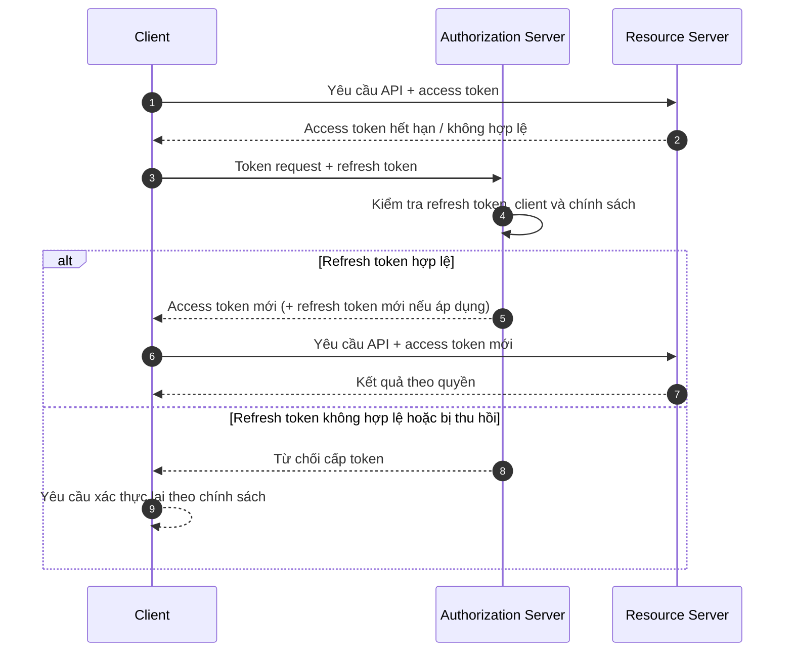
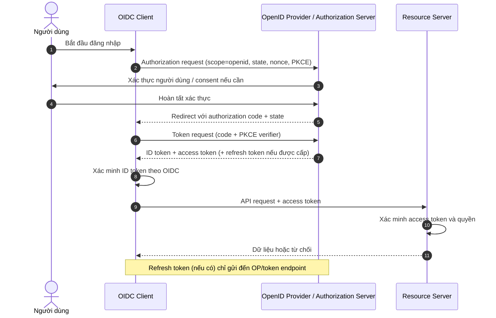

# Phân biệt access token, ID token và refresh token

## 1. Vì sao ba loại token dễ bị nhầm lẫn?

Trong một luồng đăng nhập dùng OpenID Connect (OIDC), client có thể nhận cùng lúc **ID token**, **access token** và đôi khi cả **refresh token**. Cả ba đều là credential được trao đổi dưới dạng chuỗi, có thể được gửi trong các yêu cầu HTTP và có thể liên quan đến cùng một người dùng. Tuy nhiên, chúng phục vụ ba mục đích khác nhau:

- **ID token:** truyền các khẳng định về kết quả xác thực và chủ thể đến OIDC client.
- **Access token:** cho phép client yêu cầu truy cập tài nguyên được bảo vệ tại resource server trong phạm vi được cấp.
- **Refresh token:** cho phép client yêu cầu authorization server cấp access token mới khi đáp ứng chính sách.

Một lỗi thiết kế thường gặp là lấy ID token gửi đến API vì thấy nó có chữ ký JWT và chứa `sub`, hoặc gửi refresh token đến resource server vì nghĩ mọi token đều có thể dùng như bearer access token. Cả hai đều nhầm **mục đích và đối tượng nhận**.

Hãy nhớ:

```text
ID token       -> OIDC client
Access token   -> Resource server / API
Refresh token  -> Authorization server / token endpoint
```

**Không chọn token dựa trên việc nó trông giống JWT. Hãy chọn theo mục đích, audience và bên nhận được giao thức quy định.**

Bài viết thuộc phạm vi **Security - JSON Web Token (JWT)** tổng quát, tập trung vào ranh giới bảo mật giữa các loại credential trong OAuth 2.0 và OpenID Connect, không phụ thuộc ngôn ngữ lập trình hay framework.

## 2. Bảng so sánh tổng quan

| Tiêu chí | ID token | Access token | Refresh token |
| --- | --- | --- | --- |
| Mục đích | Truyền kết quả xác thực và claims về subject cho client | Truy cập tài nguyên được bảo vệ | Xin access token mới |
| Giao thức/khung | OpenID Connect | OAuth 2.0 và profile access token tương ứng | OAuth 2.0 |
| Bên nhận chính | OIDC client | Resource server/API | Authorization server |
| Audience điển hình | `client_id` của OIDC client | API/resource server hoặc audience tài nguyên | Authorization server/token endpoint theo cơ chế cấp |
| Định dạng | JWT theo OIDC; có thể ký và có thể mã hóa theo profile | Có thể opaque hoặc JWT | Thường là chuỗi opaque; OAuth không bắt buộc định dạng JWT |
| Nội dung | Issuer, subject, audience, thời gian, thông tin xác thực và claims OIDC | Quyền/scope, subject hoặc client, audience, thời gian và metadata theo profile | Credential tham chiếu đến quyền tiếp tục quy trình cấp token; không phải bộ claims để API nghiệp vụ sử dụng |
| Bên xác minh | OIDC client | Resource server | Authorization server |
| Nơi sử dụng | Xử lý kết quả đăng nhập/định danh tại client | Header hoặc cơ chế truyền access token đến API | Token request đến authorization server |
| Vòng đời | Hạn dùng ID token; gắn với kết quả xác thực | Thường ngắn hạn | Thường dài hơn access token, có thể xoay vòng và thu hồi |
| Khi bị lộ | Có thể làm lộ thông tin xác thực và bị lạm dụng nếu client chấp nhận sai cách | Có thể bị dùng để truy cập API trong phạm vi token | Có thể bị dùng để xin access token mới; thường có rủi ro kéo dài hơn |

Các đặc điểm về thời hạn, định dạng, claims và cơ chế thu hồi phụ thuộc profile và chính sách của authorization server. Bảng mô tả vai trò tiêu chuẩn, không áp đặt một cách triển khai duy nhất.

## 3. ID token: bằng chứng về kết quả xác thực dành cho client

### 3.1. ID token là gì?

ID token được định nghĩa trong OpenID Connect Core 1.0. Đây là một JWT chứa các khẳng định về **xác thực người dùng và subject** trong một giao dịch OIDC. Authorization server trong vai trò OpenID Provider (OP) phát hành ID token cho client sau khi xử lý yêu cầu xác thực.

ID token trả lời các câu hỏi như:

- Issuer nào đã phát hành khẳng định?
- Subject được xác thực là ai trong phạm vi issuer?
- Token được phát hành cho client nào?
- Token được phát hành lúc nào và hết hạn khi nào?
- Có nonce hoặc thông tin về thời điểm/phương thức xác thực cần kiểm tra không?

ID token **không phải giấy phép truy cập API**. Nó cho client biết kết quả xác thực theo giao thức OIDC; resource server không được mặc định chấp nhận ID token như access token.

### 3.2. Các claims thường gặp trong ID token

Ví dụ payload minh họa:

```json
{
  "iss": "https://identity.example.org",
  "sub": "user-2481",
  "aud": "shopping-client",
  "exp": 1893456900,
  "iat": 1893456000,
  "auth_time": 1893455900,
  "nonce": "login-request-nonce-91"
}
```

| Claim | Ý nghĩa |
| --- | --- |
| `iss` | Issuer đã phát hành ID token |
| `sub` | Định danh subject trong phạm vi issuer |
| `aud` | Client hoặc các client mà ID token hướng đến; thông thường phải chứa `client_id` của client đang xác minh |
| `exp` | Thời điểm ID token hết hạn |
| `iat` | Thời điểm ID token được phát hành |
| `auth_time` | Thời điểm người dùng được xác thực, khi được yêu cầu/trả về |
| `nonce` | Giá trị liên kết ID token với yêu cầu xác thực ban đầu nếu client đã gửi nonce |
| `acr`, `amr` | Thông tin về mức độ hoặc phương thức xác thực, khi được cung cấp |
| `azp` | Authorized party; được kiểm tra theo các quy tắc OIDC, đặc biệt khi audience có nhiều giá trị |

Không phải mọi claim đều bắt buộc trong mọi ID token. Client phải áp dụng đúng yêu cầu của OIDC Core và các tham số trong yêu cầu xác thực.

### 3.3. ID token được xác minh bởi ai?

**OIDC client** xác minh ID token trước khi sử dụng claims để tạo hoặc cập nhật trạng thái đăng nhập cục bộ. Các kiểm tra chính thường gồm:

1. Lấy issuer và khóa từ cấu hình/metadata OIDC đã tin cậy.
2. Xác minh chữ ký theo thuật toán và khóa được cho phép.
3. Đối chiếu `iss` với issuer mong đợi.
4. Kiểm tra `aud` chứa `client_id` của client.
5. Kiểm tra `exp`, `iat` và các ràng buộc thời gian.
6. Nếu yêu cầu xác thực đã gửi `nonce`, so khớp giá trị trong ID token với nonce đã lưu cho yêu cầu đó.
7. Nếu `azp` xuất hiện, kiểm tra nó khớp `client_id`; khi `aud` có nhiều giá trị, xử lý theo yêu cầu OIDC.
8. Kiểm tra các điều kiện bổ sung như `auth_time`, `at_hash` hoặc `c_hash` khi flow/profile yêu cầu.

Chỉ giải mã payload rồi đọc `sub` là không đủ. Client chỉ được tin claims sau khi xác minh ID token và ràng buộc nó với đúng yêu cầu xác thực.

### 3.4. ID token không chứng minh người đang cầm token là subject

ID token là một khẳng định đã được OP phát hành cho client. Nếu token bị sao chép, việc chữ ký vẫn hợp lệ không chứng minh người đang gửi token là người dùng ban đầu. Client cần bảo vệ ID token, liên kết phản hồi với yêu cầu bằng `state` và `nonce` khi áp dụng, và quản lý phiên cục bộ theo chính sách.

ID token cũng không nên được gửi qua nhiều API như một credential dùng chung. Audience của nó dành cho client, không phải mọi resource server.

## 4. Access token: credential để truy cập API

### 4.1. Access token là gì?

Access token là credential được cấp trong OAuth 2.0 để client trình đến resource server khi yêu cầu truy cập tài nguyên. Token đại diện cho quyền được cấp trong một phạm vi, audience và thời hạn nhất định.

Access token có thể đại diện cho:

- Người dùng đã ủy quyền cho client.
- Chính client hoặc một workload trong luồng không có người dùng trực tiếp.
- Một danh tính/chủ thể khác theo grant và profile được sử dụng.

Do đó, không phải mọi access token đều gắn với một phiên đăng nhập của người dùng.

### 4.2. Access token có thể là opaque hoặc JWT

OAuth 2.0 không bắt buộc access token phải là JWT.

| Dạng access token | Đặc điểm | Cách resource server kiểm tra |
| --- | --- | --- |
| **Opaque/reference** | Chuỗi tham chiếu không tự bộc lộ claims | Tra cứu trạng thái hoặc gọi introspection theo RFC 7662/kho dữ liệu được tin cậy |
| **JWT access token** | Mang claims, thường được ký bằng JWS | Xác minh chữ ký, issuer, audience, thời hạn, loại token và chính sách |

Nếu authorization server phát hành JWT access token theo [RFC 9068](https://www.rfc-editor.org/rfc/rfc9068), profile này quy định cách biểu diễn và xác minh. Ví dụ header có thể là:

```json
{
  "typ": "at+jwt",
  "alg": "RS256",
  "kid": "as-signing-key-01"
}
```

Payload minh họa:

```json
{
  "iss": "https://authorization.example.org",
  "sub": "account-42",
  "aud": "https://api.example.org/orders",
  "client_id": "shopping-client",
  "iat": 1893456000,
  "exp": 1893456900,
  "jti": "access-token-7f31",
  "scope": "orders:read"
}
```

Đây là ví dụ minh họa, không phải token đã ký. `scope` và các claim khác được diễn giải theo profile và hợp đồng giữa authorization server với resource server. Không thể kết luận một payload tùy ý có `iss`, `sub`, `aud` là JWT access token tuân thủ RFC 9068.

### 4.3. Access token được xác minh bởi ai?

**Resource server/API** xác minh access token. Khi token là JWT, quy trình thường gồm:

1. Xác định token thuộc loại/profile access token được hỗ trợ.
2. Đối chiếu issuer với authorization server được tin cậy.
3. Chọn khóa xác minh từ nguồn tin cậy; `kid` chỉ giúp chọn khóa trong tập đã được thiết lập.
4. Chỉ chấp nhận thuật toán được cấu hình và xác minh chữ ký.
5. Kiểm tra audience phải phù hợp resource server đang nhận.
6. Kiểm tra thời hạn và các claims bắt buộc.
7. Đánh giá scope/permission cùng quyền trên tài nguyên cụ thể.
8. Kiểm tra trạng thái thu hồi hoặc sender constraint nếu hệ thống yêu cầu.

Với opaque token, resource server có thể hỏi authorization server bằng Token Introspection hoặc tra cứu trạng thái theo cơ chế được hỗ trợ.

### 4.4. Access token không tự cho phép mọi thao tác

Giả sử access token có:

```json
{
  "aud": "orders-api",
  "scope": "orders:read"
}
```

Token có thể phù hợp để yêu cầu đọc đơn hàng, nhưng API vẫn cần kiểm tra chủ thể có quyền xem **đơn hàng cụ thể** hay không. Scope là một điều kiện của chính sách, không phải giấy phép tuyệt đối trên mọi tài nguyên.

Access token cũng không nhất thiết chứng minh người dùng đã xác thực bằng phương thức nào. Nếu API cần thông tin về mức xác thực, nó phải dựa trên profile/claims được thỏa thuận và kiểm tra đúng nguồn, không suy luận từ việc token có dạng JWT.

### 4.5. Cách trình access token

Với bearer access token, client thường gửi:

```http
GET /orders HTTP/1.1
Host: api.example.org
Authorization: Bearer <access-token>
```

Theo RFC 6750, bearer token là credential mà bên sở hữu có thể trình để sử dụng. Vì vậy cần HTTPS/TLS, bảo vệ nơi lưu, tránh ghi token vào log/URL và giới hạn scope/audience/thời hạn. Một số hệ thống dùng sender-constrained token như DPoP hoặc mutual TLS; khi đó resource server phải kiểm tra cả bằng chứng ràng buộc, không chỉ chuỗi token.

## 5. Refresh token: credential để xin access token mới

### 5.1. Refresh token là gì?

Refresh token được dùng bởi client để yêu cầu authorization server cấp access token mới. Nó giúp client tiếp tục truy cập trong khi không phải lặp lại toàn bộ quy trình đăng nhập, nếu refresh credential và phiên/chính sách liên quan vẫn hợp lệ.

Refresh token:

- Được gửi đến **authorization server/token endpoint**.
- Không được gửi đến resource server để gọi API nghiệp vụ.
- Có thể là chuỗi opaque; OAuth 2.0 không bắt buộc nó phải là JWT.
- Có thời hạn, phạm vi, ràng buộc client và chính sách thu hồi riêng.
- Có thể được xoay vòng để hạn chế việc sử dụng lại token đã bị sao chép.

### 5.2. Luồng refresh



Refresh token không “gia hạn chữ ký” trên access token cũ. Authorization server thực hiện một quyết định cấp mới và có thể phát hành access token với claims, audience, scope và thời hạn mới.

### 5.3. Refresh token thường có rủi ro cao

Access token bị lộ thường cho phép truy cập tài nguyên trong phạm vi và thời hạn của token. Refresh token bị lộ có thể cho phép kẻ tấn công liên tục xin access token mới, kéo dài khả năng truy cập. Vì vậy:

- Chỉ gửi refresh token đến authorization server đúng theo giao thức.
- Lưu trữ an toàn và giới hạn khả năng đọc.
- Ràng buộc với client/phiên nếu giao thức hỗ trợ.
- Đặt thời hạn, idle timeout và absolute lifetime phù hợp.
- Thu hồi khi phát hiện xâm phạm hoặc khi phiên kết thúc.
- Cân nhắc rotation và phát hiện reuse.

### 5.4. Refresh token rotation

Với rotation, sau khi refresh token hiện tại được sử dụng thành công, authorization server cấp refresh token mới và vô hiệu hóa token cũ. Nếu token cũ bị dùng lại, hệ thống có thể coi đây là dấu hiệu token bị sao chép và thu hồi nhóm token/phiên liên quan theo chính sách.

Rotation cần lưu quan hệ giữa các lần cấp và có quy tắc xử lý khi client gửi lại token cũ. Chỉ đổi chuỗi token mà không theo dõi trạng thái sẽ không tạo ra cơ chế phát hiện reuse đáng tin cậy.

## 6. Ba token trong luồng OpenID Connect Authorization Code

Một luồng OIDC phổ biến sử dụng Authorization Code Flow. Client yêu cầu scope `openid`, thường kèm các scope khác như `profile` hoặc `email`. Khi đổi authorization code tại token endpoint, client có thể nhận ID token và access token; refresh token có thể được cấp tùy điều kiện và chính sách.



Vai trò của từng token:

1. **ID token:** client xác minh để nhận biết kết quả xác thực và subject theo OIDC.
2. **Access token:** client trình cho resource server để truy cập tài nguyên.
3. **Refresh token:** client gửi cho authorization server khi cần access token mới.

Không phải mọi OIDC response đều phải chứa cả ba token. Refresh token phụ thuộc grant, scope, chính sách và điều kiện cấp. Access token có thể opaque hoặc JWT. ID token theo OIDC là JWT.

## 7. Phân biệt audience và bên nhận

Audience là một trong những dấu hiệu quan trọng nhất để phân biệt ID token với access token.

| Loại token | Audience thường hướng đến | Bên kiểm tra chính |
| --- | --- | --- |
| ID token | OIDC client, thường là `client_id` | OIDC client |
| Access token | Resource server/API hoặc tài nguyên được bảo vệ | Resource server |
| Refresh token | Được dùng trong quy trình với authorization server; không phải token gửi đến API nghiệp vụ | Authorization server |

Ví dụ:

- ID token có `aud: "shopping-client"`.
- Access token có `aud: "orders-api"`.

Nếu client gửi ID token đến `orders-api`, API phải từ chối vì token không được phát hành cho audience của API và không phải loại access token mà API yêu cầu. Việc cả hai token đều do cùng một issuer ký không làm chúng thay thế được cho nhau.

Nếu access token là opaque, audience và scope có thể được cung cấp qua introspection hoặc một cơ chế tra cứu khác. Resource server vẫn phải kiểm tra chúng theo hợp đồng.

## 8. So sánh vòng đời và hành vi khi hết hạn

| Sự kiện | ID token | Access token | Refresh token |
| --- | --- | --- | --- |
| Hết hạn | Client không tiếp tục dùng token đó làm kết quả xác thực mới | Resource server từ chối theo chính sách thời gian | Authorization server từ chối yêu cầu làm mới |
| Cấp token mới | Thường cần một luồng xác thực/cấp token mới theo OIDC | Có thể xin bằng refresh token hoặc một grant khác | Có thể được thay bằng refresh token mới khi rotation |
| Thu hồi | OIDC có thể có cơ chế logout/session liên quan, nhưng ID token tự thân không có cơ chế thu hồi tức thì chung | Có thể dùng revocation, introspection hoặc trạng thái bổ sung tùy loại token | Có thể thu hồi tại authorization server |
| Đăng xuất | Client kết thúc phiên cục bộ và có thể phối hợp logout OIDC | Access token đã cấp có thể vẫn còn hiệu lực đến `exp` nếu API không kiểm tra thu hồi | Nên thu hồi hoặc vô hiệu hóa theo chính sách |

Đăng xuất tại một client không tự bảo đảm mọi access token đã phát hành ở mọi resource server lập tức mất hiệu lực. Nếu cần chặn ngay, kiến trúc phải có cơ chế thu hồi/trạng thái được resource server kiểm tra.

## 9. Các lỗi sử dụng token thường gặp

| Lỗi | Vì sao sai? | Cách đúng |
| --- | --- | --- |
| Gửi ID token đến API | ID token dành cho client, audience thường là client_id | Gửi access token đúng audience |
| Dùng access token để xác nhận danh tính người dùng tại client | Access token là credential truy cập tài nguyên, không thay thế OIDC ID token | Xác minh ID token theo OIDC nếu cần xử lý kết quả xác thực |
| Gửi refresh token đến resource server | Refresh token không cấp quyền gọi API nghiệp vụ | Chỉ gửi refresh token đến authorization server/token endpoint |
| Giả định access token luôn là JWT | OAuth 2.0 không bắt buộc định dạng access token | Xác minh theo định dạng/profile mà authorization server công bố |
| Parse JWT rồi tin claims | Parse không xác minh chữ ký, issuer, audience hay thời gian | Xác minh theo profile và chính sách |
| Dùng ID token làm session cookie trực tiếp mà không kiểm tra | Token có thể chưa được xác minh hoặc chưa được ràng buộc với yêu cầu | Xác minh đầy đủ rồi tạo/quản lý phiên cục bộ theo chính sách |
| Lưu refresh token ở nơi dễ bị đọc | Kẻ tấn công có thể xin access token mới | Bảo vệ nơi lưu, rotation, reuse detection và thu hồi |
| Cho rằng hết hạn access token đồng nghĩa phải đăng nhập lại | Refresh token hoặc phiên OP có thể vẫn hợp lệ | Thử làm mới theo giao thức; yêu cầu xác thực lại khi không còn điều kiện |

## 10. Checklist cho từng bên

### OIDC Client

- [ ] Phân biệt rõ ID token, access token và refresh token.
- [ ] Xác minh ID token theo OIDC: chữ ký, `iss`, `aud`, `exp`, `iat`, `nonce` khi áp dụng và `azp` khi có.
- [ ] Chỉ dùng ID token để xử lý kết quả xác thực tại client.
- [ ] Chỉ gửi access token đến resource server phù hợp.
- [ ] Chỉ gửi refresh token đến authorization server.
- [ ] Bảo vệ token khi lưu, truyền và không ghi token nguyên văn vào log.
- [ ] Dùng Authorization Code Flow với PKCE cho các client phù hợp theo khuyến nghị hiện hành.

### Authorization Server / OpenID Provider

- [ ] Phát hành đúng loại token theo yêu cầu và profile.
- [ ] ID token có claims, audience và chữ ký phù hợp OIDC.
- [ ] Access token có audience/scope/thời hạn phù hợp tài nguyên.
- [ ] Refresh token có ràng buộc client, vòng đời và chính sách thu hồi rõ ràng.
- [ ] Có quy trình bảo vệ và luân chuyển khóa ký.
- [ ] Có cơ chế rotation/reuse detection nếu áp dụng refresh token rotation.

### Resource Server

- [ ] Chỉ chấp nhận access token đúng loại/profile.
- [ ] Không dùng ID token hoặc refresh token thay cho access token.
- [ ] Kiểm tra issuer, audience, chữ ký/active status, thời hạn và scope.
- [ ] Kiểm tra quyền trên tài nguyên và thao tác cụ thể.
- [ ] Xử lý thu hồi, sender constraint và sự cố khóa theo yêu cầu.

## 11. Ví dụ tổng hợp

Một người dùng đăng nhập vào ứng dụng mua hàng qua OIDC. Sau khi hoàn tất Authorization Code Flow:

- Client nhận ID token có `aud: "shopping-client"`. Client xác minh token và dùng `sub` để nhận diện subject theo issuer.
- Client nhận access token có audience `orders-api` và scope `orders:read`. Client gửi token này đến API đơn hàng.
- Client nhận refresh token. Khi access token hết hạn, client gửi refresh token đến token endpoint để xin access token mới.

Nếu client gửi ID token đến API đơn hàng, API từ chối do sai loại/audience. Nếu client gửi refresh token đến API đơn hàng, API cũng từ chối vì refresh token không phải credential truy cập tài nguyên. Nếu client gửi access token đến token endpoint như refresh token, authorization server không xử lý nó như một refresh credential.

Mỗi token chỉ được dùng ở đúng nơi và đúng mục đích:

```text
OIDC Client:
  xác minh ID token
  giữ access token để gọi API
  giữ refresh token để xin token mới

Resource Server:
  xác minh access token
  áp dụng quyền trên tài nguyên

Authorization Server:
  phát hành token
  xác minh refresh token
  cấp access token mới theo chính sách
```

## 12. Kết luận

ID token, access token và refresh token là ba loại credential có mục đích và audience khác nhau:

- **ID token** là JWT theo OIDC, dành cho client để xác minh kết quả xác thực và subject.
- **Access token** dành cho resource server để truy cập tài nguyên; nó có thể là JWT hoặc opaque theo profile.
- **Refresh token** dành cho authorization server để yêu cầu access token mới; OAuth 2.0 không bắt buộc nó phải là JWT.

Ranh giới quan trọng nhất là **bên nhận**: client xác minh ID token, resource server xác minh access token, authorization server xử lý refresh token. Dùng đúng loại token, đúng audience và đúng quy tắc xác minh giúp tránh nhầm lẫn giữa xác thực, ủy quyền và quản lý vòng đời credential.

## Tài liệu chuẩn để đọc tiếp

- [RFC 6749 — The OAuth 2.0 Authorization Framework](https://www.rfc-editor.org/rfc/rfc6749): access token, refresh token và quy trình cấp quyền.
- [RFC 6750 — OAuth 2.0 Bearer Token Usage](https://www.rfc-editor.org/rfc/rfc6750): sử dụng access token dạng bearer.
- [RFC 9068 — JWT Profile for OAuth 2.0 Access Tokens](https://www.rfc-editor.org/rfc/rfc9068): profile JWT access token và quy tắc resource server xác minh.
- [OpenID Connect Core 1.0](https://openid.net/specs/openid-connect-core-1_0.html): ID token, claims và xác minh tại client.
- [RFC 7662 — OAuth 2.0 Token Introspection](https://www.rfc-editor.org/rfc/rfc7662): kiểm tra trạng thái opaque/reference access token.
- [RFC 7009 — OAuth 2.0 Token Revocation](https://www.rfc-editor.org/rfc/rfc7009): thu hồi access token và refresh token.
- [RFC 8725 — JSON Web Token Best Current Practices](https://www.rfc-editor.org/rfc/rfc8725): thực hành bảo mật JWT.
