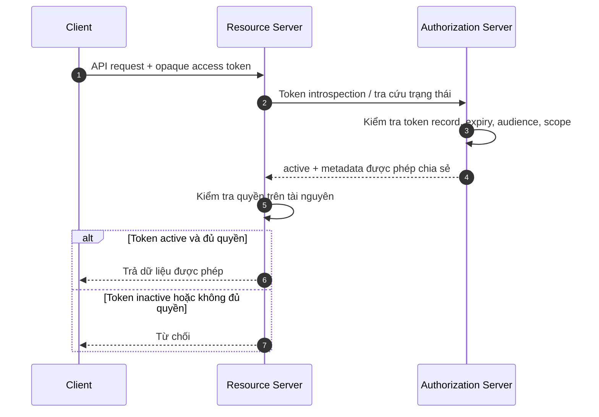
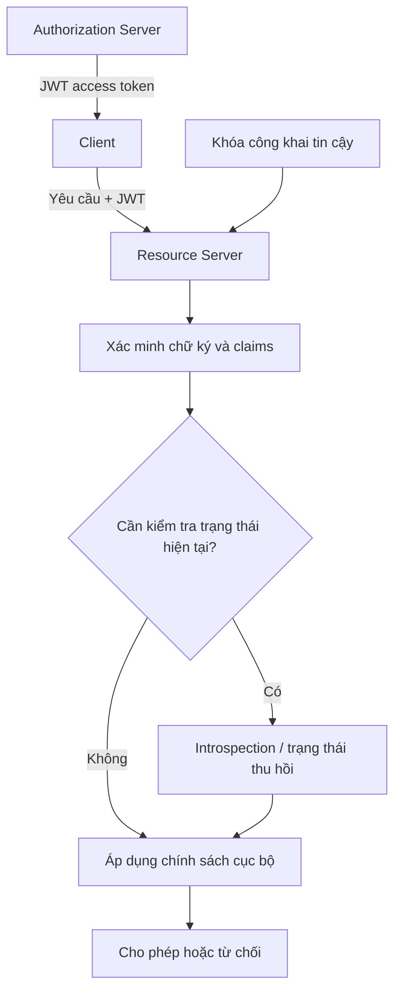

# Vì sao access token không bắt buộc phải là JWT

## 1. OAuth 2.0 định nghĩa quyền truy cập, không áp đặt định dạng access token

Khi tìm hiểu OAuth 2.0, nhiều người mặc định access token phải có cấu trúc JWT với header, payload và chữ ký. Thực tế, **OAuth 2.0 không bắt buộc access token phải là JWT**.

Theo RFC 6749, access token là một chuỗi đại diện cho quyền truy cập được cấp cho client. Chuẩn mô tả cách client nhận token, cách token được dùng trong các yêu cầu tài nguyên và một số metadata của token response, nhưng **không quy định định dạng nội bộ của chuỗi access token**. Token có thể là:

- **Opaque/reference token:** chuỗi tham chiếu không tự bộc lộ claims; resource server cần tra cứu trạng thái hoặc metadata từ nguồn có thẩm quyền.
- **JWT access token:** token có cấu trúc claims theo JWT, thường được bảo vệ bằng chữ ký JWS để resource server có thể xác minh.

Hai lựa chọn đều có thể được dùng trong OAuth 2.0 nếu authorization server và resource server thống nhất cách phát hành, truyền, xác minh và áp dụng quyền.

Điểm quan trọng:

> OAuth 2.0 chuẩn hóa framework ủy quyền và cách các bên tương tác. Định dạng access token là lựa chọn của authorization server và hệ sinh thái triển khai, không phải yêu cầu bắt buộc của RFC 6749.

Bài viết thuộc phạm vi **Security - JSON Web Token (JWT)** tổng quát, giải thích lý do access token có thể không phải JWT và cách lựa chọn định dạng phù hợp, không phụ thuộc ngôn ngữ lập trình hay framework.

## 2. Access token trong OAuth 2.0 là gì?

Access token là credential mà client trình cho resource server để yêu cầu truy cập tài nguyên được bảo vệ. Token đại diện cho quyền được cấp theo một phạm vi, audience, client, chủ thể và thời hạn nhất định tùy giao thức/profile.

Một token response OAuth 2.0 điển hình có thể có dạng:

```json
{
  "access_token": "opaque-or-structured-token-value",
  "token_type": "Bearer",
  "expires_in": 900,
  "scope": "orders:read"
}
```

Đây là ví dụ minh họa. Các trường có ý nghĩa:

- `access_token`: giá trị credential được cấp.
- `token_type`: cách sử dụng token, ví dụ `Bearer`.
- `expires_in`: thời gian sống tính bằng giây nếu được trả về.
- `scope`: phạm vi quyền được cấp, khi được trả về.

OAuth 2.0 không yêu cầu `access_token` phải chứa JSON hoặc có thể giải mã được. Client nhận giá trị này và sử dụng theo token type cùng quy tắc của giao thức.

### 2.1. Client không cần biết cấu trúc nội bộ của access token

Trong OAuth 2.0, client nên coi access token là một chuỗi credential và không phụ thuộc vào cách token được mã hóa hoặc cấu trúc nội bộ. Client không nên:

- Tách token theo dấu chấm rồi tự đọc payload để quyết định quyền.
- Dựa vào một claim chưa được xác minh để hiển thị rằng quyền đã được cấp.
- Giả định mọi access token đều là JWT.
- Giả định token có thể được dùng ở mọi resource server.
- Tự diễn giải cấu trúc riêng của authorization server nếu giao thức/profile không quy định.

Việc client có thể nhìn thấy một chuỗi giống JWT không làm thay đổi nguyên tắc này. Resource server là bên chịu trách nhiệm xác minh access token theo cơ chế đã thỏa thuận.

### 2.2. Token type và token format là hai khái niệm khác nhau

| Khái niệm | Câu hỏi | Ví dụ |
| --- | --- | --- |
| **Token type** | Client trình token theo cách nào? | Bearer, hoặc cơ chế sender-constrained theo profile |
| **Token format** | Dữ liệu token được biểu diễn ra sao? | Opaque/reference string, JWT |

Bearer mô tả cách sử dụng credential: bên sở hữu token có thể trình token. JWT mô tả định dạng dữ liệu. Vì thế, một access token có thể vừa là **JWT** vừa được sử dụng theo kiểu **Bearer**. Một opaque access token cũng có thể là bearer token.

## 3. Opaque/reference access token là gì?

Opaque token là một giá trị mà client và resource server không diễn giải trực tiếp như một tập claims tự chứa. Giá trị thường được tạo ngẫu nhiên với entropy cao và dùng làm **tham chiếu đến bản ghi token hoặc quyền truy cập ở phía máy chủ**.

Ví dụ một opaque token giả lập:

```text
v1_7Nf4pQm2xL9cR8tW3kB6sA0dH5jU
```

Chuỗi trên chỉ minh họa hình thức; nó không chứa thông tin người dùng hoặc scope có thể đọc trực tiếp. Authorization server có thể lưu một bản ghi tương ứng:

```text
token_reference: hash(token)
issuer: https://authorization.example.org
subject: account-42
client_id: shopping-app
audience: orders-api
scope: orders:read
expires_at: ...
active: true
```

Resource server dùng token để tra cứu thông tin này hoặc gọi dịch vụ kiểm tra trạng thái. Trong thực tế, kho dữ liệu không nhất thiết lưu token nguyên văn; có thể lưu giá trị băm hoặc định danh an toàn khác để giảm hậu quả nếu kho bị lộ.

### 3.1. Luồng xác minh opaque token



Trong OAuth 2.0, cơ chế **Token Introspection** được chuẩn hóa trong RFC 7662. Resource server có thể gửi token đến endpoint introspection được bảo vệ để hỏi trạng thái và nhận metadata theo chính sách. RFC 7662 không bắt buộc mọi opaque token phải được triển khai theo một cách lưu trữ cụ thể; nó chuẩn hóa giao diện tra cứu trạng thái.

### 3.2. Opaque token không có nghĩa là không bảo mật bằng mật mã

Opaque token vẫn phải:

- Được tạo bằng nguồn ngẫu nhiên mật mã với entropy đủ lớn.
- Khó đoán và không thể suy ra từ user ID hoặc timestamp.
- Được truyền qua HTTPS/TLS.
- Được giới hạn audience, scope và thời hạn.
- Được bảo vệ khi lưu trữ, tránh log nguyên văn và có chính sách thu hồi.

Opaque chỉ nói rằng cấu trúc/claims không được client hoặc resource server tự diễn giải từ chuỗi token. Nó vẫn là credential nhạy cảm; kẻ tấn công có được token bearer có thể thử sử dụng token.

## 4. JWT access token là gì?

JWT access token là access token được biểu diễn theo định dạng JSON Web Token. JWT mang claims như issuer, subject, audience, thời gian, client và scope theo profile sử dụng.

Ví dụ payload minh họa:

```json
{
  "iss": "https://authorization.example.org",
  "sub": "account-42",
  "aud": "https://api.example.org/orders",
  "client_id": "shopping-app",
  "iat": 1893456000,
  "exp": 1893456900,
  "jti": "access-7f31",
  "scope": "orders:read"
}
```

Đây chỉ là Claims Set minh họa, không phải JWT đã ký. Nếu được bảo vệ bằng JWS compact, token thường có ba phần:

```text
BASE64URL(protected-header).BASE64URL(payload).BASE64URL(signature)
```

Resource server có thể xác minh chữ ký bằng khóa công khai tin cậy, kiểm tra issuer, audience, thời hạn và claims theo profile. Nhờ vậy, nhiều resource server có thể xác minh token cục bộ mà không cần hỏi authorization server trong từng yêu cầu.

### 4.1. JWT Profile for OAuth 2.0 Access Tokens

RFC 9068 định nghĩa một profile cho JWT access token trong OAuth 2.0. Đây là **một lựa chọn profile**, không phải yêu cầu của mọi triển khai OAuth 2.0.

Profile này quy định cách phát hành và xác minh access token JWT, bao gồm các yêu cầu về header, claims, chữ ký và cách resource server kiểm tra. Ví dụ header có thể chứa:

```json
{
  "typ": "at+jwt",
  "alg": "RS256",
  "kid": "as-signing-key-01"
}
```

`typ: "at+jwt"` giúp phân biệt access token theo profile với các loại JWT khác. Resource server cần áp dụng đầy đủ quy tắc của RFC 9068 khi tuyên bố hỗ trợ profile này. Không thể coi bất kỳ JWT nào có `sub`, `aud` và `exp` là JWT access token tuân thủ RFC 9068.

### 4.2. Xác minh JWT access token

Resource server thường cần:

1. Xác định token thuộc loại/profile access token được hỗ trợ.
2. Đối chiếu `iss` với authorization server được tin cậy.
3. Chọn khóa xác minh từ nguồn khóa đáng tin cậy; `kid` chỉ là gợi ý chọn khóa trong tập đó.
4. Chỉ chấp nhận thuật toán nằm trong chính sách cho phép.
5. Xác minh chữ ký JWS.
6. Kiểm tra `aud` phù hợp với chính resource server đang nhận.
7. Kiểm tra `exp`, `nbf` và các claims bắt buộc theo profile.
8. Đánh giá scope/permission cùng quyền trên tài nguyên cụ thể.
9. Kiểm tra thu hồi hoặc sender constraint nếu hệ thống yêu cầu.

Chữ ký hợp lệ không có nghĩa token được dùng ở mọi API hoặc mọi thao tác. Audience và chính sách tài nguyên vẫn phải được kiểm tra.

## 5. Vì sao OAuth 2.0 không bắt buộc access token là JWT?

### 5.1. OAuth 2.0 tách giao thức khỏi định dạng nội bộ

Mục tiêu của OAuth 2.0 là chuẩn hóa cách client nhận và sử dụng quyền truy cập, không phải áp đặt một cấu trúc dữ liệu duy nhất cho credential. Authorization server và resource server có thể lựa chọn cách biểu diễn token phù hợp với kiến trúc, miễn là các bên có cơ chế xác minh và áp dụng quyền đúng.

Điều này giúp OAuth 2.0 hoạt động với nhiều hệ thống khác nhau:

- Hệ thống quản lý token bằng bản ghi tập trung.
- Hệ thống phân tán cần xác minh JWT cục bộ.
- Hệ thống có gateway/introspection trung tâm.
- Hệ thống dùng nhiều loại credential hoặc profile khác nhau.

Nếu OAuth 2.0 bắt buộc JWT, các hệ thống cần thu hồi tập trung, che giấu metadata hoặc có mô hình trạng thái riêng sẽ phải gánh thêm một định dạng không nhất thiết phù hợp.

### 5.2. Không phải mọi resource server đều cần tự giải mã claims

Một resource server có thể chỉ cần biết:

- Token còn hoạt động không?
- Token dành cho resource server nào?
- Client hoặc subject nào được đại diện?
- Scope/permission nào được cấp?
- Token hết hạn lúc nào?

Nếu authorization server có thể trả lời các câu hỏi này qua introspection, resource server không cần đọc payload JWT. Opaque token giúp authorization server kiểm soát dữ liệu trạng thái tập trung và có thể thay đổi metadata mà không phải phát hành lại token trong mọi trường hợp.

### 5.3. Thu hồi và thay đổi quyền tập trung

Với JWT tự chứa, claims đã phát hành không tự cập nhật khi:

- Người dùng bị khóa.
- Scope bị thu hồi.
- Client bị vô hiệu hóa.
- Phiên bị kết thúc.
- Token bị báo lộ.

Nếu resource server chỉ xác minh chữ ký và `exp`, JWT vẫn có thể được chấp nhận cho đến hết hạn. Opaque token với bản ghi trạng thái cho phép authorization server vô hiệu hóa token và resource server nhận biết qua introspection/tra cứu. Hiệu lực thực tế vẫn phụ thuộc tần suất tra cứu, cache và đồng bộ.

Lưu ý: JWT cũng có thể được thu hồi bằng denylist, introspection hoặc kiểm tra trạng thái; opaque token cũng có thể bị cache và chậm nhận biết thu hồi. Khác biệt nằm ở **cách biểu diễn và đường xác minh mặc định**, không phải JWT không thể thu hồi hay opaque token luôn thu hồi tức thì.

### 5.4. Hạn chế lộ metadata cho client

Payload JWS thường đọc được sau khi giải mã Base64url. Chữ ký không che giấu claims. Nếu access token chứa nhiều thông tin về subject, client hoặc quyền, các thành phần giữ token có thể đọc được nội dung đó.

Opaque token không tự bộc lộ claims trong chuỗi token. Resource server cần hỏi nguồn có thẩm quyền để nhận metadata. Điều này có thể giảm việc để lộ thông tin cấu trúc và thuộc tính nội bộ cho client hoặc các thành phần trung gian.

Opaque token vẫn có thể bị đánh cắp và sử dụng; tính opaque không thay thế HTTPS/TLS, bảo vệ nơi lưu hoặc giới hạn quyền.

### 5.5. Đơn giản hóa quản lý khóa ở resource server

JWT access token dạng JWS yêu cầu resource server có cấu hình issuer, thuật toán và khóa xác minh tin cậy. Trong môi trường nhiều issuer, nhiều tenant hoặc nhiều loại token, quản lý khóa và luân chuyển khóa có thể phức tạp.

Với opaque token, resource server có thể giao việc xác định trạng thái cho authorization server qua introspection. Resource server vẫn cần xác thực kết nối và bảo vệ thông tin truy cập endpoint introspection, nhưng không nhất thiết phải phân phối mọi khóa ký của issuer đến từng API.

Đây là sự chuyển đổi trách nhiệm: introspection cần dịch vụ trung tâm sẵn sàng và có độ trễ phù hợp; JWT cần quản lý khóa và chính sách xác minh tại các verifier.

### 5.6. Kích thước và chi phí truyền

JWT chứa header, claims và chữ ký; token có thể dài khi có nhiều claims. Nếu gửi trong mỗi yêu cầu, kích thước lớn có thể làm tăng:

- Dung lượng header HTTP.
- Băng thông và chi phí truyền lặp lại.
- Bộ nhớ ở client, gateway và resource server.
- Nguy cơ chạm giới hạn header của proxy hoặc máy chủ.

Opaque token thường là chuỗi ngẫu nhiên ngắn hơn, không cần mang toàn bộ claims. Tuy nhiên, kích thước cụ thể phụ thuộc cách sinh token và không phải opaque token nào cũng ngắn hơn mọi JWT.

### 5.7. Không muốn buộc client phụ thuộc cấu trúc token

Nếu client bắt đầu parse JWT để lấy user ID hoặc scope, nó sẽ phụ thuộc vào cấu trúc và claims cụ thể. Khi authorization server thay đổi định dạng, thêm mã hóa hoặc chuyển sang opaque token, client có thể bị ảnh hưởng.

OAuth 2.0 khuyến khích client sử dụng access token như một credential không cần diễn giải nội dung. Việc resource server xác minh token nên được tách khỏi client. Điều này cho phép authorization server thay đổi định dạng access token mà không buộc client phải thay đổi logic, miễn là giao thức và cách sử dụng token vẫn được giữ đúng.

## 6. So sánh JWT access token và opaque access token

| Tiêu chí | JWT access token | Opaque/reference access token |
| --- | --- | --- |
| Định dạng | Claims JSON theo JWT, thường JWS | Chuỗi tham chiếu |
| Client có cần parse? | Không; nên coi như chuỗi credential | Không |
| Cách resource server xác minh | Có thể cục bộ bằng chữ ký/claims | Thường tra cứu hoặc introspection |
| Phụ thuộc authorization server trong mỗi yêu cầu | Có thể thấp nếu không cần trạng thái bổ sung | Thường cao hơn nếu introspection mỗi lần |
| Thu hồi | Cần denylist, introspection, kiểm tra trạng thái hoặc TTL ngắn | Có thể vô hiệu hóa bản ghi; cache có thể trì hoãn hiệu lực |
| Claims mới nhất | Claims có thể cũ đến khi hết hạn/kiểm tra bổ sung | Có thể nhận metadata hiện tại qua tra cứu |
| Quản lý khóa | Cần phân phối và luân chuyển khóa xác minh | Có thể tập trung xác minh tại authorization server |
| Quyền riêng tư | Payload JWS thường đọc được | Chuỗi không tự bộc lộ claims |
| Kích thước | Có thể dài do claims và chữ ký | Thường ngắn hơn, tùy cách tạo |
| Khả năng mở rộng | Xác minh cục bộ có thể giảm tải trung tâm | Introspection tập trung cần mở rộng và cache |
| Vận hành | Quản lý khóa, issuer, thuật toán, TTL và thu hồi | Quản lý token store, introspection, cache và khả dụng |

Không có lựa chọn nào thắng ở mọi tiêu chí. Quyết định phụ thuộc yêu cầu thu hồi, độ mới của quyền, số lượng resource server, khả năng quản lý khóa, độ trễ và năng lực vận hành.

## 7. Token Introspection: cách resource server kiểm tra opaque token

RFC 7662 chuẩn hóa giao thức introspection. Resource server gửi token đến endpoint introspection của authorization server qua một kênh được bảo vệ. Authorization server xác định token có đang hoạt động hay không và trả metadata được phép chia sẻ.

Ví dụ request minh họa:

```http
POST /introspect HTTP/1.1
Host: authorization.example.org
Content-Type: application/x-www-form-urlencoded
Authorization: Basic <resource-server-credentials>

token=<opaque-access-token>&token_type_hint=access_token
```

Ví dụ response minh họa:

```json
{
  "active": true,
  "scope": "orders:read",
  "client_id": "shopping-app",
  "sub": "account-42",
  "aud": ["orders-api"],
  "iss": "https://authorization.example.org",
  "exp": 1893456900
}
```

Các trường trong response phụ thuộc token và chính sách của authorization server. `active: true` cho biết token được xem là đang hoạt động theo quy tắc của authorization server tại thời điểm introspection; resource server vẫn phải kiểm tra audience, scope và quyền trên tài nguyên theo yêu cầu.

### 7.1. Introspection có thể dùng với JWT không?

Có. Introspection không chỉ dành riêng cho opaque token. Một authorization server có thể hỗ trợ introspection cho cả token JWT để cung cấp trạng thái tập trung, chẳng hạn khi cần thu hồi trước hạn hoặc kiểm tra metadata mới nhất.

Tuy nhiên, nếu resource server đã xác minh JWT cục bộ và không cần trạng thái trung tâm, gọi introspection cho mọi yêu cầu có thể làm mất một phần lợi ích giảm tra cứu của JWT. Kiến trúc có thể chọn introspection toàn bộ, chọn lọc hoặc dùng denylist/cache tùy yêu cầu.

### 7.2. Cache introspection response

Resource server có thể cache kết quả introspection để giảm số lần gọi authorization server. Nhưng cache làm thay đổi độ mới của trạng thái:

- Cache dài giúp giảm độ trễ và tải trung tâm.
- Cache ngắn giúp nhận biết thu hồi nhanh hơn.
- Cache hết hạn cần xử lý khi authorization server không sẵn sàng.

Nếu yêu cầu là thu hồi gần như tức thì, cache phải được thiết kế phù hợp hoặc kết hợp cơ chế push/event để cập nhật trạng thái. Không thể vừa cache trạng thái lâu vừa kỳ vọng mọi lần thu hồi có hiệu lực tức thời.

## 8. Vì sao RFC 9068 tồn tại nếu JWT không bắt buộc?

RFC 9068 định nghĩa **JWT Profile for OAuth 2.0 Access Tokens** nhằm tạo một hồ sơ thống nhất cho những hệ thống muốn dùng JWT làm access token.

Profile này giải quyết vấn đề liên thông: nếu mỗi authorization server tự chọn claim, header và quy tắc xác minh, resource server có thể phải hỗ trợ nhiều cách hiểu khác nhau. RFC 9068 quy định các yêu cầu cụ thể để resource server biết cách nhận diện và xác minh JWT access token.

Một số điểm thường gặp:

- Header `typ` có giá trị `at+jwt` theo profile.
- Token có các claims bắt buộc như `iss`, `exp`, `aud`, `sub` hoặc `client_id` theo điều kiện của profile, `iat`, `jti`.
- Resource server xác minh chữ ký, issuer, audience, thời gian và claims theo profile.
- Token được dùng như access credential, không phải ID token.

RFC 9068 là **một lựa chọn chuẩn hóa cho JWT access token**, không làm thay đổi nguyên tắc của RFC 6749 rằng access token không có định dạng bắt buộc. Một hệ thống vẫn có thể dùng opaque access token hoặc profile khác được các bên thống nhất.

## 9. Khi nào chọn JWT access token?

JWT access token có thể phù hợp khi:

1. Nhiều resource server cần xác minh claims độc lập.
2. Hệ thống muốn giảm số lần gọi authorization server trong đường xử lý thông thường.
3. Có thể thiết lập quan hệ tin cậy giữa issuer, khóa và resource server.
4. Claims tương đối ổn định trong thời hạn token.
5. Hệ thống chấp nhận hoặc đã có giải pháp cho việc thu hồi trước hạn.
6. Có nhu cầu trao đổi claims theo một profile chuẩn như RFC 9068.

Ví dụ: một nền tảng có nhiều API ở nhiều vùng triển khai. Mỗi API xác minh JWT bằng public key đã tin cậy, kiểm tra audience và scope riêng. Các thao tác nhạy cảm vẫn có thể kiểm tra trạng thái tài khoản hoặc quyền hiện tại.

## 10. Khi nào chọn opaque access token?

Opaque token có thể phù hợp khi:

1. Authorization server cần kiểm soát tập trung trạng thái token.
2. Thu hồi hoặc thay đổi quyền cần được phản ánh nhanh.
3. Resource server không cần tự đọc claims từ token.
4. Tổ chức muốn hạn chế metadata xuất hiện trong token client đang giữ.
5. Quản lý khóa xác minh ở nhiều resource server gây phức tạp.
6. Hệ thống đã có hạ tầng introspection hoặc token store đáng tin cậy.

Ví dụ: ứng dụng quản trị nội bộ cần khóa quyền truy cập ngay khi tài khoản bị vô hiệu hóa. Resource server gọi introspection để xác định token còn active, sau đó áp dụng scope và quyền trên tài nguyên. Cache phải đủ ngắn hoặc có cơ chế cập nhật để đáp ứng yêu cầu thu hồi.

Opaque token không tự bảo đảm thu hồi tức thì: nếu resource server cache `active: true` trong thời gian dài, nó vẫn có thể chấp nhận token đã bị thu hồi trong khoảng cache đó.

## 11. Kiến trúc lai: JWT và trạng thái tập trung cùng tồn tại

Không nhất thiết phải chọn một mô hình tuyệt đối. Có thể sử dụng:

- JWT access token thời hạn ngắn cho xác minh cục bộ trong phần lớn yêu cầu.
- Introspection hoặc denylist cho token/hoạt động có yêu cầu thu hồi cao.
- Refresh token được quản lý trạng thái tập trung.
- Kiểm tra trạng thái tài khoản hoặc quyền hiện tại cho thao tác nhạy cảm.
- Cơ chế luân chuyển khóa và cập nhật metadata tin cậy.



Mô hình lai cần quy định rõ khi nào phải introspect, cache bao lâu, xử lý ra sao khi authorization server không sẵn sàng và cách phân phối sự kiện thu hồi. Nếu mọi yêu cầu đều introspect thì JWT có thể không đem lại lợi ích giảm tra cứu đáng kể.

## 12. Các nhầm lẫn thường gặp

| Nhầm lẫn | Cách hiểu đúng |
| --- | --- |
| OAuth 2.0 bắt buộc access token là JWT | RFC 6749 không quy định định dạng nội bộ của access token |
| Mọi access token đều có ba phần ngăn bằng dấu chấm | Opaque token có thể là chuỗi tham chiếu; JWT JWS compact thường có ba phần |
| Client nên parse JWT access token để lấy quyền | Client nên coi access token là credential; resource server xác minh và áp dụng quyền |
| Opaque token an toàn hơn chỉ vì không đọc được | Token vẫn có thể bị đánh cắp và sử dụng; cần bảo vệ như credential |
| JWT không thể thu hồi | Có thể dùng denylist, introspection, trạng thái bổ sung hoặc TTL ngắn |
| Opaque token luôn thu hồi tức thì | Cache và đồng bộ có thể trì hoãn việc nhận biết thu hồi |
| Introspection chỉ dùng cho opaque token | Introspection cũng có thể được dùng cho JWT nếu authorization server hỗ trợ |
| JWT luôn nhanh hơn | Cần tính cả chi phí xác minh mật mã, kích thước, quản lý khóa và tra cứu bổ sung |
| RFC 9068 bắt buộc mọi OAuth access token là JWT | RFC 9068 là profile tùy chọn cho JWT access token |
| Bearer và JWT là một khái niệm | Bearer là cách sử dụng token; JWT là định dạng token |

## 13. Checklist lựa chọn định dạng access token

Trước khi quyết định JWT hay opaque token, hãy trả lời:

1. **Nhu cầu xác minh:** resource server có cần tự xác minh claims hay chỉ cần hỏi trạng thái token?
2. **Thu hồi:** cần chặn token trước hạn trong bao lâu? Có chấp nhận cửa sổ TTL/cache không?
3. **Độ mới quyền:** quyền có thay đổi thường xuyên hoặc cần hiệu lực ngay không?
4. **Khóa:** tổ chức có khả năng phân phối, cache, luân chuyển và thu hồi khóa an toàn không?
5. **Quyền riêng tư:** payload có chứa claims không nên để client hoặc trung gian đọc không?
6. **Hiệu năng:** chi phí introspection, xác minh mật mã và truyền token là bao nhiêu trong tải thực tế?
7. **Khả năng sẵn sàng:** nếu authorization server/introspection không sẵn sàng, resource server xử lý thế nào?
8. **Liên thông:** các bên đã thống nhất profile token, audience, claims và quy tắc xác minh chưa?
9. **Client:** client có đang phụ thuộc vào cấu trúc nội bộ của access token không?
10. **Vận hành:** có giám sát, ứng phó khi token/khóa bị lộ và quy trình thu hồi rõ ràng không?

## 14. Kết luận

Access token không bắt buộc phải là JWT vì OAuth 2.0 chuẩn hóa **vai trò và cách sử dụng credential**, không áp đặt một định dạng nội bộ duy nhất. Authorization server có thể cấp opaque/reference token để resource server tra cứu trạng thái tập trung, hoặc JWT access token để resource server xác minh claims cục bộ theo một profile đã thống nhất.

JWT có lợi thế khi cần xác minh phân tán và mang claims có thể kiểm chứng; opaque token có lợi thế khi muốn kiểm soát trạng thái và metadata tập trung. Cả hai đều cần bảo vệ credential, giới hạn quyền, audience và thời hạn, đồng thời có kế hoạch thu hồi và xử lý sự cố.

**RFC 9068 chuẩn hóa một cách dùng JWT làm access token, nhưng không biến JWT thành yêu cầu bắt buộc của OAuth 2.0.** Lựa chọn đúng phụ thuộc vào nhu cầu thu hồi, độ mới của quyền, khả năng quản lý khóa, khả năng sẵn sàng và chi phí vận hành.

## Tài liệu chuẩn để đọc tiếp

- [RFC 6749 — The OAuth 2.0 Authorization Framework](https://www.rfc-editor.org/rfc/rfc6749): định nghĩa access token và framework ủy quyền; không áp đặt định dạng token.
- [RFC 6750 — OAuth 2.0 Bearer Token Usage](https://www.rfc-editor.org/rfc/rfc6750): cách sử dụng bearer access token.
- [RFC 7662 — OAuth 2.0 Token Introspection](https://www.rfc-editor.org/rfc/rfc7662): kiểm tra trạng thái token qua authorization server.
- [RFC 9068 — JWT Profile for OAuth 2.0 Access Tokens](https://www.rfc-editor.org/rfc/rfc9068): profile JWT access token tùy chọn.
- [RFC 7009 — OAuth 2.0 Token Revocation](https://www.rfc-editor.org/rfc/rfc7009): thu hồi token.
- [RFC 8725 — JSON Web Token Best Current Practices](https://www.rfc-editor.org/rfc/rfc8725): thực hành bảo mật JWT.
- [RFC 9700 — Best Current Practice for OAuth 2.0 Security](https://www.rfc-editor.org/rfc/rfc9700): thực hành bảo mật hiện hành cho OAuth 2.0.
