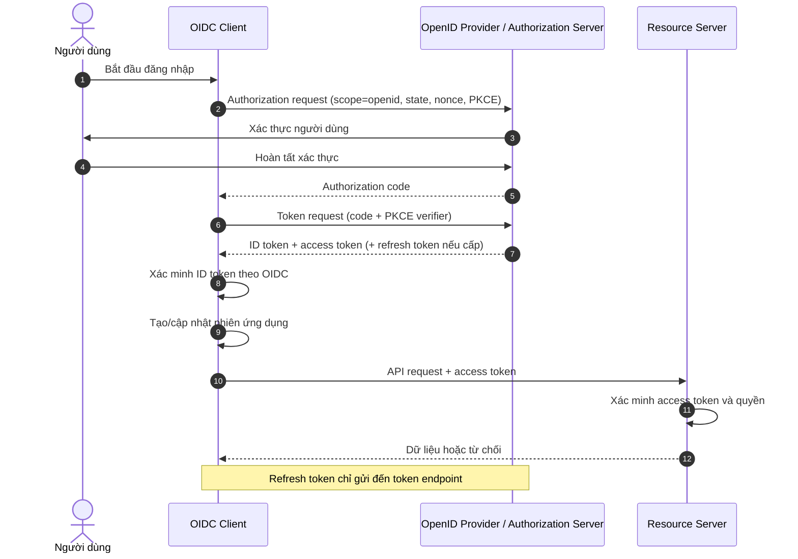

# Vì sao ID token không dùng thay access token tại API

## 1. Cùng là JWT nhưng không cùng mục đích

Trong OpenID Connect (OIDC), client thường nhận được **ID token** và **access token** trong cùng một luồng cấp token. Cả hai có thể là chuỗi ký tự dài; cả hai thậm chí có thể được biểu diễn bằng JWT và được ký bởi cùng một OpenID Provider. Vì vậy, một nhầm lẫn dễ xảy ra là lấy ID token gửi đến API vì nghĩ rằng chữ ký hợp lệ và có claim `sub` là đủ.

Đây là cách dùng sai. Hai token được phát hành cho **hai đối tượng nhận và hai mục đích khác nhau**:

- **ID token** dành cho OIDC client. Nó truyền các khẳng định về kết quả xác thực và subject để client xác minh, sau đó có thể tạo hoặc cập nhật phiên đăng nhập của ứng dụng.
- **Access token** dành cho resource server/API. Nó đại diện cho quyền truy cập tài nguyên đã được cấp để client trình khi gọi API.

Hãy nhớ ranh giới:

```text
ID token       -> OIDC client -> xác minh kết quả xác thực
Access token   -> Resource API -> xác minh quyền truy cập tài nguyên
```

**API không nên chấp nhận ID token thay cho access token**, kể cả khi ID token có chữ ký hợp lệ, do cùng issuer phát hành hoặc chứa thông tin người dùng. Chữ ký chỉ là một phần của xác minh; API còn phải kiểm tra loại token, audience, mục đích và quyền theo hợp đồng của resource server.

Bài viết thuộc phạm vi **Security - JSON Web Token (JWT)** tổng quát, giải thích ranh giới giữa định dạng JWT, xác thực OIDC và ủy quyền OAuth 2.0, không phụ thuộc ngôn ngữ lập trình hay framework.

## 2. Hai token được tạo ra để trả lời hai câu hỏi khác nhau

| Câu hỏi | ID token | Access token |
| --- | --- | --- |
| Ai là subject đã được xác thực theo giao dịch OIDC? | Có — đây là một mục đích chính của ID token | Có thể đại diện subject theo grant/profile, nhưng không phải hợp đồng ID token dành cho client |
| Client có thể xác minh kết quả đăng nhập không? | Có — client xác minh ID token theo OIDC Core | Không dùng access token thay cho ID token |
| Có được phép gọi API không? | Không tự cấp quyền gọi API | Có thể — trong phạm vi audience và quyền được cấp |
| Bên nhận chính là ai? | OIDC client | Resource server/API |
| Audience thường là gì? | `client_id` của OIDC client | API hoặc resource server được phép nhận |
| Định dạng | JWT theo OIDC | Có thể opaque hoặc JWT |
| Bên xác minh chính | OIDC client | Resource server |
| Quy tắc chính | OpenID Connect Core | OAuth 2.0 và profile access token được sử dụng |

Ví dụ: người dùng đăng nhập vào ứng dụng mua hàng. ID token giúp ứng dụng biết rằng OpenID Provider đã phát hành khẳng định về `user-2481` cho client `shopping-client`. Khi ứng dụng muốn đọc đơn hàng, nó cần access token có quyền phù hợp và audience dành cho `orders-api`.

**Xác thực người dùng tại client không đồng nghĩa với việc API đã cấp quyền truy cập tài nguyên.** Đây là hai quyết định bảo mật riêng biệt.

## 3. ID token: dành cho OIDC client

### 3.1. ID token là gì?

Theo OpenID Connect Core 1.0, ID token là một cấu trúc JWT chứa các claims về quá trình xác thực và subject. Nó được OpenID Provider (OP) phát hành cho client trong một giao dịch OIDC.

ID token giúp client kiểm tra:

- Issuer nào đã phát hành khẳng định?
- Subject nào được nhận diện trong phạm vi issuer?
- Token được phát hành cho client nào?
- Token được phát hành lúc nào, hết hạn lúc nào?
- Phản hồi có gắn với yêu cầu xác thực ban đầu không?
- Có thông tin về thời điểm hoặc mức độ xác thực cần kiểm tra không?

Ví dụ payload ID token minh họa:

```json
{
  "iss": "https://identity.example.org",
  "sub": "user-2481",
  "aud": "shopping-client",
  "exp": 1893456900,
  "iat": 1893456000,
  "auth_time": 1893455900,
  "nonce": "login-request-nonce-91"
}
```

Các claim có ý nghĩa:

| Claim | Ý nghĩa trong ID token |
| --- | --- |
| `iss` | OpenID Provider đã phát hành token |
| `sub` | Định danh subject trong phạm vi issuer |
| `aud` | Client hoặc các client mà ID token hướng đến; client xác minh phải nằm trong audience theo quy tắc OIDC |
| `exp` | Thời điểm ID token hết hạn |
| `iat` | Thời điểm ID token được phát hành |
| `auth_time` | Thời điểm người dùng được xác thực, khi được yêu cầu hoặc trả về |
| `nonce` | Giá trị liên kết ID token với yêu cầu xác thực ban đầu khi client gửi nonce |
| `acr`, `amr` | Thông tin về mức độ hoặc phương thức xác thực, khi được cung cấp |
| `azp` | Authorized party; được kiểm tra theo quy tắc OIDC, đặc biệt khi audience có nhiều giá trị |

Không phải mọi claim đều bắt buộc trong mọi ID token. Client phải áp dụng các yêu cầu của OIDC Core và các tham số trong yêu cầu xác thực.

### 3.2. Client xác minh ID token như thế nào?

OIDC client cần xác minh ID token trước khi sử dụng claims để xác lập danh tính hoặc tạo phiên đăng nhập cục bộ. Các bước chính gồm:

1. Lấy issuer và khóa từ cấu hình/metadata OIDC đáng tin cậy.
2. Xác minh chữ ký theo thuật toán và khóa được cho phép.
3. Đối chiếu `iss` với issuer mong đợi.
4. Kiểm tra `aud` chứa `client_id` của client.
5. Kiểm tra `exp`, `iat` và các ràng buộc thời gian.
6. Nếu client đã gửi `nonce`, so khớp giá trị trong ID token với nonce đã lưu cho yêu cầu đó.
7. Nếu `azp` xuất hiện, kiểm tra nó khớp `client_id`; khi `aud` có nhiều giá trị, xử lý theo yêu cầu OIDC.
8. Kiểm tra các điều kiện bổ sung như `auth_time`, `at_hash` hoặc `c_hash` khi flow/profile yêu cầu.

Chỉ giải mã payload để đọc `sub` là không đủ. Chữ ký hợp lệ cũng chưa đủ nếu issuer, audience, nonce hoặc thời hạn không đạt.

### 3.3. ID token không phải giấy phép truy cập API

ID token có thể chứa thông tin về subject, thời điểm xác thực hoặc phương thức xác thực. Những thông tin đó giúp client hiểu kết quả xác thực. Chúng **không tự biến thành scope hoặc quyền truy cập API**.

Ví dụ, client nhận ID token có:

```json
{
  "sub": "user-2481",
  "aud": "shopping-client",
  "amr": ["mfa"]
}
```

Điều này có thể cho client biết subject đã đáp ứng một mức xác thực nhất định theo OIDC. Nó không có nghĩa `user-2481` được phép đọc mọi đơn hàng hoặc gọi mọi API. Resource server phải nhận access token phù hợp và áp dụng chính sách quyền của mình.

Ngay cả khi tổ chức thêm claim tùy chỉnh như `roles` hoặc `groups` vào ID token, API cũng không nên tự diễn giải claim đó thành quyền truy cập nếu chưa có một profile/contract riêng quy định rõ mục đích, audience, nguồn tin cậy và cách ánh xạ quyền. Cách thông thường vẫn là dùng access token dành cho API.

## 4. Access token: dành cho resource server/API

### 4.1. Access token là gì?

Access token là credential mà client trình cho resource server để yêu cầu truy cập tài nguyên được bảo vệ. Token thể hiện quyền được cấp theo grant, audience, scope, thời hạn và các ràng buộc của profile.

Access token có thể đại diện cho người dùng hoặc cho chính client/workload, tùy luồng OAuth 2.0. Vì vậy, không phải mọi access token đều có nghĩa là một người dùng vừa đăng nhập.

### 4.2. Access token không nhất thiết là JWT

OAuth 2.0 không bắt buộc access token phải là JWT. Có hai dạng thường gặp:

| Dạng | Đặc điểm | Cách resource server kiểm tra |
| --- | --- | --- |
| **Opaque/reference access token** | Chuỗi tham chiếu không tự bộc lộ claims | Tra cứu trạng thái hoặc dùng Token Introspection theo RFC 7662 |
| **JWT access token** | Mang claims theo JWT, thường được bảo vệ bằng JWS | Xác minh chữ ký, issuer, audience, thời hạn, loại token và quyền theo profile |

Nếu authorization server dùng [RFC 9068 — JWT Profile for OAuth 2.0 Access Tokens](https://www.rfc-editor.org/rfc/rfc9068), JWT access token có thể có header:

```json
{
  "typ": "at+jwt",
  "alg": "RS256",
  "kid": "as-signing-key-01"
}
```

Payload minh họa:

```json
{
  "iss": "https://identity.example.org",
  "sub": "user-2481",
  "aud": "https://api.example.org/orders",
  "client_id": "shopping-client",
  "iat": 1893456000,
  "exp": 1893456900,
  "jti": "access-token-7f31",
  "scope": "orders:read"
}
```

Đây là các thành phần minh họa, không phải token đã ký. Profile RFC 9068 quy định các header/claims và cách xác minh cụ thể; không thể coi payload tùy ý có `iss`, `sub` và `exp` là access token tuân thủ profile.

### 4.3. Resource server xác minh access token

Khi nhận access token JWT, resource server thường cần:

1. Xác định token đúng loại/profile access token được hỗ trợ.
2. Đối chiếu issuer với authorization server được tin cậy.
3. Chọn khóa xác minh từ nguồn tin cậy; `kid` chỉ là gợi ý chọn khóa trong tập đã được thiết lập.
4. Chỉ chấp nhận thuật toán nằm trong chính sách cho phép và xác minh chữ ký.
5. Kiểm tra audience phù hợp với API đang nhận.
6. Kiểm tra `exp`, `nbf` và các claims bắt buộc theo profile.
7. Đánh giá scope/permission và quyền trên tài nguyên cụ thể.
8. Kiểm tra trạng thái thu hồi hoặc sender constraint nếu hệ thống yêu cầu.

Với opaque access token, resource server có thể gọi introspection hoặc tra cứu trạng thái theo cơ chế đã thống nhất.

### 4.4. Access token không đồng nghĩa với quyền tuyệt đối

Ví dụ access token có `aud: "orders-api"` và `scope: "orders:read"`. Điều này có thể cho phép client yêu cầu đọc đơn hàng, nhưng API vẫn phải kiểm tra subject có quyền xem đơn hàng cụ thể hay không.

Quyết định truy cập có thể phụ thuộc:

- Scope/permission trong access token.
- Chủ thể hoặc client được token đại diện.
- Audience và loại token.
- Quan hệ sở hữu tài nguyên.
- Trạng thái tài khoản và dữ liệu nghiệp vụ hiện tại.
- Ràng buộc bổ sung của tổ chức.

**Access token là đầu vào của quyết định ủy quyền; nó không bỏ qua chính sách tài nguyên của API.**

## 5. Vì sao API không được dùng ID token thay access token?

### 5.1. Audience khác nhau

Audience là một ràng buộc quan trọng:

- ID token được phát hành cho OIDC client, thường có `aud` chứa `client_id`.
- Access token được phát hành để resource server/API nhận, với audience tương ứng tài nguyên được bảo vệ.

Ví dụ:

| Token | `aud` | Bên nhận dự kiến |
| --- | --- | --- |
| ID token | `shopping-client` | OIDC client |
| Access token | `https://api.example.org/orders` | API đơn hàng |

Nếu `orders-api` nhận ID token có audience `shopping-client`, API phải từ chối vì token không được phát hành cho API đó và không phải loại credential mà API yêu cầu.

Không nên chỉ kiểm tra chữ ký rồi bỏ qua audience. Cùng một issuer có thể phát hành token cho nhiều client và nhiều API; nguồn phát hành giống nhau không làm các token có thể thay thế cho nhau.

### 5.2. Mục đích và ngữ nghĩa claims khác nhau

ID token mô tả kết quả xác thực theo OIDC. Access token mô tả quyền truy cập tài nguyên theo OAuth/profile.

Ví dụ:

- `auth_time` trong ID token nói về thời điểm xác thực.
- `amr` có thể mô tả phương thức xác thực.
- `scope` trong access token biểu diễn phạm vi quyền theo hợp đồng/profile.
- `aud` trong access token xác định resource server dự kiến.

Một claim xác thực không tự trở thành quyền truy cập. API cần kiểm tra claims và chính sách được định nghĩa cho access token.

### 5.3. Ngăn chặn token substitution và cross-JWT confusion

Nếu API chấp nhận bất kỳ JWT nào có chữ ký hợp lệ và `sub`, attacker có thể thử gửi một token được phát hành cho mục đích khác — ví dụ ID token — để đánh lừa API.

Đây là dạng **token substitution / cross-JWT confusion**: một token hợp lệ trong ngữ cảnh A bị sử dụng sai ở ngữ cảnh B.

Để ngăn chặn:

- Phân biệt rõ loại token và profile.
- Kiểm tra audience theo đúng resource server.
- Kiểm tra `typ` hoặc các dấu hiệu phân loại theo profile khi được quy định.
- Dùng quy tắc xác minh tách biệt cho ID token và access token.
- Không dùng chung một bộ kiểm tra quá rộng cho mọi JWT.
- Không suy ra quyền API chỉ từ subject, chữ ký hoặc claims xác thực.

RFC 8725 khuyến nghị explicit typing và các quy tắc xác minh loại trừ lẫn nhau khi cần để tránh nhầm lẫn giữa các loại JWT. RFC 9068 cũng định nghĩa profile access token với kiểu `at+jwt`.

### 5.4. Chữ ký hợp lệ không chứng minh token đúng mục đích

Giả sử ID token được ký bằng khóa hợp lệ của OpenID Provider. API có public key tương ứng nên xác minh chữ ký thành công. Điều đó chỉ chứng minh token được bảo vệ phù hợp với khóa ấy; nó **không chứng minh token được phát hành để gọi API**.

Resource server cần xác minh cả:

1. Nguồn phát hành được tin cậy.
2. Token thuộc đúng loại/profile access token.
3. Audience dành cho resource server.
4. Claims và thời hạn đáp ứng yêu cầu.
5. Scope/permission đủ cho thao tác.

Nếu thiếu các kiểm tra ngữ cảnh, việc xác minh chữ ký đơn lẻ có thể tạo ra lỗ hổng.

## 6. Luồng đúng: client xác minh ID token, API xác minh access token

Trong Authorization Code Flow của OIDC, client yêu cầu scope `openid`. Sau khi người dùng hoàn tất xác thực, client đổi authorization code tại token endpoint và có thể nhận ID token, access token cùng refresh token nếu được cấp.



Luồng này tách hai trách nhiệm:

1. **Client xác minh ID token:** xác nhận kết quả xác thực và subject theo OIDC, rồi áp dụng chính sách phiên của ứng dụng.
2. **Resource server xác minh access token:** xác nhận credential được cấp cho API và kiểm tra quyền truy cập tài nguyên.

Client không cần gửi ID token đến API để “chứng minh người dùng đã đăng nhập”. Nếu API cần nhận diện chủ thể, access token có thể mang subject theo profile và API xác minh token theo hợp đồng. Nếu hệ thống cần truyền thông tin xác thực bổ sung, phải định nghĩa cơ chế đáng tin cậy riêng thay vì tự dùng ID token sai audience.

## 7. Ví dụ cụ thể: vì sao gửi nhầm ID token bị từ chối?

Giả sử authorization server phát hành:

**ID token**

```json
{
  "iss": "https://identity.example.org",
  "sub": "user-2481",
  "aud": "shopping-client",
  "exp": 1893456900,
  "iat": 1893456000,
  "nonce": "n-91"
}
```

**Access token JWT theo profile được hỗ trợ**

```json
{
  "iss": "https://identity.example.org",
  "sub": "user-2481",
  "aud": "orders-api",
  "client_id": "shopping-client",
  "exp": 1893456900,
  "iat": 1893456000,
  "scope": "orders:read"
}
```

Cả hai có thể được cùng issuer ký. Nhưng:

| Yêu cầu | ID token | Access token |
| --- | --- | --- |
| Client dùng để xác minh đăng nhập | Đúng mục đích | Không thay thế ID token |
| Gửi đến `orders-api` | Sai loại và audience | Đúng mục đích nếu mọi kiểm tra khác đạt |
| Dùng claim `sub` để xác định subject | Client có thể dùng sau khi xác minh | API có thể dùng theo profile sau khi xác minh |
| Dùng `scope: orders:read` để kiểm tra quyền | Không phải mục đích của ID token | Có thể là đầu vào của chính sách |

Nếu client gửi ID token đến API:

```http
GET /orders HTTP/1.1
Host: api.example.org
Authorization: Bearer <id-token>
```

API phải từ chối vì token không phải access token dành cho `orders-api`. Nếu API chỉ kiểm tra chữ ký và `sub`, nó có thể vô tình chấp nhận token được phát hành cho một client khác.

Yêu cầu đúng:

```http
GET /orders HTTP/1.1
Host: api.example.org
Authorization: Bearer <access-token>
```

API xác minh access token theo profile, audience và chính sách của nó rồi mới kiểm tra quyền đọc đơn hàng.

## 8. Nếu ID token và access token đều là JWT thì sao?

Hai token có thể có cùng hình thức JWS compact:

```text
BASE64URL(header).BASE64URL(payload).BASE64URL(signature)
```

Nhìn hình thức không đủ để phân biệt mục đích. Một số trường có thể trùng nhau:

- Cùng issuer `iss`.
- Cùng subject `sub`.
- Cùng thời điểm phát hành gần nhau.
- Cùng thuật toán ký.
- Cùng khóa hoặc JWKS nguồn.

Nhưng các trường này không làm chúng trở thành cùng một loại credential. Verifier phải dựa vào **hồ sơ token và ngữ cảnh**:

| Kiểm tra | Client với ID token | API với access token |
| --- | --- | --- |
| Issuer | OP đã cấu hình | Authorization server đã cấu hình |
| Audience | Client ID | Resource server/API |
| Loại token | ID token theo OIDC | Access token theo profile, ví dụ `at+jwt` nếu dùng RFC 9068 |
| Chữ ký | Theo OIDC Core | Theo profile access token |
| Claims thời gian | `exp`, `iat` và điều kiện liên quan | `exp`, `nbf` nếu có và các điều kiện profile |
| Ràng buộc đặc thù | `nonce`, `auth_time`, `azp` khi áp dụng | Scope, client, audience, sender constraint và trạng thái nếu áp dụng |
| Quyết định cuối | Xác thực/phiên client | Quyền truy cập tài nguyên |

### 8.1. Không dựa duy nhất vào `typ`

Header `typ` có thể hỗ trợ phân loại token. RFC 9068 sử dụng `at+jwt` cho JWT access token theo profile. Tuy nhiên, không nên chỉ nhìn một giá trị header rồi bỏ qua chữ ký, issuer, audience và các claims bắt buộc.

Tương tự, không nên dựa vào một claim duy nhất như `sub`, `scope` hoặc `nonce` để xác định token. Cần áp dụng toàn bộ bộ quy tắc xác minh riêng cho từng loại.

## 9. Có trường hợp nào API có thể nhận ID token không?

Trong thiết kế thông thường, **resource server không dùng ID token làm access token**. ID token dành cho OIDC client và audience của nó là client. API cần access token phù hợp với resource server.

Có thể một thành phần vừa đóng vai trò OIDC client vừa cung cấp API. Ví dụ, một ứng dụng web xác minh ID token để tạo phiên đăng nhập cho chính ứng dụng, sau đó các yêu cầu đến API nội bộ được bảo vệ bằng session cookie hoặc access token riêng. Việc ứng dụng nhận ID token với tư cách client không làm API của ứng dụng tự động có quyền chấp nhận ID token đó.

Chỉ khi một hệ thống định nghĩa một profile riêng, có audience, loại token, quyền và quy tắc xác minh rõ ràng cho một mục đích khác, nó mới có thể sử dụng một JWT theo hợp đồng đó. Nhưng khi ấy cần gọi đúng loại credential/profile, không nên coi đó là ID token OIDC tiêu chuẩn được dùng thay access token.

## 10. Các lỗi thiết kế thường gặp

| Lỗi | Rủi ro | Cách xử lý đúng |
| --- | --- | --- |
| API chỉ xác minh chữ ký ID token rồi chấp nhận | Chấp nhận token có mục đích/audience sai | Kiểm tra loại access token, issuer, audience và profile |
| Client gửi ID token đến mọi API | Token bị dùng sai ngữ cảnh | Gửi access token phù hợp resource server |
| Dùng `sub` trong ID token làm bằng chứng quyền API | Nhầm danh tính với ủy quyền | API xác minh access token và áp dụng chính sách |
| Tin rằng cùng issuer nghĩa là token thay thế nhau | Token của client có thể bị chấp nhận ở API | Xác minh audience và loại token |
| Chỉ kiểm tra `typ` | Có thể bỏ sót chữ ký, audience hoặc claims sai | Dùng bộ xác minh đầy đủ theo profile |
| Chấp nhận ID token có custom `roles` như quyền API | Claims không có hợp đồng ủy quyền rõ ràng | Định nghĩa access-token profile và chính sách quyền riêng |
| Dùng access token thay ID token tại client | Bỏ qua hợp đồng xác thực OIDC | Xác minh ID token theo OIDC Core |
| Coi ID token là session cookie | Bỏ qua quản lý phiên, logout và thu hồi | Sau khi xác minh ID token, tạo phiên cục bộ theo chính sách |

## 11. Phân biệt lỗi xác thực token và lỗi quyền truy cập

Resource server cần phân biệt token không hợp lệ với token hợp lệ nhưng không đủ quyền.

| Tình huống | Diễn giải | Phản hồi thường gặp |
| --- | --- | --- |
| Gửi ID token thay access token | Sai loại token/audience hoặc không đáp ứng profile | Từ chối như credential không hợp lệ |
| Access token hết hạn hoặc chữ ký sai | Token không hợp lệ | `401 Unauthorized` với lỗi `invalid_token` theo ngữ cảnh bearer |
| Access token hợp lệ nhưng thiếu scope | Credential hợp lệ nhưng không đủ quyền | `403 Forbidden`, có thể kèm `insufficient_scope` theo RFC 6750 |
| Access token hợp lệ nhưng không có quyền trên đơn hàng cụ thể | Không được phép truy cập tài nguyên đó | Từ chối theo chính sách API |

Không nên phản hồi chi tiết quá mức khiến attacker biết khóa, issuer nội bộ hoặc thông tin nhạy cảm về token. Log nội bộ có thể ghi nhận mã lỗi và ngữ cảnh cần thiết nhưng không ghi token nguyên văn.

## 12. Checklist cho Client và Resource Server

### OIDC Client

- [ ] Xác minh ID token theo OpenID Connect Core.
- [ ] Kiểm tra chữ ký, issuer, audience, thời hạn và nonce khi áp dụng.
- [ ] Kiểm tra `azp` khi xuất hiện theo quy tắc OIDC.
- [ ] Chỉ sử dụng ID token để xử lý kết quả xác thực/subject ở client.
- [ ] Không gửi ID token đến resource server thay access token.
- [ ] Bảo vệ ID token và các credential khác khi lưu trữ, truyền tải và ghi log.
- [ ] Tạo/quản lý phiên ứng dụng theo chính sách sau khi ID token được xác minh.

### Resource Server / API

- [ ] Chỉ chấp nhận access token đúng loại/profile.
- [ ] Không chấp nhận ID token chỉ vì chữ ký hợp lệ.
- [ ] Kiểm tra issuer và audience phù hợp API.
- [ ] Nếu dùng JWT access token, xác minh chữ ký bằng khóa tin cậy và thuật toán được cho phép.
- [ ] Nếu dùng opaque token, kiểm tra trạng thái qua introspection/nguồn có thẩm quyền.
- [ ] Kiểm tra thời gian, scope/permission và claims bắt buộc.
- [ ] Kiểm tra quyền trên tài nguyên và thao tác cụ thể.
- [ ] Có chính sách thu hồi, sender constraint và xử lý sự cố khi cần.
- [ ] Không ghi token nguyên văn vào log.

## 13. Kết luận

ID token và access token có thể cùng được phát hành trong một luồng OIDC, cùng do một issuer ký và thậm chí cùng được biểu diễn bằng JWT. Nhưng chúng có **audience, mục đích và bộ quy tắc xác minh khác nhau**:

- ID token dành cho OIDC client để xác minh kết quả xác thực và subject.
- Access token dành cho resource server/API để kiểm tra quyền truy cập tài nguyên.

API không được dùng ID token thay access token vì điều đó phá vỡ ranh giới giữa xác thực và ủy quyền, đồng thời mở ra nguy cơ token substitution hoặc cross-JWT confusion. Resource server phải xác minh đúng loại access token, issuer, audience, thời gian, scope và quyền trên tài nguyên.

**Một chữ ký hợp lệ không biến token thành credential phù hợp cho mọi nơi.** Luôn kiểm tra token được phát hành cho ai, nhằm mục đích gì và theo profile nào.

## Tài liệu chuẩn để đọc tiếp

- [OpenID Connect Core 1.0](https://openid.net/specs/openid-connect-core-1_0.html): ID token, claims và quy tắc xác minh tại client.
- [RFC 6749 — The OAuth 2.0 Authorization Framework](https://www.rfc-editor.org/rfc/rfc6749): access token và vai trò của resource server.
- [RFC 6750 — OAuth 2.0 Bearer Token Usage](https://www.rfc-editor.org/rfc/rfc6750): cách gửi và xử lý bearer access token.
- [RFC 9068 — JWT Profile for OAuth 2.0 Access Tokens](https://www.rfc-editor.org/rfc/rfc9068): profile và quy tắc xác minh JWT access token.
- [RFC 8725 — JSON Web Token Best Current Practices](https://www.rfc-editor.org/rfc/rfc8725): explicit typing, validation rules và phòng tránh nhầm lẫn JWT.
- [RFC 7662 — OAuth 2.0 Token Introspection](https://www.rfc-editor.org/rfc/rfc7662): kiểm tra trạng thái opaque/reference access token.
- [RFC 7009 — OAuth 2.0 Token Revocation](https://www.rfc-editor.org/rfc/rfc7009): thu hồi access token và refresh token.
