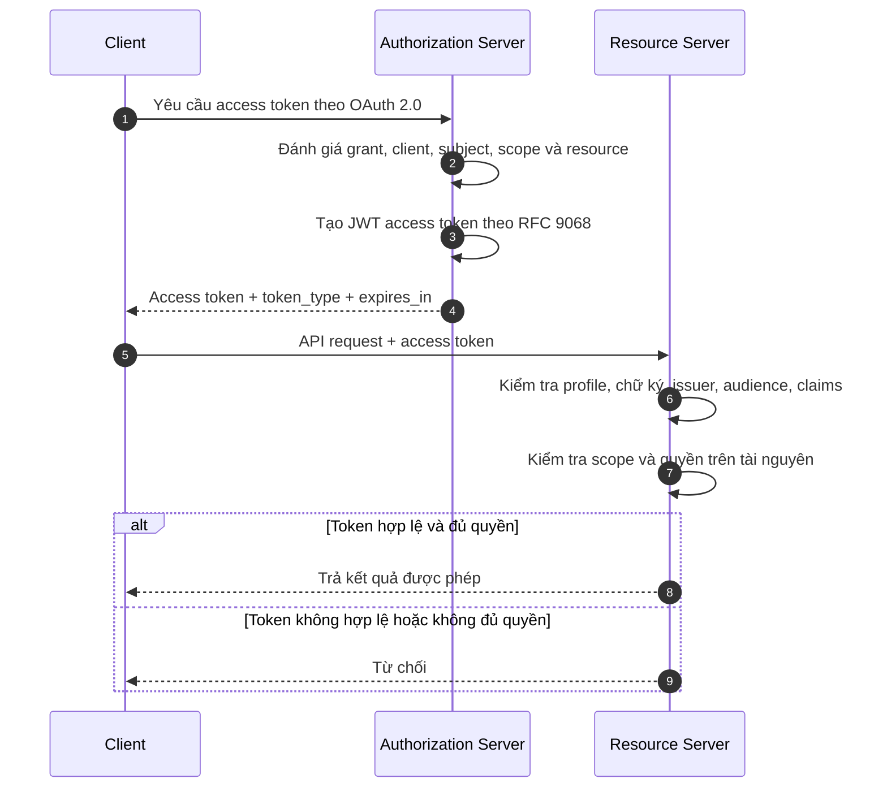
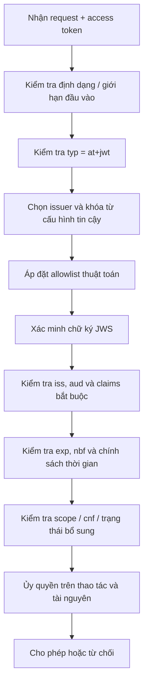

# Hồ sơ JWT access token và hợp đồng của máy chủ tài nguyên

## 1. Từ một JWT bất kỳ đến JWT access token có hợp đồng rõ ràng

OAuth 2.0 không bắt buộc access token phải có định dạng JWT. Authorization server có thể cấp một chuỗi opaque để resource server tra cứu trạng thái, hoặc cấp JWT để resource server xác minh claims bằng khóa tin cậy. Khi các bên chọn JWT, chỉ nói “token có chữ ký và chứa `sub`, `aud`, `exp`” vẫn chưa đủ để tạo ra một hợp đồng liên thông an toàn.

[RFC 9068 — JWT Profile for OAuth 2.0 Access Tokens](https://www.rfc-editor.org/rfc/rfc9068) định nghĩa một **profile chuẩn cho access token dạng JWT**. Profile này cụ thể hóa header, claims và các bước xác minh để authorization server và resource server hiểu token theo cùng một cách.

Profile trả lời những câu hỏi quan trọng:

- JWT này có thực sự là access token không?
- Authorization server nào phát hành?
- Token được cấp cho resource server nào?
- Token đại diện cho subject và client nào?
- Token được phát hành lúc nào, hết hạn lúc nào và có định danh nào?
- Resource server phải xác minh chữ ký, issuer, audience và claims ra sao?
- Scope và các ràng buộc bổ sung được dùng trong quyết định truy cập như thế nào?

**JWT access token theo RFC 9068 là một loại credential có hợp đồng xác minh cụ thể.** Nó không phải ID token OIDC, không phải mọi JWT trong hệ thống và cũng không làm thay đổi nguyên tắc rằng OAuth 2.0 có thể sử dụng access token opaque.

Bài này thuộc phạm vi **Security - JSON Web Token (JWT)** tổng quát, tập trung vào hợp đồng giữa authorization server và resource server, không phụ thuộc ngôn ngữ lập trình hay framework.

## 2. Các bên và trách nhiệm trong hợp đồng

| Bên | Trách nhiệm |
| --- | --- |
| **Authorization Server (AS)** | Quyết định cấp quyền, tạo access token đúng profile, ký token, công bố khóa xác minh và quản lý vòng đời token |
| **Client** | Nhận và bảo vệ access token, gửi token đến resource server đúng cách; coi access token như credential, không phụ thuộc cấu trúc nội bộ |
| **Resource Server (RS)** | Xác minh token theo RFC 9068 và chính sách riêng, kiểm tra quyền trên thao tác/tài nguyên rồi mới xử lý yêu cầu |
| **Resource Owner / Subject** | Chủ thể có quyền truy cập hoặc được token đại diện, tùy grant và ngữ cảnh |

Luồng cơ bản:



Hợp đồng phải được thống nhất giữa AS và RS trước khi đưa vào vận hành. Client không cần biết cách AS ký token hoặc cách RS xác minh; client chỉ cần sử dụng token theo giao thức và bảo vệ nó.

## 3. RFC 9068 là profile, không phải yêu cầu của mọi OAuth access token

RFC 6749 định nghĩa access token theo vai trò trong OAuth 2.0 nhưng không áp đặt định dạng nội bộ. RFC 9068 bổ sung quy tắc cho những hệ thống **chọn JWT làm access token**.

| Khái niệm | Ý nghĩa |
| --- | --- |
| OAuth 2.0 access token | Credential được client trình cho resource server để truy cập tài nguyên |
| JWT | Định dạng mang claims JSON |
| JWT access token | Access token được biểu diễn bằng JWT theo một hợp đồng sử dụng |
| RFC 9068 profile | Quy tắc chuẩn hóa cách tạo và xác minh JWT access token trong OAuth 2.0 |

Không thể kết luận một token tuân thủ RFC 9068 chỉ vì nó:

- Có ba phần ngăn bởi dấu chấm.
- Có header `alg`.
- Có các claims `iss`, `sub` hoặc `exp`.
- Được ký bằng một khóa mà API tình cờ có thể truy cập.

Nếu AS và RS tuyên bố sử dụng RFC 9068, hai bên phải tuân thủ các yêu cầu của profile, bao gồm loại token, chữ ký, claims bắt buộc và quy trình xác minh.

## 4. Hình dạng JWT access token theo RFC 9068

### 4.1. Protected header

JWT access token theo profile sử dụng JWS để bảo vệ token bằng chữ ký số. Header cần phân biệt rõ loại token:

```json
{
  "typ": "at+jwt",
  "alg": "RS256",
  "kid": "as-signing-key-2026-01"
}
```

Ý nghĩa:

- `typ`: xác định loại nội dung là access token JWT theo profile; RFC 9068 sử dụng giá trị `at+jwt`.
- `alg`: thuật toán chữ ký được sử dụng. Profile yêu cầu thuật toán bất đối xứng và không chấp nhận `none`.
- `kid`: định danh khóa để RS chọn khóa tương ứng trong tập khóa tin cậy; đây là metadata chọn khóa, không phải bằng chứng tự thân về độ tin cậy.

Không để token tự quyết định chính sách thuật toán. RS phải có allowlist thuật toán được cấu hình và liên kết với issuer/profile đã tin cậy.

### 4.2. Payload và các claims bắt buộc

RFC 9068 quy định một tập claims cốt lõi cho JWT access token:

| Claim | Bắt buộc theo profile | Ý nghĩa |
| --- | --- | --- |
| `iss` | Có | Issuer — authorization server phát hành token |
| `exp` | Có | Thời điểm hết hạn |
| `aud` | Có | Resource server hoặc tài nguyên được phép nhận token |
| `sub` | Có | Subject mà token đại diện theo grant/ngữ cảnh |
| `client_id` | Có | OAuth client được cấp token |
| `iat` | Có | Thời điểm phát hành |
| `jti` | Có | Định danh duy nhất của token |

Ví dụ payload minh họa:

```json
{
  "iss": "https://authorization.example.org",
  "sub": "account-42",
  "aud": "https://api.example.org/orders",
  "client_id": "shopping-client",
  "iat": 1893456000,
  "exp": 1893456900,
  "jti": "at-7f31-2026",
  "scope": "orders:read"
}
```

Đây là Claims Set minh họa, chưa phải JWT đã ký. Các giá trị `iat` và `exp` là NumericDate, biểu diễn số giây từ Unix epoch; khoảng cách trong ví dụ là 15 phút. Thời hạn thực tế do AS đặt theo chính sách và yêu cầu bảo mật.

### 4.3. Ý nghĩa cần hiểu đúng của từng claim

**`iss` — issuer**

Là định danh của authorization server phát hành token. RS phải đối chiếu giá trị này với issuer đã cấu hình tin cậy. Không được lấy `iss` trong token làm lý do để tự động tin một issuer mới hoặc tải khóa từ nguồn bất kỳ.

**`sub` — subject**

Là chủ thể mà token đại diện. Tùy grant, subject có thể là người dùng hoặc một danh tính khác theo ngữ cảnh cấp quyền. Không được giả định mọi access token đều đại diện cho một người dùng đang đăng nhập.

**`aud` — audience**

Xác định bên nhận dự kiến. Giá trị phải phù hợp với định danh resource server đang xử lý yêu cầu. Claim có thể là một chuỗi hoặc mảng chuỗi theo quy tắc JWT; RS phải xác nhận chính mình nằm trong audience được phép.

**`client_id` — client**

Định danh OAuth client mà AS đã cấp token. Claim này giúp phân biệt client gọi API với subject mà token đại diện. Hai giá trị có thể khác nhau: một ứng dụng có thể gọi thay mặt người dùng.

**`iat` và `exp` — thời gian**

`iat` ghi nhận thời điểm phát hành; `exp` xác định thời điểm hết hạn. RS phải kiểm tra token còn trong khoảng hiệu lực. Có thể cho phép leeway nhỏ để xử lý sai lệch đồng hồ, nhưng phải có giới hạn.

**`jti` — định danh token**

AS tạo định danh riêng cho từng token. `jti` hỗ trợ nhận diện, ghi nhận sự kiện hoặc tra cứu denylist nếu hệ thống có trạng thái bổ sung. Chỉ có `jti` trong payload **không tự tạo ra khả năng thu hồi hoặc chống phát lại**.

### 4.4. Claims tùy chọn và mở rộng

Một số claim có thể xuất hiện tùy profile và chính sách:

| Claim | Mục đích có thể có | Lưu ý |
| --- | --- | --- |
| `scope` | Phạm vi quyền được cấp | Khi dùng theo OAuth, thường là chuỗi các scope phân tách bằng dấu cách |
| `cnf` | Ràng buộc token với khóa/bằng chứng của bên trình | RS phải xác minh proof-of-possession theo cơ chế tương ứng |
| `act` | Thông tin actor trong một số mô hình delegation | Chỉ diễn giải khi hợp đồng ứng dụng/profile quy định |
| Claim riêng | Tenant, nhóm, thuộc tính nghiệp vụ hoặc quyền bổ sung | Phải định nghĩa rõ namespace, kiểu dữ liệu, issuer và ngữ nghĩa |

Không nên thêm mọi thông tin người dùng vào access token. Chỉ đưa claims cần thiết cho resource server và mục đích cụ thể. Claim tùy chỉnh không có hợp đồng rõ ràng dễ tạo ra cách hiểu khác nhau giữa các API.

## 5. Hợp đồng phát hành của Authorization Server

AS chịu trách nhiệm tạo token có thể được RS xác minh và diễn giải nhất quán.

### 5.1. Xác định grant, subject, client và resource

Trước khi tạo JWT, AS cần:

1. Xác minh client theo cơ chế đăng ký và xác thực phù hợp.
2. Xử lý authorization grant và sự đồng ý/chính sách của resource owner nếu có.
3. Xác định subject mà token đại diện.
4. Xác định resource server/audience mà token được cấp cho.
5. Đánh giá scope và các quyền được phép cấp.
6. Áp dụng giới hạn thời hạn, ràng buộc client và điều kiện bổ sung.

AS không được ký nguyên trạng scope hoặc role do client tự khai báo. Quyền phải xuất phát từ chính sách cấp quyền có thẩm quyền.

### 5.2. Tạo header và claims theo profile

Khi phát hành JWT access token theo RFC 9068, AS cần:

- Dùng header type `at+jwt`.
- Ký token bằng thuật toán bất đối xứng được profile và chính sách cho phép.
- Không dùng thuật toán `none`.
- Phát hành các claims bắt buộc: `iss`, `exp`, `aud`, `sub`, `client_id`, `iat`, `jti`.
- Đảm bảo audience tương ứng resource server được yêu cầu và cấp quyền.
- Sinh `jti` riêng cho từng token.
- Chỉ thêm scope/claims khi có căn cứ và theo hợp đồng.
- Giữ payload ở mức tối thiểu, tránh dữ liệu bí mật hoặc thông tin cá nhân không cần thiết.

### 5.3. Ký token và quản lý khóa

Với chữ ký bất đối xứng:

- AS giữ private signing key trong môi trường kiểm soát chặt chẽ.
- RS nhận public key từ nguồn phân phối tin cậy, thường qua JWKS/metadata đã xác thực.
- RS chỉ dùng khóa phù hợp với issuer, thuật toán và mục đích xác minh.
- `kid` giúp chọn khóa trong tập tin cậy; không được dùng nó để tải khóa tùy ý.

AS phải có quy trình tạo khóa, lưu trữ, phân phối, luân chuyển, ngừng tin và xử lý sự cố khóa bị lộ. Không công bố private key trong JWKS công khai.

### 5.4. Trả token response theo OAuth

Ví dụ token response minh họa:

```json
{
  "access_token": "<signed-jwt-access-token>",
  "token_type": "Bearer",
  "expires_in": 900,
  "scope": "orders:read"
}
```

`token_type` và `typ` là hai trường khác nhau:

- `token_type` nằm trong OAuth token response và mô tả cách client sử dụng credential, ví dụ `Bearer`.
- `typ` nằm trong JOSE header và xác định loại JWT, ví dụ `at+jwt` theo RFC 9068.

Không dùng hai trường này thay thế cho nhau. Một JWT access token có thể được trình theo kiểu Bearer, nhưng bearer là cách sử dụng token còn JWT là định dạng.

### 5.5. Công bố metadata và JWKS

AS cần cung cấp thông tin để RS xác định issuer và khóa xác minh thông qua cấu hình hoặc metadata đáng tin cậy. Trong hệ sinh thái OAuth, metadata authorization server có thể công bố `issuer` và `jwks_uri` theo RFC 8414.

RS phải xác thực nguồn metadata và bảo vệ quá trình tải khóa. Không được lấy URL từ `jku`, `x5u` hoặc dữ liệu khác trong token rồi tự động tin khóa được tải về.

## 6. Hợp đồng xác minh của Resource Server

RS là bên quyết định có chấp nhận JWT access token cho yêu cầu hiện tại hay không. Việc parse token thành công hoặc chữ ký khớp với một khóa bất kỳ không đủ.

### 6.1. Pipeline xác minh



Các bước có thể được thực hiện theo thứ tự nội bộ khác nhau, nhưng mọi điều kiện bắt buộc đều phải đạt trước khi RS sử dụng claims cho quyết định bảo mật.

### 6.2. Bước 1 — Kiểm tra cấu trúc và loại token

RS giới hạn kích thước và định dạng token, sau đó xác định token có phù hợp profile access token mà API hỗ trợ không.

Với RFC 9068, header `typ` phải nhận diện loại JWT access token theo profile (`at+jwt`). Điều này giúp tránh dùng nhầm ID token, client assertion hoặc một JWT khác được ký bởi cùng issuer.

Không dùng một bộ xác minh chung quá rộng để chấp nhận mọi JWT. ID token OIDC có audience dành cho client; access token có audience dành cho resource server. Các loại token phải có quy tắc xác minh riêng.

### 6.3. Bước 2 — Xác định issuer tin cậy

RS đối chiếu `iss` với issuer đã cấu hình. Nếu token khai một issuer chưa được cho phép, RS từ chối. Không được tin issuer chỉ vì token tự khai tên hoặc URL của nó.

Thông tin issuer, metadata và JWKS phải được liên kết qua cấu hình hoặc cơ chế discovery đã xác thực. Không để dữ liệu đầu vào của token tự mở rộng tập nguồn tin cậy.

### 6.4. Bước 3 — Chọn khóa và thuật toán

RS:

1. Chọn khóa từ JWKS hoặc kho khóa đã được xác thực.
2. Dùng `kid` để tìm khóa phù hợp nếu có nhiều khóa.
3. Kiểm tra loại khóa, mục đích sử dụng và thuật toán theo chính sách.
4. Chỉ cho phép thuật toán bất đối xứng đã được cấu hình.
5. Từ chối `alg: none`, thuật toán không hỗ trợ hoặc sự kết hợp khóa/thuật toán không hợp lệ.

Không dùng thuật toán do token đề xuất một cách mù quáng. Không coi khóa được nhúng trong token hoặc lấy từ URL tùy ý là khóa tin cậy.

### 6.5. Bước 4 — Xác minh chữ ký

RS xác minh JWS bằng public key thuộc issuer tin cậy. Nếu chữ ký không hợp lệ, token bị từ chối. Nếu không tìm được khóa phù hợp hoặc không thể xác minh do nguồn khóa không sẵn sàng, RS phải xử lý theo chính sách an toàn; không được bỏ qua bước chữ ký.

Xác minh chữ ký chứng minh nội dung được bảo vệ phù hợp với khóa đã chọn. Nó chưa chứng minh token dành cho API này hoặc subject có quyền trên tài nguyên.

### 6.6. Bước 5 — Kiểm tra issuer, audience và claims

RS phải:

- So khớp `iss` với issuer mong đợi.
- Xác nhận `aud` chứa định danh của resource server hiện tại.
- Kiểm tra `sub`, `client_id`, `iat`, `exp`, `jti` theo profile và hợp đồng.
- Kiểm tra `nbf` nếu token có claim này.
- Từ chối claims sai kiểu, thiếu claim bắt buộc hoặc không đáp ứng ràng buộc profile.

Audience không được bỏ qua chỉ vì token có chữ ký hợp lệ. Nếu token dành cho `orders-api`, một API khác như `payments-api` phải từ chối trừ khi chính nó được liệt kê trong audience và hợp đồng cho phép.

### 6.7. Bước 6 — Kiểm tra thời gian

Với NumericDate:

- `exp` là claim bắt buộc theo profile; tại hoặc sau thời điểm hết hạn, token không còn được chấp nhận.
- `iat` phải có mặt và có thể được dùng để đánh giá tuổi token theo chính sách.
- `nbf` nếu xuất hiện thì token chưa được chấp nhận trước mốc đó.
- Có thể cho phép clock skew nhỏ, có giới hạn và thống nhất giữa các bên.

Không nên dùng leeway lớn để che giấu lỗi đồng bộ thời gian. Hệ thống cần đồng bộ đồng hồ và có chính sách xử lý sai lệch rõ ràng.

### 6.8. Bước 7 — Kiểm tra claims và ràng buộc bổ sung

RS cần kiểm tra:

- Scope có phù hợp với API và thao tác không?
- Client có được phép gọi resource này không?
- Subject có đáp ứng điều kiện truy cập không?
- Claim `cnf` có yêu cầu bằng chứng sender-constrained không?
- Có trạng thái thu hồi hoặc tài khoản bị khóa cần kiểm tra không?
- Các claim mở rộng có đúng kiểu và đúng ngữ nghĩa theo hợp đồng không?

Không được tự diễn giải claim riêng như `role`, `groups` hoặc `tenant` nếu AS và RS chưa thống nhất ý nghĩa, nguồn phát hành và quy tắc ánh xạ.

## 7. Audience: ràng buộc token với đúng Resource Server

Audience là một trong những ranh giới quan trọng nhất của JWT access token.

Ví dụ:

```json
{
  "iss": "https://authorization.example.org",
  "sub": "account-42",
  "aud": "https://api.example.org/orders",
  "client_id": "shopping-client",
  "scope": "orders:read"
}
```

Token được cấp cho resource `https://api.example.org/orders`. Khi một API thanh toán nhận token này, nó không được chấp nhận chỉ vì issuer giống với issuer của token thanh toán.

### 7.1. Audience không phải client_id

- `client_id` xác định client được AS cấp token.
- `aud` xác định resource server hoặc tài nguyên được phép nhận token.
- `sub` xác định subject mà token đại diện.

Ba giá trị có thể khác nhau. Ví dụ:

| Claim | Giá trị | Ý nghĩa |
| --- | --- | --- |
| `sub` | `account-42` | Người dùng/chủ thể được đại diện |
| `client_id` | `shopping-client` | Ứng dụng đã yêu cầu token |
| `aud` | `orders-api` | API được phép nhận token |

RS không được nhầm client là resource server hoặc subject là client.

### 7.2. Token đa audience

JWT có thể chứa một hoặc nhiều audience theo định dạng JWT. Nếu một token có nhiều audience, mỗi RS chỉ được chấp nhận khi định danh của chính nó nằm trong danh sách được phép và chính sách AS cho phép token dùng ở các resource đó.

Không nên cấp một token với audience quá rộng chỉ để tiện gọi nhiều API. Tách token theo resource giúp giảm phạm vi thiệt hại khi token bị lộ và làm rõ trách nhiệm của từng RS.

## 8. Scope và quyết định ủy quyền

### 8.1. Scope là phạm vi được cấp, không phải quyết định cuối cùng

Claim `scope` có thể chứa chuỗi các scope phân tách bằng dấu cách, ví dụ:

```json
{
  "scope": "orders:read orders:export"
}
```

Các scope cần được định nghĩa trong hợp đồng giữa AS và RS. Ví dụ:

| Scope | Ý nghĩa theo hợp đồng giả định |
| --- | --- |
| `orders:read` | Được yêu cầu đọc dữ liệu đơn hàng |
| `orders:export` | Được yêu cầu xuất dữ liệu đơn hàng |
| `orders:write` | Được yêu cầu tạo hoặc cập nhật đơn hàng |

Tên scope không có ý nghĩa phổ quát tự động. RS phải ánh xạ scope sang thao tác và quy tắc nghiệp vụ của chính nó.

### 8.2. Scope không thay thế kiểm tra tài nguyên

Giả sử token có `orders:read`. Điều đó không có nghĩa subject được đọc mọi đơn hàng. RS còn có thể cần kiểm tra:

- Đơn hàng có thuộc subject hoặc tổ chức của subject không?
- Tài nguyên có đang ở trạng thái được phép xem không?
- Có ràng buộc tenant hoặc phân vùng dữ liệu không?
- Có quy tắc bảo mật bổ sung cho dữ liệu nhạy cảm không?

Ví dụ:

| Yêu cầu | Token | Chính sách tài nguyên | Kết quả |
| --- | --- | --- | --- |
| Đọc đơn hàng thuộc tài khoản | `orders:read` | Được phép | Cho phép |
| Đọc đơn hàng thuộc tài khoản khác | `orders:read` | Không được phép | Từ chối |
| Cập nhật đơn hàng | `orders:read` | Không đủ quyền thao tác | Từ chối |
| Đọc đơn hàng tại API thanh toán | Audience sai | Không xét quyền nghiệp vụ | Từ chối |

### 8.3. Phân biệt token không hợp lệ và thiếu quyền

Với bearer access token theo RFC 6750, có thể phân biệt:

- **401 Unauthorized / `invalid_token`:** token thiếu, sai định dạng, chữ ký sai, hết hạn, issuer/audience không hợp lệ hoặc không được chấp nhận.
- **403 Forbidden / `insufficient_scope`:** token hợp lệ nhưng scope không đủ cho thao tác.
- Một token có scope phù hợp vẫn có thể bị từ chối bởi chính sách tài nguyên; phản hồi cụ thể tùy hợp đồng API.

Không tiết lộ chi tiết nhạy cảm về khóa, issuer nội bộ hoặc cách xác minh cho client không đáng tin.

## 9. Sender-constrained access token và claim `cnf`

Bearer token có đặc tính: ai sở hữu chuỗi token có thể thử trình token. Nếu token bị sao chép, attacker có thể sử dụng token trong thời hạn và phạm vi được cấp.

Một số profile cho phép **sender-constrained token**, trong đó token được ràng buộc với khóa hoặc chứng thư của bên trình. Claim `cnf` (confirmation) có thể mang thông tin về khóa/bằng chứng ràng buộc theo cơ chế được sử dụng.

Ví dụ khái niệm:

```json
{
  "cnf": {
    "jkt": "<thumbprint-of-client-public-key>"
  }
}
```

Đây là ví dụ minh họa cho một kiểu ràng buộc khóa; cách tạo và xác minh proof phải tuân theo profile tương ứng, chẳng hạn DPoP. Với mutual TLS, cách ràng buộc chứng thư được định nghĩa trong profile tương ứng.

Khi token có `cnf`, RS không thể chỉ xác minh chữ ký JWT rồi bỏ qua bằng chứng sender. RS phải xác minh yêu cầu hiện tại chứng minh được quyền kiểm soát khóa/chứng thư tương ứng. Nếu không có bằng chứng hợp lệ, từ chối yêu cầu.

Sender constraint giúp giảm rủi ro token bị sao chép rồi sử dụng ở nơi khác, nhưng không loại bỏ mọi rủi ro như mã độc trên client, chiếm quyền thiết bị hoặc lạm dụng trong khi khóa vẫn bị kiểm soát bởi attacker.

## 10. Phân biệt JWT access token với OIDC ID token

Một authorization server/OpenID Provider có thể phát hành nhiều loại JWT. Resource server không được dùng một bộ xác minh chung chỉ dựa trên chữ ký.

| Tiêu chí | JWT access token theo RFC 9068 | OIDC ID token |
| --- | --- | --- |
| Mục đích | Truy cập tài nguyên | Truyền kết quả xác thực đến client |
| Audience | Resource server/API | OIDC client |
| Header type | `at+jwt` theo profile | Theo quy tắc ID token OIDC |
| Claims đặc trưng | `client_id`, scope và claims access token | `nonce`, `auth_time`, `acr`, `amr` khi áp dụng |
| Bên xác minh chính | Resource server | OIDC client |
| Quyết định | Cho phép hay từ chối truy cập tài nguyên | Chấp nhận kết quả xác thực và xử lý phiên client |

Một ID token có chữ ký hợp lệ không phải access token. RS phải từ chối ID token nếu nó không đáp ứng profile và audience access token được RS yêu cầu.

Explicit typing (`typ: at+jwt`), kiểm tra audience và các quy tắc xác minh riêng giúp chống **cross-JWT confusion** — tình huống một JWT hợp lệ trong ngữ cảnh này bị dùng nhầm ở ngữ cảnh khác.

## 11. Quản lý khóa và luân chuyển trong vận hành

JWT access token theo profile sử dụng chữ ký bất đối xứng. AS giữ private key; RS dùng public key tương ứng.

### 11.1. Luồng phân phối khóa

1. AS tạo cặp khóa theo thuật toán được phép.
2. Private key được bảo vệ trong kho bí mật hoặc môi trường kiểm soát phù hợp.
3. Public key được công bố qua JWKS/metadata từ nguồn tin cậy.
4. RS lấy và cache public key theo chính sách.
5. AS ký JWT bằng private key; header có thể mang `kid`.
6. RS chọn public key theo `kid` và xác minh chữ ký.

### 11.2. Luân chuyển khóa bình thường

Một quy trình chuyển khóa có kiểm soát:

1. Công bố public key mới trước khi sử dụng để ký.
2. Đảm bảo RS có thời gian cập nhật JWKS/cache.
3. Bắt đầu ký token mới bằng private key mới.
4. Giữ public key cũ trong khoảng cần thiết để xác minh token cũ còn hiệu lực và tính đến cache/leeway.
5. Ngừng tin khóa cũ khi không còn token hợp lệ cần xác minh.

### 11.3. Khóa bị lộ

Khi private key bị lộ, attacker có thể tạo token giả có chữ ký hợp lệ về mặt mật mã. AS và RS cần phối hợp:

- Dừng sử dụng khóa bị lộ để ký.
- Công bố/đưa vào sử dụng khóa mới qua kênh tin cậy.
- Ngừng tin khóa bị lộ tại RS theo mức độ khẩn cấp.
- Đánh giá token được ký trong khoảng bị ảnh hưởng.
- Thu hồi phiên/credential liên quan và yêu cầu cấp lại nếu cần.
- Theo dõi việc RS đã cập nhật khóa và cache hay chưa.

Không được tiếp tục tin khóa bị lộ chỉ vì token có `exp` còn xa.

## 12. Thu hồi, hết hạn và trạng thái token

JWT access token tự chứa claims nên RS có thể xác minh cục bộ. Nhưng điều đó có nghĩa token không tự cập nhật khi quyền hoặc trạng thái tài khoản thay đổi.

### 12.1. Hết hạn

Khi thời điểm hiện tại đạt hoặc vượt `exp`, RS phải từ chối token. Thời hạn ngắn giúp giới hạn cửa sổ sử dụng token cũ nhưng làm tăng tần suất cấp mới.

### 12.2. Thu hồi trước hạn

RFC 9068 không biến JWT thành credential có thể tự thu hồi tức thì. Nếu cần thu hồi, hệ thống có thể dùng:

- Denylist theo issuer và `jti`.
- OAuth Token Introspection khi AS hỗ trợ.
- Kiểm tra trạng thái phiên hoặc tài khoản.
- Sự kiện thu hồi để cập nhật cache của RS.
- Ngừng tin khóa ký khi xảy ra sự cố khóa.

Mỗi cách đều có đánh đổi. Cache introspection hoặc cache denylist có thể tạo độ trễ nhận biết thu hồi. Nếu yêu cầu thu hồi tức thì, cần thiết kế đường cập nhật trạng thái và hành vi khi dịch vụ trạng thái không sẵn sàng.

### 12.3. `jti` không tự chống replay

`jti` là định danh token, không phải cơ chế chống phát lại. Muốn phát hiện token bị sử dụng lại trong một ngữ cảnh cần lưu trạng thái sử dụng, kiểm tra nonce hoặc áp dụng sender constraint theo profile phù hợp.

## 13. Ví dụ hợp đồng hoàn chỉnh giữa AS và RS

Giả sử tổ chức có:

- Authorization server: `https://authorization.example.org`.
- Client: `shopping-client`.
- Resource server: `https://api.example.org/orders`.
- Subject: `account-42`.
- Scope được cấp: `orders:read`.

### 13.1. Token được phát hành

```json
{
  "header": {
    "typ": "at+jwt",
    "alg": "RS256",
    "kid": "as-signing-key-2026-01"
  },
  "payload": {
    "iss": "https://authorization.example.org",
    "sub": "account-42",
    "aud": "https://api.example.org/orders",
    "client_id": "shopping-client",
    "iat": 1893456000,
    "exp": 1893456900,
    "jti": "at-7f31-2026",
    "scope": "orders:read"
  }
}
```

Đây là cấu trúc minh họa để giải thích hợp đồng, không phải JWT compact đã ký.

### 13.2. Client trình token

```http
GET /orders/987 HTTP/1.1
Host: api.example.org
Authorization: Bearer <jwt-access-token>
```

Client coi access token là một chuỗi credential. Nó không tự quyết định quyền bằng cách đọc payload.

### 13.3. Resource server đánh giá

RS xác minh:

1. Header type là `at+jwt`.
2. Issuer đúng là `https://authorization.example.org`.
3. Khóa được chọn từ JWKS đáng tin cậy và chữ ký hợp lệ.
4. Audience chứa `https://api.example.org/orders`.
5. Các claims bắt buộc có mặt và đúng kiểu.
6. Token chưa hết hạn.
7. `client_id` và `sub` phù hợp với chính sách của API.
8. Scope có `orders:read`.
9. Subject có quyền xem đơn hàng `987` theo dữ liệu nghiệp vụ hiện tại.

Chỉ khi tất cả điều kiện áp dụng đạt, RS mới trả dữ liệu.

### 13.4. Các tình huống từ chối

| Tình huống | Lý do từ chối |
| --- | --- |
| Token có `typ: JWT` nhưng không phải `at+jwt` | Không đáp ứng profile access token được yêu cầu |
| Chữ ký sai | Nội dung không được xác minh bằng khóa tin cậy |
| `iss` khác issuer cấu hình | Nguồn phát hành không được tin |
| `aud` là `payments-api` | Token không dành cho resource server hiện tại |
| Thiếu `client_id` hoặc `jti` | Thiếu claim bắt buộc theo profile |
| `exp` đã qua | Token hết hạn |
| Thiếu `orders:read` | Token hợp lệ nhưng scope không đủ |
| Có scope nhưng đơn hàng thuộc tenant khác | Chính sách trên tài nguyên không cho phép |
| Có `cnf` nhưng proof không hợp lệ | Không chứng minh được quyền kiểm soát khóa ràng buộc |

## 14. Những lỗi triển khai thường gặp

1. **Coi mọi JWT là access token:** bỏ qua `typ`, audience và profile.
2. **Chỉ xác minh chữ ký:** không kiểm tra issuer, audience, thời hạn và claims bắt buộc.
3. **Dùng ID token cho API:** nhầm audience client với audience resource server.
4. **Bỏ qua `client_id`:** không phân biệt client yêu cầu token với subject được đại diện.
5. **Coi scope là quyền tuyệt đối:** bỏ qua quyền trên tài nguyên và quy tắc nghiệp vụ.
6. **Tin `kid` hoặc URL khóa từ token:** mở rộng nguồn tin cậy theo dữ liệu không đáng tin.
7. **Không quản lý vòng đời khóa:** không có chuyển tiếp khóa, cache policy hoặc quy trình xử lý khóa bị lộ.
8. **Cho rằng `jti` tự chống replay:** không có trạng thái hoặc cơ chế kiểm tra tương ứng.
9. **Cấp audience quá rộng:** một token có thể được dùng ở nhiều API ngoài nhu cầu.
10. **Đưa quá nhiều claims vào payload:** tăng kích thước và lộ dữ liệu không cần thiết.
11. **Client parse access token để quyết định quyền:** tạo phụ thuộc vào cấu trúc nội bộ và dễ hiểu sai claims.
12. **Dùng một validator cho mọi JWT:** làm tăng nguy cơ cross-JWT confusion.

## 15. Checklist hợp đồng cho Authorization Server và Resource Server

### Authorization Server

- [ ] Đã thống nhất sử dụng RFC 9068 với resource server.
- [ ] Header có `typ: at+jwt` và thuật toán bất đối xứng được cho phép.
- [ ] Token có đủ claims bắt buộc: `iss`, `exp`, `aud`, `sub`, `client_id`, `iat`, `jti`.
- [ ] Audience giới hạn đúng resource server.
- [ ] Scope và claims mở rộng được cấp theo chính sách, không theo dữ liệu client tự khai.
- [ ] Private signing key được bảo vệ và có quy trình luân chuyển/ứng phó sự cố.
- [ ] Public keys được công bố qua metadata/JWKS đáng tin cậy.
- [ ] Thời hạn token phù hợp rủi ro và yêu cầu vận hành.
- [ ] Có chính sách thu hồi, refresh và xử lý quyền thay đổi.

### Resource Server

- [ ] Chỉ chấp nhận đúng loại/profile access token.
- [ ] Kiểm tra `typ`, issuer và audience.
- [ ] Chỉ dùng thuật toán và khóa nằm trong chính sách tin cậy.
- [ ] Xác minh chữ ký trước khi sử dụng claims.
- [ ] Kiểm tra claims bắt buộc, thời gian và kiểu dữ liệu.
- [ ] Diễn giải scope theo hợp đồng và kiểm tra quyền trên tài nguyên.
- [ ] Xác minh proof nếu token có ràng buộc sender qua `cnf`.
- [ ] Có chính sách cho thu hồi, cache, key rotation và lỗi dịch vụ phụ trợ.
- [ ] Trả lỗi phù hợp: token không hợp lệ khác với token hợp lệ nhưng thiếu quyền.
- [ ] Không ghi access token nguyên văn vào log.

### Client

- [ ] Coi access token là credential và không phụ thuộc cấu trúc nội bộ.
- [ ] Gửi token đến đúng resource server và qua kênh bảo mật.
- [ ] Không gửi ID token hoặc refresh token thay access token.
- [ ] Bảo vệ token khi lưu và không ghi token vào URL/log.
- [ ] Xử lý hết hạn và yêu cầu cấp mới theo giao thức.

## 16. Kết luận

RFC 9068 biến “một JWT được dùng làm access token” thành một **hợp đồng có thể kiểm tra** giữa authorization server và resource server. AS chịu trách nhiệm phát hành token đúng loại, đúng issuer, audience, claims và chữ ký. RS chịu trách nhiệm xác minh profile, khóa, thuật toán, claims, thời gian, scope và quyền trên tài nguyên.

Điểm quan trọng nhất là không dừng ở việc kiểm tra chữ ký. Một access token hợp lệ phải **đúng loại, đúng issuer, đúng audience, còn hiệu lực và phù hợp với chính sách của API**. Client chỉ cần bảo vệ và trình credential đúng giao thức; quyết định tin cậy và ủy quyền nằm ở resource server.

RFC 9068 là profile cho những hệ thống chọn JWT access token. OAuth 2.0 vẫn cho phép opaque access token; lựa chọn định dạng phải dựa trên yêu cầu về xác minh phân tán, thu hồi, quản lý khóa và vận hành.

## Tài liệu chuẩn để đọc tiếp

- [RFC 9068 — JWT Profile for OAuth 2.0 Access Tokens](https://www.rfc-editor.org/rfc/rfc9068): profile chính cho JWT access token.
- [RFC 6749 — The OAuth 2.0 Authorization Framework](https://www.rfc-editor.org/rfc/rfc6749): vai trò access token, client, authorization server và resource server.
- [RFC 6750 — OAuth 2.0 Bearer Token Usage](https://www.rfc-editor.org/rfc/rfc6750): cách trình bearer access token và xử lý lỗi.
- [RFC 7519 — JSON Web Token (JWT)](https://www.rfc-editor.org/rfc/rfc7519): định dạng JWT và registered claims.
- [RFC 7515 — JSON Web Signature (JWS)](https://www.rfc-editor.org/rfc/rfc7515): chữ ký và xác minh tính toàn vẹn.
- [RFC 7517 — JSON Web Key (JWK)](https://www.rfc-editor.org/rfc/rfc7517): biểu diễn khóa và JWKS.
- [RFC 8414 — OAuth 2.0 Authorization Server Metadata](https://www.rfc-editor.org/rfc/rfc8414): metadata issuer và JWKS URI.
- [RFC 8725 — JSON Web Token Best Current Practices](https://www.rfc-editor.org/rfc/rfc8725): thực hành bảo mật JWT và chống nhầm lẫn token.
- [RFC 7662 — OAuth 2.0 Token Introspection](https://www.rfc-editor.org/rfc/rfc7662): kiểm tra trạng thái token.
- [RFC 9449 — OAuth 2.0 Demonstrating Proof of Possession (DPoP)](https://www.rfc-editor.org/rfc/rfc9449): ràng buộc token với bằng chứng kiểm soát khóa.
