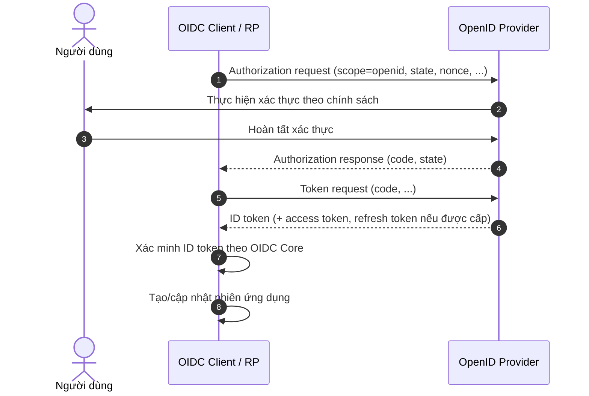
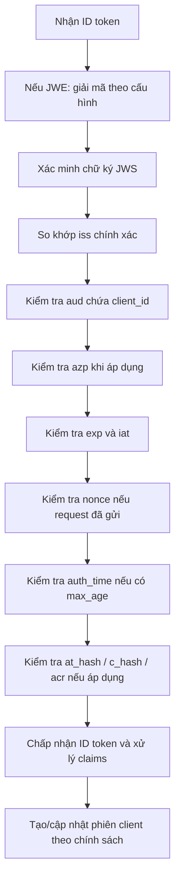
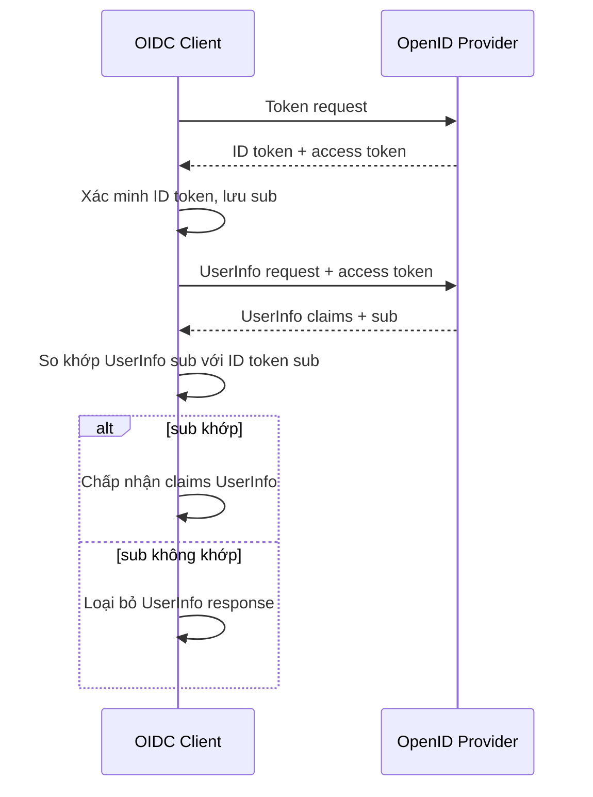

# Claims và quy tắc xác minh riêng của ID token

## 1. ID token là một khẳng định xác thực theo OpenID Connect

Trong OpenID Connect (OIDC), **ID token** là một JWT do OpenID Provider (OP) phát hành để truyền các khẳng định về một giao dịch xác thực đến OIDC client (Relying Party - RP). Nó giúp client biết issuer nào đã phát hành kết quả, subject nào được nhận diện, token dành cho client nào và những điều kiện xác thực nào được ghi nhận.

ID token có hình thức giống các JWT khác, nhưng cách diễn giải và xác minh của nó được quy định bởi **OpenID Connect Core 1.0**. Client không được áp dụng một bộ kiểm tra JWT chung chung rồi mặc định rằng token đã hợp lệ. Client cần kiểm tra đúng issuer, audience, chữ ký, thời gian và những ràng buộc riêng của yêu cầu OIDC.

ID token trả lời câu hỏi: **“OpenID Provider đã phát hành khẳng định xác thực nào cho client này?”** Nó không phải access token và không cấp quyền gọi API. Resource server cần access token đúng audience và profile riêng.

Các điểm cốt lõi:

- ID token theo OIDC phải được ký bằng JWS; có thể được mã hóa thêm bằng JWE theo cấu hình và thỏa thuận.
- Payload có một số claims bắt buộc, một số claims tùy chọn và một số claims chỉ bắt buộc khi yêu cầu xác thực đặt điều kiện tương ứng.
- Client phải ràng buộc ID token với đúng issuer, client ID và yêu cầu xác thực ban đầu.
- Các giá trị như `nonce`, `auth_time`, `acr` và `amr` có ngữ nghĩa OIDC riêng.
- Xác minh chữ ký thành công chưa đủ nếu audience hoặc nonce không khớp.

Bài viết thuộc phạm vi **Security - JSON Web Token (JWT)** tổng quát, tập trung vào claims và quy tắc xác minh ID token theo OIDC, không phụ thuộc ngôn ngữ lập trình hay framework.

## 2. Vị trí của ID token trong luồng OIDC

Client yêu cầu xác thực bằng cách gửi authorization request có scope `openid`. OP xác thực người dùng theo chính sách và trả kết quả theo flow được sử dụng. Trong Authorization Code Flow, client đổi authorization code tại token endpoint và nhận ID token trong token response.



ID token được gửi đến client như kết quả của giao dịch OIDC. Access token, nếu có, được dùng cho resource server; refresh token, nếu có, được gửi đến OP để xin token mới. Ba loại credential có audience và mục đích khác nhau.

## 3. Các claims cốt lõi của ID token

### 3.1. Năm claims bắt buộc

Theo OIDC Core, ID token phải chứa các claims sau:

| Claim | Bắt buộc | Ý nghĩa và cách diễn giải |
| --- | --- | --- |
| `iss` | Có | Issuer Identifier của OP phát hành ID token |
| `sub` | Có | Định danh subject trong phạm vi issuer |
| `aud` | Có | Danh sách audience; phải bao gồm `client_id` của client xác minh |
| `exp` | Có | Thời điểm ID token hết hạn |
| `iat` | Có | Thời điểm ID token được phát hành |

Ví dụ payload minh họa:

```json
{
  "iss": "https://identity.example.org",
  "sub": "user-2481",
  "aud": "shopping-client",
  "exp": 1893456900,
  "iat": 1893456000
}
```

Đây chỉ là Claims Set minh họa, chưa phải JWT đã ký. `exp` và `iat` là NumericDate, biểu diễn số giây tính từ Unix epoch. Client phải xác minh các claims này theo OIDC Core trước khi tin nội dung.

### 3.2. `iss`: issuer phải khớp chính xác

`iss` xác định OP phát hành ID token. Client phải so khớp giá trị này với Issuer Identifier mà client đã cấu hình hoặc nhận từ metadata OIDC đáng tin cậy.

Ví dụ:

- Issuer được cấu hình: `https://identity.example.org`
- Issuer trong token: `https://identity.example.org`
- Kết quả: khớp nếu toàn bộ giá trị đúng theo quy tắc so sánh của OIDC.

Không tự chuẩn hóa URL theo suy đoán, bỏ dấu gạch chéo cuối, đổi hostname hoặc chấp nhận issuer gần giống. Kẻ tấn công có thể lợi dụng việc so sánh lỏng để làm client chấp nhận token từ một nguồn khác.

Issuer trong token là dữ liệu cần kiểm tra; bản thân claim `iss` không tạo ra niềm tin đối với issuer.

### 3.3. `sub`: định danh subject

`sub` là định danh chủ thể được xác thực trong phạm vi issuer. Theo OIDC, giá trị này phân biệt chữ hoa/chữ thường, có tính cục bộ đối với issuer, duy nhất trong phạm vi issuer và không được tái cấp cho subject khác.

Client nên dùng cặp:

```text
(iss, sub)
```

để xác định subject ổn định. Không nên dùng riêng `sub` giữa nhiều issuer vì hai OP khác nhau có thể phát hành cùng một chuỗi `sub` cho các subject khác nhau.

Không mặc định `sub` là username, email hoặc số điện thoại. OIDC hỗ trợ các kiểu subject identifier như:

- **Public subject identifier:** cùng một giá trị subject được dùng cho các client trong phạm vi issuer.
- **Pairwise subject identifier:** OP tạo giá trị khác nhau cho từng sector/client group theo chính sách, giúp giảm khả năng liên kết hoạt động của người dùng giữa các client.

Client không nên tự suy ra danh tính thật từ cấu trúc của `sub`; đây là định danh opaque theo hợp đồng OIDC.

### 3.4. `aud`: audience phải chứa client ID

`aud` xác định các client mà ID token được phát hành cho. Client xác minh phải tìm thấy `client_id` của chính mình trong audience.

Ví dụ:

```json
{
  "aud": ["shopping-client", "trusted-companion-client"],
  "azp": "shopping-client"
}
```

Nếu `aud` có nhiều giá trị, client nên kiểm tra claim `azp` có mặt. Nếu `azp` xuất hiện, client nên xác minh giá trị đó khớp với `client_id` của mình theo OIDC Core. Không chấp nhận ID token chỉ vì issuer và chữ ký đúng nếu audience không dành cho client.

### 3.5. `exp` và `iat`: thời hạn và thời điểm phát hành

- `exp` là thời điểm hết hạn. Client phải từ chối ID token tại hoặc sau thời điểm hết hạn, có thể áp dụng khoảng leeway nhỏ để xử lý clock skew.
- `iat` là thời điểm phát hành. Client có thể dùng nó để từ chối token được phát hành quá lâu so với thời điểm hiện tại, qua đó giới hạn thời gian cần lưu nonce và giảm khả năng chấp nhận phản hồi cũ.

Client và OP cần đồng bộ thời gian. Không nên dùng leeway quá lớn để che giấu lỗi đồng hồ.

## 4. Claims có điều kiện hoặc tùy chọn

Không phải mọi ID token đều có toàn bộ claims dưới đây. Một số claim trở thành bắt buộc khi client gửi tham số tương ứng trong authentication request; một số claim chỉ được trả về khi OP có thông tin hoặc chính sách phù hợp.

### 4.1. `nonce`: liên kết ID token với yêu cầu xác thực

`nonce` là giá trị do client tạo và gửi trong authentication request. Nếu yêu cầu có `nonce`, ID token trả về phải chứa claim `nonce` với giá trị khớp chính xác.

Ví dụ yêu cầu:

```text
nonce = "n-7f31-unique-for-this-auth-request"
```

ID token phản hồi:

```json
{
  "nonce": "n-7f31-unique-for-this-auth-request"
}
```

Client phải:

1. Sinh nonce khó đoán, gắn với một authentication request cụ thể.
2. Lưu nonce trong trạng thái giao dịch đang chờ, liên kết với browser/client session phù hợp.
3. Khi nhận ID token, xác minh claim `nonce` khớp chính xác giá trị đã lưu.
4. Đánh dấu giao dịch đã sử dụng và loại bỏ nonce sau khi hoàn tất.
5. Từ chối token thiếu nonce hoặc sai nonce khi request đã gửi nonce.

Nonce giúp liên kết ID token với yêu cầu hiện tại và giảm nguy cơ token bị phát lại trong ngữ cảnh khác. Nó không thay thế chữ ký, issuer, audience hoặc `state`.

### 4.2. `auth_time`: thời điểm người dùng thực sự xác thực

`auth_time` cho biết thời điểm OP xác thực người dùng. Claim này quan trọng khi client yêu cầu xác thực mới hoặc giới hạn tuổi của lần xác thực.

Nếu authentication request có tham số `max_age`, ID token phải chứa `auth_time`. Client cần kiểm tra thời điểm xác thực có đáp ứng giới hạn `max_age` hay không:

```text
current_time - auth_time <= max_age + allowed_clock_skew
```

Nếu lần xác thực quá cũ, client có thể yêu cầu người dùng xác thực lại theo chính sách. Không nhầm `auth_time` với `iat`:

- `auth_time`: lúc người dùng được OP xác thực.
- `iat`: lúc ID token hiện tại được phát hành.

OP có thể phát hành một ID token mới cho một phiên xác thực cũ; vì vậy hai mốc này có thể khác nhau.

### 4.3. `acr`: Authentication Context Class Reference

`acr` biểu diễn lớp/ngữ cảnh xác thực theo định nghĩa của OP hoặc profile. Client có thể yêu cầu một mức xác thực cụ thể thông qua yêu cầu OIDC và đánh giá giá trị trả về theo chính sách.

Không có một danh sách giá trị `acr` phổ quát mà mọi OP đều phải dùng giống nhau. Hai bên cần thống nhất ý nghĩa của từng giá trị. Client không nên suy diễn rằng một chuỗi `acr` bất kỳ tự động tương đương MFA hoặc một mức bảo đảm cụ thể.

### 4.4. `amr`: Authentication Methods References

`amr` là mảng các phương thức xác thực được sử dụng, nếu OP cung cấp. Ví dụ minh họa:

```json
{
  "amr": ["pwd", "otp"]
}
```

Giá trị cụ thể phụ thuộc OP và quy ước được áp dụng. Client chỉ nên dùng `amr` cho quyết định bảo mật khi có hợp đồng rõ ràng về ý nghĩa, mức bảo đảm và nguồn phát hành.

### 4.5. `azp`: Authorized Party

`azp` xác định bên được ủy quyền sử dụng ID token. Claim này có ý nghĩa đặc biệt khi ID token có nhiều audience.

Quy tắc cần nhớ:

- Nếu `aud` chứa nhiều giá trị, client nên xác minh `azp` có mặt.
- Nếu `azp` xuất hiện, client nên xác minh nó bằng `client_id` của mình.
- Client vẫn phải kiểm tra `aud`; `azp` không thay thế audience validation.

### 4.6. `at_hash` và `c_hash`

Hai claim này giúp ràng buộc ID token với các giá trị token/code được trả về trong một số flow OIDC:

- `at_hash`: hash của access token.
- `c_hash`: hash của authorization code.

Chúng xuất hiện trong những điều kiện flow cụ thể, đặc biệt khi access token hoặc authorization code được trả về trực tiếp trong authorization response ở Implicit/Hybrid Flow. Nếu claim được yêu cầu theo flow hoặc xuất hiện trong ID token, client phải xác minh theo công thức và thuật toán được OIDC Core quy định.

Không áp dụng máy móc `at_hash`/`c_hash` như claims bắt buộc cho mọi Authorization Code Flow. Với flow và response cụ thể, hãy theo đúng yêu cầu OIDC Core.

### 4.7. Bảng tổng hợp mức độ bắt buộc

| Claim | Mức độ theo OIDC | Khi nào kiểm tra |
| --- | --- | --- |
| `iss` | Bắt buộc | Luôn luôn |
| `sub` | Bắt buộc | Luôn luôn; dùng trong phạm vi issuer |
| `aud` | Bắt buộc | Luôn luôn; phải chứa client ID |
| `exp` | Bắt buộc | Luôn luôn; phải còn hiệu lực |
| `iat` | Bắt buộc | Luôn luôn; có thể áp dụng giới hạn tuổi token |
| `nonce` | Bắt buộc nếu request gửi nonce | So khớp chính xác với giao dịch đang chờ |
| `auth_time` | Bắt buộc nếu request có `max_age` | Kiểm tra tuổi lần xác thực |
| `azp` | Không bắt buộc trong mọi trường hợp | Nếu xuất hiện phải kiểm tra; nên có khi nhiều audience |
| `acr` | Theo yêu cầu/chính sách xác thực | So sánh với ngữ cảnh/mức xác thực được yêu cầu |
| `amr` | Tùy chọn | Chỉ dùng khi OP cung cấp và hai bên thống nhất ý nghĩa |
| `at_hash`, `c_hash` | Phụ thuộc flow/response | Kiểm tra khi được yêu cầu hoặc xuất hiện theo quy tắc OIDC |

## 5. Claims hồ sơ người dùng và quyền riêng tư

OIDC có thể trả về các claims về profile, email, địa chỉ hoặc số điện thoại tùy scope và yêu cầu. Một số ví dụ:

| Nhóm | Claim ví dụ | Ý nghĩa |
| --- | --- | --- |
| Profile | `name`, `given_name`, `family_name`, `picture`, `locale` | Thông tin hiển thị hồ sơ |
| Email | `email`, `email_verified` | Địa chỉ email và trạng thái xác minh |
| Phone | `phone_number`, `phone_number_verified` | Số điện thoại và trạng thái xác minh |
| Thời gian cập nhật | `updated_at` | Thời điểm thông tin được cập nhật |

Các claims này không phải tất cả đều phải xuất hiện trong ID token. OP có thể cung cấp chúng qua UserInfo Endpoint hoặc theo yêu cầu claims/profile.

### 5.1. Email không phải định danh ổn định thay cho `sub`

Email có thể thay đổi, được tái sử dụng hoặc có mức độ xác minh khác nhau giữa các OP. Nếu cần biết địa chỉ email đã được OP xác minh, client cần kiểm tra `email_verified` theo hợp đồng OIDC. Không nên dùng email làm khóa định danh duy nhất thay cho cặp `iss` và `sub`.

Tương tự, `phone_number` không tự chứng minh số điện thoại đã được xác minh; cần xem claim `phone_number_verified` khi có và hiểu đúng chính sách OP.

### 5.2. Không đưa dữ liệu quá mức cần thiết vào ID token

ID token thường được client giữ và có thể xuất hiện trong nhiều thành phần quan sát/diagnostic. Với JWS compact, payload được Base64url nên có thể đọc được; chữ ký không che giấu claims.

Do đó:

- Chỉ yêu cầu và sử dụng claims cần thiết.
- Không đưa mật khẩu, secret, thông tin thanh toán hoặc dữ liệu nhạy cảm không cần thiết vào ID token.
- Không ghi ID token nguyên văn vào log.
- Nếu cần lấy thêm dữ liệu profile, cân nhắc UserInfo Endpoint với access token đúng mục đích.
- Nếu cần bảo mật nội dung, sử dụng cơ chế mã hóa theo cấu hình OIDC phù hợp; mã hóa không thay thế xác minh chữ ký và claims.

## 6. Quy tắc xác minh ID token theo OIDC Core

Client phải xác minh ID token trước khi sử dụng bất kỳ claim nào để xác lập danh tính hoặc phiên đăng nhập.

### 6.1. Quy trình xác minh tổng quát



Sơ đồ mô tả thứ tự khái niệm. Trong triển khai, thư viện có thể thực hiện một số bước khác thứ tự, nhưng client phải bảo đảm mọi kiểm tra bắt buộc đều đạt trước khi sử dụng claims.

### 6.2. Bước 1 — Lấy cấu hình OP từ nguồn tin cậy

Client cần biết issuer và thông tin khóa từ cấu hình đáng tin cậy hoặc OpenID Provider Configuration đã được xác thực. Metadata OIDC thường cung cấp:

- `issuer`: Issuer Identifier.
- `jwks_uri`: địa chỉ JWKS chứa khóa công khai.
- `id_token_signing_alg_values_supported`: các thuật toán ký ID token được hỗ trợ.
- Endpoint và khả năng OIDC khác.

Không lấy issuer hoặc JWKS URL tùy ý từ token để thiết lập niềm tin. Client cần xác định OP từ cấu hình/discovery được tin cậy trước khi xác minh.

### 6.3. Bước 2 — Xử lý mã hóa nếu ID token dùng JWE

OIDC yêu cầu ID token được ký; token cũng có thể được mã hóa. Nếu ID token được mã hóa, client phải giải mã theo thuật toán và khóa đã thỏa thuận/đăng ký. Nếu cấu trúc lồng nhau, client phải xử lý lớp ngoài và lớp chữ ký bên trong đúng theo cấu hình.

Giải mã thành công không thay thế xác minh chữ ký. Client phải xác minh nguồn gốc và tính toàn vẹn theo yêu cầu OIDC.

### 6.4. Bước 3 — Xác minh chữ ký JWS

Client chọn khóa công khai từ JWKS của issuer đã tin cậy, dùng thuật toán đã được cấu hình và xác minh chữ ký.

- Header `kid` chỉ là gợi ý chọn khóa trong tập JWKS tin cậy.
- Header `alg` không được phép tự quyết định allowlist.
- Không chấp nhận token không có chữ ký hoặc thuật toán không được hỗ trợ.
- Nếu không tìm thấy khóa phù hợp, làm mới JWKS theo chính sách; nếu vẫn không thể xác minh thì từ chối.

OIDC ID token phải được ký. Không áp dụng quy tắc chấp nhận `alg: none` cho ID token.

### 6.5. Bước 4 — Kiểm tra issuer và audience

- `iss` phải khớp chính xác issuer đã cấu hình.
- `aud` phải chứa `client_id` của client.
- Nếu có nhiều audience, client nên kiểm tra `azp` có mặt.
- Nếu `azp` xuất hiện, client nên xác minh giá trị khớp client ID.

Không dùng `sub` hoặc `client_id` thay cho audience. Token được phát hành cho client khác phải bị từ chối.

### 6.6. Bước 5 — Kiểm tra thời gian

Client phải xác minh thời điểm hiện tại trước `exp`. Có thể cho phép leeway nhỏ để xử lý clock skew. Client cũng nên áp dụng giới hạn hợp lý cho `iat`, tránh chấp nhận ID token được phát hành quá lâu trước đó.

Nếu request có `max_age`, client phải kiểm tra `auth_time` có mặt và lần xác thực còn nằm trong giới hạn được yêu cầu.

### 6.7. Bước 6 — Kiểm tra nonce và ràng buộc giao dịch

Nếu client gửi `nonce` trong authentication request:

- ID token phải chứa `nonce`.
- Giá trị phải khớp chính xác nonce đã lưu cho giao dịch.
- Nonce phải chỉ được dùng cho giao dịch tương ứng và không tái sử dụng sau khi hoàn tất.

Client cũng cần kiểm tra `state` trong authorization response nếu đã gửi `state`. **`state` là tham số của giao thức ở authorization request/response, không phải claim bắt buộc trong ID token.** Nó giúp liên kết phản hồi với yêu cầu ban đầu và bảo vệ luồng redirect; nonce ràng buộc ID token với yêu cầu xác thực.

Hai giá trị giải quyết các rủi ro khác nhau và không thay thế lẫn nhau.

### 6.8. Bước 7 — Kiểm tra các claims phụ thuộc flow

Client kiểm tra `at_hash`, `c_hash`, `auth_time`, `acr` hoặc claim khác khi OIDC Core và flow đang dùng yêu cầu. Không nên:

- Bắt buộc `at_hash` trong mọi flow dù flow không yêu cầu.
- Bỏ qua `at_hash`/`c_hash` khi profile yêu cầu kiểm tra.
- Coi `acr` hoặc `amr` là mức bảo đảm phổ quát mà không có hợp đồng.

### 6.9. Bước 8 — Chỉ sử dụng claims sau khi mọi kiểm tra đạt

Khi ID token hợp lệ, client có thể sử dụng `(iss, sub)` để nhận diện subject, lấy claims theo scope và áp dụng chính sách phiên. Client vẫn cần kiểm soát session lifetime, logout, reauthentication và quyền truy cập cục bộ theo kiến trúc.

ID token hết hạn không nhất thiết đồng nghĩa phiên OP đã kết thúc; ngược lại, token còn hạn cũng không bảo đảm người dùng vẫn có phiên hoạt động. Quản lý phiên là một lớp riêng.

## 7. `state` và `nonce`: hai giá trị không được nhầm lẫn

| Tiêu chí | `state` | `nonce` |
| --- | --- | --- |
| Nằm ở đâu? | Authorization request và authorization response | Authentication request và ID token claim |
| Mục đích chính | Liên kết phản hồi redirect với yêu cầu ban đầu; giảm CSRF/correlation attacks | Liên kết ID token với yêu cầu xác thực; giảm replay/substitution |
| Ai tạo? | Client | Client |
| Kiểm tra ở đâu? | Khi nhận authorization response | Khi xác minh ID token |
| Có phải JWT claim không? | Không | Có thể là claim trong ID token khi request gửi nonce |
| Có thay thế nhau không? | Không | Không |

Ví dụ:

```text
Authorization request:
  state = "s-4a91"
  nonce = "n-7f31"

Authorization response:
  code = "..."
  state = "s-4a91"

ID token:
  nonce = "n-7f31"
```

Client phải so khớp cả hai ở đúng giai đoạn. Không chỉ kiểm tra chữ ký ID token rồi bỏ qua nonce hoặc state.

## 8. UserInfo Endpoint và quan hệ với ID token

OIDC có thể cung cấp thêm claims người dùng qua UserInfo Endpoint. Client gọi endpoint này bằng access token phù hợp. Phản hồi UserInfo thường là JSON chứa các claims về subject.

Một quy tắc quan trọng: claim `sub` trong UserInfo response phải khớp chính xác với `sub` trong ID token đã xác minh. Nếu hai giá trị không khớp, client **không được sử dụng UserInfo response** vì nó có thể thuộc subject khác.



UserInfo Endpoint không thay thế việc xác minh ID token. Access token được dùng để gọi UserInfo; ID token vẫn là bằng chứng xác thực được xác minh theo OIDC.

## 9. Những lỗi xác minh ID token thường gặp

| Lỗi | Hậu quả | Cách xử lý |
| --- | --- | --- |
| Chỉ decode payload rồi tin `sub` | Claims có thể bị giả mạo hoặc token chưa được xác minh | Xác minh chữ ký, issuer, audience và thời gian |
| Không so khớp `iss` chính xác | Chấp nhận token từ issuer khác | So sánh với Issuer Identifier đã tin cậy |
| Không kiểm tra `aud` | Chấp nhận ID token phát hành cho client khác | Bắt buộc audience chứa client ID |
| Bỏ qua `azp` khi có nhiều audience | Không xác định đúng client được ủy quyền | Kiểm tra azp theo OIDC |
| Bỏ qua `nonce` | Tăng nguy cơ token replay/substitution | So khớp nonce nếu request đã gửi |
| Nhầm `iat` với `auth_time` | Đánh giá sai tuổi của lần xác thực | Dùng auth_time khi max_age yêu cầu |
| Tin `email` là định danh ổn định | Liên kết nhầm tài khoản khi email đổi/tái sử dụng | Dùng `(iss, sub)` làm định danh |
| Dùng ID token gọi API | Nhầm xác thực với ủy quyền; sai audience | Dùng access token đúng resource |
| Bỏ qua `state` | Không ràng buộc authorization response với request | Lưu và so khớp state |
| Không kiểm tra UserInfo `sub` | Ghép claims của subject khác vào phiên hiện tại | Bắt buộc khớp sub trước khi dùng UserInfo |
| Ghi ID token vào log | Làm lộ claims và credential | Loại bỏ hoặc che token trong log |

## 10. Phân biệt ID token với access token

| Tiêu chí | OIDC ID token | OAuth access token |
| --- | --- | --- |
| Mục đích | Khẳng định kết quả xác thực và subject | Quyền truy cập tài nguyên |
| Bên nhận | OIDC client | Resource server/API |
| Audience | Client ID | Resource/API |
| Định dạng | JWT theo OIDC | Opaque hoặc JWT theo profile |
| Claims tiêu biểu | `iss`, `sub`, `aud`, `exp`, `iat`, `nonce`, `auth_time` | `iss`, `sub`, `aud`, `exp`, `client_id`, `scope` tùy profile |
| Bên xác minh | Client | Resource server |
| Quyết định | Chấp nhận kết quả xác thực, cập nhật phiên client | Cho phép hoặc từ chối truy cập tài nguyên |

ID token có thể chứa claims về danh tính và phương thức xác thực, nhưng không tự cấp quyền API. Access token có thể đại diện cho subject, nhưng không thay thế ID token trong hợp đồng xác thực OIDC.

## 11. Ví dụ xác minh ID token hoàn chỉnh

Giả sử client đã cấu hình:

```text
issuer   = https://identity.example.org
client_id = shopping-client
nonce     = n-7f31
max_age   = 300
```

OP trả về ID token có Claims Set:

```json
{
  "iss": "https://identity.example.org",
  "sub": "pairwise-subject-91",
  "aud": "shopping-client",
  "exp": 1893456900,
  "iat": 1893456000,
  "auth_time": 1893455900,
  "nonce": "n-7f31",
  "acr": "urn:example:loa:2",
  "amr": ["pwd", "otp"]
}
```

Client kiểm tra:

1. Issuer khớp chính xác `https://identity.example.org`.
2. Chữ ký hợp lệ bằng khóa công khai của OP.
3. Audience chứa `shopping-client`.
4. `exp` chưa đến hạn và `iat` nằm trong giới hạn hợp lý.
5. `nonce` khớp `n-7f31`.
6. Vì request có `max_age=300`, `auth_time` có mặt và thời gian xác thực không quá 300 giây (cộng leeway cho phép).
7. Nếu client có yêu cầu mức xác thực cụ thể, `acr` phải đáp ứng chính sách đã thỏa thuận; `amr` chỉ được diễn giải theo quy ước OP.

Nếu một trong các điều kiện bắt buộc không đạt, client từ chối ID token và không tạo phiên đăng nhập dựa trên token đó.

### Một số biến thể cần từ chối

| Biến thể | Lý do |
| --- | --- |
| `iss` là `https://identity-example.org` | Issuer khác với giá trị cấu hình |
| `aud` chỉ có `another-client` | Token không dành cho client này |
| `nonce` là `n-older-request` | Token không gắn với giao dịch đang chờ |
| `exp` đã qua | ID token hết hạn |
| Chữ ký không hợp lệ | Không xác minh được nguồn gốc/toàn vẹn |
| Thiếu `auth_time` khi request có `max_age` | Không đáp ứng yêu cầu OIDC |
| UserInfo `sub` khác ID token `sub` | Không được sử dụng UserInfo response |

## 12. Checklist xác minh ID token

### Cấu hình và nguồn tin cậy

- [ ] Issuer được cấu hình hoặc discovery từ nguồn OIDC đáng tin cậy.
- [ ] JWKS được lấy từ metadata của đúng issuer và qua kênh bảo mật.
- [ ] Thuật toán ký được giới hạn theo cấu hình.
- [ ] Có chính sách cache/làm mới JWKS và xử lý `kid` không tìm thấy.

### Chữ ký và claims bắt buộc

- [ ] ID token được xử lý theo JWS/JWE đã đăng ký.
- [ ] Chữ ký được xác minh; không chấp nhận token không chữ ký.
- [ ] `iss` khớp chính xác.
- [ ] `sub` có mặt và được dùng trong phạm vi issuer.
- [ ] `aud` chứa client ID.
- [ ] `exp` còn hiệu lực.
- [ ] `iat` được kiểm tra theo chính sách.
- [ ] `azp` được kiểm tra khi xuất hiện và khi nhiều audience.

### Ràng buộc yêu cầu xác thực

- [ ] `nonce` được so khớp nếu request gửi nonce.
- [ ] `auth_time` được kiểm tra nếu request có `max_age`.
- [ ] `acr`/`amr` được diễn giải theo hợp đồng nếu được dùng.
- [ ] `at_hash`/`c_hash` được kiểm tra khi flow yêu cầu.
- [ ] `state` được kiểm tra trong authorization response nếu đã gửi.

### Claims bổ sung và phiên

- [ ] Claims profile/email/phone chỉ được sử dụng theo trạng thái xác minh.
- [ ] UserInfo response được kiểm tra `sub` khớp ID token.
- [ ] Không dùng ID token làm access token.
- [ ] Không ghi token nguyên văn vào log.
- [ ] Phiên ứng dụng có timeout, logout và reauthentication riêng.

## 13. Kết luận

ID token là một JWT có ý nghĩa đặc thù trong OpenID Connect. Các claims bắt buộc `iss`, `sub`, `aud`, `exp`, `iat` tạo nền tảng để client xác định nguồn phát hành, subject, đối tượng nhận và thời hạn. Các claims như `nonce`, `auth_time`, `acr`, `amr`, `azp`, `at_hash` và `c_hash` bổ sung ràng buộc hoặc ngữ cảnh theo yêu cầu và flow.

Client phải xác minh chữ ký, issuer, audience, thời gian và các điều kiện OIDC tương ứng trước khi sử dụng claims. `state` ràng buộc authorization response với yêu cầu; `nonce` ràng buộc ID token với yêu cầu xác thực. UserInfo claims cần có `sub` khớp ID token. Danh tính ổn định nên được xác định bằng cặp `(iss, sub)`, không phải email đơn lẻ.

**ID token xác nhận kết quả xác thực cho client; access token mới là credential để resource server kiểm tra quyền truy cập.** Phân biệt đúng vai trò và xác minh đầy đủ giúp tránh replay, token substitution và nhầm lẫn giữa xác thực với ủy quyền.

## Tài liệu chuẩn để đọc tiếp

- [OpenID Connect Core 1.0 — ID Token](https://openid.net/specs/openid-connect-core-1_0.html#IDToken): cấu trúc ID token, claims và quy tắc xác minh.
- [OpenID Connect Core 1.0 — ID Token Validation](https://openid.net/specs/openid-connect-core-1_0.html#IDTokenValidation): các bước xác minh ID token tại client.
- [OpenID Connect Core 1.0 — UserInfo Endpoint](https://openid.net/specs/openid-connect-core-1_0.html#UserInfo): claims người dùng và ràng buộc subject.
- [OpenID Connect Discovery 1.0](https://openid.net/specs/openid-connect-discovery-1_0.html): metadata issuer, JWKS URI và cấu hình OP.
- [RFC 7519 — JSON Web Token (JWT)](https://www.rfc-editor.org/rfc/rfc7519): định dạng JWT và NumericDate.
- [RFC 7515 — JSON Web Signature (JWS)](https://www.rfc-editor.org/rfc/rfc7515): chữ ký và xác minh tính toàn vẹn.
- [RFC 8725 — JSON Web Token Best Current Practices](https://www.rfc-editor.org/rfc/rfc8725): thực hành xác minh JWT và tránh nhầm lẫn token.
