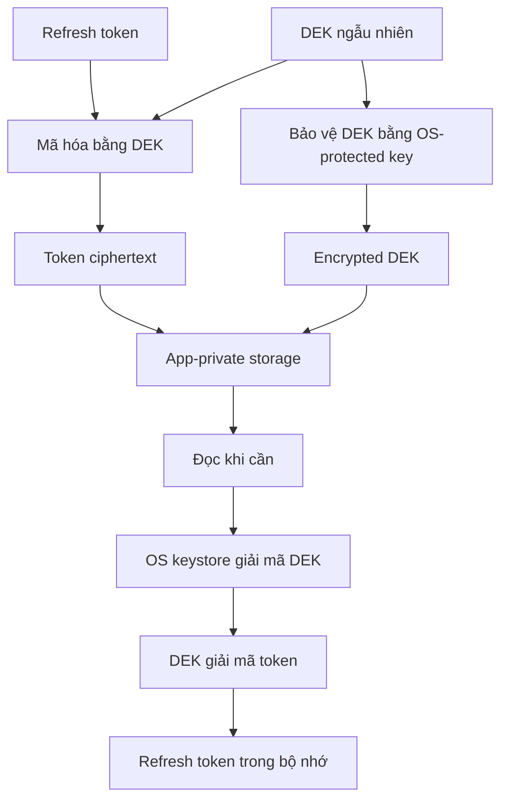

# Ứng dụng di động, ứng dụng máy tính và kho lưu trữ bảo mật của hệ điều hành

## 1. Vì sao ứng dụng native cần chiến lược lưu token riêng?

Ứng dụng di động và ứng dụng máy tính thường duy trì trạng thái đăng nhập qua nhiều lần mở ứng dụng. Để giữ phiên, ứng dụng có thể cần lưu refresh token hoặc một credential tương đương. Nếu lưu token ở dạng văn bản thuần trong file cấu hình, database, preferences hoặc thư mục dữ liệu dùng chung, người có quyền đọc thiết bị hay bản sao lưu có thể lấy token và sử dụng nó như một bearer credential.

**Bearer token là bí mật có thể chuyển giao:** bất kỳ ai lấy được token còn hiệu lực đều có thể sử dụng token theo phạm vi quyền của nó, trừ khi giao thức có cơ chế ràng buộc token với người gửi. Vì vậy, việc lưu token phải giảm khả năng bị đọc, sao chép và sử dụng lại.

Một chiến lược tốt thường kết hợp:

- Chỉ lưu token cần thiết để duy trì phiên; ưu tiên giữ access token ngắn hạn trong bộ nhớ.
- Lưu refresh token hoặc credential dài hạn trong kho bí mật do hệ điều hành quản lý.
- Nếu cần lưu token trong file hoặc database, mã hóa dữ liệu bằng khóa được bảo vệ bởi OS keystore/secret store.
- Giới hạn ứng dụng, người dùng hệ điều hành và tiến trình được phép truy cập.
- Có cơ chế hết hạn, rotation, thu hồi và xóa token khi đăng xuất hoặc phát hiện rủi ro.
- Bảo vệ cả bản sao lưu, log, crash report, bộ nhớ và luồng truyền token.

Bài học này thuộc chương **Lưu trữ và truyền** của học phần **Security - JSON Web Token (JWT)** (`SECURITY_TOKEN_SECURITY_JWT`). Nội dung áp dụng cho ứng dụng native trên nhiều hệ điều hành; các ví dụ về kho lưu trữ chỉ là những lựa chọn theo nền tảng, không gắn với một ngôn ngữ lập trình hay framework cụ thể.

## 2. Phân loại token trước khi quyết định lưu

Không phải mọi token đều cần được lưu lâu dài.

| Loại dữ liệu | Cách lưu thường phù hợp | Lý do |
| --- | --- | --- |
| Access token thời hạn ngắn | Bộ nhớ tiến trình; chỉ lưu bền vững khi có yêu cầu rõ | Giảm thời gian token tồn tại trên thiết bị |
| Refresh token | OS secure storage hoặc dữ liệu mã hóa bằng khóa OS-protected | Có thể cấp access token mới nên thường có giá trị cao |
| ID token | Xử lý sau xác minh; chỉ lưu nếu ứng dụng thật sự cần | Chứa thông tin định danh và có thể tiết lộ dữ liệu cá nhân |
| Private key dùng cho DPoP hoặc client authentication | OS keystore/hardware-backed key store | Khóa riêng có thể được giữ không xuất được |
| Client secret | Không nhúng vào ứng dụng native công khai | Có thể bị trích xuất từ gói cài đặt hoặc môi trường chạy |

### 2.1. Ưu tiên access token trong bộ nhớ

Nếu ứng dụng có thể lấy access token mới từ refresh token, hãy giữ access token trong bộ nhớ và chỉ lưu refresh token trong secure storage. Khi ứng dụng đóng hoặc tiến trình bị hủy, access token biến mất cùng tiến trình.

Cách này không loại bỏ mọi nguy cơ: malware có thể đọc bộ nhớ khi ứng dụng đang chạy, debugger hoặc thiết bị đã bị compromise có thể lấy dữ liệu, và hệ điều hành có thể tạo crash dump. Tuy vậy, giảm thời gian lưu bền vững giúp thu hẹp cửa sổ bị đánh cắp.

### 2.2. Bảo vệ refresh token chặt hơn

Refresh token thường có vòng đời dài hơn access token và có thể tạo ra nhiều access token mới. Nếu refresh token bị đánh cắp, kẻ tấn công có thể duy trì quyền truy cập lâu hơn.

Các biện pháp cần cân nhắc:

- Lưu refresh token trong kho bí mật của hệ điều hành.
- Dùng refresh token rotation nếu authorization server hỗ trợ.
- Phát hiện việc dùng lại refresh token đã bị thay thế và thu hồi token family/phiên theo chính sách.
- Ràng buộc refresh token với client hoặc khóa thiết bị khi giao thức hỗ trợ sender-constrained tokens.
- Giới hạn thời hạn tuyệt đối và thời gian không hoạt động.
- Xóa token cục bộ và thu hồi phía máy chủ khi đăng xuất hoặc phát hiện thiết bị bị mất.

Không nên giả định mọi refresh token đều là JWT. Nhiều hệ thống dùng refresh token dạng opaque; yêu cầu bảo vệ tại nơi lưu trữ vẫn tương tự.

## 3. Kho lưu trữ bảo mật của hệ điều hành

Các hệ điều hành hiện đại cung cấp cơ chế lưu secret, credential hoặc khóa mật mã. Những cơ chế này có thể áp dụng quyền truy cập theo user, app, entitlement, trạng thái đăng nhập hoặc xác thực cục bộ.

| Nền tảng | Cơ chế thường dùng | Vai trò chính |
| --- | --- | --- |
| iOS / iPadOS | Keychain Services; Secure Enclave cho một số khóa riêng | Lưu secret/credential và kiểm soát quyền truy cập; giữ khóa riêng không xuất được khi phần cứng hỗ trợ |
| Android | Android Keystore; StrongBox trên thiết bị tương thích | Tạo và sử dụng khóa trong vùng bảo vệ; ứng dụng có thể mã hóa token trước khi lưu file riêng |
| macOS | Keychain Services; Secure Enclave trên phần cứng hỗ trợ | Lưu credential và khóa theo tài khoản/ngữ cảnh truy cập |
| Windows | DPAPI, Credential Manager, CNG/TPM tùy trường hợp | Bảo vệ dữ liệu hoặc lưu credential theo user/máy; quản lý khóa bằng provider phù hợp |
| Linux desktop | Secret Service API (ví dụ GNOME Keyring), KWallet; TPM tùy hệ thống | Lưu secret trong keyring được mở khóa theo phiên desktop; phần cứng có thể bảo vệ khóa |
| Môi trường desktop/headless Linux | Secret manager của môi trường triển khai, TPM hoặc dịch vụ quản lý bí mật | Cần xác định rõ cách mở khóa, phân quyền và vòng đời secret |

Không có một API thống nhất được mọi nền tảng triển khai giống nhau. Ứng dụng đa nền tảng thường cần một lớp trừu tượng, nhưng lớp đó phải giữ nguyên các thuộc tính bảo mật của từng hệ điều hành và xử lý được trường hợp secure store không khả dụng.

## 4. iOS và iPadOS: Keychain và Secure Enclave

### 4.1. Keychain dùng để lưu credential

**Keychain Services** cung cấp kho lưu trữ cho password, token, key và các dữ liệu bí mật khác. Ứng dụng có thể lưu refresh token trực tiếp dưới dạng Keychain item thay vì ghi vào preferences hoặc file thông thường.

Khi thiết kế Keychain item, cần chọn:

- **Access group:** ứng dụng hoặc nhóm ứng dụng nào được phép truy cập item.
- **Accessibility class:** item có sẵn khi thiết bị đang mở khóa, chỉ khi đã mở khóa sau lần khởi động gần nhất, hoặc theo điều kiện phù hợp khác.
- **Access control:** có yêu cầu xác thực người dùng, Face ID/Touch ID hoặc passcode cho thao tác đọc hay không.
- **Synchronizable behavior:** item có được đồng bộ qua hệ sinh thái tài khoản hay chỉ ở thiết bị, theo nhu cầu và chính sách dữ liệu.

Chọn accessibility class theo cách sử dụng thực tế. Ví dụ, refresh token chỉ dùng khi ứng dụng đang hoạt động có thể được bảo vệ để chỉ truy cập khi thiết bị đã mở khóa. Một tác vụ nền cần đọc token khi thiết bị khóa có thể cần lựa chọn khác, nhưng phải đánh giá kỹ tác động nếu thiết bị bị mất.

### 4.2. Secure Enclave không phải kho chứa mọi loại token

Secure Enclave là vùng phần cứng bảo vệ một số thao tác và khóa riêng trên thiết bị hỗ trợ. Nó phù hợp để giữ khóa riêng không xuất được, chẳng hạn khóa ký DPoP hoặc khóa client authentication.

Không nên hiểu Secure Enclave là nơi lưu trực tiếp mọi chuỗi refresh token. Một mô hình thường gặp là:

1. Tạo khóa mã hóa trong Keychain/secure hardware theo khả năng nền tảng.
2. Dùng khóa đó để mã hóa dữ liệu token trước khi ghi vào kho dữ liệu riêng.
3. Lưu ciphertext trong app container.
4. Khi cần, yêu cầu hệ điều hành thực hiện thao tác giải mã theo quyền của ứng dụng.

Nếu Keychain có thể lưu trực tiếp token với access control phù hợp, cách đó thường đơn giản hơn. Chỉ dùng thêm lớp mã hóa file khi có nhu cầu cụ thể và hiểu rõ vòng đời khóa.

### 4.3. Biometric protection và trải nghiệm người dùng

Yêu cầu Face ID/Touch ID cho mỗi lần truy cập có thể tăng bảo vệ khi người dùng mở ứng dụng, nhưng cũng ảnh hưởng đến refresh nền, thông báo và các tác vụ tự động.

Cần quyết định rõ:

- Token có cần đọc khi ứng dụng chạy nền không?
- Có chấp nhận yêu cầu người dùng xác thực lại sau một khoảng thời gian không?
- Nếu biometric enrollment thay đổi hoặc người dùng xóa biometric, item có còn truy cập được không?
- Nếu thiết bị không hỗ trợ biometric, fallback có dùng passcode hay từ chối?
- Thao tác đăng xuất có xóa item và khóa liên quan không?

Không bật biometric gating theo mặc định cho mọi token mà không xét luồng sử dụng. Cũng không giảm bảo vệ chỉ để tác vụ nền tiện hơn nếu token có quyền cao.

## 5. Android: Keystore và StrongBox

### 5.1. Android Keystore bảo vệ khóa

Android Keystore cho phép ứng dụng tạo và sử dụng khóa mật mã mà material của khóa có thể không rời khỏi môi trường bảo vệ. Trên thiết bị hỗ trợ, khóa có thể được lưu trong TEE hoặc StrongBox.

Điểm quan trọng: **Keystore chủ yếu quản lý khóa, không phải nơi lưu tùy ý một chuỗi refresh token như một database.** Một cách triển khai thường gặp:

1. Tạo khóa AES trong Android Keystore.
2. Dùng khóa đó mã hóa refresh token.
3. Lưu ciphertext và IV/nonce trong vùng lưu trữ riêng tư của ứng dụng.
4. Khi cần refresh, lấy ciphertext và yêu cầu Keystore thực hiện giải mã.
5. Chỉ giữ plaintext trong bộ nhớ trong thời gian cần thiết.

Phải dùng chế độ mã hóa xác thực như AES-GCM với nonce đúng quy tắc. Không tự xây dựng thuật toán mã hóa hoặc tái sử dụng nonce với cùng khóa.

### 5.2. StrongBox và phần cứng bảo vệ

StrongBox Keymaster là triển khai phần cứng bảo vệ khóa trên các thiết bị tương thích. Không phải thiết bị Android nào cũng có StrongBox, và khả năng hỗ trợ phụ thuộc phần cứng/phiên bản hệ thống.

Ứng dụng cần:

- Kiểm tra khả năng hỗ trợ trước khi yêu cầu StrongBox.
- Có policy fallback rõ ràng khi thiết bị không hỗ trợ.
- Không giả định mọi khóa đều hardware-backed.
- Kiểm tra trạng thái và thuộc tính khóa khi cần mức đảm bảo cao.
- Xử lý lỗi khi khóa không còn sử dụng được sau restore, reinstall hoặc thay đổi trạng thái thiết bị.

Nếu policy bắt buộc hardware-backed key, không nên âm thầm chuyển sang khóa software-backed mà vẫn báo hệ thống đang đạt cùng mức bảo vệ.

### 5.3. App-private storage vẫn cần được bảo vệ

Thư mục riêng của ứng dụng giảm khả năng ứng dụng khác đọc file, nhưng không biến token trong file thành secret an toàn tuyệt đối. Dữ liệu có thể xuất hiện trong backup, thiết bị đã root, debug build, log hoặc bản sao do ứng dụng tự tạo.

Nếu dùng file/database để lưu ciphertext:

- Đặt file trong app-private storage.
- Loại trừ dữ liệu nhạy cảm khỏi backup nếu không có thiết kế khôi phục an toàn.
- Không lưu khóa mã hóa cùng file ciphertext.
- Bảo vệ khóa bằng Keystore và giới hạn thao tác dùng khóa.
- Xử lý trường hợp khóa bị mất hoặc không còn truy cập được bằng cách yêu cầu đăng nhập lại.

## 6. macOS: Keychain và phần cứng bảo vệ khóa

macOS cung cấp Keychain để lưu password, token, certificate và key. Ứng dụng desktop có thể dùng Keychain item để lưu refresh token hoặc dùng keychain-protected key để mã hóa dữ liệu cục bộ.

Các điểm cần kiểm soát:

- Quyền truy cập item và ứng dụng được phép yêu cầu secret.
- Phạm vi keychain theo người dùng và trạng thái khóa keychain.
- Hộp thoại cấp quyền truy cập khi ứng dụng hoặc chữ ký ứng dụng thay đổi.
- Quy trình cập nhật, gỡ cài đặt và xóa credential.
- Đồng bộ keychain nếu tính năng đồng bộ được bật và phù hợp với chính sách.

Trên phần cứng hỗ trợ, Secure Enclave có thể giữ khóa riêng không xuất được. Như trên iOS, đây là bảo vệ khóa cho các thao tác mật mã; token thường vẫn được lưu trong Keychain hoặc được mã hóa bằng khóa được bảo vệ.

Không nên dùng một keychain item có quyền quá rộng cho nhiều ứng dụng nếu không có lý do chia sẻ credential rõ ràng.

## 7. Windows: DPAPI, Credential Manager và TPM

### 7.1. DPAPI

Windows Data Protection API (DPAPI) có thể bảo vệ dữ liệu nhạy cảm bằng khóa gắn với tài khoản người dùng hoặc phạm vi máy tùy cách gọi. Ứng dụng có thể dùng DPAPI để mã hóa một blob chứa refresh token trước khi ghi vào file riêng.

Các lưu ý:

- Chọn user scope hay machine scope theo mô hình người dùng và dịch vụ.
- User scope thường phù hợp với ứng dụng desktop chạy dưới tài khoản người dùng cụ thể.
- Machine scope có thể cho phép nhiều tài khoản/tiến trình trên cùng máy giải mã nếu họ có quyền phù hợp; không dùng khi cần cách ly theo user.
- Bảo vệ file ciphertext bằng ACL và đặt trong profile hoặc thư mục dữ liệu thích hợp.
- Hiểu tác động của roaming profile, backup, restore và việc chuyển dữ liệu sang máy khác.

DPAPI không bảo vệ ứng dụng khỏi malware đang chạy dưới cùng tài khoản và có thể gọi API giải mã trong ngữ cảnh đó. Khi user session đã mở khóa, tiến trình có quyền phù hợp có thể sử dụng dữ liệu được bảo vệ.

### 7.2. Credential Manager

Windows Credential Manager cung cấp cơ chế lưu credential theo tài khoản người dùng. Có thể phù hợp để lưu thông tin xác thực hoặc secret mà ứng dụng cần truy cập lại.

Cần phân biệt credential store với một hệ thống quản lý phiên JWT hoàn chỉnh. Ứng dụng vẫn phải tự quản lý issuer, audience, expiry, refresh rotation, logout và thu hồi token phía máy chủ.

### 7.3. TPM và Windows Hello

TPM có thể bảo vệ khóa mật mã và hỗ trợ các thao tác không xuất khóa. Windows Hello cung cấp trải nghiệm xác thực người dùng và có thể gắn với khóa bảo vệ phần cứng theo cấu hình.

Không coi TPM là kho lưu token tổng quát. Một mô hình có thể dùng TPM-protected key để bảo vệ khóa mã hóa token; ciphertext được lưu trong profile của user. Cần thiết kế fallback và recovery nếu TPM bị reset, thiết bị thay đổi hoặc khóa không còn truy cập được.

## 8. Linux desktop: Secret Service, keyring và TPM

Linux desktop có nhiều môi trường và cách quản lý secret khác nhau. **Secret Service API** là giao diện phổ biến để ứng dụng truy cập secret store; GNOME Keyring và một số môi trường khác có thể cung cấp dịch vụ tương ứng. KWallet cũng là một lựa chọn trong hệ sinh thái KDE.

Các điểm cần đánh giá:

- Keyring có được mở khóa cùng phiên đăng nhập hay yêu cầu người dùng mở khóa riêng?
- Ứng dụng có thể truy cập secret qua D-Bus trong phiên hiện tại không?
- Desktop environment có triển khai Secret Service không?
- Ứng dụng chạy headless hoặc dưới service account thì secret store hoạt động thế nào?
- Khi logout hoặc khóa desktop, keyring có bị khóa không?
- Secret có bị đồng bộ hoặc backup theo cách nào?

Không giả định mọi bản phân phối Linux đều có cùng keyring hoặc luôn có một desktop session đang chạy. Với ứng dụng headless, cần dùng secret manager phù hợp môi trường triển khai, quyền file nghiêm ngặt và/hoặc TPM theo thiết kế. Không chuyển sang file văn bản thuần chỉ vì Secret Service không khả dụng.

## 9. Thiết kế lưu token bằng envelope encryption

Nếu ứng dụng cần lưu token trong file hoặc database, có thể dùng mô hình mã hóa phong bì (envelope encryption):



Các thành phần:

- **DEK (Data Encryption Key):** khóa dữ liệu ngẫu nhiên dùng mã hóa token.
- **OS-protected key/KEK:** khóa hoặc cơ chế do hệ điều hành bảo vệ, dùng wrap DEK.
- **Ciphertext:** token đã mã hóa, có thể lưu trong file hoặc database.
- **Metadata:** IV/nonce, tag, version và thông tin thuật toán cần thiết để giải mã.

Nguyên tắc triển khai:

1. Dùng thư viện mật mã chuẩn và AEAD như AES-GCM.
2. Tạo DEK và nonce bằng CSPRNG.
3. Không tái sử dụng nonce với cùng khóa AES-GCM.
4. Dùng AAD để ràng buộc ciphertext với metadata như account ID, token purpose hoặc record version khi thiết kế phù hợp.
5. Wrap DEK bằng khóa OS-protected; không lưu DEK dạng rõ cạnh ciphertext.
6. Lưu version thuật toán để có thể migration khi cần.
7. Chỉ giải mã trong bộ nhớ khi thực sự cần refresh.
8. Khi token bị thay thế hoặc thu hồi, xóa ciphertext và metadata liên quan theo policy.

Envelope encryption làm tăng độ phức tạp. Nếu OS secure store có thể lưu trực tiếp refresh token với access control phù hợp, hãy ưu tiên giải pháp đơn giản đó. Chỉ dùng mã hóa file/database khi kích thước, truy vấn, backup hoặc kiến trúc lưu trữ tạo ra nhu cầu cụ thể.

## 10. Phân quyền theo người dùng và tiến trình trên desktop

Ứng dụng máy tính thường chạy trên hệ điều hành đa người dùng. Một máy có thể có nhiều tài khoản, nhiều profile ứng dụng hoặc nhiều tiến trình nền.

Cần tránh:

- Lưu một refresh token chung trong thư mục dùng chung cho mọi tài khoản.
- Đặt token trong file cấu hình mà mọi user có quyền đọc.
- Chạy tiến trình nền với quyền cao hơn mức cần thiết và có thể đọc credential của nhiều user.
- Chia sẻ keychain item hoặc secret store entry giữa các ứng dụng không cùng ranh giới tin cậy.
- Để log hoặc crash dump chứa token trong thư mục mà user khác truy cập được.

Nên:

- Lưu credential theo user profile hoặc secret store của user.
- Dùng ACL và quyền file tối thiểu.
- Tách dữ liệu theo account/tenant và môi trường.
- Nếu có background service, xác định rõ service chạy dưới tài khoản nào và vì sao cần quyền giải mã.
- Không dùng machine-wide secret khi chỉ một user cần truy cập.
- Xóa credential của đúng profile khi user đăng xuất hoặc gỡ tài khoản.

Một tiến trình chạy dưới cùng user thường có thể tận dụng quyền của user đó. Vì vậy, OS secure storage chủ yếu giúp cách ly giữa ứng dụng/người dùng và bảo vệ dữ liệu khi thiết bị khóa hoặc dữ liệu bị sao chép; nó không tạo ranh giới hoàn hảo trước malware đã chiếm được tài khoản đang đăng nhập.

## 11. Backup, restore, reinstall và chuyển thiết bị

Backup là một đường rò rỉ phổ biến vì dữ liệu có thể được sao chép ra khỏi thiết bị mà người dùng không nhận ra.

### 11.1. Những gì cần đánh giá

- Token có nằm trong backup tự động của hệ điều hành không?
- Ciphertext có được backup nhưng khóa giải mã không được chuyển theo không?
- Keychain item có đồng bộ qua tài khoản cloud không?
- Khóa hardware-backed có thể được khôi phục trên thiết bị mới không?
- Sau reinstall, app có còn truy cập được credential cũ không?
- Khi user đổi mật khẩu, reset TPM, xóa biometric hoặc khôi phục thiết bị, dữ liệu mã hóa cũ xử lý thế nào?

Không có quy tắc backup chung cho mọi OS hoặc mọi loại item. Cần kiểm tra chính sách cụ thể của nền tảng và cấu hình ứng dụng.

### 11.2. Không backup token theo mặc định

Nếu không có yêu cầu duy trì phiên qua restore, lựa chọn an toàn thường là loại token và ciphertext chứa token khỏi backup. Sau khi cài lại hoặc chuyển thiết bị, người dùng xác thực lại để lấy credential mới.

Nếu nghiệp vụ yêu cầu restore phiên, phải thiết kế riêng:

- Khóa có thể được khôi phục an toàn hoặc token được cấp lại qua quy trình xác thực.
- Token được ràng buộc với thiết bị cũ không bị copy sang thiết bị mới như bearer credential không ràng buộc.
- Backup được mã hóa và quyền truy cập được kiểm soát.
- Có thể thu hồi phiên trên thiết bị cũ khi kích hoạt thiết bị mới.
- Có xử lý rõ khi khóa không thể khôi phục: xóa ciphertext không dùng được và yêu cầu đăng nhập lại.

### 11.3. Reinstall và mất khóa

Nếu token được mã hóa bằng khóa không xuất được trong OS keystore, việc xóa app hoặc thay đổi thiết bị có thể làm khóa không còn truy cập được. Khi đó ciphertext cũ không thể giải mã. Đây có thể là hành vi mong muốn nếu mục tiêu là ràng buộc credential với cài đặt/thiết bị.

Không tìm cách khôi phục bằng cách lưu thêm bản khóa rõ trong file backup. Hãy coi trường hợp mất khóa là một luồng re-authentication bình thường.

## 12. Bảo vệ token trong bộ nhớ, log và giao diện

Secure storage bảo vệ dữ liệu khi nằm yên, nhưng token phải xuất hiện trong bộ nhớ khi ứng dụng sử dụng nó.

Các điểm cần kiểm soát:

- Chỉ giữ access token và refresh token trong bộ nhớ khi cần.
- Không sao chép token qua clipboard hoặc notification.
- Không đưa token vào URL, query string hoặc deep link.
- Không ghi token vào log, analytics, telemetry, crash report hoặc exception message.
- Không đưa token vào screenshot, UI debug hoặc thông báo hệ điều hành.
- Xóa reference và buffer khi có thể sau khi hoàn tất thao tác; hiểu rằng managed runtime hoặc hệ điều hành có thể tạo bản sao bộ nhớ mà ứng dụng không kiểm soát hoàn toàn.
- Tắt debug logging nhạy cảm trong bản phát hành.
- Hạn chế dump bộ nhớ và quyền debug trên thiết bị production.
- Dùng TLS/HTTPS và kiểm tra chứng thư đúng cách khi truyền token tới authorization/resource server.

Không thể bảo đảm xóa vật lý mọi bản sao của chuỗi token khỏi RAM bằng một thao tác chung trên mọi ngôn ngữ/runtime. Thiết kế cần giảm thời gian tồn tại, số bản sao và quyền truy cập bộ nhớ.

## 13. Luồng đăng nhập native app và PKCE

Ứng dụng native là public client: người dùng có thể tải gói cài đặt và phân tích mã ứng dụng. Vì vậy, không nhúng client secret cố định vào ứng dụng và coi nó là bí mật.

Với OAuth 2.0, native app thường nên:

1. Mở authorization request bằng external user-agent (thường là browser hệ thống).
2. Dùng Authorization Code Flow với PKCE.
3. Xác minh redirect URI và `state` theo đúng giao thức.
4. Đổi authorization code lấy token qua TLS.
5. Lưu refresh token trong OS secure storage.
6. Giữ access token ngắn hạn trong bộ nhớ.
7. Dùng refresh rotation hoặc sender-constrained token nếu authorization server hỗ trợ.

PKCE bảo vệ authorization code trong luồng cấp quyền; nó không tự mã hóa token khi lưu trên thiết bị. Kho lưu trữ OS vẫn cần được dùng để bảo vệ refresh token.

Với ứng dụng cần ràng buộc token với thiết bị, có thể cân nhắc DPoP hoặc cơ chế sender-constraining tương đương nếu server và client hỗ trợ. Khóa riêng dùng tạo proof nên được giữ trong OS keystore/hardware-backed key store; không lưu private key dạng exportable cạnh token.

## 14. Logout, thu hồi và xử lý thiết bị bị mất

Đăng xuất cần xử lý cả phía thiết bị và phía máy chủ.

Một quy trình có thể gồm:

1. Gọi endpoint revocation hoặc logout của authorization server nếu giao thức hỗ trợ.
2. Thu hồi refresh token hoặc token family theo policy.
3. Xóa access token trong bộ nhớ.
4. Xóa refresh token, encrypted token blobs và metadata khỏi OS secure store/app storage.
5. Xóa khóa mã hóa riêng của phiên nếu kiến trúc dùng envelope encryption và khóa đó không còn cần thiết.
6. Xóa dữ liệu cache nhạy cảm liên quan đến phiên.
7. Ghi nhận trạng thái đăng xuất mà không ghi token vào log.

Nếu thiết bị bị mất:

- Thu hồi refresh token/phiên từ server càng sớm càng tốt.
- Vô hiệu hóa hoặc thu hồi khóa thiết bị nếu có sender-constrained credential.
- Yêu cầu xác thực lại trên thiết bị mới.
- Xem xét remote wipe theo chính sách quản lý thiết bị; không dựa vào remote wipe như biện pháp duy nhất.
- Kiểm tra lịch sử sử dụng bất thường và xử lý các access token còn hiệu lực theo khả năng của hệ thống.

Xóa local token không đảm bảo access token đã phát hành bị vô hiệu hóa ngay lập tức. Nếu access token là self-contained JWT và resource server chỉ kiểm tra chữ ký cùng `exp`, token có thể còn được chấp nhận đến khi hết hạn trừ khi có cơ chế introspection, denylist, session version hoặc sender constraint.

## 15. Các lựa chọn lưu trữ thường gặp và mức rủi ro

| Cách lưu | Đánh giá | Khuyến nghị |
| --- | --- | --- |
| Refresh token dạng rõ trong file/preferences | Rủi ro cao nếu file hoặc backup bị đọc | Tránh |
| Token dạng rõ trong database cục bộ | Rủi ro cao khi database bị sao chép | Tránh |
| Token trong app-private storage nhưng không mã hóa | Giảm truy cập từ app khác, vẫn dễ lộ khi thiết bị/root/account bị compromise | Không dùng cho credential dài hạn |
| Token trong OS secure storage | Thường là lựa chọn ưu tiên cho secret nhỏ | Dùng access control và scope phù hợp |
| Ciphertext trong app storage, khóa ở OS keystore | Có thể phù hợp khi cần file/database hoặc backup policy riêng | Dùng AEAD, tách khóa và quản lý vòng đời |
| Token trong bộ nhớ trong thời gian ngắn | Giảm lưu bền vững | Phù hợp với access token ngắn hạn |
| Token trong log, URL hoặc clipboard | Rất dễ bị sao chép sang nhiều nơi | Cấm theo policy |

## 16. Mã giả quản lý token trong ứng dụng native

Đoạn mã dưới đây mô tả các thao tác trừu tượng. Tên hàm không đại diện API của một hệ điều hành hoặc thư viện cụ thể.

```text
// ĐĂNG NHẬP THÀNH CÔNG
tokens = oauth.exchangeAuthorizationCodeWithPKCE(
    code = authorizationCode,
    verifier = pkceVerifier
)

// Access token chỉ ở trong bộ nhớ.
sessionMemory.setAccessToken(tokens.accessToken)

// Refresh token lưu qua OS secure storage.
osSecureStore.put(
    key = "refresh-token:account-42",
    value = tokens.refreshToken,
    accessPolicy = "current-app-and-user"
)

// KHI ACCESS TOKEN HẾT HẠN
refreshToken = osSecureStore.get("refresh-token:account-42")

newTokens = oauth.refresh(
    refreshToken = refreshToken
)

// Nếu server dùng refresh token rotation, lưu token mới trước
// khi bỏ token cũ khỏi trạng thái ứng dụng.
osSecureStore.put(
    key = "refresh-token:account-42",
    value = newTokens.refreshToken,
    accessPolicy = "current-app-and-user"
)

sessionMemory.setAccessToken(newTokens.accessToken)

// ĐĂNG XUẤT
oauth.revokeIfSupported(refreshToken)
sessionMemory.clearAccessToken()
osSecureStore.delete("refresh-token:account-42")
clearSensitiveSessionCache()
```

Mã giả cần được điều chỉnh theo giao thức thực tế. Nếu refresh token rotation được bật, xử lý lỗi mạng và cập nhật token phải tránh trạng thái dùng lại token cũ không còn hợp lệ. Không ghi token mới hoặc cũ vào log khi xử lý retry.

## 17. Checklist bảo vệ token trên mobile và desktop

- [ ] Đã phân loại access token, refresh token, ID token và private key.
- [ ] Access token ngắn hạn chỉ được giữ trong bộ nhớ nếu không cần lưu bền vững.
- [ ] Refresh token được lưu trong OS secure storage hoặc ciphertext được mã hóa bằng khóa OS-protected.
- [ ] Không lưu token dạng rõ trong preferences, file cấu hình, database hoặc thư mục dùng chung.
- [ ] Đã chọn đúng phạm vi user/app/access group và quyền đọc secret.
- [ ] Đã đánh giá hardware-backed key, Secure Enclave, StrongBox hoặc TPM khi nền tảng hỗ trợ và policy yêu cầu.
- [ ] Không nhầm secure keystore lưu khóa với kho lưu trực tiếp mọi loại token.
- [ ] Có xử lý khi OS secure store bị khóa, không khả dụng hoặc khóa bị mất.
- [ ] Đã xác định token/ciphertext có được backup, sync hoặc restore không.
- [ ] Không để khóa mã hóa và ciphertext ở cùng một nơi với quyền truy cập tương đương.
- [ ] Desktop credential được cô lập theo user profile; không dùng machine-wide secret nếu không cần.
- [ ] Không đưa token vào log, telemetry, crash dump, URL, clipboard hoặc notification.
- [ ] Dùng TLS/HTTPS khi truyền token và bảo vệ redirect flow của native app.
- [ ] Dùng Authorization Code Flow với PKCE cho OAuth native app; không nhúng client secret cố định.
- [ ] Có refresh token rotation hoặc sender-constrained token nếu server hỗ trợ.
- [ ] Logout xóa token cục bộ và gọi cơ chế revoke phía server khi có.
- [ ] Có quy trình thu hồi phiên/khóa khi thiết bị bị mất hoặc bị compromise.
- [ ] Sau khi giải mã, plaintext và khóa chỉ tồn tại trong bộ nhớ trong thời gian cần thiết.

**Kết luận:** Ứng dụng di động và desktop nên ưu tiên kho bí mật do hệ điều hành quản lý để lưu refresh token và khóa, đồng thời giữ access token ngắn hạn trong bộ nhớ khi có thể. iOS Keychain, Android Keystore, macOS Keychain, Windows DPAPI/Credential Manager và Linux Secret Service cung cấp các cơ chế khác nhau; cần hiểu đúng phạm vi bảo vệ, khả năng backup và giới hạn của từng nền tảng. Secure storage giảm nguy cơ đánh cắp dữ liệu khi lưu trữ nhưng không bảo vệ ứng dụng khỏi malware đã chiếm quyền tiến trình đang mở khóa. Bảo vệ token phải kết hợp phân quyền, PKCE, rotation, thu hồi phía server, kiểm soát backup và bảo vệ dữ liệu sau giải mã.

### Tài liệu tiêu chuẩn và tài liệu nền tảng

- [RFC 8252 — OAuth 2.0 for Native Apps](https://www.rfc-editor.org/rfc/rfc8252)
- [RFC 9700 — Best Current Practice for OAuth 2.0 Security](https://www.rfc-editor.org/rfc/rfc9700)
- [RFC 7636 — Proof Key for Code Exchange (PKCE)](https://www.rfc-editor.org/rfc/rfc7636)
- [RFC 9449 — OAuth 2.0 Demonstrating Proof of Possession (DPoP)](https://www.rfc-editor.org/rfc/rfc9449)
- [Apple — Keychain Services](https://developer.apple.com/documentation/security/keychain_services)
- [Apple — Secure Enclave](https://developer.apple.com/documentation/security/certificate_key_and_trust_services/keys/protecting_keys_with_the_secure_enclave)
- [Android — Keystore system](https://developer.android.com/privacy-and-security/keystore)
- [Microsoft — Data Protection API (DPAPI)](https://learn.microsoft.com/windows/win32/secauthn/data-protection)
- [freedesktop.org — Secret Service API](https://specifications.freedesktop.org/secret-service/latest/)
