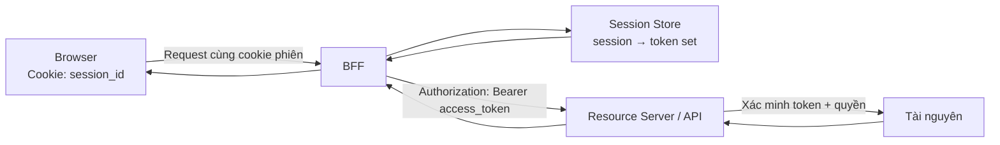
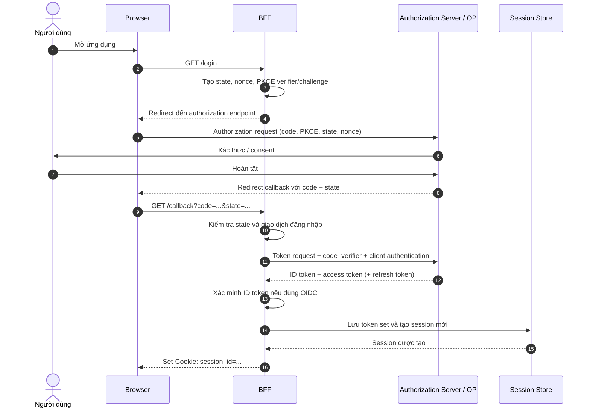
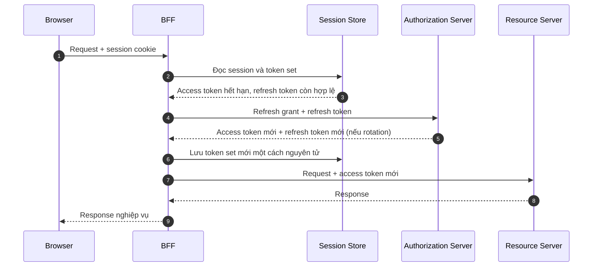
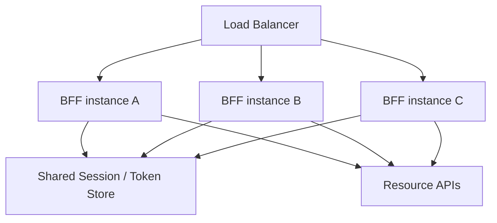

# Phối hợp JWT với mô hình Backend for Frontend

## 1. Backend for Frontend giải quyết vấn đề gì?

Một ứng dụng web có thể gọi API trực tiếp từ trình duyệt và giữ access token ở phía client. Nếu access token là JWT, mã chạy trong trang có thể đọc và gửi token trong header `Authorization`. Cách này hoạt động, nhưng token trở thành dữ liệu hiện diện trong môi trường trình duyệt: lỗi XSS, thư viện bên thứ ba hoặc mã độc chạy cùng origin có thể tìm cách lấy token và sử dụng nó.

**Backend for Frontend (BFF)** là một mẫu kiến trúc đặt một backend riêng giữa giao diện web và các API phía sau. BFF đại diện cho ứng dụng trình duyệt khi giao tiếp với authorization server và resource server. Trong mô hình phổ biến:

- Trình duyệt chỉ giữ một cookie phiên có giá trị ngẫu nhiên, thường là session ID opaque.
- BFF giữ access token, refresh token và thông tin phiên ở phía máy chủ.
- Khi trình duyệt gọi BFF, BFF xác định phiên và lấy credential tương ứng.
- BFF gọi API phía sau, gửi access token trong header `Authorization`.
- Resource server vẫn tự xác minh access token và quyết định quyền truy cập.

Như vậy, JWT có thể tiếp tục được dùng giữa BFF và API, trong khi trình duyệt không cần trực tiếp giữ JWT access token. **BFF thay đổi ranh giới nơi lưu và sử dụng token; nó không thay đổi bản chất hay định dạng của JWT.**

Bài viết thuộc phạm vi **Security - JSON Web Token (JWT)** tổng quát, tập trung vào phối hợp token với BFF trong ứng dụng web, không phụ thuộc ngôn ngữ lập trình hay framework.

## 2. BFF không phải là một loại token hay giao thức OAuth

BFF là một **mẫu kiến trúc**. Nó không phải:

- Một định dạng access token mới.
- Một biến thể của JWT.
- Một grant type OAuth 2.0.
- Một cơ chế mã hóa token.
- Một cơ chế tự động chống XSS hoặc CSRF.

BFF thường hoạt động như một OAuth confidential client ở phía máy chủ. Nó có thể sử dụng Authorization Code Flow với PKCE để lấy token. Access token mà BFF nhận được có thể là JWT hoặc opaque token tùy authorization server. Refresh token cũng có thể là opaque hoặc định dạng khác theo chính sách; OAuth không bắt buộc refresh token là JWT.

| Thành phần | Vai trò |
| --- | --- |
| Browser / Frontend | Hiển thị giao diện, gửi yêu cầu đến BFF bằng cookie phiên |
| BFF | Backend dành cho giao diện; quản lý phiên và token phía máy chủ, điều phối lời gọi API |
| Authorization Server (AS) | Xác thực/ủy quyền theo OAuth hoặc OIDC, phát hành access token và refresh token |
| Resource Server (RS) | API bảo vệ tài nguyên, xác minh access token và kiểm tra quyền |
| Session Store | Lưu trạng thái phiên và liên kết phiên với credential phía máy chủ |

## 3. Kiến trúc tổng thể

### 3.1. Luồng request thông thường



Trình duyệt gửi cookie phiên đến BFF. BFF tra cứu phiên và lấy access token ở phía máy chủ. BFF gọi API với access token; API xác minh token theo profile mà nó hỗ trợ. Phản hồi đi ngược lại qua BFF đến trình duyệt.

### 3.2. Hai ranh giới credential khác nhau

| Kết nối | Credential thường dùng | Bên xác minh |
| --- | --- | --- |
| Browser → BFF | Cookie chứa session ID opaque | BFF / session store |
| BFF → Resource Server | OAuth access token (JWT hoặc opaque) | Resource server |
| BFF → Authorization Server | Authorization code, refresh token và client authentication theo flow | Authorization server |

Cookie phiên không phải access token. Nó chỉ giúp BFF nhận diện phiên của trình duyệt và tra cứu trạng thái phía máy chủ. Access token mới là credential mà BFF trình cho resource server.

### 3.3. BFF giữ token ở phía máy chủ

Một bản ghi phiên phía máy chủ có thể có cấu trúc khái niệm:

```json
{
  "session_id_hash": "<hash-of-random-session-id>",
  "subject": "account-42",
  "issuer": "https://identity.example.org",
  "access_token_encrypted": "<encrypted-access-token>",
  "refresh_token_encrypted": "<encrypted-refresh-token>",
  "access_token_expires_at": 1893456900,
  "session_created_at": 1893456000,
  "last_activity_at": 1893456600
}
```

Đây là ví dụ minh họa, không phải schema bắt buộc. Hệ thống có thể lưu access token dạng opaque hoặc JWT; refresh token có thể không phải JWT. Nếu kho phiên bị truy cập trái phép, token lưu nguyên văn có thể bị sử dụng, vì vậy cần hạn chế quyền truy cập và bảo vệ dữ liệu nhạy cảm khi lưu.

## 4. Luồng đăng nhập: Authorization Code Flow với PKCE

Trong mô hình BFF, trình duyệt khởi tạo quá trình đăng nhập nhưng BFF thường là bên thực hiện việc đổi authorization code lấy token. BFF được đăng ký như một client phù hợp với mô hình confidential client; client authentication được thực hiện ở phía máy chủ khi cấu hình yêu cầu.

### 4.1. Các bước chính

1. Người dùng truy cập ứng dụng; BFF chưa tìm thấy phiên hợp lệ.
2. BFF tạo giao dịch đăng nhập, sinh `state`, `nonce` khi dùng OIDC và PKCE verifier/challenge.
3. Trình duyệt được chuyển hướng đến authorization endpoint của AS/OP.
4. Người dùng xác thực và hoàn tất consent nếu cần.
5. AS chuyển hướng trình duyệt về callback đã đăng ký với authorization code và `state`.
6. BFF kiểm tra `state`, sau đó đổi code tại token endpoint bằng PKCE verifier và client authentication nếu được yêu cầu.
7. Nếu dùng OIDC, BFF xác minh ID token theo OIDC Core.
8. BFF lưu token set và trạng thái người dùng trong session store.
9. BFF sinh session ID mới và gửi cookie phiên cho trình duyệt.
10. Trình duyệt dùng cookie phiên để gọi các endpoint BFF.



Sơ đồ là luồng khái niệm. Chi tiết callback method, cookie, client authentication và response mode phải khớp với cấu hình OAuth/OIDC. Với response mode dùng POST cross-site, cần đánh giá riêng thuộc tính SameSite của cookie giao dịch/correlation.

### 4.2. Vai trò của state, nonce và PKCE

| Giá trị | Vai trò | Bên kiểm tra |
| --- | --- | --- |
| `state` | Liên kết authorization response với giao dịch đăng nhập đã khởi tạo, giảm CSRF/correlation attack trên redirect | BFF tại callback |
| `nonce` | Liên kết ID token với yêu cầu xác thực OIDC và giảm nguy cơ replay/substitution | BFF khi xác minh ID token |
| PKCE `code_verifier` | Chứng minh bên đổi authorization code nắm bí mật gắn với code challenge | AS tại token endpoint |
| Client authentication | Xác thực BFF như OAuth client confidential theo cơ chế đăng ký | AS tại token endpoint |

Các cơ chế này giải quyết những vấn đề khác nhau; không thay thế lẫn nhau. PKCE không thay thế kiểm tra `state`, và `state` không thay thế xác minh ID token.

## 5. Cookie phiên của BFF

### 5.1. Cookie chỉ chứa session ID

Trong BFF pattern, trình duyệt thường nhận cookie chứa một session ID ngẫu nhiên:

```http
Set-Cookie: __Host-bff_session=<random-session-id>; Path=/; Secure; HttpOnly; SameSite=Lax
```

Các thuộc tính thường có ý nghĩa:

| Thuộc tính | Mục đích |
| --- | --- |
| `Secure` | Chỉ gửi cookie qua kết nối HTTPS |
| `HttpOnly` | Không cho script phía trang đọc trực tiếp cookie |
| `SameSite=Lax` | Hạn chế gửi cookie trong nhiều ngữ cảnh cross-site; cần đánh giá với flow redirect thực tế |
| `Path=/` | Cookie có phạm vi toàn bộ path của host |
| `__Host-` prefix | Trình duyệt yêu cầu cookie Secure, Path=/ và không có Domain; giúp giới hạn cookie ở host tạo nó |

Cookie nên là host-only và có giá trị ngẫu nhiên đủ khó đoán. Không đặt access token hoặc refresh token vào cookie phiên chỉ để tránh session store. Cookie chứa session ID là một bearer credential cho phiên BFF; nếu bị đánh cắp, attacker có thể mạo danh phiên cho đến khi phiên bị vô hiệu hóa.

### 5.2. Session ID không phải JWT

Session ID thường là chuỗi ngẫu nhiên opaque, không chứa claims. BFF dùng nó làm khóa tra cứu trạng thái phiên. Không cần ký JWT cho cookie phiên nếu kiến trúc đã dùng session store có kiểm soát.

Phân biệt:

- Cookie là phương tiện lưu và truyền dữ liệu trong trình duyệt.
- Session ID là định danh phiên được gửi trong cookie.
- Session record là trạng thái phiên ở phía máy chủ.
- Access token là credential BFF dùng để gọi resource server.

Đừng dùng một giá trị cho tất cả mục đích nếu điều đó làm mở rộng phạm vi quyền hoặc khiến thu hồi khó khăn.

### 5.3. Vòng đời session

BFF cần:

- Tạo session ID mới sau khi đăng nhập thành công.
- Rotate session ID sau thay đổi mức xác thực hoặc nâng quyền nhạy cảm.
- Có idle timeout và absolute timeout.
- Vô hiệu hóa session record khi đăng xuất hoặc khi phát hiện xâm phạm.
- Xóa cookie bằng đúng tên, path và thuộc tính phù hợp khi kết thúc phiên.
- Không đưa session ID vào URL, log hoặc dữ liệu phân tích.

Nếu session store được chia sẻ giữa nhiều BFF instance, mọi instance cần kiểm tra cùng trạng thái và có quy tắc đồng bộ nhất quán. Sticky session không thay thế việc quản lý vòng đời phiên đúng cách.

## 6. BFF gọi API bằng JWT access token

Sau khi phiên được tạo, trình duyệt gửi yêu cầu đến BFF bằng cookie phiên:

```http
GET /bff/orders HTTP/1.1
Host: app.example.org
Cookie: __Host-bff_session=<random-session-id>
```

BFF tra cứu session record, lấy access token và gọi resource server:

```http
GET /v1/orders HTTP/1.1
Host: api.example.org
Authorization: Bearer <jwt-access-token>
```

### 6.1. Resource server vẫn phải xác minh JWT

BFF không được xem việc đã xác thực phiên người dùng là lý do để bỏ qua xác minh access token tại API. Resource server cần xác minh theo profile và hợp đồng đã thống nhất:

1. Token đúng loại/profile access token được hỗ trợ.
2. Issuer là authorization server tin cậy.
3. Chữ ký hợp lệ theo khóa và thuật toán được cho phép.
4. Audience bao gồm resource server hiện tại.
5. Claims thời gian như `exp` và `nbf` hợp lệ.
6. Scope/permission đủ cho thao tác.
7. Quyền trên tài nguyên cụ thể được đáp ứng.
8. Sender constraint hoặc trạng thái thu hồi được kiểm tra nếu profile yêu cầu.

Nếu dùng JWT access token theo RFC 9068, resource server cần tuân thủ profile, bao gồm phân biệt token bằng `typ: at+jwt` và kiểm tra các claims bắt buộc.

### 6.2. BFF không nên biến mình thành authorization server tùy tiện

BFF có thể giới hạn endpoint nào được phép gọi và chọn API tương ứng với phiên, nhưng nó không nên tự tạo hoặc tự sửa claims trong access token. Quyền phải do AS cấp và được RS xác minh. BFF có thể áp dụng thêm chính sách giao diện hoặc kiểm tra nghiệp vụ, nhưng resource server vẫn là nơi bảo vệ tài nguyên.

### 6.3. Giới hạn phạm vi API mà BFF công khai

BFF nên cung cấp API phục vụ nhu cầu của giao diện, không nhất thiết proxy mọi endpoint phía sau. Một BFF có thể:

- Tổng hợp dữ liệu từ nhiều resource server.
- Chuyển đổi response sang cấu trúc phù hợp giao diện.
- Giới hạn method và tài nguyên mà phiên có thể yêu cầu.
- Áp dụng rate limit và kiểm tra dữ liệu đầu vào.
- Không chuyển tiếp header nhạy cảm không cần thiết.

Không chuyển tiếp cookie phiên của browser đến resource server nếu API không có hợp đồng rõ ràng yêu cầu điều đó. Thông thường BFF chỉ gửi access token và các metadata cần thiết.

## 7. Access token và refresh token được lưu ở đâu?

### 7.1. Lưu token phía máy chủ

Trong BFF pattern, access token và refresh token được lưu trong session store hoặc kho token phía máy chủ. Một số nguyên tắc:

- Chỉ lưu token cần thiết cho phiên.
- Hạn chế quyền đọc kho phiên/token theo nguyên tắc least privilege.
- Mã hóa token khi lưu trữ nếu kho dữ liệu hoặc threat model yêu cầu; quản lý khóa mã hóa riêng và an toàn.
- Không ghi token nguyên văn vào log, trace, error report hoặc analytics.
- Không trả token trong response BFF cho trình duyệt.
- Xóa token khi phiên kết thúc hoặc khi credential bị thu hồi theo chính sách.
- Giới hạn thời gian tồn tại của bản ghi và dữ liệu sao lưu.

Mã hóa at-rest không bảo vệ token nếu attacker chiếm được BFF process hoặc quyền giải mã. Cần bảo vệ cả runtime, secret, quyền truy cập và kênh giao tiếp.

### 7.2. Không đưa token vào nơi lưu phía browser

Mục tiêu của BFF là giảm việc access/refresh token hiện diện trong môi trường trình duyệt. Tránh trả token cho frontend hoặc lưu chúng trong:

- Local storage.
- Session storage.
- IndexedDB.
- Cookie có thể đọc từ script.
- URL hoặc fragment.
- Log phía client, telemetry hoặc error tracking.

Cookie phiên vẫn là credential nhạy cảm và có thể bị lạm dụng nếu bị đánh cắp. Nhưng nó là một session handle opaque có thể vô hiệu hóa tập trung, trong khi access/refresh token được giữ và quản lý ở phía máy chủ.

### 7.3. Mã hóa và phân tách dữ liệu

Nếu token được lưu trong kho dữ liệu:

- Có thể lưu token dưới dạng ciphertext với khóa quản lý ngoài kho dữ liệu.
- Tách quyền truy cập dữ liệu phiên khỏi quyền giải mã token khi kiến trúc cho phép.
- Luân chuyển khóa mã hóa và có quy trình xử lý bản sao lưu.
- Không dùng cùng một secret cho session ID, ký JWT và mã hóa token store.
- Giới hạn dữ liệu được trả về khi tra cứu session; không trả token set cho endpoint browser-facing.

## 8. Refresh token rotation trong BFF

### 8.1. Vì sao BFF cần xử lý refresh?

Access token thường có thời hạn ngắn. Khi access token hết hạn, BFF có thể dùng refresh token phía máy chủ để xin access token mới. Trình duyệt không cần biết refresh token hoặc thực hiện refresh trực tiếp.



### 8.2. Cập nhật token set an toàn

Nếu authorization server sử dụng refresh token rotation, refresh token cũ có thể bị vô hiệu hóa sau khi sử dụng. BFF cần:

1. Khóa hoặc điều phối refresh theo session/token family để tránh nhiều request đồng thời dùng cùng refresh token.
2. Gửi refresh token hiện tại đến đúng token endpoint.
3. Nhận access token mới và refresh token mới nếu được cấp.
4. Cập nhật token set trong session store một cách nguyên tử.
5. Chỉ tiếp tục request khi token set mới được lưu thành công.
6. Không tiếp tục dùng refresh token cũ sau khi rotation thành công.

Nếu nhiều request đồng thời cùng phát hiện access token hết hạn, chúng có thể cùng cố refresh. Điều này có thể kích hoạt reuse detection hoặc làm một request thành công nhưng request khác thất bại. BFF cần cơ chế single-flight/lock hoặc điều phối tương đương cho mỗi session/token family.

Nếu refresh token bị từ chối hoặc bị phát hiện reuse, BFF nên vô hiệu hóa phiên/credential liên quan và yêu cầu xác thực lại theo chính sách. Không retry vô hạn với refresh token đã bị từ chối.

### 8.3. Khi không có refresh token

Không phải token response nào cũng có refresh token. Nếu không có refresh token hoặc refresh không còn hợp lệ, BFF có thể:

- Dùng lại phiên OP qua một authorization flow mới nếu chính sách cho phép.
- Chuyển người dùng qua đăng nhập/xác thực lại.
- Kết thúc phiên BFF nếu không thể tiếp tục an toàn.

BFF không tự kéo dài `exp` của access token hoặc sửa claims để làm token có vẻ còn hạn.

## 9. CSRF: rủi ro quan trọng khi BFF dùng cookie

### 9.1. Cookie được trình duyệt tự động gửi

Khi BFF dùng cookie phiên, trình duyệt có thể tự động đính kèm cookie theo domain/path/SameSite và ngữ cảnh request. Một website độc hại có thể tìm cách khiến trình duyệt người dùng gửi yêu cầu đến BFF trong khi người dùng đang có phiên đăng nhập.

Đây là lý do BFF **không tự động loại bỏ CSRF**. Việc access token được giữ phía máy chủ giúp giảm token exposure ở browser, nhưng cookie phiên tạo ra một bề mặt CSRF cần được bảo vệ.

### 9.2. Các lớp phòng chống CSRF

Tùy kiến trúc, BFF có thể kết hợp:

- **CSRF token:** giá trị khó đoán gắn với phiên/giao dịch; yêu cầu trình duyệt gửi lại trong custom header hoặc body và BFF kiểm tra.
- **SameSite cookie:** chọn `Lax` hoặc `Strict` khi phù hợp; dùng `None; Secure` chỉ khi thực sự cần cross-site cookie.
- **Origin validation:** với request thay đổi trạng thái, kiểm tra `Origin` có khớp origin frontend đã cấu hình.
- **Referer validation:** có thể dùng như tín hiệu bổ sung khi phù hợp, không dựa vào nó một cách mù quáng.
- **Custom request header:** có thể buộc request cross-origin qua preflight trong trình duyệt, nhưng vẫn cần kiểm tra server-side.
- **HTTP method semantics:** không dùng GET/HEAD cho thao tác thay đổi trạng thái.

Không có một biện pháp đơn lẻ phù hợp mọi ứng dụng. Cần xác định threat model, cách cookie được gửi và các endpoint có tác động trạng thái.

### 9.3. State, nonce và CSRF token của BFF không giống nhau

| Cơ chế | Phạm vi bảo vệ | Thời điểm kiểm tra |
| --- | --- | --- |
| OAuth `state` | Liên kết authorization response với giao dịch đăng nhập khởi tạo | OAuth callback |
| OIDC `nonce` | Liên kết ID token với authentication request | Xác minh ID token |
| CSRF token của BFF | Bảo vệ các request browser → BFF dùng cookie phiên | Các endpoint BFF có rủi ro CSRF |
| PKCE | Ràng buộc authorization code với bên giữ verifier | Token endpoint |

Không tái sử dụng một giá trị cho tất cả cơ chế hoặc bỏ qua một cơ chế vì đã có cơ chế khác.

## 10. CORS và cùng origin trong mô hình BFF

Một lợi ích vận hành của BFF là có thể phục vụ giao diện và endpoint BFF dưới cùng origin:

```text
https://app.example.org/       -> Frontend
https://app.example.org/bff/*  -> BFF
```

Khi browser gọi BFF cùng origin, thường không cần CORS cho đường giao tiếp đó. BFF gọi resource server từ phía máy chủ nên CORS của trình duyệt không áp dụng cho lời gọi server-to-server.

Nếu frontend và BFF nằm ở origin khác nhau, trình duyệt có thể cần CORS:

- Cho phép origin frontend cụ thể.
- Nếu dùng cookie cross-origin với credentials mode `include`, trả `Access-Control-Allow-Credentials: true` và `Access-Control-Allow-Origin` cụ thể; không dùng wildcard.
- Cho phép các method và header cần thiết, bao gồm custom CSRF header nếu có.
- Dùng `Vary: Origin` khi response phụ thuộc origin.
- Vẫn xác minh CSRF token và session ở BFF.

CORS không thay thế CSRF protection. Cho phép origin đọc response không có nghĩa request đã được xác thực hoặc được phép thực hiện nghiệp vụ.

## 11. Đăng xuất và thu hồi token

### 11.1. Kết thúc phiên BFF

Khi người dùng đăng xuất, BFF thường cần:

1. Xác định session hiện tại.
2. Vô hiệu hóa session record ở session store.
3. Xóa cookie phiên bằng cùng tên và phạm vi cookie.
4. Xóa hoặc đánh dấu token set không còn được sử dụng.
5. Nếu có refresh token và AS hỗ trợ, gửi yêu cầu revocation theo chính sách.
6. Phối hợp logout OIDC/OP nếu ứng dụng yêu cầu đăng xuất cả phiên tại OP.

Ví dụ xóa cookie:

```http
Set-Cookie: __Host-bff_session=; Path=/; Max-Age=0; Secure; HttpOnly; SameSite=Lax
```

Xóa cookie ở browser mà không vô hiệu hóa session record phía máy chủ là chưa đủ. Attacker còn giữ bản sao cookie có thể tiếp tục sử dụng nếu session record vẫn hoạt động.

### 11.2. Access JWT có thể còn hiệu lực sau logout

Khi BFF xóa session, BFF không còn sử dụng token set đó cho các request mới. Tuy nhiên, access JWT đã phát hành có thể vẫn được resource server chấp nhận đến `exp` nếu resource server chỉ xác minh chữ ký và claims, không kiểm tra trạng thái thu hồi.

Nếu cần thu hồi access token trước hạn, hệ thống có thể dùng:

- Access token thời hạn ngắn.
- OAuth token revocation nếu AS hỗ trợ và có cơ chế để RS nhận biết.
- Introspection hoặc denylist.
- Trạng thái phiên/tài khoản được kiểm tra ở RS.
- Sender-constrained token và biện pháp giảm thiểu replay.

Thu hồi refresh token ngăn việc xin token mới bằng refresh credential đó, nhưng không tự làm mọi access JWT đã phát hành mất hiệu lực ngay lập tức.

## 12. Bảo vệ BFF và giảm thiểu rủi ro XSS

### 12.1. BFF giảm token exposure, không loại bỏ XSS

Nếu access token và refresh token không được trả về browser, mã chạy trong trang khó lấy trực tiếp token hơn. Đây là một lợi ích lớn của BFF. Tuy nhiên, XSS vẫn có thể:

- Đọc dữ liệu mà người dùng được phép xem.
- Gửi request đến BFF bằng cookie phiên hiện có.
- Thực hiện hành động thay người dùng trong phạm vi phiên.
- Đọc response mà frontend được phép nhận.

`HttpOnly` ngăn script đọc trực tiếp session cookie, nhưng không ngăn script độc hại gửi request cùng origin vì trình duyệt tự đính kèm cookie.

Do đó vẫn cần:

- Ngăn XSS bằng output encoding, sanitization và chính sách nội dung phù hợp.
- Hạn chế script bên thứ ba và quyền truy cập của chúng.
- Dùng Content Security Policy (CSP) theo threat model.
- Bảo vệ CSRF và kiểm tra quyền ở BFF/API.
- Giới hạn thời hạn phiên và phát hiện hoạt động bất thường.

### 12.2. BFF là một thành phần có quyền cao

BFF nắm giữ token có thể truy cập tài nguyên thay mặt người dùng. Nếu BFF bị chiếm quyền, attacker có thể truy cập session store, token set và các API phía sau. Vì vậy:

- Giới hạn quyền mạng và quyền dữ liệu của BFF.
- Bảo vệ secret client và khóa mã hóa token store.
- Tách môi trường và credential giữa các ứng dụng/tenant.
- Kiểm tra quyền của từng endpoint BFF.
- Không tạo proxy mở cho URL tùy ý do browser cung cấp.
- Chặn SSRF và giới hạn destination của các lời gọi server-to-server.
- Giới hạn request size, rate và thời gian xử lý.
- Giám sát việc sử dụng token và không log token nguyên văn.

## 13. Triển khai nhiều instance và quản lý session store

Trong môi trường có nhiều BFF instance, phiên cần được truy cập nhất quán:



Các yêu cầu vận hành:

- Session store có tính sẵn sàng và kiểm soát truy cập phù hợp.
- Mỗi session ID tra cứu ra đúng token set và trạng thái.
- Cập nhật refresh token rotation phải nguyên tử hoặc có cơ chế khóa tương đương.
- Phiên hết hạn phải được dọn dẹp theo chính sách.
- Backup/replica không làm lộ token hoặc kéo dài credential đã bị thu hồi.
- Khi session store không khả dụng, BFF phải xử lý theo hướng an toàn; không bỏ qua xác minh phiên hoặc tự tạo phiên mặc định.

Sticky session có thể giảm một số lần tra cứu nhưng không giải quyết nhất quán, thu hồi và failover. Với nhiều instance, shared store hoặc một cơ chế session distribution được thiết kế rõ ràng thường dễ kiểm soát hơn.

## 14. BFF và các mô hình lưu token khác

| Tiêu chí | SPA giữ token ở browser | BFF giữ token phía server |
| --- | --- | --- |
| Access/refresh token hiện diện ở browser | Có thể có | Không cần trả cho browser |
| Credential browser gửi đến backend | Thường là access token trực tiếp đến API | Cookie session đến BFF |
| API call | Browser gọi resource server | BFF gọi resource server |
| Rủi ro XSS lấy access token | Cao hơn nếu token có thể đọc từ nơi lưu phía browser | Giảm khả năng lấy trực tiếp token; XSS vẫn có thể thao tác qua phiên |
| Rủi ro CSRF | Phụ thuộc cách credential được gửi; bearer header do trang chủ động thêm có hành vi khác cookie | Cần bảo vệ vì cookie phiên tự động được gửi |
| Quản lý refresh token | Phía browser hoặc một backend trung gian | Phía BFF |
| Hạ tầng | Có thể ít thành phần server hơn | Cần BFF và session/token store |
| Độ trễ | Browser gọi API trực tiếp | Thêm một hop qua BFF |
| Kiểm soát API theo giao diện | Phân tán giữa frontend/API | Có thể tập trung endpoint và response tại BFF |

Không có mô hình nào phù hợp mọi ứng dụng. BFF thường phù hợp khi muốn giữ OAuth token ở phía server và có backend riêng cho giao diện. SPA gọi API trực tiếp có thể phù hợp với một số hệ thống có threat model, cách lưu credential và cơ chế sender constraint được đánh giá kỹ.

## 15. Khi nào nên dùng BFF?

BFF đáng cân nhắc khi:

1. Ứng dụng web muốn tránh để access/refresh token xuất hiện trong môi trường trình duyệt.
2. Có thể vận hành một backend riêng và session store an toàn.
3. Giao diện cần tổng hợp dữ liệu từ nhiều API hoặc cần API chuyên biệt cho frontend.
4. Muốn tập trung quản lý refresh token và chính sách phiên ở phía máy chủ.
5. Muốn giảm phụ thuộc của frontend vào cấu trúc nội bộ của access token.
6. Có khả năng xử lý CSRF, session lifecycle, secret management và vận hành BFF.

BFF có thể không cần thiết hoặc không phù hợp khi:

- Client là ứng dụng native/mobile không có mô hình browser cookie tương tự.
- Hệ thống chỉ là service-to-service và không có trình duyệt/người dùng tương tác.
- Không thể vận hành BFF hoặc session store với độ sẵn sàng và bảo mật cần thiết.
- Thêm một hop server gây ảnh hưởng lớn đến độ trễ mà lợi ích không tương xứng.
- Backend trở thành proxy tổng quát, mở rộng quyền truy cập không kiểm soát.

Quyết định nên dựa trên threat model, yêu cầu UX, topology hệ thống, năng lực vận hành và loại client.

## 16. Những lỗi thiết kế thường gặp

1. **Đặt access token vào cookie phiên:** làm lẫn session handle với API credential và có thể mở rộng rủi ro khi cookie bị gửi tự động.
2. **Trả refresh token về frontend:** phá vỡ mục tiêu giữ refresh credential ở server.
3. **Tin cookie là bằng chứng người dùng có quyền trên mọi API:** BFF vẫn phải xác minh session và API vẫn phải xác minh access token.
4. **Không xoay session ID sau đăng nhập:** tạo nguy cơ session fixation.
5. **Dùng cookie nhưng không có CSRF protection:** cookie tự động được gửi trong các ngữ cảnh phù hợp.
6. **Cho rằng SameSite thay thế hoàn toàn CSRF token:** SameSite là một lớp phòng vệ, cần đánh giá theo luồng và trình duyệt.
7. **Cho rằng BFF loại bỏ XSS:** XSS vẫn có thể gọi endpoint BFF và đọc dữ liệu được phép.
8. **Để nhiều request đồng thời refresh cùng một token:** gây race condition và reuse detection ngoài ý muốn.
9. **Lưu token nguyên văn trong kho dữ liệu/log:** làm tăng hậu quả khi kho hoặc hệ thống quan sát bị lộ.
10. **Không thu hồi session phía server khi logout:** cookie cũ có thể tiếp tục dùng.
11. **Cho rằng logout làm access JWT mất hiệu lực tức thì:** RS có thể chấp nhận token đến `exp` nếu không có kiểm tra trạng thái.
12. **BFF proxy URL tùy ý:** có thể tạo SSRF hoặc biến BFF thành điểm truy cập nội bộ.
13. **Bỏ qua xác minh JWT ở resource server vì BFF đã xác thực:** làm mất ranh giới tin cậy API.
14. **Dùng một session store hoặc khóa chung cho mọi ứng dụng:** mở rộng phạm vi thiệt hại giữa các hệ thống.

## 17. Checklist bảo mật cho mô hình BFF + JWT

### Luồng OAuth/OIDC

- [ ] BFF được đăng ký đúng loại client và dùng Authorization Code Flow.
- [ ] PKCE được sử dụng; client authentication được thực hiện phía server khi cần.
- [ ] `state` được kiểm tra tại callback.
- [ ] `nonce` được kiểm tra khi dùng OIDC.
- [ ] Redirect URI được đăng ký và so khớp chính xác.
- [ ] ID token được xác minh theo OIDC trước khi dùng claims.

### Phiên và cookie

- [ ] Browser chỉ nhận session ID opaque; không nhận access/refresh token.
- [ ] Cookie có Secure, HttpOnly và SameSite phù hợp.
- [ ] Session ID có entropy cao và được rotate sau đăng nhập/nâng quyền.
- [ ] Có idle timeout, absolute timeout và logout phía server.
- [ ] Cookie được xóa với đúng tên/path/attributes khi kết thúc phiên.
- [ ] Session store được bảo vệ và chia sẻ nhất quán giữa các instance.

### Token store và refresh

- [ ] Token được lưu phía server, giới hạn quyền truy cập và mã hóa khi phù hợp.
- [ ] Token không xuất hiện trong log, URL, trace hoặc response browser-facing.
- [ ] Refresh token rotation được xử lý có khóa/điều phối theo session.
- [ ] Token set mới được lưu nguyên tử trước khi sử dụng tiếp.
- [ ] Refresh reuse hoặc refresh failure có quy trình thu hồi/yêu cầu đăng nhập lại.
- [ ] Logout có xử lý refresh token revocation khi hỗ trợ.

### CSRF, XSS và CORS

- [ ] Các endpoint dùng cookie có CSRF protection phù hợp.
- [ ] Origin được kiểm tra cho request thay đổi trạng thái khi áp dụng.
- [ ] SameSite được xem là một lớp phòng vệ, không phải biện pháp duy nhất.
- [ ] Có biện pháp giảm XSS như output encoding, CSP và kiểm soát script bên thứ ba.
- [ ] CORS chỉ cho phép origin cần thiết; credentialed CORS không dùng wildcard.
- [ ] Không cho phép preflight đồng nghĩa với cho phép nghiệp vụ.

### Resource server và vận hành

- [ ] RS tự xác minh access token theo profile, issuer, audience, chữ ký và thời gian.
- [ ] RS kiểm tra scope/permission và quyền trên tài nguyên.
- [ ] Có kế hoạch thu hồi access token trước hạn khi yêu cầu.
- [ ] BFF chỉ gọi các destination được cho phép và có biện pháp chống SSRF.
- [ ] Có rate limit, input validation, giám sát và xử lý sự cố.
- [ ] Khóa ký, secret client và khóa mã hóa token store được quản lý riêng.

## 18. Kết luận

BFF tạo một ranh giới backend giữa trình duyệt và các API. Trong mô hình phổ biến, trình duyệt giữ cookie chứa session ID opaque; BFF giữ access token và refresh token phía máy chủ; BFF gửi access token đến resource server; resource server vẫn xác minh token và quyết định quyền.

Mô hình này giúp giảm việc access/refresh token xuất hiện trong môi trường trình duyệt và tập trung quản lý refresh token, nhưng đổi lại cần vận hành session store, bảo vệ BFF, xử lý CSRF, quản lý vòng đời phiên và đồng bộ refresh token rotation. `HttpOnly`, `SameSite` và CORS không tự giải quyết toàn bộ các rủi ro này.

**JWT và BFF đảm nhiệm hai lớp khác nhau:** JWT là định dạng credential có thể được resource server xác minh; BFF là kiến trúc quyết định credential được giữ và chuyển tiếp qua những ranh giới nào. Thiết kế an toàn cần xác minh access token ở resource server, bảo vệ cookie/session ở BFF và có cơ chế thu hồi phù hợp với yêu cầu nghiệp vụ.

## Tài liệu tham khảo

- [RFC 6749 — The OAuth 2.0 Authorization Framework](https://www.rfc-editor.org/rfc/rfc6749): authorization code, access token và refresh token.
- [RFC 7636 — Proof Key for Code Exchange (PKCE)](https://www.rfc-editor.org/rfc/rfc7636): ràng buộc authorization code với code verifier.
- [RFC 9700 — Best Current Practice for OAuth 2.0 Security](https://www.rfc-editor.org/rfc/rfc9700): khuyến nghị bảo mật OAuth 2.0 hiện hành.
- [OpenID Connect Core 1.0](https://openid.net/specs/openid-connect-core-1_0.html): ID token, nonce và xác minh OIDC.
- [RFC 9068 — JWT Profile for OAuth 2.0 Access Tokens](https://www.rfc-editor.org/rfc/rfc9068): profile JWT access token.
- [RFC 7009 — OAuth 2.0 Token Revocation](https://www.rfc-editor.org/rfc/rfc7009): thu hồi access token và refresh token.
- [RFC 6750 — OAuth 2.0 Bearer Token Usage](https://www.rfc-editor.org/rfc/rfc6750): cách truyền bearer access token.
- [OWASP Session Management Cheat Sheet](https://cheatsheetseries.owasp.org/cheatsheets/Session_Management_Cheat_Sheet.html): session ID, cookie và vòng đời phiên.
- [OWASP Cross-Site Request Forgery Prevention Cheat Sheet](https://cheatsheetseries.owasp.org/cheatsheets/Cross-Site_Request_Forgery_Prevention_Cheat_Sheet.html): các biện pháp chống CSRF.
- [OWASP Cross Site Scripting Prevention Cheat Sheet](https://cheatsheetseries.owasp.org/cheatsheets/Cross_Site_Scripting_Prevention_Cheat_Sheet.html): giảm thiểu XSS.
