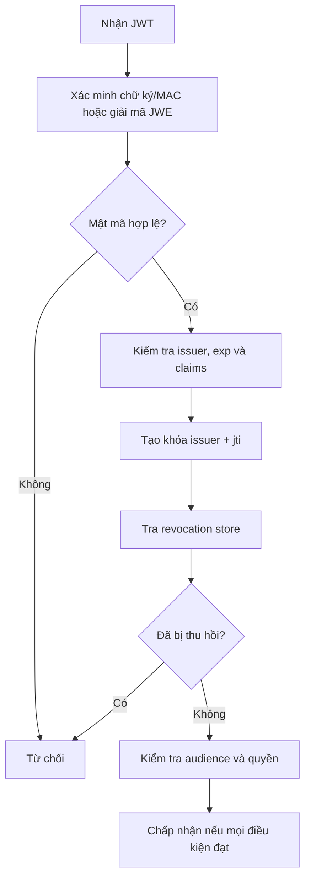

# Danh sách thu hồi theo jti và thời hạn lưu trạng thái

## 1. Vì sao JWT cần cơ chế thu hồi?

Trong module **SECURITY_TOKEN_SECURITY_JWT — Security - JSON Web Token (JWT)**, JWT thường được xác minh bằng chữ ký hoặc giải mã mà không cần truy vấn trạng thái phiên ở mọi request. Cách này giảm phụ thuộc vào trạng thái phía server, nhưng tạo ra một vấn đề: sau khi token được phát hành, việc logout hoặc khóa tài khoản không tự làm token mất hiệu lực.

**JWT có chữ ký hợp lệ không đồng nghĩa token chưa bị thu hồi.** Xác minh mật mã và kiểm tra trạng thái thu hồi là hai bước riêng biệt.

Một **revocation list** (danh sách thu hồi, thường triển khai như denylist) lưu định danh của các token đã bị vô hiệu hóa. Bên xác minh kiểm tra JWT có nằm trong danh sách hay không. Với JWT có claim `jti`, hệ thống có thể dùng `jti` kết hợp issuer để nhận diện chính xác token.

Danh sách thu hồi cho phép vô hiệu hóa token trước thời điểm hết hạn, nhưng thêm một bước tra cứu trạng thái và yêu cầu kho dữ liệu có tính sẵn sàng, nhất quán cùng chính sách lưu trữ phù hợp.

## 2. Revocation list hoạt động như thế nào?

Một luồng xử lý thông thường:

1. Issuer phát hành JWT có claim `jti` duy nhất và claim `exp`.
2. Khi có sự kiện thu hồi, hệ thống xác thực quyền thu hồi và ghi định danh token vào revocation store.
3. Bên nhận xác minh chữ ký/MAC hoặc giải mã JWE theo profile.
4. Bên nhận kiểm tra issuer, thời hạn và các claim bắt buộc.
5. Bên nhận tra cứu cặp issuer và `jti` trong revocation store.
6. Nếu có bản ghi thu hồi còn hiệu lực, từ chối token; nếu không, tiếp tục kiểm tra quyền.



Không tin `iss` hoặc `jti` từ token chưa được xác minh để quyết định issuer nào được phép truy vấn hoặc ghi trạng thái. Có thể dùng dữ liệu chưa xác minh để định tuyến sơ bộ tới cấu hình issuer trong allowlist, nhưng phải xác minh mật mã và đối chiếu issuer chính xác trước khi tin claims.

Lưu ý về JWE: giải mã JWE và xác minh Authentication Tag bảo vệ nội dung đối với recipient, nhưng tự nó không chứng minh ai đã tạo JWE. Nếu revocation policy dựa vào issuer để nhận diện nguồn phát hành, profile phải yêu cầu chữ ký JWS bên trong hoặc một cơ chế xác thực nguồn gốc/kênh phát hành đáng tin cậy tương đương.

## 3. Claim jti và định danh token

`jti` (*JWT ID*) là claim định danh JWT. RFC 7519 định nghĩa nó là định danh duy nhất cho token; issuer phải chọn giá trị sao cho xác suất trùng lặp không đáng kể. `jti` là tùy chọn trong JWT nói chung, nhưng profile muốn thu hồi từng token bằng denylist nên yêu cầu claim này.

RFC 7519 cũng yêu cầu ngăn va chạm `jti` giữa các issuer khác nhau khi ứng dụng dùng nhiều issuer. Dù vậy, lưu khóa theo cặp issuer và `jti` vẫn là biện pháp phòng thủ bổ sung: nó cô lập trust domain, giảm tác động khi cấu hình issuer sai và làm rõ phạm vi của mỗi bản ghi.

Ví dụ Claims Set:

```json
{
  "iss": "https://issuer.example",
  "sub": "user-42",
  "aud": "orders-api",
  "jti": "f4c8c9a6-4d9d-4a7a-a6e7-2e9c2e83a101",
  "iat": 1795000000,
  "exp": 1795003600
}
```

Nguyên tắc thiết kế:

- Mỗi token cần thu hồi độc lập phải có `jti` riêng.
- Không tái sử dụng `jti` cho token mới.
- `jti` là định danh, không phải bí mật hoặc bằng chứng xác thực.
- Giới hạn kiểu dữ liệu, độ dài và encoding của `jti`.
- Không nhúng thông tin cá nhân vào `jti`; ưu tiên giá trị ngẫu nhiên/opaque.
- Namespace theo issuer vì hai issuer độc lập có thể dùng cùng chuỗi `jti`.

Khóa logic nên là cặp giá trị trusted issuer và jti. Trong hệ thống nhiều tenant, có thể cần thêm trust domain/tenant theo cấu hình. Không dùng issuer hoặc tenant do client tự khai báo mà chưa đối chiếu với nguồn tin cậy.

## 4. Thiết kế bản ghi thu hồi

Một bản ghi có thể chứa:

| Trường | Mục đích |
| --- | --- |
| issuer / trust domain | Namespace của token |
| jti hoặc digest của jti | Định danh token bị thu hồi |
| revokedAt | Thời điểm ghi nhận thu hồi |
| retainUntil | Thời điểm không còn cần giữ trạng thái |
| reasonCode | Mã lý do thu hồi, tránh chứa dữ liệu nhạy cảm |
| revokedBy / source | Nguồn yêu cầu thu hồi nếu cần audit |

Không nên lưu toàn bộ JWT trong revocation list. Token có thể chứa claims nhạy cảm và bản thân nó là bearer credential. Lưu token đầy đủ làm tăng hậu quả nếu kho trạng thái hoặc log bị lộ.

Có thể lưu issuer và `jti` trực tiếp nếu kho được bảo vệ. Nếu muốn giảm khả năng lộ giá trị `jti` trong bản ghi hoặc log, có thể lưu digest như HMAC-SHA-256 trên biểu diễn chuẩn hóa của issuer và `jti` bằng khóa nội bộ. Dùng hai trường riêng hoặc cách mã hóa tuple không mơ hồ; không nối chuỗi tùy tiện nếu delimiter có thể xuất hiện trong dữ liệu.

Ví dụ schema:

```json
{
  "issuer": "https://issuer.example",
  "jtiDigest": "base64url-of-keyed-digest",
  "revokedAt": 1795001000,
  "retainUntil": 1795003660,
  "reasonCode": "USER_LOGOUT"
}
```

Nên đặt unique key trên định danh thu hồi gồm issuer và digest jti. Thao tác revoke nên idempotent: request lặp không tạo bản ghi trùng và không vô tình rút ngắn thời hạn lưu.

## 5. Tính thời hạn lưu bản ghi từ exp

Mục tiêu là giữ trạng thái thu hồi ít nhất cho tới khi token không còn được bên xác minh chấp nhận.

`exp` trong JWT là NumericDate, biểu diễn thời điểm hết hạn theo số giây kể từ Unix epoch. Theo RFC 7519, token không được chấp nhận tại hoặc sau thời điểm hết hạn; profile có thể cho phép một khoảng clock-skew nhỏ để xử lý sai lệch đồng hồ.

Nếu profile cho phép clock-skew tối đa là `L` giây, thời điểm cuối cùng token có thể được chấp nhận là:

```text
retainUntil = exp + L
```

Tại thời điểm thu hồi `now`, TTL còn lại:

```text
ttlSeconds = max(0, retainUntil - now)
```

Nếu datastore nhận TTL theo số nguyên giây, nên làm tròn lên để tránh xóa bản ghi sớm:

```text
ttlSeconds = ceil(max(0, exp + clockSkew - now))
```

Ví dụ:

| Giá trị | Thời điểm |
| --- | ---: |
| exp | 12:00:00 |
| Clock-skew được cho phép | 60 giây |
| retainUntil | 12:01:00 |
| Thời điểm thu hồi | 11:40:00 |
| TTL cần lưu xấp xỉ | 21 phút |

Nếu token đã hết thời hạn chấp nhận khi ghi thu hồi, không cần tạo bản ghi mới. Nếu hệ thống có quy tắc thời gian riêng, phải dùng cùng quy tắc ở bước xác minh và bước tính TTL.

### 5.1. Không quên clock-skew

Nếu bên xác minh chấp nhận token thêm 60 giây sau `exp` nhưng revocation store xóa bản ghi đúng tại `exp`, token đã bị thu hồi có thể được chấp nhận trong khoảng clock-skew còn lại. Vì vậy, thời hạn lưu phải bao phủ toàn bộ khoảng token còn có thể được chấp nhận.

### 5.2. TTL vật lý và thời hạn logic

TTL tự động của datastore thường dọn dữ liệu bất đồng bộ. Bản ghi có thể còn tồn tại sau TTL; điều này thường không ảnh hưởng nếu hệ thống chỉ coi bản ghi có `retainUntil > now` là trạng thái có hiệu lực.

Điều quan trọng là datastore không xóa bản ghi trước `retainUntil`. Cần hiểu độ chính xác và đơn vị TTL của datastore; có thể lưu thêm thời điểm hết hạn logic để kiểm tra khi đọc.

## 6. Nếu token thiếu jti hoặc exp thì sao?

### 6.1. Thiếu jti

Nếu token không có `jti`, hệ thống không thể thu hồi chính xác token đó bằng định danh per-token.

Các lựa chọn:

- Profile yêu cầu per-token revocation thì bắt buộc `jti` phải có và từ chối token thiếu claim.
- Nếu cần thu hồi cả phiên, dùng claim phiên như `sid` hoặc định danh phiên được quản lý riêng.
- Có thể dùng subject/session version để vô hiệu hóa nhiều token, nhưng phải kiểm tra trạng thái tương ứng trên mỗi request.

Không tự tạo `jti` ở phía xác minh rồi coi nó là định danh đã được issuer ký; giá trị đó không nằm trong token và không thể nhận diện nhất quán ở request sau.

### 6.2. Thiếu exp

Nếu token không có `exp`, không thể tính thời hạn lưu tự nhiên từ claim hết hạn. Denylist có thể phải giữ bản ghi vô thời hạn để bảo đảm token không bị chấp nhận trở lại.

Với token cần thu hồi, thiết kế an toàn hơn là yêu cầu `exp` trong profile. Nếu giao thức đặc biệt không có `exp`, phải định nghĩa giới hạn tuổi tối đa dựa trên claim/thời điểm phát hành đã xác thực hoặc trạng thái phiên phía server. Không đặt TTL ngắn tùy tiện rồi xóa bản ghi khi token vẫn có thể được chấp nhận.

### 6.3. exp sai kiểu hoặc không hợp lệ

Nếu `exp` không phải NumericDate hợp lệ, bên xác minh phải từ chối token theo profile. Không dùng giá trị mặc định dễ dãi để tính TTL.

## 7. Quy trình ghi nhận thu hồi

Một endpoint hoặc quy trình quản trị thu hồi nên:

1. Xác thực người gọi hoặc hệ thống yêu cầu thu hồi.
2. Xác minh JWT và lấy issuer/subject/jti/exp từ token đã được xác thực.
3. Kiểm tra người gọi có quyền thu hồi token đó hoặc phiên tương ứng.
4. Tính `retainUntil` từ `exp` và clock-skew policy.
5. Nếu token đã hết thời hạn chấp nhận, kết thúc idempotently mà không cần lưu entry.
6. Ghi bản ghi với unique key gồm issuer và jti hoặc digest tương ứng.
7. Đảm bảo trạng thái được nhìn thấy theo mức nhất quán mà hệ thống cam kết.
8. Ghi audit event tối thiểu, không ghi raw JWT hoặc refresh token.
9. Trả kết quả không làm lộ thông tin về token của người khác.

Mã giả:

```text
function revokeJwt(compactToken, caller):
    require caller is authenticated
    verified = verifyJwtUsingConfiguredProfile(compactToken)
    require callerMayRevoke(verified.issuer, verified.subject, caller)
    require verified.jti exists
    require verified.exp is valid NumericDate

    retainUntil = verified.exp + configuredClockSkew
    now = currentTime()
    if retainUntil <= now:
        return successAlreadyExpired

    key = makeRevocationKey(verified.issuer, verified.jti)
    revocationStore.putIfAbsent(
        key,
        { revokedAt: now, retainUntil: retainUntil },
        ttl = ceil(retainUntil - now)
    )
    publishRevocationInvalidation(key)
    return success
```

Đây là mã giả mô tả quy trình. Nếu dùng OAuth 2.0 Token Revocation Endpoint theo RFC 7009, endpoint và phản hồi phải tuân theo RFC đó. Không tạo endpoint nhận token tùy ý mà bỏ qua xác thực client, quyền sở hữu token hoặc chính sách chống lạm dụng.

## 8. Quy trình kiểm tra thu hồi khi nhận JWT

Bên xác minh nên thực hiện:

1. Kiểm tra serialization và cấu trúc JWT theo profile.
2. Xác minh chữ ký/MAC hoặc giải mã JWE và xác thực Authentication Tag.
3. Kiểm tra issuer, audience, thời hạn và các claim bắt buộc.
4. Yêu cầu `jti` nếu profile dùng per-token revocation.
5. Tạo khóa tra cứu theo issuer và `jti`.
6. Tra revocation store.
7. Nếu có bản ghi thu hồi còn hiệu lực, từ chối token.
8. Nếu không bị thu hồi, tiếp tục kiểm tra scope/role và authorization.

Mã giả:

```text
function validateAccessToken(token, expectedIssuer, expectedAudience):
    jwt = verifyJwtAndParseClaims(token, expectedIssuer)
    require jwt.iss == expectedIssuer
    require audienceMatches(jwt.aud, expectedAudience)
    require jwt.exp is valid and not expired
    require jwt.jti exists

    key = makeRevocationKey(jwt.iss, jwt.jti)
    entry = revocationStore.get(key)
    if entry exists and entry.retainUntil > currentTime():
        reject("revoked token")

    require claimsAndAuthorizationPolicyPass(jwt)
    return jwt
```

Không tra cứu revocation store chỉ bằng `jti` chưa xác minh. Nếu token chưa qua bước xác minh, kẻ tấn công có thể gửi giá trị tùy ý để gây tải lookup hoặc lợi dụng namespace sai.

### 8.1. Kiểm tra trên mọi request hay chỉ khi đăng nhập?

Nếu yêu cầu thu hồi có hiệu lực gần như ngay lập tức, bên nhận phải kiểm tra trạng thái trên mỗi request được bảo vệ hoặc dùng cơ chế phân phối trạng thái có bảo đảm tương đương. Chỉ kiểm tra lúc đăng nhập rồi giữ kết quả trong session dài sẽ làm giảm hiệu lực thu hồi.

Với thao tác rủi ro cao, có thể kiểm tra lại trạng thái ngay trước thao tác quan trọng. Không thể thu hồi ngược một request đã được chấp nhận và thực thi xong.

## 9. Cache kết quả tra cứu và vấn đề nhất quán

Revocation lookup có thể trở thành chi phí đáng kể khi hệ thống xử lý nhiều request. Cache giúp giảm tải nhưng ảnh hưởng tới thời gian thu hồi.

### 9.1. Cache trạng thái đã thu hồi

Cache kết quả **đã thu hồi** thường an toàn hơn cache kết quả chưa thu hồi. Khi token đã được xác nhận revoked, giữ kết quả đó tới `retainUntil` giúp từ chối nhanh. Nếu cần gỡ trạng thái thu hồi, quy trình đó phải được định nghĩa riêng và có invalidation rõ ràng.

### 9.2. Cache trạng thái chưa thu hồi

Cache kết quả **chưa bị thu hồi** có thể làm chậm hiệu lực của thao tác revoke:

1. Instance A kiểm tra token và cache kết quả “chưa thu hồi” trong 2 phút.
2. Quản trị viên thu hồi token.
3. Instance A tiếp tục dùng cache cũ trong thời gian còn lại.

Nếu yêu cầu thu hồi nhanh, không cache kết quả âm hoặc đặt TTL rất ngắn và có invalidation đáng tin cậy. Pub/sub có thể giảm độ trễ nhưng cần xử lý event bị mất, consumer ngắt kết nối và khởi động lại.

### 9.3. Nhiều instance và nhiều vùng

Nếu dữ liệu thu hồi được sao chép bất đồng bộ, một vùng có thể chưa nhìn thấy bản ghi mới và vẫn chấp nhận token đã thu hồi.

Lựa chọn phụ thuộc yêu cầu:

- Dùng kho có read-after-write hoặc consistency mạnh cho trạng thái nhạy cảm.
- Dùng nguồn ghi/đọc authoritative hoặc định tuyến kiểm tra tới cùng trust domain.
- Phân phối invalidation event và có cơ chế đối soát khi event bị mất.
- Định nghĩa rõ độ trễ thu hồi tối đa mà hệ thống chấp nhận.

Không tuyên bố “thu hồi tức thì” nếu kiến trúc có cache âm hoặc replication bất đồng bộ mà không có giới hạn độ trễ.

## 10. Fail-open hay fail-closed khi revocation store lỗi?

Nếu revocation store không truy cập được, bên xác minh không biết token có bị thu hồi hay không. Đây là quyết định bảo mật và availability cần được xác định trong profile.

| Chính sách | Hành vi | Đánh đổi |
| --- | --- | --- |
| **Fail-closed** | Không xác minh được trạng thái thì từ chối request | Bảo vệ tốt hơn nhưng lỗi store có thể làm gián đoạn dịch vụ |
| **Fail-open** | Bỏ qua kiểm tra thu hồi và tiếp tục nếu các kiểm tra khác đạt | Tăng availability nhưng có thể chấp nhận token đã thu hồi |
| **Grace mode có giới hạn** | Dùng cache/trạng thái gần nhất trong khoảng được quy định | Cần giới hạn tuổi, loại lỗi và phạm vi token |

Với thao tác nhạy cảm như thay đổi thông tin bảo mật, thanh toán hoặc quản trị, fail-closed thường phù hợp hơn. Nếu nghiệp vụ buộc phải fail-open, cần giới hạn thời gian, scope và loại endpoint; ghi nhận trạng thái suy giảm và cảnh báo.

Không nhầm “không tìm thấy bản ghi” với “không thể truy cập store”. Không có entry là trạng thái chưa thu hồi; timeout hoặc lỗi kết nối là trạng thái không xác định.

## 11. Thu hồi một token và thu hồi cả phiên

`jti` nhận diện **một JWT cụ thể**. Nếu người dùng có nhiều access token, thu hồi một `jti` không tự động thu hồi các token khác.

| Mục tiêu | Cơ chế phù hợp |
| --- | --- |
| Thu hồi một access token | Denylist theo issuer và jti |
| Thu hồi một refresh token | Revocation theo định danh refresh token và chính sách rotation |
| Thu hồi toàn bộ token của một session | Session identifier như `sid` hoặc session version được kiểm tra phía server |
| Thu hồi toàn bộ phiên của một user | User/session version hoặc trạng thái tài khoản |
| Thu hồi khóa ký bị xâm phạm | Key-level trust policy và loại bỏ khóa khỏi tập được chấp nhận |

Nếu cần thu hồi cả session, có thể đưa claim `sid` vào token và duy trì trạng thái phiên phía server. Khi logout hoặc phát hiện xâm nhập, vô hiệu hóa session identifier; các token gắn với session đó sẽ bị từ chối theo profile.

Không dùng một `jti` chung cho mọi access token của cùng người dùng nếu yêu cầu thu hồi từng token. Điều đó làm mất khả năng phân biệt từng lần phát hành.

## 12. Phân biệt thu hồi với chống replay

Revocation list và replay detection có liên quan nhưng không giống nhau:

- **Revocation:** đánh dấu token không còn được chấp nhận từ một thời điểm trở đi.
- **Replay prevention:** ngăn một thông điệp hoặc proof hợp lệ bị sử dụng lặp lại ngoài quy tắc giao thức.

Một denylist theo `jti` không tự ngăn replay trước khi token bị thu hồi. Token bearer bị sao chép vẫn có thể được dùng nhiều lần cho tới khi hết hạn hoặc bị thu hồi.

Nếu giao thức yêu cầu token chỉ dùng một lần, hệ thống cần lưu trạng thái đã sử dụng và thực hiện thao tác kiểm tra/đánh dấu nguyên tử để tránh hai request đồng thời cùng vượt qua. Với DPoP hoặc proof-of-possession, cần xác minh proof, nonce/replay window và các ràng buộc theo RFC tương ứng; chỉ có `jti` của access token là chưa đủ.

## 13. Bảo vệ revocation store

Revocation store là thành phần của hệ thống xác minh. Nếu kẻ tấn công có thể sửa hoặc xóa bản ghi, họ có thể làm token đã thu hồi được chấp nhận trở lại. Nếu có thể ghi tùy ý, họ có thể làm token hợp lệ bị từ chối hàng loạt.

Các biện pháp cần có:

- Chỉ thành phần được ủy quyền mới được ghi/xóa trạng thái thu hồi.
- Phân quyền đọc/ghi riêng; validator thường chỉ cần quyền đọc.
- Bảo vệ kết nối tới store và thông tin xác thực.
- Bảo vệ dữ liệu lưu trữ và bản sao lưu theo chính sách dữ liệu.
- Audit thao tác thu hồi, phục hồi và xóa bản ghi.
- Rate limit endpoint thu hồi để tránh bị dùng làm công cụ từ chối dịch vụ.
- Không ghi raw JWT, access token hoặc refresh token vào log.
- Kiểm tra định dạng và giới hạn độ dài `iss`, `jti` trước khi tạo key.
- Chống sửa/xóa trái phép và phát hiện thay đổi bất thường về số lượng entry.

Request thu hồi phải được xác thực và kiểm tra quyền sở hữu/ủy quyền. Không cho phép người dùng thu hồi token của chủ thể khác chỉ bằng cách gửi `jti` mà họ tự chọn.

## 14. Dung lượng và hiệu năng

TTL giúp giới hạn dung lượng vì mỗi token bị thu hồi chỉ cần tồn tại tới khi token không còn được chấp nhận.

Ước lượng đơn giản:

```text
activeRevocationEntries
    ≈ revocationsPerSecond × averageRetentionSeconds
```

Ví dụ, nếu hệ thống ghi nhận trung bình 20 lần thu hồi mỗi giây và thời gian lưu trung bình là 3.600 giây:

```text
20 × 3600 = 72,000 active entries
```

Đây là ước lượng gần đúng; dung lượng thực tế còn phụ thuộc kích thước key/value, index, replication, metadata audit và phân bố thời hạn token.

Để vận hành ổn định:

- Dùng TTL tự động để dọn entry hết hạn.
- Giới hạn kích thước `jti` và issuer.
- Dùng index/primary key phù hợp với issuer và jti.
- Tránh quét toàn bộ danh sách để kiểm tra từng request.
- Theo dõi số entry đang hoạt động, tốc độ ghi, tốc độ lookup và độ trễ.
- Dùng batch/cleanup nền nếu datastore không có TTL phù hợp.
- Không xóa entry trước `retainUntil` chỉ để giảm dung lượng.

Nếu tốc độ thu hồi lớn, tính dung lượng theo peak rate và thời hạn token tối đa, không chỉ dựa trên trung bình.

## 15. Các lỗi thiết kế thường gặp

### 15.1. Lưu bản ghi thu hồi vô thời hạn

Điều này làm denylist tăng mãi dù token đã hết hạn từ lâu.

**Cách xử lý:** tính `retainUntil` từ `exp` và clock-skew; dùng TTL phù hợp và kiểm tra thời hạn logic.

### 15.2. TTL ngắn hơn thời gian token còn có thể được chấp nhận

Nếu hệ thống cho phép clock-skew nhưng TTL không cộng leeway, token có thể được chấp nhận sau khi entry bị xóa.

**Cách xử lý:** dùng `exp + maximumAcceptedClockSkew` làm mốc giữ trạng thái.

### 15.3. Chỉ dùng jti, bỏ qua issuer

Hai issuer có thể dùng cùng giá trị `jti`; key collision làm thu hồi nhầm token.

**Cách xử lý:** namespace theo issuer/trust domain và xác minh issuer trước khi tra cứu.

### 15.4. Chấp nhận token không có jti

Hệ thống không thể tra cứu chính xác một token không có định danh.

**Cách xử lý:** bắt buộc `jti` trong profile cần per-token revocation hoặc dùng cơ chế session-level được định nghĩa riêng.

### 15.5. Dùng cache âm quá lâu

Cache “chưa thu hồi” cũ có thể tiếp tục chấp nhận token sau khi entry mới được ghi.

**Cách xử lý:** không cache âm nếu cần thu hồi tức thì; nếu cache, đặt TTL rất ngắn và có invalidation/consistency guarantee.

### 15.6. Fail-open mà không có giới hạn

Khi store lỗi, hệ thống bỏ qua mọi trạng thái thu hồi và tiếp tục chấp nhận token trong thời gian không xác định.

**Cách xử lý:** định nghĩa fail policy theo mức rủi ro, giới hạn thời gian suy giảm, ghi log và cảnh báo.

### 15.7. Tin jti trước khi xác minh JWT

Kẻ tấn công có thể gửi token giả với `iss` hoặc `jti` tùy ý để tạo tải lookup hoặc tác động tới namespace.

**Cách xử lý:** xác minh mật mã và issuer theo trust configuration trước khi dùng claims cho quyết định bảo mật.

### 15.8. Nghĩ rằng thu hồi một jti sẽ logout mọi thiết bị

Mỗi token có thể có `jti` riêng; thu hồi một token không tự động vô hiệu hóa token khác.

**Cách xử lý:** dùng session identifier, token family hoặc version trạng thái nếu nghiệp vụ cần thu hồi theo phiên/tài khoản.

## 16. Kịch bản kiểm thử

| Kịch bản | Kết quả mong đợi |
| --- | --- |
| JWT có `jti` chưa bị thu hồi và chữ ký hợp lệ | Tiếp tục kiểm tra claims/authorization |
| JWT có issuer và jti trong denylist | Từ chối |
| Hai issuer dùng cùng `jti` | Thu hồi một issuer không ảnh hưởng issuer còn lại |
| Token bị thu hồi sát thời điểm `exp` | Entry được giữ tới `exp + leeway` |
| Token đã hết thời gian chấp nhận trước khi revoke | Không cần tạo entry mới |
| Token thiếu `jti` trong profile bắt buộc | Từ chối |
| Token thiếu `exp` trong profile yêu cầu expiration | Từ chối |
| `exp` sai kiểu hoặc không hợp lệ | Từ chối, không tính TTL bằng giá trị mặc định |
| Revoke cùng token nhiều lần | Kết quả idempotent, không tạo entry trùng |
| Store timeout | Áp dụng fail-open/closed/grace policy đã cấu hình |
| Cache âm còn hiệu lực sau khi revoke | Phát hiện độ trễ và xác nhận invalidation/TTL đáp ứng SLA |
| Hai replica đọc trạng thái sau khi revoke | Kết quả nhất quán theo cam kết độ trễ thu hồi |
| Người không có quyền gọi revoke | Từ chối và không ghi entry |
| Token đã thu hồi nhưng chữ ký không hợp lệ | Từ chối ở bước xác minh mật mã; không tin claims chưa xác minh |
| Một session có nhiều token | Thu hồi một `jti` chỉ chặn token đó; session revoke chặn các token thuộc session theo profile |

## 17. Checklist thiết kế

- [ ] Profile yêu cầu `jti` cho token cần thu hồi riêng lẻ.
- [ ] Mỗi lần phát hành token có `jti` riêng và không tái sử dụng.
- [ ] Khóa revocation store bao gồm issuer/trust domain và `jti`.
- [ ] JWT được xác minh mật mã và issuer trước khi tin `jti`/`exp`.
- [ ] Không lưu raw JWT hoặc refresh token trong denylist.
- [ ] Có unique constraint và thao tác revoke idempotent.
- [ ] Bản ghi có `revokedAt` và `retainUntil` rõ ràng.
- [ ] TTL được tính từ `exp + clockSkew`, không xóa sớm.
- [ ] Profile định nghĩa xử lý token thiếu `jti` hoặc `exp`.
- [ ] Kiểm tra trạng thái ở mọi request cần bảo đảm hiệu lực thu hồi.
- [ ] Cache âm có TTL rất ngắn hoặc bị vô hiệu hóa khi có revoke event.
- [ ] Có consistency policy cho nhiều instance/region và SLA độ trễ thu hồi.
- [ ] Có fail-open/fail-closed policy rõ ràng khi store không khả dụng.
- [ ] Bảo vệ quyền ghi/xóa, kết nối, audit và backup của revocation store.
- [ ] Có cơ chế session/family revoke nếu cần thu hồi nhiều token cùng lúc.
- [ ] Không nhầm revocation với replay prevention.
- [ ] Theo dõi số entry, TTL, lookup latency, lỗi store và độ trễ propagation.

## 18. Câu hỏi tự kiểm tra

**Câu 1.** Claim `jti` dùng để làm gì?

**Đáp án:** Định danh duy nhất một JWT để có thể tham chiếu, thu hồi hoặc áp dụng chính sách chống replay theo profile.

**Câu 2.** Vì sao revocation key nên gồm cả `iss` và `jti`?

**Đáp án:** Vì hai issuer khác nhau có thể dùng cùng chuỗi `jti`; namespace theo issuer tránh thu hồi nhầm token.

**Câu 3.** Bản ghi thu hồi nên được giữ tới thời điểm nào?

**Đáp án:** Ít nhất tới khi token không còn được chấp nhận: thông thường là `exp` cộng clock-skew tối đa của profile.

**Câu 4.** Có nên lưu toàn bộ JWT trong revocation store không?

**Đáp án:** Không. Nên lưu issuer và `jti` hoặc digest tương ứng; raw JWT là bearer credential và có thể chứa dữ liệu nhạy cảm.

**Câu 5.** Token thiếu `jti` có thể được thu hồi riêng lẻ bằng denylist theo `jti` không?

**Đáp án:** Không. Profile cần per-token revocation phải yêu cầu `jti`, hoặc dùng một cơ chế session-level khác.

**Câu 6.** Vì sao cache kết quả “chưa thu hồi” có thể nguy hiểm?

**Đáp án:** Vì cache cũ có thể tiếp tục cho phép token sau khi trạng thái thu hồi đã được ghi.

**Câu 7.** Revocation list có ngăn replay token trước khi token bị thu hồi không?

**Đáp án:** Không. Nó chỉ chặn token sau khi trạng thái thu hồi được ghi và nhìn thấy; replay prevention cần cơ chế riêng.

**Câu 8.** Khi revocation store lỗi, fail-open có ý nghĩa gì?

**Đáp án:** Hệ thống bỏ qua kiểm tra thu hồi và có thể tiếp tục chấp nhận token; điều này tăng availability nhưng có nguy cơ chấp nhận token đã bị thu hồi.

## 19. Tài liệu chuẩn tham khảo

- [RFC 7519 — JSON Web Token (JWT)](https://www.rfc-editor.org/rfc/rfc7519): định nghĩa `jti`, `exp`, `iss` và các claim JWT.
- [RFC 8725 — JSON Web Token Best Current Practices](https://www.rfc-editor.org/rfc/rfc8725): xác minh JWT an toàn, kiểm soát issuer, thuật toán và ngữ cảnh token.
- [RFC 7009 — OAuth 2.0 Token Revocation](https://www.rfc-editor.org/rfc/rfc7009): giao thức thu hồi access token và refresh token tại authorization server.
- [RFC 7662 — OAuth 2.0 Token Introspection](https://www.rfc-editor.org/rfc/rfc7662): truy vấn trạng thái token qua introspection endpoint.
- [RFC 9110 — HTTP Semantics](https://www.rfc-editor.org/rfc/rfc9110): ngữ nghĩa HTTP có liên quan tới endpoint và phản hồi dịch vụ.

**Ghi nhớ:** Danh sách thu hồi theo `jti` cho phép vô hiệu hóa một JWT trước `exp`, nhưng cần namespace theo issuer và chỉ dùng claims sau khi xác minh. Giữ bản ghi tới `exp` cộng clock-skew tối đa; không lưu raw token; kiểm soát cache âm và tính nhất quán giữa các instance. Nếu cần thu hồi cả phiên, dùng session/family identifier; nếu cần chống replay, bổ sung cơ chế riêng.
