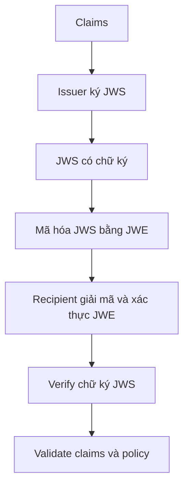
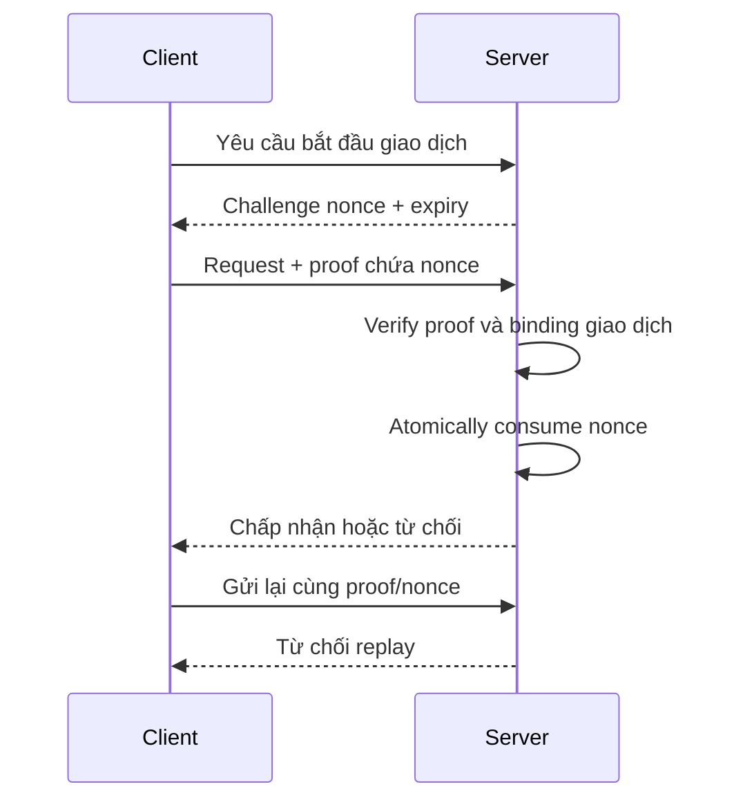
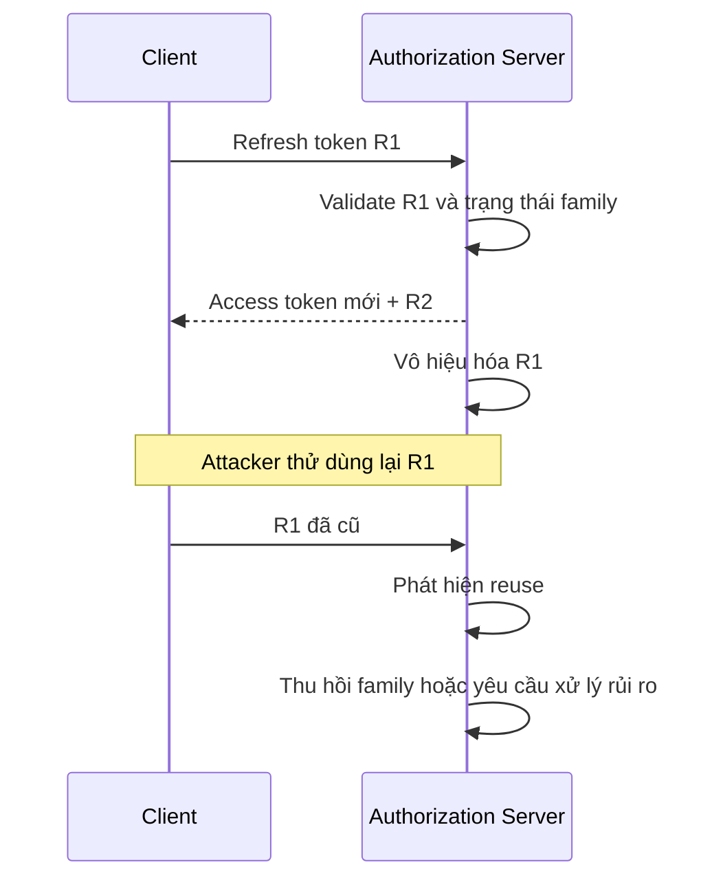

# Phân biệt chống giả mạo, chống đánh cắp và chống phát lại

## 1. Ba mục tiêu bảo mật khác nhau

Khi bảo vệ JSON Web Token (JWT), cần phân biệt ba loại rủi ro thường bị gộp chung:

- **Giả mạo (forgery):** kẻ tấn công tạo token hoặc sửa nội dung token để hệ thống tin một danh tính, quyền hay dữ liệu không do issuer đáng tin phát hành.
- **Đánh cắp (theft):** kẻ tấn công lấy được token hợp lệ của người dùng hoặc dịch vụ, ví dụ từ thiết bị, bộ nhớ, log, backup hoặc đường truyền.
- **Phát lại (replay):** kẻ tấn công gửi lại một token, proof hoặc request hợp lệ đã được quan sát hay thu thập trước đó để thực hiện hành động thêm lần nữa.

Ba rủi ro có liên hệ nhưng không đồng nghĩa. Một token có thể không bị giả mạo nhưng vẫn bị đánh cắp. Một token bị đánh cắp có thể được dùng để phát lại. Một request có thể bị phát lại ngay cả khi kẻ tấn công không sửa token hoặc không biết khóa ký.

JWT là định dạng mang claims và có thể được bảo vệ bằng chữ ký hoặc mã hóa. Bản thân định dạng JWT **không tự cung cấp đầy đủ cơ chế chống đánh cắp hay chống phát lại**. Hệ thống phải kết hợp xác minh mật mã, bảo vệ credential, ràng buộc token với người gửi và quản lý trạng thái theo yêu cầu nghiệp vụ.

Bài học này thuộc chương **Chống phát lại** của học phần **Security - JSON Web Token (JWT)** (SECURITY_TOKEN_SECURITY_JWT). Nội dung áp dụng cho JWT/JOSE và các giao thức sử dụng token nói chung, không phụ thuộc Java hoặc Spring Security.

## 2. Bảng so sánh ba loại tấn công

| Mục tiêu của attacker | Cách tấn công | Điều gì bị phá vỡ? | Nhóm biện pháp chính |
| --- | --- | --- | --- |
| Giả mạo token | Tạo chữ ký/MAC giả, sửa claims, khai thác thuật toán hoặc khóa yếu | Tính xác thực nguồn và tính toàn vẹn | Verify chữ ký, allowlist thuật toán, quản lý khóa, kiểm tra issuer/audience |
| Đánh cắp token | Lấy token hợp lệ từ thiết bị, log, bộ nhớ, backup hoặc mạng | Bí mật và quyền kiểm soát credential | TLS, secure storage, giảm thời gian tồn tại, bảo vệ endpoint, sender-constrained token |
| Phát lại token/request/proof | Gửi lại dữ liệu hợp lệ đã được chấp nhận hoặc quan sát | Tính mới, tính duy nhất hoặc tính một lần của hành động | Expiry, nonce/challenge, replay cache, one-time state, DPoP/mTLS, idempotency |

Không có một cơ chế đơn lẻ giải quyết cả ba mục tiêu:

- Chữ ký hợp lệ không ngăn token bị sao chép.
- Mã hóa không ngăn người có token gửi lại token.
- TLS bảo vệ dữ liệu trên kết nối nhưng không ngăn token đã bị lấy ở endpoint được sử dụng trên kết nối khác.
- Nonce chống phát lại không thể sửa chữa một chữ ký giả hoặc một khóa đã bị đánh cắp.

## 3. Chống giả mạo: bảo vệ nguồn gốc và tính toàn vẹn

### 3.1. Kẻ tấn công giả mạo JWT như thế nào?

Với JWS, attacker có thể thử:

- Sửa claim sub, role, scope, aud hoặc exp rồi giữ nguyên chữ ký cũ.
- Tạo chữ ký bằng một khóa do attacker kiểm soát.
- Khai thác secret HMAC yếu để đoán khóa.
- Lợi dụng việc verifier chấp nhận thuật toán ngoài allowlist hoặc nhầm loại khóa.
- Dùng token alg: none nếu hệ thống cho phép token không chữ ký.
- Khai thác key selection không an toàn để verifier dùng nhầm khóa.

Nếu verifier hoạt động đúng, việc thay đổi payload làm chữ ký không còn hợp lệ và token bị từ chối.

### 3.2. Chữ ký JWS giải quyết phần nào?

JWS ký protected header và payload. Khi verifier kiểm tra chữ ký bằng khóa tin cậy và thuật toán được cho phép, hệ thống có bằng chứng rằng nội dung khớp với chữ ký được tạo bởi bên giữ khóa ký tương ứng.

Với chữ ký bất đối xứng:

- Issuer giữ private signing key.
- Resource server giữ public verification key.
- Verifier có thể xác minh mà không có khả năng ký token mới.

Với MAC đối xứng như HS256, mọi bên giữ cùng secret đều có thể tạo MAC hợp lệ. Nếu nhiều dịch vụ chỉ cần xác minh, dùng chung secret khiến mỗi dịch vụ cũng có khả năng giả mạo token. Cần lựa chọn mô hình khóa phù hợp ranh giới tin cậy.

### 3.3. Những kiểm tra cần có

- Chỉ cho phép danh sách thuật toán đã cấu hình; không lấy quyền cho phép từ alg trong token.
- Chọn khóa từ nguồn tin cậy gắn với issuer đã biết.
- Dùng kid chỉ như gợi ý chọn khóa trong key set đã cấu hình.
- Không tự động tải khóa từ jku hoặc x5u không được tin cậy.
- Kiểm tra chữ ký trước khi tin claims.
- Kiểm tra iss, aud, exp, nbf, loại token và các claim bắt buộc.
- Tách khóa ký và khóa mã hóa theo mục đích.
- Bảo vệ private key/HMAC secret, giới hạn quyền sử dụng và có kế hoạch rotation.

### 3.4. JWE không tự xác thực issuer

JWE cung cấp mã hóa nội dung có xác thực, nhưng authentication tag không tương đương chữ ký issuer. Với mã hóa public key recipient, bất kỳ ai có public key đều có thể tạo JWE mới gửi cho recipient. Với khóa đối xứng, mọi bên giữ khóa có thể tạo JWE có tag hợp lệ.

Nếu cần bí mật và xác thực nguồn phát hành, một mô hình phổ biến là ký JWS trước rồi mã hóa JWS bằng JWE. Recipient phải giải mã JWE, sau đó xác minh chữ ký JWS bên trong.



Chống giả mạo bảo vệ việc token có được tạo bởi issuer tin cậy hay không. Nó không ngăn một attacker lấy một token hợp lệ rồi sử dụng lại.

## 4. Chống đánh cắp: bảo vệ bí mật token

### 4.1. Vì sao token hợp lệ vẫn nguy hiểm khi bị lấy cắp?

Access token dạng bearer thường có nghĩa là ai sở hữu token đều có thể trình token để truy cập, miễn là token còn hiệu lực và đáp ứng policy. Attacker không cần biết private signing key. Họ chỉ cần lấy được chuỗi token hợp lệ.

Nguồn rò rỉ thường gặp:

- Lưu refresh token hoặc access token dạng rõ trong file, database, preferences hoặc backup.
- Ghi token vào log, tracing, analytics, crash report hoặc exception.
- Đưa token vào URL, query string, clipboard hoặc notification.
- Malware, extension độc hại, debugger hoặc tiến trình cùng quyền đọc bộ nhớ.
- Thiết bị bị root/jailbreak hoặc tài khoản desktop bị compromise.
- Kết nối không dùng TLS hoặc xác minh chứng thư sai.
- Token bị lộ qua proxy, gateway hay dịch vụ trung gian có quyền đọc request.

Chữ ký JWS vẫn hợp lệ sau khi token bị đánh cắp. Vì vậy, verifier không thể phân biệt người dùng hợp lệ và attacker chỉ dựa trên chữ ký của một bearer token.

### 4.2. Giảm khả năng token bị lấy

- Dùng TLS/HTTPS cho mọi kết nối truyền token; xác minh chứng thư và hostname đúng cách.
- Giữ access token ngắn hạn trong bộ nhớ khi có thể.
- Lưu refresh token trong kho bí mật của hệ điều hành hoặc secret store phù hợp.
- Không ghi token đầy đủ vào log, URL, analytics, telemetry hoặc crash dump.
- Hạn chế quyền đọc file, backup, process và tài khoản dịch vụ.
- Không nhúng client secret cố định trong ứng dụng native công khai.
- Dùng Authorization Code Flow với PKCE cho native OAuth client.
- Thu hồi refresh token và phiên khi đăng xuất hoặc phát hiện thiết bị bị mất.
- Giảm scope và audience của token theo nhu cầu tối thiểu.

### 4.3. Giới hạn của TLS và mã hóa token

TLS bảo vệ dữ liệu trên kết nối giữa các điểm kết thúc TLS. Nếu token đã bị đọc ở client, gateway hoặc resource server, TLS không thể làm nó bí mật trở lại.

JWE có thể giữ payload bí mật qua một số trung gian không có khóa giải mã, nhưng header và metadata vẫn có thể nhìn thấy. JWE cũng không ngăn recipient hợp lệ sao chép token hoặc plaintext.

Do đó, bảo vệ token khi lưu, trong bộ nhớ, khi truyền và tại endpoint đều cần thiết. Không xem TLS hoặc JWE là biện pháp thay thế cho secure storage và kiểm soát quyền truy cập.

## 5. Chống phát lại: ngăn sử dụng lại dữ liệu hợp lệ

### 5.1. Replay là gì?

Replay xảy ra khi một token, proof hoặc request hợp lệ được gửi lại. Attacker có thể không cần sửa một byte nào.

Ví dụ:

1. Người dùng gửi request chuyển tiền kèm access token hợp lệ.
2. Attacker ghi lại request hoặc lấy được token và nội dung request.
3. Attacker gửi lại request giống hệt.
4. Nếu server không kiểm tra tính duy nhất của giao dịch, hành động có thể được thực hiện lần thứ hai.

Chữ ký JWS vẫn hợp lệ vì token không bị sửa. Authentication tag JWE cũng vẫn hợp lệ. Kiểm tra chữ ký và tag chỉ xác minh tính toàn vẹn, không chứng minh request chưa từng được gửi.

### 5.2. Ba loại replay cần phân biệt

| Loại replay | Dữ liệu được gửi lại | Ví dụ |
| --- | --- | --- |
| Token replay | Cùng một access token hoặc JWT | Attacker dùng lại bearer token còn hạn |
| Proof replay | Cùng một DPoP proof hoặc proof tương tự | Gửi lại proof JWT đã dùng cho request trước |
| Request/transaction replay | Cùng request nghiệp vụ hoặc thông điệp giao dịch | Gửi lại lệnh thanh toán, tạo đơn hoặc đổi mật khẩu |

Một hệ thống có thể chặn một loại replay nhưng vẫn để loại khác xảy ra. Ví dụ, DPoP giúp ràng buộc access token với khóa của client và phát hiện proof trùng lặp, nhưng nghiệp vụ vẫn cần idempotency nếu cùng một lệnh thanh toán có thể được gửi lại bằng hai proof DPoP mới.

## 6. Vì sao exp và nbf chưa đủ chống replay?

exp giới hạn thời điểm token hết hiệu lực; nbf xác định thời điểm token bắt đầu có hiệu lực. Chúng giới hạn cửa sổ sử dụng nhưng không làm token trở thành one-time credential.

Nếu access token còn hạn 10 phút, attacker có thể gửi lại token nhiều lần trong 10 phút đó. Mỗi request có thể đều vượt qua chữ ký và thời hạn.

Dùng thời hạn ngắn vẫn hữu ích vì giảm khoảng thời gian token bị đánh cắp có thể bị lạm dụng. Nhưng đây là **giảm thời gian phơi nhiễm**, không phải phát hiện token đã được dùng.

Các lưu ý:

- Chọn TTL phù hợp với giá trị và rủi ro của token.
- Kiểm tra exp và nbf với clock skew nhỏ, có giới hạn.
- Không dùng iat đơn lẻ làm cơ chế chống replay.
- Không cho phép một token sống lâu chỉ vì hệ thống chưa có replay cache.
- Với hành động nhạy cảm, cần thêm nonce, trạng thái one-time hoặc ràng buộc người gửi.

## 7. jti: định danh token không tự động làm token one-time

JWT có thể chứa claim jti (JWT ID) để định danh một token. Giá trị này có ích cho logging đã làm sạch, thu hồi hoặc phát hiện việc dùng lại trong một policy cụ thể.

Tuy nhiên, jti chỉ là một giá trị định danh. Nếu server không lưu hoặc so sánh trạng thái, nó không tự ngăn replay.

### 7.1. Dùng jti cho token one-time

Với token reset mật khẩu, xác nhận email hoặc phê duyệt giao dịch chỉ được dùng một lần, server có thể:

1. Phát hành jti duy nhất, khó đoán.
2. Gắn token với subject, mục đích, resource và thời hạn.
3. Khi nhận token, verify chữ ký và validate claims.
4. Thực hiện thao tác tiêu thụ jti bằng một cập nhật nguyên tử.
5. Nếu jti đã được tiêu thụ, từ chối.
6. Nếu chưa, đánh dấu đã tiêu thụ và thực hiện hành động trong cùng transaction hoặc theo cơ chế đảm bảo nhất quán.

Ví dụ trạng thái:

```text
jti: "reset-7f3c..."
subject: "user-42"
purpose: "password-reset"
expires_at: 2026-11-16T20:00:00Z
consumed_at: null
```

Thao tác tiêu thụ phải chống race condition. Hai request đến đồng thời không được cùng thấy trạng thái chưa tiêu thụ rồi cả hai đều thực hiện hành động. Dùng transaction, compare-and-swap hoặc lệnh atomic tương đương.

### 7.2. Không tiêu thụ jti của access token thông thường sau request đầu tiên

Access token thường được thiết kế để dùng cho nhiều request trong thời hạn của nó. Nếu server đánh dấu jti đã dùng ngay lần đầu và từ chối mọi request tiếp theo, token sẽ chỉ hoạt động một lần và nhiều API bình thường sẽ thất bại.

Vì vậy, cần phân biệt:

- jti của access token: định danh token; có thể dùng cho denylist/revocation hoặc audit theo policy.
- jti của one-time JWT: định danh credential chỉ được tiêu thụ một lần.
- jti của DPoP proof: định danh proof cho một request; thường cần chống trùng trong cửa sổ thời gian chấp nhận.

Không áp dụng cùng một quy tắc tiêu thụ cho cả ba loại.

## 8. Nonce và challenge theo giao dịch

Nonce là giá trị duy nhất hoặc khó đoán được dùng để ràng buộc một thông điệp với một lần tương tác. Trong chống replay, nonce hiệu quả khi server kiểm soát việc cấp phát, thời hạn và tiêu thụ nó.

### 8.1. Luồng challenge-response

1. Client yêu cầu bắt đầu một thao tác nhạy cảm.
2. Server tạo nonce ngẫu nhiên và gắn với session, subject, action hoặc transaction.
3. Server trả challenge kèm thời hạn ngắn.
4. Client đưa nonce vào proof hoặc request được bảo vệ bằng chữ ký/MAC.
5. Server xác minh proof, đối chiếu nonce với challenge đang chờ.
6. Server tiêu thụ challenge một cách nguyên tử.
7. Mọi lần dùng lại challenge đều bị từ chối.



### 8.2. Nonce cần được ràng buộc với ngữ cảnh

Không chỉ kiểm tra nonce có tồn tại. Cần ràng buộc với:

- Subject hoặc client đã yêu cầu challenge.
- Hành động cụ thể, ví dụ transfer.
- Tài nguyên hoặc transaction ID.
- Nội dung quan trọng như số tiền, currency và người thụ hưởng.
- Thời hạn và trạng thái chưa được sử dụng.

Nếu nonce chỉ gắn với session mà không gắn với nội dung giao dịch, attacker có thể thử dùng challenge hợp lệ cho một hành động khác nếu các bước kiểm tra còn lại không chặn.

### 8.3. Nonce không phải jti và không phải IV

- jti định danh JWT hoặc proof.
- Nonce/challenge của ứng dụng ràng buộc một lần tương tác hay giao dịch.
- IV/nonce của AES-GCM là tham số mật mã cần tuân thủ quy tắc uniqueness với cùng CEK; nó không tự chống replay request ở tầng ứng dụng.

Tên gọi có thể giống nhau nhưng mục đích và phạm vi kiểm tra khác nhau.

## 9. Sender-constrained token: giảm giá trị của token bị đánh cắp

Bearer token có thể được dùng bởi bất kỳ ai sở hữu nó. Sender-constrained token ràng buộc quyền sử dụng token với một khóa hoặc chứng thư của client. Attacker lấy được chuỗi token nhưng không có khóa tương ứng sẽ khó sử dụng token hơn.

### 9.1. DPoP

DPoP (Demonstrating Proof of Possession) dùng một khóa bất đối xứng của client để tạo proof JWT cho request.

Một DPoP proof thường có:

- jti: ID duy nhất của proof.
- htm: HTTP method.
- htu: HTTP URI đích theo quy tắc DPoP.
- iat: thời điểm tạo proof.
- ath: hash của access token khi proof được dùng cùng access token tại resource server.
- nonce: server-provided nonce nếu server yêu cầu.

Access token DPoP-bound chứa thông tin confirmation như cnf.jkt, là thumbprint của public key. Resource server kiểm tra proof được ký bởi đúng khóa đã ràng buộc với token, method/URI khớp request, ath khớp access token và các điều kiện thời gian/nonce.

DPoP giúp giảm khả năng sử dụng access token bị đánh cắp đơn lẻ. Để chống replay proof, server có thể lưu các jti đã thấy trong cửa sổ chấp nhận theo khóa client, hoặc dùng nonce do server cấp và kiểm tra việc tiêu thụ theo policy.

DPoP không tự ngăn mọi replay nghiệp vụ. Nếu client hợp lệ tạo hai proof khác nhau cho cùng một lệnh chuyển tiền, server vẫn cần idempotency hoặc transaction state để tránh thực hiện hai lần.

### 9.2. Mutual TLS (mTLS) certificate-bound access token

Với OAuth mTLS, authorization server có thể ràng buộc access token với chứng thư client. Token chứa confirmation claim như cnf.x5t#S256, là thumbprint của chứng thư.

Resource server kiểm tra chứng thư client trong TLS handshake khớp với chứng thư được token ràng buộc. Người chỉ lấy được chuỗi access token nhưng không có private key tương ứng sẽ khó sử dụng token qua một kết nối mTLS hợp lệ.

mTLS làm giảm rủi ro token theft, nhưng không loại bỏ replay nếu attacker chiếm được private key, điều khiển client hợp lệ hoặc có khả năng sử dụng client như một signing/connection oracle. Nó cũng không tự bảo đảm một thao tác nghiệp vụ chỉ được thực hiện một lần.

### 9.3. So sánh bearer, DPoP và mTLS

| Cơ chế | Ràng buộc với | Giảm rủi ro chính | Điều vẫn cần xử lý |
| --- | --- | --- | --- |
| Bearer token | Người sở hữu token | Không có sender binding | Bảo vệ token và chống replay ở tầng ứng dụng |
| DPoP | Khóa bất đối xứng của client | Token bị đánh cắp nhưng không có private key | Proof replay, khóa client bị lộ và transaction idempotency |
| mTLS-bound token | Chứng thư client trong TLS | Token bị đánh cắp nhưng không có private key chứng thư | Khóa/chứng thư bị lộ, replay nghiệp vụ và quản lý chứng thư |

Khóa DPoP hoặc mTLS cần được bảo vệ bằng OS keystore, HSM hoặc cơ chế phù hợp. Nếu malware có thể yêu cầu thiết bị ký proof tùy ý, việc khóa không xuất được vẫn chưa đủ để bảo vệ người dùng.

## 10. Refresh token rotation và phát hiện replay

Refresh token thường có giá trị cao vì có thể cấp access token mới. Rotation thay refresh token cũ bằng refresh token mới mỗi lần sử dụng thành công.

Luồng tổng quát:

1. Client gửi refresh token hiện tại.
2. Authorization server xác minh token và trạng thái token family.
3. Server phát hành access token mới và refresh token mới.
4. Refresh token cũ bị vô hiệu hóa.
5. Nếu token cũ bị dùng lại sau khi đã rotate, server phát hiện reuse và có thể thu hồi token family theo policy.



Rotation giúp phát hiện tình huống token cũ bị dùng lại, thường là dấu hiệu token đã bị sao chép. Tuy nhiên:

- Nếu attacker dùng token trước client hợp lệ, server có thể không biết ai là kẻ đánh cắp.
- Xử lý race condition khi client gửi refresh đồng thời cần được thiết kế rõ.
- Reuse detection có thể làm thu hồi cả phiên hợp lệ; cần quy tắc phục hồi và thông báo phù hợp.
- Rotation không thay thế secure storage hoặc sender constraint.

## 11. Chống replay ở tầng HTTP và nghiệp vụ

Token replay và request replay không phải một vấn đề duy nhất. Một access token có thể được dùng hợp lệ cho nhiều request; một request giao dịch lại có thể không được phép thực hiện hai lần.

### 11.1. Idempotency key

Với các thao tác như thanh toán, tạo đơn, chuyển tiền hoặc tạo tài nguyên, client có thể gửi một idempotency key duy nhất cho một thao tác logic.

Server cần:

1. Nhận idempotency key cùng request.
2. Ràng buộc key với subject, endpoint và dữ liệu request quan trọng.
3. Lưu trạng thái xử lý một cách nguyên tử.
4. Nếu cùng key và cùng request được gửi lại, trả kết quả trước đó thay vì thực hiện hành động lần nữa.
5. Nếu cùng key nhưng nội dung khác, từ chối.

Idempotency key không phải credential xác thực. Attacker có thể biết hoặc sao chép key; server vẫn phải xác thực token và kiểm tra quyền. Mục tiêu của idempotency là tránh xử lý trùng một thao tác logic.

### 11.2. Chữ ký request và ràng buộc nội dung

Với giao thức yêu cầu bảo vệ request cụ thể, proof có thể ràng buộc method, URI, body hash, timestamp và nonce. Nếu chỉ ký access token mà không ràng buộc request, cùng token vẫn có thể được dùng cho nhiều request khác nhau trong phạm vi quyền.

DPoP ràng buộc method và URI cùng access token; nếu nghiệp vụ cần chống thay đổi hoặc gửi lại body giao dịch, cần thêm cơ chế ký/ràng buộc payload hoặc idempotency theo giao thức. Không giả định htu và htm tự ràng buộc toàn bộ HTTP body.

### 11.3. TLS record replay không giống application replay

TLS có cơ chế bảo vệ thứ tự và tính toàn vẹn record trong kết nối. Điều đó không ngăn attacker lấy một bearer token từ endpoint rồi gửi token qua một kết nối TLS mới. Chống replay token/request vẫn phải được thiết kế ở tầng ứng dụng.

## 12. Thiết kế replay cache và trạng thái one-time

Nếu một token, nonce hoặc proof phải chỉ được dùng một lần, server cần lưu trạng thái đã tiêu thụ.

Một replay cache có thể lưu:

- Khóa định danh: issuer + token ID, hoặc thumbprint khóa + proof ID.
- Thời điểm đầu tiên nhìn thấy.
- Thời hạn cần giữ entry.
- Ngữ cảnh như subject, endpoint hoặc transaction ID nếu cần.

Các yêu cầu kỹ thuật:

- Dùng thao tác atomic insert-if-absent hoặc compare-and-set.
- Giữ entry ít nhất bằng cửa sổ thời gian token/proof còn được chấp nhận.
- Dùng kho trạng thái chia sẻ hoặc cơ chế nhất quán giữa các instance; cache cục bộ từng node có thể bỏ lọt replay sang node khác.
- Giới hạn dung lượng và chống spam ID ngẫu nhiên gây cạn bộ nhớ.
- Không lưu nguyên bearer token làm cache key; dùng ID hoặc hash phù hợp.
- Xác định hành vi khi replay store không khả dụng: với giao dịch nhạy cảm, fail closed thường an toàn hơn.
- Thiết kế xử lý retry và lỗi transaction để tránh đánh dấu đã dùng nhưng giao dịch chưa được thực hiện, hoặc thực hiện giao dịch nhưng không lưu trạng thái tiêu thụ.

### 12.1. TTL và cửa sổ thời gian

Nếu proof chỉ được chấp nhận khi iat nằm trong cửa sổ 5 phút, replay cache phải giữ ID đã thấy đủ lâu để bao phủ toàn bộ cửa sổ chấp nhận, cộng clock skew theo policy. Nếu xóa entry quá sớm, cùng proof có thể được chấp nhận lại khi token vẫn nằm trong cửa sổ.

Không dùng timestamp đơn lẻ làm khóa duy nhất vì nhiều request có thể cùng thời điểm. Kết hợp ID ngẫu nhiên duy nhất với subject/key/issuer và context thích hợp.

## 13. Ví dụ tổng hợp: chuyển tiền

Giả sử API chuyển tiền nhận một access token JWT và body:

```json
{
  "from": "account-100",
  "to": "account-200",
  "amount": 500000,
  "currency": "VND"
}
```

Các biện pháp giải quyết từng rủi ro:

| Rủi ro | Biện pháp |
| --- | --- |
| Forgery: attacker sửa scope hoặc sub thành quyền cao hơn | Verify JWS với issuer key tin cậy, allowlist thuật toán và claims validation |
| Theft: attacker lấy access token từ log hoặc thiết bị | Không log token, secure storage, TLS, access token ngắn hạn và sender-constrained token |
| Replay: attacker gửi lại lệnh chuyển tiền | Nonce/challenge giao dịch, idempotency key, transaction state và kiểm tra atomic |
| Token hợp lệ nhưng sai API | Kiểm tra aud, scope, subject và authorization |
| Refresh token bị sao chép | Secure storage, rotation và reuse detection |

Luồng xử lý có thể là:

1. Xác minh chữ ký hoặc authenticated decryption của token.
2. Kiểm tra issuer, audience, thời hạn và scope.
3. Xác minh sender proof nếu token được ràng buộc bằng DPoP/mTLS.
4. Kiểm tra challenge/nonce gắn với giao dịch và xác thực nội dung giao dịch.
5. Atomically kiểm tra idempotency key hoặc trạng thái giao dịch.
6. Thực hiện chuyển tiền trong transaction.
7. Ghi nhận kết quả để request lặp lại nhận cùng kết quả, không chuyển tiền lần hai.

Không nên chỉ dựa vào jti của access token để ngăn lệnh chuyển tiền lặp lại. Một access token hợp lệ có thể được dùng cho nhiều giao dịch khác nhau; tính duy nhất cần gắn với từng thao tác nghiệp vụ.

## 14. Bảng chọn biện pháp theo tình huống

| Tình huống | Ưu tiên | Bổ sung khi cần |
| --- | --- | --- |
| API đọc dữ liệu với access token ngắn hạn | Verify chữ ký, claims, TLS, secure storage | DPoP/mTLS nếu rủi ro token theft cao |
| Token reset password dùng một lần | exp, jti, atomic consume và ràng buộc subject/purpose | Thông báo và audit |
| API chuyển tiền hoặc tạo đơn | Authorization + idempotency + transaction state | Nonce/challenge và sender constraint |
| Native app gọi API | PKCE, OS secure storage, token TTL | DPoP nếu server hỗ trợ |
| Machine-to-machine | Private key/certificate được quản lý an toàn, audience giới hạn | mTLS-bound access token |
| Refresh token dài hạn | Secure storage, rotation và reuse detection | Sender-constrained refresh token |
| Giao dịch cần xác nhận người dùng | Challenge gắn với nội dung giao dịch và proof phù hợp | Re-authentication hoặc step-up authentication |

Không cần bật mọi cơ chế cho mọi endpoint. Hãy xác định tài sản, khả năng attacker, giá trị hành động và hậu quả nếu thao tác bị lặp.

## 15. Checklist phân biệt và triển khai phòng vệ

- [ ] Đã xác định rủi ro là giả mạo, đánh cắp, replay hay kết hợp nhiều loại.
- [ ] JWS được verify bằng thuật toán allowlist và khóa issuer tin cậy.
- [ ] Không coi JWE authenticated decryption là bằng chứng issuer đã ký token.
- [ ] Nếu cần xác thực nguồn trong JWE, đã xác minh JWS lồng bên trong hoặc cơ chế tương đương.
- [ ] Access/refresh token được bảo vệ khi truyền, lưu và trong bộ nhớ.
- [ ] Không ghi token vào log, URL, clipboard, telemetry hoặc crash report.
- [ ] exp và nbf được kiểm tra nhưng không bị xem là cơ chế one-time.
- [ ] jti được dùng đúng mục đích; token ID không tự chống replay nếu không có state.
- [ ] Token one-time được tiêu thụ bằng thao tác atomic.
- [ ] Nonce/challenge gắn với subject, action, resource và transaction cần bảo vệ.
- [ ] DPoP/mTLS được dùng khi cần ràng buộc token với client key/certificate.
- [ ] DPoP proof có replay detection theo jti/nonce và kiểm tra binding với access token.
- [ ] Refresh token rotation có reuse detection và xử lý race condition.
- [ ] Giao dịch nhạy cảm có idempotency hoặc transaction state để ngăn thực hiện trùng.
- [ ] Replay cache được chia sẻ/nhất quán giữa các instance và có TTL phù hợp.
- [ ] Có kiểm thử token giả, token bị đánh cắp giả lập, proof trùng, nonce đã dùng và request giao dịch lặp lại.

**Kết luận:** Chống giả mạo xác minh token được tạo bởi nguồn tin cậy và không bị sửa; chống đánh cắp bảo vệ bí mật token để attacker không lấy được credential; chống phát lại bảo đảm token, proof hoặc thao tác không bị dùng lại ngoài chính sách. Chữ ký, mã hóa và TLS giải quyết những phần khác nhau. Hệ thống cần kết hợp verify/claims validation, secure storage, sender-constrained token, nonce hoặc trạng thái one-time, replay cache và idempotency theo đúng loại hành động. Không nhầm exp hoặc jti với một cơ chế chống replay tự động.

### Tài liệu tiêu chuẩn

- [RFC 7515 — JSON Web Signature (JWS)](https://www.rfc-editor.org/rfc/rfc7515)
- [RFC 7516 — JSON Web Encryption (JWE)](https://www.rfc-editor.org/rfc/rfc7516)
- [RFC 7519 — JSON Web Token (JWT)](https://www.rfc-editor.org/rfc/rfc7519)
- [RFC 6750 — OAuth 2.0 Bearer Token Usage](https://www.rfc-editor.org/rfc/rfc6750)
- [RFC 8252 — OAuth 2.0 for Native Apps](https://www.rfc-editor.org/rfc/rfc8252)
- [RFC 8705 — OAuth 2.0 Mutual-TLS Client Authentication and Certificate-Bound Access Tokens](https://www.rfc-editor.org/rfc/rfc8705)
- [RFC 9449 — OAuth 2.0 Demonstrating Proof of Possession (DPoP)](https://www.rfc-editor.org/rfc/rfc9449)
- [RFC 9700 — Best Current Practice for OAuth 2.0 Security](https://www.rfc-editor.org/rfc/rfc9700)
