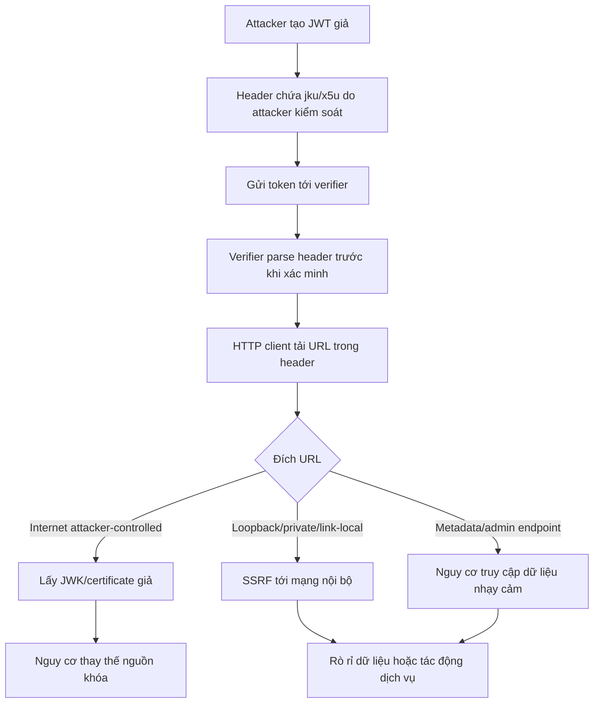
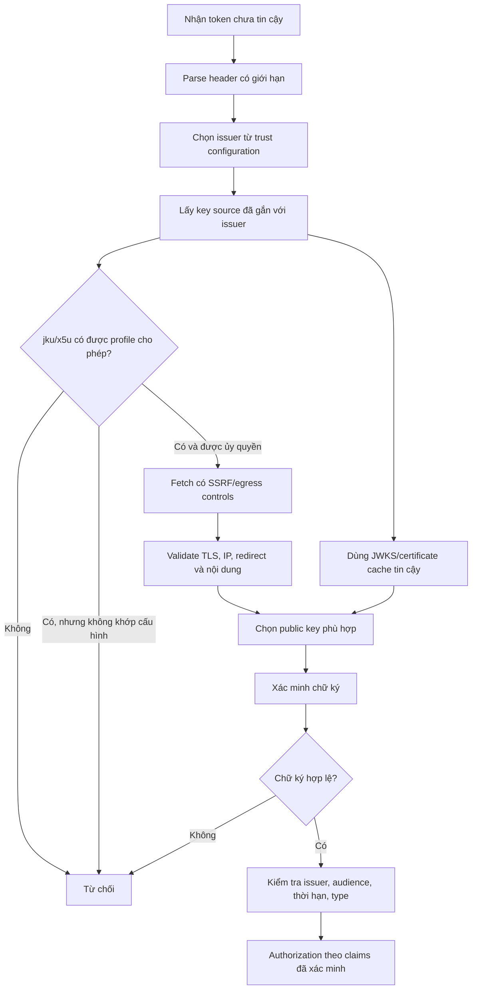

# jku, x5u và tấn công SSRF hoặc thay thế nguồn khóa

## 1. Vì sao URL trong JOSE Header là ranh giới bảo mật?

Trong module **SECURITY_TOKEN_SECURITY_JWT — Security - JSON Web Token (JWT)**, bên xác minh cần có khóa tin cậy để kiểm tra chữ ký JWS hoặc thực hiện các thao tác mật mã liên quan. JOSE định nghĩa một số header parameter có thể chỉ tới tài nguyên chứa thông tin khóa, tiêu biểu là:

- `jku` (*JWK Set URL*): URI tham chiếu tới một JSON Web Key Set.
- `x5u` (*X.509 URL*): URI tham chiếu tới chứng thư khóa công khai X.509 hoặc chuỗi chứng thư.

Các tham số này hữu ích trong một số giao thức phân phối khóa, nhưng tạo ra rủi ro nếu verifier tự động truy cập URL do token cung cấp. Trước khi chữ ký được xác minh, toàn bộ header của token vẫn là dữ liệu không đáng tin. Nếu verifier dùng URL đó để tạo HTTP request, người gửi token có thể tác động tới đích mạng mà verifier truy cập.

Hai nhóm rủi ro chính:

1. **SSRF (Server-Side Request Forgery):** verifier bị lợi dụng để gửi request từ mạng phía server tới loopback, mạng nội bộ, dịch vụ metadata hoặc endpoint nhạy cảm.
2. **Key-source substitution:** verifier lấy khóa hoặc chứng thư từ nguồn do kẻ tấn công kiểm soát, rồi xác minh chữ ký bằng khóa đó. Kẻ tấn công có thể tự tạo cặp khóa, ký token bằng khóa riêng của mình và khiến verifier chấp nhận token nếu nguồn khóa không được ràng buộc với issuer tin cậy.

**TLS tới URL trong token không tự giải quyết hai vấn đề này.** TLS có thể xác thực máy chủ theo hệ thống chứng thư, nhưng không chứng minh máy chủ đó được issuer đã cấu hình ủy quyền làm nguồn khóa cho JWT đang xét.

## 2. jku và x5u có ý nghĩa gì?

### 2.1. jku: JWK Set URL

`jku` là một URI tham chiếu tới tài nguyên chứa JWK Set. Verifier có thể tải tập khóa rồi chọn JWK phù hợp để xác minh chữ ký.

Ví dụ JOSE Header:

```json
{
  "alg": "RS256",
  "kid": "signing-key-2026",
  "jku": "https://keys.issuer.example/jwks.json"
}
```

Tài nguyên được tham chiếu thường có dạng:

```json
{
  "keys": [
    {
      "kty": "RSA",
      "kid": "signing-key-2026",
      "use": "sig",
      "alg": "RS256",
      "n": "base64url-modulus",
      "e": "AQAB"
    }
  ]
}
```

`jku` chỉ cho biết nơi tìm JWK Set. Nó không chứng minh rằng tập khóa đó thuộc issuer trong claim `iss`, cũng không chứng minh khóa được tìm thấy có quyền ký token cho audience hiện tại.

RFC 7515 yêu cầu cơ chế truy xuất tài nguyên JWK Set phải cung cấp bảo vệ tính toàn vẹn; HTTPS/TLS là cách thường dùng. Yêu cầu bảo vệ kênh chỉ chống sửa đổi trên đường truyền, không thay thế việc verifier phải ràng buộc URL với issuer tin cậy.

### 2.2. x5u: X.509 URL

`x5u` là URI tham chiếu tới chứng thư khóa công khai X.509 hoặc chuỗi chứng thư. Theo RFC 7515, tài nguyên được tham chiếu phải có biểu diễn PEM phù hợp với RFC 5280 và phải được bảo vệ tính toàn vẹn bằng TLS hoặc cơ chế tương đương.

Ví dụ JOSE Header:

```json
{
  "alg": "RS256",
  "kid": "signing-certificate-2026",
  "x5u": "https://certs.issuer.example/signing-chain.pem"
}
```

Verifier tải chứng thư, kiểm tra chuỗi chứng thư và lấy public key phù hợp để xác minh chữ ký. Việc tải thành công hoặc chuỗi chứng thư hợp lệ về mặt PKI vẫn chưa đủ: profile phải xác định CA/trust anchor, danh tính issuer và mục đích sử dụng chứng thư được chấp nhận.

### 2.3. Phân biệt x5u với x5c

`x5u` là URL cần được truy cập để tải tài nguyên chứng thư. `x5c` nhúng trực tiếp chuỗi chứng thư vào JOSE Header dưới dạng mảng base64-encoded DER certificate; nó không yêu cầu verifier tải chứng thư từ URL.

Tuy nhiên, `x5c` cũng không tự tạo niềm tin. Verifier vẫn phải kiểm tra chuỗi chứng thư, trust anchor, thời hạn, trạng thái thu hồi nếu profile yêu cầu, key usage/extended key usage và quan hệ giữa danh tính chứng thư với issuer. Không được chấp nhận một chứng thư bất kỳ chỉ vì nó được nhúng trong token.

## 3. SSRF xảy ra như thế nào?

SSRF xuất hiện khi ứng dụng server-side gửi request tới một địa chỉ mà kẻ tấn công có thể điều khiển hoặc tác động. Với JWT, đường khai thác thường là:

1. Verifier nhận một token chưa xác minh.
2. Verifier parse JOSE Header.
3. Verifier đọc `jku` hoặc `x5u` từ header.
4. Verifier tự động gửi HTTP request tới URI đó để lấy khóa/chứng thư.
5. Kẻ tấn công chọn URL trỏ tới tài nguyên nội bộ hoặc endpoint nhạy cảm.



Điểm nguy hiểm nằm ở việc verifier thực hiện truy cập mạng trước khi biết token có hợp lệ hay không. Chữ ký chưa được xác minh không thể được dùng làm căn cứ tin URL trong chính header đó.

### 3.1. Các đích SSRF thường bị nhắm tới

Một URL độc hại có thể cố truy cập:

- Loopback IPv4/IPv6, ví dụ địa chỉ localhost.
- Địa chỉ private trong mạng nội bộ.
- Link-local address và dịch vụ metadata của môi trường cloud.
- Endpoint quản trị chỉ mở trong mạng service-to-service.
- Dịch vụ nội bộ không được thiết kế để nhận request từ bên ngoài.
- Dịch vụ DNS, proxy hoặc endpoint có thể làm lộ thông tin cấu hình.

Tác động tùy vào quyền mạng của verifier: đọc dữ liệu nội bộ, dò tìm cổng/dịch vụ, kích hoạt hành động không mong muốn hoặc tạo tải lên hệ thống khác. Không phải mọi SSRF đều đọc được response; blind SSRF vẫn có thể gây side effect hoặc tiết lộ thông tin qua timing và log.

### 3.2. Không chỉ kiểm tra chuỗi URL ban đầu

Chặn một số chuỗi như `localhost` hoặc `127.0.0.1` là chưa đủ. URL có thể dùng:

- Biểu diễn IPv4/IPv6 khác nhau hoặc địa chỉ IPv4-mapped IPv6.
- Tên DNS có nhiều bản ghi, CNAME hoặc thay đổi kết quả theo thời gian.
- Redirect từ host công khai sang địa chỉ nội bộ.
- Port không chuẩn, userinfo hoặc cách mã hóa ký tự gây khác biệt giữa parser.
- DNS rebinding: lần kiểm tra DNS trả IP công khai nhưng lúc kết nối lại trả IP nội bộ.
- Proxy hoặc resolver có hành vi khác với kiểm tra tại ứng dụng.

Kiểm tra an toàn phải gắn với **địa chỉ thực sự được kết nối**, không chỉ chuỗi URL đã parse ban đầu.

## 4. Key-source substitution hoạt động như thế nào?

Key-source substitution là tình huống verifier lấy khóa từ nguồn do token hoặc kẻ tấn công lựa chọn, rồi coi khóa đó là khóa hợp lệ để xác minh issuer.

Ví dụ:

1. Kẻ tấn công tự tạo cặp khóa RSA: private key và public key.
2. Kẻ tấn công công bố public key trong JWK Set trên một máy chủ do mình kiểm soát.
3. Kẻ tấn công tạo JWT với claim `iss` giống issuer mục tiêu, claim quyền tùy ý và header `jku` trỏ tới JWK Set của mình.
4. Kẻ tấn công ký JWT bằng private key của mình.
5. Verifier tải JWK Set theo `jku`, tìm được public key của kẻ tấn công và xác minh chữ ký thành công.
6. Nếu verifier không kiểm tra nguồn khóa có thuộc issuer tin cậy hay không, token giả có thể được chấp nhận.

Chữ ký trong ví dụ là hợp lệ về mặt toán học. Lỗi nằm ở **quyết định tin khóa**: verifier đã cho token tự chọn khóa dùng để chứng minh chính token đó.

### 4.1. Chữ ký hợp lệ không tự chứng minh danh tính issuer

Chữ ký số chứng minh dữ liệu được ký bằng private key tương ứng với public key dùng để xác minh. Nó chỉ chứng minh token do issuer cụ thể phát hành khi verifier đã có căn cứ tin cậy rằng public key đó thuộc issuer ấy và được phép dùng cho mục đích này.

Chuỗi xử lý phải ràng buộc:

```text
trusted issuer configuration
    -> trusted key source
    -> eligible public key
    -> signature verification
    -> exact issuer/audience/profile validation
```

Nếu bỏ qua bước ràng buộc nguồn khóa, kẻ tấn công có thể tự tạo khóa và tự chứng minh chữ ký của mình hợp lệ.

### 4.2. x5u cũng có thể gây thay thế nguồn khóa

Kẻ tấn công có thể lưu chứng thư chứa public key của mình ở một URL HTTPS do mình kiểm soát, rồi đặt URL đó vào `x5u`. Nếu verifier chỉ kiểm tra TLS của máy chủ tải chứng thư mà không ràng buộc chứng thư với issuer tin cậy, nó có thể lấy public key của kẻ tấn công để xác minh token giả.

TLS chứng minh kết nối tới host tương ứng với chứng thư TLS hợp lệ. Nó không chứng minh host đó là nguồn phát hành khóa được cấu hình cho issuer trong JWT.

## 5. Ranh giới tin cậy: issuer phải quyết định nguồn khóa

Nguồn khóa phải được xác định từ cấu hình tin cậy của verifier hoặc từ metadata được bootstrap qua một trust anchor đã biết. Không để JWT chưa xác minh tự quyết định nơi lấy khóa.

Một mô hình an toàn:

1. Ứng dụng cấu hình danh sách issuer được phép.
2. Mỗi issuer được gắn với một nguồn khóa đã đăng ký, ví dụ JWKS URI cố định hoặc metadata discovery được tin cậy.
3. Verifier chọn cấu hình issuer từ allowlist; claim `iss` chưa xác minh chỉ được dùng để tra cứu trong danh sách này.
4. Verifier lấy khóa từ nguồn đã gắn với issuer đó.
5. Verifier xác minh chữ ký.
6. Verifier kiểm tra claim `iss` chính xác khớp issuer cấu hình, cùng audience, token type và các claim bắt buộc.

Ví dụ cấu hình logic:

```text
trustedIssuers:
  - issuer: https://issuer.example
    jwksUri: https://issuer.example/.well-known/jwks.json
    allowedAlgorithms: [RS256]
    allowedKeyTypes: [RSA]
```

Đây là ví dụ minh họa. Giá trị issuer và JWKS URI phải đến từ cấu hình hoặc quy trình đăng ký đáng tin cậy, không được lấy tùy ý từ token đang xác minh.

### 5.1. Issuer claim không phải trust anchor

Claim `iss` là một phát biểu trong JWT. Trước khi xác minh chữ ký, nó chưa được chứng minh. Không được làm theo luồng:

```text
unverified iss
    -> concatenate into URL
    -> fetch discovery/JWKS
    -> trust returned key
```

Luồng này cho phép token điều khiển cả issuer được tra cứu lẫn nguồn khóa. Với hệ thống đa issuer, chỉ chọn từ danh sách issuer đã đăng ký; không tạo URL discovery bằng cách ghép chuỗi từ `iss` tùy ý.

### 5.2. Dynamic discovery vẫn cần bootstrap tin cậy

Dynamic discovery có thể phù hợp khi một hệ thống hỗ trợ nhiều issuer, nhưng bước khởi đầu phải được tin cậy:

- Issuer phải được đăng ký hoặc cho phép trước.
- Discovery URI phải được xác định từ issuer đã đăng ký theo quy tắc của giao thức.
- Metadata trả về phải có issuer chính xác khớp issuer mong đợi.
- `jwks_uri` trong metadata phải được kiểm tra theo chính sách nguồn khóa và SSRF.
- JWKS được tải phải được cache theo issuer và nguồn đã xác minh.

Không dùng discovery để biến một `iss` bất kỳ trong token thành quyền truy cập mạng tùy ý.

## 6. Chính sách xử lý jku

Với JWT profile thông thường, lựa chọn an toàn nhất là lấy JWKS URI từ cấu hình issuer đã tin cậy. Nếu header có `jku`:

- Có thể từ chối token nếu profile không cho phép header này.
- Hoặc yêu cầu `jku` khớp chính xác URI đã cấu hình cho issuer.
- Không fetch URL mới chỉ vì header yêu cầu.
- Không coi TLS hợp lệ là bằng chứng issuer ủy quyền URL đó.

Nếu một giao thức cần dùng `jku` để hỗ trợ phân phối khóa, phải định nghĩa quy trình đăng ký/ủy quyền URL trước khi chấp nhận token. Việc cho phép phải gắn với issuer, không phải chỉ với token hoặc `kid`.

### 6.1. Không cho phép URL tùy ý theo từng token

Một verifier không nên cung cấp hành vi “token nào cũng có thể chỉ định JWKS URL riêng”. Nếu mỗi token được phép chọn một URL, kẻ tấn công có thể:

- Dùng URL của mình để thay thế nguồn khóa.
- Gửi URL nội bộ để khai thác SSRF.
- Tạo nhiều URL khác nhau để né cache và rate limit.
- Dùng hostname thay đổi liên tục để vượt qua quy tắc allowlist yếu.

### 6.2. So khớp URI phải chặt chẽ

Nếu profile yêu cầu header `jku` khớp cấu hình:

- So sánh URI theo quy tắc canonicalization đã định nghĩa, không dùng so khớp chuỗi con.
- Không dùng kiểm tra kiểu “host kết thúc bằng trusted.example” nếu không xử lý ranh giới domain chính xác.
- Xác định rõ scheme, hostname, port, path và query được phép.
- Từ chối userinfo, fragment và thành phần bất thường nếu profile không cần.
- Không tự ý theo redirect sang host khác.

Ví dụ, `https://trusted.example.attacker.invalid/jwks` không thuộc host `trusted.example` dù chuỗi hostname có chứa tên đó.

### 6.3. Token đồng thời có jku và x5u

Nếu một token đưa cả `jku` và `x5u`, verifier không nên tự chọn một nguồn theo thứ tự tùy tiện. Profile phải quy định rõ một trong các cách:

- Chỉ cho phép một trong hai tham số và từ chối khi cả hai cùng xuất hiện.
- Cho phép cả hai nhưng yêu cầu chúng cùng ánh xạ tới key identity đã đăng ký và kết quả phải nhất quán.
- Chọn một cơ chế duy nhất theo cấu hình issuer và bỏ qua tham số còn lại theo quy tắc profile đã công bố.

Với JWT profile thông thường, từ chối trường hợp có nhiều chỉ dẫn nguồn khóa không cần thiết thường đơn giản và dễ kiểm toán hơn. Không thử lần lượt nhiều URL cho tới khi tìm được khóa làm chữ ký hợp lệ.

## 7. Chính sách xử lý x5u

Với `x5u`, nguyên tắc tương tự áp dụng cho nguồn chứng thư:

1. Chỉ chấp nhận URI đã được cấu hình hoặc ủy quyền cho issuer.
2. Nếu profile không hỗ trợ URL chứng thư trong header, từ chối hoặc bỏ qua theo đúng profile; không tự fetch.
3. Nếu phải fetch, chỉ dùng HTTPS với xác minh hostname và chuỗi TLS đầy đủ.
4. Giới hạn host, port, redirect và địa chỉ IP thực tế được kết nối.
5. Giới hạn kích thước response, thời gian tải và số chứng thư.
6. Parse PEM nghiêm ngặt; từ chối dữ liệu sai định dạng hoặc chứa quá nhiều certificate.
7. Xác minh chuỗi X.509 tới trust anchor được cấu hình.
8. Kiểm tra thời hạn, key usage, extended key usage và danh tính theo profile.
9. Ràng buộc public key với issuer đã đăng ký.

Không nhầm hai loại xác minh:

- **TLS server certificate:** xác thực máy chủ cung cấp tài nguyên x5u.
- **JWT signing certificate:** chứng thư chứa public key được dùng để xác minh chữ ký JWT.

Hai chứng thư có thể khác nhau và phục vụ hai mục đích khác nhau. TLS hợp lệ không làm chứng thư ký JWT tự động đáng tin.

## 8. Kiểm soát SSRF khi bắt buộc phải tải URL

Một số giao thức có thể cần truy cập tài nguyên khóa động. Khi đó, cần áp dụng nhiều lớp kiểm soát đồng thời.

### 8.1. Scheme và hostname

- Chỉ cho phép `https` trong môi trường production, trừ khi profile có ngoại lệ được kiểm soát rõ.
- Không cho phép scheme như `file`, `ftp`, `gopher` hoặc scheme tùy biến.
- Từ chối userinfo trong URI.
- Giới hạn port theo cấu hình, thường chỉ cho phép HTTPS port chuẩn.
- Dùng parser URI chuẩn, tránh tự tách chuỗi URL bằng regex đơn giản.
- Chuẩn hóa hostname theo quy tắc IDNA và so khớp domain chính xác.
- Không cho phép hostname rỗng, IP literal hoặc hostname ngoài allowlist nếu profile yêu cầu host đã đăng ký.

### 8.2. DNS và địa chỉ IP

Nếu chính sách cho phép host động, phải kiểm tra mọi địa chỉ được DNS phân giải:

- Chặn loopback, private, link-local, multicast, unspecified và các dải reserved.
- Kiểm tra IPv4, IPv6 và IPv4-mapped IPv6.
- Kiểm tra tất cả A/AAAA records, không chỉ một địa chỉ đầu tiên.
- Kết nối tới địa chỉ đã được kiểm tra; tránh resolve lần nữa ở tầng HTTP client tạo cửa sổ DNS rebinding.
- Xác minh địa chỉ peer thực tế của kết nối nếu hạ tầng cho phép.
- Áp dụng lại kiểm tra sau mỗi redirect hoặc lần resolve mới.

Danh sách địa chỉ cấm cần dựa trên registry IP và chính sách mạng được duy trì; không nên chỉ hard-code một vài địa chỉ localhost.

### 8.3. Redirect

An toàn nhất là tắt tự động redirect cho request lấy khóa. Nếu giao thức buộc phải cho phép:

- Giới hạn số hop rất nhỏ.
- Parse và kiểm tra lại URI đích ở mỗi hop.
- Kiểm tra scheme, hostname, port và IP sau redirect.
- Không chuyển credential/header nhạy cảm sang host khác.
- Không cho redirect từ host công khai sang địa chỉ private/link-local.

Không coi URL ban đầu hợp lệ là bằng chứng mọi URL sau redirect đều hợp lệ.

### 8.4. Egress network policy

Lớp mạng là biện pháp bổ sung quan trọng:

- Chỉ cho phép verifier kết nối tới các endpoint JWKS/certificate đã đăng ký.
- Chặn truy cập từ workload xác minh JWT tới mạng quản trị, control plane và metadata endpoint nếu không cần.
- Dùng egress proxy/gateway có policy kiểm tra đích và ghi log.
- Phân vùng network để một lỗi URL validation không cho phép truy cập toàn bộ mạng nội bộ.
- Không dựa duy nhất vào kiểm tra ở ứng dụng; network policy phải giới hạn tác động khi code có lỗi.

## 9. TLS và xác minh chứng thư

Khi tải JWK Set hoặc certificate qua HTTPS:

- Xác minh chuỗi chứng thư TLS theo trust store phù hợp.
- Kiểm tra hostname khớp chứng thư.
- Kiểm tra thời hạn và thuật toán/chính sách TLS được phép.
- Không tắt xác minh chứng thư để “sửa” lỗi kết nối.
- Không chấp nhận mọi chứng thư tự ký trừ khi đã pin trust anchor cụ thể và profile cho phép.
- Hạn chế redirect và không để proxy tùy ý thay đổi đích.

TLS bảo vệ tính toàn vẹn và xác thực kênh tới server. Nhưng để tin khóa JWT, vẫn phải xác minh nguồn khóa được server đó ủy quyền bởi issuer hoặc trust configuration.

## 10. Xác minh khóa lấy từ JWKS hoặc X.509

Sau khi tải nguồn khóa từ URI đã được tin cậy, vẫn cần kiểm tra nội dung.

### 10.1. Kiểm tra JWK

Khi chọn JWK, cần đối chiếu:

- `kid` nếu token/profile yêu cầu định danh khóa.
- `kty` phải tương thích với thuật toán được cấu hình.
- `alg` nếu có phải khớp allowlist và mục đích xác minh.
- `use` nếu có phải cho phép chữ ký, ví dụ `sig`.
- `key_ops` nếu có phải cho phép thao tác `verify`.
- Chỉ sử dụng public key phù hợp; không chấp nhận private key material từ JWKS công khai.
- Nếu có nhiều khóa cùng khớp và không phân biệt được theo profile, từ chối trường hợp mơ hồ.

Không để token tự chọn thuật toán rồi dùng bất kỳ khóa nào trả về từ URL. Allowlist thuật toán phải được cấu hình độc lập và ràng buộc với loại khóa.

### 10.2. Kiểm tra X.509

Khi dùng certificate lấy từ `x5u` hoặc chuỗi `x5c`:

- Xây dựng chuỗi tới trust anchor được chấp nhận.
- Kiểm tra thời hạn chứng thư.
- Kiểm tra key usage/extended key usage phù hợp với việc xác minh chữ ký.
- Kiểm tra chính sách CA, path length và ràng buộc tên nếu profile yêu cầu.
- Kiểm tra trạng thái thu hồi theo chính sách PKI.
- Ràng buộc subject/SAN hoặc định danh chứng thư với issuer đã đăng ký.
- Chỉ lấy public key sau khi chuỗi chứng thư được chấp nhận.

Không dùng certificate do token cung cấp làm trust anchor của chính nó.

## 11. Cache, key rotation và chống cache poisoning

Tải khóa động cần cache để giảm tải, nhưng cache phải dựa trên trust identity đã xác minh.

### 11.1. Cache key đúng

Cache nên được namespace theo issuer/trust domain và nguồn khóa đã cấu hình. Không cache chỉ theo:

- `kid` đơn lẻ, vì nhiều issuer có thể dùng cùng `kid`.
- URL do token tùy ý cung cấp.
- Hash của token, vì mỗi token sẽ tạo entry mới và né được cache.

Ví dụ cache identity:

```text
cacheKey = (trustedIssuerId, configuredKeySourceId, representationVersion)
```

### 11.2. Kiểm tra trước khi thay cache

Khi nhận JWKS mới:

1. Kiểm tra HTTP status, content type, kích thước và timeout.
2. Parse JSON nghiêm ngặt.
3. Kiểm tra cấu trúc `keys` và số lượng JWK.
4. Kiểm tra từng khóa theo policy.
5. Từ chối snapshot có khóa không hợp lệ theo profile hoặc có dữ liệu private key.
6. Chỉ thay snapshot sau khi kiểm tra thành công.
7. Cập nhật snapshot nguyên tử để không có trạng thái nửa cũ nửa mới.

Không ghi đè cache tốt bằng response lỗi, JSON rỗng bất thường hoặc dữ liệu lấy từ URL không thuộc nguồn tin cậy.

### 11.3. Key rotation

Khi issuer xoay vòng khóa:

1. Công bố public key mới trong JWKS đã đăng ký.
2. Chờ propagation/cache policy phù hợp.
3. Bắt đầu ký token bằng `kid` mới.
4. Giữ public key cũ đủ lâu để xác minh token cũ còn hiệu lực.
5. Gỡ khóa cũ sau khi overlap kết thúc.

Không dùng key rotation làm lý do cho phép token chỉ định nguồn khóa mới. Khóa mới phải xuất hiện trong nguồn đã được issuer tin cậy công bố.

## 12. Vì sao kid không phải nguồn tin cậy?

`kid` là một định danh khóa trong JOSE Header. Nó giúp chọn một khóa trong tập khóa đã được tin cậy; bản thân nó không phải URL, không phải public key và không chứng minh khóa thuộc issuer.

Một số lỗi thường gặp:

- Dùng `kid` làm tên file hoặc đường dẫn trực tiếp.
- Ghép `kid` vào URL mà không giới hạn nguồn.
- Tin `kid` từ token chưa xác minh như một định danh đã được issuer xác nhận.
- Chọn khóa chỉ dựa trên `kid` mà không kiểm tra loại khóa và thuật toán.
- Dùng cache toàn cục theo `kid` mà không namespace issuer.

Nếu không tìm thấy `kid`, có thể refresh JWKS từ nguồn đã cấu hình theo chính sách cooldown/rate limit. Không tải URL mới do token yêu cầu chỉ vì `kid` chưa biết.

## 13. Xử lý lỗi và giới hạn tài nguyên

Tải khóa là một thao tác mạng nằm trên đường xác minh. Cần giới hạn:

| Giới hạn | Mục đích |
| --- | --- |
| Connect/read timeout | Không để request treo lâu |
| Maximum response size | Ngăn response khổng lồ tiêu thụ bộ nhớ |
| Maximum certificate count/size | Giới hạn parse chuỗi X.509 |
| Maximum JWK count | Giới hạn chi phí parse và chọn khóa |
| Redirect limit | Tránh redirect chain hoặc chuyển hướng tới đích nguy hiểm |
| Per-issuer refresh rate | Ngăn token tạo refresh storm |
| Global egress concurrency | Giới hạn tổng tải ra ngoài |
| DNS resolution timeout | Tránh chờ resolver vô hạn |
| Retry budget/backoff | Tránh retry storm khi nguồn khóa lỗi |

Khi URL hoặc nguồn khóa không hợp lệ, phải từ chối token. Không chuyển sang chế độ bỏ qua chữ ký, chấp nhận khóa nhúng không tin cậy hoặc dùng thuật toán yếu để duy trì availability.

Thông báo lỗi cho client nên chung chung, ví dụ token không hợp lệ. Log nội bộ có thể ghi mã lỗi đã chuẩn hóa như `UNTRUSTED_KEY_SOURCE`, `SSRF_POLICY_BLOCK`, `JWKS_FETCH_TIMEOUT` hoặc `CERTIFICATE_CHAIN_INVALID`, nhưng không ghi raw token hoặc thông tin nhạy cảm.

## 14. Quy trình xác minh an toàn

Một verifier có thể áp dụng quy trình sau:

1. Parse Compact serialization và giới hạn kích thước token.
2. Parse JOSE Header như dữ liệu chưa tin cậy; từ chối tham số hoặc cấu trúc không được profile hỗ trợ.
3. Xác định issuer dự kiến từ endpoint, client registration hoặc allowlist đã cấu hình.
4. Chọn key source gắn với issuer đó.
5. Nếu header có `jku`/`x5u`, kiểm tra profile: từ chối hoặc yêu cầu khớp URI đã ủy quyền; không fetch tùy ý.
6. Tải nguồn khóa qua HTTP client có SSRF controls nếu cần refresh.
7. Kiểm tra TLS, redirect, IP peer, response size, JSON/certificate và policy khóa.
8. Chọn đúng public key theo `kid`, `kty`, `alg`, `use`, `key_ops` và profile.
9. Xác minh chữ ký JWS.
10. Kiểm tra `iss` chính xác, `aud`, `exp`, `nbf`, token type và claims bắt buộc.
11. Chỉ sau đó mới sử dụng claims cho authorization.



## 15. Mã giả chính sách chọn nguồn khóa

```text
function resolveTrustedKey(token, expectedIssuer):
    require expectedIssuer in configuredIssuerAllowlist

    header = parseJoseHeader(token)
    require header.alg in policy[expectedIssuer].allowedAlgorithms

    configuredSource = policy[expectedIssuer].keySource

    if header.jku exists and header.x5u exists:
        require policy[expectedIssuer].allowsBothKeyHints

    if header.jku exists:
        require policy[expectedIssuer].allowsJku
        require canonicalUri(header.jku) == configuredSource.jwksUri

    if header.x5u exists:
        require policy[expectedIssuer].allowsX5u
        require canonicalUri(header.x5u) in configuredSource.allowedCertificateUris

    if header.jku or header.x5u:
        selectedUri = selectUriByIssuerPolicy(header, configuredSource)
        require uriPassesSsrfPolicy(selectedUri)
        response = fetchWithTimeoutAndSizeLimit(selectedUri)
        require redirectChainPassesPolicy(response)
        require responseSourceIsAuthorized(response.finalUri, configuredSource)
        keySetOrCertificate = validateFetchedKeyMaterial(response)
    else:
        keySetOrCertificate = loadFromConfiguredTrustedCache(configuredSource)

    key = selectEligiblePublicKey(keySetOrCertificate, header)
    require keyMatchesConfiguredAlgorithmAndIssuer(key, expectedIssuer)
    return key

function validateToken(token, expectedIssuer, expectedAudience):
    key = resolveTrustedKey(token, expectedIssuer)
    require verifySignature(token, key)
    claims = parseVerifiedClaims(token)
    require claims.iss == expectedIssuer
    require audienceMatches(claims.aud, expectedAudience)
    require temporalClaimsAreValid(claims)
    return claims
```

Đây là mã giả mô tả chính sách, không phải implementation đầy đủ. `canonicalUri`, `uriPassesSsrfPolicy`, `fetchWithTimeoutAndSizeLimit` và `validateFetchedKeyMaterial` phải được hiện thực bằng thư viện URI/HTTP/X.509 phù hợp, kiểm tra địa chỉ peer thực tế và chính sách mạng. Không dùng mã giả này làm lý do tự viết parser URL hoặc certificate validator.

## 16. Các lỗi triển khai thường gặp

### 16.1. Fetch jku trước khi xác định issuer tin cậy

Verifier đọc URL trong token và tải ngay. Điều này vừa mở SSRF vừa cho phép key-source substitution.

**Cách xử lý:** chọn nguồn khóa từ trust configuration theo issuer đã đăng ký; URL trong header chỉ được chấp nhận nếu profile cho phép và đã được ủy quyền trước.

### 16.2. Chỉ kiểm tra hostname bằng chuỗi con

Kiểm tra chuỗi có chứa tên host tin cậy có thể chấp nhận domain giả mạo hoặc hostname có hậu tố độc hại.

**Cách xử lý:** parse URI chuẩn, chuẩn hóa hostname và so khớp host/domain theo ranh giới chính xác.

### 16.3. Chặn localhost nhưng quên IPv6, private và link-local

Một số dạng địa chỉ khác có thể truy cập cùng tài nguyên nội bộ.

**Cách xử lý:** kiểm tra toàn bộ dải IPv4/IPv6 không công khai, địa chỉ peer và kết quả DNS.

### 16.4. Cho phép redirect tự động

URL công khai có thể redirect tới địa chỉ nội bộ mà không đi qua kiểm tra đích ban đầu.

**Cách xử lý:** tắt redirect hoặc kiểm tra lại từng hop và IP thực tế.

### 16.5. Nghĩ rằng HTTPS đủ để tin nguồn khóa

HTTPS chỉ xác thực máy chủ của URL. Nó không chứng minh issuer đã ủy quyền host đó làm nơi công bố khóa.

**Cách xử lý:** ràng buộc key source với issuer qua cấu hình/metadata đã bootstrap tin cậy.

### 16.6. Chấp nhận JWK hoặc certificate nhúng mà không kiểm tra trust

Kẻ tấn công có thể tự tạo key pair và đưa public key vào token.

**Cách xử lý:** chỉ sử dụng khóa từ nguồn tin cậy; nếu profile cho phép `jwk` hoặc `x5c`, phải xác minh quan hệ trust độc lập.

### 16.7. Cache theo URL hoặc kid tùy ý

Kẻ tấn công có thể tạo vô số URL/`kid` để né cache, làm tăng request và dung lượng.

**Cách xử lý:** cache theo issuer và configured key-source identity; giới hạn số entry, TTL và refresh rate.

### 16.8. Bỏ qua lỗi tải khóa rồi chấp nhận token

Khi endpoint lỗi, verifier chuyển sang bỏ qua chữ ký hoặc dùng khóa bất kỳ.

**Cách xử lý:** nếu không có khóa tin cậy và không thể xác minh, từ chối token; có thể dùng cache cũ chỉ theo stale-key policy được định nghĩa riêng.

## 17. Kịch bản kiểm thử bảo mật

| Kịch bản | Kết quả mong đợi |
| --- | --- |
| `jku` trỏ tới JWKS URI đã cấu hình cho issuer | Chỉ chấp nhận sau khi response và JWK vượt qua policy |
| `jku` trỏ tới host attacker-controlled | Từ chối hoặc không fetch |
| `x5u` trỏ tới host attacker-controlled | Từ chối hoặc không fetch |
| URL trỏ tới loopback/private/link-local | Chặn trước khi kết nối |
| DNS trả nhiều IP, trong đó có IP private | Chặn hoặc chỉ kết nối IP đã được policy cho phép |
| DNS rebinding giữa resolve và connect | Kết nối không được phép phải bị chặn |
| URL công khai redirect tới private IP | Redirect bị chặn |
| URL dùng scheme không phải HTTPS | Từ chối theo production policy |
| URL có userinfo, port hoặc hostname bất thường | Từ chối theo URI policy |
| TLS certificate không hợp lệ hoặc hostname mismatch | Không tải/không tin response |
| TLS hợp lệ nhưng host không được issuer ủy quyền | Từ chối nguồn khóa |
| JWKS chứa private key material | Từ chối snapshot |
| JWKS có khóa sai kty/alg/use/key_ops | Không chọn khóa đó |
| Nhiều khóa cùng khớp không phân biệt được | Từ chối trường hợp mơ hồ |
| Token tự tạo key pair và đặt public key trên jku của mình | Không được chấp nhận cho issuer mục tiêu |
| x5u trả chứng thư hợp lệ nhưng không thuộc trust anchor/profile | Từ chối |
| Upstream timeout hoặc trả response quá lớn | Dừng fetch, không chấp nhận token chưa xác minh |
| Upstream lỗi nhưng cache tin cậy còn trong stale policy | Chỉ dùng cache cũ nếu policy cho phép |
| `kid` ngẫu nhiên liên tục | Không tạo refresh storm hoặc cache vô hạn |

Kiểm thử SSRF nên chạy trong môi trường kiểm thử cô lập, dùng endpoint giả lập để xác nhận request bị chặn; không cần truy cập thử metadata hoặc dịch vụ nội bộ production.

## 18. Checklist phòng thủ

- [ ] Không coi `jku` hoặc `x5u` từ JWT chưa xác minh là nguồn khóa đáng tin.
- [ ] Mỗi issuer được gắn với JWKS/certificate source đã đăng ký.
- [ ] Claim `iss` chỉ được dùng để chọn cấu hình trong allowlist; sau xác minh phải so khớp chính xác.
- [ ] Profile từ chối `jku`/`x5u` nếu không cần hỗ trợ; nếu hỗ trợ thì URI phải được ủy quyền.
- [ ] Không tạo discovery/JWKS URL bằng cách ghép chuỗi từ issuer tùy ý.
- [ ] Chỉ cho phép HTTPS và host/port/path theo policy.
- [ ] Kiểm tra DNS, mọi địa chỉ A/AAAA và IP peer thực tế.
- [ ] Chặn loopback, private, link-local, multicast, unspecified và reserved ranges.
- [ ] Tắt redirect hoặc kiểm tra lại mọi hop.
- [ ] Đặt timeout, response-size limit, concurrency limit và rate limit.
- [ ] Áp dụng egress network policy để chặn truy cập mạng nhạy cảm.
- [ ] Xác minh TLS hostname và certificate chain; không tắt validation.
- [ ] Phân biệt TLS server certificate với JWT signing certificate.
- [ ] Kiểm tra JWK/X.509 theo kty, alg, use, key_ops, trust anchor và mục đích.
- [ ] Cache theo issuer và configured key-source identity; cập nhật snapshot nguyên tử.
- [ ] Không refresh chỉ vì chữ ký sai; unknown kid chỉ refresh nguồn đã cấu hình theo rate limit.
- [ ] Không fallback sang khóa không tin cậy hoặc bỏ qua xác minh khi fetch lỗi.
- [ ] Log mã lỗi an toàn, không ghi raw token hoặc thông tin xác thực.
- [ ] Kiểm thử key substitution, SSRF, DNS rebinding, redirect và cache poisoning.

## 19. Câu hỏi tự kiểm tra

**Câu 1.** `jku` tham chiếu tới tài nguyên nào?

**Đáp án:** Một JWK Set chứa các JSON Web Key có thể được dùng để chọn khóa phù hợp.

**Câu 2.** `x5u` khác `x5c` thế nào?

**Đáp án:** `x5u` là URI tải chứng thư/chuỗi chứng thư; `x5c` nhúng chuỗi chứng thư trực tiếp trong JOSE Header.

**Câu 3.** Vì sao fetch `jku` trước khi xác minh chữ ký có thể tạo SSRF?

**Đáp án:** Header chưa xác minh do người gửi kiểm soát; verifier có thể bị dụ gửi request tới loopback, mạng private, link-local hoặc endpoint nội bộ.

**Câu 4.** Vì sao HTTPS tới URL trong `jku` chưa đủ để tin public key?

**Đáp án:** HTTPS xác thực máy chủ của URL, nhưng không chứng minh issuer đã ủy quyền máy chủ đó làm nguồn khóa cho token.

**Câu 5.** Key-source substitution xảy ra như thế nào?

**Đáp án:** Kẻ tấn công cung cấp public key của mình qua URL do token chỉ định, ký token bằng private key tương ứng và khiến verifier dùng chính public key đó để xác minh.

**Câu 6.** `kid` có phải nguồn tin cậy không?

**Đáp án:** Không. `kid` chỉ là gợi ý chọn khóa trong một tập khóa đã được tin cậy.

**Câu 7.** Nếu hệ thống hỗ trợ nhiều issuer, có thể lấy `jwks_uri` bằng cách ghép `iss` trong token vào URL discovery không?

**Đáp án:** Không. Issuer phải nằm trong allowlist/registration đã tin cậy; discovery metadata phải được bootstrap và xác minh theo cấu hình đó.

**Câu 8.** Khi không tải được khóa tin cậy, verifier nên làm gì?

**Đáp án:** Từ chối token nếu không thể xác minh; chỉ dùng cache cũ theo stale-key policy được định nghĩa rõ. Không bỏ qua chữ ký hoặc chấp nhận khóa do token cung cấp.

## 20. Tài liệu chuẩn tham khảo

- [RFC 7515 — JSON Web Signature (JWS)](https://www.rfc-editor.org/rfc/rfc7515): định nghĩa `jku`, `x5u`, `x5c` và các JOSE Header Parameter.
- [RFC 7517 — JSON Web Key (JWK)](https://www.rfc-editor.org/rfc/rfc7517): JWK/JWK Set và các thuộc tính khóa.
- [RFC 7519 — JSON Web Token (JWT)](https://www.rfc-editor.org/rfc/rfc7519): claims `iss`, `aud`, `exp`, `jti` và cấu trúc JWT.
- [RFC 5280 — Internet X.509 Public Key Infrastructure Certificate and CRL Profile](https://www.rfc-editor.org/rfc/rfc5280): xác minh chuỗi chứng thư X.509.
- [RFC 8725 — JSON Web Token Best Current Practices](https://www.rfc-editor.org/rfc/rfc8725): ràng buộc khóa với issuer, kiểm soát thuật toán và xác minh JWT an toàn.
- [RFC 3986 — Uniform Resource Identifier (URI): Generic Syntax](https://www.rfc-editor.org/rfc/rfc3986): cú pháp và phân tích URI.
- [OWASP SSRF Prevention Cheat Sheet](https://cheatsheetseries.owasp.org/cheatsheets/Server_Side_Request_Forgery_Prevention_Cheat_Sheet.html): kiểm soát URL, DNS, redirect và network egress để phòng SSRF.

**Ghi nhớ:** `jku` và `x5u` chỉ là chỉ dẫn tới tài nguyên khóa/chứng thư, không phải trust anchor. Verifier không được để token chưa xác minh tự chọn nguồn khóa. Hãy ràng buộc nguồn khóa với issuer đã đăng ký, kiểm soát SSRF ở cả ứng dụng lẫn mạng, xác minh TLS và nội dung khóa, rồi mới xác minh chữ ký và claims.
