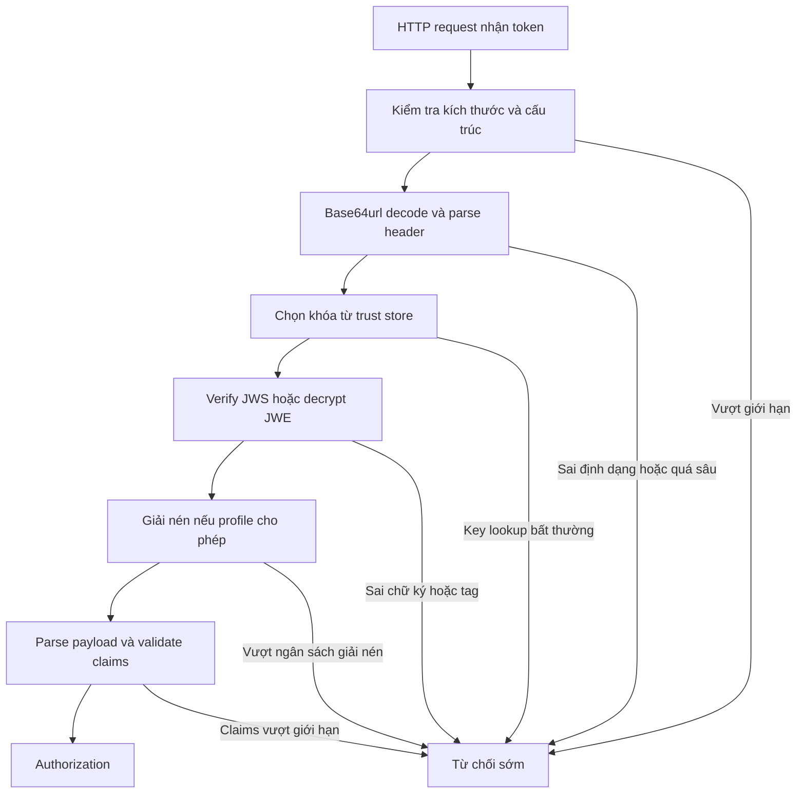

# Payload quá lớn, lồng sâu và làm cạn tài nguyên xác minh

## 1. JWT có thể trở thành đầu vào gây cạn tài nguyên

JWT thường được gửi trong mỗi request để resource server xác minh danh tính và quyền. Quá trình xử lý token có thể bao gồm đọc header, giải mã Base64url, parse JSON, tra cứu khóa, xác minh chữ ký hoặc giải mã JWE, giải nén nội dung và kiểm tra claims.

Mỗi bước đều tiêu thụ CPU, bộ nhớ, I/O hoặc tài nguyên dùng chung. Nếu hệ thống không đặt giới hạn, attacker có thể gửi token được thiết kế để khiến server:

- Cấp phát buffer rất lớn khi giải mã Base64url.
- Parse payload JSON chứa hàng triệu phần tử hoặc cấu trúc lồng rất sâu.
- Thực hiện nhiều thao tác xác minh chữ ký hoặc thử nhiều khóa.
- Tải JWKS liên tục bằng cách gửi kid ngẫu nhiên.
- Xử lý JWE có nhiều recipient hoặc JWS JSON Serialization có nhiều signature.
- Giải nén payload có tỷ lệ nén bất thường và kích thước sau giải nén rất lớn.
- Đệ quy xử lý nhiều lớp nested JWT.
- Ghi log hoặc tạo trace chứa token rất lớn, làm tăng dung lượng lưu trữ và chi phí xử lý.

Đây là nhóm rủi ro **resource exhaustion / denial of service (DoS)**. Token không nhất thiết phải có chữ ký hợp lệ mới gây tốn tài nguyên: việc kiểm tra kích thước, phân đoạn, Base64url và JSON đã có thể tiêu thụ tài nguyên trước khi server xác minh được chữ ký.

Bài học này thuộc chương **Tấn công JWT** của học phần **Security - JSON Web Token (JWT)** (SECURITY_TOKEN_SECURITY_JWT). Nội dung tập trung vào giới hạn tài nguyên và xử lý token an toàn theo chuẩn JWT/JOSE nói chung, không phụ thuộc Java hoặc Spring Security.

## 2. Những giai đoạn xử lý có thể bị khai thác

Một luồng xác minh token thường có các giai đoạn sau:



Các giới hạn cấu trúc phải được áp dụng trước những bước có thể tạo ra chi phí lớn. Sau khi token vượt qua xác minh mật mã, ứng dụng mới được tin claims và sử dụng chúng cho authorization.

Cần phân biệt hai việc:

- **Kiểm tra giới hạn đầu vào trước xác minh:** chỉ kiểm tra số byte, số phần, độ dài segment, độ sâu cấu trúc và các giới hạn parser. Những kiểm tra này không làm token trở nên đáng tin.
- **Kiểm tra nội dung sau xác minh:** dùng claims đã được xác thực để kiểm tra issuer, audience, tenant, thời hạn, scope và quyền.

Không lấy claim chưa xác minh làm căn cứ tăng quota, bỏ qua rate limit hoặc cấp thêm tài nguyên cho request.

## 3. Payload quá lớn

### 3.1. Vì sao token lớn gây tốn tài nguyên?

JWT Compact dùng Base64url để biểu diễn các phần. Với JWS, payload thường được Base64url-encode; với JWE, ciphertext cũng được biểu diễn theo cách tương tự. Kích thước token truyền trên mạng lớn hơn dữ liệu nhị phân ban đầu, sau đó server có thể tạo thêm nhiều bản sao trong quá trình decode và parse.

Một token lớn có thể gây chi phí ở nhiều nơi:

- Reverse proxy và web server phải nhận, lưu buffer và chuyển tiếp header.
- Middleware phải tách token thành các segment.
- Base64url decoder cấp phát bộ nhớ cho dữ liệu nhị phân.
- JSON parser tạo string, map, list và object.
- Thư viện mật mã cấp phát buffer cho input và output.
- Log, tracing và exception handler có thể sao chép token thêm lần nữa.

Không nên chỉ đặt giới hạn ở tầng JSON parser. Khi parser bắt đầu chạy, server có thể đã nhận và buffer một lượng dữ liệu lớn.

### 3.2. Giới hạn kích thước ở nhiều tầng

Nên xác định giới hạn tổng thể và giới hạn riêng cho từng phần:

| Vị trí | Giới hạn cần cân nhắc | Mục tiêu |
| --- | --- | --- |
| HTTP request | Tổng header, cookie và body | Chặn request quá lớn từ sớm |
| Authorization header/cookie | Độ dài token tối đa | Tránh token phình to trong mỗi request |
| JWT Compact | Tổng byte và số segment | Từ chối cấu trúc bất thường |
| Từng segment | Protected header, payload/ciphertext, signature/tag, encrypted key | Ngăn một phần riêng lẻ chiếm quá nhiều bộ nhớ |
| JSON parser | Độ sâu, số member, số phần tử, độ dài string/number | Giới hạn cấu trúc phức tạp |
| Claims | Số lượng và kích thước claim, role, group, scope | Tránh token mang quá nhiều dữ liệu |
| JWE JSON Serialization | Số recipient và kích thước header từng recipient | Giới hạn công việc quản lý khóa |

Các con số cụ thể phải dựa trên profile, hạ tầng và nhu cầu thực tế. Không có một giới hạn byte phù hợp cho mọi JWT. Hãy đặt ngưỡng đủ cho token hợp lệ lớn nhất của hệ thống, có biên an toàn và được kiểm thử trên toàn đường đi qua proxy, gateway và service.

Ví dụ, nếu access token chỉ cần iss, sub, aud, thời hạn, tenant, scope và một số metadata nhỏ, một payload chứa hàng nghìn group hoặc toàn bộ hồ sơ người dùng là dấu hiệu thiết kế cần xem lại.

### 3.3. Chọn nơi lưu dữ liệu lớn phù hợp

JWT được gửi lặp lại trong nhiều request. Đưa danh sách quyền lớn, hàng trăm tenant, thông tin hồ sơ, cấu hình hoặc dữ liệu nghiệp vụ vào token sẽ làm mọi request đắt hơn.

Thay vì nhúng toàn bộ dữ liệu:

- Chỉ giữ các claims cần thiết để ra quyết định tại resource server.
- Dùng scope gọn và có quy ước rõ.
- Dùng resource reference hoặc API tra cứu khi dữ liệu lớn hoặc thay đổi thường xuyên.
- Dùng opaque token và introspection nếu cần quyền kiểm soát trạng thái tập trung.
- Không biến JWT thành một bản sao database hoặc session profile.

Reference trong token vẫn phải được kiểm tra quyền truy cập. Việc thay dữ liệu lớn bằng ID không tự giải quyết IDOR/BOLA.

## 4. JSON lồng sâu và cấu trúc phức tạp

### 4.1. Deep nesting

JSON cho phép object và array lồng nhau. Một payload có thể được tạo với nhiều lớp như:

```json
{
  "a": {
    "b": {
      "c": {
        "d": {
          "e": {
            "value": "..."
          }
        }
      }
    }
  }
}
```

Cấu trúc này có thể khiến parser đệ quy dùng nhiều stack hoặc CPU. Nếu parser không giới hạn độ sâu, dữ liệu lồng sâu có thể gây stack overflow, parser failure hoặc tiêu thụ tài nguyên kéo dài.

Cần cấu hình:

- Độ sâu JSON tối đa.
- Số object member tối đa.
- Số phần tử array tối đa.
- Độ dài tối đa của tên field và string.
- Độ dài và phạm vi numeric value.
- Thời gian xử lý hoặc ngân sách parse nếu thư viện hỗ trợ.

Nếu thư viện JSON không hỗ trợ giới hạn cần thiết, hãy chọn parser khác hoặc đặt một lớp kiểm tra giới hạn trước khi parse đầy đủ. Không tự viết parser JSON đơn giản để thay thế parser chuẩn.

### 4.2. Nhiều claim hoặc array rất lớn

Một claim groups có thể chứa hàng chục nghìn phần tử; permissions có thể chứa một chuỗi dài; custom claim có thể chứa object phức tạp.

Dù JSON hợp lệ, dữ liệu đó có thể làm:

- Tăng thời gian parse và kiểm tra policy.
- Tạo nhiều truy vấn database khi map từng group sang quyền.
- Tăng bộ nhớ cache nếu claims được lưu cùng session.
- Tăng kích thước log và audit.
- Làm chậm mọi request sử dụng token.

Giới hạn số lượng phần tử và tổng kích thước claims theo profile. Với danh sách quyền lớn, cân nhắc policy service hoặc tra cứu quyền theo nhu cầu.

### 4.3. Duplicate JSON member names

JSON parser có thể xử lý tên member trùng lặp theo cách khác nhau. Ví dụ:

```json
{
  "tenant_id": "tenant-A",
  "tenant_id": "tenant-B"
}
```

Một parser có thể giữ giá trị cuối, parser khác có thể giữ giá trị đầu hoặc từ chối. Nếu gateway và resource server diễn giải khác nhau, attacker có thể tạo ra sự bất đồng về claims hoặc header.

RFC 7519 yêu cầu parser JWT xử lý tên claim trùng lặp theo cách xác định: từ chối hoặc dùng giá trị xuất hiện cuối cùng theo quy tắc JSON được nêu trong RFC. Trong profile bảo mật, từ chối duplicate names thường giúp tránh khác biệt giữa các thành phần.

Hãy thống nhất parser và policy trên toàn hệ thống. Không để gateway kiểm tra một tenant trong khi service downstream dùng tenant khác từ cùng payload.

## 5. Nested JWT và giới hạn độ sâu

### 5.1. Nested JWT hợp lệ có thể cần thiết

Một nested JWT là JWT được đặt bên trong một JWT khác. Ví dụ thường gặp:

1. Issuer ký claims thành JWS.
2. Issuer mã hóa JWS thành JWE.
3. Recipient giải mã JWE rồi xác minh JWS bên trong.

Mô hình này kết hợp confidentiality của JWE và xác thực nguồn của JWS.

### 5.2. Không xử lý đệ quy không giới hạn

Nếu ứng dụng tự động parse nội dung sau mỗi lần decode/decrypt và tiếp tục khi thấy một chuỗi có hình dạng JWT, attacker có thể tạo nhiều lớp lồng nhau. Mỗi lớp có thể kích hoạt thêm parsing, key lookup, cryptographic verification hoặc decryption.

Các biện pháp:

- Chỉ chấp nhận nesting theo profile đã định nghĩa.
- Đặt max_nesting_depth nhỏ và rõ ràng; nếu profile chỉ cần JWE chứa một JWS thì không chấp nhận thêm lớp tùy ý.
- Kiểm tra cty và loại nội dung theo hợp đồng, nhưng không coi header chưa xác minh là bằng chứng tin cậy.
- Không tự động thử nhiều cách parse hoặc nhiều loại token cho đến khi một cách thành công.
- Giới hạn tổng số thao tác mật mã trên một request.
- Từ chối token vượt độ sâu trước khi tiếp tục đệ quy.

### 5.3. cty không phải lệnh đệ quy

Header cty có thể mô tả loại nội dung, chẳng hạn JWT cho nested JWT. Tuy nhiên, giá trị cty không cho phép token tự yêu cầu server xử lý độ sâu bất kỳ.

Ứng dụng phải xác định trước endpoint đang chấp nhận profile nào. Nếu endpoint chỉ chấp nhận access token JWS, không tự chuyển sang chế độ nested JWE vì header đề nghị. Nếu endpoint chấp nhận nested JWT, quy định chính xác thứ tự và số lớp được phép.

## 6. JWE compression và decompression bomb

### 6.1. Compression có thể làm dữ liệu sau giải nén rất lớn

JWE hỗ trợ tham số header zip để chỉ định nén plaintext trước khi mã hóa. Khi giải mã, recipient khôi phục plaintext đã nén rồi giải nén để lấy nội dung ban đầu.

Một payload nhỏ sau nén có thể mở rộng thành dữ liệu rất lớn. Nếu server giải nén mà không giới hạn output, attacker có thể tạo tình huống decompression bomb làm tăng mạnh CPU và bộ nhớ.

Đặc biệt, với public-key encryption, bất kỳ ai có public key của recipient có thể tạo một JWE mới cho recipient. Vì vậy, việc JWE có authentication tag hợp lệ không có nghĩa payload là đáng tin về kích thước hoặc độ phức tạp.

### 6.2. Xác thực trước, giải nén sau

Với JWE dùng authenticated encryption, recipient phải xác minh authentication tag thành công trước khi sử dụng plaintext. Không đưa plaintext chưa được xác thực vào parser hoặc decompressor.

Sau khi xác thực thành công, vẫn phải giới hạn:

- Kích thước tối đa sau giải nén.
- Tỷ lệ giữa dữ liệu sau giải nén và dữ liệu nén.
- Thời gian CPU cho decompression.
- Bộ nhớ và số lượng buffer.
- Độ sâu JSON sau giải nén.

Nếu thư viện tự giải nén bên trong và không cho cấu hình output limit phù hợp, không bật chấp nhận zip cho dữ liệu không tin cậy hoặc chọn thư viện/API có kiểm soát tài nguyên tốt hơn.

### 6.3. Chỉ chấp nhận compression theo profile

- Chỉ cho phép thuật toán nén đã được profile quy định.
- zip trong JWE phải nằm trong protected header theo RFC 7516.
- Không để token tự chọn cơ chế nén ngoài allowlist.
- Tránh nén dữ liệu có secret cùng dữ liệu do attacker kiểm soát nếu mô hình có thể tạo side-channel từ kích thước nén.
- Không dùng compression như cách giải quyết token quá lớn; hãy giảm claims hoặc chuyển dữ liệu sang API riêng.

## 7. JWE nhiều recipient và JWS JSON Serialization

JWE JSON General Serialization có thể chứa nhiều recipient entries. JWS JSON Serialization có thể chứa nhiều signature entries. Đây là các tính năng hợp lệ của JOSE nhưng cũng làm tăng công việc parse và xử lý.

Một attacker có thể gửi JSON Serialization với:

- Mảng recipients rất lớn.
- Nhiều header riêng cho recipient.
- Encrypted key có kích thước lớn.
- Nhiều signature entries.
- Protected/unprotected header phức tạp.
- Các giá trị lặp hoặc dữ liệu không nhất quán.

Nếu ứng dụng chỉ cần một recipient hoặc một chữ ký, nên từ chối cấu trúc nhiều recipient/signature. Nếu cần hỗ trợ, đặt giới hạn số lượng và kích thước mỗi entry. Không thử lần lượt mọi recipient key hoặc mọi signature algorithm mà không có ngân sách.

Đặc biệt, không để recipient entry do token cung cấp kích hoạt tải khóa từ URL tùy ý. Key resolution phải dùng trust store và JWKS endpoint đã cấu hình cho issuer/recipient.

## 8. Key lookup và chi phí xác minh chữ ký

### 8.1. kid ngẫu nhiên có thể gây key-fetch storm

Một số verifier tải JWKS khi gặp kid chưa có trong cache. Nếu mỗi token chứa một kid ngẫu nhiên khác nhau và mỗi lần đều kích hoạt fetch, attacker có thể gây lượng lớn outbound request tới identity provider.

Cách phòng tránh:

- Chỉ dùng JWKS URI được cấu hình tin cậy theo issuer.
- Không lấy jku hoặc x5u từ token làm URL để tải khóa tùy ý.
- Cache JWKS và đặt TTL hợp lý.
- Gộp các lần refresh đồng thời (single-flight) để một đợt token lạ không tạo nhiều fetch giống nhau.
- Có negative cache ngắn hạn cho kid không tồn tại.
- Rate limit việc refresh key set và giới hạn thời gian chờ mạng.
- Khi key service lỗi, áp dụng policy rõ ràng; không thử nguồn khóa không tin cậy làm fallback.

### 8.2. Không thử mọi thuật toán và mọi khóa

Một verifier không nên thử từng thuật toán hoặc toàn bộ key set cho đến khi tìm được cách xác minh thành công.

Hãy:

- Cấu hình allowlist thuật toán theo issuer và token profile.
- Ràng buộc key type, key use và thuật toán với nhau.
- Dùng kid để chọn trong key set đã tin cậy; kiểm tra key metadata.
- Giới hạn số khóa ứng viên khi profile cho phép nhiều khóa.
- Không fallback sang none, HMAC hoặc thuật toán khác khi verify thất bại.
- Không lặp lại phép xác minh đắt tiền nhiều lần trong cùng request.

Một chữ ký sai vẫn có thể tốn CPU. Vì vậy, cần giới hạn kích thước đầu vào, rate limit và concurrency ngay cả khi mọi token đều bị từ chối.

### 8.3. Giới hạn thời gian và concurrency

- Đặt timeout cho key retrieval và các thao tác phụ thuộc mạng.
- Giới hạn số request đang đồng thời ở bước xác minh.
- Dùng queue/bulkhead để một đợt token xấu không chiếm toàn bộ worker.
- Rate limit trước xác thực theo IP/connection hoặc nguồn có thể quan sát đáng tin.
- Sau xác thực, áp dụng quota theo principal, client và tenant.
- Không cho phép một request chưa xác minh tự khai tenant để nhận quota riêng.

## 9. Giới hạn tài nguyên theo từng tầng

Một policy thực tế cần quy định ngân sách cho từng bước:

| Tầng | Ngân sách/giới hạn | Hành vi khi vượt |
| --- | --- | --- |
| Proxy/API gateway | Tổng request/header size, tốc độ request, connection | Từ chối trước khi chuyển tiếp |
| Token parser | Tổng token bytes, segment count/length, JSON depth | Từ chối token |
| JOSE processor | Thuật toán, số recipient/signature, nesting depth | Từ chối token không đúng profile |
| Key resolver | Số lần lookup, timeout, refresh rate | Từ chối hoặc dùng key cache còn hợp lệ theo policy |
| Crypto worker | CPU time, concurrency, queue length | Từ chối/giới hạn tải |
| Decompressor | Output bytes, compression ratio, CPU time | Dừng giải nén và từ chối |
| Claims validator | Claim count, array length, string length | Từ chối claims vượt profile |
| Authorization/data access | Số truy vấn, fan-out, timeout | Hủy thao tác vượt ngân sách |

Giới hạn cần phối hợp. Ví dụ, giới hạn token 32 KB không đủ nếu JSON parser vẫn cho phép độ sâu hàng chục nghìn; giới hạn JSON depth cũng không đủ nếu server cho phép hàng nghìn lần verify đồng thời.

## 10. Xử lý lỗi và phản hồi HTTP

Từ chối token vượt giới hạn ngay tại tầng phù hợp:

- Request/header quá lớn có thể bị proxy hoặc server từ chối bằng 413 Content Too Large hoặc 431 Request Header Fields Too Large, tùy vị trí và loại giới hạn.
- Token sai cấu trúc, chữ ký không hợp lệ hoặc claims không đạt policy thường được xử lý như lỗi xác thực theo hợp đồng API.
- Không trả stack trace, parser internals, key-store details hoặc nội dung token cho client.
- Không thử tiếp các thuật toán hoặc key source khác sau khi đã xác định token vi phạm policy.
- Hủy buffer và tác vụ đang chạy khi có thể; không tiếp tục parse phần còn lại sau khi vượt ngân sách.

Thông báo bên ngoài nên đủ tổng quát để tránh biến endpoint thành oracle. Nội bộ có thể phân loại lỗi như token_too_large, json_depth_exceeded, unknown_kid, signature_invalid, decompression_limit_exceeded và ghi metric mà không lưu token.

Không ghi token đầy đủ vào log. Nếu cần liên kết sự kiện, dùng request ID hoặc fingerprint/hash một chiều đã được thiết kế phù hợp, không dùng bearer token thô làm log field.

## 11. Ví dụ policy giới hạn token

Đây là cấu hình minh họa, không phải thông số bắt buộc của JWT hoặc mặc định của thư viện:

```yaml
jwt:
  max_compact_token_bytes: 16384
  max_header_bytes: 2048
  max_payload_or_ciphertext_bytes: 12288
  max_signature_or_tag_bytes: 2048

  json:
    max_depth: 16
    max_object_members: 128
    max_array_items: 256
    max_string_bytes: 4096
    reject_duplicate_names: true

  jose:
    allowed_jws_algorithms:
      - ES256
    allowed_jwe_key_management_algorithms:
      - RSA-OAEP-256
    allowed_jwe_content_encryption:
      - A256GCM
    max_recipients: 1
    max_signatures: 1
    max_nested_jwt_depth: 1
    allow_compression: false

  key_resolution:
    trusted_jwks_only: true
    lookup_timeout_ms: 500
    negative_kid_cache_seconds: 15
    max_refreshes_per_minute: 6

  processing:
    max_concurrent_verifications: 100
    max_crypto_queue_length: 500
    max_decompressed_bytes: 32768
    max_decompression_ratio: 20
```

Các giá trị trên chỉ giúp minh họa cách biểu diễn policy. Hệ thống phải đo token hợp lệ thực tế, kiểm tra giới hạn của proxy và thư viện, rồi chọn ngưỡng phù hợp. Không sao chép nguyên các con số này vào production mà chưa kiểm thử tải.

## 12. Kiểm thử khả năng chống resource exhaustion

Không chỉ kiểm thử token hợp lệ. Cần kiểm thử đầu vào cực trị và hành vi khi tải tăng.

| Ca kiểm thử | Điều cần xác nhận |
| --- | --- |
| Token lớn hơn giới hạn | Bị từ chối trước khi decode/parse tốn kém |
| Một segment vượt giới hạn | Không cấp phát buffer không cần thiết |
| JSON lồng sâu | Parser từ chối trong giới hạn cấu hình |
| Array/claim có quá nhiều phần tử | Bị từ chối mà không tạo object graph khổng lồ |
| JSON có duplicate member names | Bị từ chối hoặc xử lý thống nhất theo profile |
| Nested JWT vượt độ sâu | Không tiếp tục đệ quy |
| JWE có payload nén mở rộng lớn | Decompressor dừng tại output limit |
| JWE có quá nhiều recipients | Bị từ chối trước khi thử nhiều khóa |
| JWS JSON có nhiều signatures | Bị giới hạn theo profile |
| Token chứa kid ngẫu nhiên liên tục | Không tạo JWKS fetch storm |
| Chữ ký sai trên token kích thước lớn | CPU và concurrency vẫn trong ngân sách |
| Nhiều request đồng thời | Queue, timeout và rate limit giữ dịch vụ ổn định |
| Parser hoặc key service timeout | Request kết thúc có kiểm soát, không treo worker |
| Log/trace khi token lỗi | Không chứa token hoặc payload nhạy cảm |

Nên dùng fuzzing cho parser/JOSE boundary, property-based tests cho giới hạn cấu trúc và load tests cho CPU, bộ nhớ, outbound key lookup và concurrency. Thử nghiệm phải chạy trong môi trường kiểm soát với dữ liệu giả, không gửi payload DoS vào hệ thống production.

### 12.1. Các metric nên theo dõi

- Số token bị từ chối theo lý do và endpoint.
- Phân phối kích thước token và từng segment.
- Thời gian parse, verify, decrypt và decompress.
- Tỷ lệ token có kid không tồn tại.
- Số lần JWKS refresh và số lần cache hit/miss.
- Queue length, concurrency và timeout của crypto worker.
- Bộ nhớ sử dụng và số lần parser/decompressor chạm giới hạn.
- Tỷ lệ lỗi xác thực theo client/IP/tenant sau khi các định danh đó đã được xác minh.

Metric không nên chứa token, claims cá nhân hoặc dữ liệu tenant nhạy cảm. Tránh gắn token hoặc user ID duy nhất vào label vì có thể tạo cardinality không giới hạn.

## 13. Những sai lầm cần tránh

- Chỉ giới hạn kích thước ở frontend nhưng không giới hạn tại gateway/service.
- Parse toàn bộ payload trước khi kiểm tra tổng token size.
- Cho phép JSON lồng sâu không giới hạn.
- Tự động giải nén mọi JWE mà không có output limit.
- Cho phép token chọn jku/x5u và kích hoạt request mạng tùy ý.
- Thử nhiều thuật toán hoặc mọi khóa khi verify thất bại.
- Xử lý đệ quy nested JWT không có max depth.
- Cho phép recipients/signatures không giới hạn trong JSON Serialization.
- Đưa toàn bộ profile, nhóm quyền hoặc dữ liệu nghiệp vụ lớn vào JWT.
- Log token hoặc payload khi parser/crypto thất bại.
- Chỉ rate limit sau xác thực, khiến endpoint parse/verify trở thành điểm DoS trước authentication.
- Trả stack trace hoặc chi tiết parser/crypto cho caller.

## 14. Checklist bảo vệ tài nguyên xác minh JWT

- [ ] Đã đặt giới hạn tổng byte cho HTTP request và JWT trước khi decode.
- [ ] Đã đặt giới hạn riêng cho header, payload/ciphertext, signature/tag và encrypted key.
- [ ] JSON parser có giới hạn depth, member count, array size và string length.
- [ ] Duplicate JSON member names được xử lý nhất quán; ưu tiên từ chối trong profile bảo mật.
- [ ] Claims có kích thước và số lượng phù hợp; không nhúng dữ liệu nghiệp vụ lớn.
- [ ] Nested JWT có loại và độ sâu được cho phép rõ ràng.
- [ ] JWE compression bị tắt nếu không cần; nếu bật, có output/ratio/time limit.
- [ ] Authentication tag được xác minh trước khi sử dụng plaintext hoặc giải nén.
- [ ] Số recipient và signature entries trong JOSE JSON Serialization bị giới hạn.
- [ ] Thuật toán và key type nằm trong allowlist cấu hình.
- [ ] JWKS chỉ được lấy từ nguồn tin cậy; kid không tạo fetch storm.
- [ ] Có timeout, negative cache, concurrency limit và rate limit cho key lookup.
- [ ] Crypto verification có ngân sách CPU, queue và concurrency.
- [ ] Có rate limit trước xác thực và quota sau xác thực.
- [ ] Lỗi vượt giới hạn được từ chối sớm, không tiếp tục xử lý hoặc fallback.
- [ ] Log, trace và metric không lưu token hoặc claims nhạy cảm.
- [ ] Có fuzz test, boundary test và load test cho các trường hợp cực trị.

**Kết luận:** JWT có thể bị lợi dụng làm đầu vào gây cạn CPU, bộ nhớ, I/O và tài nguyên mạng ngay cả khi token cuối cùng không hợp lệ. Hệ thống cần giới hạn kích thước trước decode, giới hạn cấu trúc JSON và độ sâu nested, kiểm soát số recipient/signature, khóa nguồn JWKS, allowlist thuật toán và đặt ngân sách cho verify/decrypt/decompress. Với JWE compression, phải xác thực tag trước khi sử dụng plaintext và giới hạn kích thước sau giải nén. Rate limit, concurrency control, log an toàn và kiểm thử cực trị giúp duy trì dịch vụ ổn định khi nhận token độc hại.

### Tài liệu tiêu chuẩn và hướng dẫn

- [RFC 7515 — JSON Web Signature (JWS)](https://www.rfc-editor.org/rfc/rfc7515)
- [RFC 7516 — JSON Web Encryption (JWE)](https://www.rfc-editor.org/rfc/rfc7516)
- [RFC 7518 — JSON Web Algorithms (JWA)](https://www.rfc-editor.org/rfc/rfc7518)
- [RFC 7519 — JSON Web Token (JWT)](https://www.rfc-editor.org/rfc/rfc7519)
- [RFC 8259 — The JavaScript Object Notation (JSON) Data Interchange Format](https://www.rfc-editor.org/rfc/rfc8259)
- [RFC 8725 — JSON Web Token Best Current Practices](https://www.rfc-editor.org/rfc/rfc8725)
- [RFC 9110 — HTTP Semantics](https://www.rfc-editor.org/rfc/rfc9110)
- [OWASP Denial of Service Cheat Sheet](https://cheatsheetseries.owasp.org/cheatsheets/Denial_of_Service_Cheat_Sheet.html)
