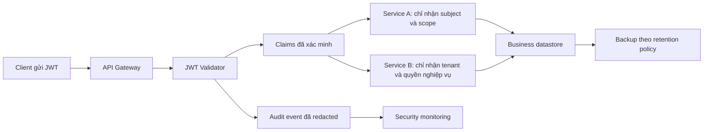

# Quyền truy cập vào token và dữ liệu giải mã trong nội bộ hệ thống

## 1. Vì sao quyền truy cập nội bộ cũng là ranh giới bảo mật?

Trong module **SECURITY_TOKEN_SECURITY_JWT — Security - JSON Web Token (JWT)**, JWT thường đi qua nhiều thành phần: issuer, API gateway, dịch vụ nghiệp vụ, hệ thống xác minh, hàng đợi thông điệp, kho log, công cụ giám sát và bộ phận vận hành. Mỗi thành phần có thể nhìn thấy token, một phần token hoặc dữ liệu sau giải mã.

Một hệ thống có thể xác minh chữ ký JWT hoàn toàn chính xác nhưng vẫn làm lộ dữ liệu nếu quá nhiều thành phần hoặc nhân sự có thể đọc token và claims. Rủi ro nội bộ có thể đến từ:

- Dịch vụ nhận token nhưng không cần đọc toàn bộ claims.
- Nhân sự hỗ trợ tải token hoặc payload vào ticket để điều tra.
- Log, trace, dashboard hoặc công cụ analytics lưu Authorization header.
- Dữ liệu đã giải mã được sao chép sang cache, queue, file tạm hoặc môi trường kiểm thử.
- Tài khoản dịch vụ dùng chung có quyền đọc token của nhiều tenant.
- Quyền quản trị quá rộng hoặc không có audit.
- Backup và bản export tồn tại lâu hơn mục đích ban đầu.

**Token và dữ liệu sau giải mã đều cần được bảo vệ như dữ liệu nhạy cảm.** Chữ ký số bảo vệ tính toàn vẹn và nguồn gốc theo khóa tin cậy; nó không tự giới hạn ai trong nội bộ được phép đọc token hoặc claims.

## 2. Phân biệt token, claims và dữ liệu sau giải mã

Không phải mọi dạng dữ liệu liên quan đến JWT có cùng mức độ nhạy cảm. Cần phân loại trước khi xác định quyền truy cập.

| Loại dữ liệu | Ví dụ | Rủi ro khi bị lộ |
| --- | --- | --- |
| Raw bearer token | Chuỗi JWT Compact trong Authorization header | Có thể bị sử dụng như credential cho tới khi hết hạn hoặc bị thu hồi |
| Protected Header | `alg`, `kid`, `typ`, `jku` | Có thể tiết lộ cấu hình, định danh khóa hoặc nguồn khóa |
| Claims Set đã giải mã | `sub`, `email`, `roles`, `scope`, `tenant_id` | Có thể tiết lộ danh tính, quyền, quan hệ hoặc dữ liệu nghiệp vụ |
| Plaintext sau giải mã JWE | Claims và dữ liệu riêng tư bên trong JWE | Có thể chứa dữ liệu nhạy cảm vốn được mã hóa khi truyền |
| Metadata vận hành | Issuer, audience, thời hạn, kết quả xác minh | Có thể tiết lộ cấu trúc hệ thống hoặc hoạt động người dùng |
| Khóa mật mã | Private signing key, decryption key | Có thể cho phép giả mạo token hoặc giải mã dữ liệu hàng loạt |

Raw JWT có thể là bearer credential: ai sở hữu token có thể sử dụng nó nếu token còn hiệu lực và các kiểm tra khác cho phép. Vì vậy, không nên coi token là dữ liệu vô hại chỉ vì nó là một chuỗi ký tự.

JWS thông thường không mã hóa payload. Base64url chỉ là encoding; bất kỳ ai có token đều có thể đọc claims nếu không có lớp mã hóa khác. Với JWE, ciphertext bảo vệ tính bí mật trên đường truyền và khi lưu, nhưng sau khi recipient giải mã thì plaintext lại trở thành dữ liệu cần kiểm soát quyền truy cập.

## 3. Xây dựng phân loại và bản đồ luồng dữ liệu

Trước khi cấp quyền, cần biết dữ liệu đi qua đâu, ai có thể đọc và vì sao thành phần đó cần truy cập.

Một bản đồ dữ liệu nên mô tả:

- Nguồn phát hành token và loại token.
- Thành phần nhận token đầu tiên.
- Thành phần xác minh chữ ký, giải mã hoặc introspection.
- Claims nào được đọc bởi từng dịch vụ.
- Dữ liệu nào được chuyển tiếp tới dịch vụ tiếp theo.
- Nơi dữ liệu được lưu tạm hoặc lưu lâu dài.
- Công cụ quan sát, hỗ trợ và điều tra có thể nhìn thấy trường nào.
- Vị trí backup, export, môi trường phân tích và môi trường kiểm thử.
- Thời hạn lưu và quy trình xóa ở từng nơi.

Ví dụ luồng dữ liệu:



Sơ đồ cần thể hiện luồng dữ liệu thực tế của hệ thống. Không chuyển raw token tới mọi thành phần chỉ để tiện xác minh lại hoặc debug nếu có thể chuyển kết quả xác minh tối thiểu.

### 3.1. Phân loại theo mục đích và tác động

Có thể dùng các mức phân loại nội bộ, ví dụ:

| Mức | Ví dụ | Quy tắc truy cập |
| --- | --- | --- |
| Công khai | Thông tin thuật toán hoặc tài liệu public | Có thể chia sẻ rộng |
| Nội bộ | Issuer identifier, trạng thái dịch vụ không nhạy cảm | Chỉ nhân sự/workload nội bộ theo nhiệm vụ |
| Nhạy cảm | Subject, tenant, scope, email, claims nghiệp vụ | Quyền hẹp theo mục đích và tenant |
| Bí mật xác thực | Raw access token, refresh token, session cookie | Không hiển thị rộng; chỉ thành phần thực sự cần sử dụng |
| Bí mật mật mã | Private key, decryption key, secret dùng ký | Quyền đặc biệt, quản lý bằng KMS/HSM hoặc cơ chế tương đương |

Mức phân loại cụ thể phụ thuộc chính sách tổ chức và loại dữ liệu. Cùng một claim có thể có mức nhạy cảm khác nhau theo ngữ cảnh; ví dụ `sub` dạng opaque vẫn có thể liên kết tới hồ sơ người dùng khi kết hợp với dữ liệu khác.

## 4. Áp dụng least privilege cho workload

Mỗi dịch vụ chỉ nên nhận đúng dữ liệu và quyền cần thiết để hoàn thành nhiệm vụ. Việc xác minh token tập trung có thể giúp giảm số nơi phải đọc raw JWT.

### 4.1. Tách quyền xác minh khỏi quyền sử dụng claims

Một kiến trúc có thể phân chia:

- **Gateway/validator:** nhận raw token, xác minh chữ ký, issuer, audience, thời hạn và các claim bắt buộc.
- **Business service:** nhận identity context hoặc tập claims tối thiểu đã được xác minh, chỉ dùng cho nghiệp vụ của nó.
- **Audit service:** nhận sự kiện đã lọc, không nhận raw token.
- **Support/analytics:** nhận metadata đã khử định danh hoặc dữ liệu tổng hợp.

Không phải mọi hệ thống đều cần một gateway tập trung; nếu từng dịch vụ tự xác minh JWT, quyền truy cập phải được giới hạn tương ứng. Điều quan trọng là không nhân bản token sang các thành phần không cần nó.

### 4.2. Claims tối thiểu theo dịch vụ

Ví dụ một request cần xử lý đơn hàng có thể chỉ cần:

```json
{
  "subjectRef": "opaque-user-reference",
  "tenantRef": "tenant-17",
  "permissions": ["orders:read"],
  "authTime": 1795000000
}
```

Một dịch vụ đọc đơn hàng không nhất thiết cần email, số điện thoại, địa chỉ hoặc toàn bộ profile của người dùng. Chỉ chuyển các trường thật sự cần cho quyết định nghiệp vụ.

Identity context được chuyển tiếp phải có nguồn gốc tin cậy và không thể bị client tự giả mạo. Nếu dùng header nội bộ, cần bảo đảm client bên ngoài không thể gửi trực tiếp hoặc ghi đè header đó; gateway phải loại bỏ giá trị do client cung cấp và tạo lại sau khi xác minh.

### 4.3. Ràng buộc audience và scope

`aud` giới hạn recipient dự kiến của token; scope/permission giới hạn hành động được cấp. Các dịch vụ phải kiểm tra audience và quyền theo profile, không dùng token có audience rộng hơn chỉ vì chữ ký hợp lệ.

Không chia sẻ một token quản trị đa năng cho nhiều workload. Tạo token theo audience, scope và mục đích cụ thể giúp giảm hậu quả khi một dịch vụ hoặc tài khoản bị xâm nhập.

## 5. Quyền truy cập của con người

Nhân sự vận hành, hỗ trợ, phát triển và bảo mật có nhu cầu khác nhau. Không nên cấp quyền xem raw token hoặc plaintext claims chỉ vì một người thuộc nhóm nội bộ.

| Vai trò | Quyền mặc định phù hợp |
| --- | --- |
| Developer | Dữ liệu giả lập/synthetic trong môi trường dev; không cần token production |
| Support | Trạng thái phiên và mã lỗi đã redacted; chỉ truy cập dữ liệu cá nhân khi quy trình hỗ trợ yêu cầu |
| SRE/Operations | Metrics, health và metadata vận hành; không cần đọc claims đầy đủ |
| Security analyst | Audit event và dữ liệu điều tra theo phạm vi sự cố |
| Privacy/Data governance | Metadata luồng dữ liệu, mục đích, retention và báo cáo truy cập |
| Key custodian | Thao tác khóa theo quy trình đặc quyền; không mặc nhiên có quyền đọc mọi payload |
| Incident commander | Quyền điều phối sự cố; quyền đọc dữ liệu nhạy cảm phải được cấp riêng theo tình huống |

### 5.1. Quyền theo vai trò và thuộc tính

RBAC có thể xác định vai trò được phép thực hiện loại thao tác nào. ABAC bổ sung điều kiện theo thuộc tính như:

- Tenant hoặc vùng dữ liệu mà người truy cập phụ trách.
- Môi trường production/non-production.
- Mục đích truy cập: hỗ trợ, điều tra, khắc phục hoặc audit.
- Mức độ nhạy cảm của dữ liệu.
- Thời gian và trạng thái phê duyệt.
- Ticket/sự cố liên quan.

Ví dụ, một support engineer có thể xem trạng thái token đã được xác minh của tenant mình phụ trách, nhưng không được tải raw JWT hoặc claims riêng tư của tenant khác.

### 5.2. Just-in-time và break-glass

Với nhu cầu đặc biệt không thể xử lý bằng quyền thường trực:

1. Người yêu cầu nêu mục đích và phạm vi cụ thể.
2. Hệ thống xác minh danh tính mạnh và quyền phê duyệt.
3. Cấp quyền tạm thời cho đúng tenant, đối tượng và trường dữ liệu.
4. Ghi audit đầy đủ trước và trong khi truy cập.
5. Hết thời hạn, quyền tự động bị thu hồi.
6. Hành động break-glass được rà soát sau sự cố.

Break-glass không phải tài khoản dùng chung hoặc cách bỏ qua audit. Quy trình phải giới hạn phạm vi và có cơ chế phát hiện việc sử dụng bất thường.

## 6. Bảo vệ token và claims trong log

Log thường được tập trung và có nhiều người/hệ thống truy cập. Vì vậy, log là một trong những nơi dễ làm rò rỉ token nhất.

Không ghi các dữ liệu sau nếu không có nhu cầu đặc biệt được phê duyệt:

- Authorization header đầy đủ.
- Raw JWT, refresh token hoặc cookie phiên.
- Toàn bộ Claims Set.
- Plaintext JWE sau giải mã.
- Private key, secret hoặc dữ liệu dùng để tạo chữ ký.
- Request/response body có chứa token hoặc dữ liệu cá nhân.

Thay vào đó, có thể ghi metadata tối thiểu:

```json
{
  "event": "jwt_validation",
  "issuer_id": "issuer-main",
  "audience": "orders-api",
  "token_type": "access",
  "result": "rejected",
  "reason_code": "EXPIRED",
  "correlation_id": "req-opaque-123",
  "timestamp": "2026-11-16T10:15:30Z"
}
```

Ví dụ này tránh lưu token, subject, email và claims không cần thiết. Nếu điều tra cần liên kết sự kiện với một tài khoản, nên dùng định danh nội bộ được kiểm soát hoặc pseudonymous reference, có quyền truy cập và thời hạn rõ ràng.

### 6.1. Redaction phải diễn ra trước khi ghi log

Redaction ở dashboard chỉ che dữ liệu khi hiển thị; raw token vẫn có thể tồn tại trong log backend, index, replica và backup. Cần lọc tại nguồn:

- Loại bỏ Authorization/Cookie header trước khi serialize request.
- Redact trường nhạy cảm trong structured logging.
- Không dump object chứa token khi exception xảy ra.
- Không log toàn bộ request/response mặc định.
- Kiểm tra instrumentation tự động của tracing/APM.
- Kiểm thử cả đường log lỗi, retry và dead-letter queue.

### 6.2. Correlation ID không phải token

Dùng correlation ID ngẫu nhiên để liên kết log giữa dịch vụ. Không dùng raw JWT, refresh token, session ID hoặc `jti` làm correlation ID công khai. Nếu cần tham chiếu token trong điều tra, dùng digest/keyed pseudonym được thiết kế riêng và giới hạn quyền tra cứu.

## 7. Tracing, metrics và công cụ quan sát

Distributed tracing có thể tự động thu thập HTTP header, query, request body hoặc exception context. Cần cấu hình rõ các trường bị loại bỏ.

Thực hành phù hợp:

- Chặn Authorization và Cookie khỏi trace attributes.
- Không đưa claims nhạy cảm vào span name hoặc metric label.
- Dùng mã lỗi chuẩn hóa thay cho payload đầy đủ.
- Tránh label cardinality cao như `jti`, token hash hoặc subject.
- Giới hạn quyền truy cập trace theo môi trường và team.
- Đặt retention riêng cho trace và log có dữ liệu nhạy cảm.
- Kiểm tra export sang nhà cung cấp observability bên ngoài.

Metrics nên tập trung vào số lượng và xu hướng: tỷ lệ token hết hạn, chữ ký sai, issuer không hợp lệ, lỗi xác minh, số request theo audience. Không cần ghi toàn bộ token hoặc claims để tạo các chỉ số này.

## 8. Bảo vệ dữ liệu trong cache, queue và kho lưu trữ

Token và dữ liệu giải mã thường được sao chép ngoài luồng request chính.

### 8.1. Cache

- Không cache raw token nếu không cần thiết.
- Nếu cần cache kết quả xác minh, cache theo issuer/token identity và TTL không vượt quá thời hạn chấp nhận.
- Cache claims tối thiểu; không giữ plaintext nhạy cảm lâu hơn mục đích.
- Phân quyền cache theo workload/tenant.
- Bảo vệ kết nối, xác thực client và mã hóa dữ liệu khi cần.
- Xóa cache khi session/token bị thu hồi hoặc quyền thay đổi theo chính sách.

### 8.2. Message queue và event bus

Không gửi raw JWT qua queue chỉ để consumer có thể lấy một vài claim. Ưu tiên event chứa subject reference, tenant, quyền hoặc dữ liệu nghiệp vụ tối thiểu đã được xác minh.

Nếu token thực sự cần đi qua queue:

- Chỉ producer/consumer được ủy quyền mới có quyền publish/read.
- Dùng TLS và cơ chế xác thực workload.
- Giới hạn retention, replay và quyền truy cập dead-letter queue.
- Tránh hiển thị payload trong UI quản trị queue.
- Không đưa token vào message key hoặc tên topic.
- Có quy trình xóa/expire message theo yêu cầu lưu trữ.

### 8.3. Database, file tạm và backup

- Hạn chế lưu raw JWT trong database; lưu trạng thái phiên hoặc metadata cần thiết thay thế.
- Mã hóa dữ liệu nhạy cảm khi lưu nếu threat model yêu cầu.
- Giới hạn quyền truy vấn và export.
- Kiểm soát file tạm, crash dump và memory dump.
- Bảo vệ backup, snapshot và bản export với cùng mức phân loại dữ liệu gốc.
- Xác định cách xóa dữ liệu trong backup theo chu kỳ và chính sách retention.

Xóa bản ghi trong database chính không tự xóa các bản sao trong replica, cache, queue, backup, log hoặc hệ thống phân tích.

## 9. Dữ liệu sau giải mã JWE

JWE cung cấp tính bí mật cho plaintext khi được mã hóa đúng và khóa được quản lý an toàn. Tuy nhiên, sau khi recipient giải mã, plaintext có thể bị lộ qua các kênh nội bộ giống dữ liệu ứng dụng thông thường.

Các nguyên tắc:

- Chỉ workload có nhu cầu nghiệp vụ mới được phép giải mã.
- Private decryption key không được phân phối cho mọi dịch vụ chỉ để tiện xử lý.
- Ưu tiên giải mã ở ranh giới tin cậy gần nơi sử dụng dữ liệu.
- Không log plaintext hoặc đưa vào trace.
- Chỉ chuyển claims cần thiết sang downstream service.
- Xóa plaintext tạm khi hoàn thành tác vụ theo khả năng runtime.
- Giới hạn quyền truy cập crash dump, heap dump và debug endpoint.

Nếu nhiều dịch vụ đều cần giải mã cùng một token, hãy đánh giá lại ranh giới dịch vụ. Có thể một dịch vụ tin cậy giải mã và chuyển identity context tối thiểu thay vì phân phối private key rộng rãi.

### 9.1. Không nhầm mã hóa với kiểm soát truy cập

Mã hóa bảo vệ dữ liệu khi người không có khóa truy cập vào ciphertext. Nó không giới hạn người dùng hợp lệ của khóa sẽ làm gì với plaintext sau giải mã.

Ví dụ, nếu mười dịch vụ cùng có quyền dùng một decryption key, cả mười dịch vụ có thể giải mã payload. Nếu chỉ hai dịch vụ cần đọc claim nhạy cảm, nên giới hạn quyền giải mã hoặc thiết kế payload/khóa theo mục đích để giảm phạm vi truy cập.

## 10. Quản lý khóa và quyền đặc quyền

Private signing key và decryption key có mức nhạy cảm cao hơn raw token. Ai có quyền sử dụng private signing key có thể phát hành JWT giả; ai có quyền dùng decryption key có thể đọc payload JWE tương ứng.

Thực hành phù hợp:

- Lưu khóa trong KMS, HSM hoặc hệ thống quản lý bí mật tương đương khi phù hợp.
- Tách quyền quản trị khóa khỏi quyền sử dụng khóa.
- Cấp quyền ký/giải mã cho workload identity cụ thể.
- Dùng key policy giới hạn thuật toán, key purpose và thao tác.
- Không export private key nếu không có nhu cầu được phê duyệt.
- Audit mọi thao tác ký, giải mã, export, rotate và disable.
- Xoay vòng khóa theo quy trình và duy trì overlap cần thiết.
- Có quy trình thu hồi khẩn cấp và xử lý khóa bị xâm phạm.

Không cấp quyền quản trị KMS chỉ vì một dịch vụ cần ký hoặc giải mã. Quyền sử dụng thao tác mật mã và quyền thay đổi policy/key lifecycle nên được tách riêng.

## 11. Xác thực workload và bảo vệ kênh nội bộ

Không nên coi mạng nội bộ là vùng tin cậy tuyệt đối. Mỗi dịch vụ cần có danh tính riêng và xác thực khi giao tiếp với dịch vụ khác.

Có thể dùng:

- Workload identity hoặc service account riêng cho từng ứng dụng.
- Mutual TLS (mTLS) để xác thực hai đầu kết nối.
- OAuth client credentials hoặc token service-to-service với audience/scope riêng.
- Network segmentation và policy hạn chế luồng gọi.
- Credential rotation và thu hồi danh tính workload.

Không dùng một shared secret hoặc một service account chung cho nhiều dịch vụ nếu có thể tách biệt. Khi một workload bị xâm nhập, danh tính riêng giúp giới hạn quyền và xác định nguồn truy cập trong audit.

## 12. Cô lập tenant và môi trường

Trong hệ thống nhiều tenant, mọi thao tác đọc token/claims phải được ràng buộc với tenant context đã được xác minh.

- Không lấy tenant chỉ từ header do client tự gửi.
- Xác minh tenant claim theo issuer/profile và kiểm tra quyền của subject trong tenant đó.
- Namespace cache, database key, log access và object storage theo tenant khi cần.
- Không để support user của tenant A truy vấn claims tenant B.
- Không dùng token production trong dev, test hoặc demo.
- Dùng synthetic data và token giả lập cho môi trường không production.
- Tách credential, signing key, encryption key và service identity theo môi trường.

Tenant ID trong JWT không thay thế authorization. Một token có claim `tenant_id` hợp lệ vẫn phải được kiểm tra rằng người dùng và workload được phép thao tác trên tenant đó.

## 13. Data minimization và privacy by design

JWT không nên trở thành hồ sơ người dùng đầy đủ. Claims nên chỉ chứa dữ liệu cần cho xác minh hoặc quyết định quyền.

Trước khi đưa claim vào token, hãy hỏi:

1. Thành phần nhận có thật sự cần claim này không?
2. Có thể dùng opaque identifier thay cho email, tên hoặc thông tin cá nhân không?
3. Có thể tra cứu dữ liệu qua API có kiểm soát thay vì sao chép vào token không?
4. Claim có thể thay đổi trong thời gian token còn hiệu lực không?
5. Nếu token bị log hoặc lộ, claim này gây tác động gì?
6. Token có thể được chuyển tới những audience nào?

Không đưa mật khẩu, refresh token khác, private key, dữ liệu tài chính đầy đủ hoặc thông tin bí mật không cần thiết vào claims. JWE có thể bảo vệ tính bí mật của payload, nhưng không loại bỏ nhu cầu tối thiểu hóa dữ liệu.

### 13.1. Pseudonymization và dữ liệu có thể liên kết

Opaque subject ID hoặc pseudonymous identifier có thể giảm việc lộ danh tính trực tiếp. Tuy nhiên, một định danh ổn định vẫn có thể liên kết hoạt động của cùng người dùng qua nhiều request hoặc dataset.

Do đó:

- Dùng định danh theo audience hoặc mục đích khi cần giảm liên kết chéo.
- Giới hạn quyền ánh xạ opaque ID về danh tính thật.
- Không coi hash không khóa của email hoặc số điện thoại là ẩn danh.
- Quản lý mapping table như dữ liệu nhạy cảm.

## 14. Retention, xóa dữ liệu và quyền riêng tư

Mỗi bản sao token/claims cần có mục đích và thời hạn lưu. Thời hạn không nên dài hơn mức cần thiết cho xác minh, audit, điều tra hoặc nghĩa vụ lưu trữ đã xác định.

| Nơi lưu | Câu hỏi retention cần trả lời |
| --- | --- |
| Request memory | Khi nào kết thúc xử lý và giải phóng tham chiếu? |
| Cache | TTL tối đa là bao lâu? Có invalidation khi revoke không? |
| Queue | Message tồn tại bao lâu? Dead-letter queue có retention riêng không? |
| Log/trace | Trường nào được lưu, ai đọc được, khi nào xóa? |
| Database | Có thật sự cần lưu token/claims hay chỉ cần trạng thái? |
| Backup/snapshot | Chu kỳ backup và thời điểm bản sao hết hạn là gì? |
| Support ticket | Có token hoặc plaintext bị đính kèm không? Khi nào xóa? |

Khi có yêu cầu xóa dữ liệu, cần xét tất cả bản sao và hệ thống phụ thuộc. Một số bản sao backup có thể chỉ được loại bỏ khi hết chu kỳ; điều này phải được mô tả rõ trong chính sách lưu trữ và kiểm soát truy cập trong thời gian chờ.

## 15. Audit truy cập dữ liệu nhạy cảm

Audit log nên trả lời được:

- Ai hoặc workload nào truy cập?
- Truy cập dữ liệu nào, thuộc issuer/tenant nào?
- Thực hiện thao tác gì: đọc token, giải mã, export, ký hay thay đổi policy?
- Mục đích và ticket/sự cố liên quan là gì?
- Quyền được cấp theo vai trò thường trực hay JIT/break-glass?
- Thời điểm, nguồn truy cập và kết quả ra sao?

Audit phải được bảo vệ khỏi sửa/xóa trái phép và chỉ người có nhiệm vụ mới được đọc. Không ghi raw token hoặc plaintext vào audit log để chứng minh rằng đã truy cập; hãy ghi object reference, data classification, action và outcome.

### 15.1. Phát hiện hành vi bất thường

Ví dụ dấu hiệu cần cảnh báo:

- Một workload đột nhiên đọc token/claims của nhiều tenant.
- Nhân sự support truy cập dữ liệu ngoài ticket hoặc ngoài giờ được phép.
- Một service identity gọi thao tác giải mã với tần suất tăng đột biến.
- Có nhiều lần export hoặc tải dữ liệu nhạy cảm.
- Có truy cập vào token đã hết hạn hoặc đã bị thu hồi mà không có lý do nghiệp vụ.
- Một tài khoản đặc quyền thay đổi policy hoặc tắt audit.

## 16. Quy trình truy cập khẩn cấp

Trong sự cố, đội bảo mật có thể cần xem một phần dữ liệu token hoặc plaintext để xác định phạm vi ảnh hưởng. Quy trình khẩn cấp nên:

1. Ghi nhận incident ID và mục đích điều tra.
2. Xác định chính xác token/issuer/tenant và trường dữ liệu cần xem.
3. Phê duyệt theo cơ chế hai người hoặc mức phê duyệt phù hợp với rủi ro.
4. Cấp quyền JIT có thời hạn và phạm vi hẹp.
5. Dùng công cụ truy cập được audit, không sao chép token vào chat hoặc ticket thông thường.
6. Redact dữ liệu không cần thiết trong báo cáo.
7. Thu hồi quyền sau khi hoàn tất.
8. Rà soát audit và xóa bản sao tạm theo retention policy.

Nếu token bị lộ trong quá trình điều tra, xử lý nó như credential bị xâm phạm: đánh giá khả năng sử dụng, thu hồi token/session nếu có thể và điều tra nơi token đã được sao chép.

## 17. Mã giả kiểm soát truy cập claims

Một dịch vụ có thể nhận identity context đã xác minh thay vì raw JWT:

```text
function handleBusinessRequest(request, verifiedContext):
    require verifiedContext.signatureVerified
    require verifiedContext.issuer in trustedIssuers
    require verifiedContext.audience includes thisService
    require verifiedContext.tokenType == "access"

    tenant = verifiedContext.tenant
    subject = verifiedContext.subject

    require workloadMayAccessTenant(thisWorkload, tenant)
    require subjectMayPerform(subject, request.action, tenant)

    claimsNeeded = selectOnlyRequiredClaims(
        verifiedContext,
        ["sub", "tenant_id", "scope"]
    )

    audit({
        actor: thisWorkload,
        tenant: tenant,
        subjectRef: pseudonymize(subject),
        action: request.action,
        result: "authorized"
    })

    return executeBusinessOperation(request, claimsNeeded)
```

Đây là mã giả mô tả chính sách. Trong triển khai thực tế, identity context phải được truyền qua kênh nội bộ có xác thực và không thể bị client bên ngoài giả mạo. Dịch vụ vẫn phải kiểm tra authorization cho tài nguyên cụ thể; claim đã xác minh không tự động cấp quyền cho mọi thao tác.

## 18. Kịch bản kiểm thử

| Kịch bản | Kết quả mong đợi |
| --- | --- |
| Developer truy cập raw token production | Bị từ chối nếu không có quyền đặc biệt |
| Support xem trạng thái token đã redacted | Chỉ thấy trường được phép theo tenant/ticket |
| Log request có Authorization header | Header bị loại bỏ hoặc redact trước khi ghi |
| APM tự thu thập HTTP headers | Authorization/Cookie không xuất hiện trong trace |
| Service A chỉ cần subject và scope | Không nhận email/profile claims không cần thiết |
| Client gửi giả mạo tenant header | Gateway loại bỏ và tạo context từ claims đã xác minh |
| Workload tenant A truy cập dữ liệu tenant B | Bị từ chối và audit |
| Token JWE được giải mã | Plaintext chỉ xuất hiện trong workload được ủy quyền |
| Nhân sự dùng break-glass | Có phê duyệt, thời hạn, audit và thu hồi quyền |
| Cache chứa claims nhạy cảm hết TTL | Entry bị xóa hoặc không còn được sử dụng |
| Backup chứa dữ liệu token | Được bảo vệ cùng phân loại và retention policy |
| Revoked token xuất hiện trong queue retry | Consumer kiểm tra trạng thái theo policy trước khi thực hiện |
| Workload identity bị thu hồi | Request nội bộ tiếp theo bị từ chối |
| Một dịch vụ export lượng lớn claims | Bị giới hạn, cảnh báo và audit |
| Yêu cầu xóa dữ liệu | Xem xét log, cache, queue, backup, ticket và bản export |

## 19. Checklist thiết kế

- [ ] Đã lập bản đồ mọi nơi raw JWT, claims và plaintext JWE có thể đi qua.
- [ ] Đã phân loại dữ liệu theo mức nhạy cảm và mục đích sử dụng.
- [ ] Chỉ thành phần cần thiết mới nhận raw token hoặc có quyền giải mã.
- [ ] Dịch vụ downstream nhận identity context/claims tối thiểu khi phù hợp.
- [ ] Audience, scope, tenant và workload identity được kiểm tra độc lập.
- [ ] Quyền con người theo least privilege, RBAC/ABAC và tenant boundary.
- [ ] Quyền đặc biệt dùng JIT/break-glass có phê duyệt, audit và tự hết hạn.
- [ ] Authorization/Cookie header, raw JWT và plaintext được redacted tại nguồn log.
- [ ] APM, tracing, metrics, error reporting và dashboard không làm lộ token.
- [ ] Cache, queue, database, file tạm và backup có access control và retention rõ ràng.
- [ ] JWE plaintext chỉ được giải mã ở workload được ủy quyền.
- [ ] Private signing/decryption key được bảo vệ bằng KMS/HSM hoặc cơ chế phù hợp.
- [ ] Workload identity riêng, kết nối nội bộ xác thực và phân vùng mạng phù hợp.
- [ ] Không dùng dữ liệu production hoặc token thật trong môi trường dev/test.
- [ ] Claims được tối thiểu hóa; opaque ID không bị coi nhầm là dữ liệu ẩn danh.
- [ ] Audit truy cập không chứa raw token và có khả năng phát hiện export bất thường.
- [ ] Quy trình xóa xét tới replica, cache, queue, log, ticket và backup.
- [ ] Đã kiểm thử truy cập trái phép giữa workload, vai trò và tenant.

## 20. Câu hỏi tự kiểm tra

**Câu 1.** Vì sao raw JWT cần được coi là dữ liệu nhạy cảm?

**Đáp án:** Vì bearer token có thể được dùng như credential; ngoài ra claims có thể chứa thông tin cá nhân, quyền và dữ liệu nghiệp vụ.

**Câu 2.** Base64url encoding của JWS có bảo vệ bí mật claims không?

**Đáp án:** Không. Base64url chỉ là encoding; payload JWS thông thường có thể được đọc mà không cần khóa.

**Câu 3.** JWE có loại bỏ nhu cầu kiểm soát quyền truy cập plaintext không?

**Đáp án:** Không. Sau giải mã, plaintext phải được bảo vệ bằng access control, data minimization, logging và retention policy.

**Câu 4.** Vì sao downstream service nên nhận claims tối thiểu?

**Đáp án:** Để giảm số thành phần có thể đọc dữ liệu nhạy cảm và giới hạn hậu quả khi một workload bị xâm nhập.

**Câu 5.** Có nên log Authorization header để debug không?

**Đáp án:** Không nên. Hãy redact tại nguồn và dùng correlation ID cùng mã lỗi chuẩn hóa.

**Câu 6.** RBAC có đủ để cô lập tenant không?

**Đáp án:** Không phải lúc nào cũng đủ. Cần kết hợp thuộc tính tenant, workload identity và kiểm tra quyền trên tài nguyên cụ thể.

**Câu 7.** Break-glass có nghĩa là bỏ qua audit không?

**Đáp án:** Không. Truy cập khẩn cấp phải có mục đích, phạm vi, phê duyệt phù hợp, thời hạn và audit.

**Câu 8.** Xóa token khỏi database chính có nghĩa mọi bản sao đã biến mất không?

**Đáp án:** Không. Cần xét cache, replica, queue, log, backup, file tạm, trace và ticket.

## 21. Tài liệu tham khảo

- [RFC 7519 — JSON Web Token (JWT)](https://www.rfc-editor.org/rfc/rfc7519): cấu trúc JWT và các claims.
- [RFC 7516 — JSON Web Encryption (JWE)](https://www.rfc-editor.org/rfc/rfc7516): bảo vệ và giải mã plaintext JWE.
- [RFC 8725 — JSON Web Token Best Current Practices](https://www.rfc-editor.org/rfc/rfc8725): thực hành an toàn khi phát hành và xác minh JWT.
- [NIST SP 800-53 Rev. 5](https://csrc.nist.gov/pubs/sp/800/53/r5/upd1/final): kiểm soát truy cập, audit, least privilege và bảo vệ dữ liệu hệ thống.
- [NIST SP 800-207 — Zero Trust Architecture](https://csrc.nist.gov/pubs/sp/800/207/final): xác thực và cấp quyền theo danh tính, tài nguyên và ngữ cảnh.
- [OWASP Logging Cheat Sheet](https://cheatsheetseries.owasp.org/cheatsheets/Logging_Cheat_Sheet.html): dữ liệu cần loại bỏ/che khỏi log và bảo vệ log.
- [OWASP Secrets Management Cheat Sheet](https://cheatsheetseries.owasp.org/cheatsheets/Secrets_Management_Cheat_Sheet.html): quản lý quyền, vòng đời và audit secrets.
- [OWASP Cryptographic Storage Cheat Sheet](https://cheatsheetseries.owasp.org/cheatsheets/Cryptographic_Storage_Cheat_Sheet.html): bảo vệ dữ liệu nhạy cảm khi lưu trữ.

**Ghi nhớ:** Xác minh JWT đúng không tự bảo vệ dữ liệu khỏi người dùng nội bộ hoặc workload có quyền quá rộng. Hãy phân loại raw token, claims và plaintext; cấp quyền theo workload, người dùng, tenant và mục đích; giảm dữ liệu được chuyển tiếp; redact log/trace tại nguồn; bảo vệ khóa, cache, queue, backup; audit quyền đặc biệt và đặt thời hạn lưu rõ ràng.
