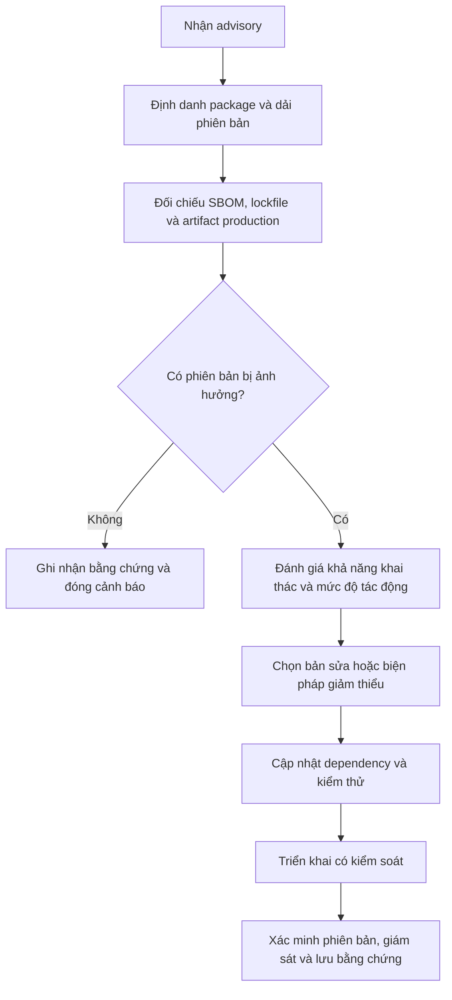

# Quản lý phiên bản phụ thuộc và xử lý thông báo lỗ hổng

Trong một hệ thống sử dụng JSON Web Token (JWT), thư viện JWT thường nằm trên đường đi của các thao tác nhạy cảm: phân tích token, kiểm tra chữ ký, xử lý khóa, giải mã nội dung hoặc xác thực các claim. Một lỗi trong thư viện trực tiếp hoặc trong dependency bắc cầu có thể làm suy yếu ranh giới xác thực, gây từ chối dịch vụ hoặc khiến hệ thống chấp nhận dữ liệu không đáng tin cậy.

Vì vậy, tích hợp thư viện JWT không kết thúc ở thời điểm chọn một package và gọi API. Đội phát triển cần quản lý phiên bản, kiểm soát nguồn cung ứng, theo dõi thông báo bảo mật và có quy trình xử lý lỗ hổng xuyên suốt vòng đời phần mềm. Các nguyên tắc dưới đây áp dụng cho nhiều ngôn ngữ và nền tảng; chúng không phụ thuộc vào một framework cụ thể.

## 1. Vì sao phiên bản dependency là một phần của bảo mật JWT?

Thư viện JWT có thể phụ thuộc vào nhiều thành phần khác nhau:

- Bộ phân tích JSON và bộ mã hóa/giải mã Base64URL.
- Thư viện mật mã hoặc crypto provider thực hiện các phép toán chữ ký và mã hóa.
- Thành phần xử lý khóa, định dạng khóa và chứng thư.
- HTTP client dùng để lấy khóa công khai từ JWKS endpoint.
- Bộ nhớ đệm, parser hoặc tiện ích xử lý dữ liệu mà thư viện sử dụng gián tiếp.

Một lỗ hổng không nhất thiết nằm trong package mang tên JWT. Ví dụ, lỗi trong parser có thể bị kích hoạt khi hệ thống nhận một token không đáng tin cậy; lỗi trong thành phần mật mã có thể ảnh hưởng đến việc xác minh chữ ký; lỗi trong HTTP client có thể làm tăng rủi ro khi tải JWKS. Dependency bắc cầu vì thế cũng cần được kiểm kê và theo dõi như dependency trực tiếp.

Quản lý phiên bản tốt giúp tổ chức:

1. Biết chính xác mã nguồn và phiên bản nào được đưa vào từng bản phát hành.
2. Tái tạo được cùng một dependency graph khi build và triển khai.
3. Phát hiện sớm phiên bản bị ảnh hưởng bởi advisory.
4. Nâng cấp có kiểm soát, hạn chế thay đổi ngoài dự kiến.
5. Chứng minh được lỗ hổng đã được xử lý hoặc có ngoại lệ được phê duyệt.

## 2. Kiểm kê dependency trực tiếp và bắc cầu

Trước khi đặt chính sách phiên bản, cần biết hệ thống thực sự sử dụng những thành phần nào. Không chỉ xem manifest khai báo dependency trực tiếp; hãy kiểm tra cả dependency graph sau khi công cụ build đã phân giải phiên bản.

Với mỗi dependency liên quan đến luồng JWT, nên lưu tối thiểu:

| Thông tin | Ý nghĩa |
|---|---|
| Tên và định danh package | Phân biệt package cùng tên hoặc khác hệ sinh thái; có thể dùng Package URL (purl) khi phù hợp |
| Phiên bản được phân giải | Phiên bản thực tế có trong artifact, không chỉ là khoảng phiên bản trong manifest |
| Quan hệ dependency | Trực tiếp hay bắc cầu, và package nào kéo nó vào |
| Nguồn tải | Registry, repository hoặc nhà cung cấp đã được phê duyệt |
| Mục đích sử dụng | Parse token, verify signature, xử lý khóa, tải JWKS hay chức năng khác |
| Môi trường sử dụng | Production, build, test hoặc công cụ phát triển |
| Trạng thái hỗ trợ | Còn được bảo trì hay đã hết vòng đời hỗ trợ |

Danh mục thành phần phần mềm (SBOM) ở định dạng như SPDX hoặc CycloneDX giúp biểu diễn dependency graph và hỗ trợ đối chiếu với dữ liệu lỗ hổng. SBOM cần gắn với artifact hoặc bản phát hành cụ thể; một danh sách dependency chung không đủ để chứng minh phiên bản đang chạy trong production.

**Lưu ý:** scanner không tìm thấy cảnh báo không đồng nghĩa dependency an toàn. Package có thể chưa được lập mã định danh, advisory chưa được công bố hoặc phiên bản thực tế chưa được scanner nhận diện. Kiểm kê và rà soát nguồn bảo mật của nhà duy trì vẫn cần thiết.

## 3. Chính sách ghim và cập nhật phiên bản

### 3.1. Phân biệt phiên bản yêu cầu và phiên bản được phân giải

Manifest thường cho phép khai báo một phiên bản chính xác hoặc một khoảng phiên bản. Công cụ quản lý dependency sau đó chọn phiên bản thỏa điều kiện. Hai giá trị này không nhất thiết giống nhau.

- **Phiên bản yêu cầu (requested version):** điều kiện mà manifest cho phép.
- **Phiên bản được phân giải (resolved version):** phiên bản cụ thể thực sự được đưa vào dependency graph.
- **Lockfile:** ghi lại kết quả phân giải để các lần build sau có thể tái tạo cùng đồ thị dependency.

Đối với ứng dụng, nên kiểm soát phiên bản được phân giải bằng lockfile và đưa lockfile vào quy trình review. Chỉ khai báo một khoảng phiên bản trong manifest mà không khóa kết quả có thể khiến hai lần build tạo ra artifact khác nhau.

Ví dụ minh họa dưới đây là quy ước giả lập, không phải cú pháp của một package manager cụ thể:

```yaml
dependencies:
  jwt-verifier:
    requested: ">=4.2.0 <5.0.0"
    resolved: "4.3.2"
    source: "approved-registry"
    integrity: "<digest-do-cong-cu-quan-ly-ghi-nhan>"
```

Khoảng phiên bản thể hiện chính sách tương thích mà dự án mong muốn; phiên bản `4.3.2` và digest thể hiện nội dung cụ thể được build. Trong hệ thống thực tế, hãy dùng định dạng và cơ chế integrity do hệ sinh thái hỗ trợ, không tự tạo digest minh họa.

### 3.2. Không dựa hoàn toàn vào số phiên bản

Nếu thư viện tuân theo Semantic Versioning, thông thường:

| Thành phần phiên bản | Ý nghĩa thường gặp | Cách đánh giá |
|---|---|---|
| PATCH | Sửa lỗi tương thích trong cùng dòng phiên bản | Thường có phạm vi thay đổi nhỏ hơn, nhưng vẫn cần đọc release note và kiểm thử |
| MINOR | Bổ sung chức năng tương thích ngược | Kiểm tra thay đổi hành vi, mặc định và dependency mới |
| MAJOR | Có thể chứa thay đổi không tương thích | Cần kế hoạch migration và kiểm thử tương thích đầy đủ |

Semantic Versioning là cam kết của nhà phát hành, không phải bằng chứng an toàn hay bảo đảm rằng mọi bản PATCH đều không có tác động. Một phiên bản mới hơn cũng không tự động là lựa chọn đúng nếu nó đã ngừng hỗ trợ, thay đổi API hoặc chưa tương thích với các thành phần khác.

### 3.3. Quy tắc quản lý phiên bản nên có

- Tránh wildcard, phiên bản động hoặc cơ chế tự lấy `latest` trong build production.
- Dùng lockfile và bảo đảm quy trình CI build từ đúng lockfile đã review.
- Ưu tiên release còn được nhà duy trì hỗ trợ và có thông tin phát hành rõ ràng.
- Theo dõi release note, breaking change, thay đổi mặc định mật mã và dependency mới.
- Không tự ý ép phiên bản dependency bắc cầu nếu chưa xác nhận tương thích với package phụ thuộc nó.
- Xác minh nguồn tải, chữ ký hoặc checksum khi hệ sinh thái cung cấp cơ chế đáng tin cậy.
- Định kỳ cập nhật cả dependency trực tiếp lẫn bắc cầu; không chỉ cập nhật khi có sự cố.

Ghim phiên bản không có nghĩa là giữ nguyên phiên bản mãi mãi. Ghim giúp build có thể tái lập; quy trình cập nhật định kỳ giúp dependency không bị tụt lại ở phiên bản lỗi thời.

## 4. Theo dõi thông báo lỗ hổng

Không nên phụ thuộc vào một nguồn cảnh báo duy nhất. Có thể kết hợp các nguồn sau:

1. **Thông báo của nhà duy trì:** security advisory, release note bảo mật, mailing list hoặc kênh thông báo chính thức của thư viện và crypto provider.
2. **Cơ sở dữ liệu advisory:** CVE/NVD, GitHub Security Advisories, OSV và nguồn tương ứng với hệ sinh thái package.
3. **Công cụ phân tích dependency:** Software Composition Analysis (SCA), scanner trong CI/CD hoặc dịch vụ quản lý lỗ hổng.
4. **SBOM và artifact registry:** đối chiếu thành phần của từng artifact đã build với advisory mới được công bố.
5. **Thông tin từ đội vận hành:** cảnh báo runtime, sự cố xác thực bất thường hoặc dấu hiệu khai thác có thể làm thay đổi mức ưu tiên xử lý.

Khi nhận cảnh báo, cần chuẩn hóa các trường thông tin: mã advisory, package định danh, hệ sinh thái, dải phiên bản bị ảnh hưởng, phiên bản đã sửa, mức độ nghiêm trọng, điều kiện khai thác, ngày công bố/cập nhật và khuyến nghị của nhà duy trì.

Không phải advisory nào cũng có CVE; ngược lại, chỉ dựa vào CVE cũng có thể bỏ sót cảnh báo riêng của nhà cung cấp. Cần đối chiếu package và phiên bản chính xác, tránh kết luận chỉ từ tên thư viện gần giống nhau.

## 5. Quy trình xử lý một thông báo lỗ hổng

Quy trình nên có người chịu trách nhiệm, thời hạn xử lý theo chính sách tổ chức và bằng chứng đóng cảnh báo. Một luồng điển hình:



### Bước 1: Xác minh package và phiên bản bị ảnh hưởng

- Xác định package bằng định danh đầy đủ, hệ sinh thái và nguồn phát hành.
- So sánh phiên bản đã phân giải với dải phiên bản bị ảnh hưởng trong advisory.
- Kiểm tra cả dependency bắc cầu và các artifact đang chạy, không chỉ nhánh mã nguồn mới nhất.
- Xác minh bản sửa được nhà duy trì công bố; lưu ý có thể có nhiều nhánh hỗ trợ với các phiên bản vá khác nhau.

Nếu advisory không nêu rõ phiên bản hoặc dữ liệu giữa các nguồn không thống nhất, cần kiểm tra thông báo gốc và hỏi nhà duy trì thay vì tự suy diễn.

### Bước 2: Đánh giá khả năng khai thác trong hệ thống

Mức độ nghiêm trọng được công bố là đầu vào quan trọng nhưng chưa đủ để quyết định thứ tự xử lý. Hãy đánh giá thêm:

- **Khả năng tiếp cận:** thành phần dễ bị ảnh hưởng có xử lý token hoặc dữ liệu từ Internet, đối tác hay người dùng không?
- **Khả năng đi tới đoạn mã lỗi (reachability):** chức năng dễ bị ảnh hưởng có thực sự được gọi trong cấu hình triển khai không?
- **Vai trò trong xác thực:** lỗi có thể ảnh hưởng đến parse, verify chữ ký, chọn khóa, giải mã hoặc kiểm tra claim không?
- **Điều kiện khai thác:** cần quyền truy cập, cấu hình đặc biệt, loại token hoặc thuật toán cụ thể nào?
- **Tác động:** có thể dẫn đến chấp nhận token không hợp lệ, lộ dữ liệu, giả mạo danh tính, thực thi hành vi ngoài ý muốn hay từ chối dịch vụ không?
- **Tình trạng khai thác:** có bằng chứng khai thác thực tế hoặc cảnh báo khẩn cấp từ nguồn đáng tin cậy không?

Không nên hạ mức ưu tiên chỉ vì scanner đánh dấu dependency là bắc cầu. Nếu dependency đó nằm trên đường xử lý token production thì rủi ro vẫn có thể trực tiếp đối với hệ thống.

### Bước 3: Chọn phương án khắc phục

Ưu tiên phiên bản đã sửa được nhà duy trì hỗ trợ. Khi chọn phiên bản, cần xem xét:

- Phiên bản có thực sự nằm ngoài dải bị ảnh hưởng không?
- Bản sửa có dành cho nhánh đang sử dụng không, hay bắt buộc nâng cấp major?
- Có thay đổi API, mặc định thuật toán, định dạng khóa hoặc hành vi kiểm tra claim không?
- Dependency bắc cầu và crypto provider có tương thích không?
- Bản phát hành có nguồn gốc và tính toàn vẹn xác minh được không?

Nếu chưa có bản vá, cần đánh giá biện pháp giảm thiểu được nhà duy trì khuyến nghị. Với luồng JWT, biện pháp tạm thời có thể bao gồm vô hiệu hóa chức năng hoặc đường xử lý bị ảnh hưởng, giới hạn loại token/thuật toán được chấp nhận bằng allowlist rõ ràng, hạn chế nguồn JWKS được phép truy cập hoặc chặn đầu vào gây lỗi. Chỉ áp dụng biện pháp phù hợp với nguyên nhân advisory; không xem cấu hình phòng vệ chung là cách thay thế cho bản vá.

Nếu không thể giảm thiểu an toàn, cân nhắc tạm dừng chức năng hoặc cô lập thành phần bị ảnh hưởng. Mọi ngoại lệ phải có người phê duyệt, lý do, phạm vi, biện pháp bù đắp, ngày hết hạn và kế hoạch xử lý tiếp theo.

### Bước 4: Kiểm thử sau khi cập nhật

Kiểm thử không chỉ nhằm xác nhận ứng dụng khởi động được. Cần kiểm tra lại hành vi bảo mật và tương thích của toàn bộ luồng token:

- Token có chữ ký hợp lệ được xác minh đúng với khóa và thuật toán dự kiến.
- Token sai chữ ký, sai định dạng hoặc bị sửa đổi vẫn bị từ chối.
- Thuật toán không được cho phép, thuật toán không an toàn hoặc cấu hình không xác định không được chấp nhận.
- Các claim quan trọng như `iss`, `aud`, `exp` và `nbf` vẫn được kiểm tra theo chính sách của ứng dụng.
- Việc chọn khóa, tải JWKS, cache và xoay vòng khóa hoạt động đúng; lỗi khi lấy khóa không khiến hệ thống bỏ qua xác minh.
- Token quá lớn, JSON bất thường hoặc đầu vào lỗi không gây treo hay tiêu thụ tài nguyên vượt kiểm soát.
- Các trường hợp tương thích và hiệu năng quan trọng không bị suy giảm ngoài dự kiến.

Nên bổ sung regression test cho điều kiện đã kích hoạt advisory nếu có thể mô tả an toàn. Không đưa token thật, khóa riêng hoặc dữ liệu xác thực production vào log và bộ kiểm thử dùng chung.

### Bước 5: Triển khai và xác minh

Triển khai theo chiến lược phù hợp với mức độ rủi ro: canary, từng nhóm dịch vụ hoặc rollout có kiểm soát. Theo dõi tỷ lệ xác thực thất bại, lỗi parse/verify, lỗi tải JWKS, độ trễ và tài nguyên. Đặt tiêu chí dừng hoặc rollback trước khi triển khai.

Rollback phải tránh quay lại phiên bản đang có lỗ hổng. Nếu bản cập nhật gây sự cố, phương án quay lui cần là một phiên bản an toàn đã được xác minh hoặc một bản sửa tương thích khác; không tự động khôi phục dependency dễ bị khai thác chỉ để đưa dịch vụ về trạng thái hoạt động.

Sau triển khai, xác nhận phiên bản thực tế trong artifact và môi trường production, cập nhật SBOM/đăng ký dependency, đóng cảnh báo bằng bằng chứng và thông báo cho các nhóm chịu ảnh hưởng.

## 6. Ví dụ: lỗ hổng trong dependency bắc cầu của thư viện JWT

Giả sử một dịch vụ xác thực sử dụng `jwt-gateway` và package này kéo theo dependency giả định `token-parser`. Nhà duy trì thông báo rằng các phiên bản `token-parser` thấp hơn `3.4.1` có lỗi xử lý một dạng header không hợp lệ; `3.4.1` là phiên bản đã sửa. Đây là ví dụ minh họa, không phải advisory của một sản phẩm có thật.

Quy trình xử lý:

1. Scanner phát hiện `token-parser` trong dependency graph, dù nhóm phát triển không khai báo package này trực tiếp.
2. Đội phụ trách đối chiếu lockfile, SBOM và artifact production để xác nhận phiên bản thực tế là `3.3.8`.
3. Kiểm tra dịch vụ có nhận JWT từ nguồn bên ngoài và có đi qua parser bị ảnh hưởng hay không. Vì đường xử lý này đang được sử dụng, cảnh báo được ưu tiên cao.
4. Kiểm tra release note và nâng dependency cha hoặc cập nhật dependency bắc cầu theo cách được nhà duy trì hỗ trợ để phân giải sang `3.4.1` hoặc bản an toàn mới hơn.
5. Chạy regression test cho token hợp lệ, token có header lỗi, chữ ký không hợp lệ, thuật toán ngoài allowlist và các trường hợp tương thích.
6. Build lại artifact từ lockfile đã cập nhật, triển khai theo từng giai đoạn và xác minh phiên bản trong production.
7. Lưu advisory, phiên bản trước/sau, kết quả kiểm thử, phê duyệt triển khai và bằng chứng scanner không còn phát hiện phiên bản bị ảnh hưởng.

Nếu dependency cha chưa hỗ trợ phiên bản đã sửa, không nên âm thầm ép một phiên bản bất kỳ rồi coi như hoàn tất. Cần xác minh tương thích, yêu cầu bản phát hành mới từ nhà duy trì, áp dụng biện pháp giảm thiểu phù hợp hoặc lập ngoại lệ có thời hạn.

## 7. Tự động hóa trong CI/CD

Một quy trình hiệu quả kết hợp kiểm soát ở thời điểm thay đổi mã nguồn và giám sát sau khi phát hành:

| Điểm kiểm soát | Việc cần thực hiện |
|---|---|
| Khi thêm hoặc nâng dependency | Review nguồn, phiên bản, release note, license và thay đổi dependency graph |
| Khi tạo pull request | Quét dependency trực tiếp/bắc cầu, kiểm tra lockfile và so sánh SBOM nếu có |
| Khi build artifact | Sinh hoặc gắn SBOM với artifact; lưu định danh và digest của thành phần |
| Theo lịch định kỳ | Quét lại dependency đã tồn tại vì advisory có thể được công bố sau ngày build |
| Khi có advisory mới | Đối chiếu với SBOM/artifact đã phát hành, tạo ticket và chỉ định người xử lý |
| Trước khi release | Áp dụng chính sách chặn theo mức rủi ro, xác nhận ngoại lệ còn hiệu lực và có phê duyệt |

Chính sách CI/CD nên quy định rõ ngưỡng chặn build, thời hạn khắc phục theo mức độ, người có quyền phê duyệt ngoại lệ và cách xử lý cảnh báo sai. Ngưỡng thời gian cụ thể cần dựa trên khả năng vận hành và khẩu vị rủi ro của tổ chức; không có một SLA duy nhất phù hợp cho mọi hệ thống.

Không nên chỉ cấu hình scanner để báo cáo rồi bỏ qua. Cảnh báo cần được chuyển thành công việc có chủ sở hữu, mức ưu tiên, hạn xử lý và trạng thái theo dõi. Đồng thời, tránh chặn build một cách máy móc khi chưa xác minh package, phiên bản và khả năng ảnh hưởng; false positive kéo dài sẽ khiến đội ngũ mất niềm tin vào hệ thống cảnh báo.

## 8. Những sai lầm thường gặp

- **Chỉ kiểm tra dependency trực tiếp:** bỏ sót package bắc cầu nằm trong đường xử lý JWT.
- **Chỉ quét tại thời điểm build:** bỏ sót advisory được công bố sau khi artifact đã phát hành.
- **Coi lockfile là bằng chứng an toàn:** lockfile chỉ giúp tái lập dependency graph, không chứng minh các phiên bản trong đó không có lỗ hổng.
- **Nâng lên phiên bản mới nhất mà không đọc release note:** có thể đưa vào breaking change hoặc thay đổi cấu hình bảo mật ngoài dự kiến.
- **Dựa duy nhất vào CVSS:** bỏ qua khả năng tiếp cận, reachability, mức độ quan trọng của luồng xác thực và bằng chứng khai thác.
- **Ép dependency bắc cầu tùy tiện:** có thể làm package cha không tương thích hoặc tạo ra lỗi runtime khó phát hiện.
- **Tắt cảnh báo mà không lưu lý do:** khiến tổ chức mất dấu rủi ro và không biết khi nào cần đánh giá lại.
- **Rollback về bản dễ bị khai thác:** biến sự cố tương thích thành việc khôi phục lỗ hổng đã biết.
- **Không xác minh production:** mã nguồn đã cập nhật nhưng artifact cũ hoặc một dịch vụ khác vẫn có thể đang chạy phiên bản bị ảnh hưởng.

## 9. Checklist vận hành

- [ ] Có danh mục dependency trực tiếp và bắc cầu của thành phần JWT.
- [ ] Biết phiên bản thực tế trong artifact và production, không chỉ phiên bản khai báo.
- [ ] Lockfile được quản lý trong review và build có thể tái lập.
- [ ] Dependency đến từ nguồn đáng tin cậy; integrity được xác minh khi có hỗ trợ.
- [ ] Có SBOM hoặc cách tương đương để đối chiếu advisory với artifact.
- [ ] Theo dõi advisory của nhà duy trì và cơ sở dữ liệu lỗ hổng phù hợp.
- [ ] Mỗi cảnh báo được xác minh package, dải phiên bản và khả năng ảnh hưởng.
- [ ] Có chủ sở hữu, mức ưu tiên, hạn xử lý và quy trình ngoại lệ.
- [ ] Bản nâng cấp được kiểm thử cả tương thích lẫn các điều kiện bảo mật JWT.
- [ ] Sau triển khai đã xác minh phiên bản production và lưu bằng chứng đóng cảnh báo.

## Kết luận

Quản lý dependency của thư viện JWT là một hoạt động bảo mật liên tục, không phải thao tác cập nhật package đơn lẻ. Cần kiểm kê toàn bộ dependency graph, khóa kết quả phân giải để build có thể tái lập, theo dõi nhiều nguồn advisory, đánh giá khả năng khai thác trong ngữ cảnh thực tế và triển khai bản sửa có kiểm thử. Khi chưa có bản vá, biện pháp giảm thiểu phải có căn cứ, người chịu trách nhiệm và thời hạn rõ ràng. Một quy trình như vậy giúp duy trì độ tin cậy của luồng xác thực JWT trong suốt vòng đời vận hành.
