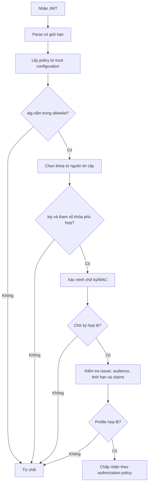

# Thuật toán ngoài danh sách, loại khóa sai và chữ ký sai

## 1. Mục tiêu kiểm thử

Trong module **SECURITY_TOKEN_SECURITY_JWT — Security - JSON Web Token (JWT)**, việc xác minh chữ ký chỉ an toàn khi verifier kiểm soát được cả thuật toán lẫn khóa được dùng. Một JWT có thể được tạo đúng định dạng nhưng vẫn phải bị từ chối nếu:

- Header yêu cầu thuật toán không nằm trong allowlist.
- Thuật toán không tương thích với loại khóa hoặc tham số khóa.
- Khóa không thuộc issuer hoặc trust domain đã cấu hình.
- Chữ ký/MAC không hợp lệ, bị thay đổi hoặc không được tạo bởi khóa tương ứng.
- Token dùng cấu trúc hoặc chế độ JOSE mà profile không hỗ trợ.

Bài này tập trung vào cách thiết kế kiểm thử bảo mật cho ba nhóm điều kiện: **thuật toán ngoài danh sách, loại khóa sai và chữ ký sai**. Mục tiêu là chứng minh verifier từ chối an toàn, không tự hạ cấp thuật toán, không chọn nhầm khóa và không chấp nhận token chỉ vì cấu trúc của nó hợp lệ.

Các ví dụ chủ yếu dùng JWS ký JWT. Với JWT dạng JWE hoặc Nested JWT, cần kiểm thử thêm thuật toán quản lý khóa, thuật toán mã hóa nội dung, authentication tag và chữ ký bên trong theo profile tương ứng.

## 2. Những điều kiện phải đúng trước khi chấp nhận JWT

Một verifier nên dựa trên policy được cấu hình độc lập với token. Tối thiểu cần ràng buộc:

1. Issuer được phép.
2. Token type và định dạng được hỗ trợ.
3. Thuật toán được phép cho issuer, token type và mục đích sử dụng.
4. Nguồn khóa được tin cậy và gắn với issuer.
5. Loại khóa và tham số khóa tương thích với thuật toán.
6. Khóa có mục đích xác minh phù hợp.
7. Chữ ký/MAC được xác minh thành công trên đúng JWS Signing Input.
8. Claims như `iss`, `aud`, `exp`, `nbf` và các claim bắt buộc đáp ứng profile.

Header của JWT là dữ liệu do người gửi cung cấp. Trường `alg` có thể được đọc để biết token đang khai báo thuật toán nào, nhưng không được để nó tự quyết định verifier sẽ dùng thuật toán gì. Verifier phải đối chiếu nó với allowlist đã cấu hình.



Không được dùng việc chữ ký hợp lệ để bỏ qua kiểm tra issuer, audience hoặc thời hạn. Chữ ký chỉ là một điều kiện trong toàn bộ quy trình xác minh.

## 3. Algorithm allowlist

**Algorithm allowlist** là danh sách thuật toán verifier chấp nhận trong một ngữ cảnh cụ thể. Allowlist cần được cấu hình theo issuer, loại token và mục đích sử dụng; không nên có một danh sách rộng dùng chung cho mọi nguồn.

Ví dụ policy logic:

```yaml
issuerPolicies:
  - issuer: https://issuer.example
    tokenType: access
    allowedJwsAlgorithms:
      - RS256
    allowedKeyTypes:
      - RSA
    minimumRsaModulusBits: 2048
```

Đây là cấu hình minh họa. Thuật toán thực tế phải phù hợp với khả năng của issuer, verifier, chuẩn giao thức và chính sách mật mã của tổ chức.

### 3.1. Allowlist phải độc lập với JWT Header

Một thiết kế không an toàn là:

```text
algorithm = token.header.alg
verify(token, key, algorithm)
```

Đoạn mã giả trên cho phép token chọn thuật toán. Một verifier an toàn cần:

```text
policy = trustedIssuerPolicy(expectedIssuer)
require token.header.alg in policy.allowedAlgorithms
require selectedKey is eligible under policy and algorithm
verify(token, selectedKey, policy-approved algorithm)
```

Thư viện JOSE nên được cấu hình bằng allowlist rõ ràng hoặc API xác minh có tham số thuật toán được ứng dụng kiểm soát. Không dựa vào mặc định thư viện nếu chưa xác nhận mặc định đó phù hợp với profile.

### 3.2. Không tự động fallback

Nếu chữ ký không xác minh được bằng thuật toán được cấu hình, verifier không được thử lần lượt mọi thuật toán hoặc loại khóa khác cho tới khi có một cách xác minh thành công.

Ví dụ, không được:

- Thử RS256 thất bại rồi tự chuyển sang HS256.
- Thử khóa RSA rồi thử cùng bytes dưới dạng HMAC secret.
- Khi `alg` không được phép, chọn thuật toán khác dựa trên loại khóa đang có.
- Khi khóa không tương thích, bỏ qua kiểm tra `kty` để tiếp tục.

Fallback làm mờ ranh giới policy và có thể mở lại các lớp tấn công algorithm confusion.

## 4. Các nhóm thuật toán và loại khóa tương ứng

Bảng sau mô tả các nhóm thường gặp trong JWS. Đây là hướng dẫn tương thích tổng quát; profile cần quy định chính xác thuật toán, tham số và độ dài khóa được chấp nhận.

| Nhóm thuật toán | Ví dụ `alg` | Loại khóa phù hợp | Kiểm tra quan trọng |
| --- | --- | --- | --- |
| RSA signature | RS256, RS384, RS512 | JWK `kty: RSA` | Modulus đủ mạnh, public exponent hợp lệ, chỉ dùng public key để verify |
| RSA-PSS signature | PS256, PS384, PS512 | JWK `kty: RSA` | Kiểm tra đúng hash, MGF1 và salt length theo JOSE |
| ECDSA signature | ES256, ES384, ES512 | JWK `kty: EC` | Curve phải đúng với thuật toán, điểm EC hợp lệ |
| EdDSA | EdDSA | JWK `kty: OKP` với curve được profile hỗ trợ | Đúng curve/algorithm và public key format |
| HMAC signature | HS256, HS384, HS512 | JWK `kty: oct` hoặc secret đối xứng được quản lý an toàn | Secret đủ entropy/độ dài, không dùng public key bytes làm secret |

Một số ràng buộc thường dùng:

- RS256 và PS256 sử dụng RSA với kích thước modulus tối thiểu theo profile; RFC 7518 yêu cầu tối thiểu 2048 bit cho các thuật toán RSA tương ứng.
- ES256 yêu cầu curve P-256; ES384 yêu cầu P-384; ES512 yêu cầu P-521.
- EdDSA cần đúng loại khóa và curve được thư viện/profile hỗ trợ, ví dụ Ed25519 hoặc Ed448 theo cấu hình.
- HS256 cần secret có ít nhất 256 bit entropy/độ dài khóa theo yêu cầu thuật toán; các biến thể HS384/HS512 cần mức tương ứng.
- Không coi `kty` là đủ: phải kiểm tra thêm curve, modulus, exponent, key operations và policy.

Không nên chấp nhận khóa chỉ vì thư viện có thể parse được nó. Khả năng parse không chứng minh khóa phù hợp hoặc được phép sử dụng.

## 5. JWK metadata và điều kiện chọn khóa

Khi khóa đến từ JWKS, verifier cần kiểm tra các thuộc tính liên quan:

| JWK parameter | Ý nghĩa kiểm thử |
| --- | --- |
| `kty` | Loại khóa phải tương thích với thuật toán |
| `kid` | Định danh khóa; nếu profile yêu cầu thì phải khớp chính xác |
| `alg` | Nếu có, phải tương thích với thuật toán được policy cho phép |
| `use` | Nếu có, phải cho phép mục đích chữ ký, thường là `sig` |
| `key_ops` | Nếu có, phải cho phép thao tác `verify` |
| `crv` | Với EC/OKP, curve phải nằm trong danh sách cho phép |
| `n`, `e` | Với RSA, modulus và exponent phải hợp lệ và đạt yêu cầu |
| `x`, `y` | Với EC, tọa độ phải tạo thành điểm hợp lệ trên curve được chỉ định |
| `d` | Private key material; không được xuất hiện trong JWKS công khai dùng xác minh |

`alg`, `use` và `key_ops` là các thuộc tính có thể tùy chọn theo JWK. Nếu hiện diện, chúng phải tương thích với policy. Nếu vắng mặt, verifier vẫn phải áp dụng policy độc lập; không được mặc nhiên coi khóa phù hợp với mọi thuật toán.

### 5.1. Chọn đúng một khóa

Nếu profile dùng `kid`, verifier tìm khóa trong JWKS thuộc issuer đã tin cậy. Kết quả cần được kiểm tra:

- Không tìm thấy khóa: từ chối hoặc refresh JWKS từ nguồn đã cấu hình theo chính sách.
- Tìm thấy đúng một khóa đủ điều kiện: có thể tiếp tục xác minh.
- Nhiều khóa cùng khớp và không thể phân biệt theo profile: từ chối trường hợp mơ hồ.
- Khóa có `kid` đúng nhưng `kty`, `alg`, `use`, `key_ops` hoặc curve sai: từ chối khóa đó.

Không được chọn khóa chỉ vì `kid` khớp. `kid` là định danh, không phải bằng chứng về loại khóa, mục đích hoặc quyền ký.

### 5.2. Không trộn khóa giữa các issuer

Cache và key selection phải được namespace theo issuer/trust domain. Hai issuer có thể dùng cùng chuỗi `kid`; không để khóa của issuer A được dùng để xác minh token của issuer B.

Nếu chữ ký xác minh thành công bằng khóa của issuer khác nhưng `iss` trong token khai báo issuer hiện tại, token vẫn phải bị từ chối vì quan hệ issuer-key không hợp lệ.

## 6. Algorithm confusion cần được kiểm thử

Algorithm confusion xảy ra khi verifier diễn giải thuật toán do token khai báo theo cách khác với policy hoặc dùng cùng material khóa trong một vai trò không phù hợp.

### 6.1. `none` hoặc unsecured JWT

Với JWS, `alg: none` biểu thị unsecured JWS không có chữ ký. Profile xác thực access token thông thường phải từ chối token này.

Test cần xác nhận:

- `alg: none` bị từ chối.
- Token không có signature segment không được chấp nhận như token đã ký.
- Verifier không chuyển sang chế độ unsecured vì thiếu khóa hoặc lỗi tải JWKS.
- Chỉ một profile riêng, được thiết kế rõ cho dữ liệu không cần xác thực mật mã, mới có thể xem xét unsecured JWT; không tái sử dụng cho access token.

### 6.2. Nhầm lẫn RSA và HMAC

Một lỗi cổ điển là verifier vốn dự kiến dùng RSA public key để xác minh RS256 nhưng lại cho phép token yêu cầu HS256 và sử dụng bytes của public key như HMAC secret.

Kẻ tấn công có thể biết public key nên có thể tạo HMAC hợp lệ nếu verifier mắc lỗi này.

Kiểm thử cần chứng minh:

- Policy issuer chỉ cho phép RS256 thì token HS256 bị từ chối trước khi xác minh.
- RSA public key không bao giờ được chuyển thành HMAC secret.
- Key type RSA không được chấp nhận cho HS256.
- HMAC secret không được dùng như RSA/EC/OKP public key.
- Không có fallback giữa thuật toán đối xứng và bất đối xứng.

### 6.3. Thuật toán cùng họ nhưng không được phép

Nếu policy chỉ cho phép RS256, token dùng RS384 hoặc PS256 vẫn phải bị từ chối dù thư viện và khóa có thể hỗ trợ chúng. Tương tự, cho phép ES256 không có nghĩa tự động cho phép ES384 hoặc EdDSA.

Allowlist là danh sách chính xác, không phải chỉ kiểm tra một prefix hoặc nhóm thuật toán rộng.

### 6.4. Header parameter gây thay đổi cách xác minh

Kiểm thử thêm các header:

- `crit` chứa extension mà verifier không hỗ trợ: từ chối.
- `b64` hoặc detached payload mode không được profile hỗ trợ: từ chối.
- Header trùng tên hoặc cấu trúc JSON mơ hồ: xử lý theo parser/profile nghiêm ngặt; không để hai thành phần hiểu khác nhau.
- `jwk`, `jku`, `x5u` hoặc `x5c` không được profile tin cậy: không dùng làm nguồn khóa thay thế.

Verifier phải từ chối critical parameter không hiểu thay vì âm thầm bỏ qua.

## 7. Kiểm thử loại khóa sai

Mục tiêu là chứng minh verifier chỉ chọn khóa đúng loại, đúng tham số và đúng mục đích.

### 7.1. Sai `kty`

Với policy RS256/RSA, thử đưa vào:

- JWK `kty: EC`.
- JWK `kty: OKP`.
- JWK `kty: oct`.
- JWK không có `kty`.
- JWK có `kty` không được hỗ trợ.

Kết quả mong đợi: không khóa nào được chọn và token bị từ chối. Không cố ép chuyển đổi khóa giữa các loại.

### 7.2. Sai curve

Với ES256, thử các trường hợp:

- EC key dùng P-384 hoặc P-521.
- EC key dùng curve không nằm trong profile.
- `crv` không khớp với kích thước/định dạng tọa độ.
- Tọa độ điểm EC không hợp lệ hoặc không nằm trên curve.

Kết quả mong đợi: từ chối khóa trước khi xác minh chữ ký. Không suy ra curve chỉ từ kích thước bytes hoặc `kid`.

### 7.3. RSA key không đạt yêu cầu

Thử:

- Modulus nhỏ hơn minimum key size.
- Modulus hoặc exponent malformed.
- Public key thiếu thành phần bắt buộc.
- Private key material `d` xuất hiện trong JWKS công khai.
- RSA key được đánh dấu `use: enc` hoặc `key_ops` không cho phép `verify`.

Kết quả mong đợi: từ chối khóa. Không hạ minimum key size khi gặp token không xác minh được.

### 7.4. Sai key operation hoặc purpose

Nếu JWK có `use` hoặc `key_ops`:

- `use: enc` không được dùng để xác minh chữ ký.
- `key_ops: ["encrypt"]` không được dùng để verify.
- `key_ops` không bao gồm `verify` thì từ chối.
- Nếu `use` và `key_ops` mâu thuẫn, từ chối khóa.

Nếu các trường tùy chọn này vắng mặt, policy verifier vẫn phải xác định khóa có được phép cho verify hay không.

### 7.5. Sai loại secret đối với HMAC

Với HS256/HS384/HS512, thử:

- Secret quá ngắn hoặc entropy thấp.
- Secret rỗng.
- Public key PEM/DER được dùng làm secret.
- JWK `kty` không phải `oct`.
- Secret bị lộ trong log hoặc fixture kiểm thử dùng lại trong production.

Kết quả mong đợi: từ chối cấu hình khóa không đạt yêu cầu; không chấp nhận token bằng một secret yếu chỉ vì MAC khớp.

## 8. Kiểm thử chữ ký sai

Chữ ký sai phải dẫn đến từ chối nhất quán. Bộ test nên tạo token hợp lệ trước, sau đó thay đổi đúng một thành phần để xác nhận kiểm tra mật mã phát hiện được thay đổi.

### 8.1. Thay đổi payload

1. Tạo JWS hợp lệ bằng test key.
2. Giữ nguyên protected header và signature.
3. Thay đổi một byte trong payload hoặc một claim.
4. Gửi token đã thay đổi tới verifier.

Kết quả mong đợi: chữ ký không hợp lệ và token bị từ chối.

### 8.2. Thay đổi protected header

Thay đổi `alg`, `kid` hoặc một protected header parameter sau khi ký nhưng giữ signature cũ. Vì protected header tham gia vào JWS Signing Input, chữ ký phải thất bại hoặc token phải bị từ chối sớm do header không phù hợp policy.

Không được chỉ kiểm tra payload mà bỏ qua protected header.

### 8.3. Thay đổi signature

Thử:

- Lật một bit trong signature.
- Xóa một phần signature.
- Signature rỗng.
- Base64url encoding không hợp lệ.
- Signature có độ dài sai so với thuật toán.
- Signature được tạo bằng private key khác.

Kết quả mong đợi: từ chối; không có fallback sang thuật toán khác hoặc khóa khác ngoài quy tắc chọn khóa đã cấu hình.

### 8.4. Dùng khóa khác nhưng cùng thuật toán

Tạo hai cặp khóa cùng loại và thuật toán:

- Token được ký bằng private key A.
- Verifier chỉ có public key B.

Kết quả mong đợi: chữ ký thất bại. Test này chứng minh verifier không chỉ kiểm tra `alg` và `kty`, mà còn xác minh đúng key material.

### 8.5. Kiểm tra đúng JWS Signing Input

Với Compact JWS, signing input là:

```text
BASE64URL(UTF8(protected header))
    + "."
    + BASE64URL(payload)
```

Verifier phải xác minh đúng bytes theo serialization đã nhận. Không decode JSON rồi serialize lại theo thứ tự field khác, không tự chuẩn hóa whitespace hoặc thay đổi encoding trước khi xác minh.

Sử dụng thư viện JOSE đã được kiểm chứng để xử lý serialization, base64url và thuật toán chữ ký. Không tự viết thuật toán mật mã hoặc tự tạo parser Compact JWS cho production.

## 9. Kiểm thử HMAC và so sánh MAC

Với HMAC, verifier phải dùng secret đúng, đúng thuật toán và phép so sánh MAC an toàn.

Các test cần có:

- MAC đúng với secret đúng được chấp nhận nếu mọi policy khác đạt.
- MAC sai một bit bị từ chối.
- MAC được tạo bằng secret khác bị từ chối.
- Secret không đạt độ dài/entropy bị từ chối ở bước cấu hình hoặc key loading.
- Token khai báo HS256 nhưng policy chỉ cho phép HS384 bị từ chối.
- Không dùng chuỗi bytes của asymmetric public key làm HMAC secret.

Phép so sánh MAC nên dùng cơ chế constant-time do thư viện mật mã cung cấp. Không viết vòng lặp so sánh chuỗi thông thường có thể dừng ngay tại byte đầu tiên khác nhau.

## 10. Kiểm thử chữ ký và issuer binding

Chữ ký hợp lệ với một public key không đủ để kết luận token thuộc issuer đang được xử lý.

Tạo các test:

1. Issuer A có key set A; token A ký bằng private key A và `iss=A`: hợp lệ nếu claims khác đạt.
2. Token khai báo `iss=A` nhưng ký bằng private key B của issuer B: từ chối.
3. Token có `kid` trùng giữa issuer A và B: chỉ dùng key set thuộc issuer đã chọn.
4. Token được ký đúng bằng key A nhưng `aud` không chứa verifier hiện tại: từ chối ở bước claims.
5. Token được ký đúng nhưng `typ` hoặc token profile không đúng: từ chối theo profile.
6. JWKS chứa một khóa cùng `kid` nhưng sai loại hoặc sai mục đích: không chọn khóa đó.

Các test này tách biệt lỗi chữ ký với lỗi trust/claims để báo cáo nguyên nhân chính xác.

## 11. Kiểm thử JWE và Nested JWT

Nếu module/profile hỗ trợ JWE, không gộp kiểm tra thuật toán mã hóa với thuật toán chữ ký JWS.

Trong JWE:

- `alg` chỉ thuật toán quản lý hoặc thiết lập CEK.
- `enc` chỉ thuật toán mã hóa nội dung.
- Verifier/decrypter phải allowlist riêng cho `alg` và `enc`.
- Key type và tham số phải tương thích với từng thuật toán.
- Authentication Tag phải hợp lệ; thay đổi ciphertext, protected header hoặc tag phải bị từ chối.

Với Nested JWT có JWE bên ngoài và JWS bên trong, phải kiểm tra cả hai lớp theo thứ tự profile yêu cầu. Giải mã JWE thành công không tự chứng minh issuer đã ký claims; chữ ký JWS bên trong vẫn cần được xác minh nếu profile yêu cầu nguồn gốc bằng chữ ký.

Kiểm thử tối thiểu:

- `alg` JWE ngoài allowlist: từ chối.
- `enc` JWE ngoài allowlist: từ chối.
- Key type sai cho key management: từ chối.
- Ciphertext hoặc authentication tag bị thay đổi: từ chối.
- Nested JWS dùng thuật toán ngoài allowlist: từ chối dù JWE ngoài giải mã được.
- Nested JWS chữ ký sai: từ chối sau giải mã.

## 12. Negative test matrix

Bảng này có thể dùng làm bộ kiểm thử bắt buộc cho verifier:

| ID | Đầu vào/thay đổi | Kết quả mong đợi | Lớp kiểm tra |
| --- | --- | --- | --- |
| ALG-01 | `alg` không nằm trong allowlist | Từ chối | Algorithm policy |
| ALG-02 | `alg: none` | Từ chối | Unsecured token policy |
| ALG-03 | RS256 policy nhưng token khai báo HS256 | Từ chối | Algorithm confusion |
| ALG-04 | RS256 policy nhưng token khai báo PS256 | Từ chối nếu PS256 không được allowlist | Exact allowlist |
| ALG-05 | `alg` thiếu hoặc sai kiểu | Từ chối | Header validation |
| ALG-06 | Unsupported `crit` parameter | Từ chối | JOSE critical headers |
| KEY-01 | RSA algorithm với `kty: EC` | Từ chối | Key type |
| KEY-02 | RSA algorithm với `kty: oct` | Từ chối | Key type |
| KEY-03 | ES256 với curve không phải P-256 | Từ chối | Curve compatibility |
| KEY-04 | RSA modulus dưới policy minimum | Từ chối | Key strength |
| KEY-05 | JWK chứa private key material không được phép | Từ chối snapshot/khóa | Key material exposure |
| KEY-06 | `use: enc` cho verify | Từ chối | Key purpose |
| KEY-07 | `key_ops` không có `verify` | Từ chối | Key operation |
| KEY-08 | JWK `alg` mâu thuẫn với token/policy | Từ chối khóa | JWK metadata |
| KEY-09 | Không có khóa hoặc nhiều khóa mơ hồ | Từ chối | Key selection |
| KEY-10 | `kid` thuộc issuer khác | Từ chối | Issuer namespace |
| SIG-01 | Payload thay đổi sau khi ký | Từ chối | Signature integrity |
| SIG-02 | Protected header thay đổi sau khi ký | Từ chối | Signature integrity |
| SIG-03 | Signature bị lật bit | Từ chối | Signature verification |
| SIG-04 | Signature bị cắt ngắn/rỗng | Từ chối | Serialization/signature |
| SIG-05 | Token ký bằng private key khác | Từ chối | Key correspondence |
| SIG-06 | HMAC secret sai | Từ chối | MAC verification |
| SIG-07 | Issuer A nhưng ký bằng key B | Từ chối | Issuer-key binding |
| SIG-08 | MAC/signature có độ dài hoặc encoding sai | Từ chối | Signature format |
| JWE-01 | JWE `alg` ngoài allowlist | Từ chối | Key management policy |
| JWE-02 | JWE `enc` ngoài allowlist | Từ chối | Content encryption policy |
| JWE-03 | Authentication Tag bị thay đổi | Từ chối | AEAD integrity |
| FLOW-01 | JWKS fetch lỗi, không có cache tin cậy | Từ chối | Fail-closed verification |
| FLOW-02 | Chữ ký sai kích hoạt fallback thuật toán | Không được fallback | No downgrade |

## 13. Positive test matrix

Negative test chỉ có ý nghĩa khi verifier vẫn chấp nhận token hợp lệ. Cần có positive test tương ứng:

| ID | Đầu vào | Kết quả mong đợi |
| --- | --- | --- |
| POS-01 | RS256 với RSA public key hợp lệ và đúng issuer | Chấp nhận nếu claims đạt |
| POS-02 | PS256 được cấu hình rõ với RSA key phù hợp | Chấp nhận nếu profile cho phép |
| POS-03 | ES256 với EC P-256 key hợp lệ | Chấp nhận nếu policy cho phép |
| POS-04 | EdDSA với curve/key được profile hỗ trợ | Chấp nhận nếu policy cho phép |
| POS-05 | HS256 với secret đủ mạnh và được quản lý đúng | Chấp nhận nếu profile cho phép |
| POS-06 | JWK có `use: sig`, `key_ops: verify` và metadata tương thích | Chấp nhận |
| POS-07 | JWK thiếu `alg` nhưng policy bên ngoài xác định rõ thuật toán và key type | Có thể chấp nhận theo profile |
| POS-08 | Nhiều khóa trong JWKS nhưng chỉ một khóa đủ điều kiện | Chọn đúng khóa |
| POS-09 | Key rotation: token mới dùng key mới đã được công bố tin cậy | Chấp nhận sau khi cache cập nhật |
| POS-10 | Token đúng chữ ký, issuer, audience và thời hạn | Chấp nhận |

Positive test phải xác nhận cả policy và kết quả xác minh; không chỉ kiểm tra thư viện trả về `true` cho chữ ký.

## 14. Thiết kế test fixture và key material

Mỗi test nên dùng khóa thử nghiệm được tạo riêng cho test suite hoặc fixture công khai dành cho kiểm thử. Không dùng private key production, access token thật hoặc dữ liệu người dùng thật.

Một bộ fixture có thể gồm:

- RSA key pair hợp lệ đạt kích thước tối thiểu của policy.
- RSA key pair yếu để xác nhận key-size rejection.
- Hai RSA key pair khác nhau cùng thuật toán để kiểm thử wrong-key.
- EC P-256, P-384 và curve không được phép.
- OKP key theo curve được profile hỗ trợ.
- HMAC secret đủ mạnh và secret yếu để test cấu hình.
- JWKS có `kid` hợp lệ, sai `kty`, sai `use`, sai `key_ops`, trùng `kid` và private key material.
- Token hợp lệ, token bị thay payload/header/signature và token khai báo `alg` ngoài allowlist.

Test fixture nên có tên và metadata mô tả rõ mục đích. Không tái sử dụng một key fixture cho nhiều test không liên quan nếu việc đó làm che khuất lỗi ràng buộc issuer hoặc key purpose.

### 14.1. Tạo token sai bằng mutation có kiểm soát

Một phương pháp hiệu quả:

1. Tạo token hợp lệ từ test issuer.
2. Lưu lại header, payload, signing input và signature trong bộ nhớ test.
3. Thay đúng một thành phần cho mỗi test case.
4. Không ký lại token sau khi mutation, trừ test kiểm tra thuật toán hoặc key-source.
5. Gửi token tới verifier và kiểm tra kết quả từ chối.
6. Xác nhận không có side effect nghiệp vụ.

Mutation từng thành phần giúp xác định chính xác lớp kiểm tra nào đã phát hiện lỗi.

## 15. Mã giả cho test harness

Mã giả sau mô tả cách tổ chức test độc lập với ngôn ngữ và thư viện:

```text
function assertRejected(testName, token, verifierPolicy):
    result = verifier.verify(token, verifierPolicy)
    assert result.accepted == false
    assert result.authorizationExecuted == false
    recordSecurityTestResult(testName, result.reasonCategory)

function assertAccepted(testName, token, verifierPolicy):
    result = verifier.verify(token, verifierPolicy)
    assert result.accepted == true
    assert result.claimsMatchExpectedFixture

function runAlgorithmTests(fixtures, policy):
    assertAccepted("allowed-rs256", fixtures.validRs256, policy.rs256)
    assertRejected("disallowed-hs256", fixtures.hs256, policy.rs256)
    assertRejected("unsecured-none", fixtures.noneToken, policy.rs256)
    assertRejected("unsupported-alg", fixtures.unknownAlg, policy.rs256)

function runKeyTests(fixtures, policy):
    assertRejected("wrong-kty", fixtures.rsaAlgWithEcKey, policy.rs256)
    assertRejected("weak-rsa", fixtures.weakRsaKeyToken, policy.rs256)
    assertRejected("wrong-curve", fixtures.es256WithP384, policy.es256)
    assertRejected("wrong-purpose", fixtures.encryptionKeyForVerify, policy.rs256)

function runSignatureTests(fixtures, policy):
    assertRejected("payload-mutated", fixtures.mutatedPayload, policy.rs256)
    assertRejected("header-mutated", fixtures.mutatedHeader, policy.rs256)
    assertRejected("signature-mutated", fixtures.mutatedSignature, policy.rs256)
    assertRejected("wrong-private-key", fixtures.signedByOtherKey, policy.rs256)

function runAll():
    runAlgorithmTests(fixtures, configuredPolicy)
    runKeyTests(fixtures, configuredPolicy)
    runSignatureTests(fixtures, configuredPolicy)
```

Tên thuộc tính trong mã giả chỉ là ví dụ. Test harness thực tế nên phân biệt lỗi parse, policy, key selection, signature và claims; đồng thời xác nhận request không đi tới business handler khi xác minh thất bại.

## 16. Kiểm tra hành vi lỗi và không downgrade

Khi token không đạt điều kiện, verifier phải từ chối. Các kiểm thử nên xác nhận:

- Không gọi business handler.
- Không tạo session hoặc principal đã xác thực.
- Không phát hành token mới dựa trên token sai.
- Không thử thuật toán yếu hơn hoặc thuật toán ngoài allowlist.
- Không lấy khóa từ URL/header thay thế khi key lookup thất bại.
- Không dùng khóa của issuer khác.
- Không ghi raw token, signature hoặc secret vào log.
- Không trả chi tiết nội bộ như public key bytes, secret identifier hoặc stack trace cho client.

Có thể trả một lỗi tổng quát như `invalid_token` cho client. Log nội bộ nên dùng reason category đã chuẩn hóa, ví dụ:

| Reason category | Ý nghĩa |
| --- | --- |
| `ALG_NOT_ALLOWED` | Thuật toán không nằm trong allowlist |
| `KEY_TYPE_MISMATCH` | Loại khóa không tương thích |
| `KEY_PARAMETERS_INVALID` | Curve, modulus hoặc tham số khóa không hợp lệ |
| `KEY_NOT_TRUSTED` | Khóa không thuộc nguồn tin cậy |
| `KEY_SELECTION_AMBIGUOUS` | Có nhiều khóa không thể phân biệt an toàn |
| `SIGNATURE_INVALID` | Chữ ký/MAC không hợp lệ |
| `TOKEN_FORMAT_INVALID` | Serialization hoặc encoding không hợp lệ |
| `CLAIMS_INVALID` | Issuer, audience, thời hạn hoặc claim không đạt |

Không nên phân biệt quá chi tiết lỗi cho người gửi không tin cậy nếu thông tin đó có thể hỗ trợ dò cấu hình hoặc khóa.

## 17. Kiểm thử fuzzing và robustness

Sau các test có cấu trúc, có thể fuzz parser và verifier bằng dữ liệu tổng hợp để tìm lỗi xử lý đầu vào.

Các vùng nên fuzz:

- JSON header và Claims Set.
- Base64url segments.
- Signature length và encoding.
- `alg`, `kid`, `crit`, `b64` và các header parameter.
- JWK fields như `kty`, `crv`, `n`, `e`, `x`, `y`, `use`, `key_ops`.
- JWK Set có số lượng khóa lớn hoặc trường lặp.
- Giá trị chuỗi rất dài, kiểu dữ liệu sai và JSON lồng sâu.

Tiêu chí:

- Không crash hoặc tiêu thụ tài nguyên không giới hạn.
- Không panic/exception làm lộ dữ liệu nhạy cảm.
- Không chấp nhận token khi parser và verifier diễn giải khác nhau.
- Không có fallback ngoài policy.
- Mọi đầu vào không hợp lệ đều dẫn tới kết quả từ chối có kiểm soát.

Fuzzing phải chạy với giới hạn CPU, memory và thời gian; không dùng private key hoặc token production làm corpus.

## 18. Các lỗi kiểm thử thường gặp

### 18.1. Chỉ test token hợp lệ

Test thành công không chứng minh verifier từ chối thuật toán hoặc khóa sai.

**Cách xử lý:** xây dựng negative test matrix cho từng lớp policy.

### 18.2. Chỉ test chữ ký sai nhưng không test key selection

Verifier có thể từ chối signature sai nhưng vẫn chọn nhầm khóa hoặc chấp nhận key source không tin cậy trong trường hợp khác.

**Cách xử lý:** kiểm thử riêng `alg`, `kty`, curve, key purpose, issuer namespace và `kid`.

### 18.3. Chỉ test `alg` ngoài allowlist bằng chuỗi ngẫu nhiên

Điều đó chưa kiểm tra algorithm confusion giữa các thuật toán hợp lệ về cú pháp như RS256 và HS256.

**Cách xử lý:** thêm test đối kháng giữa thuật toán đối xứng và bất đối xứng, cùng các thuật toán khác họ.

### 18.4. Test sai khóa bằng key type sai

Nếu dùng EC key cho RS256, verifier có thể từ chối ngay ở bước `kty`; test này chưa chứng minh chữ ký thất bại khi key type đúng nhưng key material sai.

**Cách xử lý:** có test riêng dùng hai RSA key pair khác nhau cho cùng thuật toán.

### 18.5. Dùng fixture production

Private key hoặc token thật có thể bị sao chép vào log, CI artifact hoặc repository.

**Cách xử lý:** chỉ dùng test key được tạo riêng, giả lập claims và kiểm soát artifact.

### 18.6. Không xác nhận side effect

Verifier có thể trả lỗi nhưng request vẫn đi tiếp qua một nhánh nghiệp vụ khác.

**Cách xử lý:** assert rằng business handler, session creation và downstream call không được thực thi khi token bị từ chối.

## 19. Checklist kiểm thử

- [ ] Allowlist thuật toán được cấu hình độc lập với JOSE Header.
- [ ] Có test `alg` ngoài allowlist và `alg: none`.
- [ ] Có test algorithm confusion RS/HS và không có fallback.
- [ ] Có test thuật toán cùng họ nhưng không được phép.
- [ ] Có test `crit` và header parameter không hỗ trợ.
- [ ] Có test sai `kty`, curve, RSA modulus/exponent và key parameters.
- [ ] Có test JWK `use`, `key_ops` và `alg` mâu thuẫn.
- [ ] Có test HMAC secret yếu, rỗng hoặc lấy nhầm từ public key.
- [ ] Có test `kid` không tồn tại, trùng lặp và thuộc issuer khác.
- [ ] Có test chữ ký sai do payload/header/signature bị thay đổi.
- [ ] Có test wrong key cùng loại và cùng thuật toán.
- [ ] Có test issuer-key binding và audience/token type.
- [ ] Có test JWE `alg`, `enc`, authentication tag nếu profile hỗ trợ JWE.
- [ ] Có positive test cho từng thuật toán được cho phép.
- [ ] Test harness xác nhận không có business side effect khi token sai.
- [ ] Lỗi được phân loại nội bộ nhưng không làm lộ thông tin nhạy cảm ra client.
- [ ] Fuzzing có giới hạn tài nguyên và chỉ dùng test fixture.
- [ ] Không dùng private key, token hoặc dữ liệu production trong test.

## 20. Câu hỏi tự kiểm tra

**Câu 1.** Vì sao không được để `alg` trong JWT tự quyết định thuật toán xác minh?

**Đáp án:** Vì header chưa được xác minh là dữ liệu không tin cậy; thuật toán phải được giới hạn bởi policy đã cấu hình cho issuer và token type.

**Câu 2.** Algorithm confusion giữa RS256 và HS256 có thể xảy ra như thế nào?

**Đáp án:** Verifier dự kiến dùng RSA public key nhưng lại xử lý bytes của public key như HMAC secret khi token yêu cầu HS256. Kẻ tấn công biết public key có thể tạo MAC nếu verifier mắc lỗi.

**Câu 3.** Vì sao `kty` đúng vẫn chưa đủ để chấp nhận JWK?

**Đáp án:** Còn phải kiểm tra curve, kích thước/tham số, `alg`, `use`, `key_ops`, issuer và mục đích sử dụng.

**Câu 4.** JWK thiếu `alg` có luôn phải bị từ chối không?

**Đáp án:** Không nhất thiết. Trường này tùy chọn; verifier có thể chấp nhận nếu policy bên ngoài xác định rõ thuật toán và khóa tương thích. Nếu `alg` hiện diện thì phải phù hợp policy.

**Câu 5.** Chữ ký được tạo bằng một RSA key khác nhưng cùng RS256 phải cho kết quả gì?

**Đáp án:** Từ chối vì public key được cấu hình không tương ứng với private key đã ký.

**Câu 6.** Thay đổi payload sau khi ký có làm chữ ký còn hợp lệ không?

**Đáp án:** Không. Payload là một phần của JWS Signing Input nên thay đổi payload làm xác minh chữ ký thất bại.

**Câu 7.** Nếu JWE giải mã thành công, có thể kết luận issuer đã ký JWT không?

**Đáp án:** Không. JWE cung cấp bảo vệ mã hóa; nếu profile yêu cầu bằng chứng chữ ký của issuer, cần xác minh JWS bên trong hoặc cơ chế xác thực nguồn gốc tương đương.

**Câu 8.** Vì sao test wrong-key cần cả khóa sai loại và khóa sai cùng loại?

**Đáp án:** Khóa sai loại kiểm tra key compatibility; khóa sai cùng loại/thuật toán kiểm tra verifier có xác minh đúng key material hay không.

## 21. Tài liệu chuẩn tham khảo

- [RFC 7515 — JSON Web Signature (JWS)](https://www.rfc-editor.org/rfc/rfc7515): JWS Signing Input, chữ ký và JOSE Header.
- [RFC 7517 — JSON Web Key (JWK)](https://www.rfc-editor.org/rfc/rfc7517): loại khóa, tham số khóa và JWK Set.
- [RFC 7518 — JSON Web Algorithms (JWA)](https://www.rfc-editor.org/rfc/rfc7518): thuật toán chữ ký/MAC, yêu cầu khóa và thuật toán mã hóa JOSE.
- [RFC 7519 — JSON Web Token (JWT)](https://www.rfc-editor.org/rfc/rfc7519): cấu trúc JWT và claims.
- [RFC 8725 — JSON Web Token Best Current Practices](https://www.rfc-editor.org/rfc/rfc8725): kiểm soát thuật toán, issuer, key confusion và xác minh JWT an toàn.
- [RFC 8037 — CFRG Elliptic Curve Diffie-Hellman (ECDH) and Signatures in JOSE](https://www.rfc-editor.org/rfc/rfc8037): thuật toán và key type OKP/EdDSA trong JOSE.
- [NIST FIPS 186-5 — Digital Signature Standard](https://csrc.nist.gov/pubs/fips/186-5/final): yêu cầu và thuật toán chữ ký số.
- [OWASP Application Security Verification Standard (ASVS)](https://owasp.org/www-project-application-security-verification-standard/): yêu cầu kiểm chứng bảo mật ứng dụng, bao gồm xác minh và sử dụng mật mã an toàn.

**Ghi nhớ:** Verifier chỉ được dùng thuật toán đã được allowlist, khóa phải đúng loại/tham số/mục đích và thuộc nguồn tin cậy của issuer, còn chữ ký/MAC phải xác minh trên đúng dữ liệu đã nhận. Test cả positive lẫn negative cases; đặc biệt phải có algorithm confusion, `none`, wrong key cùng loại, sai `kty`/curve, mutation chữ ký và xác nhận request bị từ chối không tạo side effect.
