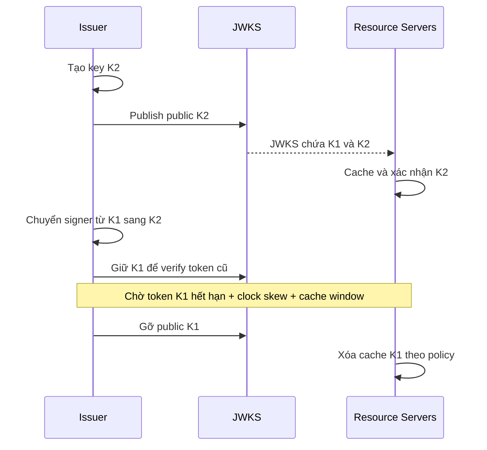

# Xoay vòng khóa, thu hồi token và sự cố lộ khóa

## 1. Vì sao vòng đời khóa và token phải được kiểm thử?

JWT thường được xác minh bằng chữ ký hoặc được bảo vệ bằng mã hóa. Hệ thống có thể vận hành ổn định trong thời gian dài, nhưng rủi ro thay đổi khi khóa đến hạn xoay vòng, người dùng đăng xuất, refresh token bị đánh cắp hoặc private key bị lộ.

Một thiết kế an toàn phải trả lời được các câu hỏi:

- Khi phát hành token bằng khóa mới, mọi resource server đã nhận được public key mới chưa?
- Trong khoảng chuyển tiếp, token ký bằng khóa cũ còn được chấp nhận đến khi nào?
- Khi người dùng bị thu hồi quyền, access token JWT đã phát hành có còn dùng được không?
- Khi private signing key bị lộ, hệ thống có thể ngừng tin khóa đó trên tất cả verifier nhanh đến mức nào?
- Khi khóa giải mã JWE bị lộ, ciphertext cũ có thể bị giải mã hay không?
- Khi JWKS endpoint hoặc KMS gặp sự cố, hệ thống có tiếp tục xác minh bằng khóa cache hay từ chối request?
- Có thể chứng minh qua log, metric và test rằng key rotation hoặc revocation đã thực sự có hiệu lực không?

Các cơ chế này liên quan với nhau nhưng khác nhau:

- **Key rotation:** thay khóa đang dùng theo một lịch trình có kiểm soát.
- **Token/session revocation:** làm mất hiệu lực credential hoặc phiên đã phát hành.
- **Key compromise response:** ngừng tin khóa bị lộ, đánh giá token chịu ảnh hưởng và khôi phục hệ thống.

Thay khóa không tự động thu hồi mọi token đã phát hành. Thu hồi refresh token cũng không nhất thiết làm access token JWT đang được xác minh offline mất hiệu lực ngay lập tức. Khi private key ký bị lộ, attacker có thể tạo token giả với chữ ký hợp lệ theo khóa đó. Vì vậy, từng cơ chế cần policy và kiểm thử riêng.

Bài học này thuộc chương **Kiểm thử bảo mật** của học phần **Security - JSON Web Token (JWT)** (SECURITY_TOKEN_SECURITY_JWT). Nội dung áp dụng cho hệ thống JWT/JOSE và các thành phần quản lý khóa nói chung, không phụ thuộc Java, Spring Security hoặc một thư viện cụ thể.

## 2. Phân biệt các loại khóa và phạm vi ảnh hưởng

Trước khi xây dựng quy trình rotation, phải lập danh mục khóa. Không phải mọi khóa xuất hiện trong hệ thống đều có cùng vai trò hoặc cùng cách xử lý.

| Loại khóa | Vai trò | Hậu quả khi bị lộ |
| --- | --- | --- |
| JWS asymmetric private key | Ký JWT | Attacker có thể tạo token giả được verifier chấp nhận nếu verifier còn tin public key tương ứng |
| HMAC secret | Ký và xác minh JWS | Bất kỳ bên nào có secret đều có thể tạo MAC hợp lệ; mọi hệ thống dùng chung secret có thể bị ảnh hưởng |
| JWE recipient private key | Giải mã CEK hoặc nội dung JWE theo thuật toán | Attacker có thể giải mã ciphertext đã thu thập được và có thể giải mã dữ liệu tương lai cho tới khi key bị thay |
| JWE KEK | Wrap/unwrap CEK | CEK được bảo vệ bằng KEK có thể bị lộ; mức ảnh hưởng phụ thuộc việc CEK có được lưu, wrap và quản lý riêng hay không |
| DPoP private key | Tạo proof of possession | Attacker có thể tạo proof thay client và sử dụng token bị ràng buộc với khóa đó |
| KMS/HSM access credential | Cho phép gọi thao tác khóa | Attacker có thể ký, giải mã, export hoặc thay đổi policy tùy quyền được cấp |
| TLS private key | Bảo vệ kết nối TLS | Ảnh hưởng tới danh tính máy chủ/kết nối; đây là vòng đời chứng thư và khóa TLS, cần quản lý liên kết nhưng không đồng nhất với JWT signing key |

Một khóa có thể không export được nhưng vẫn bị lạm dụng nếu attacker chiếm được quyền gọi thao tác ký hoặc giải mã. Vì vậy, đánh giá compromise phải xét cả key material lẫn quyền truy cập KMS/HSM, workload identity, tài khoản quản trị và pipeline triển khai.

### 2.1. Tách mục đích và phạm vi khóa

- Dùng khóa ký và khóa mã hóa riêng theo mục đích.
- Tránh dùng chung một HMAC secret cho nhiều issuer hoặc nhiều môi trường.
- Giới hạn service nào được ký; các resource server chỉ cần public verification key.
- Tách development, staging và production key.
- Gắn key với issuer, thuật toán, loại khóa và mục đích cụ thể.
- Không để một kid trỏ tới nhiều khóa hoặc nhiều ý nghĩa trong cùng trust domain.
- Lưu private key trong HSM/KMS hoặc secret store được kiểm soát khi kiến trúc yêu cầu.

Nếu một khóa được dùng cho nhiều issuer hoặc nhiều loại token, sự cố của một thành phần có thể ảnh hưởng toàn bộ phạm vi chia sẻ đó.

## 3. Mô hình trạng thái vòng đời khóa

Một quy trình vận hành nên định nghĩa trạng thái khóa rõ ràng. Tên trạng thái dưới đây là mô hình quản trị minh họa, không phải trạng thái bắt buộc trong JWK.

| Trạng thái | Ý nghĩa | Có được ký token mới? | Có được xác minh/giải mã dữ liệu cũ? |
| --- | --- | --- | --- |
| Created | Khóa đã tạo nhưng chưa được công bố | Chưa | Chưa |
| Published / pre-active | Public key đã được công bố để verifier cập nhật | Chưa | Có thể chưa có token mới cần xác minh |
| Active | Khóa hiện tại được issuer sử dụng | Có | Có |
| Verify-only / decrypt-only | Ngừng phát hành dữ liệu mới bằng khóa này | Không | Có trong thời gian chuyển tiếp |
| Retired | Đã hết thời gian cần phục vụ dữ liệu cũ | Không | Không theo policy thông thường |
| Revoked / compromised | Không còn được tin cậy do lộ khóa hoặc lý do khẩn cấp | Không | Từ chối ngay theo emergency policy |
| Destroyed | Key material đã được hủy theo quy trình | Không | Không thể sử dụng |

Không nhầm retired với revoked. Khóa cũ trong một lần rotation bình thường có thể vẫn cần xác minh token còn hạn. Khóa bị compromise cần bị chặn khẩn cấp, kể cả khi token được ký bằng khóa đó chưa hết hạn.

## 4. Quy trình xoay vòng JWS signing key theo lịch

Với chữ ký bất đối xứng, issuer giữ private key để ký; resource server nhận public key qua JWKS hoặc kênh tin cậy khác. Một quy trình rotation thường có giai đoạn overlap để verifier kịp nhận khóa mới và vẫn xác minh token cũ.

### 4.1. Trước khi chuyển signer

1. Tạo key pair mới trong KMS/HSM hoặc vùng quản lý khóa phù hợp.
2. Sinh kid mới, duy nhất trong phạm vi issuer.
3. Gắn metadata chính xác: kty, use, key_ops, alg và curve nếu có.
4. Kiểm tra key pair bằng test sign/verify nội bộ.
5. Công bố public key mới trong JWKS nhưng chưa dùng để ký.
6. Chờ verifier, CDN, proxy và cache JWKS có thời gian lấy key mới.
7. Xác minh các resource server trọng yếu đã nhìn thấy kid mới.

Không công bố private key trong JWKS. Với RSA/EC/OKP, JWKS công khai chỉ chứa public parameters. Với khóa đối xứng oct, không phát hành secret trong JWKS công khai.

### 4.2. Chuyển sang khóa mới

Sau khi public key mới đã có thể được verifier sử dụng:

1. Cấu hình issuer bắt đầu ký token mới bằng private key mới.
2. Ghi nhận kid đang ký và thời điểm chuyển đổi.
3. Giữ public key cũ trong JWKS để xác minh token đã phát hành trước đó.
4. Kiểm tra token mới xác minh thành công trên tất cả resource server.
5. Kiểm tra token cũ còn hạn vẫn xác minh được trong cửa sổ overlap.
6. Theo dõi lỗi unknown_kid, lỗi chữ ký và JWKS refresh bất thường.

Issuer phải kiểm soát rõ khóa ký hiện tại. Không để nhiều instance tự chọn khóa khác nhau ngoài kế hoạch vì có thể tạo ra trạng thái phát hành không nhất quán.

### 4.3. Gỡ khóa cũ

Chỉ gỡ public key cũ sau khi:

- Issuer đã ngừng ký bằng khóa cũ.
- Token hợp lệ cuối cùng được ký bằng khóa cũ đã hết hạn hoặc đã bị thu hồi theo policy.
- Đã cộng clock skew tối đa được chấp nhận.
- Đã tính thời gian cache JWKS, cache token và độ trễ đồng bộ của verifier.
- Các hệ thống phụ thuộc đã cập nhật key set.
- Có kiểm tra xác nhận rằng không còn workload hợp lệ cần khóa cũ.

Một mốc thời gian tham khảo:

Không có một thời gian overlap cố định cho mọi hệ thống. Nó phụ thuộc TTL tối đa của token, cache policy, clock skew, khả năng cập nhật verifier và yêu cầu sẵn sàng.

## 5. JWKS cache và đồng bộ giữa verifier

Xoay vòng khóa có thể đúng ở issuer nhưng vẫn thất bại nếu resource server dùng JWKS cache cũ.

### 5.1. Những tình huống phải kiểm tra

- Verifier chưa tải public key mới khi issuer bắt đầu ký bằng key mới.
- Verifier vẫn cache public key cũ sau khi key đã bị gỡ.
- Nhiều instance refresh JWKS đồng thời khi gặp kid mới.
- kid ngẫu nhiên khiến verifier tạo quá nhiều request đến JWKS endpoint.
- CDN hoặc reverse proxy giữ JWKS cũ lâu hơn dự kiến.
- Một verifier offline không thể cập nhật key set.
- JWKS endpoint tạm thời lỗi trong khi cache hiện tại vẫn còn hợp lệ.
- Nhiều issuer vô tình dùng cùng kid nhưng key khác nhau.

### 5.2. Policy cache cần rõ ràng

- Cấu hình TTL và cách tôn trọng HTTP cache headers.
- Có cơ chế refresh chủ động khi rotation được điều phối.
- Gộp refresh đồng thời (single-flight).
- Dùng negative cache ngắn hạn cho kid không tồn tại để tránh fetch storm.
- Chỉ tải JWKS từ URI tin cậy gắn với issuer đã cấu hình.
- Không dùng jku hoặc x5u từ token không tin cậy để tải key tùy ý.
- Có timeout, retry giới hạn và backoff.
- Xác định rõ có được dùng stale key set khi JWKS endpoint lỗi hay không.
- Có cách purge cache khẩn cấp khi key bị compromise.

Trong rotation bình thường, dùng cache còn hợp lệ có thể tăng availability. Trong sự cố lộ private key, tiếp tục dùng stale JWKS có thể khiến token giả vẫn được chấp nhận. Emergency policy cần có khả năng chặn kid bị compromise ngay tại verifier hoặc qua policy service khẩn cấp.

### 5.3. kid không phải bằng chứng tin cậy

kid chỉ là định danh để chọn khóa trong tập khóa đã tin cậy. Nó không xác minh issuer, không chứng minh token hợp lệ và không cho phép verifier tự tìm khóa ở một URL do token cung cấp.

Nếu kid trùng trong cùng JWKS hoặc key set chứa key metadata mâu thuẫn, verifier cần từ chối theo policy thay vì thử tùy ý nhiều khóa.

## 6. Xoay vòng HMAC secret

HMAC có đặc điểm khác chữ ký bất đối xứng: mọi verifier giữ secret đều có khả năng tạo MAC hợp lệ. Do đó, rotation HMAC thường có phạm vi phân phối và rủi ro lớn hơn.

Một quy trình có thể gồm:

1. Tạo secret mới đủ entropy bằng nguồn ngẫu nhiên an toàn.
2. Phân phối secret mới tới các thành phần cần xác minh qua secret manager/KMS.
3. Xác nhận tất cả verifier có thể đọc secret mới.
4. Chuyển issuer sang secret mới và phát token có kid mới.
5. Giữ secret cũ ở chế độ verify-only trong thời gian token cũ còn hạn.
6. Gỡ secret cũ sau khi token cũ hết hạn hoặc bị thu hồi theo policy.
7. Xác minh không còn instance, job hoặc môi trường dùng secret cũ.

Verifier phải chọn secret theo issuer và policy đã cấu hình. Không thử mọi secret trong key ring cho đến khi MAC thành công nếu có thể tránh; cách đó làm tăng chi phí và gây mơ hồ.

Nếu HMAC secret bị lộ, giả định mọi thành phần hoặc người có được secret đều có thể ký token giả. Cần thay secret trên toàn bộ trust domain dùng chung, đánh giá token bị ảnh hưởng và xem xét chuyển sang chữ ký bất đối xứng nếu muốn tách quyền ký khỏi quyền xác minh.

## 7. Xoay vòng khóa JWE và dữ liệu đã mã hóa

JWE có hai lớp khóa thường cần phân biệt:

- **CEK (Content Encryption Key):** mã hóa plaintext bằng thuật toán enc.
- **KEK hoặc recipient key:** bảo vệ CEK bằng thuật toán alg, hoặc recipient private key dùng để khôi phục CEK.

Với mỗi JWE, CEK thường được tạo theo quy trình của thuật toán và được bảo vệ cho recipient. Khi thay khóa recipient/KEK, ciphertext cũ có thể vẫn cần giải mã trong thời gian lưu trữ.

### 7.1. Rotation có kế hoạch

- Công bố hoặc triển khai public recipient key mới trước khi producer bắt đầu mã hóa cho key đó.
- Chuyển producer sang key mới theo một thời điểm điều phối.
- Giữ private key cũ ở trạng thái decrypt-only cho đến khi ciphertext cũ được xử lý, hết hạn hoặc re-encrypt.
- Với dữ liệu lưu lâu dài, xác định thời điểm rewrap CEK hoặc giải mã rồi mã hóa lại bằng khóa mới.
- Theo dõi ciphertext còn tham chiếu kid cũ.
- Hủy key cũ chỉ khi không còn dữ liệu hợp lệ cần giải mã.

Không phải mọi JWE đều có thể rewrap CEK theo cùng một cách. Phải dựa vào thuật toán quản lý khóa và khả năng của thư viện/KMS. Nếu không thể rewrap an toàn, cần decrypt rồi encrypt lại với key mới.

### 7.2. Khi khóa giải mã bị lộ

Nếu recipient private key hoặc KEK bị lộ, attacker có thể giải mã ciphertext mà họ đã thu thập nếu ciphertext được tạo cho khóa đó và thuật toán cho phép. Xoay khóa chỉ bảo vệ dữ liệu tương lai; nó không làm ciphertext đã bị sao chép trở nên bí mật trở lại.

Cần:

- Ngừng mã hóa mới cho key bị lộ.
- Chuyển producer sang key mới.
- Đánh giá ciphertext lưu trữ và dữ liệu đã truyền có thể đã bị thu thập.
- Re-encrypt dữ liệu còn kiểm soát được nếu plaintext vẫn còn trong vùng kiểm soát.
- Xác định dữ liệu cũ nào đã không thể bảo vệ lại vì attacker có thể đã giữ bản ciphertext.
- Thu hồi quyền KMS/HSM và credential liên quan.
- Kiểm tra audit log các thao tác decrypt bất thường.

JWE không tự cung cấp forward secrecy. Nếu attacker có private key recipient dài hạn và đã lưu ciphertext tương ứng, việc lộ private key sau này có thể làm lộ dữ liệu quá khứ.

## 8. Thu hồi access token và refresh token

### 8.1. JWT access token thường được xác minh offline

Với access token JWT, resource server có thể chỉ kiểm tra chữ ký, claims và thời hạn mà không hỏi authorization server ở mỗi request. Cách này giảm độ trễ và phụ thuộc mạng, nhưng tạo giới hạn:

**Khi access token đã phát hành, resource server có thể tiếp tục chấp nhận token đến exp nếu không có cơ chế kiểm tra trạng thái thu hồi.**

Thu hồi refresh token ngăn client dùng refresh token đó để xin token mới. Nó không tự động vô hiệu hóa access token JWT đã được cấp trước đó.

### 8.2. Các chiến lược thu hồi

| Cơ chế | Cách hoạt động | Trade-off |
| --- | --- | --- |
| Access token TTL ngắn | Token tự hết hạn nhanh | Giảm cửa sổ lạm dụng; không thu hồi tức thời |
| Token introspection | Resource server hỏi authorization server về trạng thái token | Cập nhật trạng thái nhanh hơn nhưng tăng network dependency và latency |
| Denylist theo issuer + jti | Resource server từ chối token ID đã bị thu hồi | Cần lưu trạng thái đến khi token hết hạn và đồng bộ giữa instance |
| Session/token version | So version trong token với trạng thái hiện tại | Có thể thu hồi theo user/session/tenant; cần tra cứu hoặc cache nhất quán |
| Revocation theo kid | Chặn mọi token ký bằng một key ID | Phạm vi rộng; phù hợp khi key compromise, không phải logout một user |
| Sender-constrained credential | Ràng buộc token với DPoP key hoặc mTLS certificate | Giảm khả năng dùng token bị đánh cắp; vẫn cần thu hồi khóa/token bị compromise |

jti chỉ định danh token. Nó không tự tạo denylist và không tự làm token bị thu hồi. Resource server phải kiểm tra trạng thái jti theo một policy cụ thể.

### 8.3. Thu hồi refresh token

Refresh token thường có vòng đời dài hơn access token. Khi đăng xuất, mất thiết bị hoặc phát hiện rủi ro:

- Thu hồi refresh token hoặc token family phía authorization server.
- Xóa refresh token khỏi secure storage ở client nếu client còn hoạt động.
- Nếu dùng rotation, đánh dấu token cũ đã tiêu thụ.
- Phát hiện việc dùng lại refresh token đã bị thay thế.
- Thu hồi session hoặc family theo policy khi có dấu hiệu reuse.
- Ghi audit mà không lưu giá trị token.

Với refresh token opaque, server có thể tra cứu trạng thái trực tiếp. Với refresh token JWT, vẫn cần trạng thái server-side nếu yêu cầu thu hồi trước exp.

### 8.4. Logout không phải lúc nào cũng là revoke

Logout phía client có thể chỉ xóa token cục bộ. Điều đó không bảo đảm token đã phát hành bị vô hiệu hóa trên server.

Một quy trình logout có thể cần:

1. Gọi endpoint revocation theo giao thức nếu có.
2. Thu hồi refresh token/session.
3. Xóa token cục bộ và dữ liệu phiên.
4. Xóa hoặc vô hiệu hóa khóa sender-constrained liên quan nếu policy yêu cầu.
5. Xử lý access token còn hiệu lực bằng TTL, introspection hoặc denylist theo mức rủi ro.

## 9. Thu hồi theo RFC và kiểm tra trạng thái token

### 9.1. OAuth Token Revocation — RFC 7009

RFC 7009 định nghĩa endpoint revocation để client yêu cầu authorization server thu hồi token. Việc thu hồi token phụ thuộc loại token, server và chính sách triển khai.

Khi tích hợp, cần kiểm tra:

- Client có được phép gọi endpoint revocation không?
- Server có xác thực client theo đúng loại client không?
- Token được thu hồi có phải refresh token, access token hay cả liên quan token family?
- Hành vi với token không hợp lệ hoặc đã bị thu hồi có tuân thủ hợp đồng API không?
- Resource server biết trạng thái thu hồi bằng introspection, denylist hoặc cơ chế nào?
- Response và log có tránh tiết lộ token không?

Không giả định việc endpoint revocation trả thành công đồng nghĩa mọi resource server offline đã lập tức ngừng chấp nhận access token JWT.

### 9.2. Token Introspection — RFC 7662

Introspection cho phép resource server hỏi authorization server về trạng thái token. Trường active có thể biểu thị token còn được coi là active theo policy.

Cần kiểm thử:

- Token bị thu hồi chuyển sang inactive trong thời gian mong muốn.
- Cache introspection không giữ kết quả active quá lâu.
- Authorization server không truy cập được thì resource server xử lý theo policy.
- Introspection endpoint chỉ được gọi bởi client/resource server được phép.
- Không gửi token tới endpoint introspection không tin cậy.
- Kết quả introspection được ràng buộc với audience, issuer và loại token phù hợp.

Cache introspection giúp giảm tải nhưng tạo độ trễ thu hồi. TTL cache phải phù hợp với mức độ nhạy cảm của thao tác.

## 10. Ứng phó khi JWS signing key bị lộ

Đây là tình huống có mức độ nghiêm trọng cao vì attacker có thể ký JWT mới mà verifier sẽ coi là hợp lệ nếu vẫn tin public key tương ứng.

### 10.1. Hiểu phạm vi ảnh hưởng

Khi private signing key bị lộ:

- Attacker có thể tạo token với sub, scope, role, aud, exp hoặc tenant claim tùy ý trong phạm vi verifier chấp nhận.
- Chữ ký giả được tạo bằng key đó không thể phân biệt với chữ ký hợp lệ chỉ bằng phép verify.
- Token giả có thể tiếp tục được chấp nhận ở verifier đang cache public key cũ.
- Nếu key được dùng cho nhiều issuer, môi trường hoặc loại token, tất cả có thể chịu ảnh hưởng.
- Nếu key đã được dùng lâu dài, cần đánh giá cả token cũ và dữ liệu audit trong khoảng thời gian phơi nhiễm.

Không thể xác định token nào là thật hay giả chỉ bằng chữ ký khi cả hai được ký bằng cùng private key đã bị compromise. Cần dựa vào thời gian, nguồn phát hành, log, session state, token issuance records và các tín hiệu khác; trong trường hợp không thể phân biệt đáng tin cậy, phải thu hồi rộng hơn.

### 10.2. Containment khẩn cấp

1. Dừng issuer sử dụng private key bị lộ.
2. Chặn kid bị compromise tại verifier bằng emergency deny policy.
3. Gỡ public key khỏi JWKS tin cậy và phát tín hiệu purge cache.
4. Làm mới key cache ở gateway, resource server và các consumer liên quan.
5. Phát hành key pair mới và kiểm tra đường ký/xác minh.
6. Thu hồi refresh token, session hoặc token family trong phạm vi có nguy cơ.
7. Cân nhắc thu hồi mọi access token ký bằng kid đó nếu không thể phân biệt token giả.
8. Yêu cầu xác thực lại hoặc cấp token mới theo phạm vi ảnh hưởng.
9. Kiểm tra KMS/HSM audit, quyền truy cập, pipeline và host có thể đã lộ key.
10. Giữ bằng chứng và timeline phục vụ điều tra.

Gỡ public key khỏi JWKS không đảm bảo chặn tức thì nếu verifier vẫn dùng cache cũ. Cần cơ chế emergency deny hoặc cache invalidation có xác nhận. Nếu một verifier không thể nhận policy khẩn cấp, phải đánh giá việc tạm ngừng traffic hoặc fail closed cho token liên quan.

### 10.3. Khôi phục

- Tạo key mới trong trust boundary đã được kiểm tra.
- Xác minh issuer chỉ ký bằng key mới.
- Xác minh verifier từ chối token mới được ký bằng key cũ.
- Xác minh token hợp lệ ký bằng key mới được chấp nhận.
- Cập nhật mọi hệ thống dùng key cũ.
- Xoay credential KMS/HSM, deployment secret và quyền truy cập liên quan.
- Theo dõi token bất thường, request trái phép và hành vi sau sự cố.
- Ghi lại quyết định về dữ liệu/phiên cần thông báo hoặc xử lý bổ sung.

Không khôi phục bằng cách đưa lại public key bị compromise vào JWKS chỉ để giảm lỗi xác minh. Rollback về key cũ chỉ phù hợp khi lỗi rotation được xác định là lỗi vận hành và key cũ chưa bị lộ.

## 11. Ứng phó khi HMAC secret bị lộ

HMAC secret là bí mật dùng chung. Bên nào có secret đều có thể tạo token với MAC hợp lệ.

Sự cố có thể ảnh hưởng rộng hơn mô hình asymmetric signing vì verifier cũng nắm secret. Khi secret bị lộ:

- Xác định tất cả issuer, verifier, môi trường và workload dùng secret.
- Dừng ký bằng secret cũ.
- Tạo secret mới và phân phối qua secret manager/KMS.
- Chuyển issuer sang secret mới với kid mới.
- Cập nhật verifier theo kế hoạch có kiểm soát.
- Chặn secret cũ sau khi token hợp lệ đã được xử lý hoặc thu hồi theo emergency policy.
- Thu hồi token/session trong phạm vi bị ảnh hưởng.
- Rà soát log, host, CI/CD và nơi lưu secret.

Nếu nhiều hệ thống dùng chung HMAC secret, không thể chỉ xoay ở một service. Mọi consumer phải chuyển đổi nhất quán. Sự cố cũng là dịp đánh giá lại việc dùng HMAC hay chữ ký bất đối xứng để tách quyền phát hành và xác minh.

## 12. Ứng phó khi JWE decryption key hoặc DPoP key bị lộ

### 12.1. JWE decryption key

Khi recipient private key hoặc KEK bị lộ:

- Ngừng tạo JWE mới cho khóa đó.
- Chuyển producer sang recipient key/KEK mới.
- Gỡ hoặc đánh dấu key cũ bị compromise theo trust policy.
- Kiểm tra log decrypt và truy cập key service.
- Đánh giá ciphertext cũ có thể đã bị attacker thu thập.
- Re-encrypt dữ liệu còn kiểm soát được nếu cần bảo mật tiếp.
- Xác định dữ liệu lịch sử nào phải coi là có khả năng đã lộ.

Nếu dữ liệu đã được mã hóa cho public key bị lộ private key, attacker có thể giải mã bản ciphertext đã lưu. Việc phát hành public key mới không làm thay đổi ciphertext cũ.

### 12.2. DPoP private key

Khi khóa DPoP của client bị lộ:

- Thu hồi access/refresh token bị ràng buộc với thumbprint khóa đó theo khả năng hệ thống.
- Chặn hoặc thu hồi key binding cũ.
- Tạo key pair DPoP mới trong secure storage phù hợp.
- Cấp token mới được ràng buộc với public key mới.
- Xác minh proof ký bằng key cũ bị từ chối.
- Kiểm tra có request trái phép đã được gửi trong thời gian compromise hay không.

Không chỉ xóa private key trên thiết bị rồi coi sự cố đã kết thúc; server cần thu hồi credential đã được ràng buộc với key cũ.

## 13. Runbook xử lý sự cố lộ khóa

Một runbook cần phân công người chịu trách nhiệm, thứ tự hành động và tiêu chí hoàn tất. Ví dụ:

| Giai đoạn | Hành động | Bằng chứng hoàn tất |
| --- | --- | --- |
| Detect | Xác nhận loại khóa, kid, issuer, thời điểm và tín hiệu compromise | Incident record có phạm vi ban đầu |
| Contain | Dừng signer, chặn key, purge cache, khóa quyền KMS/HSM bị lạm dụng | Verifier test từ chối key bị chặn |
| Revoke | Thu hồi token/session/family và sender binding liên quan | Trạng thái revocation được xác nhận |
| Recover | Tạo key mới, publish public key, chuyển signer | Token mới verify thành công |
| Validate | Kiểm thử mọi verifier và downstream consumer | Test matrix pass, không còn chấp nhận key cũ |
| Monitor | Theo dõi request, unknown kid, lỗi xác minh và truy cập key | Dashboard/alert ổn định trong thời gian theo dõi |
| Review | Điều tra root cause, cập nhật policy và bằng chứng | Post-incident report và action owners |

### 13.1. Thứ tự ưu tiên khi thời gian khẩn cấp

Nếu có bằng chứng private signing key đang bị attacker sử dụng, ưu tiên chặn khả năng tạo token giả và chặn verifier chấp nhận key đó. Điều tra nguyên nhân và tối ưu vận hành tiếp tục song song sau khi containment đã có hiệu lực.

Không trì hoãn việc chặn key chỉ để giữ tương thích với token cũ. Nếu việc chặn gây gián đoạn, xử lý qua quy trình khôi phục phiên hoặc xác thực lại.

## 14. Kịch bản kiểm thử rotation và revocation

Kiểm thử nên chạy trong môi trường cô lập với key và token thử nghiệm. Không thử cố ý làm lộ production key hoặc thu hồi token người dùng thật để chứng minh quy trình.

### 14.1. Planned signing-key rotation

| Bước kiểm thử | Kết quả mong đợi |
| --- | --- |
| Tạo key K2 và publish public key | JWKS có K1 và K2; không lộ private key |
| Verifier refresh JWKS | Các instance nhìn thấy K2 trong thời gian SLA |
| Chuyển issuer ký bằng K2 | Token mới có kid K2 và verify thành công |
| Gửi token cũ ký bằng K1 | Vẫn verify trong overlap hợp lệ |
| Hết thời hạn overlap | K1 bị gỡ theo policy |
| Gửi lại token K1 sau khi gỡ | Bị từ chối sau khi cache được cập nhật |
| Gửi kid không tồn tại | Từ chối có kiểm soát; không tải URL tùy ý hoặc tạo fetch storm |

### 14.2. Emergency key compromise

- Đánh dấu K1 bị compromise và kích hoạt emergency deny policy.
- Gửi token thử nghiệm ký bằng K1 tới từng verifier.
- Xác nhận tất cả verifier từ chối K1, kể cả instance từng cache JWKS cũ.
- Xác nhận K2 vẫn hoạt động.
- Xác nhận token/session thuộc phạm vi thu hồi không thể tiếp tục refresh.
- Xác nhận token giả mới ký bằng K1 không thể được chấp nhận.
- Kiểm tra dashboard và audit thể hiện thời điểm policy có hiệu lực ở từng service.

Test phải đo thời gian từ lúc phát lệnh containment tới khi verifier cuối cùng chặn key cũ. Đây là một chỉ số quan trọng của khả năng ứng phó.

### 14.3. Token revocation

| Kịch bản | Kết quả cần xác nhận |
| --- | --- |
| Thu hồi refresh token | Không thể dùng token đó để refresh |
| Refresh token rotation và reuse | Token cũ bị phát hiện; family xử lý theo policy |
| Thu hồi một jti access token | Resource server có denylist từ chối token đó |
| Session version tăng | Token mang version cũ bị từ chối tại nơi yêu cầu kiểm tra trạng thái |
| Introspection báo inactive | Resource server từ chối token theo policy |
| Introspection cache còn active | Độ trễ thu hồi không vượt SLA |
| Logout chỉ xóa local state | Test xác nhận server-side token vẫn có thể còn hiệu lực nếu chưa revoke |
| Token access offline chưa hết hạn | Hành vi đúng với chiến lược TTL/denylist/introspection đã chọn |

### 14.4. Failure và race-condition tests

- JWKS endpoint lỗi trong lúc rotation.
- KMS/HSM không truy cập được khi signer cần ký.
- Verifier dùng cache cũ hoặc cache rỗng.
- Hai issuer instance chuyển key ở thời điểm khác nhau.
- Token cũ và mới đến đồng thời.
- Đồng hồ issuer/verifier lệch trong giới hạn và vượt giới hạn.
- Refresh token được dùng đồng thời hai lần.
- Cache invalidation bị trễ hoặc một instance mất kết nối policy service.
- Rollback cấu hình sau khi rotation thất bại.
- Emergency deny policy bị mất khi service restart.

Với khóa đã bị compromise, test không được cho phép rollback policy để tiếp tục tin khóa cũ. Với rotation bình thường chưa có compromise, rollback có thể được cho phép theo quy trình đã phê duyệt.

## 15. Đo lường và bằng chứng vận hành

Không thể kết luận rotation thành công chỉ vì issuer đã đổi cấu hình. Cần quan sát toàn hệ thống.

Các metric nên có:

- kid hiện tại của signer theo issuer và môi trường.
- Thời điểm bắt đầu và hoàn tất mỗi đợt rotation.
- Tỷ lệ verifier đã tải key set mới.
- Số lỗi unknown_kid, signature invalid và decrypt failure.
- JWKS cache hit/miss, refresh count, refresh latency và lỗi fetch.
- Số token bị từ chối theo key ID hoặc revocation reason.
- Độ trễ từ lệnh revoke đến khi resource server cuối cùng áp dụng.
- Số refresh token reuse và token family bị thu hồi.
- Số thao tác ký/giải mã từ KMS/HSM theo workload identity.
- Số lần emergency deny policy được áp dụng và thời gian lan truyền.

Không ghi raw JWT, private key, HMAC secret, CEK hoặc plaintext nhạy cảm vào log. Có thể dùng kid, request ID, issuer và fingerprint đã được thiết kế an toàn để liên kết sự kiện. Tránh đưa token hoặc user ID có cardinality lớn vào metric label.

Bằng chứng kiểm toán nên lưu:

- Change/incident ID.
- Người phê duyệt và người thực hiện.
- Key ID, loại khóa, issuer và môi trường.
- Thời điểm publish, activate, verify-only, revoke và destroy.
- Kết quả test trên từng verifier.
- Kết quả cache invalidation.
- Phạm vi token/session bị thu hồi.
- Ngoại lệ và rủi ro còn tồn tại.

## 16. Những sai lầm thường gặp

- Xóa public key cũ ngay khi chuyển signer, khiến token cũ hợp lệ bị từ chối ngoài kế hoạch.
- Giữ public key bị compromise chỉ để token cũ tiếp tục hoạt động.
- Cho rằng gỡ key khỏi JWKS sẽ xóa ngay key trong cache của mọi verifier.
- Chỉ xoay khóa tại issuer mà quên consumer, worker hoặc môi trường khác.
- Thu hồi refresh token rồi tuyên bố mọi access token đã mất hiệu lực.
- Dùng jti nhưng không có denylist hoặc trạng thái server-side.
- Dùng một kid cho nhiều key khác nhau trong cùng issuer.
- Cho verifier thử mọi key hoặc mọi thuật toán khi không tìm thấy kid.
- Dùng HMAC secret chung cho quá nhiều service.
- Xóa private key giải mã JWE trước khi xử lý dữ liệu cũ cần đọc.
- Nghĩ rằng rotate JWE key sẽ làm ciphertext lịch sử đã bị sao chép trở nên an toàn.
- Rollback về key bị compromise để khôi phục availability.
- Không kiểm thử JWKS cache, race condition, clock skew và sự cố KMS/HSM.
- Không có số liệu đo thời gian từ lúc revoke đến lúc mọi verifier từ chối token.

## 17. Checklist kiểm thử vòng đời khóa và token

- [ ] Đã lập inventory cho JWS, HMAC, JWE, DPoP, KMS/HSM và khóa liên quan.
- [ ] Khóa ký, khóa mã hóa và khóa theo môi trường được tách mục đích.
- [ ] Có trạng thái và owner cho từng key lifecycle.
- [ ] Planned rotation có bước tạo key, publish, overlap, switch signer và retire.
- [ ] kid duy nhất trong phạm vi issuer và key metadata khớp thuật toán/mục đích.
- [ ] JWKS cache, CDN, verifier và consumer được kiểm thử trong giai đoạn overlap.
- [ ] Token ký bằng key cũ chỉ được chấp nhận trong cửa sổ đã định nghĩa.
- [ ] HMAC secret rotation được kiểm thử trên toàn bộ issuer/verifier sử dụng secret.
- [ ] JWE key rotation có kế hoạch decrypt, rewrap hoặc re-encrypt dữ liệu cũ.
- [ ] Token revocation phân biệt access token, refresh token, session và token family.
- [ ] jti chỉ được coi là định danh; denylist/introspection/version được triển khai nếu cần.
- [ ] Đã đo độ trễ revoke và cache invalidation theo SLA.
- [ ] Có emergency deny cho key bị compromise, kể cả verifier dùng stale JWKS.
- [ ] Có runbook riêng cho signing key, HMAC secret, JWE key và DPoP key compromise.
- [ ] Có kiểm thử token giả được ký bằng key đã compromise bị từ chối ở mọi verifier.
- [ ] KMS/HSM permission, audit log và credential quản trị được kiểm tra.
- [ ] Rollback chỉ cho phép khi key cũ chưa bị compromise.
- [ ] Log/metric không chứa token hoặc key material.
- [ ] Có bằng chứng kiểm thử, phê duyệt, timeline và người chịu trách nhiệm.

**Kết luận:** Xoay vòng khóa, thu hồi token và ứng phó lộ khóa là ba quy trình liên quan nhưng không thể thay thế cho nhau. Rotation bình thường cần publish key mới trước, chuyển signer, giữ key cũ trong thời gian token hợp lệ và gỡ sau khi verifier cập nhật. Revocation cần trạng thái server-side hoặc thời hạn ngắn nếu muốn vô hiệu hóa access token JWT trước exp. Khi khóa bị compromise, phải chặn key ở mọi verifier, xử lý cache cũ, thu hồi credential chịu ảnh hưởng và phát hành khóa mới; riêng JWE còn cần đánh giá khả năng lộ ciphertext lịch sử. Kiểm thử phải chứng minh thời gian lan truyền, hành vi khi cache/KMS lỗi và việc token ký bằng khóa đã bị chặn thực sự bị từ chối.

### Tài liệu tiêu chuẩn và hướng dẫn

- [RFC 7517 — JSON Web Key (JWK)](https://www.rfc-editor.org/rfc/rfc7517)
- [RFC 7519 — JSON Web Token (JWT)](https://www.rfc-editor.org/rfc/rfc7519)
- [RFC 7009 — OAuth 2.0 Token Revocation](https://www.rfc-editor.org/rfc/rfc7009)
- [RFC 7516 — JSON Web Encryption (JWE)](https://www.rfc-editor.org/rfc/rfc7516)
- [RFC 7662 — OAuth 2.0 Token Introspection](https://www.rfc-editor.org/rfc/rfc7662)
- [RFC 8725 — JSON Web Token Best Current Practices](https://www.rfc-editor.org/rfc/rfc8725)
- [RFC 9068 — JSON Web Token (JWT) Profile for OAuth 2.0 Access Tokens](https://www.rfc-editor.org/rfc/rfc9068)
- [RFC 9700 — Best Current Practice for OAuth 2.0 Security](https://www.rfc-editor.org/rfc/rfc9700)
- [NIST SP 800-57 Part 1 — Recommendation for Key Management](https://csrc.nist.gov/pubs/sp/800/57/pt1/r5/final)
