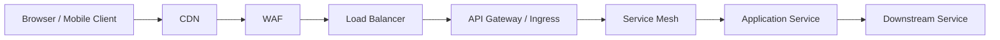

# Kích thước token và tác động lên băng thông cùng giới hạn hạ tầng

## 1. Vì sao kích thước JWT là một vấn đề vận hành?

JWT thường được gửi lặp lại trong các request để resource server xác minh danh tính và quyền. Một access token vài kilobyte có vẻ nhỏ khi xem riêng lẻ, nhưng khi được gửi hàng nghìn lần mỗi giây qua nhiều lớp mạng và nhiều service, nó trở thành một phần đáng kể của lưu lượng, header buffer và chi phí xử lý.

Token quá lớn có thể gây ra các vấn đề thực tế:

- Request bị CDN, WAF, reverse proxy, load balancer, API gateway hoặc web server từ chối vì vượt giới hạn header.
- Một request hợp lệ ở môi trường local thất bại khi đi qua production ingress có giới hạn thấp hơn.
- Băng thông tăng do cùng access token được gửi lại trong mọi request API.
- Nhiều service nội bộ chuyển tiếp token khiến cùng dữ liệu được truyền qua nhiều hop.
- Cookie chứa JWT làm tăng kích thước header của cả những request không cần nội dung token đó.
- Token lớn làm tăng chi phí Base64url decode, parse JSON, hash chữ ký, cấp phát bộ nhớ và ghi log.
- JWT bị đưa vào URL có thể vượt giới hạn URI và làm lộ token qua log, browser history hoặc referrer.
- Token phình to sau khi thêm nhiều group, role, tenant, permission hoặc custom claims.

Vấn đề không chỉ là làm cho token nhỏ để tiết kiệm vài byte. Hệ thống phải có **ngân sách kích thước token** phù hợp với mọi thành phần trên đường truyền, đồng thời giữ đủ claims để xác minh và authorization.

Bài học này thuộc chương **Hiệu năng và vận hành** của học phần **Security - JSON Web Token (JWT)** (SECURITY_TOKEN_SECURITY_JWT). Nội dung áp dụng cho JWT/JOSE trong mọi ngôn ngữ, runtime và kiến trúc; không phụ thuộc Java hoặc Spring Security.

## 2. JWT Compact được cấu tạo như thế nào và kích thước đến từ đâu?

### 2.1. JWS Compact Serialization

Một JWS Compact có ba segment Base64url, ngăn cách bằng hai dấu chấm:

```text
BASE64URL(protected-header)
.
BASE64URL(payload)
.
BASE64URL(signature)
```

Kích thước token phụ thuộc vào:

1. Protected header: tên thuật toán, kid, typ, cty và các tham số JOSE.
2. Payload: JSON claims, tên claim, giá trị string, array, object và metadata.
3. Signature: phụ thuộc thuật toán và kích thước khóa.
4. Dấu phân cách và cách biểu diễn Base64url.

Công thức tính độ dài theo số ký tự của JWS Compact:

```text
JWS_length =
    header_segment_length
  + 1
  + payload_segment_length
  + 1
  + signature_segment_length
```

JWT Compact dùng các ký tự ASCII trong Base64url và dấu chấm, do đó số ký tự của token Compact cũng chính là số byte khi truyền trong UTF-8/ASCII. Khi đo kích thước thực tế, hãy đo chuỗi token đã serialize, không ước lượng từ số ký tự JSON trước khi encode.

### 2.2. Base64url làm dữ liệu lớn hơn

Base64url biểu diễn mỗi nhóm 3 byte đầu vào bằng 4 ký tự đầu ra. Bỏ padding cuối theo quy tắc Base64url không padding có thể làm chênh lệch một vài ký tự, nhưng mức tăng vẫn xấp xỉ một phần ba.

Ví dụ gần đúng:

| Dữ liệu nhị phân/JSON đã serialize | Độ dài Base64url xấp xỉ |
| ---: | ---: |
| 300 bytes | 400 ký tự |
| 750 bytes | 1.000 ký tự |
| 1.500 bytes | 2.000 ký tự |
| 3.000 bytes | 4.000 ký tự |
| 6.000 bytes | 8.000 ký tự |

Đây chỉ là ước lượng cho một segment; token còn header, chữ ký, dấu phân cách và có thể có các segment khác. Muốn biết chính xác phải đo token được thư viện tạo ra.

Base64url giúp dữ liệu an toàn khi đặt trong các giao thức văn bản, nhưng không phải compression. Nó thường làm chuỗi dài hơn dữ liệu ban đầu.

### 2.3. Signature có thể chiếm một phần đáng kể

Độ dài chữ ký phụ thuộc thuật toán:

- ECDSA JOSE dùng dạng R || S có độ dài cố định theo curve; ví dụ ES256 có chữ ký nhị phân 64 bytes trước khi Base64url encode.
- Ed25519 có chữ ký 64 bytes.
- RSA signature có độ dài bằng kích thước modulus tính theo byte; khóa RSA 2048-bit tạo chữ ký 256 bytes trước khi encode.
- HMAC output có độ dài cố định theo biến thể hash.

Vì vậy, giảm payload không làm phần signature ngắn đi. Nếu token có payload rất nhỏ nhưng dùng chữ ký RSA lớn, signature vẫn chiếm dung lượng cố định tương đối đáng kể.

Không chọn thuật toán yếu chỉ để giảm vài trăm ký tự. Thuật toán phải được chọn theo security policy và interoperability; kích thước là một ràng buộc vận hành cần tính đến trong các lựa chọn an toàn.

## 3. JWE và nested JWT có overhead khác JWS

### 3.1. JWE Compact Serialization

JWE Compact có năm segment:

```text
BASE64URL(protected-header)
.
BASE64URL(encrypted-key)
.
BASE64URL(iv)
.
BASE64URL(ciphertext)
.
BASE64URL(authentication-tag)
```

Kích thước JWE phụ thuộc:

- Protected header, gồm alg, enc, kid, zip nếu có và metadata.
- Encrypted key: có thể bằng rỗng trong một số chế độ như dir, hoặc có độ dài đáng kể với RSA-OAEP và các cơ chế key wrapping.
- IV/nonce.
- Ciphertext.
- Authentication tag.

Với AEAD như AES-GCM, ciphertext thường có độ dài gần bằng plaintext; tag được truyền riêng trong segment cuối. IV và tag tạo overhead cố định theo profile. Encrypted key có thể làm token tăng thêm đáng kể.

Với các thuật toán mã hóa theo khối có padding, độ dài ciphertext còn phụ thuộc padding. Không áp dụng một công thức kích thước duy nhất cho mọi JWE; cần đo với đúng alg, enc, key type và thư viện triển khai.

### 3.2. Nested JWT làm tăng kích thước

Nếu issuer ký claims thành JWS rồi mã hóa toàn bộ JWS bằng JWE, token ngoài chứa chuỗi JWS bên trong dưới dạng plaintext trước khi mã hóa. Phần JWS đã có header, payload và signature; lớp JWE lại thêm header, encrypted key, IV và tag.

Nested JWT có thể cần thiết để kết hợp xác thực nguồn và confidentiality, nhưng không nên dùng nhiều lớp chỉ vì tiện tái sử dụng. Mỗi lớp làm tăng kích thước, số bước xử lý và độ phức tạp vận hành.

Chỉ hỗ trợ cấu trúc lồng theo profile đã định nghĩa. Không để token tự yêu cầu nesting sâu tùy ý.

### 3.3. JSON Serialization có overhead cấu trúc

JWS/JWE JSON Serialization có các tên field, dấu ngoặc, dấu phẩy, protected/unprotected headers và recipient/signature entries. General Serialization có thể chứa nhiều recipient hoặc signature.

Nếu use case chỉ cần một chữ ký hoặc một recipient, Compact Serialization thường gọn hơn. Nếu cần JSON Serialization, hãy đo toàn bộ JSON object thực tế và giới hạn số entry theo profile.

## 4. Token được truyền ở đâu?

### 4.1. Authorization header

Với bearer access token, cách truyền thường gặp là:

```http
GET /api/invoices HTTP/1.1
Host: api.example
Authorization: Bearer eyJ...<token>...
Accept: application/json
```

Header Authorization được gửi lại trong mỗi request cần xác thực. Nếu access token tăng từ 1 KB lên 8 KB, mỗi request có thể tăng thêm khoảng 7 KB trước khi tính overhead khác.

Header có giới hạn ở nhiều lớp. Một request có thể bị từ chối bởi:

- CDN hoặc WAF ở biên.
- Reverse proxy.
- Load balancer hoặc ingress controller.
- API gateway.
- HTTP server.
- Middleware xác thực.
- Service mesh sidecar.
- Downstream service.

Các giới hạn có thể áp dụng riêng cho một header field hoặc tổng header list. Một số thành phần còn giới hạn số lượng header. Mức thấp nhất trên toàn tuyến thường quyết định request có đi qua được hay không.

### 4.2. Cookie

JWT có thể được lưu trong cookie nếu kiến trúc browser và threat model phù hợp. Tuy nhiên, cookie có một số tác động riêng:

- Browser tự gửi cookie trên các request khớp domain/path và policy.
- Một JWT lớn có thể được gửi tới nhiều endpoint, kể cả endpoint không cần nội dung token.
- Cookie khác, tracking cookie và metadata cũng chiếm cùng ngân sách header.
- Browser, proxy và server có giới hạn riêng về kích thước từng cookie, tổng cookie và tổng header; các giới hạn này khác nhau theo implementation.
- Nếu server trả token qua Set-Cookie, response header cũng phải nằm trong giới hạn của đường trả về.

Không giả định có một giới hạn cookie duy nhất áp dụng cho mọi browser. Cần kiểm thử các browser và proxy nằm trong phạm vi hỗ trợ.

Khi dùng cookie cho session credential, cần thiết kế Secure, HttpOnly, SameSite, domain/path và CSRF protection theo threat model. Các thuộc tính này bảo vệ cách cookie được gửi và truy cập; chúng không làm cookie JWT nhỏ hơn.

### 4.3. URL và query string

Không đặt bearer token trong URL hoặc query string để giải quyết giới hạn header. URL có thể xuất hiện trong:

- Browser history.
- Access log của proxy và server.
- Analytics.
- Monitoring/tracing.
- Referrer khi trình duyệt điều hướng.
- Cache key và hệ thống báo lỗi.

URL dài còn có thể vượt giới hạn URI, dẫn tới lỗi 414 URI Too Long. RFC 6750 khuyến nghị không dùng query parameter để truyền bearer token trong trường hợp thông thường vì rủi ro bảo mật.

### 4.4. gRPC, WebSocket và service-to-service

Token trong gRPC thường được truyền qua metadata, vốn đi theo cơ chế header và chịu giới hạn của client/server/proxy. WebSocket handshake cũng sử dụng HTTP headers trước khi nâng cấp kết nối.

Trong kiến trúc service-to-service, nếu gateway chuyển nguyên access token của người dùng qua nhiều service, kích thước token được nhân lên theo số hop và số request downstream. Hãy xác định service nào thực sự cần danh tính người dùng, audience nào phù hợp và có nên dùng token exchange/delegation để tạo credential hẹp hơn không.

Không thay JWT bằng một header tenant/user tự khai báo mà không có xác thực và ràng buộc tin cậy. Việc giảm byte phải giữ nguyên security boundary.

## 5. Tác động lên băng thông khi token được gửi lặp lại

### 5.1. Công thức ước lượng

Nếu mỗi request gửi một token có kích thước T bytes, có R request mỗi giây và token đi qua H hop nội bộ, lượng dữ liệu token truyền đi xấp xỉ:

```text
token_bytes_per_second = T * R * H

token_bandwidth_bits_per_second =
    T * R * H * 8
```

Công thức này chỉ tính phần token được gửi lại, chưa gồm tên header, dấu phân cách HTTP, TLS record, TCP/IP, HTTP metadata và các header khác. Với HTTP/2 hoặc HTTP/3, framing và header compression có thể làm thay đổi số byte thực tế trên dây.

### 5.2. Ví dụ

Giả sử access token dài 2 KB và client gửi 5.000 request/giây:

```text
2,000 bytes * 5,000 requests/second
= 10,000,000 bytes/second
≈ 10 MB/s
≈ 80 Mbps
```

Nếu mỗi request còn được chuyển nguyên token qua hai service nội bộ, phần token có thể được truyền thêm ở các hop đó. Chi phí thực tế phụ thuộc fan-out và cách service gọi nhau.

Một token 8 KB trong cùng lưu lượng sẽ tạo ra lượng dữ liệu token xấp xỉ gấp bốn lần. Khi tính cho hàng nghìn client hoặc nhiều cụm service, chênh lệch có thể đáng kể.

### 5.3. Fan-out nội bộ

Một request tới API gateway có thể gọi billing, profile, reporting và audit. Nếu tất cả service nhận cùng token, một request bên ngoài có thể tạo nhiều lần truyền token bên trong.

Hãy lập sơ đồ luồng để xác định:

- Token được gửi qua bao nhiêu hop?
- Service nào cần subject, tenant hoặc delegation context?
- Có service nào chỉ cần service identity riêng?
- Có thể dùng token có audience và scope giới hạn cho downstream không?
- Có thể chuyển thông tin cần thiết bằng một context đã được xác thực thay vì gửi toàn bộ token không?

Token exchange có thể cấp token mới cho downstream với audience và scope hẹp hơn. Token mới không nhất thiết luôn nhỏ hơn, nhưng giúp tránh gửi credential quá rộng tới service không cần nó. Nếu chỉ cần context nội bộ, phải dùng một cơ chế truyền được xác thực và không cho caller giả mạo context.

## 6. HTTP header compression có giải quyết được token lớn không?

HTTP/2 dùng HPACK và HTTP/3 dùng QPACK để nén biểu diễn header. Tên header lặp lại và một số giá trị có thể được mã hóa hiệu quả hơn. Tuy nhiên, không nên dựa vào header compression để bỏ qua ngân sách kích thước JWT.

Các lý do:

- Authorization là dữ liệu nhạy cảm; implementation nên dùng cơ chế never-indexed/sensitive để tránh đưa giá trị vào dynamic table.
- Bearer token thường có entropy cao do payload Base64url và chữ ký; khả năng nén nội dung token không cao.
- Proxy hoặc service có thể giải nén header trước khi áp dụng giới hạn header list.
- Giới hạn header list thường được tính trên biểu diễn sau giải mã hoặc theo quy tắc của implementation; không thể lấy số byte trên dây làm ngân sách duy nhất.
- Một request có thể đi qua HTTP/1.1 ở một hop và HTTP/2 hoặc HTTP/3 ở hop khác.
- Header compression không làm token biến mất khỏi log, bộ nhớ hoặc request tại endpoint.

Đánh dấu Authorization là sensitive/never-indexed theo khả năng của stack và không đưa token vào dynamic table. Việc này là một biện pháp bảo vệ header compression; nó không thay thế TLS, giới hạn kích thước và bảo vệ token.

Không bật cơ chế compression tùy chỉnh cho JWT để giảm băng thông nếu chưa phân tích side-channel và tương thích. JWE có zip là một tính năng riêng, có thể tạo rủi ro decompression bomb và không phải giải pháp mặc định cho token lớn.

## 7. Những giới hạn hạ tầng cần kiểm tra

### 7.1. Tổng header và từng header field

Cần phân biệt:

- Giới hạn độ dài riêng của Authorization.
- Giới hạn tổng kích thước request headers.
- Giới hạn số lượng header field.
- Giới hạn cookie header.
- Giới hạn header list trong HTTP/2 hoặc HTTP/3.
- Giới hạn riêng của gateway, WAF hoặc service mesh.

Một Authorization header vừa với giới hạn field riêng vẫn có thể làm tổng header vượt giới hạn khi cộng thêm Cookie, User-Agent, tracing headers và metadata khác.

### 7.2. Các status code có thể gặp

| Mã HTTP | Ý nghĩa thường gặp | Trường hợp liên quan |
| --- | --- | --- |
| 400 Bad Request | Request không hợp lệ | Gateway có thể dùng khi header hoặc token sai định dạng |
| 413 Content Too Large | Nội dung request vượt giới hạn | Thường liên quan request body; một số gateway dùng theo policy riêng |
| 414 URI Too Long | URI vượt giới hạn | Có thể gặp khi credential bị đặt nhầm trong URL |
| 431 Request Header Fields Too Large | Header field hoặc tổng header quá lớn | Mã phù hợp cho request headers vượt giới hạn |

Không phải mọi proxy đều trả cùng mã lỗi. Một số đóng kết nối hoặc trả mã riêng. Cần ghi nhận hành vi thực tế ở từng tầng và chuẩn hóa lỗi ở gateway nếu phù hợp.

### 7.3. Đường đi của request

Một request production có thể đi qua:



Mỗi thành phần có thể có giới hạn khác nhau. Việc kiểm tra ở application service là quá muộn nếu WAF hoặc ingress đã từ chối request.

Hãy lập bảng giới hạn theo từng hop và xác định effective limit là giới hạn thấp nhất có thể áp dụng cho request. Khi thay đổi cấu hình, cần kiểm tra cả request đi và response về, vì Set-Cookie hoặc header response lớn cũng có thể bị giới hạn.

### 7.4. Giao thức và môi trường khác nhau

Kiểm thử ít nhất các đường đi thực tế:

- HTTP/1.1.
- HTTP/2.
- HTTP/3 nếu được hỗ trợ.
- gRPC metadata.
- WebSocket handshake.
- Mobile network qua CDN/WAF.
- Browser qua reverse proxy.
- Service-to-service qua service mesh.
- Batch/worker nếu credential được truyền trong message.

Không giả định một test trên localhost đại diện cho mọi giao thức hoặc toàn bộ production path.

## 8. Thiết kế ngân sách kích thước token

### 8.1. Đặt budget cho token phát hành

Issuer nên đo kích thước token sau khi serialize. Có thể quy định:

- Mục tiêu kích thước thường gặp (target size).
- Giới hạn tối đa cứng (hard maximum).
- Ngưỡng cảnh báo khi token tăng bất thường.
- Giới hạn riêng cho từng loại token/profile.
- Giới hạn riêng cho JWS Compact, JWE hoặc nested JWT nếu các loại này cùng tồn tại.

Ví dụ, access token thông thường có thể có budget nhỏ hơn token trao đổi giữa service hoặc token mang metadata đặc thù. Không dùng một ngưỡng lớn cho mọi loại token chỉ để hỗ trợ một trường hợp hiếm.

Nếu token vượt budget tại issuer, hãy từ chối phát hành hoặc sửa cấu trúc claims theo policy. Không âm thầm cắt bớt claim quan trọng, vì điều đó có thể thay đổi authorization semantics.

### 8.2. Budget tại verifier và gateway

Verifier phải có giới hạn tương ứng hoặc cao hơn mức phát hành hợp lệ đã được thống nhất, nhưng vẫn nằm trong giới hạn hạ tầng.

- Kiểm tra số byte của token trước Base64url decode và JSON parse.
- Kiểm tra số segment và độ dài segment.
- Không cho phép gateway chấp nhận token lớn hơn nhưng downstream lại bị từ chối.
- Dành headroom cho các header khác.
- Từ chối rõ ràng, không truncate token.
- Đồng bộ cấu hình giữa môi trường và phiên bản dịch vụ.

Không đặt giới hạn thấp hơn token hợp lệ đang được phát hành nếu chưa có kế hoạch migration. Khi giảm giới hạn, phải đo token đang lưu hành và chờ token cũ hết hạn hoặc có quy trình chuyển đổi.

### 8.3. Ví dụ policy minh họa

```yaml
jwt_transport:
  max_compact_token_bytes: 8192
  target_access_token_bytes: 2048
  max_authorization_field_bytes: 12288
  max_request_header_list_bytes: 32768
  reject_oversized_token_before_decode: true
  log_token_value: false
  measure_serialized_size_at_issuer: true
  warn_when_token_exceeds_target: true
```

Các con số chỉ là ví dụ để minh họa cách biểu diễn policy, không phải giới hạn tiêu chuẩn của JWT, HTTP hay browser. Giá trị production phải dựa trên giới hạn thực của CDN, WAF, proxy, gateway, server, client và các service downstream.

Giới hạn Authorization field phải bao gồm prefix Bearer và các byte header liên quan theo cách implementation đo. Tổng header list còn phải dành chỗ cho Cookie và các header khác.

## 9. Giảm kích thước JWT bằng cách thiết kế claims hợp lý

### 9.1. Chỉ giữ claims cần thiết

Mỗi claim làm tăng payload, Base64url segment và dữ liệu được gửi lại trong các request. Hãy giữ những thông tin cần thiết để xác minh token và đưa ra quyết định authorization tại resource server.

Một access token có thể chỉ cần các trường như:

```json
{
  "iss": "https://identity.example",
  "sub": "user-42",
  "aud": "orders-api",
  "iat": 1794859200,
  "exp": 1794860100,
  "jti": "at-7d91c2",
  "scope": "order:read order:create"
}
```

Đây chỉ là ví dụ tối giản theo một profile cụ thể; claim bắt buộc phụ thuộc giao thức và policy. Không bỏ iss, aud, thời hạn hoặc claim cần thiết chỉ để giảm kích thước.

### 9.2. Tránh nhúng dữ liệu thay đổi thường xuyên

Không nên đưa vào access token:

- Toàn bộ hồ sơ người dùng.
- Danh sách hàng nghìn group hoặc permission.
- Danh sách resource ID mà người dùng có thể truy cập.
- Cấu hình UI hoặc preference.
- Lịch sử giao dịch.
- Dữ liệu cá nhân không cần thiết cho authorization.
- Bản sao của thông tin đã có ở API khác.

Dữ liệu thay đổi sau khi token phát hành có thể khiến claims cũ không còn chính xác cho đến khi token hết hạn. Với dữ liệu lớn hoặc cần cập nhật nhanh, dùng API/policy service hoặc reference có kiểm tra quyền.

### 9.3. Giảm trùng lặp trong claims

Một số cách giảm kích thước có thể hữu ích nếu không làm mơ hồ semantics:

- Tránh lặp cùng một thông tin dưới nhiều claim alias.
- Không đưa cả danh sách role chi tiết và danh sách permission đã suy ra nếu verifier chỉ cần một trong hai.
- Dùng scope string có quy ước thay cho object lồng nhiều tầng khi profile cho phép.
- Giới hạn audience đúng service cần nhận token.
- Không lặp metadata client hoặc tenant ở nhiều cấu trúc nếu không cần.

Không rút ngắn tên claim thành các ký tự khó hiểu chỉ để tiết kiệm vài byte nếu làm giảm khả năng bảo trì hoặc gây xung đột. Nếu dùng custom claim compact, phải có schema và version rõ ràng.

### 9.4. Không dùng JWT như database hoặc session profile

JWT phù hợp để mang claims có kích thước vừa phải và có vòng đời xác định. Nếu token chứa toàn bộ quyền, group, tenant và profile, hệ thống đang dùng token như một bản sao dữ liệu.

Hãy chuyển phần dữ liệu lớn sang:

- API tra cứu theo quyền.
- Policy/authorization service.
- Server-side session.
- Reference token hoặc opaque token với introspection.
- Token exchange để cấp credential hẹp theo từng service.

Các lựa chọn này có trade-off về latency, availability và trạng thái server-side. Mục tiêu là chọn đúng cách truyền dữ liệu, không phải chuyển mọi hệ thống sang opaque token một cách máy móc.

## 10. Chọn giữa JWT và opaque/reference token

| Tiêu chí | JWT self-contained | Opaque/reference token |
| --- | --- | --- |
| Kích thước trên request | Phụ thuộc claims, chữ ký/mã hóa; có thể lớn | Thường là chuỗi tham chiếu ngẫu nhiên ngắn hơn |
| Xác minh | Có thể verify offline bằng key | Thường cần introspection hoặc lookup |
| Thu hồi tức thời | Cần denylist/version/introspection hoặc TTL ngắn | Có thể tra cứu trạng thái tập trung |
| Phụ thuộc mạng khi xác minh | Có thể thấp hơn | Thường cao hơn nếu introspection online |
| Thông tin trong token | Claims có thể đọc được nếu JWS; JWE có thể mã hóa | Không chứa claims tự mô tả |
| Cache và availability | Dễ xác minh cục bộ nếu key đã có | Cần thiết kế cache/fallback cho lookup |
| Phù hợp | Claims vừa phải, nhiều verifier, cần xác minh phân tán | Token cần nhỏ, trạng thái/thu hồi tập trung, claims lớn hoặc thay đổi |

Opaque token không tự động an toàn hơn. Nó giảm kích thước và che nội dung, nhưng introspection endpoint trở thành thành phần quan trọng về latency, availability, authorization và bảo mật.

Một kiến trúc có thể dùng JWT cho một số access token và opaque token cho luồng cần thu hồi tập trung. Quyết định phải dựa trên yêu cầu cụ thể.

## 11. Tối ưu truyền token giữa các service

Trong microservices, tránh chuyển một token có audience quá rộng qua mọi service.

Các nguyên tắc:

- Chỉ chuyển token tới service được chỉ định trong aud.
- Dùng token exchange hoặc delegation khi cần token cho downstream audience.
- Giới hạn scope theo công việc downstream.
- Không forward refresh token tới resource server.
- Không đưa bearer token vào message queue hoặc event payload nếu consumer không thực sự cần nó.
- Nếu message cần identity context, dùng service identity, delegation token ngắn hạn hoặc message được xác thực và bind với context theo policy.
- Không tạo một custom header X-User-ID hoặc X-Tenant-ID không có cơ chế xác thực rồi coi đó là thay thế JWT.
- Đo tổng byte qua các hop, không chỉ kích thước request ở edge.

Một service chỉ cần biết actor và tenant cho audit có thể không cần nhận toàn bộ access token của người dùng. Có thể dùng context tối thiểu được ký hoặc truyền qua một kênh service-to-service đã xác thực, với quy tắc rõ ràng về nguồn gốc và phạm vi.

## 12. Đo lường kích thước và tác động hiệu năng

### 12.1. Đo token sau serialize

Tại issuer, đo token thực tế sau khi thư viện tạo xong:

```text
token = serializeJwt(claims, signingKey)

tokenBytes = byteLengthAscii(token)

if tokenBytes > configuredHardMaximum:
    rejectIssuance()

recordMetric(
    name = "jwt.serialized_size_bytes",
    value = tokenBytes,
    labels = {
        token_profile: "access",
        issuer: "identity-service",
        algorithm: "ES256"
    }
)
```

Không ghi token vào metric hoặc log. Chỉ ghi số byte và các nhãn có cardinality được kiểm soát như profile, issuer hoặc thuật toán.

### 12.2. Đo ở verifier và gateway

Các chỉ số nên theo dõi:

- Phân phối kích thước token: p50, p90, p95, p99 và maximum.
- Kích thước Authorization field và tổng request headers.
- Tỷ lệ request bị từ chối do header quá lớn.
- Tỷ lệ 400, 413, 414 và 431 theo từng hop.
- Số lần request bị reset hoặc gateway trả lỗi upstream.
- Thời gian parse, verify và claims validation.
- CPU và memory khi token size tăng.
- Băng thông request theo endpoint, client và service hop.
- Tỷ lệ token vượt target budget tại issuer.

Tránh dùng token, sub hoặc ID người dùng làm metric label vì có thể gây cardinality rất lớn và lộ thông tin. Dùng request ID trong trace có quyền truy cập hạn chế nếu cần điều tra.

### 12.3. Đo end-to-end

Một token có thể vừa giới hạn ở ingress vừa tạo tải ở downstream. Vì vậy, benchmark cần đo toàn tuyến:

1. Client tạo request với token ở kích thước hợp lệ nhỏ nhất.
2. Lặp lại với token ở kích thước mục tiêu.
3. Lặp lại ở sát hard maximum.
4. Gửi qua toàn bộ CDN/WAF/proxy/gateway/service mesh.
5. Ghi nhận bytes, latency, throughput, CPU, memory và lỗi.
6. Lặp lại với fan-out nội bộ thực tế.
7. So sánh HTTP/1.1, HTTP/2, HTTP/3 hoặc gRPC nếu nằm trong phạm vi hỗ trợ.

Không chỉ benchmark hàm verify trong một process. Một thư viện có thể verify nhanh nhưng request vẫn bị proxy từ chối trước khi tới thư viện.

## 13. Kiểm thử giới hạn kích thước và khả năng tương thích

### 13.1. Boundary tests

Với giới hạn tối đa là N bytes, kiểm tra:

| Kích thước đầu vào | Kết quả mong đợi |
| --- | --- |
| N - 1 bytes | Chấp nhận nếu token hợp lệ và các giới hạn khác đạt |
| N bytes | Chấp nhận nếu policy định nghĩa giới hạn inclusive |
| N + 1 bytes | Từ chối trước decode/parse tốn kém |
| Authorization field vừa giới hạn nhưng tổng headers vượt | Từ chối theo giới hạn tổng |
| Token hợp lệ ở local nhưng vượt proxy limit | Test phát hiện lỗi ở đúng hop |
| Cookie tổng quá lớn | Client/proxy/server xử lý theo giới hạn đã công bố |
| URL có token hoặc query quá dài | Bị từ chối và kiểm tra không làm lộ token trong log |

Đo bằng byte, không đo số ký tự Unicode của JSON claims trước khi Base64url encode. Với Compact JWT, token là ASCII nên số ký tự trùng số byte.

### 13.2. Kiểm thử transport matrix

- HTTP/1.1 qua reverse proxy.
- HTTP/2 qua ingress hoặc gateway.
- HTTP/3 nếu có.
- Browser gửi Cookie.
- Mobile client gửi Authorization.
- gRPC metadata.
- WebSocket handshake.
- Service-to-service có forwarding hoặc token exchange.
- Response có Set-Cookie lớn nếu luồng sử dụng cookie.

### 13.3. Kiểm thử hiệu năng

Dùng token ở nhiều mức kích thước và nhiều mức concurrency. So sánh:

- Throughput request/second.
- p50/p95/p99 latency.
- CPU time cho parse và verify.
- Memory allocation và garbage collection nếu runtime có.
- Request bytes và network throughput.
- Số request bị từ chối ở proxy/gateway.
- Số lần token được chuyển tiếp giữa service.

Tạo token thử nghiệm bằng key giả lập và claims giả; không dùng token production hoặc dữ liệu cá nhân thật trong benchmark.

## 14. Xử lý lỗi và logging

Khi token vượt giới hạn:

- Từ chối trước khi decode Base64url hoặc parse JSON nếu có thể.
- Không truncate token rồi tiếp tục xác minh.
- Không tự bỏ một phần claims để làm token vừa giới hạn.
- Không retry request với token bị cắt hoặc token cũ.
- Trả lỗi phù hợp với tầng từ chối; có thể là 431 cho request header quá lớn.
- Không trả stack trace, token segment hoặc parser internals cho client.
- Không ghi raw token vào access log, debug log, trace hoặc error report.
- Ghi request ID, hop, giới hạn bị vi phạm và số byte quan sát được.

Nếu issuer tạo token vượt hard maximum, cần ghi nhận nguyên nhân ở issuer và sửa claims/schema. Không để client phải tự cắt chuỗi token hoặc thay đổi payload.

## 15. Ví dụ policy và quy trình kiểm soát kích thước

Một quy trình vận hành có thể gồm:

```text
1. Định nghĩa token profiles:
   - access token cho API
   - service-to-service token
   - ID Token
   - JWE hoặc nested JWT nếu có

2. Đặt target và hard maximum cho từng profile.

3. Đo serialized token tại issuer:
   - token bytes
   - header bytes
   - payload bytes
   - signature/encrypted-key/tag overhead

4. So sánh với effective limit của:
   - CDN/WAF
   - reverse proxy/load balancer
   - API gateway/ingress
   - HTTP server/service mesh
   - downstream service

5. Dành headroom cho Cookie và các header khác.

6. Kiểm tra boundary và transport matrix.

7. Theo dõi percentile và cảnh báo khi token tăng kích thước.

8. Khi vượt budget:
   - xem lại claims
   - bỏ dữ liệu dư thừa
   - dùng reference/introspection nếu phù hợp
   - cấp token audience/scope hẹp cho downstream
   - không giảm thuật toán bảo mật chỉ để tiết kiệm byte
```

Khi thay đổi claim schema, cần tương thích ngược trong thời gian token cũ còn hiệu lực. Verifier có thể cần chấp nhận cả schema version cũ và mới trong một cửa sổ migration, nhưng không được làm lỏng kiểm tra authorization.

## 16. Checklist kích thước token và giới hạn hạ tầng

- [ ] Đã đo kích thước token sau serialize, không ước lượng từ JSON claims.
- [ ] Đã tính Base64url expansion, header, signature, encrypted key, IV và tag.
- [ ] Đã phân biệt JWS, JWE, nested JWT và JSON Serialization.
- [ ] Có target size và hard maximum cho từng token profile.
- [ ] Issuer từ chối phát hành token vượt hard maximum.
- [ ] Verifier kiểm tra độ dài trước decode/parse.
- [ ] Authorization field và tổng request header có giới hạn rõ ràng.
- [ ] Đã kiểm tra giới hạn của CDN, WAF, proxy, load balancer, ingress, gateway và service.
- [ ] Cookie có budget riêng và không gửi JWT lớn tới endpoint không cần.
- [ ] Không truyền bearer token trong URL/query string.
- [ ] Đã kiểm tra gRPC metadata, WebSocket và HTTP versions có sử dụng.
- [ ] Không dựa vào HPACK/QPACK để bỏ qua giới hạn token.
- [ ] Authorization được đánh dấu sensitive/never-indexed khi stack hỗ trợ.
- [ ] Claims được tối thiểu hóa; không nhúng profile, ACL hoặc dữ liệu nghiệp vụ lớn.
- [ ] Đã cân nhắc opaque/reference token hoặc introspection khi phù hợp.
- [ ] Downstream chỉ nhận token đúng audience và scope cần thiết.
- [ ] Có metric p50/p95/p99/max token size và header size.
- [ ] Có boundary tests N-1, N, N+1 và test end-to-end qua mọi hop.
- [ ] Log/trace không chứa raw JWT hoặc claims nhạy cảm.
- [ ] Có kế hoạch migration khi giảm giới hạn hoặc thay đổi claim schema.

**Kết luận:** Kích thước JWT ảnh hưởng trực tiếp tới header budget, băng thông, số lần truyền qua các service, bộ nhớ và chi phí parse/verify. JWS tăng kích thước do Base64url, claims và signature; JWE còn có encrypted key, IV, ciphertext và authentication tag; nested JWT cộng thêm overhead của từng lớp. Hãy đo token sau serialize, đặt target và hard maximum ở issuer, đồng bộ giới hạn với mọi proxy/gateway/server, tối thiểu hóa claims và kiểm thử toàn tuyến. HTTP header compression có thể giảm một phần framing nhưng không thay thế budget, đặc biệt với Authorization nhạy cảm. Khi claims lớn hoặc thay đổi thường xuyên, cân nhắc reference token/introspection và token exchange theo đúng trade-off của hệ thống.

### Tài liệu tiêu chuẩn

- [RFC 6750 — OAuth 2.0 Bearer Token Usage](https://www.rfc-editor.org/rfc/rfc6750)
- [RFC 7515 — JSON Web Signature (JWS)](https://www.rfc-editor.org/rfc/rfc7515)
- [RFC 7516 — JSON Web Encryption (JWE)](https://www.rfc-editor.org/rfc/rfc7516)
- [RFC 7517 — JSON Web Key (JWK)](https://www.rfc-editor.org/rfc/rfc7517)
- [RFC 7519 — JSON Web Token (JWT)](https://www.rfc-editor.org/rfc/rfc7519)
- [RFC 7541 — HPACK: Header Compression for HTTP/2](https://www.rfc-editor.org/rfc/rfc7541)
- [RFC 9110 — HTTP Semantics](https://www.rfc-editor.org/rfc/rfc9110)
- [RFC 9204 — QPACK: Field Compression for HTTP/3](https://www.rfc-editor.org/rfc/rfc9204)
- [RFC 6265 — HTTP State Management Mechanism](https://www.rfc-editor.org/rfc/rfc6265)
- [RFC 9068 — JSON Web Token (JWT) Profile for OAuth 2.0 Access Tokens](https://www.rfc-editor.org/rfc/rfc9068)
