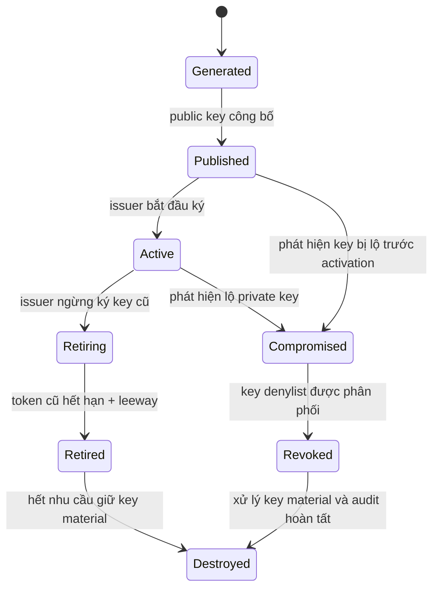

# Diễn tập xoay khóa, lộ khóa và gián đoạn nguồn JWKS

## 1. Mục tiêu vận hành

Trong module **SECURITY_TOKEN_SECURITY_JWT — Security - JSON Web Token (JWT)**, khóa ký và nguồn công bố khóa là thành phần trọng yếu của chuỗi tin cậy. Một hệ thống có thể xác minh JWT đúng về mặt mật mã nhưng vẫn gặp sự cố nghiêm trọng nếu:

- Xoay khóa không đúng thứ tự, khiến verifier chưa biết public key mới khi issuer bắt đầu ký bằng nó.
- Private signing key bị lộ nhưng các verifier vẫn chấp nhận public key tương ứng từ cache hoặc JWKS.
- JWKS endpoint bị gián đoạn, trả dữ liệu lỗi hoặc không thể phân phối key rotation tới các vùng.
- Các thành phần có chính sách cache khác nhau, dẫn tới mỗi verifier nhìn thấy một tập khóa khác nhau.
- Đội vận hành không biết khi nào tiếp tục phát hành token, khi nào dùng stale key và khi nào phải từ chối.

Bài này hướng dẫn thiết kế và thực hiện **diễn tập vận hành** cho ba tình huống: xoay khóa định kỳ, lộ khóa ký và gián đoạn nguồn JWKS. Mục tiêu là kiểm tra khả năng phối hợp giữa issuer, verifier, đội vận hành, security và người quản lý khóa; đo thời gian phát hiện, lan truyền và khôi phục; đồng thời xác nhận hệ thống không hạ thấp chính sách xác minh khi có sự cố.

Diễn tập phải dùng test issuer, test key và môi trường cô lập. Không cố tình làm lộ private key production, tắt key production hoặc gây gián đoạn endpoint JWKS đang phục vụ người dùng thật.

## 2. Thành phần và thuật ngữ cần thống nhất

| Thành phần | Trách nhiệm |
| --- | --- |
| Issuer / Authorization Server | Phát hành token, chọn signing key và công bố public key |
| JWKS endpoint | Công bố tập public JWK được issuer cho phép sử dụng |
| Verifier / Resource Server | Lấy public key tin cậy, xác minh chữ ký và claims |
| KMS/HSM hoặc key vault | Tạo, bảo vệ, sử dụng, vô hiệu hóa và audit key material |
| Key custodian | Quản lý vòng đời khóa và phê duyệt thao tác đặc quyền |
| Operations/SRE | Theo dõi availability, cache, propagation và phục hồi dịch vụ |
| Security incident lead | Điều phối xử lý lộ khóa và quyết định phạm vi ứng phó |
| JWKS cache | Snapshot khóa đã tải, gắn với issuer và nguồn khóa tin cậy |

Các thuật ngữ:

- **Signing key:** cặp khóa hoặc secret được dùng để ký JWT.
- **Verification key:** public key hoặc secret được dùng để xác minh chữ ký/MAC.
- **Key rotation:** thay khóa đang dùng bằng khóa mới theo quy trình có overlap.
- **Key compromise:** private key hoặc secret ký bị lộ, bị truy cập trái phép hoặc không còn có thể tin cậy.
- **JWKS outage:** verifier không thể lấy hoặc cập nhật JWK Set từ nguồn đã cấu hình.
- **Stale key:** khóa có trong cache nhưng snapshot đã quá thời hạn freshness bình thường.
- **Key denylist:** trạng thái độc lập để đánh dấu một key identity không còn được phép xác minh token.
- **Propagation delay:** thời gian để thay đổi ở issuer/JWKS được mọi verifier liên quan nhìn thấy.

Mỗi key identity phải được định danh trong phạm vi issuer/trust domain. Không dùng riêng chuỗi `kid` làm định danh toàn cục vì nhiều issuer có thể dùng cùng giá trị này.

## 3. Nguyên tắc thiết kế trước khi diễn tập

### 3.1. Trust source phải ổn định

Verifier phải lấy JWKS URI từ cấu hình issuer đã tin cậy hoặc metadata được bootstrap theo quy trình tin cậy. Token không được tự chọn URL lấy khóa. Khi tải JWKS, verifier cần xác minh TLS, hostname, nguồn dữ liệu, cấu trúc JWK và policy của từng key.

### 3.2. Key rotation là thay đổi có trình tự

Xoay khóa định kỳ thường cần công bố public key mới trước khi issuer bắt đầu ký bằng private key mới. Trong khoảng chuyển tiếp, verifier có thể cần cả public key cũ và mới để xác minh token đang còn hiệu lực.

### 3.3. Key compromise là sự kiện khẩn cấp

Khi private key bị lộ, không thể áp dụng overlap thông thường một cách máy móc. Kẻ tấn công có thể tạo token giả bằng khóa bị lộ. Cần ngừng sử dụng khóa, đánh dấu key identity bị xâm phạm và phân phối trạng thái từ chối tới verifier, kể cả nơi đang giữ cache cũ.

### 3.4. JWKS outage không đồng nghĩa key compromise

Outage là vấn đề availability của nguồn khóa. Key compromise là vấn đề trust. Hai tình huống có thể xảy ra đồng thời nhưng cần policy khác nhau:

- Với outage thông thường, có thể dùng known-good cached key trong cửa sổ stale được phê duyệt.
- Với key compromise, cached copy của khóa bị xâm phạm phải bị từ chối ngay khi verifier nhận được trạng thái khẩn cấp; không được dùng stale-if-error để giữ nó.

### 3.5. Không có khóa tin cậy thì không xác minh

Nếu verifier không có public key đáng tin cậy phù hợp, nó phải từ chối token. Không chuyển sang `alg: none`, không thử thuật toán yếu hơn, không tin JWK nhúng không được ủy quyền và không dùng khóa của issuer khác.

## 4. Chuẩn bị kế hoạch và phạm vi diễn tập

Trước mỗi buổi diễn tập, ghi lại:

- Mục tiêu và giả thuyết cần kiểm chứng.
- Issuer, token type, audience và các verifier nằm trong phạm vi.
- JWKS URI, cache TTL, stale-if-error limit và cơ chế invalidation hiện tại.
- Key identity thử nghiệm: issuer, `kid`, JWK thumbprint hoặc fingerprint chứng thư.
- Người điều phối, người thực hiện, người quan sát và người có quyền dừng diễn tập.
- Kênh liên lạc và nơi ghi nhận timeline/evidence.
- Điều kiện bắt đầu, điều kiện dừng và tiêu chí khôi phục.
- Các hệ thống không thuộc phạm vi và cách bảo đảm không ảnh hưởng chúng.

Nên chạy theo hai mức:

1. **Tabletop exercise:** mô phỏng tình huống, yêu cầu từng vai trò nêu quyết định và thao tác dự kiến; không thay đổi dịch vụ.
2. **Technical game day:** dùng test issuer, test JWKS và verifier staging để thực hiện thay đổi thực tế, đo cache và propagation.

Chỉ chuyển sang technical game day sau khi tabletop xác nhận có người chịu trách nhiệm, có rollback và có giới hạn tác động rõ ràng.

## 5. Xác định mục tiêu đo lường

Không chỉ hỏi “dịch vụ có chạy lại không”. Mỗi kịch bản cần đo:

| Chỉ số | Ý nghĩa |
| --- | --- |
| MTTD | Thời gian từ sự kiện bắt đầu tới khi phát hiện |
| MTTA | Thời gian tới khi người có trách nhiệm xác nhận và nhận xử lý |
| MTTR | Thời gian khôi phục trạng thái dịch vụ mục tiêu |
| Key propagation time | Thời gian public key mới xuất hiện tại mọi verifier trong phạm vi |
| Emergency revocation propagation | Thời gian key denylist tới mọi verifier |
| JWKS fetch success rate | Tỷ lệ request tải JWKS thành công |
| Cache age | Tuổi snapshot JWKS đang được dùng |
| Unknown-kid rejection rate | Tỷ lệ token có `kid` chưa biết bị từ chối |
| Stale-key acceptance count | Số lần verifier chấp nhận token bằng stale key |
| Compromised-key acceptance count | Số token dùng key bị đánh dấu compromise nhưng vẫn được chấp nhận; mục tiêu là 0 sau khi trạng thái khẩn cấp đã tới verifier |
| False rejection rate | Tỷ lệ token hợp lệ bị từ chối do propagation/cache/configuration |

Đặt SLO/RTO cụ thể theo mức rủi ro của hệ thống. Không dùng một con số mặc định cho mọi tổ chức; API đọc thông thường, thao tác thanh toán và chức năng quản trị có thể có mức chịu lỗi khác nhau.

## 6. Mô hình vòng đời khóa và trạng thái

Một key có thể đi qua các trạng thái logic:



Trạng thái thực tế có thể khác theo KMS/HSM và quy trình nội bộ. Điểm cần giữ là **Retired** và **Compromised/Revoked** có ý nghĩa khác nhau:

- Retired: issuer đã ngừng ký bằng khóa, nhưng public key cũ vẫn có thể cần để xác minh token hợp lệ còn hạn.
- Compromised/Revoked: khóa không còn đáng tin để xác minh token mới hoặc cũ; phải từ chối theo key identity và policy khẩn cấp.

Không dùng trạng thái “inactive” chung chung nếu nó không cho biết khóa đã ngừng ký bình thường hay bị xâm phạm.

## 7. Diễn tập A — Xoay khóa định kỳ

### 7.1. Mục tiêu

Chứng minh issuer có thể chuyển từ key cũ sang key mới mà:

- Không phát hành token bằng key mới trước khi public key được công bố và phân phối đủ rộng.
- Verifier xác minh được token cũ trong khoảng token còn hiệu lực.
- Verifier xác minh được token mới sau khi key mới đã được công bố.
- Không có kid collision hoặc key selection mơ hồ.
- Key cũ được loại bỏ sau khi không còn token hợp lệ cần nó.

### 7.2. Điều kiện trước diễn tập

- Có test issuer và test signing key riêng.
- Có test JWKS endpoint cùng cấu hình cache tương tự production.
- Ghi nhận key cũ, kid, public key thumbprint và token expiration tối đa.
- Biết cache TTL, refresh interval, stale-if-error và cơ chế push invalidation.
- Có verifier ở các vùng hoặc nhóm triển khai đại diện.
- Có thể quan sát JWKS version, ETag, cache age và key selection.

### 7.3. Trình tự thực hiện

1. Tạo key pair mới trong KMS/HSM hoặc key service thử nghiệm.
2. Gán kid mới, duy nhất trong phạm vi issuer; không tái sử dụng kid cũ.
3. Công bố public JWK mới trong JWKS cùng public key cũ.
4. Xác minh response JWKS đúng issuer, đúng schema và chỉ chứa public key material.
5. Chờ propagation theo cache TTL/refresh policy hoặc chủ động invalidation.
6. Xác nhận các verifier trong phạm vi nhìn thấy key mới và chọn được key theo kid.
7. Chuyển issuer sang ký token mới bằng private key tương ứng với key mới.
8. Xác minh token mới trên mọi nhóm verifier.
9. Xác minh token cũ vẫn hoạt động trong khoảng hiệu lực còn lại.
10. Ngừng ký bằng key cũ và ghi nhận thời điểm token cuối cùng được ký bằng key cũ.
11. Chờ hết thời hạn token tối đa có thể phát hành bằng key cũ cộng clock-skew được chấp nhận.
12. Gỡ public key cũ khỏi JWKS, invalidation cache theo policy và xác nhận không còn verifier cần key đó.
13. Đóng vòng đời key cũ theo quy trình lưu trữ/xóa key material và audit.

### 7.4. Tính thời điểm được phép gỡ key cũ

Nếu token cuối cùng ký bằng key cũ có thời điểm hết hạn lớn nhất là T, và verifier cho phép clock-skew tối đa L, mốc sớm nhất để token đó không còn được chấp nhận là:

```text
oldKeyRetainUntil = T + L
```

Nếu hệ thống áp dụng maximum token lifetime D, thời điểm ngừng ký bằng key cũ là S, thì có thể ước lượng bảo thủ:

```text
oldKeyRetainUntil = S + D + L
```

Phải dùng cùng một quy tắc expiration/leeway ở issuer và verifier. Nếu có token không có exp, token có tuổi thọ không giới hạn hoặc verifier có stale policy kéo dài, không thể chỉ dựa vào công thức đơn giản này; cần quy tắc riêng trước khi gỡ key.

### 7.5. Tiêu chí thành công

- Public key mới xuất hiện ở tất cả verifier trong phạm vi trước khi issuer dùng private key mới.
- Token mới được xác minh thành công bằng đúng key identity.
- Token cũ vẫn xác minh được trong overlap đã định nghĩa.
- Không có token nào được xác minh bằng key thuộc issuer khác.
- Không có kid trùng hoặc nhiều khóa cùng khớp.
- Key cũ chỉ bị gỡ sau khi token cũ hết thời gian chấp nhận.
- Không có request refresh JWKS tăng đột biến do cache miss không được kiểm soát.

## 8. Diễn tập B — Private signing key bị lộ

### 8.1. Mục tiêu

Chứng minh tổ chức có thể phát hiện và vô hiệu hóa key bị xâm phạm nhanh chóng, đồng thời hiểu rõ tác động tới token hợp lệ đã phát hành bằng key đó.

Khi private signing key bị lộ, attacker có thể ký token mới có chữ ký hợp lệ về mặt toán học. Vì vậy, verifier cần một tín hiệu tin cậy để từ chối key identity bị xâm phạm. Chỉ ngừng ký ở issuer hoặc xóa public key khỏi JWKS có thể chưa đủ do verifier đang giữ cache.

### 8.2. Điều kiện kích hoạt

Ví dụ nguồn phát hiện:

- KMS/HSM audit cho thấy thao tác ký bất thường.
- Private key export trái phép hoặc secret xuất hiện trong log/repository.
- Alert về quyền truy cập key vault bất thường.
- Token giả được phát hiện có chữ ký hợp lệ từ key identity đang dùng.
- Nhân sự hoặc nhà cung cấp báo cáo key material bị lộ.

Không cần đợi xác định đầy đủ attacker đã sử dụng key hay chưa mới bắt đầu containment. Incident lead có thể kích hoạt quy trình khẩn cấp khi có bằng chứng đáng tin rằng private key đã bị xâm phạm.

### 8.3. Trình tự ứng phó

1. Mở incident, ghi thời điểm phát hiện và xác định issuer/key identity.
2. Ngừng mọi hoạt động ký mới bằng private key bị nghi ngờ.
3. Disable hoặc revoke quyền sử dụng key trong KMS/HSM; kiểm tra các workload identity có thể gọi thao tác ký.
4. Tạo key pair thay thế trong trust boundary được kiểm soát.
5. Công bố public key mới qua JWKS đã cấu hình và xác nhận propagation.
6. Phát hành tín hiệu key compromise độc lập với JWKS cache: denylist theo issuer và key thumbprint/key identity; nếu cần, dùng kid kết hợp fingerprint để tránh mơ hồ.
7. Phân phối trạng thái khẩn cấp tới tất cả verifier và invalidation cache chứa key bị xâm phạm.
8. Xác nhận verifier từ chối mọi token dùng key identity bị xâm phạm, kể cả token có chữ ký toán học hợp lệ.
9. Xem xét thu hồi session, refresh token family hoặc token descendants theo threat model.
10. Điều tra thời gian phơi nhiễm, nguồn truy cập key, token có khả năng bị giả mạo và dữ liệu/tài nguyên đã bị truy cập.
11. Xoay các credential khác nếu chúng dùng chung secret, quyền hoặc trust boundary bị ảnh hưởng.
12. Lưu evidence, bảo toàn audit và hoàn tất báo cáo sự cố.

### 8.4. Vì sao cần key denylist độc lập với JWKS?

JWKS có thể bị cache trong memory hoặc ở nhiều vùng. Nếu issuer chỉ xóa key khỏi JWKS:

- Verifier đang giữ snapshot cũ có thể tiếp tục dùng public key đó.
- Một vùng đang offline có thể không nhận thay đổi.
- Cache stale-if-error có thể giữ key lâu hơn cache TTL bình thường.
- CDN/proxy có thể còn bản sao chưa hết hạn.

Vì vậy, cần một kênh trạng thái khẩn cấp có độ ưu tiên cao hơn stale cache. Key denylist có thể được phân phối qua control plane, signed configuration hoặc cơ chế invalidation đã xác thực. Verifier phải kiểm tra denylist trước khi sử dụng key, kể cả key đến từ cache.

Key identity nên ràng buộc với issuer và fingerprint/thumbprint của public key. Chỉ dùng kid có thể không đủ nếu kid bị tái sử dụng hoặc có collision. Quy tắc nhận dạng và cách phân phối denylist phải được định nghĩa trước sự cố.

### 8.5. Tác động tới token hợp lệ

Khi một signing key bị compromise, verifier không thể phân biệt chắc chắn token hợp lệ do issuer ký với token giả do attacker ký bằng cùng private key chỉ dựa trên chữ ký. Vì vậy, từ chối mọi token ký bằng key đó có thể làm gián đoạn cả người dùng hợp lệ.

Đây là trade-off cần được diễn tập và phê duyệt trước:

- **Security-first:** từ chối ngay mọi token dùng key bị compromise; yêu cầu người dùng xác thực lại hoặc lấy token mới.
- **Risk-segmented:** từ chối trên endpoint nhạy cảm trước, nhưng chỉ áp dụng ngoại lệ cho endpoint ít rủi ro nếu có bằng chứng độc lập và policy được phê duyệt. Không dùng cách này nếu không thể chứng minh token an toàn.
- **Session recovery:** thu hồi refresh token/session family bị ảnh hưởng, yêu cầu cấp token mới bằng key thay thế.

Không giữ key bị compromise chỉ để tránh logout người dùng. Quyết định availability phải được đặt trong threat model và do incident authority phê duyệt.

### 8.6. Tiêu chí thành công

- Signing operation bằng key bị compromise đã bị dừng.
- Key identity bị denylist ở mọi verifier trong phạm vi.
- Cache cũ không thể vượt qua denylist.
- Không verifier nào chấp nhận token mới ký bằng key bị compromise sau khi nhận trạng thái khẩn cấp.
- Key thay thế được công bố và dùng theo quy trình an toàn.
- Có đánh giá phạm vi token/session cần thu hồi.
- Audit và evidence được bảo toàn.

## 9. Diễn tập C — JWKS endpoint gián đoạn

### 9.1. Mục tiêu

Xác nhận hệ thống tiếp tục hoạt động theo chính sách khi nguồn JWKS tạm thời không truy cập được, đồng thời không chấp nhận khóa chưa biết hoặc khóa không tin cậy.

### 9.2. Các dạng sự cố cần mô phỏng

- DNS lookup lỗi hoặc trả kết quả không thể kết nối.
- TLS handshake lỗi hoặc chứng thư endpoint hết hạn/hostname mismatch.
- Timeout, connection reset hoặc HTTP 5xx.
- HTTP 429 do rate limit.
- Response quá lớn, sai content type hoặc JSON malformed.
- JWKS trả mảng keys rỗng bất thường.
- CDN/proxy phục vụ snapshot cũ.
- Một vùng truy cập được JWKS, vùng khác không.
- JWKS outage trùng lúc issuer chuẩn bị xoay khóa.

Mỗi dạng lỗi có thể ảnh hưởng khác nhau. Ví dụ HTTP 429 cần tôn trọng Retry-After; JSON malformed không được dùng để ghi đè cache tốt; DNS/TLS error cần phân biệt với response hợp lệ nhưng không có key.

### 9.3. Phân biệt known key và unknown kid

| Trường hợp | Hành vi đề xuất |
| --- | --- |
| Token dùng key đã biết, cache còn fresh | Tiếp tục xác minh theo policy |
| Token dùng key đã biết, cache stale trong grace window | Có thể dùng stale key nếu không bị denylist và policy cho phép |
| Token dùng key đã biết, vượt quá max-stale | Từ chối hoặc áp dụng chế độ suy giảm đã được phê duyệt; không kéo dài vô hạn |
| Token có kid mới chưa biết, JWKS đang outage | Từ chối; không có căn cứ tin cậy cho key mới |
| Token có key identity nằm trong denylist | Từ chối ngay, kể cả cache còn fresh |
| JWKS response malformed/không hợp lệ | Không thay snapshot last-known-good |
| JWKS response hợp lệ nhưng thiếu key cũ | Áp dụng key lifecycle policy; không tự coi outage là lý do giữ key đã bị revoke |

Stale-if-error chỉ áp dụng cho key đã được tin cậy trước đó và chưa bị đánh dấu compromise/revoked. Nó không cho phép chấp nhận key mới do token tự đưa ra.

### 9.4. Stale-key policy

Một stale-key policy nên xác định rõ:

- Cache freshness TTL bình thường.
- Thời gian tối đa được phép dùng stale key khi nguồn lỗi.
- Loại lỗi nào kích hoạt stale-if-error.
- Key nào được phép dùng stale: chỉ known key đã xác thực và chưa bị denylist.
- Endpoint hoặc loại token nào được áp dụng grace mode.
- Điều kiện buộc fail-closed.
- Ai có quyền thay đổi giới hạn trong incident.
- Cách ghi log, metric và alert khi dùng stale key.

Không dùng một giá trị stale tối đa tùy ý cho toàn bộ hệ thống. Endpoint quản trị, thay đổi thông tin bảo mật hoặc giao dịch rủi ro cao có thể cần fail-closed sớm hơn endpoint ít nhạy cảm.

### 9.5. Không thay cache bằng dữ liệu lỗi

Verifier nên tải và kiểm tra snapshot mới trước khi cập nhật cache:

1. Kiểm tra nguồn/issuer và TLS.
2. Kiểm tra HTTP status, kích thước và content type.
3. Parse JSON nghiêm ngặt.
4. Kiểm tra keys là cấu trúc hợp lệ và giới hạn số lượng.
5. Kiểm tra từng JWK theo algorithm/key policy.
6. Chỉ thay cache bằng snapshot đã được chấp nhận, theo thao tác nguyên tử.

Nếu fetch lỗi hoặc dữ liệu malformed, giữ last-known-good snapshot trong giới hạn stale policy. Nếu có tín hiệu compromise độc lập, denylist phải có ưu tiên và loại bỏ key đó khỏi khả năng xác minh dù snapshot vẫn tồn tại.

### 9.6. Tiêu chí thành công

- Known key được xử lý theo freshness và stale policy đã cấu hình.
- Unknown kid bị từ chối khi không thể lấy key tin cậy.
- Response malformed không làm mất snapshot tốt.
- Key bị denylist luôn bị từ chối dù JWKS hoặc cache còn chứa nó.
- Refresh retry không tạo storm.
- Hệ thống phát cảnh báo khi vượt ngưỡng stale hoặc JWKS outage.
- Sau khi JWKS phục hồi, cache cập nhật và verifier hội tụ về cùng key set.

## 10. Chính sách cache và refresh JWKS

### 10.1. Cache theo issuer và nguồn khóa

Cache identity nên gồm issuer/trust domain và key-source identity đã cấu hình. Không cache chỉ theo kid vì nhiều issuer có thể dùng cùng giá trị; cũng không dùng URL tùy ý trong token làm cache key.

Một cache entry nên ghi nhận:

- Issuer/trust domain.
- JWKS URI đã cấu hình.
- Snapshot version hoặc ETag/Last-Modified.
- Thời điểm tải thành công.
- Freshness TTL và max-stale deadline.
- Danh sách key identity và thumbprint.
- Trạng thái denylist/invalidation áp dụng cho từng key.

### 10.2. Conditional request và refresh control

HTTP conditional request như ETag/If-None-Match hoặc Last-Modified/If-Modified-Since có thể giảm tải khi JWKS không thay đổi. Verifier nên:

- Tôn trọng Cache-Control/TTL theo policy đã thống nhất.
- Dùng jitter để tránh mọi instance refresh cùng lúc.
- Dùng single-flight/coalescing để nhiều request cùng unknown kid không tạo nhiều fetch đồng thời.
- Rate limit refresh theo issuer.
- Có exponential backoff và retry budget.
- Tôn trọng Retry-After khi endpoint trả 429 hoặc 503 nếu có.
- Giới hạn timeout và response size.

Không refresh JWKS với mọi request có chữ ký sai. Điều đó có thể cho phép attacker tạo refresh storm. Chỉ những điều kiện được policy xác định, chẳng hạn unknown kid, mới được kích hoạt refresh có kiểm soát.

### 10.3. Unknown-kid cooldown

Nếu nhiều token liên tiếp có kid chưa biết, verifier có thể refresh một lần theo issuer rồi áp dụng cooldown. Kết quả “không tìm thấy key” có thể được cache ngắn để tránh lặp request, nhưng không được dùng negative cache để che mất key mới sau khi issuer đã công bố. Cần có invalidation khi JWKS version thay đổi hoặc hết cooldown.

## 11. Ma trận quyết định vận hành

Ma trận này giúp incident lead thống nhất hành vi giữa các verifier:

| Tình huống | Key source/cache | Hành động xác minh | Hành động vận hành |
| --- | --- | --- | --- |
| Rotation bình thường, key mới đã được công bố | Fresh JWKS có cả key cũ và mới | Chấp nhận token theo key đúng issuer và policy | Theo dõi propagation, sau đó chuyển signing |
| Rotation nhưng verifier chưa thấy key mới | JWKS/cache chưa hội tụ | Không chấp nhận token dùng key mới chưa biết | Chưa chuyển issuer hoặc tạm dừng rollout |
| JWKS outage, known key còn fresh | Cache trusted và fresh | Tiếp tục theo policy | Khắc phục nguồn, theo dõi cache |
| JWKS outage, known key stale trong grace | Cache trusted nhưng stale | Chỉ chấp nhận nếu key không denylist và policy cho phép | Alert, giới hạn grace, khôi phục JWKS |
| JWKS outage, unknown kid | Không có key tin cậy | Từ chối token | Không tự thêm key; khắc phục nguồn hoặc issuer |
| Signing key compromise | Cache có thể còn key cũ | Từ chối key identity bị denylist | Dừng ký, phân phối emergency denylist, rotate key |
| JWKS response malformed | Snapshot mới không hợp lệ | Giữ last-known-good trong stale limit; không dùng response lỗi | Alert và điều tra nguồn |
| Denylist/control plane chưa tới một verifier | Trạng thái trust không hội tụ | Theo policy high-risk; không tuyên bố đã revoke toàn cục | Cô lập verifier chưa cập nhật hoặc chặn traffic |

Nếu một verifier không nhận được emergency denylist, hệ thống chưa thể khẳng định key compromise đã được xử lý toàn cục. Cần có trạng thái rollout/invalidation có xác nhận thay vì chỉ dựa vào việc gửi event thành công.

## 12. Quy trình phối hợp và trách nhiệm

Một mô hình trách nhiệm đơn giản:

| Vai trò | Trách nhiệm chính |
| --- | --- |
| Incident commander | Kích hoạt, điều phối, quyết định mức độ và kết thúc sự cố |
| Key custodian | Dừng/disable key, tạo key thay thế và xác nhận key lifecycle |
| Issuer owner | Chuyển signing key, kiểm soát token lifetime và phát hành |
| JWKS owner | Phục hồi endpoint, xác nhận nội dung và propagation |
| Verifier owner | Cache policy, denylist, xác minh và fail-closed behavior |
| SRE/Network | DNS, TLS, CDN, egress, health và capacity |
| Security | Đánh giá compromise, phạm vi token giả và bằng chứng |
| Communications | Cập nhật nội bộ và thông báo người dùng theo phê duyệt |

Các quyết định cần có người chịu trách nhiệm rõ:

- Ai được phép tuyên bố key bị compromise?
- Ai có quyền disable key trong KMS/HSM?
- Ai phê duyệt emergency denylist?
- Ai quyết định tạm dừng phát hành token?
- Ai được phép thay stale-key grace trong incident?
- Ai xác nhận mọi verifier đã nhận thay đổi?
- Ai phê duyệt kết thúc sự cố và gỡ biện pháp khẩn cấp?

Không để một người vừa thay đổi trust policy vừa tự xác nhận thành công mà không có kiểm soát độc lập đối với thao tác rủi ro cao.

## 13. Kịch bản tabletop mẫu

### Inject 1 — Rotation không hội tụ

Điều phối viên thông báo issuer đã công bố key mới, nhưng một vùng verifier chưa thấy kid mới sau thời gian propagation dự kiến.

Câu hỏi:

- Issuer có tiếp tục ký bằng key mới không?
- Verifier vùng đó sẽ xử lý unknown kid thế nào?
- Có thể refresh an toàn từ nguồn nào?
- Ai có quyền tạm dừng rollout?
- Bằng chứng nào cho thấy mọi vùng đã hội tụ?

Kết quả mong đợi: không chuyển signing trước khi key mới được phân phối đủ; unknown kid bị từ chối; refresh có giới hạn.

### Inject 2 — Dấu hiệu private key bị lộ

Điều phối viên cung cấp cảnh báo KMS về thao tác ký bất thường và một JWT có chữ ký hợp lệ nhưng claims bất thường.

Câu hỏi:

- Ai kích hoạt incident?
- Ai dừng signing và disable key?
- Denylist được phát hành qua kênh nào?
- Làm sao xử lý verifier đang offline hoặc cache stale?
- Token/session nào cần thu hồi?
- Có cần yêu cầu người dùng xác thực lại?

Kết quả mong đợi: containment không chờ đầy đủ forensic; denylist độc lập với JWKS; mọi verifier phải xác nhận key bị compromise không còn được chấp nhận.

### Inject 3 — JWKS outage trong lúc rotation

Điều phối viên thông báo JWKS trả HTTP 503 trong khi issuer đang chuẩn bị chuyển sang key mới.

Câu hỏi:

- Issuer có được phép dùng key chưa được verifier biết không?
- Known key trong cache còn fresh hay stale?
- Stale grace có áp dụng cho endpoint nhạy cảm không?
- Unknown kid được xử lý ra sao?
- Retry có thể gây refresh storm không?
- Điều kiện nào cho phép tiếp tục rotation?

Kết quả mong đợi: không dùng key mới chưa phân phối; known key chỉ được dùng theo stale policy; unknown kid bị từ chối; rotation tạm dừng cho tới khi nguồn khóa hội tụ.

## 14. Runbook chi tiết cho rotation

Runbook nên có các bước có thể kiểm chứng và người chịu trách nhiệm:

| Bước | Hành động | Bằng chứng cần lưu |
| --- | --- | --- |
| R1 | Tạo key mới trong KMS/HSM | Key version, algorithm, creation time, approver |
| R2 | Kiểm tra public JWK và thumbprint | JWK metadata đã loại private material |
| R3 | Publish key mới cùng key cũ | JWKS version/ETag và response đã xác thực |
| R4 | Đợi propagation hoặc invalidate cache | Danh sách verifier xác nhận nhìn thấy key |
| R5 | Chuyển issuer sang key mới | Thời điểm switch, kid mới và kết quả signing |
| R6 | Verify token mới trên mọi vùng | Test result theo verifier/region |
| R7 | Theo dõi token cũ và thời hạn cuối | Thời điểm token cuối ký bằng key cũ, maximum exp |
| R8 | Gỡ key cũ sau retention window | Phê duyệt, JWKS snapshot và cache convergence |
| R9 | Đóng vòng đời key cũ | KMS state, audit và bằng chứng xóa/archival |

Điều kiện dừng:

- Một verifier quan trọng chưa nhìn thấy public key mới.
- JWKS response không hợp lệ hoặc có private key material.
- Key mới không khớp algorithm/key policy.
- Token mới không xác minh được trên một vùng.
- Có dấu hiệu key cũ bị compromise trong lúc rotation.

Nếu có dấu hiệu compromise, dừng runbook rotation bình thường và chuyển sang incident response. Không tiếp tục overlap chỉ vì kế hoạch rotation đã bắt đầu.

## 15. Runbook chi tiết cho key compromise

| Bước | Hành động | Bằng chứng cần lưu |
| --- | --- | --- |
| C1 | Mở incident và xác định key identity | Incident ID, issuer, kid, thumbprint, thời điểm |
| C2 | Dừng signing bằng key nghi ngờ | KMS/HSM deny/disable event, signing failure |
| C3 | Tạo key thay thế | Key version và phê duyệt |
| C4 | Công bố public key mới | JWKS version và propagation |
| C5 | Phát emergency denylist | Signed control-plane event/config version |
| C6 | Xác nhận mọi verifier nhận denylist | Ack theo region/instance hoặc health inventory |
| C7 | Chặn traffic từ verifier chưa hội tụ | Network/service routing evidence |
| C8 | Thu hồi session/refresh family theo phạm vi | Số session/token family đã revoke |
| C9 | Điều tra token giả và truy cập liên quan | Timeline, audit, evidence chain |
| C10 | Phục hồi dịch vụ và giám sát tăng cường | Error rate, rejected-key count, residual risk |

Không đánh dấu incident “contained” chỉ vì JWKS đã bỏ key. Cần xác nhận verifier không còn dùng cache key bị compromise và signing operation bằng private key đó đã bị dừng.

### 15.1. Key compromise khi verifier offline

Verifier offline hoặc bị phân vùng mạng có thể không nhận emergency denylist. Có các lựa chọn:

- Chặn traffic tới verifier đó cho tới khi nhận trạng thái khẩn cấp.
- Đưa verifier vào chế độ không chấp nhận token dùng key có khả năng bị compromise.
- Dùng control plane độc lập, có xác thực và khả năng retry/ack để phân phối trạng thái.
- Xác định rõ maximum time-to-revoke và hành động tự động khi quá hạn.

Nếu không thể chứng minh verifier đã nhận denylist, không thể tuyên bố key đã bị vô hiệu hóa trên toàn hệ thống.

## 16. Runbook chi tiết cho JWKS outage

### 16.1. Phân loại lỗi

Trước tiên xác định lỗi nằm ở đâu:

- DNS/resolver.
- TLS/certificate/hostname.
- Network route, firewall, proxy hoặc egress.
- CDN/cache.
- JWKS origin/application.
- HTTP rate limit hoặc capacity.
- Nội dung JWKS malformed hoặc policy validation.

Không thay đổi trust policy để xử lý một lỗi mạng tạm thời. Ví dụ, không tắt TLS verification hoặc cho phép mọi host chỉ để JWKS fetch hoạt động trở lại.

### 16.2. Trình tự xử lý

1. Xác nhận phạm vi: issuer, endpoint, vùng và verifier bị ảnh hưởng.
2. Kiểm tra trạng thái endpoint bằng công cụ health đã được phép, không gửi token production vào công cụ debug.
3. Kiểm tra DNS, TLS, HTTP status, response size và JWKS schema.
4. Xác định cache age ở các verifier và key nào còn fresh.
5. Áp dụng stale-key policy đã được phê duyệt; không tự kéo dài max-stale.
6. Từ chối unknown kid nếu không thể lấy public key tin cậy.
7. Giảm refresh concurrency, bật backoff và tôn trọng Retry-After.
8. Khắc phục origin/CDN/DNS/TLS hoặc network path.
9. Khi endpoint phục hồi, xác minh JWKS snapshot mới trước khi cập nhật cache.
10. Theo dõi cache convergence, unknown-kid rejection và false rejection.
11. Kết thúc grace mode khi freshness bình thường được khôi phục.

### 16.3. Khi outage trùng key rotation

Issuer không nên bắt đầu ký bằng key mới nếu chưa có bằng chứng public key đã được phân phối. Nếu issuer đã chuyển signing quá sớm:

- Dừng phát hành token bằng key chưa được verifier biết.
- Nếu private key mới chưa bị compromise, có thể giữ key đó và đợi JWKS phục hồi; không cần tạo thêm key mới chỉ vì outage.
- Nếu token mới đã được phát hành, ghi nhận phạm vi và thời hạn; chỉ cho phép xác minh khi verifier nhận được public key qua nguồn tin cậy.
- Không chèn public key qua header/token hoặc kênh không được trust policy phê duyệt.

## 17. Kế hoạch khôi phục và rollback

Rollback phải phù hợp với loại sự cố:

| Sự cố | Có thể rollback về key cũ không? | Điều kiện |
| --- | --- | --- |
| Rotation lỗi trước khi ký bằng key mới | Thường có | Key cũ chưa compromise và vẫn được tin cậy |
| Rotation lỗi sau khi đã phát hành token bằng key mới | Có thể cần giữ cả hai public key | Không được xóa key mới trước khi token mới hết hạn hoặc bị thu hồi |
| Key cũ bị compromise | Không | Không quay lại signing hoặc verification bằng key bị compromise |
| Key mới bị lỗi cấu hình nhưng chưa compromise | Có thể quay về key cũ | Key cũ vẫn an toàn, chưa bị revoke và policy cho phép |
| JWKS outage | Không phải rollback key | Khôi phục nguồn JWKS và áp dụng cache policy |

Không được coi rollback là khôi phục file cấu hình cũ một cách máy móc. Phải xét token đã phát hành bằng từng key, trạng thái compromise, denylist và cache ở verifier.

## 18. Quan sát, cảnh báo và bằng chứng

Dashboard vận hành nên có tối thiểu:

- JWKS fetch success/error theo issuer và vùng.
- HTTP status, latency, DNS/TLS failure category.
- JWKS snapshot age, ETag/version và số key hợp lệ.
- Cache freshness và stale usage.
- Unknown kid count và refresh cooldown activity.
- Token verification failure theo reason category.
- Key denylist version và propagation acknowledgement.
- Signing operation theo key identity.
- Thời điểm key activation, retirement và revocation.

Alert nên kích hoạt khi:

- JWKS không truy cập được vượt ngưỡng.
- Cache sắp vượt max-stale.
- Có nhiều unknown kid bất thường.
- JWKS response thay đổi bất thường về số lượng hoặc loại khóa.
- Key denylist chưa tới một verifier trong thời gian mục tiêu.
- KMS/HSM có signing activity bất thường hoặc key export trái phép.
- Verifier tiếp tục chấp nhận key identity đã bị denylist.

Không đưa raw JWT, private key hoặc plaintext claims vào metric/log để phục vụ giám sát. Dùng issuer identifier, key fingerprint, reason code và correlation ID được kiểm soát.

## 19. Bảo vệ diễn tập và tránh gây sự cố thật

Diễn tập lộ khóa có thể tạo ra tình huống giống sự cố thật. Cần:

- Dùng test key có thể hủy và test issuer riêng.
- Chỉ chạy trên staging hoặc môi trường game-day được cô lập.
- Dùng endpoint JWKS giả lập hoặc fault injection có giới hạn.
- Không truy cập metadata endpoint hoặc dịch vụ nội bộ thật trong bài test SSRF/JWKS.
- Có kill switch và người điều phối độc lập.
- Xác nhận không có route, credential hoặc key production được tham chiếu.
- Dùng token giả và subject tổng hợp.
- Xóa test key, cache, token và fixture sau diễn tập theo quy trình.
- Ghi lại các thay đổi và khôi phục trạng thái test ban đầu.

Nếu phát hiện test đã tác động nhầm vào production, dừng diễn tập, kích hoạt incident thật và bảo toàn evidence; không tiếp tục để hoàn thành kịch bản.

## 20. Kịch bản kiểm thử kỹ thuật

| ID | Tình huống | Kết quả mong đợi |
| --- | --- | --- |
| ROT-01 | Publish key mới trước khi signing | Verifier nhìn thấy key mới trước switch |
| ROT-02 | Token mới dùng key mới sau propagation | Xác minh thành công |
| ROT-03 | Token cũ trong overlap | Xác minh thành công bằng key cũ |
| ROT-04 | Gỡ key cũ trước max exp + leeway | Test phát hiện false rejection |
| ROT-05 | Hai issuer dùng cùng kid | Không dùng nhầm key giữa issuer |
| CMP-01 | Dừng signing bằng key compromise | KMS/HSM từ chối signing mới |
| CMP-02 | Denylist tới verifier | Key bị từ chối dù cache còn chứa public key |
| CMP-03 | Verifier offline không nhận denylist | Traffic bị cô lập hoặc policy an toàn được kích hoạt |
| CMP-04 | Token giả ký bằng private key test bị lộ | Từ chối sau khi denylist được áp dụng |
| JWK-01 | JWKS timeout với fresh cache | Known key tiếp tục theo policy |
| JWK-02 | JWKS outage với stale cache trong grace | Chỉ known key chưa denylist được dùng |
| JWK-03 | Unknown kid khi JWKS outage | Từ chối |
| JWK-04 | JWKS JSON malformed | Không ghi đè last-known-good snapshot |
| JWK-05 | JWKS trả 429 | Backoff và tôn trọng Retry-After |
| JWK-06 | JWKS phục hồi | Cache hội tụ và freshness được khôi phục |
| JWK-07 | Outage trùng rotation | Issuer tạm dừng switch sang key chưa phân phối |
| SEC-01 | Denylist và stale-if-error cùng áp dụng | Denylist có ưu tiên |
| SEC-02 | Refresh bị kích hoạt bởi nhiều unknown kid | Single-flight/rate limit ngăn refresh storm |

## 21. Checklist sẵn sàng vận hành

- [ ] Có inventory issuer, JWKS URI, verifier và key identity.
- [ ] Có quy trình tạo key, publish public key, switch signing và retire key.
- [ ] Có maximum token lifetime và clock-skew thống nhất.
- [ ] Có quy tắc giữ key cũ tới khi token cuối cùng hết thời gian chấp nhận.
- [ ] kid không bị tái sử dụng trong cùng issuer và cache được namespace đúng.
- [ ] Có key denylist độc lập với JWKS để xử lý compromise.
- [ ] Emergency denylist có xác thực, versioning, acknowledgement và retry.
- [ ] Verifier kiểm tra denylist trước khi sử dụng key từ cache.
- [ ] Có stale-key policy với freshness TTL, max-stale, scope và fail-closed threshold.
- [ ] Unknown kid bị từ chối nếu không có key tin cậy.
- [ ] JWKS fetch có timeout, response-size limit, backoff và rate limit.
- [ ] Cache chỉ cập nhật sau khi snapshot mới được xác minh và kiểm tra hợp lệ.
- [ ] Có dashboard cache age, fetch status, key propagation và denylist propagation.
- [ ] Có người chịu trách nhiệm cho disable key, emergency revoke và kết thúc incident.
- [ ] Có tabletop và technical game day định kỳ bằng test key.
- [ ] Có tiêu chí dừng, rollback và cô lập verifier không hội tụ.
- [ ] Không dùng stale cache cho key đã compromise.
- [ ] Có post-exercise review, action owner và deadline khắc phục.

## 22. Câu hỏi tự kiểm tra

**Câu 1.** Vì sao phải publish public key mới trước khi issuer bắt đầu ký bằng private key mới?

**Đáp án:** Để verifier có thể lấy và tin cậy public key trước khi nhận token mới; nếu switch quá sớm, verifier chưa hội tụ sẽ từ chối token hợp lệ.

**Câu 2.** Vì sao phải giữ public key cũ sau khi issuer ngừng ký bằng nó?

**Đáp án:** Token cũ đã phát hành vẫn có thể còn hiệu lực. Key cũ cần được giữ tới khi token cuối cùng hết thời gian chấp nhận, gồm clock-skew.

**Câu 3.** Vì sao xóa key bị compromise khỏi JWKS chưa đủ?

**Đáp án:** Verifier, CDN hoặc proxy có thể còn cache cũ. Cần emergency denylist/invalidation độc lập và xác nhận mọi verifier đã nhận.

**Câu 4.** Stale-if-error có được dùng cho key đã bị compromise không?

**Đáp án:** Không. Denylist hoặc trạng thái compromise phải có ưu tiên cao hơn cache freshness và stale policy.

**Câu 5.** Nếu JWKS outage và token có kid mới chưa biết, verifier nên làm gì?

**Đáp án:** Từ chối token vì không có public key tin cậy để xác minh. Không lấy key từ token hoặc nguồn không được ủy quyền.

**Câu 6.** JWKS trả JSON malformed thì cache nên xử lý thế nào?

**Đáp án:** Không thay snapshot last-known-good bằng response lỗi; giữ cache chỉ trong giới hạn stale policy và phát cảnh báo.

**Câu 7.** Khi nào có thể rollback về key cũ?

**Đáp án:** Chỉ khi key cũ chưa compromise, chưa bị revoke và vẫn được policy tin cậy. Không rollback về key đã bị lộ.

**Câu 8.** Điều kiện nào cho phép kết luận key compromise đã được containment toàn cục?

**Đáp án:** Signing bằng key đó đã bị dừng, denylist đã được mọi verifier trong phạm vi nhận và xác nhận, cache cũ không thể vượt qua denylist, verifier chưa hội tụ đã bị cô lập.

## 23. Tài liệu chuẩn tham khảo

- [RFC 7517 — JSON Web Key (JWK)](https://www.rfc-editor.org/rfc/rfc7517): cấu trúc JWK/JWKS và thuộc tính khóa.
- [RFC 7515 — JSON Web Signature (JWS)](https://www.rfc-editor.org/rfc/rfc7515): chữ ký JOSE và các header liên quan.
- [RFC 7519 — JSON Web Token (JWT)](https://www.rfc-editor.org/rfc/rfc7519): claims như issuer, audience và expiration.
- [RFC 8725 — JSON Web Token Best Current Practices](https://www.rfc-editor.org/rfc/rfc8725): ràng buộc thuật toán, issuer và key handling an toàn.
- [RFC 9110 — HTTP Semantics](https://www.rfc-editor.org/rfc/rfc9110): HTTP caching, conditional request và semantics response.
- [RFC 7638 — JSON Web Key (JWK) Thumbprint](https://www.rfc-editor.org/rfc/rfc7638): tạo thumbprint để định danh JWK.
- [NIST SP 800-57 Part 1 Rev. 5 — Recommendation for Key Management](https://csrc.nist.gov/pubs/sp/800/57/pt1/r5/final): quản lý vòng đời và xử lý compromise của khóa.
- [NIST SP 800-61 Rev. 3 — Incident Response Recommendations and Considerations for Cybersecurity Risk Management](https://csrc.nist.gov/pubs/sp/800/61/r3/final): tổ chức ứng phó và điều phối sự cố.

**Ghi nhớ:** Rotation bình thường cần publish trước, switch sau và giữ key cũ tới khi token cuối cùng hết hạn. Compromise cần dừng signing và denylist key identity độc lập với JWKS/cache. JWKS outage có thể dùng known-good stale key trong grace window được phê duyệt, nhưng unknown kid phải bị từ chối và stale cache không bao giờ được vượt qua trạng thái compromise.

