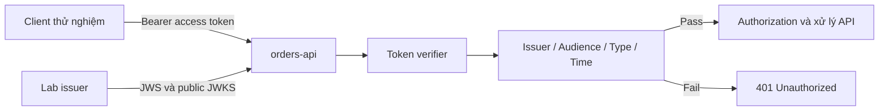

# Mô phỏng lỗi audience, issuer, loại token và thời gian hiệu lực

## 1. Mục tiêu bài thực hành

Trong bài này, bạn xây dựng một bộ xác minh access token JWT cho một API giả lập, sau đó chủ động tạo các token sai để chứng minh verifier từ chối đúng lý do.

Bài tập tập trung vào bốn nhóm điều kiện thường bị cấu hình thiếu hoặc kiểm tra không nhất quán:

- **Issuer (iss):** token phải do đúng authorization server đã được tin cậy phát hành.
- **Audience (aud):** token phải được cấp cho đúng resource server đang nhận request.
- **Token type (typ):** endpoint phải nhận đúng loại JWT theo protocol profile, tránh dùng nhầm access token, ID Token hoặc assertion.
- **Thời gian (exp, nbf, iat):** token phải nằm trong cửa sổ hiệu lực và tuân thủ chính sách clock skew, tuổi tối đa.

Bạn sẽ tạo token hợp lệ, tạo token có chữ ký hợp lệ nhưng sai từng claim, gửi chúng tới verifier, quan sát kết quả và hoàn thiện test matrix. Bài cũng kiểm tra trường hợp sửa payload mà không ký lại để phân biệt lỗi chữ ký với lỗi claims validation.

Bài học thuộc chương **Thực hành tổng hợp** của học phần **Security - JSON Web Token (JWT)** (SECURITY_TOKEN_SECURITY_JWT). Toàn bộ bài tập dùng khái niệm JWT/JOSE và OAuth/OIDC tổng quát, có thể triển khai bằng bất kỳ ngôn ngữ hoặc thư viện phù hợp; không yêu cầu Java hay Spring Security.

## 2. Kết quả cần đạt

Sau khi hoàn thành, bạn có thể:

1. Cấu hình một trust profile cho issuer và resource server cụ thể.
2. Verify chữ ký JWS trước khi tin payload claims.
3. Kiểm tra iss bằng phép so sánh chính xác với issuer đã cấu hình.
4. Kiểm tra aud theo đúng audience của API, hỗ trợ cả dạng string và array theo profile.
5. Phân biệt access token với ID Token hoặc JWT có mục đích khác bằng token profile và protected header typ.
6. Kiểm tra exp, nbf, iat, clock skew và tuổi tối đa của token.
7. Tạo test fixture để mỗi ca kiểm thử chỉ sai điều kiện đang được kiểm tra.
8. Chứng minh verifier từ chối token sai và chấp nhận token hợp lệ bằng kết quả có thể lặp lại.

## 3. Bối cảnh lab

Bạn đang xây dựng orders-api, một resource server chỉ nhận access token được phát hành bởi identity provider trong lab.



Thông tin môi trường:

| Thuộc tính | Giá trị trong lab |
| --- | --- |
| Issuer tin cậy | https://idp.lab.example |
| Resource server | orders-api |
| Client thử nghiệm | web-console |
| Subject | user-42 |
| Thuật toán ký minh họa | ES256 |
| Key ID | lab-signing-2026-01 |
| Token profile | OAuth JWT access token theo RFC 9068 |
| Token type trong protected header | at+jwt |
| Clock kiểm thử ban đầu | 2030-01-01T00:00:00Z |
| Clock skew tối đa | 30 giây |
| Tuổi access token tối đa trong lab | 600 giây |
| TTL của token hợp lệ mẫu | 300 giây |

Các giá trị là cấu hình minh họa để bài tập có kết quả xác định. Trong hệ thống thực tế, issuer, audience, thuật toán, TTL, clock skew và profile phải được thống nhất với authorization server và resource server.

## 4. Chuẩn bị môi trường thử nghiệm

### 4.1. Tạo khóa riêng cho lab

Tạo một cặp khóa thử nghiệm bằng thuật toán được thư viện của bạn hỗ trợ và policy lab cho phép. Ví dụ này dùng ES256.

- Private key chỉ dùng để ký token thử nghiệm.
- Public key được đưa vào JWKS cục bộ của issuer lab.
- kid là lab-signing-2026-01.
- Không dùng private key production hoặc khóa của người dùng thật.
- Không công bố JWKS thử nghiệm lên endpoint công khai.

JWKS minh họa:

```json
{
  "keys": [
    {
      "kty": "EC",
      "crv": "P-256",
      "kid": "lab-signing-2026-01",
      "use": "sig",
      "alg": "ES256",
      "key_ops": ["verify"],
      "x": "<PUBLIC_X>",
      "y": "<PUBLIC_Y>"
    }
  ]
}
```

Thay PUBLIC_X và PUBLIC_Y bằng public coordinates do công cụ tạo khóa cung cấp. Không đặt private parameter d vào JWKS công khai.

Nếu thư viện hoặc runtime của bạn không hỗ trợ ES256, chọn một thuật toán bất đối xứng khác trong allowlist của lab, cập nhật key type tương ứng và ghi rõ lựa chọn. Không tự động chấp nhận thuật toán mà token yêu cầu.

### 4.2. Cấu hình trust profile

Verifier phải biết trước issuer nào được tin cậy, key set nào thuộc issuer đó và API nào đang xác minh token.

```yaml
resource_server:
  name: orders-api
  trusted_issuers:
    - issuer: "https://idp.lab.example"
      jwks_source: "./fixtures/lab-jwks.json"
      allowed_algorithms:
        - ES256

  expected_audience: "orders-api"
  accepted_token_profile: "oauth-access-token"
  accepted_typ:
    - "at+jwt"

  time_policy:
    clock_skew_seconds: 30
    max_token_age_seconds: 600
    require_exp: true
    require_iat: true
    require_nbf_if_present: true
```

Đây là cấu hình khái niệm, không phải schema chuẩn của một thư viện. Hãy chuyển nó sang cấu hình tương đương trong công cụ bạn chọn.

**Quy tắc trust quan trọng:**

- Không lấy jku hoặc x5u trong token để tải khóa từ URL tùy ý.
- Với một issuer duy nhất, dùng JWKS source đã cấu hình cho issuer đó.
- Nếu hỗ trợ nhiều issuer, có thể dùng giá trị iss chưa xác minh để tra cứu trong một danh sách issuer tĩnh đã tin cậy, nhưng phải xác minh chữ ký và so sánh lại iss sau đó.
- kid chỉ là gợi ý chọn khóa bên trong key set đã tin cậy; nó không chứng minh token hợp lệ.
- alg trong header là dữ liệu chưa tin cậy; verifier phải áp dụng allowlist từ policy.

### 4.3. Dùng đồng hồ giả lập

Để kiểm tra thời gian có thể lặp lại, không phụ thuộc thời gian thật của máy, tạo một clock abstraction hoặc cơ chế time injection.

Giá trị ban đầu:

```text
T0 = 1893456000
T0 = 2030-01-01T00:00:00Z
clock_skew = 30 seconds
max_token_age = 600 seconds
```

Các test phải dùng cùng T0 cho đến khi chủ động thay đổi clock trong một test. Không sửa đồng hồ hệ điều hành của máy đang dùng; chỉ thay clock được truyền vào validator hoặc test harness.

## 5. Định nghĩa access token hợp lệ

Tạo một JWS Compact có protected header:

```json
{
  "alg": "ES256",
  "kid": "lab-signing-2026-01",
  "typ": "at+jwt"
}
```

Payload claims:

```json
{
  "iss": "https://idp.lab.example",
  "sub": "user-42",
  "aud": "orders-api",
  "client_id": "web-console",
  "iat": 1893456000,
  "nbf": 1893455970,
  "exp": 1893456300,
  "jti": "lab-access-0001",
  "scope": "orders:read orders:create"
}
```

Token này hợp lệ trong lab tại thời điểm T0 vì:

- Chữ ký được tạo bằng private key tương ứng với public key đã cấu hình.
- iss khớp issuer tin cậy.
- aud chứa đúng orders-api.
- typ là at+jwt, phù hợp access token profile được chọn.
- iat không nằm trong tương lai.
- nbf đã đến thời điểm hiệu lực.
- exp nằm trong tương lai.
- Tuổi token nằm trong giới hạn 600 giây.

Đây là fixture cho bài thực hành, không phải token dùng trong production. iat, nbf và exp là NumericDate tính bằng giây kể từ Unix epoch.

## 6. Xây dựng luồng xác minh

Một verifier cần thực hiện kiểm tra theo thứ tự có kiểm soát. Có thể dùng pseudocode sau làm hợp đồng hành vi, sau đó triển khai bằng thư viện đã chọn.

```text
function validateAccessToken(compactToken, policy, clock):
    enforceTokenSizeLimit(compactToken)

    header = parseProtectedHeaderWithLimits(compactToken)

    if header.alg is not in policy.allowedAlgorithms:
        reject("ALGORITHM_NOT_ALLOWED")

    if header.kid is missing:
        reject("UNKNOWN_KEY")

    key = resolveKeyFromConfiguredIssuerKeySet(header.kid)

    if key is missing:
        reject("UNKNOWN_KEY")

    verifyJwsSignature(compactToken, key)

    claims = parseVerifiedPayload(compactToken)

    if claims.iss != policy.trustedIssuer:
        reject("ISSUER_MISMATCH")

    if header.typ != "at+jwt":
        reject("TOKEN_TYPE_MISMATCH")

    if not audienceContains(claims.aud, "orders-api"):
        reject("AUDIENCE_MISMATCH")

    validateRequiredClaimsAndTypes(claims)
    validateTimeClaims(claims, policy.timePolicy, clock)

    return authenticatedPrincipal(claims.sub, claims.scope)
```

Đây là pseudocode mô tả yêu cầu, không phải API cụ thể. Trong triển khai thực tế, thư viện có thể kết hợp parse và verify trong một hàm; điều quan trọng là claims chỉ được tin sau khi chữ ký hợp lệ.

### 6.1. Thứ tự xác minh

1. Giới hạn kích thước và parse cấu trúc token theo giới hạn an toàn.
2. Chọn validator/profile đã được endpoint cấu hình.
3. Kiểm tra thuật toán trong allowlist.
4. Chọn khóa từ nguồn tin cậy; không tải khóa theo URL do token chỉ định.
5. Verify chữ ký.
6. Chỉ sau khi verify thành công mới tin payload claims.
7. Kiểm tra issuer, audience, token type và thời gian.
8. Kiểm tra claim bắt buộc, kiểu dữ liệu và policy authorization.
9. Tạo principal/context đã xác thực cho request.

Một số bước kiểm tra cấu trúc header phải diễn ra trước verify vì verifier cần đọc alg và kid để chọn phép xác minh. Những giá trị này vẫn là dữ liệu không tin cậy và chỉ được dùng trong phạm vi allowlist, key set và profile đã cấu hình.

### 6.2. Không fallback giữa các loại token

Không xây dựng verifier kiểu:

```text
tryValidateAsAccessToken(token)
if failed:
    tryValidateAsIdToken(token)
if failed:
    tryValidateAsGenericJwt(token)
```

Fallback như vậy dễ tạo token type confusion. Endpoint orders-api phải gọi access-token validator đã cấu hình. OIDC client phải dùng ID Token validator riêng, với các kiểm tra OIDC tương ứng.

## 7. Kiểm tra issuer (iss)

Issuer xác định bên phát hành token. Verifier phải so sánh claim iss với issuer được tin cậy trong cấu hình.

Trong lab, giá trị hợp lệ là:

```text
https://idp.lab.example
```

Các trường hợp phải từ chối:

- Issuer khác host.
- Issuer khác scheme.
- Issuer thiếu hoặc rỗng.
- Issuer có thêm path không được cấu hình.
- Issuer khác do dấu slash cuối hoặc khác chữ hoa/chữ thường.
- Issuer là URL tùy ý do token đưa vào nhưng không nằm trong trust configuration.

Không tự ý chuẩn hóa URL trước khi so sánh nếu profile không định nghĩa việc chuẩn hóa. Hãy dùng đúng quy tắc so sánh của JWT và profile được triển khai; trong lab, dùng exact string match với giá trị đã cấu hình.

### 7.1. Tạo fixture sai issuer nhưng chữ ký vẫn hợp lệ

Để kiểm tra riêng iss, không sửa chuỗi payload của một token đã ký rồi gửi lại. Việc đó làm chữ ký hỏng và verifier có thể từ chối ở bước signature, chưa kiểm tra issuer.

Thay vào đó:

1. Sao chép claims của token hợp lệ.
2. Đổi iss thành https://other-issuer.lab.example.
3. Dùng chính lab signer tạo một chữ ký mới cho payload đã đổi.
4. Gửi token mới tới orders-api.
5. Xác nhận chữ ký pass nhưng issuer validation fail.

Đây là fixture có chữ ký hợp lệ về mặt mật mã để cô lập điều kiện issuer. Trong production, mỗi issuer phải có key riêng và trust binding riêng; lab dùng chung signer chỉ để kiểm tra logic validator.

### 7.2. Kiểm tra unknown issuer

Tạo một token có iss không nằm trong danh sách issuer tin cậy và kid không có trong key set tương ứng. Verifier phải từ chối mà không tự truy cập URL issuer hoặc JWKS do token cung cấp.

Nếu hệ thống hỗ trợ nhiều issuer, test riêng cả trường hợp issuer được cấu hình nhưng token sai chữ ký và issuer không nằm trong allowlist.

## 8. Kiểm tra audience (aud)

Audience cho biết token được cấp cho một hoặc nhiều recipient. orders-api chỉ chấp nhận token có audience phù hợp với chính resource server này.

### 8.1. Dạng string

Một token hợp lệ có thể dùng:

```json
{
  "aud": "orders-api"
}
```

Một token sai:

```json
{
  "aud": "billing-api"
}
```

Verifier của orders-api phải từ chối token chỉ dành cho billing-api.

### 8.2. Dạng array

JWT cho phép aud được biểu diễn bằng một string hoặc một array các StringOrURI. Nếu profile và implementation hỗ trợ dạng array, token có thể chứa:

```json
{
  "aud": ["billing-api", "orders-api"]
}
```

Token này thỏa audience của orders-api vì giá trị chính xác có mặt trong array. Nếu profile của tổ chức yêu cầu một audience duy nhất, hãy áp dụng quy tắc hẹp hơn đã được định nghĩa.

### 8.3. So sánh chính xác, không dùng substring

Token sau không được chấp nhận cho orders-api:

```json
{
  "aud": "orders-api-admin"
}
```

Không dùng kiểm tra kiểu contains("orders-api") trên một chuỗi tùy ý. Với array, so sánh từng phần tử theo quy tắc StringOrURI; không so khớp một phần, prefix hoặc substring.

### 8.4. Tạo fixture sai audience

Để cô lập lỗi audience:

1. Sao chép claims của token hợp lệ.
2. Đổi aud thành billing-api.
3. Ký lại token bằng lab private key.
4. Giữ nguyên iss, typ, iat, nbf và exp.
5. Gửi tới orders-api.
6. Xác nhận signature, issuer, type và time pass; audience fail.

Tạo thêm ca array không có orders-api và ca orders-api-admin để chứng minh verifier không chấp nhận audience gần giống.

## 9. Kiểm tra token type (typ) và ngăn nhầm access token với ID Token

typ là tham số trong JOSE protected header, không phải claim trong payload. Với OAuth JWT access token profile theo RFC 9068, lab yêu cầu typ là at+jwt.

Verifier phải chọn profile theo endpoint và policy. Không chỉ dựa vào hình dạng JWT hoặc việc token có sub, aud, exp để suy ra loại token.

### 9.1. Các fixture sai type

Tạo các token có chữ ký hợp lệ nhưng protected header thay đổi:

| Fixture | Header typ | Kết quả tại orders-api |
| --- | --- | --- |
| Đúng access token | at+jwt | Chấp nhận nếu các điều kiện khác pass |
| Generic JWT | JWT | Từ chối |
| ID Token profile | JWT hoặc typ theo profile OIDC của lab | Từ chối |
| Thiếu typ | Không có | Từ chối theo policy lab |
| Loại không biết | example+jwt | Từ chối |

Khi tạo fixture type sai, phải ký lại token vì protected header là một phần của JWS signing input.

### 9.2. Mô phỏng ID Token gửi nhầm tới resource server

Tạo một token fixture đại diện cho ID Token của client:

```json
{
  "iss": "https://idp.lab.example",
  "sub": "user-42",
  "aud": "web-console",
  "iat": 1893456000,
  "exp": 1893456300,
  "nonce": "client-login-nonce-01"
}
```

Header có thể dùng typ JWT theo profile OIDC của lab. Gửi token này tới orders-api.

Kết quả mong đợi: resource server từ chối vì token không phải access token theo profile và audience không phải orders-api. Không được chấp nhận chỉ vì chữ ký hợp lệ và có sub.

Ngược lại, nếu access token được đưa vào nơi client mong đợi ID Token, OIDC client phải từ chối vì token không thỏa ID Token validation, bao gồm audience/client binding và các điều kiện theo authorization request như nonce khi được yêu cầu.

### 9.3. token_use không thay thế typ

Một số hệ thống thêm private claim như token_use: "access". Claim này có thể là một kiểm tra bổ sung theo profile riêng, nhưng không tự thay thế typ hoặc các quy tắc OAuth/OIDC.

Nếu dùng token_use, phải định nghĩa rõ issuer, audience, semantics và validation. Không để một token có token_use: access vượt qua validator khi protected header hoặc audience sai.

## 10. Kiểm tra thời gian hiệu lực

JWT dùng NumericDate cho các claim thời gian. Các giá trị được biểu diễn bằng số giây kể từ Unix epoch.

Trong lab:

- Clock hiện tại là T0 = 1893456000.
- Clock skew được chấp nhận tối đa là 30 giây.
- Tuổi tối đa của access token là 600 giây.
- Token hợp lệ mẫu có iat = T0, nbf = T0 - 30, exp = T0 + 300.

### 10.1. exp — thời điểm hết hạn

Token không được chấp nhận khi thời điểm hiện tại đã đạt hoặc vượt quá thời điểm hết hạn, có xét leeway theo policy.

Trong lab, quy tắc là:

```text
reject if now >= exp + clock_skew
```

Tạo các fixture:

| Fixture | Giá trị exp | Kết quả tại T0, skew 30s |
| --- | ---: | --- |
| Hết hạn rõ ràng | 1893455969 (T0 - 31) | Từ chối |
| Vừa nằm trong vùng leeway | 1893455985 (T0 - 15) | Chấp nhận theo policy lab |
| Token hợp lệ mẫu | 1893456300 (T0 + 300) | Chấp nhận |
| Không có exp | Thiếu claim | Từ chối vì lab yêu cầu |

Leeway chỉ xử lý sai lệch đồng hồ nhỏ. Không dùng leeway dài để kéo dài đáng kể tuổi token.

### 10.2. nbf — thời điểm bắt đầu có hiệu lực

Token chưa được phép sử dụng trước thời điểm nbf, có xét clock skew.

Trong lab:

```text
reject if now + clock_skew < nbf
```

Các fixture:

| Fixture | Giá trị nbf | Kết quả tại T0, skew 30s |
| --- | ---: | --- |
| Bắt đầu hiệu lực trong tương lai vượt skew | 1893456031 (T0 + 31) | Từ chối |
| Nằm trong vùng leeway | 1893456015 (T0 + 15) | Chấp nhận theo policy lab |
| Đã đến thời điểm hiệu lực | 1893455970 (T0 - 30) | Chấp nhận |
| Không có nbf | Thiếu claim | Chấp nhận nếu profile không yêu cầu |

nbf không bắt buộc trong mọi JWT. Lab chỉ yêu cầu kiểm tra đúng khi claim xuất hiện; nếu profile thực tế yêu cầu nbf, phải cấu hình bắt buộc.

### 10.3. iat — thời điểm phát hành

iat cho biết token được phát hành lúc nào. Nó không tự thay thế exp và không tự làm token hết hạn.

Trong lab, profile yêu cầu iat và áp dụng hai chính sách bổ sung:

- Không chấp nhận iat nằm trong tương lai vượt quá clock skew.
- Không chấp nhận access token cũ hơn 600 giây, có xét leeway.

```text
reject if iat > now + clock_skew
reject if now - iat > max_token_age + clock_skew
```

Tạo các fixture:

| Fixture | Giá trị iat | Kết quả |
| --- | ---: | --- |
| Thời điểm hiện tại | 1893456000 | Chấp nhận |
| Tương lai vượt skew | 1893456031 | Từ chối |
| Quá cũ | 1893455369 (T0 - 631) | Từ chối |
| Thiếu iat | Thiếu claim | Từ chối vì profile lab yêu cầu |

Yêu cầu kiểm tra future iat và max age là policy của lab/profile. JWT core định nghĩa ý nghĩa iat; không nên tuyên bố mọi verifier JWT đều bắt buộc áp dụng max age giống nhau.

### 10.4. Kiểm tra kiểu dữ liệu NumericDate

Không chấp nhận giá trị thời gian dạng string nếu validator yêu cầu NumericDate:

```json
{
  "exp": "1893456300",
  "iat": "1893456000"
}
```

Cũng cần từ chối null, object, array, NaN hoặc giá trị không hữu hạn theo khả năng biểu diễn của parser. Không âm thầm chuyển đổi string thành number vì có thể tạo khác biệt giữa các thành phần.

### 10.5. Clock skew và đồng bộ đồng hồ

Các service có thể có đồng hồ lệch nhau. Kiểm thử cần mô phỏng:

- Verifier chậm hơn issuer 45 giây.
- Verifier nhanh hơn issuer 45 giây.
- Sai lệch trong giới hạn 30 giây.
- Sai lệch vượt giới hạn.
- Một node có cấu hình leeway khác node còn lại.

Mục tiêu là xác định hành vi thống nhất và phát hiện node có clock drift. Trong production, đồng bộ thời gian bằng cơ chế NTP hoặc dịch vụ thời gian được quản trị; monitor clock offset và cảnh báo khi vượt ngưỡng.

## 11. Tạo test fixtures đúng cách

Một test chỉ có giá trị nếu nó kiểm tra đúng điều kiện dự kiến.

### 11.1. Claim validation test phải có chữ ký hợp lệ

Để kiểm tra iss, aud, exp, nbf, iat hoặc typ, hãy tạo token mới và ký lại bằng lab private key sau khi thay đổi fixture.

Ví dụ:

```text
function createSignedFixture(baseClaims, headerOverrides, claimOverrides):
    claims = copy(baseClaims)
    claims = applyOverrides(claims, claimOverrides)

    header = copy(validAccessHeader)
    header = applyOverrides(header, headerOverrides)

    return signJws(header, claims, labPrivateKey)
```

Mỗi test chỉ thay đổi một điều kiện khi có thể. Điều này giúp kết quả chỉ ra validator nào đang hoạt động.

### 11.2. Tampering test phải giữ nguyên chữ ký cũ

Để kiểm tra integrity:

1. Lấy token hợp lệ.
2. Sửa một byte trong payload segment hoặc protected header segment.
3. Giữ nguyên signature segment.
4. Gửi token tới verifier.
5. Xác nhận verifier từ chối ở bước signature verification.

Không dùng token bị sửa payload để kết luận audience hoặc issuer validation hoạt động, vì chữ ký đã sai trước khi các claims được tin.

### 11.3. Tách lỗi key lookup khỏi lỗi claims

Nếu kid không tồn tại hoặc public key không đúng, verifier phải từ chối trước claims validation. Đừng ghi nhận ca đó là test issuer/audience.

Duy trì hai nhóm test độc lập:

- **Cryptographic/key tests:** algorithm, kid, key type, signature integrity.
- **Claims/profile tests:** issuer, audience, type và thời gian với chữ ký hợp lệ.

## 12. Ma trận kiểm thử bắt buộc

Dùng bảng sau làm test plan. Mỗi dòng phải có token fixture riêng, expected result và actual result.

| ID | Thay đổi so với token hợp lệ | Chữ ký | Kết quả mong đợi | Nhóm lỗi nội bộ |
| --- | --- | --- | --- | --- |
| V-01 | Không thay đổi | Hợp lệ | Chấp nhận | PASS |
| ISS-01 | iss là issuer khác | Hợp lệ, ký lại | Từ chối | ISSUER_MISMATCH |
| ISS-02 | iss thiếu hoặc rỗng | Hợp lệ, ký lại | Từ chối | REQUIRED_CLAIM_MISSING |
| ISS-03 | Issuer không nằm trong trust list | Không có trusted key binding | Từ chối | UNTRUSTED_ISSUER |
| AUD-01 | aud chỉ có billing-api | Hợp lệ, ký lại | Từ chối | AUDIENCE_MISMATCH |
| AUD-02 | aud là orders-api-admin | Hợp lệ, ký lại | Từ chối | AUDIENCE_MISMATCH |
| AUD-03 | aud array có orders-api | Hợp lệ, ký lại | Chấp nhận nếu profile hỗ trợ array | PASS |
| AUD-04 | aud array không có orders-api | Hợp lệ, ký lại | Từ chối | AUDIENCE_MISMATCH |
| AUD-05 | aud sai kiểu dữ liệu | Hợp lệ, ký lại | Từ chối | INVALID_CLAIM_TYPE |
| TYP-01 | typ là JWT | Hợp lệ, ký lại | Từ chối | TOKEN_TYPE_MISMATCH |
| TYP-02 | Thiếu typ | Hợp lệ, ký lại | Từ chối theo profile lab | TOKEN_TYPE_MISMATCH |
| TYP-03 | typ không được nhận diện | Hợp lệ, ký lại | Từ chối | TOKEN_TYPE_MISMATCH |
| TYP-04 | ID Token fixture gửi tới orders-api | Hợp lệ, ký lại | Từ chối | TOKEN_TYPE_OR_AUDIENCE_MISMATCH |
| EXP-01 | exp = T0 - 31 | Hợp lệ, ký lại | Từ chối | TOKEN_EXPIRED |
| EXP-02 | exp = T0 - 15 | Hợp lệ, ký lại | Chấp nhận theo leeway lab | PASS |
| EXP-03 | Thiếu exp | Hợp lệ, ký lại | Từ chối | REQUIRED_CLAIM_MISSING |
| NBF-01 | nbf = T0 + 31 | Hợp lệ, ký lại | Từ chối | TOKEN_NOT_YET_VALID |
| NBF-02 | nbf = T0 + 15 | Hợp lệ, ký lại | Chấp nhận theo leeway lab | PASS |
| IAT-01 | iat = T0 + 31 | Hợp lệ, ký lại | Từ chối | ISSUED_AT_IN_FUTURE |
| IAT-02 | iat = T0 - 631 | Hợp lệ, ký lại | Từ chối | TOKEN_TOO_OLD |
| IAT-03 | Thiếu iat | Hợp lệ, ký lại | Từ chối | REQUIRED_CLAIM_MISSING |
| TIME-01 | exp, iat hoặc nbf là string | Hợp lệ, ký lại | Từ chối | INVALID_CLAIM_TYPE |
| SIG-01 | Payload bị sửa, giữ signature cũ | Không hợp lệ | Từ chối | SIGNATURE_INVALID |
| SIG-02 | Ký bằng key không tin cậy | Không được tin cậy | Từ chối | SIGNATURE_OR_KEY_INVALID |
| ALG-01 | alg ngoài allowlist hoặc none | Không được chấp nhận | Từ chối | ALGORITHM_NOT_ALLOWED |
| KEY-01 | kid không tồn tại | Không có key phù hợp | Từ chối | UNKNOWN_KEY |

Nếu một test bị từ chối ở bước khác với nhóm lỗi dự kiến, ghi nhận là test chưa cô lập đúng điều kiện. Không đổi expected result chỉ để làm test pass.

## 13. Tự động hóa test suite

Tạo một bộ test chạy được nhiều lần với clock cố định và fixture xác định.

Pseudocode:

```text
for testCase in testMatrix:
    token = buildFixture(testCase)
    result = validator.validate(
        token = token,
        expectedIssuer = "https://idp.lab.example",
        expectedAudience = "orders-api",
        expectedTyp = "at+jwt",
        clock = fixedClock(T0),
        clockSkewSeconds = 30,
        maxTokenAgeSeconds = 600
    )

    assert result.accepted == testCase.expectedAccepted

    if not testCase.expectedAccepted:
        assert result.internalReason == testCase.expectedReason

    recordResult(
        testId = testCase.id,
        expected = testCase.expectedAccepted,
        actual = result.accepted,
        reason = result.internalReason
    )
```

Mã giả không yêu cầu API cụ thể. Khi dùng thư viện, hãy ánh xạ sang validator/configuration API của thư viện và bổ sung lớp profile validation nếu thư viện chỉ cung cấp JOSE primitive.

### 13.1. Tách lỗi nội bộ và phản hồi bên ngoài

Trong test report có thể ghi lý do chi tiết như ISSUER_MISMATCH hoặc TOKEN_EXPIRED. API production không nhất thiết phải trả chi tiết này cho caller.

Ví dụ phản hồi bên ngoài:

```http
HTTP/1.1 401 Unauthorized
WWW-Authenticate: Bearer error="invalid_token"
Cache-Control: no-store
```

Không trả raw token, payload, chữ ký, tên private key, JWKS nội bộ hoặc stack trace. Log nội bộ dùng request ID và test ID; không ghi nguyên bearer token.

## 14. Các lỗi triển khai thường gặp cần phát hiện

### 14.1. Chỉ verify chữ ký

Một token có chữ ký hợp lệ vẫn có thể:

- Được phát hành bởi issuer khác.
- Được cấp cho API khác.
- Là ID Token được gửi nhầm vào resource server.
- Đã hết hạn hoặc chưa đến thời điểm hiệu lực.
- Có claims sai kiểu hoặc thiếu claim bắt buộc.

Chữ ký chỉ xác minh tính toàn vẹn và nguồn khóa ký theo trust model; nó không tự xác minh mọi policy của ứng dụng.

### 14.2. Không kiểm tra audience

Nếu API chỉ kiểm tra chữ ký và exp, một token được cấp cho billing-api có thể bị dùng tại orders-api khi cùng issuer và key được chấp nhận.

Mỗi resource server phải có expected audience rõ ràng. Không dùng một validator chung chấp nhận token của mọi API trừ khi kiến trúc có một gateway/policy đặc biệt được thiết kế rõ.

### 14.3. Tin issuer hoặc JWKS URL từ token

Không lấy iss chưa xác minh rồi ghép thành URL JWKS để fetch tùy ý. Điều đó có thể tạo SSRF hoặc đưa verifier tới nguồn khóa attacker kiểm soát.

Dùng trust configuration tĩnh hoặc discovery đã được thiết lập từ một issuer được phê duyệt. Sau khi verify chữ ký, so sánh iss với issuer expected.

### 14.4. Chấp nhận mọi token có cấu trúc JWT

Access token, ID Token, client assertion và DPoP proof đều có thể là JWT nhưng có mục đích và validation khác nhau. Chọn validator theo endpoint/protocol context, kiểm tra typ và audience, không thử nhiều profile cho tới khi một profile pass.

### 14.5. Dùng clock skew quá lớn

Leeway lớn làm token hết hạn tiếp tục được chấp nhận lâu hơn và có thể cho token tương lai vượt qua kiểm tra. Hãy đo clock drift thật, đồng bộ thời gian và giữ leeway nhỏ theo policy.

### 14.6. Dùng iat thay cho exp

iat là thời điểm phát hành. Token có iat cũ không tự động hết hạn nếu không có exp hoặc max-age policy. Với access token profile, yêu cầu exp và kiểm tra nó độc lập.

## 15. Deliverables cần nộp

Sau khi hoàn thành, thư mục lab của bạn nên có các artifact sau (đường dẫn chỉ mang tính gợi ý, không phải file cần ghi vào module Knowledge):

| Artifact | Nội dung |
| --- | --- |
| Trust policy | Issuer, JWKS source, allowed algorithm, audience, token type và time policy |
| Test key set | Key thử nghiệm và JWKS chỉ chứa public key |
| Valid fixture | Một access token hợp lệ đã ký |
| Negative fixtures | Token sai issuer, audience, type, exp, nbf, iat và kiểu dữ liệu |
| Signature fixture | Token bị sửa payload nhưng giữ signature cũ |
| Test matrix | ID, cách tạo token, expected result, actual result và internal reason |
| Test report | Tổng số pass/fail, lỗi còn tồn tại và bằng chứng chạy lại |
| README lab | Cách tạo khóa, chạy test, đặt fixed clock và dọn dữ liệu |

Không đưa private key, bearer token hoặc dữ liệu thật vào repository công khai. Nếu lưu fixture JWT trong repo thử nghiệm, chỉ dùng key và subject giả lập, đồng thời bảo đảm không thể dùng credential đó ở môi trường khác.

## 16. Tiêu chí hoàn thành và đánh giá

### 16.1. Điều kiện pass

- Token hợp lệ được chấp nhận.
- Token có chữ ký hợp lệ nhưng sai iss bị từ chối ở issuer validation.
- Token có chữ ký hợp lệ nhưng sai aud bị từ chối ở audience validation.
- Token sai hoặc thiếu typ bị từ chối theo access-token profile.
- ID Token fixture không được chấp nhận ở orders-api.
- Token hết hạn ngoài leeway bị từ chối.
- Token chưa tới nbf ngoài leeway bị từ chối.
- iat tương lai hoặc quá cũ bị xử lý theo profile lab.
- Claims thời gian sai kiểu bị từ chối.
- Token bị sửa mà không ký lại bị từ chối do signature invalid.
- Unknown kid và thuật toán ngoài allowlist bị từ chối.
- Không có test nào pass chỉ vì verifier fallback sang profile khác.

### 16.2. Thang đánh giá gợi ý

| Hạng mục | Điểm |
| --- | ---: |
| Trust configuration, issuer và key selection | 15 |
| Audience validation chính xác | 15 |
| Token type separation | 15 |
| Time validation, leeway và fixed clock | 20 |
| Fixture cô lập đúng lỗi và test matrix | 20 |
| Test report, logging an toàn và khả năng lặp lại | 10 |
| Giải thích giới hạn profile và quyết định thiết kế | 5 |
| **Tổng** | **100** |

Một bài làm không đạt nếu token sai audience, sai issuer, sai type hoặc hết hạn vẫn được API chấp nhận, kể cả khi phần lớn test khác pass.

## 17. Câu hỏi tự đánh giá sau lab

1. Vì sao token có chữ ký hợp lệ vẫn có thể không được orders-api chấp nhận?
2. Vì sao phải ký lại fixture sau khi thay iss hoặc aud để kiểm tra claims validation?
3. Nếu sửa payload nhưng giữ chữ ký cũ, verifier nên từ chối ở bước nào?
4. aud dạng array được kiểm tra như thế nào để không vô tình chấp nhận substring?
5. Vì sao typ at+jwt hữu ích khi phân biệt access token theo RFC 9068?
6. Vì sao không nên dùng một validator chung để thử access token và ID Token?
7. iat có tự làm token hết hạn không? Vì sao vẫn cần exp?
8. Leeway 30 giây ảnh hưởng thế nào đến kiểm tra exp và nbf?
9. Nếu một verifier có clock chậm 45 giây trong khi leeway chỉ 30 giây, có thể xảy ra điều gì?
10. Vì sao không được dùng iss hoặc jku chưa xác minh để tải JWKS từ URL tùy ý?
11. Nếu aud đúng nhưng scope không đủ, request nên bị xử lý ở lớp nào?
12. Làm thế nào để chứng minh test suite thực sự kiểm tra issuer thay vì chỉ phát hiện chữ ký sai?

## 18. Mở rộng bài thực hành

Sau khi toàn bộ test cơ bản pass, có thể mở rộng:

- **Nhiều issuer:** cấu hình hai issuer tin cậy với key set riêng; kiểm tra token issuer A không thể được xác minh bằng key của B.
- **Nhiều audience:** kiểm tra một token có nhiều audience và policy của từng resource server.
- **OIDC ID Token:** triển khai validator riêng, kiểm tra client audience, nonce và các điều kiện của authorization flow.
- **Clock drift phân tán:** chạy verifier với các clock offset khác nhau và đo tỷ lệ false reject/false accept trong leeway.
- **Key rotation:** publish key mới, chuyển signer, giữ overlap và kiểm tra kid cũ/mới.
- **Claim type confusion:** gửi exp dạng string, aud dạng object và iss dạng array.
- **Policy regression:** thay đổi thư viện hoặc cấu hình và chạy lại toàn bộ matrix để phát hiện validator bị nới lỏng.

Mỗi phần mở rộng cần có expected behavior và test ID riêng. Không thay đổi baseline fixture khi chưa ghi lại phiên bản policy.

## 19. Checklist kết thúc lab

- [ ] Lab chạy trong môi trường cô lập và dùng key giả lập.
- [ ] Issuer, JWKS source, audience và token profile được cấu hình rõ.
- [ ] Thuật toán ký nằm trong allowlist.
- [ ] Token hợp lệ mẫu được ký và verify thành công.
- [ ] Các ca issuer sai được ký lại để chữ ký vẫn hợp lệ.
- [ ] Các ca audience sai được ký lại để chữ ký vẫn hợp lệ.
- [ ] Các ca type sai được ký lại vì protected header nằm trong signing input.
- [ ] exp, nbf, iat được kiểm tra bằng fixed clock.
- [ ] Clock skew và max token age có policy riêng, không nhập nhằng.
- [ ] Token sai kiểu claim bị từ chối.
- [ ] Token sửa payload nhưng giữ signature cũ bị từ chối ở signature validation.
- [ ] Unknown issuer, unknown kid và thuật toán không cho phép bị từ chối.
- [ ] Access token và ID Token dùng validator riêng.
- [ ] Không có fallback thử nhiều profile.
- [ ] Test matrix có expected/actual result và internal reason.
- [ ] Log và report không chứa raw bearer token hoặc private key.
- [ ] Toàn bộ test có thể chạy lại với cùng fixture và clock.

**Kết luận:** Bài thực hành hoàn thành khi verifier chấp nhận access token hợp lệ và từ chối chính xác các token sai issuer, audience, type hoặc thời gian. Hãy tạo fixture có chữ ký hợp lệ cho từng lỗi claims, dùng fixed clock để kiểm tra thời gian, và giữ riêng test sửa payload không ký lại để kiểm tra integrity. Việc tách profile access token khỏi ID Token, ràng buộc issuer với key set tin cậy và kiểm tra audience của từng resource server giúp ngăn token hợp lệ về mật mã bị sử dụng sai ngữ cảnh.

### Tài liệu tham khảo

- [RFC 7519 — JSON Web Token (JWT)](https://www.rfc-editor.org/rfc/rfc7519)
- [RFC 8725 — JSON Web Token Best Current Practices](https://www.rfc-editor.org/rfc/rfc8725)
- [RFC 9068 — JSON Web Token (JWT) Profile for OAuth 2.0 Access Tokens](https://www.rfc-editor.org/rfc/rfc9068)
- [RFC 7515 — JSON Web Signature (JWS)](https://www.rfc-editor.org/rfc/rfc7515)
- [RFC 7517 — JSON Web Key (JWK)](https://www.rfc-editor.org/rfc/rfc7517)
- [OpenID Connect Core 1.0](https://openid.net/specs/openid-connect-core-1_0.html)
