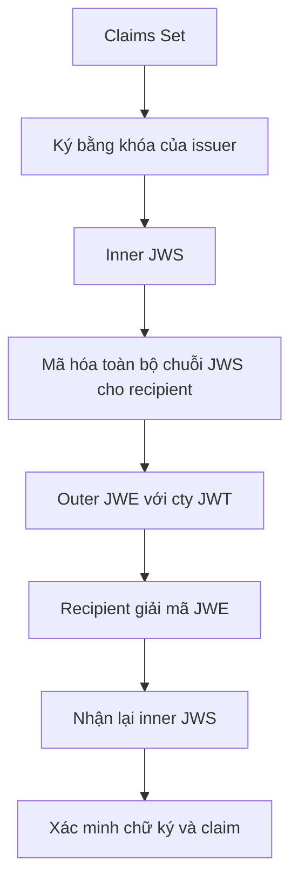
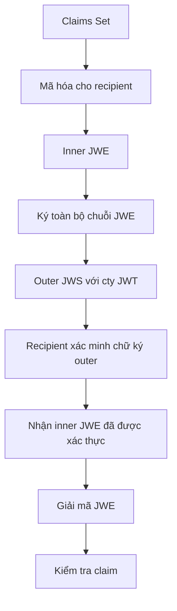

# So sánh JWT ký với JWT mã hóa và JWT lồng nhau

## Mục tiêu thực hành

Sau bài này, bạn có thể:

- Phân biệt JWT được biểu diễn bằng JSON Web Signature (JWS) với JWT được bảo vệ bằng JSON Web Encryption (JWE).
- Nhận diện cấu trúc compact serialization ba phần của JWS và năm phần của JWE.
- Giải thích chính xác chữ ký, mã hóa, thuật toán quản lý khóa và thuật toán mã hóa nội dung bảo vệ điều gì.
- Phân tích hai cách lồng JOSE: ký rồi mã hóa và mã hóa rồi ký.
- Chọn đúng thứ tự xử lý, khóa và bước kiểm tra cho từng dạng token.
- Phát hiện các lỗi triển khai như đọc claim trước khi xác minh, nhầm `alg` với `enc`, tin `kid` không kiểm soát hoặc coi JWE tự động chứng minh danh tính người gửi.

Bài thực hành thuộc module **Security - JSON Web Token (JWT)**, chương **Thực hành tổng hợp**. Các khái niệm và quy trình dưới đây áp dụng ở mức giao thức JOSE, không phụ thuộc Java, Spring hay một framework cụ thể.

## 1. Phân biệt JWT, JWS và JWE

JWT (JSON Web Token) là định dạng biểu diễn một tập claim. JWT có thể được bảo vệ bằng nhiều cách. Hai cách phổ biến là:

- **JWS:** bảo vệ tính toàn vẹn và, tùy loại thuật toán/khóa, cung cấp bằng chứng về bên tạo token thông qua chữ ký số hoặc MAC.
- **JWE:** mã hóa nội dung để chỉ bên có khả năng giải mã phù hợp mới đọc được plaintext; đồng thời xác thực tính toàn vẹn của dữ liệu mã hóa thông qua cơ chế xác thực của JWE.

JWS và JWE thuộc bộ chuẩn JOSE (JSON Object Signing and Encryption). Chúng là các cách biểu diễn và bảo vệ dữ liệu. Một chuỗi compact có cấu trúc JOSE chưa chắc là JWT; nó là JWT khi nội dung mang tập claim theo quy tắc JWT.

### Mô hình trực quan

JWS compact:

```text
┌──────────────────┬───────────────┬─────────────────┐
│ Protected header │    Payload    │    Signature    │
└──────────────────┴───────────────┴─────────────────┘
       Phần 1             Phần 2          Phần 3
```

Nội dung header và payload vẫn đọc được; thay đổi dữ liệu sẽ làm xác minh chữ ký/MAC thất bại.

JWE compact:

```text
┌────────┬───────────────┬────┬────────────┬─────────┐
│ Header │ Encrypted key│ IV │ Ciphertext │   Tag   │
└────────┴───────────────┴────┴────────────┴─────────┘
  Phần 1      Phần 2     Phần 3   Phần 4      Phần 5
```

Plaintext được mã hóa; protected header và một số metadata vẫn hiển thị. Các phần compact được mã hóa Base64URL và ngăn cách bằng dấu chấm.

| Câu hỏi | JWS | JWE |
|---|---|---|
| Có thể đọc payload trực tiếp? | Có, payload JWS compact chỉ được Base64URL hóa | Không, payload được mã hóa; phải giải mã thành công mới đọc được |
| Bảo vệ tính toàn vẹn? | Có, thông qua chữ ký hoặc MAC | Có, thông qua xác thực mật mã của JWE |
| Cung cấp tính bí mật cho payload? | Không | Có, đối với người không có khả năng giải mã |
| Dùng khóa nào? | Khóa ký/MAC và khóa xác minh tương ứng | Khóa quản lý hoặc bảo vệ CEK, cùng CEK cho mã hóa nội dung |
| Dạng compact thường gặp | 3 phần | 5 phần |

Điểm cốt lõi: **ký không phải mã hóa**. JWS giúp phát hiện thay đổi và xác minh dữ liệu theo khóa. JWE giúp giữ bí mật nội dung và phát hiện ciphertext bị sửa. Khi hệ thống cần cả hai thuộc tính, có thể lồng JWS và JWE thành Nested JWT.

## 2. Thực hành nhận diện JWT ký bằng JWS

### 2.1. Cấu trúc compact

JWS compact có dạng:

```text
BASE64URL(protected-header).
BASE64URL(payload).
BASE64URL(signature)
```

Ví dụ header có thể chứa:

```json
{
  "typ": "JWT",
  "alg": "RS256",
  "kid": "issuer-signing-key-2026-01"
}
```

Payload minh họa:

```json
{
  "iss": "https://issuer.example",
  "sub": "user-482",
  "aud": "https://api.example/orders",
  "exp": 1900000000,
  "scope": "orders:read"
}
```

Các chuỗi JSON trên chỉ minh họa nội dung sau khi giải mã. Trong token thực tế, header và payload được mã hóa Base64URL. Chúng không được giữ bí mật chỉ nhờ Base64URL.

JWS ký trên signing input:

```text
ASCII(encoded_protected_header + "." + encoded_payload)
```

Phần signature không nằm trong signing input; nó là kết quả được verifier kiểm tra. Không giải mã JSON rồi serialize lại để dựng signing input vì khoảng trắng, thứ tự thuộc tính, escape và từng byte có thể khác bản gốc.

### 2.2. Ý nghĩa của `alg` và `kid`

- `alg` xác định thuật toán chữ ký/MAC của JWS, ví dụ `RS256`, `ES256`, `EdDSA` hoặc `HS256` nếu profile cho phép.
- `kid` là gợi ý định danh khóa để tìm khóa phù hợp trong tập khóa đã được cấu hình tin cậy. Nó không tự chứng minh khóa đó đáng tin.
- `typ` có thể mô tả loại đối tượng, thường được đặt là `JWT` trong một số profile. Không dùng riêng `typ` làm bằng chứng xác thực.

Verifier phải áp dụng allowlist thuật toán do ứng dụng cấu hình. Không cho token tự quyết định thuật toán hoặc làm cho cùng một khóa được diễn giải tùy tiện theo nhiều loại thuật toán. Khóa xác minh phải được liên kết với issuer hoặc trust domain đã được cấu hình. Với HMAC, bên xác minh giữ khóa bí mật cũng có khả năng tạo MAC; với chữ ký bất đối xứng, khóa công khai xác minh không có quyền tạo chữ ký.

### 2.3. Quy trình xác minh JWS

1. Giới hạn kích thước token và kiểm tra compact serialization có đúng ba phần.
2. Phân tích protected header bằng parser an toàn; coi mọi giá trị là dữ liệu chưa tin cậy.
3. Kiểm tra `alg` có nằm trong allowlist của loại token và issuer mong đợi không.
4. Chọn khóa từ kho khóa tin cậy gắn với issuer dự kiến của endpoint hoặc ngữ cảnh đã cấu hình; dùng `kid` như selector trong tập khóa đó. Không dùng claim `iss` chưa xác minh để tự tạo trust relationship và không tải khóa từ URL tùy ý do token cung cấp.
5. Xác minh chữ ký/MAC trên đúng signing input.
6. Chỉ sau khi xác minh mật mã thành công mới đánh giá claim: `iss`, `aud`, `exp`, `nbf`, `iat`, `sub`, loại token và các điều kiện của ứng dụng.
7. Áp dụng authorization riêng cho thao tác được yêu cầu.

Chữ ký hợp lệ không đồng nghĩa token còn hạn, đúng audience hoặc được phép dùng cho mọi API. JWS cũng không che giấu nội dung: người có token có thể đọc claim và header.

## 3. Thực hành nhận diện JWT mã hóa bằng JWE

### 3.1. Cấu trúc compact

JWE compact có đúng năm phần:

```text
BASE64URL(protected-header).
BASE64URL(encrypted-key).
BASE64URL(iv).
BASE64URL(ciphertext).
BASE64URL(authentication-tag)
```

Ví dụ protected header:

```json
{
  "typ": "JWT",
  "alg": "RSA-OAEP-256",
  "enc": "A256GCM",
  "kid": "recipient-encryption-key-2026-01"
}
```

Ý nghĩa của hai trường thuật toán khác nhau:

| Header | Vai trò | Ví dụ |
|---|---|---|
| `alg` | Thuật toán quản lý khóa: tạo, chia sẻ, mã hóa hoặc bảo vệ Content Encryption Key (CEK) theo cơ chế đã chọn | `RSA-OAEP-256`, `ECDH-ES`, `A128KW`, `dir` |
| `enc` | Thuật toán mã hóa nội dung, sử dụng CEK để mã hóa plaintext và tạo cơ chế xác thực | `A256GCM`, `A128CBC-HS256` |

Không được nhầm `alg` của JWE với `alg` của JWS. Trong JWE, `alg` không phải thuật toán ký payload. `enc` mới mô tả thuật toán mã hóa nội dung.

### 3.2. CEK, encrypted key, IV, ciphertext và authentication tag

JWE thường sử dụng một CEK để mã hóa plaintext. Cách bên gửi và bên nhận có được CEK được quyết định bởi `alg`:

- Với cơ chế mã hóa khóa (key encryption), CEK được mã hóa bằng khóa công khai hoặc khóa phù hợp của người nhận; kết quả nằm trong phần encrypted key.
- Với cơ chế key wrapping, CEK được bọc bằng khóa đã thỏa thuận.
- Với cơ chế direct (`alg: "dir"`), khóa bí mật đã chia sẻ chính là CEK; phần encrypted key trong compact serialization rỗng nhưng cấu trúc vẫn có đủ năm phần.
- Với cơ chế thỏa thuận khóa như ECDH-ES, CEK được tạo hoặc dẫn xuất theo quy trình thỏa thuận khóa; các tham số cần thiết có thể nằm trong protected header.

IV/nonce là tham số đầu vào của mã hóa nội dung. Ciphertext là dữ liệu đã mã hóa. Authentication tag giúp phát hiện việc sửa đổi dữ liệu được bảo vệ. Protected header được đưa vào dữ liệu bổ sung được xác thực (Additional Authenticated Data, AAD), vì vậy sửa header cũng làm bước xác thực thất bại. Với thuật toán mã hóa có xác thực, nếu tag không hợp lệ, quá trình giải mã phải thất bại và plaintext không được sử dụng.

Protected header và các metadata của JWE compact vẫn hiển thị. Do đó, không đặt bí mật, dữ liệu cá nhân hoặc thông tin nhạy cảm vào `kid`, `alg`, `enc`, `typ`, `cty` hay tham số header khác.

### 3.3. JWE bảo vệ điều gì và không bảo vệ điều gì?

JWE cung cấp tính bí mật cho plaintext và tính toàn vẹn/xác thực của dữ liệu mã hóa theo cơ chế JOSE đã chọn. Tuy nhiên, **JWE không tự động chứng minh danh tính người gửi**.

Ví dụ, nếu bên gửi mã hóa bằng khóa công khai của API nhận, bất kỳ ai có khóa công khai đó cũng có thể tạo một JWE mà API giải mã được. Việc giải mã thành công không chứng minh token do một issuer cụ thể phát hành. Hệ thống vẫn cần cơ chế xác thực nguồn phát hành, chẳng hạn chữ ký JWS bên trong hoặc một ràng buộc tin cậy khác của giao thức.

JWE cũng không tự ngăn phát lại (replay). Nếu token bị đánh cắp, người khác có thể gửi lại trong thời gian hiệu lực nếu ứng dụng không có biện pháp chống replay phù hợp. Thời hạn ngắn, `jti`, nonce, trạng thái tiêu thụ một lần hoặc cơ chế ràng buộc phiên cần được thiết kế theo yêu cầu của hệ thống.

### 3.4. Quy trình giải mã JWE

1. Giới hạn kích thước và kiểm tra compact serialization có đúng năm phần.
2. Phân tích protected header và kiểm tra `alg`, `enc` nằm trong allowlist của cấu hình nhận.
3. Chọn khóa giải mã từ kho khóa tin cậy; `kid` chỉ được dùng để chọn trong tập khóa đã kiểm soát.
4. Thực hiện key management để lấy hoặc dẫn xuất CEK.
5. Xác thực và giải mã ciphertext bằng `enc`, IV và authentication tag.
6. Nếu xác thực tag thất bại, từ chối toàn bộ token; không trả plaintext một phần và không tiếp tục xử lý claim.
7. Xác định plaintext là Claims Set hay một JWT lồng bên trong theo profile và `cty`.
8. Kiểm tra chữ ký bên trong nếu có, rồi xác thực claim và ngữ cảnh trước khi chấp nhận.

Lỗi giải mã hoặc lỗi authentication tag không được biến thành phản hồi tiết lộ chi tiết về khóa, tag hay plaintext. Phản hồi bên ngoài nên nhất quán, còn log nội bộ cần tránh ghi token hoặc bí mật.

## 4. Nested JWT: kết hợp JWS và JWE

Nested JWT là một JWT được đặt bên trong một JWT khác để áp dụng nhiều lớp bảo vệ. Khi dùng nesting, outer JOSE header sử dụng `cty` với giá trị `JWT` để chỉ ra rằng nội dung được bảo vệ bên trong là một JWT. `cty` mô tả loại nội dung; `typ` mô tả loại đối tượng JOSE/JWT bên ngoài theo profile. Hai trường này không thay thế nhau.

Có hai thứ tự kết hợp chính. Thứ tự quyết định bên nhận phải xác minh và giải mã theo trình tự nào, đồng thời quyết định metadata nào lộ ra ngoài.

### 4.1. Ký trước, sau đó mã hóa (JWS bên trong JWE)

Luồng xử lý:



Outer JWE có thể có protected header như sau:

```json
{
  "cty": "JWT",
  "alg": "RSA-OAEP-256",
  "enc": "A256GCM",
  "kid": "recipient-encryption-key-2026-01"
}
```

Plaintext được mã hóa trong JWE là toàn bộ chuỗi compact của inner JWS, không chỉ payload JSON. Bên nhận giải mã outer JWE để lấy inner JWS, sau đó xác minh chữ ký inner bằng khóa xác minh của issuer và kiểm tra claim.

Thuộc tính đạt được:

- Nội dung claim được giữ bí mật với người không thể giải mã outer JWE.
- Chữ ký inner JWS cung cấp bằng chứng toàn vẹn và nguồn phát hành theo khóa tin cậy.
- Chữ ký và payload inner cũng được che giấu trong outer JWE khi truyền qua các trung gian không phải recipient.

Đây thường là lựa chọn phù hợp khi cần vừa xác thực issuer vừa giữ bí mật nội dung với recipient. Lưu ý rằng recipient cần giải mã trước khi có thể kiểm tra chữ ký bên trong. Hệ thống phải xử lý lỗi giải mã an toàn và không tạo oracle tiết lộ thông tin.

### 4.2. Mã hóa trước, sau đó ký (JWE bên trong JWS)

Luồng xử lý:



Trong cách này, payload của outer JWS là toàn bộ chuỗi compact của inner JWE. Recipient xác minh outer JWS trước; chỉ khi chữ ký hợp lệ mới tiếp tục giải mã inner JWE.

Thuộc tính và đánh đổi:

- Inner JWE giữ bí mật nội dung với người không có khóa giải mã.
- Outer JWS xác thực chuỗi JWE đã được ký theo khóa của signer.
- Recipient có thể xác minh chữ ký outer trước khi thực hiện giải mã.
- Protected header, metadata và độ dài của outer JWS/JWE vẫn có thể quan sát; phần claim bên trong vẫn được mã hóa.

Thứ tự này có thể hữu ích khi muốn xác thực bên đóng gói trước khi xử lý thao tác giải mã. Tuy nhiên, chữ ký outer xác thực đúng biểu diễn JWE được ký; ứng dụng vẫn phải xác minh rằng signer được phép gửi loại token đó và rằng inner JWE được mã hóa cho đúng recipient.

### 4.3. So sánh hai thứ tự lồng nhau

| Tiêu chí | JWS bên trong JWE (ký rồi mã hóa) | JWE bên trong JWS (mã hóa rồi ký) |
|---|---|---|
| Thứ tự ở bên gửi | Tạo JWS, sau đó mã hóa chuỗi JWS thành JWE | Tạo JWE, sau đó ký chuỗi JWE thành JWS |
| Bước đầu ở bên nhận | Giải mã JWE | Xác minh JWS |
| Bước tiếp theo | Xác minh JWS bên trong | Giải mã JWE bên trong |
| Claim có được giữ bí mật? | Có, nhờ JWE ngoài | Có, nhờ JWE trong |
| Chữ ký có được che giấu bên ngoài? | Có, chữ ký inner nằm trong ciphertext JWE | Không, chữ ký outer hiển thị như một phần JWS |
| Metadata nào lộ ra? | Header của JWE ngoài và kích thước token | Header JWS ngoài, toàn bộ chuỗi JWE và kích thước token |
| Điều cần xác minh | Issuer của JWS sau giải mã và recipient/key của JWE | Signer của JWS ngoài trước, rồi recipient/key và nội dung của JWE |

Không có một thứ tự đúng cho mọi giao thức. Chọn thứ tự dựa trên yêu cầu về danh tính người gửi, bí mật metadata, khả năng xác minh trước khi giải mã và mô hình tin cậy. Khi cần cả chữ ký issuer và bí mật nội dung, JWS bên trong JWE là mô hình thường dùng. Profile triển khai phải quy định rõ nesting order; không tự đoán thứ tự dựa trên số phần hoặc nội dung tình cờ của token.

## 5. Bài thực hành: phân loại ba token

Trong phần này, các chuỗi dưới đây là **mẫu cấu trúc**, không phải token mật mã có thể xác minh. Những nhãn như `HEADER`, `PAYLOAD` hoặc `TAG` chỉ giúp nhận diện vị trí; không thay thế Base64URL segment thực.

### Trường hợp A — JWT ký

```text
encoded-header.encoded-payload.encoded-signature
```

Header đã giải mã:

```json
{
  "typ": "JWT",
  "alg": "ES256",
  "kid": "issuer-key-a"
}
```

**Nhiệm vụ:**

1. Đếm số segment và xác định loại JOSE.
2. Nêu phần nào có thể đọc khi chỉ có token.
3. Xác định thuật toán và khóa cần dùng để xác minh.
4. Nêu các claim phải kiểm tra sau xác minh.

**Kết quả mong đợi:** đây là JWS compact ba phần. Header và payload có thể giải mã Base64URL. Verifier dùng allowlist cho phép `ES256`, chọn khóa công khai đáng tin cậy theo issuer/`kid`, xác minh chữ ký rồi kiểm tra issuer, audience, thời hạn và chính sách token.

### Trường hợp B — JWT mã hóa

```text
encoded-header.encrypted-key.iv.ciphertext.authentication-tag
```

Header đã giải mã:

```json
{
  "typ": "JWT",
  "alg": "RSA-OAEP-256",
  "enc": "A256GCM",
  "kid": "recipient-key-b"
}
```

**Nhiệm vụ:**

1. Đếm số segment và xác định loại JOSE.
2. Giải thích `alg` và `enc` thực hiện hai vai trò nào.
3. Nêu lý do không thể đọc claim trước khi giải mã.
4. Nêu điều kiện để chấp nhận plaintext sau khi giải mã.

**Kết quả mong đợi:** đây là JWE compact năm phần. `RSA-OAEP-256` quản lý/bảo vệ CEK; `A256GCM` mã hóa và xác thực nội dung. Recipient chọn khóa giải mã tin cậy, thực hiện key management và authenticated decryption. Chỉ khi tag hợp lệ mới được sử dụng plaintext. Sau đó vẫn cần xác thực claim và nguồn phát hành theo profile; giải mã thành công không tự chứng minh issuer.

### Trường hợp C — JWT ký rồi mã hóa

Outer header:

```json
{
  "cty": "JWT",
  "alg": "RSA-OAEP-256",
  "enc": "A256GCM",
  "kid": "recipient-key-c"
}
```

Plaintext sau giải mã outer JWE là một chuỗi JWS compact:

```text
encoded-inner-header.encoded-inner-payload.encoded-inner-signature
```

**Nhiệm vụ:**

1. Xác định vì sao đây là Nested JWT.
2. Giải thích vai trò của `cty: "JWT"`.
3. Viết đúng thứ tự thao tác của recipient.
4. Nêu thuộc tính bảo mật do từng lớp cung cấp.

**Kết quả mong đợi:** đây là JWS bên trong JWE. `cty` chỉ ra plaintext của outer object là một JWT. Recipient giải mã và xác thực JWE ngoài, nhận inner JWS, xác minh chữ ký inner rồi kiểm tra claim. JWE ngoài bảo vệ tính bí mật; JWS trong xác thực tính toàn vẹn và nguồn phát hành theo khóa tin cậy.

## 6. Bài tập chọn thứ tự xử lý

Với từng tình huống, hãy chọn JWS, JWE hoặc Nested JWT và giải thích lý do.

| Tình huống | Nhu cầu chính | Thiết kế thường phù hợp |
|---|---|---|
| API cần nhận claim có thể đọc ở client nhưng phải phát hiện chỉnh sửa | Toàn vẹn và nguồn phát hành; không yêu cầu bí mật | JWS |
| Dịch vụ gửi thông tin nhạy cảm cho một recipient xác định; cần giữ bí mật nội dung | Bí mật nội dung và xác thực ciphertext | JWE, kèm cơ chế xác thực issuer nếu yêu cầu |
| Issuer cần chứng minh nguồn phát hành và chỉ cho recipient đọc claim | Chữ ký issuer cùng bí mật nội dung | JWS bên trong JWE |
| Recipient muốn xác minh signer của gói mã hóa trước khi giải mã | Xác thực outer object trước thao tác giải mã | JWE bên trong JWS |
| Token chứa claim `role: admin` nhưng không có chữ ký hoặc cơ chế xác thực issuer | Không có cơ sở tin claim | Từ chối; mã hóa đơn thuần không thay thế xác minh nguồn phát hành |

Không chọn JWE chỉ vì payload “trông nhạy cảm” nếu chưa xác định recipient, vòng đời khóa và cách xác thực nguồn gửi. Cũng không chọn JWS rồi cho rằng claim được giữ bí mật. Yêu cầu bảo mật phải được mô tả rõ trước khi chọn định dạng.

## 7. Kiểm tra bảo mật chung cho cả ba dạng

### 7.1. Chính sách thuật toán

- Dùng allowlist riêng cho thuật toán JWS và cặp `alg`/`enc` của JWE.
- Từ chối thuật toán không được hỗ trợ, thuật toán đã bị loại bỏ hoặc thuật toán không phù hợp với loại khóa.
- Không cho header do token cung cấp tự mở rộng chính sách thuật toán.
- Với JWE, không dùng lại khóa hoặc quy trình quản lý khóa tùy tiện giữa nhiều mục đích; tuân thủ yêu cầu về độ dài khóa, nonce/IV và cách sử dụng của thuật toán.
- Không chấp nhận JWS không bảo vệ (`alg: "none"`) trong profile yêu cầu chữ ký.

### 7.2. Quản lý và chọn khóa

- Phân tách khóa ký, khóa xác minh, khóa mã hóa và khóa giải mã theo mục đích.
- `kid` chỉ là selector trong tập khóa tin cậy; không phải bằng chứng danh tính.
- Không tự động tải `jku`, `x5u` hoặc URL khác do token không tin cậy chỉ định. Nếu profile cho phép lấy JWKS từ xa, URL phải đến từ cấu hình tin cậy và được bảo vệ khỏi SSRF, redirect không an toàn và thay đổi nguồn ngoài dự kiến.
- Có kế hoạch xoay vòng, thời gian chồng lấp khóa và xử lý token được ký/mã hóa bằng khóa cũ.
- Không ghi khóa bí mật, CEK hoặc plaintext nhạy cảm vào log.

### 7.3. Xác thực claim và ngữ cảnh

Sau khi hoàn thành tất cả lớp xác minh/giải mã theo đúng thứ tự, vẫn phải kiểm tra:

| Claim/thuộc tính | Điều cần xác nhận |
|---|---|
| `iss` | Issuer nằm trong danh sách tin cậy và khớp chính xác chính sách |
| `aud` | Token được phát hành cho resource hiện tại |
| `exp` | Token chưa hết hạn; clock skew nếu có phải nhỏ và được quy định |
| `nbf` | Token đã đến thời điểm có hiệu lực |
| `iat` | Thời điểm phát hành hợp lý theo chính sách |
| `sub` | Subject được diễn giải trong namespace của issuer phù hợp |
| `typ` / `cty` | Loại token và nội dung lồng nhau phù hợp profile đã định nghĩa |
| `jti` | Được dùng theo chính sách chống replay hoặc truy vết nếu hệ thống yêu cầu |

Việc một claim có mặt không có nghĩa ứng dụng đã kiểm tra nó. Cần quy định claim nào bắt buộc, giá trị nào được chấp nhận và lỗi nào dẫn đến từ chối.

### 7.4. Giới hạn parser và nesting

- Giới hạn kích thước token, kích thước header/payload sau giải mã và số lượng claim.
- Từ chối cấu trúc compact sai số phần, segment rỗng ngoài trường hợp được chuẩn cho phép hoặc encoding không hợp lệ.
- Chỉ chấp nhận nesting khi profile cho phép và xác định trước thứ tự JWS/JWE.
- Giới hạn độ sâu nesting; không giải mã đệ quy không giới hạn theo dữ liệu đầu vào.
- Không thử hàng loạt thuật toán hoặc khóa khi xác minh thất bại.
- Trả lỗi bên ngoài nhất quán, tránh tạo oracle về tag, padding, khóa hoặc plaintext.

## 8. Những nhầm lẫn thường gặp

1. **“JWT ký thì payload bí mật.”** Sai. JWS compact chỉ Base64URL hóa payload; ai có token đều có thể giải mã.
2. **“JWT mã hóa thì chắc chắn biết ai gửi.”** Sai. Người có khóa công khai của recipient có thể mã hóa dữ liệu cho recipient; JWE không tự xác thực issuer.
3. **“`alg` và `enc` đều là thuật toán ký.”** Sai. `alg` của JWE quản lý khóa; `enc` mã hóa nội dung.
4. **“Giải mã JWE thành công là có thể cấp quyền.”** Sai. Còn phải xác minh nguồn phát hành, claim, audience, thời hạn và chính sách ứng dụng.
5. **“Nested JWT luôn phải giải mã trước rồi xác minh.”** Sai. Trình tự phụ thuộc lớp nào ở ngoài: JWS trong JWE thì giải mã trước, JWE trong JWS thì xác minh chữ ký trước.
6. **“`kid` là danh tính của khóa.”** Sai. `kid` chỉ là gợi ý tìm khóa; độ tin cậy đến từ nguồn phân phối và cấu hình.
7. **“Có JWE thì không cần chống replay.”** Sai. Mã hóa không làm token chỉ dùng một lần.
8. **“Header cũng được mã hóa cùng payload.”** Sai. Protected header của compact JWS/JWE vẫn hiển thị; với JWE, ciphertext mới là phần chứa plaintext đã mã hóa.
9. **“Có thể tự đoán nesting order bằng cách thử giải mã/xác minh.”** Không nên. Profile phải quy định rõ loại token, lớp ngoài và trình tự xử lý.

## 9. Câu hỏi tự đánh giá

1. Vì sao JWS compact có ba phần nhưng payload vẫn có thể đọc được?
2. JWE compact có năm phần nào? Phần nào chứa nội dung đã mã hóa?
3. Trong JWE, `alg` khác `enc` như thế nào?
4. Vì sao giải mã JWE thành công không chứng minh token được phát hành bởi một issuer cụ thể?
5. Với JWS nằm trong JWE, recipient phải thực hiện thao tác nào trước?
6. Với JWE nằm trong JWS, recipient phải thực hiện thao tác nào trước?
7. `cty: "JWT"` biểu đạt điều gì trong Nested JWT?
8. Tại sao `kid` không được dùng như nguồn tin cậy độc lập?
9. Vì sao cả JWS hợp lệ lẫn JWE giải mã thành công vẫn cần kiểm tra `iss`, `aud`, `exp` và chính sách ứng dụng?
10. Nested JWT có tự ngăn replay không? Cần bổ sung kiểm soát gì nếu token phải dùng một lần?

### Đáp án gợi ý

1. Vì header và payload chỉ được Base64URL hóa. Chữ ký bảo vệ tính toàn vẹn nhưng không mã hóa nội dung.
2. Protected header, encrypted key, IV, ciphertext và authentication tag. Ciphertext chứa plaintext đã mã hóa.
3. `alg` quy định cách quản lý/bảo vệ CEK; `enc` quy định cách mã hóa nội dung bằng CEK.
4. Vì nhiều bên có thể mã hóa bằng khóa công khai của recipient. Khả năng giải mã chỉ chứng minh dữ liệu được mã hóa theo khóa và thuật toán tương ứng, không xác định ai đã tạo nó.
5. Giải mã outer JWE trước, sau đó xác minh inner JWS.
6. Xác minh outer JWS trước, sau đó giải mã inner JWE.
7. Nó cho biết nội dung được bảo vệ bên trong là một JWT lồng nhau; ứng dụng vẫn phải kiểm tra cấu trúc và thứ tự theo profile.
8. Vì token có thể tự đặt `kid` tùy ý. Chỉ chọn khóa trong kho hoặc nguồn phân phối đã được cấu hình tin cậy.
9. Chữ ký/mã hóa không thay thế kiểm tra token có đúng issuer, đúng resource, còn hiệu lực và đúng mục đích hay không.
10. Không. Cần nonce, `jti` cùng kho trạng thái đã tiêu thụ, thời hạn ngắn hoặc cơ chế chống replay tương ứng với giao thức.

## 10. Checklist hoàn thành

- [ ] Nhận diện được JWS ba phần và JWE năm phần.
- [ ] Giải thích được vì sao JWS không cung cấp tính bí mật cho payload.
- [ ] Giải thích được vai trò riêng của `alg` và `enc` trong JWE.
- [ ] Mô tả được CEK, encrypted key, IV, ciphertext và authentication tag.
- [ ] Nêu được vì sao JWE không tự xác thực danh tính issuer.
- [ ] Phân biệt được JWS bên trong JWE với JWE bên trong JWS.
- [ ] Xác định đúng thứ tự xử lý của recipient cho từng kiểu nesting.
- [ ] Giải thích được `cty: "JWT"` trong Nested JWT.
- [ ] Xác định được allowlist thuật toán, nguồn khóa tin cậy và các claim cần kiểm tra.
- [ ] Nhận ra giới hạn của chữ ký/mã hóa đối với replay và authorization.

## Kết luận

JWS và JWE giải quyết hai nhu cầu bảo vệ khác nhau. JWS cung cấp tính toàn vẹn và bằng chứng xác thực theo khóa nhưng để lộ nội dung payload; JWE giữ bí mật plaintext và xác thực ciphertext nhưng không tự chứng minh danh tính issuer. Nested JWT kết hợp hai lớp bằng cách đặt JWS trong JWE hoặc JWE trong JWS. Thứ tự lồng quyết định bước đầu tiên ở bên nhận, metadata có thể quan sát và cách xác minh nguồn gửi. Dù dùng dạng nào, hệ thống vẫn cần chính sách thuật toán rõ ràng, quản lý khóa tin cậy, kiểm tra claim và kiểm soát replay/authorization theo ngữ cảnh.
