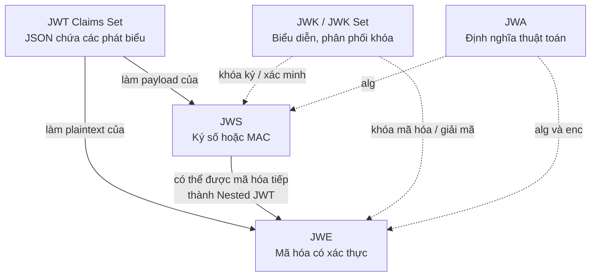

# Quan hệ giữa JWT, JWS, JWE, JWK và JWA

## 1. Bức tranh tổng thể của JOSE

**JOSE** (*JSON Object Signing and Encryption*) là họ tiêu chuẩn mô tả cách biểu diễn nội dung cần bảo vệ, chữ ký/mã xác thực, dữ liệu mã hóa, khóa mật mã và tên thuật toán bằng các cấu trúc dựa trên JSON. Trong lĩnh vực **Security - JSON Web Token (JWT)**, năm khái niệm sau thường xuất hiện cùng nhau nhưng đảm nhiệm những vai trò khác nhau:

| Khái niệm | Tên đầy đủ | Trả lời câu hỏi gì? | Tiêu chuẩn nền tảng |
| --- | --- | --- | --- |
| **JWT** | JSON Web Token | **Dữ liệu gì** được phát biểu về một chủ thể, dưới dạng các *claims*? | RFC 7519 |
| **JWS** | JSON Web Signature | **Bảo vệ tính toàn vẹn và xác thực** nội dung bằng chữ ký số hoặc MAC như thế nào? | RFC 7515 |
| **JWE** | JSON Web Encryption | **Mã hóa** nội dung, đồng thời bảo vệ tính toàn vẹn của bản mã như thế nào? | RFC 7516 |
| **JWK** | JSON Web Key | **Biểu diễn khóa mật mã** dưới dạng JSON như thế nào? | RFC 7517 |
| **JWA** | JSON Web Algorithms | **Định danh thuật toán mật mã** và các tham số liên quan bằng tên thống nhất nào? | RFC 7518 |

Điểm cốt lõi: **JWT là dạng biểu diễn tập claims; JWS và JWE là hai dạng đóng gói/bảo vệ; JWK biểu diễn khóa; JWA cung cấp tên và quy tắc thuật toán.** Chúng phối hợp với nhau nhưng không thay thế nhau.



Sơ đồ mô tả các lựa chọn biểu diễn và một trường hợp JWT lồng nhau, không có nghĩa mọi JWT đều vừa ký vừa mã hóa. Cũng không phải mọi JWS/JWE đều là JWT: JWS có thể ký bất kỳ chuỗi byte nào; JWE có thể mã hóa dữ liệu không phải JWT.

## 2. JWT: nội dung claims, không tự quyết định mức bảo vệ

Một **JWT Claims Set** là đối tượng JSON chứa các cặp tên/giá trị được bên phát hành tuyên bố về một chủ thể hoặc ngữ cảnh. Ví dụ minh họa:

```json
{
  "iss": "https://issuer.example",
  "sub": "user-123",
  "aud": "https://api.example",
  "iat": 1795000000,
  "exp": 1795003600,
  "scope": "orders:read"
}
```

Trong đó:

- `iss` (*issuer*): bên phát hành.
- `sub` (*subject*): chủ thể được nói đến.
- `aud` (*audience*): bên nhận dự kiến.
- `iat` (*issued at*): thời điểm phát hành, theo Unix time tính bằng giây.
- `exp` (*expiration time*): thời điểm hết hiệu lực, cũng tính bằng giây.
- `scope`: claim ứng dụng tự quy ước; không phải claim đăng ký cốt lõi do RFC 7519 định nghĩa.

Đối tượng JSON này **chưa phải chuỗi JWT truyền đi**. Theo RFC 7519, JWT được biểu diễn thông qua **JWS Compact Serialization** hoặc **JWE Compact Serialization**. Claims Set trở thành payload của JWS hoặc plaintext của JWE. Một JWT có thể được bọc nhiều lớp để vừa ký vừa mã hóa (*Nested JWT*).

JWT có một **JOSE Header** chỉ ra thao tác bảo vệ đang sử dụng, ví dụ tên thuật toán trong `alg`. Header và claims có vai trò khác nhau: header hướng dẫn xử lý mật mã, còn claims thể hiện nội dung cần được xác thực và kiểm tra theo nghiệp vụ. Tên `typ` có thể dùng để chỉ loại đối tượng, ví dụ `"JWT"`; với JWT lồng nhau, `cty` ở lớp ngoài thường mang giá trị `"JWT"` theo quy định dành cho trường hợp lồng nhau.

**Giải mã base64url để đọc claims không tương đương với xác minh JWT.** Bất kỳ ai sở hữu JWS Compact thông thường đều có thể đọc header và payload; chỉ sau khi xác minh chữ ký/MAC và các điều kiện sử dụng mới được tin claims.

## 3. JWS: bảo vệ tính toàn vẹn và nguồn gốc theo cơ chế chữ ký/MAC

JWS bảo vệ một payload trước việc bị sửa đổi mà không bị phát hiện. Có hai nhóm cơ chế:

- **Chữ ký bất đối xứng**: bên phát hành ký bằng khóa riêng; bên nhận xác minh bằng khóa công khai tương ứng. Điều này thích hợp khi nhiều bên cần tự xác minh token mà không sở hữu khóa ký.
- **MAC đối xứng**: bên tạo và bên xác minh cùng nắm khóa bí mật, ví dụ HMAC. Cơ chế này xác thực rằng thông điệp đến từ một bên có khóa chung, nhưng không thể phân biệt bên nào trong nhóm cùng giữ khóa đã tạo MAC.

Với dạng **JWS Compact Serialization**, một chuỗi có **3 phần** được ngăn bằng dấu chấm:

```text
BASE64URL(protected-header).BASE64URL(payload).BASE64URL(signature-or-MAC)
```

Ví dụ JOSE Header trước khi mã hóa base64url:

```json
{
  "alg": "PS256",
  "typ": "JWT",
  "kid": "issuer-sign-01"
}
```

Ý nghĩa:

- `alg: PS256` chỉ ra thuật toán ký RSA-PSS với SHA-256; tên thuật toán thuộc hệ JWA.
- `kid` là mã định danh giúp chọn khóa kiểm tra thích hợp trong các khóa được tin cậy; nó **không tự chứng minh** khóa đó đáng tin.
- `typ: JWT` cho biết đối tượng được dự kiến xử lý như JWT; giá trị này không thay thế các bước kiểm tra claims.

Trong dạng Compact thông thường, chữ ký/MAC bảo vệ chính xác biểu diễn đã mã hóa của protected header và payload. Nếu header hoặc payload bị thay đổi, xác minh mật mã phải thất bại. Bên nhận phải chọn khóa đáng tin cậy, kiểm tra thuật toán được phép và xác minh chữ ký/MAC **trước khi sử dụng claims**.

**JWS không che giấu nội dung.** Header và payload thông thường có thể được đọc sau khi giải mã base64url. Tránh đưa mật khẩu, bí mật, hoặc dữ liệu nhạy cảm vào JWS chỉ vì nó đã được ký.

Ngoài Compact, JWS còn có **JSON Serialization**, hữu ích cho cấu trúc có nhiều chữ ký hoặc biểu diễn header khác nhau. Tuy nhiên, một JWT theo RFC 7519 sử dụng dạng Compact, vì vậy không được tự động xem mọi JWS JSON Serialization là chuỗi JWT Compact.

## 4. JWE: mã hóa nội dung và xác thực bản mã

JWE cung cấp **tính bí mật của plaintext** và **khả năng phát hiện việc bản mã/dữ liệu được bảo vệ bị chỉnh sửa**. JWE thường sử dụng mã hóa nội dung có xác thực (*authenticated encryption*). Với dạng **JWE Compact Serialization**, một chuỗi có **5 phần**:

```text
BASE64URL(protected-header).BASE64URL(encrypted-key).BASE64URL(iv).BASE64URL(ciphertext).BASE64URL(authentication-tag)
```

Các thành phần:

| Thành phần | Vai trò |
| --- | --- |
| Protected header | Mô tả thuật toán và tham số JOSE, được bảo vệ tính toàn vẹn |
| Encrypted key | Khóa mã hóa nội dung (*Content Encryption Key*, CEK) đã được bọc/mã hóa, hoặc có thể rỗng trong một số chế độ |
| IV | Giá trị khởi tạo/nonce phục vụ thuật toán mã hóa nội dung |
| Ciphertext | Dữ liệu sau mã hóa |
| Authentication tag | Giá trị dùng để kiểm tra tính toàn vẹn và xác thực bản mã theo thuật toán đã chọn |

Ví dụ protected header:

```json
{
  "alg": "RSA-OAEP-256",
  "enc": "A256GCM",
  "kid": "recipient-enc-01"
}
```

Ở JWE, cần phân biệt **hai thông số thuật toán**:

- `alg` mô tả **quản lý/thiết lập khóa**: cách mã hóa, bọc hoặc thỏa thuận CEK, ví dụ `RSA-OAEP-256`, `ECDH-ES` hoặc `dir`.
- `enc` mô tả **mã hóa chính nội dung** bằng CEK, ví dụ `A256GCM` (AES-GCM với khóa 256 bit).

Ví dụ với `RSA-OAEP-256`, bên gửi có thể mã hóa/bọc CEK cho khóa công khai của bên nhận; bên nhận dùng khóa riêng tương ứng để lấy CEK rồi giải mã bản mã bằng `A256GCM`. Với `alg: dir`, khóa đối xứng chung được dùng trực tiếp làm CEK nên phần `encrypted-key` rỗng, nhưng cấu trúc Compact vẫn đủ năm phần.

Điều cần nhớ: **mã hóa JWE không tự chứng minh danh tính bên phát hành như một chữ ký số**. Bất kỳ bên nào có khóa công khai mã hóa của người nhận thường cũng có thể tạo một JWE mà người nhận giải mã được. Nếu cần xác thực chữ ký của bên phát hành ngoài tính bí mật, có thể sử dụng JWT lồng nhau.

Header của JWE Compact vẫn có thể được đọc; không nên coi các giá trị công khai trong header là bí mật. Một JWE có plaintext là JWT Claims Set là JWT được mã hóa; một JWE mã hóa tệp hoặc chuỗi dữ liệu bất kỳ thì không tự nhiên trở thành JWT.

## 5. JWK và JWK Set: mô tả và lựa chọn khóa

**JWK** định nghĩa cách viết một khóa mật mã dưới dạng JSON để các thành phần có thể trao đổi và xử lý nhất quán. Một số trường phổ biến:

| Trường | Ý nghĩa |
| --- | --- |
| `kty` | Loại khóa, ví dụ `RSA`, `EC` hoặc `oct` |
| `kid` | Định danh khóa để đối chiếu với JOSE Header |
| `use` | Mục đích khóa, thường `sig` (ký/xác minh) hoặc `enc` (mã hóa) |
| `key_ops` | Danh sách thao tác khóa được dự kiến dùng, như `sign`, `verify`, `encrypt`, `decrypt` |
| `alg` | Thuật toán dự kiến gắn với khóa, khi được khai báo |
| `n`, `e` | Các thành phần khóa công khai RSA, được biểu diễn theo định dạng quy định |

**JWK Set** (thường gọi là **JWKS**) là đối tượng JSON có mảng `keys` chứa nhiều JWK. Ví dụ **mang tính cấu trúc**, không chứa khóa thật:

```json
{
  "keys": [
    {
      "kty": "RSA",
      "kid": "issuer-sign-01",
      "use": "sig",
      "alg": "PS256",
      "n": "<modulus-base64url>",
      "e": "AQAB"
    }
  ]
}
```

Trong tình huống ký JWT bằng khóa riêng RSA:

1. Bên phát hành giữ **khóa riêng** để ký JWS và gắn `kid: issuer-sign-01` vào protected header.
2. Bên nhận lấy **khóa công khai** tương ứng từ nguồn JWKS đã được cấu hình là tin cậy.
3. Bên nhận tra `kid` trong tập khóa của đúng bên phát hành, kiểm tra loại khóa/thuật toán phù hợp, rồi dùng khóa để xác minh chữ ký.

Trong tình huống mã hóa JWE bất đối xứng, vai trò đảo theo hướng sử dụng khóa: bên gửi dùng **khóa công khai của bên nhận** để mã hóa/thiết lập khóa; bên nhận dùng **khóa riêng** để giải mã.

**Không công bố khóa bí mật hoặc thành phần khóa riêng trong JWKS công khai.** Một JWK có thể biểu diễn cả khóa công khai, khóa riêng hoặc khóa đối xứng tùy trường hợp, nhưng chỉ dữ liệu khóa được phép công bố mới được chia sẻ. `kid` chỉ là gợi ý tra cứu; nguồn khóa, chủ sở hữu khóa và chính sách tin cậy phải được kiểm soát độc lập. Khi xoay vòng khóa, một JWKS có thể chứa nhiều khóa công khai để tiếp tục xác minh các token hợp lệ đã phát hành trước đó.

## 6. JWA: ngôn ngữ chung về thuật toán

**JWA** đặc tả các mã định danh thuật toán và cách dùng chúng với JWS/JWE, cùng các dạng khóa liên quan. Đây không phải một token, khóa hay thao tác mã hóa riêng biệt. Các ví dụ:

| Ngữ cảnh | Giá trị | Ý nghĩa khái quát |
| --- | --- | --- |
| JWS `alg` | `HS256` | HMAC-SHA-256, dùng khóa đối xứng |
| JWS `alg` | `PS256` | RSA-PSS với SHA-256, chữ ký bất đối xứng |
| JWS `alg` | `ES256` | ECDSA trên P-256 với SHA-256 |
| JWE `alg` | `RSA-OAEP-256` | Quản lý khóa dựa trên RSA-OAEP với SHA-256 |
| JWE `alg` | `ECDH-ES` | Thỏa thuận khóa bằng ECDH-ES |
| JWE `alg` | `dir` | Dùng trực tiếp khóa đối xứng làm CEK |
| JWE `enc` | `A256GCM` | Mã hóa nội dung có xác thực bằng AES-GCM 256 bit |

Điểm dễ nhầm: trường `alg` trong **JWS** chỉ thuật toán tạo/xác minh chữ ký hoặc MAC, còn `alg` trong **JWE** chỉ thuật toán quản lý khóa. JWE có thêm trường `enc` để xác định thuật toán mã hóa nội dung. Không thể suy ra chính sách an toàn chỉ từ việc một tên thuật toán xuất hiện trong header: hệ thống xác minh phải có **danh sách thuật toán được phép** và đối chiếu thuật toán đó với khóa, loại token và ngữ cảnh sử dụng.

## 7. Hai luồng sử dụng và cách kết hợp

### 7.1. JWT dạng JWS: phát hành và xác minh

Một dịch vụ phát hành JWT cho API khác sử dụng theo luồng:

```text
Issuer:
  Claims Set JSON
    -> chọn thuật toán JWS được cấu hình (ví dụ PS256)
    -> ký bằng khóa riêng, tạo JWS Compact (3 phần)
    -> gửi token

Recipient:
  nhận token
    -> xác định issuer và nguồn khóa tin cậy theo cấu hình
    -> dùng kid để tìm khóa công khai phù hợp trong JWK Set
    -> kiểm tra alg và xác minh chữ ký
    -> kiểm tra iss, aud, exp, nbf (nếu có) và quy tắc ứng dụng
    -> chỉ khi tất cả hợp lệ mới chấp nhận claims
```

JWS phù hợp khi bên nhận cần biết token không bị sửa đổi và được ký/MAC bởi một bên sở hữu khóa phù hợp. Nó không phù hợp nếu yêu cầu bảo mật nội dung token khỏi người nhìn thấy chuỗi token.

### 7.2. JWT dạng JWE: mã hóa và giải mã

Một ứng dụng cần truyền claims kín cho đúng bên nhận có thể:

```text
Sender:
  Claims Set JSON
    -> chọn alg quản lý khóa và enc mã hóa nội dung
    -> dùng khóa phù hợp của recipient để tạo JWE Compact (5 phần)
    -> gửi token

Recipient:
  nhận token
    -> kiểm tra alg/enc được phép và lựa chọn khóa tin cậy
    -> giải mã/thiết lập CEK, giải mã và kiểm tra authentication tag
    -> phân tích Claims Set JSON
    -> kiểm tra iss, aud, exp, nbf (nếu có) và quy tắc ứng dụng
```

JWE phù hợp khi cần che giấu nội dung. Tuy nhiên, nếu yêu cầu **xác thực bên phát hành bằng chữ ký số**, mã hóa đơn thuần chưa đủ; cần thêm cơ chế xác thực nguồn gốc thích hợp.

### 7.3. Nested JWT: vừa ký vừa mã hóa

Một dạng phổ biến là **ký trước, mã hóa sau**:

```text
Claims Set JSON
    -> JWS bằng khóa ký của issuer
    -> JWS Compact làm plaintext của JWE
    -> JWE bằng khóa mã hóa dành cho recipient
    -> Nested JWT (chuỗi bên ngoài có 5 phần)
```

Ví dụ protected header ở **lớp JWS trong**:

```json
{
  "alg": "PS256",
  "typ": "JWT",
  "kid": "issuer-sign-01"
}
```

Ví dụ protected header ở **lớp JWE ngoài**:

```json
{
  "alg": "RSA-OAEP-256",
  "enc": "A256GCM",
  "cty": "JWT",
  "kid": "recipient-enc-01"
}
```

`cty: JWT` trên lớp bao ngoài thông báo nội dung là một JWT lồng nhau; đây là chỉ báo nội dung cần thiết trong quy trình nested theo RFC 7519. Người nhận giải mã JWE, thu được JWS Compact bên trong, sau đó xác minh chữ ký và kiểm tra claims. **Không được dừng ở bước giải mã thành công rồi coi claims đã được xác thực bởi issuer.**

Nested JWT có thể kết hợp thao tác theo thứ tự khác trong các giao thức phù hợp, nhưng bên triển khai phải biết rõ lớp nào bảo vệ thuộc tính an ninh nào. Khi vừa cần bảo mật claims vừa cần xác minh bên phát hành, luồng ký trước rồi mã hóa thường giúp bên nhận thực hiện hai bước rõ ràng.

## 8. Cách nhận diện biểu diễn và những nhầm lẫn thường gặp

Với chuỗi Compact hợp lệ về cấu trúc:

- **3 đoạn**, ngăn bởi **2 dấu chấm**: dạng JWS Compact; có thể là JWT nếu payload chứa Claims Set JSON theo quy định.
- **5 đoạn**, ngăn bởi **4 dấu chấm**: dạng JWE Compact; có thể là JWT nếu plaintext là Claims Set JSON hoặc Nested JWT hợp lệ.
- Số đoạn chỉ giúp **nhận diện cấu trúc**, không chứng minh token hợp lệ, được ký an toàn, giải mã được hoặc được phép sử dụng.

| Nhận định sai | Cách hiểu đúng |
| --- | --- |
| “JWT luôn được mã hóa.” | JWT dùng JWS thường chỉ ký/MAC, payload vẫn đọc được. JWT dùng JWE mới bảo vệ tính bí mật của plaintext. |
| “JWT, JWS và JWE là ba tên gọi của cùng một thứ.” | JWT mô tả claims; JWS và JWE là các định dạng bảo vệ nội dung và còn dùng được với dữ liệu không phải JWT. |
| “Có ba phần là chữ ký đã hợp lệ.” | Ba phần là hình thức JWS Compact; phải xác minh mật mã, thuật toán, khóa và điều kiện claims. |
| “Giải mã base64url là xác minh.” | Base64url chỉ là biểu diễn dữ liệu, không kiểm tra tính toàn vẹn hay độ tin cậy. |
| “JWE giải mã được thì chắc chắn do issuer phát hành.” | Giải mã JWE thành công xác nhận bản mã hợp lệ theo cơ chế mật mã; chưa chứng minh ai đã tạo bản mã bằng chữ ký của issuer. |
| “JWT chứa khóa và thuật toán ngay trong token.” | Header thường nêu thuật toán và `kid`; khóa được quản lý riêng và có thể biểu diễn bằng JWK/JWK Set. |
| “JWK chỉ là khóa công khai.” | JWK có thể mô tả khóa công khai, khóa riêng hoặc khóa đối xứng; việc công bố phải dựa trên mức nhạy cảm của khóa. |
| “JWT là một chuẩn riêng cho access token.” | JWT là định dạng claims có thể dùng trong nhiều loại thông điệp; ý nghĩa access token hay ID token đến từ giao thức và quy tắc ứng dụng. |

## 9. Ranh giới tin cậy và các kiểm tra bắt buộc khi thiết kế

Những sai lầm trong cách **kết nối JWT, JWS, JWE, JWK và JWA** có thể phá vỡ an toàn dù định dạng token vẫn đúng. Khi tiếp nhận token từ bên ngoài:

1. **Ràng buộc thuật toán từ cấu hình tin cậy:** chỉ chấp nhận các giá trị `alg` và, nếu là JWE, `enc` đã được cho phép; không tự động làm theo bất kỳ thuật toán nào header tự khai báo. Đặc biệt, không chấp nhận `alg: none` trong ngữ cảnh yêu cầu token có chữ ký/MAC.
2. **Gắn khóa với đúng nguồn tin cậy và mục đích:** tra `kid` trong tập khóa của issuer/recipient đã cấu hình, đồng thời kiểm tra `kty`, `use`/`key_ops` và thuật toán khi áp dụng. Không lấy khóa hoặc URL tải khóa tùy ý từ header không đáng tin rồi mặc nhiên chấp nhận.
3. **Phân biệt mục đích của token:** kiểm tra `iss`, `aud`, `exp`, `nbf` khi liên quan; xác định loại token và các claim bắt buộc theo chính sách ứng dụng. `iat` chỉ mô tả thời điểm phát hành, không tự thay thế giới hạn hết hạn.
4. **Thực hiện đủ các lớp bảo vệ:** JWT dạng JWS phải xác minh chữ ký/MAC; JWT dạng JWE phải giải mã và xác thực bản mã; Nested JWT phải xử lý mọi lớp cần thiết trước khi cấp quyền.
5. **Bảo vệ khóa và vòng đời khóa:** không đưa private/symmetric JWK vào kênh công khai, thiết kế xoay vòng/thu hồi khóa hợp lý và bảo vệ nguồn phân phối JWKS.
6. **Tiếp tục bảo vệ đường truyền và nơi lưu token:** JWS/JWE không thay thế toàn bộ yêu cầu bảo mật vận chuyển, chống đánh cắp token, giới hạn quyền và bảo vệ ứng dụng.

RFC 8725 (*JSON Web Token Best Current Practices*) đặc biệt nhấn mạnh việc kiểm tra thuật toán được phép, ràng buộc khóa với issuer, xác minh audience và tách biệt các loại JWT để ngăn nhầm lẫn ngữ cảnh.

## 10. Một kịch bản kết nối đủ năm khái niệm

Giả sử **dịch vụ A** phát hành claims cho **dịch vụ B**, còn nội dung cần được giữ kín khi truyền:

1. **JWT:** A tạo Claims Set gồm `iss`, `sub`, `aud`, `exp` và dữ liệu phù hợp.
2. **JWA:** A và B thống nhất chính sách dùng `PS256` cho chữ ký, `RSA-OAEP-256` cho quản lý khóa mã hóa và `A256GCM` cho mã hóa nội dung.
3. **JWK:** A giữ khóa ký riêng, công bố khóa xác minh công khai phù hợp trong JWKS đáng tin; B giữ khóa giải mã riêng và cung cấp khóa mã hóa công khai cho A theo kênh đã tin cậy.
4. **JWS:** A ký Claims Set thành JWS Compact. B sẽ dùng JWK công khai của A để xác minh sau khi nhận được nội dung đã giải mã.
5. **JWE:** A mã hóa JWS Compact cho B, tạo Nested JWT dạng JWE Compact. B giải mã bằng khóa riêng của mình, xác minh JWS bằng khóa công khai của A và chỉ chấp nhận claims khi mọi kiểm tra hợp lệ.

Chuỗi bên ngoài khi truyền là **JWE năm phần**; nó chứa **JWS ba phần** ở phía trong. Hai dạng biểu diễn cùng dùng các tên thuật toán từ JWA và khóa được mô tả/quản lý theo JWK. Đây là mối quan hệ giữa năm thuật ngữ trong một quy trình bảo mật thực tế.

## 11. Tài liệu chuẩn để tra cứu

- [RFC 7515 — JSON Web Signature (JWS)](https://www.rfc-editor.org/rfc/rfc7515)
- [RFC 7516 — JSON Web Encryption (JWE)](https://www.rfc-editor.org/rfc/rfc7516)
- [RFC 7517 — JSON Web Key (JWK)](https://www.rfc-editor.org/rfc/rfc7517)
- [RFC 7518 — JSON Web Algorithms (JWA)](https://www.rfc-editor.org/rfc/rfc7518)
- [RFC 7519 — JSON Web Token (JWT)](https://www.rfc-editor.org/rfc/rfc7519)
- [RFC 8725 — JSON Web Token Best Current Practices](https://www.rfc-editor.org/rfc/rfc8725)

**Ghi nhớ:** JWT mang claims; JWS bảo vệ bằng chữ ký/MAC; JWE bảo vệ bằng mã hóa có xác thực; JWK giúp biểu diễn khóa; JWA định nghĩa tên thuật toán. An toàn đến từ **đúng cấu trúc, đúng khóa, đúng thuật toán và đúng kiểm tra ngữ cảnh**, không chỉ từ việc chuỗi có hình dạng giống JWT.
