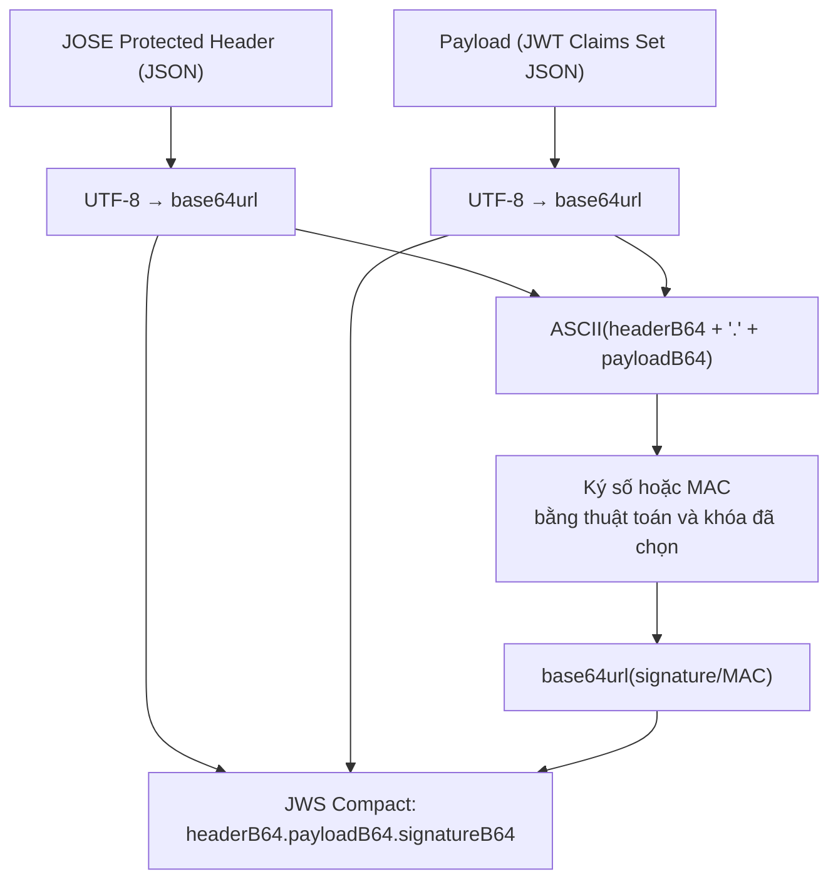
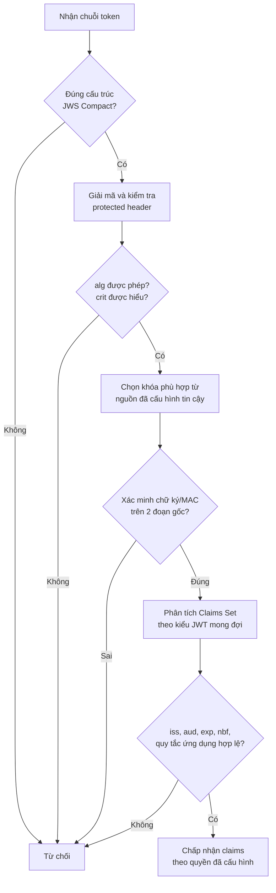

# JWS Compact Serialization và phạm vi sử dụng với JWT

## 1. JWS Compact Serialization giải quyết vấn đề gì?

Trong phạm vi **Security - JSON Web Token (JWT)** (mã dịch vụ `SECURITY_TOKEN_SECURITY_JWT`), **JWS Compact Serialization** là một cách biểu diễn thông điệp được bảo vệ bằng chữ ký số hoặc mã xác thực thông điệp (*Message Authentication Code* – MAC) thành **một chuỗi văn bản ngắn gọn**. Cấu trúc này được tiêu chuẩn hóa trong [RFC 7515](https://www.rfc-editor.org/rfc/rfc7515), thuộc họ tiêu chuẩn JOSE (*JSON Object Signing and Encryption*).

Đối với JWT theo [RFC 7519](https://www.rfc-editor.org/rfc/rfc7519), JWS Compact là cách rất phổ biến để đóng gói **JWT Claims Set** thành token có thể xác minh. Đây là lựa chọn phù hợp khi bên nhận cần kiểm tra rằng nội dung claims không bị chỉnh sửa và thao tác ký/MAC được thực hiện bằng khóa hợp lệ.

Ba khái niệm cần phân biệt ngay từ đầu:

- **JWS** là định dạng bảo vệ một payload bằng chữ ký số hoặc MAC. Payload của JWS **không bắt buộc** là JSON.
- **JWS Compact Serialization** là **một hình thức tuần tự hóa** của JWS, được biểu diễn thành ba đoạn nối bằng dấu chấm.
- **JWT dùng JWS** là trường hợp cụ thể: payload phải là một JWT Claims Set thích hợp, được bảo vệ và biểu diễn bằng JWS Compact.

Do đó, **một chuỗi JWS Compact chưa chắc là JWT**, còn **JWT cũng không phải lúc nào có ba đoạn**: JWT được mã hóa bằng JWE Compact có năm đoạn.

## 2. Cấu trúc chính xác của ba đoạn

Hình dạng cơ bản:

```text
BASE64URL(UTF8(JWS Protected Header))
    .
BASE64URL(Payload)
    .
BASE64URL(Signature-or-MAC)
```

Khi truyền thực tế, ba đoạn nằm trên **một dòng**:

```text
<protected-header>.<payload>.<signature>
```

| Đoạn | Nội dung | Ai có thể đọc? | Có được bảo vệ tính toàn vẹn không? |
| --- | --- | --- | --- |
| **1. Protected Header** | JSON mô tả thuật toán và thông tin xử lý, được mã hóa UTF-8 rồi base64url | Ai có chuỗi đều có thể giải mã base64url để đọc | **Có**, vì nằm trong signing input |
| **2. Payload** | Các byte nội dung; với JWT là JSON Claims Set được mã hóa UTF-8 rồi base64url | Ai có chuỗi đều có thể giải mã base64url để đọc | **Có**, vì nằm trong signing input |
| **3. Signature / MAC** | Kết quả ký số hoặc MAC trên signing input, được mã hóa base64url | Có thể đọc chuỗi mã hóa; không chứa plaintext của khóa bí mật | Là giá trị dùng để **xác minh** hai đoạn trước |

**Dấu chấm (`.`) là ký tự phân tách**. JWS Compact tiêu chuẩn gồm đúng **ba đoạn**, có hai dấu chấm. Dạng base64url thông thường sử dụng các ký tự chữ cái, chữ số, dấu `-` và `_`, không sử dụng ký tự `+` và `/` như base64 chuẩn và **bỏ dấu đệm `=`**.

Ví dụ về **hình dạng** (các placeholder không phải token hợp lệ):

```text
HEADER_BASE64URL.PAYLOAD_BASE64URL.SIGNATURE_BASE64URL
```

Đếm ba đoạn chỉ kiểm tra được **hình thức sơ bộ**. Cần giải mã đúng định dạng, xác minh mật mã và kiểm tra nội dung claims mới có thể chấp nhận token.

### Vì sao gọi là “protected header”?

JWS hỗ trợ các tham số header được bảo vệ và, ở dạng JSON Serialization, có thể hỗ trợ tham số header **không** được bảo vệ. Tuy nhiên, **JWS Compact chỉ có protected header**: toàn bộ đối tượng JOSE Header của dạng này được đưa vào đoạn thứ nhất và tham gia vào dữ liệu được ký/MAC. Không có chỗ dành cho unprotected header trong Compact.

Không được nhầm việc header **được ký** với việc header **đáng tin ngay khi vừa đọc**. Trước khi xác minh, bên nhận có thể đọc `alg` và `kid` để định tuyến quá trình kiểm tra, nhưng phải áp dụng chính sách thuật toán và khóa đã cấu hình, không tin mọi yêu cầu mà token tự khai báo.

## 3. Header của JWS Compact dùng làm JWT

Một protected header minh họa:

```json
{
  "alg": "PS256",
  "typ": "JWT",
  "kid": "signing-key-2026-01"
}
```

| Trường | Vai trò | Điểm cần lưu ý |
| --- | --- | --- |
| `alg` | Thuật toán ký số/MAC, ví dụ `PS256`, `ES256`, `HS256` | Bắt buộc trong JWS; bên nhận phải giới hạn theo danh sách cho phép |
| `typ` | Gợi ý kiểu đối tượng cho ứng dụng, thường là `JWT` | Không phải bằng chứng token hợp lệ; có thể vắng mặt tùy cấu hình/giao thức |
| `kid` | Gợi ý chọn khóa từ tập khóa tin cậy | Không tự xác lập danh tính bên phát hành hay độ tin cậy của khóa |
| `cty` | Loại nội dung bên trong, thường hữu ích cho JWT lồng nhau | Không phải trường mặc định bắt buộc cho JWT thông thường |
| `crit` | Liệt kê các tham số header mở rộng phải được hiểu và xử lý | Nếu không hỗ trợ tham số critical thì phải từ chối JWS đó |

Tên thuật toán được chuẩn hóa bởi [JWA – RFC 7518](https://www.rfc-editor.org/rfc/rfc7518) và các tiêu chuẩn/đăng ký thuật toán liên quan. Thuật toán lựa chọn phải tương thích loại khóa; ví dụ `PS256` dùng cặp khóa RSA, còn `HS256` dùng khóa bí mật đối xứng cho HMAC.

**JWK** ([RFC 7517](https://www.rfc-editor.org/rfc/rfc7517)) là một cách biểu diễn khóa bằng JSON. Trong thực tế, bên phát hành có thể công bố khóa **công khai** để xác minh chữ ký bất đối xứng dưới dạng tập **JWKS**. Bên nhận dùng `kid` để tìm khóa thích hợp **trong nguồn JWKS đã tin cậy**, không tải hoặc tin khóa bất kỳ chỉ vì header gợi ý.

Không đặt thông tin bí mật vào protected header: nó chỉ được base64url-encode, **không được mã hóa**.

## 4. Payload của JWT là một Claims Set

Trong JWS tổng quát, payload có thể là bất kỳ dãy byte nào. Nhưng khi JWS Compact được dùng để biểu diễn **JWT**, payload là JSON chứa các phát biểu (*claims*), chẳng hạn:

```json
{
  "iss": "https://issuer.example",
  "sub": "account-42",
  "aud": "orders-api",
  "iat": 1794800000,
  "nbf": 1794800000,
  "exp": 1794803600,
  "scope": "orders:read"
}
```

Ý nghĩa các trường minh họa:

- `iss`: bên phát hành (*issuer*).
- `sub`: chủ thể (*subject*).
- `aud`: đối tượng nhận dự kiến (*audience*).
- `iat`: thời điểm phát hành (*issued at*).
- `nbf`: token chưa được chấp nhận trước thời điểm này (*not before*).
- `exp`: thời điểm hết hiệu lực (*expiration time*).
- `scope`: claim phụ thuộc giao thức/ứng dụng, không thuộc tập claim đăng ký bắt buộc của JWT.

Các NumericDate như `iat`, `nbf`, `exp` thường thể hiện số giây kể từ mốc Unix epoch (có thể có phần lẻ theo đặc tả). Claims Set có thể chứa thêm claim công khai hoặc riêng của ứng dụng. Không phải mọi claim trong ví dụ đều bắt buộc cho mọi JWT: yêu cầu cụ thể phụ thuộc loại token và giao thức sử dụng.

Quan trọng: **payload đã mã hóa base64url vẫn có thể đọc được**. JWS không cung cấp tính bí mật. Nếu claims chứa thông tin không được phép lộ cho bên cầm chuỗi token, phải điều chỉnh thông tin hoặc dùng cơ chế mã hóa thích hợp, chẳng hạn JWT dưới dạng JWE.

## 5. Dữ liệu thực sự được ký/MAC

Giả sử:

- `H` là **dãy byte UTF-8** của đối tượng protected header sau khi tuần tự hóa JSON.
- `P` là **dãy byte payload**, với JWT là bytes UTF-8 của Claims Set JSON.
- `BASE64URL(X)` là mã hóa base64url không dấu đệm.

Với JWS Compact thông thường, hai đoạn đầu được tính:

```text
encodedHeader  = BASE64URL(H)
encodedPayload = BASE64URL(P)

signingInput = ASCII(encodedHeader + "." + encodedPayload)

signatureBytes = SIGN_OR_MAC(alg, signingKey, signingInput)
encodedSignature = BASE64URL(signatureBytes)

jwsCompact = encodedHeader + "." + encodedPayload + "." + encodedSignature
```

Sơ đồ:



**Dấu chấm giữa hai đoạn đầu là một phần của signing input**. Kết quả ký/MAC áp dụng trên **các byte chính xác của hai đoạn đã mã hóa**, không phải một phiên bản JSON được parse rồi sắp xếp/tuần tự hóa lại.

Ví dụ: hai đối tượng JSON có cùng thuộc tính nhưng khác thứ tự trường hoặc khoảng trắng có thể tạo ra các byte khác nhau. Khi tạo chữ ký, bên phát hành ký đúng byte đã chọn để biểu diễn; bên xác minh phải dùng nguyên **hai đoạn gốc** từ chuỗi để lập signing input.

### HMAC và chữ ký số khác nhau ở điểm nào?

| Cơ chế | Ví dụ `alg` | Khóa tạo | Khóa xác minh | Ý nghĩa |
| --- | --- | --- | --- | --- |
| MAC đối xứng | `HS256` | Khóa bí mật chung | Cùng khóa bí mật chung | Phát hiện sửa đổi và xác thực bên biết khóa, nhưng các bên cùng giữ khóa đều có khả năng tạo MAC |
| Chữ ký số bất đối xứng | `PS256`, `ES256` | Khóa riêng | Khóa công khai tương ứng | Bên xác minh không cần giữ khóa ký riêng |

Lựa chọn thuật toán không chỉ là vấn đề độ dài hoặc hiệu năng. Nó quyết định **mô hình phân phối và tin cậy khóa** giữa các hệ thống.

## 6. Ví dụ theo từng bước: tạo và đọc JWS Compact

Giả sử bên phát hành chuẩn bị header:

```json
{"alg":"HS256","typ":"JWT"}
```

Sau khi biến chuỗi JSON trên thành bytes UTF-8 rồi mã hóa base64url, đoạn header là:

```text
eyJhbGciOiJIUzI1NiIsInR5cCI6IkpXVCJ9
```

Payload JSON minh họa:

```json
{"sub":"account-42","aud":"orders-api","exp":1893456000}
```

Quy trình tạo token:

1. Mã hóa **đúng bytes** của payload thành `payloadB64`.
2. Ghép chuỗi `eyJhbGciOiJIUzI1NiIsInR5cCI6IkpXVCJ9.payloadB64` làm signing input.
3. Tính HMAC-SHA-256 bằng khóa bí mật được cấp cho bên phát hành/xác minh.
4. Mã hóa kết quả HMAC thành `signatureB64`.
5. Ghép ba đoạn thành một chuỗi Compact.

```text
eyJhbGciOiJIUzI1NiIsInR5cCI6IkpXVCJ9.<payloadB64>.<signatureB64>
```

Chuỗi cuối **chỉ là mẫu ký hiệu**, không phải một token có chữ ký sử dụng được: `<payloadB64>` và `<signatureB64>` phải được thay bằng kết quả tính thực tế. Không thể tính chữ ký hợp lệ chỉ bằng cách biết header và payload; người tạo phải có khóa ký/MAC phù hợp.

Người quan sát có thể giải mã hai đoạn đầu để đọc JSON. Nếu tự sửa `"sub":"account-42"` thành `"sub":"admin"` và mã hóa lại payload, kết quả xác minh chữ ký/MAC phải **thất bại**, trừ khi người sửa có thể tạo ra chữ ký/MAC hợp lệ bằng khóa được tin cậy.

## 7. Quy trình xác minh JWS Compact dưới góc nhìn bên nhận JWT

Để sử dụng JWT an toàn, bên nhận cần phân biệt **xử lý cấu trúc JWS**, **xác minh mật mã** và **kiểm tra claims**. Một luồng khái quát:



Ví dụ thuật toán giả (không gắn với thư viện hay ngôn ngữ cụ thể):

```text
function validateSignedJWT(token, expectedIssuer, expectedAudience, policy):
    segments = split(token, ".")
    require count(segments) == 3

    header = parseStrictJSON(base64urlDecode(segments[0]))
    require header.alg in policy.allowedAlgorithms
    require allCriticalHeadersAreUnderstood(header)
    require headerCompatibleWithExpectedJWTType(header, policy)

    key = findTrustedVerificationKey(
        expectedIssuer,
        header.kid,
        header.alg,
        policy.trustedKeySources
    )
    require key exists and isCompatibleWith(header.alg)

    signingInput = ASCII(segments[0] + "." + segments[1])
    signature = base64urlDecode(segments[2])
    require verifyOrCheckMAC(header.alg, key, signingInput, signature)

    claims = parseStrictJSON(base64urlDecode(segments[1]))
    require claims.iss == expectedIssuer
    require expectedAudience matches claims.aud
    require now < claims.exp                      // khi exp bắt buộc
    require now >= claims.nbf                     // nếu có nbf
    require otherTypeAndBusinessRulesHold(claims, policy)

    return acceptedClaims(claims)
```

Thuật toán trên cố ý lấy `expectedIssuer`, `expectedAudience`, chính sách thuật toán và nguồn khóa **từ ngữ cảnh tin cậy**. Không cho một header hoặc payload chưa xác minh tự quyết định khóa và chính sách được chấp nhận. Với hệ thống hỗ trợ nhiều issuer, có thể dùng dữ liệu chưa xác minh làm *gợi ý tra cứu ứng viên*, nhưng phải **ràng buộc khóa đã dùng và kết quả xác minh với đúng issuer được phép** trước khi chấp nhận.

Các phép so sánh thời gian trong mã giả mô tả nguyên tắc: thời điểm hiện tại phải **trước `exp`** và **không trước `nbf`**. Một hệ thống có thể cấu hình sai số đồng hồ nhỏ, có giới hạn. `iat`, `jti`, token type, quyền và thời hạn tối đa chỉ được kiểm tra theo chính sách có liên quan, không tự động được bảo đảm bởi chữ ký.

**Không kết luận “token hợp lệ” sau khi chỉ đọc claims.** Đọc hoặc decode không xác minh MAC/chữ ký, issuer, audience, hạn dùng hay mục đích của token.

## 8. Phạm vi hỗ trợ: JWS Compact so với các biểu diễn JOSE khác

| Hình thức | Cấu trúc | Có thể dùng cho JWT theo RFC 7519? | Đặc trưng |
| --- | --- | --- | --- |
| **JWS Compact** | `header.payload.signature` (3 đoạn) | **Có**, khi payload là JWT Claims Set hoặc cấu trúc JWT lồng nhau phù hợp | Một chữ ký/MAC; toàn bộ JOSE Header là protected header |
| **JWE Compact** | `header.encryptedKey.iv.ciphertext.tag` (5 đoạn) | **Có**, khi plaintext là JWT Claims Set hoặc cấu trúc JWT lồng nhau phù hợp | Nội dung được mã hóa có xác thực |
| **JWS JSON Serialization** | Đối tượng JSON với payload và chữ ký | **Không phải biểu diễn JWT Compact theo RFC 7519** | Có thể biểu diễn nhiều chữ ký và tham số unprotected header |
| **JWE JSON Serialization** | Đối tượng JSON với thông tin người nhận và bản mã | **Không phải biểu diễn JWT Compact theo RFC 7519** | Có thể phục vụ nhiều người nhận |

**Hai trường hợp JWS tổng quát cần đặc biệt phân biệt với JWT:**

1. **Detached payload:** một ứng dụng có thể truyền payload riêng khỏi chuỗi JWS, để bên xác minh cung cấp payload tại thời điểm kiểm tra. Cấu trúc này hữu ích trong các giao thức ký nội dung bên ngoài, nhưng không phải cách biểu diễn JWT Claims Set Compact thông thường; chỉ nhìn chuỗi thiếu payload không đủ để xử lý như JWT hoàn chỉnh.
2. **Unencoded payload (RFC 7797):** phần mở rộng `"b64": false` cho phép JWS ký một payload không qua bước base64url theo điều kiện nhất định, đồng thời phải xử lý tham số critical header theo chuẩn. **JWT theo RFC 7797 không được dùng tùy chọn unencoded payload**. Với JWT dạng JWS Compact, payload phải được base64url-encode thông thường.

Với JWS Compact sử dụng `b64: false` cho mục đích ngoài JWT, dữ liệu payload không được chứa dấu chấm theo cách gây nhầm dấu phân tách Compact. Đây là một lý do nữa để không suy ra JWT chỉ dựa trên số đoạn.

### JWT lồng nhau thì sao?

JWT có thể được **ký trước bằng JWS Compact**, sau đó **mã hóa cả JWS bằng JWE Compact**:

```text
Claims Set (JSON)
    -> JWS Compact (3 đoạn, có chữ ký/MAC)
    -> làm plaintext của JWE Compact
    -> JWT bên ngoài (5 đoạn, được mã hóa)
```

Trong trường hợp này, bên nhận giải mã JWE, thu được JWS Compact ở lớp trong, xác minh chữ ký/MAC rồi kiểm tra claims. Việc JWE giải mã thành công **không thay thế** kiểm tra JWS bên trong. Tham số `cty: JWT` trên lớp ngoài được dùng để thông báo nội dung JWT lồng nhau theo đặc tả.

## 9. Giới hạn bảo mật thường bị hiểu sai

### 9.1. “Ba đoạn là token có chữ ký số” — chưa hẳn

Chữ ký của JWS không nhất thiết là **chữ ký số bất đối xứng**: `HS256` tạo MAC bằng khóa chung. Hơn nữa, chuẩn còn định nghĩa `alg: none` cho JWS không bảo vệ mật mã (*unsecured JWS*), với đoạn thứ ba rỗng. Một JWT không được bảo vệ có thể mang hình dạng `header.payload.`.

Trường hợp `none` tồn tại trong đặc tả **không có nghĩa nó an toàn cho xác thực hoặc phân quyền**. Nếu ứng dụng yêu cầu token đã ký/MAC, chính sách xác minh phải loại bỏ `none` và mọi cấu hình không đáp ứng yêu cầu bảo vệ.

### 9.2. “Đã ký thì payload được giấu” — sai

JWS bảo vệ tính toàn vẹn và xác thực theo cơ chế mật mã sử dụng; các đoạn header/payload thông thường **không mã hóa bí mật nội dung**. Tránh đưa mật khẩu, khóa, dữ liệu nhận dạng nhạy cảm hoặc thông tin chỉ người nhận mới được đọc vào JWS thuần. Nếu cần tính bí mật, đánh giá JWE và thiết kế giới hạn dữ liệu phù hợp.

### 9.3. “Đúng chữ ký thì được dùng ở mọi nơi” — sai

Chữ ký/MAC hợp lệ chỉ nói về nội dung và khóa của JWS. Một JWT còn cần đáp ứng **issuer, audience, thời gian, loại token và quy tắc ứng dụng**. Token dành cho ứng dụng A không tự động được chấp nhận bởi ứng dụng B; token đã hết hạn không được tiếp tục dùng chỉ vì chữ ký vẫn kiểm tra đúng.

### 9.4. “Có `kid` hoặc `jku` thì tin khóa được chỉ tới” — sai

`kid` là gợi ý chọn khóa; `jku` (nếu có) là tham chiếu đến tập khóa. Các giá trị này đến từ header **do phía gửi cung cấp**. Bên nhận phải giới hạn nguồn khóa tin cậy và ràng buộc khóa với issuer đã cấu hình. Không tự tải khóa từ URL tùy ý, không dùng khóa được nhúng trong token như bằng chứng đáng tin, và không cho phép hoán đổi nhầm khóa/thuật toán giữa `HS256` với thuật toán bất đối xứng.

### 9.5. “Giải mã rồi tuần tự hóa lại JSON để xác minh” — sai

Chữ ký/MAC áp dụng trên **signing input gồm nguyên văn hai đoạn base64url ban đầu**. Không thay đổi khoảng trắng, thứ tự trường, Unicode hoặc thuật toán mã hóa JSON trước khi kiểm tra chữ ký. Phần mềm phải xử lý đúng byte representation của token nhận được.

### 9.6. “Chữ ký hợp lệ bảo đảm chống đánh cắp và phát lại” — sai

Một JWS hợp lệ có thể bị sao chép và gửi lại nếu người khác lấy được token. Cần bảo vệ kênh truyền, nơi lưu token, phạm vi quyền, thời hạn sử dụng và sử dụng cơ chế chống phát lại khi ứng dụng yêu cầu. Claim `jti` có thể hỗ trợ nhận diện token nhưng **chỉ tự xuất hiện trong payload không ngăn phát lại** nếu hệ thống không có cơ chế kiểm soát tương ứng.

## 10. Checklist triển khai và rà soát

Khi thiết kế một hệ thống nhận **JWT dạng JWS Compact**, hãy kiểm tra:

1. **Dạng token:** đầu vào có thực sự được kỳ vọng là JWS Compact JWT ba đoạn không? Có từ chối JWE hoặc định dạng khác tại đúng điểm xử lý không?
2. **Header:** JSON và base64url có hợp lệ không; `alg` có trong danh sách được phép không; `crit` có được hiểu đầy đủ không; loại token có phù hợp không?
3. **Khóa:** khóa xác minh có đến từ cấu hình hoặc nguồn tin cậy của đúng issuer; loại khóa và thuật toán có tương thích không; `kid` có được dùng chỉ để tra cứu trong phạm vi tin cậy không?
4. **Xác minh mật mã:** hai đoạn gốc có được sử dụng làm signing input; chữ ký/MAC có được kiểm tra bằng thuật toán và khóa đúng không?
5. **Claims:** nội dung có là JSON Claims Set hợp lệ; `iss`, `aud`, `exp`, `nbf` và các yêu cầu theo token type có được kiểm tra không?
6. **Ngữ cảnh sử dụng:** quyền hạn, loại tài nguyên, tenant/đối tượng nếu có và thời điểm sử dụng có khớp với chính sách ứng dụng không?
7. **Thông báo lỗi:** token lỗi, hết hạn hoặc sai chữ ký có bị từ chối nhất quán, tránh lộ bí mật khóa hoặc thông tin hệ thống không?
8. **Bảo vệ vận hành:** có hạn chế nguy cơ lộ token, replay và lưu khóa riêng/khóa đối xứng không an toàn không?

**Dấu hiệu một thiết kế đáng nghi:** chỉ gọi “decode JWT”, kiểm tra `exp` rồi quyết định quyền; chấp nhận bất kỳ `alg` token tự đưa; lấy public key từ chính token như nguồn tin cậy; hoặc cho phép một access token được dùng ở ngữ cảnh yêu cầu loại token khác.

## 11. Câu hỏi tự kiểm tra

**Câu 1.** Một chuỗi có ba đoạn, payload là một văn bản thuần tùy ý, chữ ký hợp lệ. Nó có phải JWT không?

**Đáp án:** Có thể là JWS Compact hợp lệ, nhưng **chưa phải JWT** nếu payload không phải JWT Claims Set hoặc cấu trúc JWT lồng nhau hợp lệ.

**Câu 2.** Người nhận có thể xác minh chữ ký bằng cách base64url-decode hai đoạn, parse JSON, tuần tự hóa JSON lại rồi ký so sánh không?

**Đáp án:** Không. Phải xác minh trên **hai đoạn mã hóa gốc** ghép bằng dấu chấm, chính xác theo byte.

**Câu 3.** Đoạn chữ ký bị bỏ trống thì chuỗi chắc chắn sai cấu trúc JWS Compact?

**Đáp án:** Không tuyệt đối; JWS với `alg: none` có signature rỗng theo chuẩn. Tuy nhiên, JWT dùng cho xác thực/phân quyền yêu cầu bảo vệ mật mã phải **từ chối** loại này.

**Câu 4.** Tại sao đã xác minh chữ ký vẫn phải kiểm tra `aud`?

**Đáp án:** Chữ ký xác thực nội dung theo khóa; `aud` giúp đảm bảo token **được phát hành cho đúng bên nhận/ngữ cảnh**, ngăn sử dụng token hợp lệ nhưng sai mục đích.

**Câu 5.** Tại sao JWS Compact không phù hợp để giữ kín nội dung claims?

**Đáp án:** Bởi header và payload thông thường chỉ dùng **base64url** để biểu diễn bytes, không phải mã hóa bí mật. Cần cơ chế bảo mật nội dung khác nếu dữ liệu yêu cầu tính bí mật.

## 12. Tài liệu chuẩn tham khảo

- [RFC 7515 — JSON Web Signature (JWS)](https://www.rfc-editor.org/rfc/rfc7515): định nghĩa JWS Compact, signing input, header, quy trình ký/xác minh và JSON Serialization.
- [RFC 7519 — JSON Web Token (JWT)](https://www.rfc-editor.org/rfc/rfc7519): yêu cầu với JWT Claims Set, JOSE Header và JWT dựa trên JWS/JWE Compact.
- [RFC 7518 — JSON Web Algorithms (JWA)](https://www.rfc-editor.org/rfc/rfc7518): tên và quy tắc thuật toán dùng trong JOSE.
- [RFC 7517 — JSON Web Key (JWK)](https://www.rfc-editor.org/rfc/rfc7517): biểu diễn khóa và tập JWK.
- [RFC 7797 — JWS Unencoded Payload Option](https://www.rfc-editor.org/rfc/rfc7797): phần mở rộng payload không mã hóa base64url trong JWS và giới hạn không dùng với JWT.
- [RFC 8725 — JSON Web Token Best Current Practices](https://www.rfc-editor.org/rfc/rfc8725): hướng dẫn kiểm soát thuật toán, khóa, issuer, audience và phân biệt các loại JWT.

**Kết luận:** JWS Compact Serialization tạo ra chuỗi **`header.payload.signature`** để bảo vệ tính toàn vẹn và xác thực bằng chữ ký/MAC. Với JWT, payload phải là **Claims Set**, người nhận phải **xác minh chính xác signing input** và **kiểm tra claims theo ngữ cảnh**. Ba đoạn base64url chỉ mô tả định dạng; mức tin cậy của token phụ thuộc vào thuật toán, khóa và toàn bộ quá trình xác minh.
