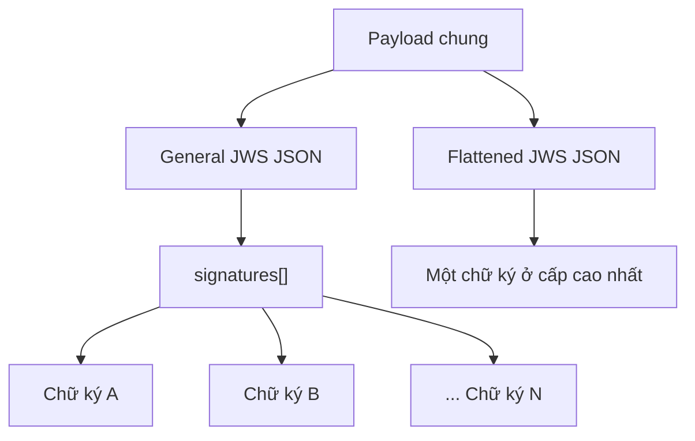
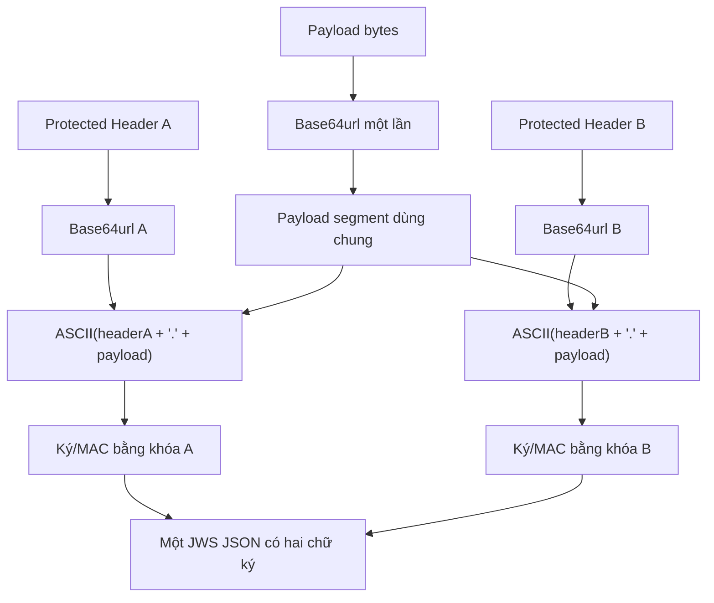
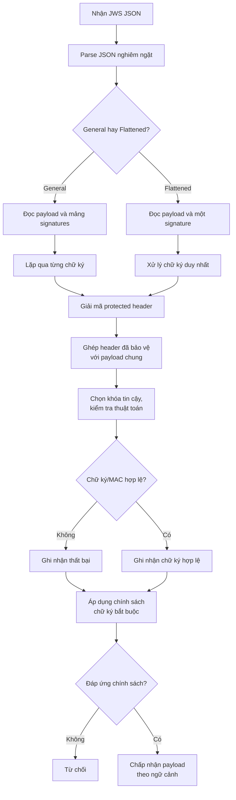

# JWS JSON Serialization: dạng tổng quát và dạng rút gọn

## 1. JWS JSON Serialization là gì?

Trong họ tiêu chuẩn **JOSE** (*JSON Object Signing and Encryption*), **JWS JSON Serialization** là cách biểu diễn nội dung được bảo vệ bằng chữ ký số hoặc MAC (*Message Authentication Code*) dưới dạng một đối tượng JSON. Tiêu chuẩn được định nghĩa trong [RFC 7515 – JSON Web Signature](https://www.rfc-editor.org/rfc/rfc7515).

Khác với **JWS Compact Serialization** chỉ biểu diễn một chữ ký/MAC bằng chuỗi ba đoạn, JWS JSON Serialization hỗ trợ hai hình thức:

- **General JWS JSON Serialization:** chứa mảng `signatures`, cho phép gắn nhiều chữ ký/MAC độc lập lên cùng một payload.
- **Flattened JWS JSON Serialization:** biểu diễn một chữ ký/MAC duy nhất bằng các trường ở cấp cao nhất, không cần mảng.

Hai hình thức này cùng bảo vệ một payload theo cơ chế JWS. Chúng khác nhau ở cấu trúc JSON và số lượng chữ ký được biểu diễn, không phải hai thuật toán mật mã khác nhau.

Trong phạm vi **Security - JSON Web Token (JWT)**, cần phân biệt rõ: RFC 7519 định nghĩa JWT được tuần tự hóa bằng **JWS Compact Serialization** hoặc **JWE Compact Serialization**. Một đối tượng JWS JSON Serialization có payload là JSON claims vẫn là một JWS JSON Serialization; nó **không trở thành biểu diễn JWT chuẩn theo RFC 7519** chỉ vì payload trông giống Claims Set.

## 2. Hai hình thức biểu diễn

### 2.1. General JWS JSON Serialization

General Serialization sử dụng một đối tượng JSON có `payload` chung và mảng `signatures`. Mỗi phần tử của mảng mô tả một chữ ký/MAC riêng:

```json
{
  "payload": "<payload-base64url>",
  "signatures": [
    {
      "protected": "<protected-header-base64url-A>",
      "header": {
        "kid": "signing-key-A"
      },
      "signature": "<signature-base64url-A>"
    },
    {
      "protected": "<protected-header-base64url-B>",
      "header": {
        "kid": "signing-key-B"
      },
      "signature": "<signature-base64url-B>"
    }
  ]
}
```

Các chuỗi đặt trong dấu ngoặc nhọn ở ví dụ là placeholder để minh họa cấu trúc, không phải giá trị base64url hoặc chữ ký có thể xác minh.

Đặc điểm:

- `payload` được biểu diễn một lần và dùng chung cho các chữ ký.
- `signatures` là mảng các đối tượng chữ ký.
- Mỗi đối tượng chữ ký có giá trị `signature` và có thể có `protected` cùng `header`.
- Mỗi chữ ký có thể sử dụng protected header, khóa và thuật toán riêng, tùy chính sách của hệ thống.
- Các chữ ký được xác minh độc lập trên signing input tương ứng, cùng tham chiếu tới payload chung.

Một đối tượng General Serialization có thể chứa nhiều chữ ký từ nhiều bên hoặc nhiều chữ ký của cùng một hệ thống theo các khóa/thuật toán khác nhau. Cấu trúc này không tự định nghĩa ai là bên có thẩm quyền, cần bao nhiêu chữ ký, hay chữ ký nào bắt buộc phải hợp lệ. Những điều kiện đó thuộc chính sách của ứng dụng nhận.

### 2.2. Flattened JWS JSON Serialization

Flattened Serialization dùng khi chỉ cần một chữ ký/MAC. Thay vì mảng `signatures`, các trường của một đối tượng chữ ký được đặt trực tiếp ở cấp cao nhất:

```json
{
  "payload": "<payload-base64url>",
  "protected": "<protected-header-base64url>",
  "header": {
    "kid": "signing-key-A"
  },
  "signature": "<signature-base64url>"
}
```

Các trường có ý nghĩa tương ứng với một phần tử trong mảng `signatures` của General Serialization:

- `payload`: payload được mã hóa base64url theo quy tắc JWS thông thường.
- `protected`: protected header được mã hóa base64url.
- `header`: unprotected header dưới dạng JSON, nếu có.
- `signature`: chữ ký/MAC được mã hóa base64url.

Flattened Serialization giúp cấu trúc gọn hơn khi chỉ có một chữ ký. Nó vẫn là JWS JSON Serialization, không phải JWS Compact và cũng không phải JWT Compact.

### 2.3. So sánh trực tiếp

| Tiêu chí | General Serialization | Flattened Serialization |
| --- | --- | --- |
| Cấu trúc chữ ký | Mảng `signatures` | Các trường chữ ký ở cấp cao nhất |
| Số chữ ký được biểu diễn | Một hoặc nhiều chữ ký | Một chữ ký |
| Payload | Một payload dùng chung | Một payload |
| Protected/unprotected header | Riêng cho từng chữ ký | Một cặp header |
| Trường hợp phù hợp | Nhiều chữ ký, nhiều bên xác nhận, chuyển đổi thuật toán | Một chữ ký với cấu trúc JSON |
| Có phải JWT Compact không? | Không | Không |



## 3. Protected Header và Unprotected Header

JWS JSON Serialization hỗ trợ hai vùng header:

| Vùng | Trường JSON | Biểu diễn | Có nằm trong signing input? |
| --- | --- | --- | --- |
| **Protected Header** | `protected` | JSON Header được mã hóa UTF-8 rồi base64url | Có |
| **Unprotected Header** | `header` | Đối tượng JSON trực tiếp | Không |

Ví dụ một chữ ký:

```json
{
  "payload": "<payload-base64url>",
  "protected": "<base64url-of-protected-header>",
  "header": {
    "kid": "key-2026-01"
  },
  "signature": "<signature-base64url>"
}
```

Protected header có thể chứa các tham số như `alg`, `typ`, `cty`, `crit` và `kid`. Các tham số này được đưa vào dữ liệu ký/MAC thông qua phần protected header đã mã hóa.

Unprotected header có thể chứa thông tin bổ trợ không cần được bảo vệ bằng chữ ký/MAC. Ví dụ `kid` đôi khi được đặt ở vùng này để hỗ trợ tra cứu khóa. Vì vùng này **không được ký**, người nhận không được xem giá trị ở đó là bằng chứng xác thực hoặc cho phép nó ghi đè chính sách tin cậy.

Một số quy tắc quan trọng:

1. Không được có cùng tên tham số trong cả protected header và unprotected header của cùng một chữ ký. Nếu trùng tên, phải từ chối JWS vì cách hiểu trở nên mơ hồ.
2. Tham số quyết định thuật toán như `alg` phải được xử lý theo chính sách tin cậy; trong thiết kế an toàn, đặt chúng trong protected header để bảo vệ tính toàn vẹn.
3. Tham số `crit` và các phần mở rộng ảnh hưởng tới cách diễn giải JWS phải được bảo vệ và phải được bên nhận hiểu rõ. Nếu có critical parameter mà bên nhận không hỗ trợ, phải từ chối.
4. `kid` chỉ là gợi ý chọn khóa. Dù nằm trong protected header, nó không tự xác lập nguồn gốc hoặc độ tin cậy của khóa.

**Đừng nhầm base64url với mã hóa bí mật:** protected header được mã hóa theo dạng biểu diễn, nhưng ai có JWS đều có thể giải mã base64url để đọc nó. Unprotected header vốn đã là JSON hiển thị trực tiếp.

## 4. Payload dùng chung và dữ liệu được ký

Trong JWS JSON Serialization thông thường, trường `payload` chứa payload được mã hóa base64url. Nếu payload là JSON, quy trình thường là:

1. Tuần tự hóa đối tượng JSON thành chuỗi JSON theo quy tắc của ứng dụng.
2. Chuyển chuỗi JSON thành bytes UTF-8.
3. Mã hóa bytes bằng base64url không dấu đệm để tạo giá trị `payload`.
4. Dùng chính giá trị payload đó để tính signing input cho từng chữ ký.

Với chữ ký thứ *i*, đặt:

- `protected_i`: giá trị chuỗi base64url trong trường `protected` của chữ ký thứ *i*.
- `payload`: giá trị chuỗi base64url dùng chung trong đối tượng JWS.

Signing input theo quy tắc JWS:

```text
signingInput_i =
    ASCII(protected_i + "." + payload)
```

Nếu protected header không được biểu diễn riêng trong một trường hợp JWS hợp lệ, phần tương ứng trong signing input là chuỗi rỗng. Tuy nhiên, với JWS có thuật toán bảo vệ thông thường, tham số `alg` cần được xử lý đúng và phải chịu sự kiểm soát của bên xác minh.

Điểm quan trọng là **mỗi chữ ký có signing input riêng**, bởi protected header của từng chữ ký có thể khác nhau. Payload được dùng chung, nhưng chữ ký A không xác minh trên protected header của chữ ký B.



Unprotected header **không nằm trong signing input**. Thay đổi nó không làm chữ ký/MAC thất bại, vì thế dữ liệu ở vùng này không được dùng làm cơ sở duy nhất cho quyết định bảo mật.

## 5. Ví dụ General Serialization với hai chữ ký

Giả sử một tổ chức muốn cùng một thông điệp được ký bởi hai khóa độc lập:

- Khóa A dùng thuật toán chữ ký RSA-PSS với SHA-256 (`PS256`).
- Khóa B dùng thuật toán chữ ký ECDSA P-256 với SHA-256 (`ES256`).
- Payload là cùng một nội dung JSON.

Đối tượng minh họa:

```json
{
  "payload": "<same-payload-base64url-for-both-signatures>",
  "signatures": [
    {
      "protected": "<base64url-of-{alg:PS256,kid:key-A}>",
      "signature": "<signature-created-by-private-key-A>"
    },
    {
      "protected": "<base64url-of-{alg:ES256,kid:key-B}>",
      "signature": "<signature-created-by-private-key-B>"
    }
  ]
}
```

Đây là ví dụ về cấu trúc, không phải token có thể xác minh. Các placeholder cần được thay bằng bytes và chữ ký thật theo đúng thuật toán.

Khi xác minh:

1. Đọc `payload` một lần và kiểm tra biểu diễn base64url.
2. Với chữ ký A, giải mã protected header A, kiểm tra `alg`, chọn khóa xác minh A từ nguồn tin cậy, tạo signing input A và xác minh chữ ký A.
3. Với chữ ký B, thực hiện tương tự nhưng dùng protected header B, khóa B và signing input B.
4. Đưa kết quả từng chữ ký vào chính sách chấp nhận đã được cấu hình.

Nếu chữ ký A hợp lệ còn chữ ký B không hợp lệ, đối tượng JWS không tự cho biết ứng dụng nên chấp nhận hay từ chối. Có thể tồn tại chính sách yêu cầu **cả hai chữ ký**, hoặc chỉ cần **một chữ ký thuộc tập khóa được tin cậy**. Ứng dụng phải quy định rõ điều kiện đó.

### Nhiều chữ ký không đồng nghĩa với chữ ký ngưỡng

General Serialization chỉ là cách mang nhiều chữ ký/MAC trên cùng payload. Nó không tự triển khai:

- Cơ chế *threshold signature* hoặc chia sẻ khóa.
- Quy tắc biểu quyết hay đồng thuận.
- Danh sách người ký bắt buộc.
- Thứ tự ưu tiên hoặc cấp bậc thẩm quyền giữa người ký.
- Chính sách “ít nhất N trên M chữ ký”.

Nếu nghiệp vụ yêu cầu các điều kiện này, ứng dụng phải định nghĩa và kiểm tra chúng riêng. Không được suy luận ý nghĩa chính sách chỉ từ việc mảng `signatures` có nhiều phần tử.

## 6. Khi nào dùng General và khi nào dùng Flattened?

### Dùng General khi có nhiều chữ ký

Một số tình huống phù hợp:

- **Nhiều tổ chức cùng xác nhận một thông điệp:** mỗi bên ký cùng payload bằng khóa riêng của mình.
- **Chuyển đổi thuật toán:** trong giai đoạn chuyển đổi, hệ thống có thể phát hành nhiều chữ ký để các nhóm người nhận hỗ trợ những bộ thuật toán/khóa khác nhau, theo chính sách rõ ràng.
- **Nhiều lớp xác nhận độc lập:** một tài liệu có thể cần chữ ký của đơn vị tạo và đơn vị phê duyệt.
- **Kiểm tra chữ ký theo nhiều khóa:** một thông điệp được ký bằng nhiều khóa có mục đích khác nhau.

General Serialization chỉ cung cấp cấu trúc mang chữ ký. Việc chữ ký đại diện cho tổ chức nào, vai trò gì và chữ ký nào cần hợp lệ phải được xác định bằng cấu hình tin cậy bên ngoài và chính sách nghiệp vụ.

### Dùng Flattened khi chỉ có một chữ ký

Flattened phù hợp khi:

- Payload chỉ cần một chữ ký/MAC.
- Hệ thống muốn biểu diễn theo JSON thay vì chuỗi Compact.
- Cần dùng cấu trúc `header` và `protected` riêng biệt.
- Giao thức trao đổi đã quy định rõ đối tượng JWS JSON Serialization.

Nếu ứng dụng cần định dạng JWT theo RFC 7519, hãy dùng đúng JWS Compact hoặc JWE Compact theo yêu cầu. Không tự thay JWT Compact bằng Flattened chỉ vì payload có các claim giống JWT.

## 7. Quy trình xác minh JWS JSON Serialization

Quy trình xác minh cần xử lý cấu trúc JSON, từng protected header, payload chung và chính sách chữ ký. Một luồng tổng quát:



Các bước nên thực hiện:

1. **Parse JSON nghiêm ngặt:** yêu cầu đúng kiểu đối tượng, trường bắt buộc và cấu trúc General hoặc Flattened; từ chối tên thành viên JSON trùng lặp để tránh khác biệt cách diễn giải giữa các parser.
2. **Xác định dạng serialization:** nếu có `signatures`, xử lý General; nếu có `signature` ở cấp cao nhất, xử lý Flattened. Không chấp nhận cấu trúc lai hoặc trường mâu thuẫn.
3. **Kiểm tra payload:** kiểm tra biểu diễn base64url và lấy đúng bytes payload. Nếu giao thức dùng detached payload, phải có đúng bytes bên ngoài theo quy tắc đã thống nhất.
4. **Xử lý từng chữ ký:** giải mã protected header, kết hợp về mặt ngữ nghĩa với unprotected header, từ chối tham số trùng tên và kiểm tra các critical parameter.
5. **Kiểm tra thuật toán:** chỉ chấp nhận thuật toán nằm trong allowlist của ngữ cảnh; kiểm tra tương thích với loại khóa và mục đích sử dụng.
6. **Chọn khóa từ nguồn tin cậy:** dùng cấu hình issuer/đối tác và `kid` như gợi ý tra cứu. Không lấy khóa từ header chưa tin cậy làm nguồn gốc tin cậy.
7. **Tạo signing input riêng:** dùng nguyên giá trị protected header đã mã hóa và payload segment theo đúng quy tắc JWS.
8. **Xác minh từng chữ ký:** kiểm tra chữ ký số/MAC với khóa và thuật toán tương ứng.
9. **Áp dụng chính sách:** quyết định cần tất cả, một chữ ký cụ thể hay một tập chữ ký đạt điều kiện. Không mặc định rằng một chữ ký hợp lệ là đủ.
10. **Sử dụng payload:** chỉ sau khi các kiểm tra cần thiết thành công mới phân tích và sử dụng nội dung theo ngữ cảnh ứng dụng.

### Mã giả xác minh tổng quát

```text
function verifyJwsJson(jwsObject, trustPolicy):
    require isStrictJsonObject(jwsObject)
    rejectDuplicateJsonMemberNames(jwsObject)

    if hasMember(jwsObject, "signatures"):
        require hasMember(jwsObject, "payload")
        require isNonEmptyArray(jwsObject.signatures)
        signatureEntries = jwsObject.signatures
    else:
        require hasMember(jwsObject, "payload")
        require hasMember(jwsObject, "signature")
        signatureEntries = [flattenedSignatureFields(jwsObject)]

    payloadSegment = jwsObject.payload
    payloadBytes = base64urlDecodeStrict(payloadSegment)
    results = []

    for entry in signatureEntries:
        protectedSegment = entry.protected or ""
        protectedHeader = parseProtectedHeader(protectedSegment)
        unprotectedHeader = entry.header or {}

        require noDuplicateNames(protectedHeader, unprotectedHeader)
        require criticalParametersAreSupported(protectedHeader)
        require protectedHeader.alg in trustPolicy.allowedAlgorithms

        key = selectTrustedKey(
            trustPolicy,
            protectedHeader.alg,
            protectedHeader.kid or unprotectedHeader.kid
        )
        require key exists and isCompatible(key, protectedHeader.alg)

        signingInput = ASCII(protectedSegment + "." + payloadSegment)
        signatureBytes = base64urlDecodeStrict(entry.signature)

        valid = verifySignatureOrMac(
            protectedHeader.alg,
            key,
            signingInput,
            signatureBytes
        )
        results.append(valid)

    require trustPolicy.signatureAcceptanceRule(results, signatureEntries)
    return payloadBytes
```

Đây là mã giả mô tả các trách nhiệm bảo mật, không phải triển khai đầy đủ. Ví dụ giả định payload được nhúng và dùng cách mã hóa base64url mặc định; đồng thời áp dụng profile chặt yêu cầu thuật toán lấy từ protected header. Nếu dùng `kid` trong unprotected header làm gợi ý tra cứu, kết quả vẫn phải được ràng buộc với nguồn khóa và chính sách tin cậy đã cấu hình. Một triển khai thực tế cần kiểm tra kiểu dữ liệu, giới hạn kích thước, lỗi parser, tham số bắt buộc và các quy tắc riêng của thuật toán. Chính sách chấp nhận chữ ký phải được xác định bởi ứng dụng, không do payload hoặc unprotected header tự quyết định.

## 8. Quan hệ với JWT

JWS JSON Serialization và JWT có thể dùng cùng các khái niệm như payload, protected header, thuật toán và khóa, nhưng chúng có phạm vi khác nhau:

| Đặc điểm | JWS JSON Serialization | JWT dùng JWS Compact |
| --- | --- | --- |
| Định dạng ngoài | Đối tượng JSON | Chuỗi Compact ba đoạn |
| Payload | Dữ liệu byte bất kỳ | JWT Claims Set |
| Số chữ ký | General: nhiều; Flattened: một | Một chữ ký/MAC trong JWS Compact |
| Header | Có protected và unprotected header | JOSE Header được bảo vệ |
| Có phải JWT theo RFC 7519? | Không | Có, nếu payload và các điều kiện JWT phù hợp |
| Mã hóa bí mật payload? | Không; JWS chỉ ký/MAC | Không; JWS chỉ ký/MAC |

Một hệ thống có thể đặt JSON Claims Set làm payload của JWS JSON Serialization để bảo vệ dữ liệu. Tuy nhiên, nếu giao thức yêu cầu JWT theo RFC 7519, đối tượng JWS JSON đó không thay thế được JWT Compact. Nếu cần JWT có nhiều lớp bảo vệ, có thể cân nhắc **Nested JWT** theo đúng cấu trúc JWS Compact bên trong JWE Compact, thay vì tự mở rộng định dạng JWT bằng General Serialization.

JWS JSON Serialization cũng không mã hóa payload. Base64url chỉ chuyển bytes sang dạng văn bản có thể nhúng trong JSON. Nếu dữ liệu cần được giữ kín với người quan sát, phải thiết kế cơ chế mã hóa phù hợp, chẳng hạn JWE.

## 9. Những lỗi thiết kế và xử lý thường gặp

### 9.1. Tin unprotected header

Unprotected header không tham gia signing input, nên bên trung gian có thể thay đổi nó mà không làm chữ ký thất bại. Nếu ứng dụng dùng một giá trị ở đây để chọn thuật toán, xác định issuer hoặc cấp quyền, kẻ tấn công có thể tác động đến quyết định đó.

**Cách xử lý:** tham số ảnh hưởng đến xác minh phải nằm trong vùng được bảo vệ hoặc được lấy từ cấu hình tin cậy; unprotected header chỉ dùng cho thông tin bổ trợ không nhạy cảm.

### 9.2. Chấp nhận một chữ ký hợp lệ mà không có chính sách

Một General Serialization có thể chứa nhiều chữ ký. Nếu ứng dụng chỉ kiểm tra “có ít nhất một chữ ký đúng” trong khi nghiệp vụ yêu cầu cả bên phát hành và bên phê duyệt, thông điệp có thể được chấp nhận thiếu xác nhận cần thiết.

**Cách xử lý:** định nghĩa rõ danh tính/nhóm khóa cần có, số lượng chữ ký hợp lệ, vai trò của từng chữ ký và hành vi khi có chữ ký lỗi hoặc không nhận diện được.

### 9.3. Dùng chung payload nhưng xác minh sai signing input

Mỗi chữ ký có protected header riêng. Dùng header A để xác minh chữ ký B sẽ tạo signing input sai. Tương tự, parse rồi serialize lại payload có thể làm thay đổi bytes và khiến xác minh không còn đúng.

**Cách xử lý:** với từng chữ ký, lấy đúng protected segment của nó và payload segment gốc trong đối tượng; ghép hai chuỗi bằng dấu chấm để tạo signing input.

### 9.4. Coi nhiều chữ ký là nhiều lớp mã hóa

Nhiều chữ ký không che giấu payload và không làm nội dung bí mật hơn. Bất kỳ ai có đối tượng JWS đều có thể đọc payload base64url thông thường.

**Cách xử lý:** nếu yêu cầu tính bí mật, sử dụng JWE hoặc một cơ chế mã hóa phù hợp. JWS và JWE giải quyết các thuộc tính bảo mật khác nhau.

### 9.5. Coi JSON Serialization là JWT

Một payload có `iss`, `sub`, `aud`, `exp` vẫn không làm đối tượng JWS JSON trở thành JWT theo RFC 7519. Hình thức tuần tự hóa JWT được quy định riêng.

**Cách xử lý:** xác định rõ giao thức cần JWS JSON hay JWT; kiểm tra đúng định dạng đầu vào và không dùng thay thế lẫn nhau.

### 9.6. Không kiểm soát parser và kích thước

Đối tượng JSON có thể bị làm lớn bất thường, chứa nhiều chữ ký, trường trùng tên hoặc giá trị không đúng kiểu. Parser khác nhau có thể diễn giải không thống nhất.

**Cách xử lý:** giới hạn kích thước payload và số chữ ký, từ chối tên thành viên trùng, kiểm tra kiểu/giá trị trường và xử lý lỗi theo cách fail-closed.

## 10. Bảng quyết định lựa chọn

| Nhu cầu | Hình thức nên xem xét | Lý do |
| --- | --- | --- |
| Một chữ ký, giao thức yêu cầu chuỗi token ngắn | JWS Compact | Biểu diễn ba đoạn đơn giản |
| Một chữ ký, giao thức trao đổi đối tượng JSON | Flattened JWS JSON | Không cần mảng chữ ký |
| Nhiều bên ký cùng payload | General JWS JSON | Mỗi chữ ký có header và giá trị xác minh riêng |
| Chuyển đổi thuật toán với nhiều nhóm người nhận | General JWS JSON, nếu chính sách cho phép | Có thể mang nhiều chữ ký trên cùng payload |
| Cần JWT theo RFC 7519 | JWS Compact hoặc JWE Compact | Đây là các dạng tuần tự hóa JWT được quy định |
| Cần bảo mật nội dung payload | JWE | JWS JSON chỉ ký/MAC, không mã hóa payload |
| Cần ký và đồng thời mã hóa JWT | Nested JWT theo chuẩn | Kết hợp JWS và JWE theo các lớp được quy định |

## 11. Câu hỏi tự kiểm tra

**Câu 1.** General JWS JSON Serialization khác Flattened ở điểm cốt lõi nào?

**Đáp án:** General dùng mảng `signatures` để biểu diễn nhiều chữ ký; Flattened đặt các trường của một chữ ký ở cấp cao nhất.

**Câu 2.** Hai chữ ký trong General Serialization có cùng signing input không?

**Đáp án:** Không nhất thiết. Payload segment dùng chung, nhưng protected header của từng chữ ký có thể khác, nên signing input được tạo riêng cho từng chữ ký.

**Câu 3.** Thay đổi unprotected header có làm chữ ký thất bại không?

**Đáp án:** Không nhất thiết, vì unprotected header không nằm trong signing input. Đây là lý do không dùng nó làm căn cứ bảo mật.

**Câu 4.** Một General JWS có hai chữ ký hợp lệ có tự động chứng minh rằng nghiệp vụ đã được hai bên phê duyệt không?

**Đáp án:** Không. Ứng dụng phải xác định khóa nào thuộc bên nào và định nghĩa rõ chính sách chữ ký bắt buộc.

**Câu 5.** Payload của JWS JSON có chứa `iss`, `sub`, `exp` thì đối tượng đó có phải JWT theo RFC 7519 không?

**Đáp án:** Không chỉ dựa vào các claim. JWT theo RFC 7519 sử dụng JWS Compact hoặc JWE Compact Serialization; JWS JSON vẫn là một biểu diễn JWS JSON.

**Câu 6.** General Serialization có mã hóa payload vì nó là JSON không?

**Đáp án:** Không. Payload thường được base64url-encode để biểu diễn, không phải mã hóa bí mật. Muốn bảo mật nội dung cần JWE hoặc cơ chế mã hóa phù hợp.

## 12. Tài liệu chuẩn tham khảo

- [RFC 7515 — JSON Web Signature (JWS)](https://www.rfc-editor.org/rfc/rfc7515): định nghĩa General và Flattened JWS JSON Serialization, protected/unprotected header, signing input và xác minh chữ ký.
- [RFC 7519 — JSON Web Token (JWT)](https://www.rfc-editor.org/rfc/rfc7519): quy định JWT Claims Set và các dạng tuần tự hóa JWT.
- [RFC 7517 — JSON Web Key (JWK)](https://www.rfc-editor.org/rfc/rfc7517): biểu diễn khóa và JWK Set.
- [RFC 7518 — JSON Web Algorithms (JWA)](https://www.rfc-editor.org/rfc/rfc7518): thuật toán chữ ký, MAC và mã hóa dùng trong JOSE.
- [RFC 7797 — JWS Unencoded Payload Option](https://www.rfc-editor.org/rfc/rfc7797): phần mở rộng payload không base64url trong JWS và các điều kiện áp dụng.
- [RFC 8725 — JSON Web Token Best Current Practices](https://www.rfc-editor.org/rfc/rfc8725): hướng dẫn an toàn khi xử lý JWT, thuật toán, khóa và ngữ cảnh sử dụng.

**Ghi nhớ:** General Serialization mang nhiều chữ ký trên cùng payload; Flattened Serialization mang một chữ ký bằng các trường ở cấp cao nhất. Cả hai đều là JWS JSON Serialization. Chúng bảo vệ tính toàn vẹn/xác thực theo chữ ký hoặc MAC, không mã hóa bí mật payload và không thay thế định dạng JWT Compact được RFC 7519 quy định.
