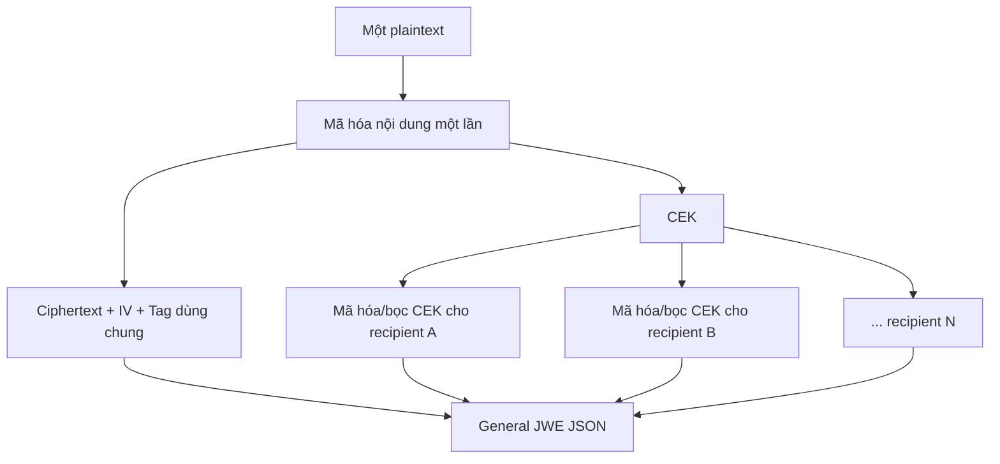
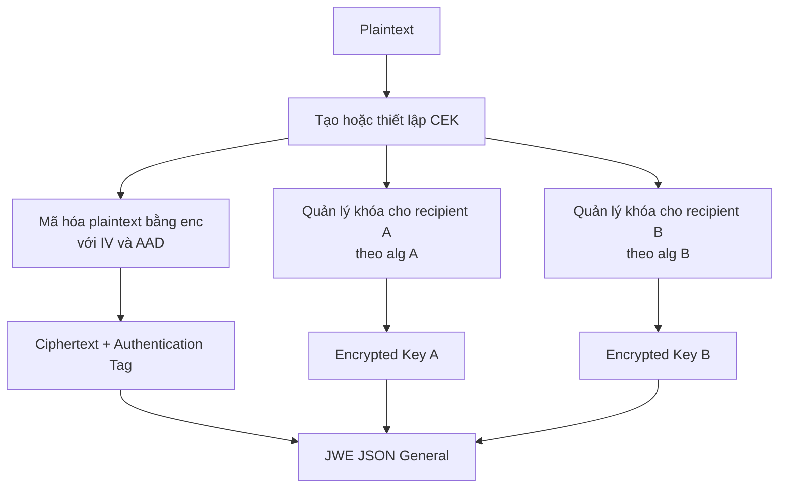
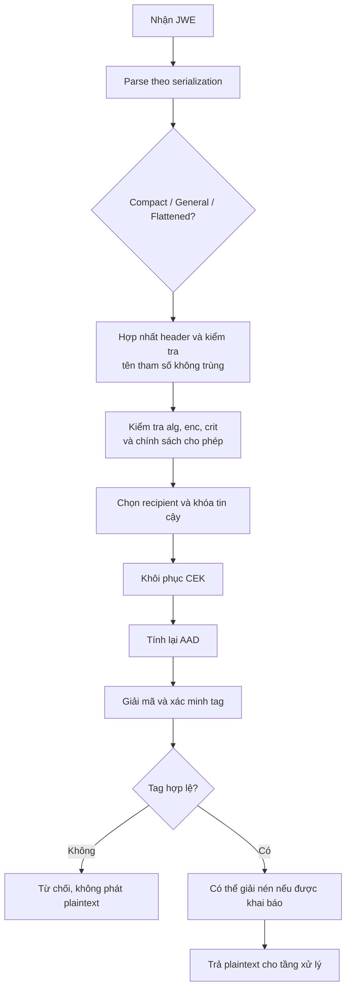

# JWE Compact Serialization và JWE JSON Serialization

## 1. JWE và hai cách tuần tự hóa

**JSON Web Encryption (JWE)** là tiêu chuẩn JOSE dùng để biểu diễn nội dung đã được mã hóa và bảo vệ tính toàn vẹn bằng cơ chế mã hóa có xác thực (*authenticated encryption*). JWE được định nghĩa trong [RFC 7516](https://www.rfc-editor.org/rfc/rfc7516). Nội dung plaintext có thể là bất kỳ dãy byte nào: văn bản, JSON, dữ liệu nhị phân hoặc một JWT khác.

JWE cung cấp hai cách tuần tự hóa:

- **JWE Compact Serialization:** biểu diễn JWE thành một chuỗi ngắn, an toàn cho môi trường truyền dạng văn bản/URL. Dạng này chỉ hỗ trợ **một recipient**.
- **JWE JSON Serialization:** biểu diễn JWE thành đối tượng JSON. Dạng này hỗ trợ một recipient hoặc nhiều recipient cùng có khả năng giải mã **một nội dung đã mã hóa chung**.

Hai cách biểu diễn sử dụng cùng nền tảng mật mã. Khác biệt chính nằm ở cấu trúc dữ liệu, khả năng biểu diễn nhiều recipient, header và Additional Authenticated Data (AAD).

Trong phạm vi **Security - JSON Web Token (JWT)**, cần nhớ rằng JWT theo [RFC 7519](https://www.rfc-editor.org/rfc/rfc7519) được tuần tự hóa bằng **JWS Compact Serialization** hoặc **JWE Compact Serialization**. JWE JSON Serialization là một biểu diễn JWE tổng quát, không phải định dạng JWT Compact. Nếu plaintext của JWE JSON là một JWT, đối tượng bên ngoài vẫn đang dùng JWE JSON Serialization.

## 2. JWE Compact Serialization: cấu trúc năm phần

JWE Compact được biểu diễn thành năm đoạn base64url, ngăn cách bằng bốn dấu chấm:

```text
BASE64URL(UTF8(Protected Header))
    .
BASE64URL(Encrypted Key)
    .
BASE64URL(Initialization Vector)
    .
BASE64URL(Ciphertext)
    .
BASE64URL(Authentication Tag)
```

Trong truyền tải, năm đoạn nằm trên một dòng:

```text
protected.encrypted_key.iv.ciphertext.tag
```

| Phần | Tên | Ý nghĩa |
| --- | --- | --- |
| 1 | **Protected Header** | JSON mô tả thuật toán quản lý khóa, thuật toán mã hóa nội dung và các tham số JOSE liên quan; được mã hóa UTF-8 rồi base64url |
| 2 | **Encrypted Key** | CEK đã được mã hóa/bọc cho recipient; có thể là chuỗi rỗng nếu thuật toán dùng trực tiếp hoặc thỏa thuận khóa trực tiếp |
| 3 | **IV** | Initialization Vector/nonce đầu vào của thuật toán mã hóa nội dung; có thể rỗng nếu thuật toán không dùng IV |
| 4 | **Ciphertext** | Nội dung sau mã hóa |
| 5 | **Authentication Tag** | Giá trị xác thực dùng để kiểm tra tính toàn vẹn của ciphertext và dữ liệu AAD; có thể rỗng nếu thuật toán quy định không dùng tag |

Các phần được base64url-encode để biểu diễn dãy byte trong chuỗi văn bản. Base64url **không phải mã hóa bí mật**; tính bí mật đến từ thuật toán JWE và khóa.

Ví dụ hình dạng (các placeholder không phải token có thể giải mã):

```text
BASE64URL_HEADER.BASE64URL_ENCRYPTED_KEY.BASE64URL_IV.BASE64URL_CIPHERTEXT.BASE64URL_TAG
```

JWE Compact không có trường riêng cho shared unprotected header, per-recipient unprotected header hoặc JWE AAD. Toàn bộ JOSE Header của dạng Compact chính là Protected Header và được đưa vào dữ liệu xác thực của thao tác mã hóa.

## 3. JWE JSON Serialization: cấu trúc tổng quát

JWE JSON Serialization dùng một đối tượng JSON để mang các thành phần JWE. Khác với Compact, header có thể được chia thành ba vùng:

| Vùng | Trường JSON | Phạm vi | Có được integrity-protect bởi AEAD không? |
| --- | --- | --- | --- |
| **Protected Header** | **protected** | Dùng chung cho toàn bộ recipient | Có |
| **Shared Unprotected Header** | **unprotected** | Dùng chung cho toàn bộ recipient | Không |
| **Per-Recipient Unprotected Header** | **header** | Chỉ áp dụng cho một recipient | Không |

Trong General Serialization, **header** nằm trong từng phần tử của mảng **recipients**. Trong Flattened Serialization, các trường dành cho một recipient được đưa lên cấp cao nhất.

### 3.1. General JWE JSON Serialization

General Serialization được thiết kế cho trường hợp có thể có nhiều recipient. Cấu trúc khái quát:

```json
{
  "protected": "<base64url-protected-header>",
  "unprotected": {
    "jku": "https://keys.example/recipient-set"
  },
  "recipients": [
    {
      "header": {
        "alg": "RSA-OAEP-256",
        "kid": "recipient-A"
      },
      "encrypted_key": "<encrypted-cek-for-A>"
    },
    {
      "header": {
        "alg": "ECDH-ES+A256KW",
        "kid": "recipient-B"
      },
      "encrypted_key": "<encrypted-cek-for-B>"
    }
  ],
  "aad": "<base64url-additional-authenticated-data>",
  "iv": "<base64url-iv>",
  "ciphertext": "<base64url-ciphertext>",
  "tag": "<base64url-authentication-tag>"
}
```

Ví dụ chỉ minh họa cấu trúc và vị trí các trường; giá trị khóa, ciphertext, IV, tag và header phải được tạo đúng quy trình mật mã. Đặc biệt, giá trị trong **unprotected** và **header** là JSON hiển thị trực tiếp, không phải vùng được bảo vệ tính toàn vẹn.

Các điểm chính:

- **protected** chứa các tham số cần được bảo vệ tính toàn vẹn.
- **unprotected** chứa tham số chung nhưng không được bảo vệ tính toàn vẹn.
- **recipients** là mảng có **một phần tử cho mỗi recipient**.
- **header** trong mỗi phần tử mô tả tham số riêng của recipient đó.
- **encrypted_key** là CEK đã được mã hóa/bọc cho recipient tương ứng; nếu thuật toán không tạo encrypted key thì giá trị byte là rỗng và trường có thể bị lược bỏ theo quy tắc chuẩn.
- **iv**, **ciphertext** và **tag** dùng chung cho toàn bộ recipient.
- **aad** là dữ liệu bổ sung được xác thực nhưng không được mã hóa; trường này chỉ có trong JWE JSON Serialization.

Một số thành phần chỉ xuất hiện khi có giá trị khác rỗng. Ví dụ, **protected** vắng mặt nếu không có Protected Header; **iv** hoặc **tag** có thể vắng mặt nếu thuật toán tương ứng tạo ra giá trị byte rỗng. **ciphertext** và mảng **recipients** vẫn là thành phần cấu trúc quan trọng của General Serialization.

### 3.2. Flattened JWE JSON Serialization

Flattened Serialization tối ưu cho **một recipient**. Nó loại bỏ mảng **recipients** và chuyển các trường **header**, **encrypted_key** của recipient lên cấp cao nhất:

```json
{
  "protected": "<base64url-protected-header>",
  "unprotected": {
    "jku": "https://keys.example/recipient-set"
  },
  "header": {
    "alg": "RSA-OAEP-256",
    "kid": "recipient-A"
  },
  "encrypted_key": "<encrypted-cek>",
  "aad": "<base64url-additional-authenticated-data>",
  "iv": "<base64url-iv>",
  "ciphertext": "<base64url-ciphertext>",
  "tag": "<base64url-authentication-tag>"
}
```

Flattened không được chứa trường **recipients**. Ngoài khác biệt cấu trúc đó, cách xử lý mật mã giống General Serialization với một recipient.

### 3.3. So sánh hai dạng JSON

| Tiêu chí | General | Flattened |
| --- | --- | --- |
| Cấu trúc recipient | Mảng **recipients** | Một recipient ở cấp cao nhất |
| Số recipient | Một hoặc nhiều | Một |
| **header** và **encrypted_key** | Nằm trong từng phần tử **recipients** | Nằm ở cấp cao nhất |
| **protected**, **unprotected** | Cấp cao nhất | Cấp cao nhất |
| **iv**, **ciphertext**, **tag** | Dùng chung | Dùng cho recipient duy nhất |
| **aad** | Có thể có | Có thể có |
| Mục đích | Phân phối cùng nội dung mã hóa tới nhiều recipient | Trao đổi JSON với một recipient |



## 4. Phân biệt các thành phần mật mã của JWE

JWE tách biệt **quản lý khóa** và **mã hóa nội dung**. Đây là điểm quan trọng nhất khi đọc JOSE Header.

### 4.1. alg: quản lý hoặc thiết lập CEK

**alg** (*Algorithm*) chỉ thuật toán dùng để xác định Content Encryption Key (CEK). Tùy thuật toán, thao tác này có thể là:

- **Key encryption:** mã hóa CEK cho recipient bằng khóa công khai, ví dụ **RSA-OAEP-256**.
- **Key wrapping:** bọc CEK bằng khóa đối xứng, ví dụ **A256KW**.
- **Direct key agreement:** hai bên thỏa thuận để tạo CEK, ví dụ **ECDH-ES**.
- **Key agreement with key wrapping:** thỏa thuận khóa rồi dùng khóa đó bọc CEK, ví dụ **ECDH-ES+A256KW**.
- **Direct encryption:** dùng trực tiếp khóa đối xứng đã chia sẻ làm CEK, ví dụ **dir**.

Với **dir**, không có CEK được mã hóa để chuyển cho recipient; phần Encrypted Key có giá trị byte rỗng. Một số chế độ thỏa thuận khóa trực tiếp cũng có Encrypted Key rỗng.

### 4.2. enc: mã hóa plaintext

**enc** (*Encryption Algorithm*) chỉ thuật toán mã hóa nội dung dùng CEK để tạo ciphertext và Authentication Tag. Ví dụ:

- **A128GCM**, **A192GCM**, **A256GCM**: AES-GCM với độ dài khóa tương ứng.
- **A128CBC-HS256**, **A256CBC-HS512**: mã hóa AES-CBC kết hợp HMAC để cung cấp mã hóa và xác thực theo cấu trúc được JWA quy định.

**enc** phải được hỗ trợ và hiểu bởi bên nhận. Trong một JWE General có nhiều recipient, **tất cả recipient dùng cùng một enc và cùng các tham số quyết định cách xử lý plaintext**, vì ciphertext, IV và tag là dùng chung.

### 4.3. CEK, IV, Ciphertext và Authentication Tag

| Thành phần | Vai trò |
| --- | --- |
| **CEK** (*Content Encryption Key*) | Khóa đối xứng dùng để mã hóa plaintext bằng thuật toán **enc** |
| **IV** (*Initialization Vector*) | Giá trị đầu vào cho thuật toán mã hóa nội dung; phải có kích thước và tính chất theo yêu cầu thuật toán |
| **Ciphertext** | Bytes đầu ra sau khi mã hóa plaintext |
| **Authentication Tag** | Giá trị xác thực giúp phát hiện chỉnh sửa ciphertext và AAD |
| **Encrypted Key** | CEK đã được mã hóa/bọc theo **alg**, hoặc rỗng với một số chế độ |
| **AAD** (*Additional Authenticated Data*) | Dữ liệu được xác thực cùng ciphertext nhưng không được mã hóa |

JWE dùng mã hóa có xác thực. Khi giải mã, nếu Authentication Tag không hợp lệ, bên nhận phải từ chối và không phát plaintext một phần cho ứng dụng.

## 5. Protected Header, Unprotected Header và quy tắc hợp nhất

Trong JWE JSON Serialization, JOSE Header được tạo bằng cách hợp nhất các tham số có trong:

1. Protected Header (**protected**).
2. Shared Unprotected Header (**unprotected**).
3. Per-Recipient Unprotected Header (**header** của recipient đang xử lý).

Ba vùng này có mức bảo vệ khác nhau:

- **Protected Header:** được đưa vào AAD của thuật toán mã hóa có xác thực; mọi recipient dùng chung vùng này.
- **Shared Unprotected Header:** dùng chung nhưng không được integrity-protect.
- **Per-Recipient Unprotected Header:** riêng cho một recipient và không được integrity-protect.

Tên tham số trong ba vùng của cùng JOSE Header **phải không trùng nhau**. Nếu **kid** hoặc **alg** xuất hiện đồng thời trong hai vùng, cấu trúc không hợp lệ và phải bị từ chối thay vì tự chọn một giá trị.

Ví dụ:

```json
{
  "protected": "<base64url-of-{enc:A256GCM}>",
  "unprotected": {
    "typ": "application/example"
  },
  "recipients": [
    {
      "header": {
        "alg": "RSA-OAEP-256",
        "kid": "recipient-A"
      },
      "encrypted_key": "<encrypted-cek>"
    }
  ],
  "iv": "<iv>",
  "ciphertext": "<ciphertext>",
  "tag": "<tag>"
}
```

Ví dụ đặt **enc** trong Protected Header để bảo vệ lựa chọn mã hóa nội dung; **alg** và **kid** nằm trong header riêng của recipient. Các tham số trong vùng unprotected không được xác thực bằng tag, vì vậy ứng dụng không được coi chúng là bằng chứng đáng tin. Nếu cần bảo vệ tính toàn vẹn cho một tham số, hãy đặt nó trong Protected Header khi cấu trúc và quy tắc của tham số cho phép.

Một số header thường gặp:

| Tham số | Ý nghĩa | Lưu ý |
| --- | --- | --- |
| **alg** | Thuật toán quản lý/thiết lập CEK | Phải nằm trong chính sách thuật toán cho phép và tương thích với khóa |
| **enc** | Thuật toán mã hóa nội dung | Bắt buộc phải hiểu; cùng một giá trị cho mọi recipient của một JWE |
| **kid** | Gợi ý định danh khóa của recipient | Dùng để tra cứu trong tập khóa tin cậy, không phải bằng chứng tin cậy |
| **typ** | Loại đối tượng JWE bên ngoài | Hỗ trợ phân biệt loại thông điệp theo giao thức |
| **cty** | Loại nội dung plaintext | Có thể dùng **JWT** khi plaintext là JWT lồng nhau |
| **zip** | Thuật toán nén plaintext trước khi mã hóa | Nếu dùng phải nằm trong Protected Header và bên nhận phải hiểu |
| **crit** | Danh sách tham số mở rộng bắt buộc phải hiểu | Không hỗ trợ tham số critical thì phải từ chối |

## 6. Additional Authenticated Data (AAD)

**AAD** là dữ liệu được thuật toán mã hóa có xác thực kiểm tra tính toàn vẹn nhưng không mã hóa. Bên nhận cần có đúng giá trị AAD để xác minh Authentication Tag.

Trong JWE Compact, AAD mặc định là:

```text
ASCII(BASE64URL(UTF8(Protected Header)))
```

Compact không có trường **aad** riêng. Nếu ứng dụng cần thêm dữ liệu ngoài header, có thể cân nhắc đưa dữ liệu đó vào một Header Parameter được bảo vệ theo giao thức phù hợp.

Trong JWE JSON Serialization, trường **aad** có thể chứa dữ liệu bổ sung đã được base64url-encode. Khi trường này hiện diện, AAD thực tế dùng cho thuật toán là:

```text
ASCII(
    BASE64URL(UTF8(Protected Header))
    + "."
    + BASE64URL(JWE AAD)
)
```

Nếu không có Protected Header, phần đầu là chuỗi rỗng theo quy tắc của RFC 7516. Nếu không có trường **aad**, AAD thực tế chỉ là ASCII của giá trị protected header đã mã hóa.

Ví dụ ứng dụng có thể đưa mã phiên bản giao thức, định danh bản ghi hoặc ngữ cảnh trao đổi vào AAD để ràng buộc ciphertext với ngữ cảnh đó. AAD **không bí mật**; nó chỉ được xác thực. Bên gửi và bên nhận phải thống nhất chính xác bytes AAD, nếu khác nhau thì kiểm tra tag sẽ thất bại.

## 7. Luồng tạo JWE

Quy trình tạo JWE ở mức khái quát:

1. Xác định plaintext là dãy byte cần bảo vệ.
2. Chọn **enc** được hỗ trợ và chính sách khóa phù hợp.
3. Chọn **alg** cho từng recipient. Tạo CEK ngẫu nhiên đúng độ dài hoặc thiết lập CEK theo chế độ direct/key agreement.
4. Với từng recipient, mã hóa/bọc CEK hoặc thỏa thuận khóa theo **alg**, tạo Encrypted Key tương ứng. Nếu thuật toán dùng trực tiếp CEK thì giá trị Encrypted Key rỗng.
5. Tạo IV đúng kích thước và yêu cầu của **enc**.
6. Xây dựng Protected Header, các vùng unprotected và AAD theo cấu trúc serialization đã chọn.
7. Tạo AAD thực tế theo quy tắc JWE.
8. Mã hóa plaintext bằng CEK, IV và AAD với **enc**, thu được ciphertext và tag.
9. Base64url-encode các giá trị byte theo quy định rồi tạo Compact hoặc JSON Serialization.

Với General JSON Serialization nhiều recipient, thao tác quản lý khóa được thực hiện cho từng recipient; còn plaintext được mã hóa **một lần**. Tất cả recipient dùng chung ciphertext, IV, tag và Protected Header; mỗi recipient có Encrypted Key tương ứng. **enc** cùng các tham số quyết định cách xử lý plaintext phải giống nhau cho tất cả recipient.



## 8. Luồng giải mã và xác thực JWE

Bên nhận không nên coi việc lấy được CEK hoặc giải mã thành công một phần là đủ. Phải kiểm tra cấu trúc, thuật toán, khóa và Authentication Tag:

1. Parse JWE theo định dạng đã được giao thức cho phép: Compact, General JSON hoặc Flattened JSON.
2. Kiểm tra cấu trúc, base64url, JSON và các trường; với JSON, hợp nhất Protected Header, Shared Unprotected Header và Per-Recipient Unprotected Header, đồng thời từ chối tên tham số trùng lặp.
3. Xác định **alg** và **enc**, kiểm tra cả hai thuộc danh sách cho phép và tương thích với khóa/recipient.
4. Chọn recipient và khóa giải mã từ cấu hình tin cậy. **kid** chỉ hỗ trợ tra cứu, không quyết định nguồn khóa tin cậy.
5. Giải mã Encrypted Key hoặc thực hiện key agreement/direct mode để xác định CEK.
6. Tính lại AAD chính xác từ Protected Header và trường **aad** (nếu có).
7. Giải mã ciphertext với CEK, IV, AAD và tag. Chỉ xuất plaintext khi tag được xác minh thành công.
8. Nếu có **zip**, giải nén sau khi xác thực tag thành công.
9. Nếu plaintext là JWT, tiếp tục xử lý JWT theo đúng định dạng và kiểm tra issuer, audience, thời hạn, loại token và các quy tắc ứng dụng.

Với JWE nhiều recipient, ứng dụng quyết định điều kiện recipient nào phải giải mã thành công. Tuy nhiên, JWE chỉ hợp lệ khi **ít nhất một recipient** hoàn tất quá trình giải mã và xác thực thành công. Một recipient không có khóa phù hợp không thể lấy plaintext chỉ từ Encrypted Key dành cho recipient khác.



## 9. So sánh JWE Compact và JWE JSON trong thực tế

| Tiêu chí | JWE Compact | JWE JSON |
| --- | --- | --- |
| Hình thức | Một chuỗi năm đoạn | Một đối tượng JSON |
| Recipient | Chính xác một recipient | Một hoặc nhiều recipient |
| Header | Một Protected Header duy nhất | Có thể chia protected, shared unprotected và per-recipient unprotected |
| Encrypted Key | Một giá trị | Một giá trị cho mỗi recipient |
| IV/ciphertext/tag | Một bộ | Một bộ dùng chung giữa các recipient |
| AAD riêng | Không có trường riêng | Có trường **aad** tùy chọn |
| Tính gọn | Gọn, phù hợp truyền dạng token | Dài hơn, có cấu trúc JSON |
| URL-safe | Có dạng base64url Compact | Không được thiết kế tối ưu cho URL |
| JWT theo RFC 7519 | Có thể dùng làm JWT mã hóa | Không phải serialization JWT được RFC 7519 quy định |

**Chọn Compact** khi cần một recipient, một chuỗi token gọn và không cần header/AAD bổ sung của JSON Serialization.

**Chọn JSON General** khi cần gửi cùng plaintext đã mã hóa tới nhiều recipient hoặc cần biểu diễn rõ thông tin từng recipient.

**Chọn JSON Flattened** khi chỉ có một recipient nhưng giao thức yêu cầu đối tượng JSON, hoặc cần dùng các trường header/AAD riêng của JWE JSON.

Ứng dụng cần quy định serialization và các tính năng hỗ trợ ngay trong giao thức. Không nên tự động chấp nhận mọi hình thức chỉ vì cùng là JWE.

## 10. Quan hệ với JWT và Nested JWT

JWE có thể mã hóa một JWT Claims Set hoặc một JWT khác. Tuy nhiên, phải phân biệt **nội dung bên trong** và **serialization bên ngoài**:

- Nếu plaintext là JWT Claims Set JSON, JWE bảo vệ nội dung đó; bên nhận cần biết giao thức dự kiến plaintext là Claims Set.
- Nếu plaintext là một JWS Compact JWT, JWE bên ngoài tạo thành **Nested JWT** theo mô hình ký trước, mã hóa sau.
- Nếu JWE JSON Serialization mang plaintext là JWT, đối tượng ngoài vẫn là JWE JSON Serialization; nó không trở thành JWT Compact theo RFC 7519.

Ví dụ luồng Nested JWT:

```text
JWT Claims Set
    -> ký bằng JWS Compact
    -> JWS Compact trở thành plaintext của JWE
    -> mã hóa bằng JWE Compact cho recipient
    -> Nested JWT bên ngoài có 5 đoạn
```

Trong JWE ngoài, **cty: JWT** có thể chỉ ra nội dung được bảo vệ là một JWT lồng nhau. Bên nhận phải giải mã và xác minh lớp JWS bên trong trước khi tin các claims. **Giải mã JWE thành công không tự xác thực danh tính issuer của JWS bên trong.**

JWE cung cấp tính bí mật và tính toàn vẹn của nội dung đã mã hóa, nhưng không tự chứng minh ai là người tạo JWE. Bất kỳ bên nào có khóa công khai mã hóa của recipient đều có thể tạo một JWE mà recipient giải mã được. Nếu cần xác thực nguồn phát hành, cần chữ ký JWS hoặc một cơ chế xác thực nguồn gốc khác.

## 11. Những lỗi bảo mật và vận hành cần tránh

### 11.1. Nhầm alg với enc

**alg** xác định cách tạo/thiết lập CEK; **enc** xác định cách mã hóa plaintext. Chọn sai vai trò có thể dẫn đến cấu hình khóa sai hoặc giải mã không tương thích.

**Cách xử lý:** kiểm tra độc lập allowlist cho **alg** và **enc**, đồng thời ràng buộc từng khóa với đúng thuật toán/mục đích.

### 11.2. Tin Shared Unprotected hoặc Per-Recipient Unprotected Header

Hai vùng này không được bảo vệ bởi Authentication Tag. Dữ liệu ở đó có thể bị sửa mà không làm bước xác thực ciphertext thất bại.

**Cách xử lý:** chỉ dùng vùng unprotected cho metadata không nhạy cảm; các tham số cần bảo vệ phải đặt trong Protected Header khi đặc tả cho phép. Không dùng giá trị **kid**, URL hoặc metadata chưa tin cậy để tự động mở rộng tập khóa.

### 11.3. Không ràng buộc thuật toán với khóa

Nếu một khóa được thử với nhiều thuật toán không tương thích chính sách, kẻ tấn công có thể khai thác khác biệt xử lý hoặc lỗi giải mã.

**Cách xử lý:** dùng allowlist thuật toán, ràng buộc khóa với một tập thuật toán hẹp và từ chối JWE dùng thuật toán không được phép, kể cả khi có thể giải mã về mặt kỹ thuật.

### 11.4. Làm lộ thông tin qua lỗi giải mã

Khác biệt thông báo lỗi, mã trạng thái hoặc thời gian xử lý giữa lỗi Encrypted Key, padding, CEK và Authentication Tag có thể tạo thành oracle cho tấn công chọn bản mã.

**Cách xử lý:** trả lỗi từ chối thống nhất ra bên ngoài, tránh phát plaintext trước khi tag hợp lệ và tuân thủ biện pháp chống timing/oracle phù hợp với thuật toán.

### 11.5. Tạo CEK/IV không an toàn

CEK và IV là đầu vào mật mã quan trọng. Dùng nguồn ngẫu nhiên yếu, tái sử dụng IV trái với yêu cầu thuật toán hoặc quản lý khóa kém có thể phá vỡ tính bí mật và toàn vẹn.

**Cách xử lý:** sinh CEK/IV bằng nguồn ngẫu nhiên mật mã phù hợp; tuân thủ yêu cầu nonce của **enc** (đặc biệt với AES-GCM); bảo vệ CEK, khóa mã hóa khóa và khóa riêng trong toàn bộ vòng đời.

### 11.6. Cho rằng nhiều recipient có ciphertext riêng

Trong General JWE JSON Serialization, ciphertext, IV và tag dùng chung; mỗi recipient có thông tin quản lý khóa riêng để khôi phục cùng CEK. Recipient có khả năng khôi phục CEK có thể đọc cùng plaintext.

**Cách xử lý:** chỉ đưa recipient được phép vào danh sách; hiểu rằng việc thêm recipient mở rộng số bên có thể đọc nội dung. Nếu mỗi người nhận cần nội dung khác nhau, tạo JWE riêng cho từng nội dung.

### 11.7. Nhầm mã hóa với chống phát lại

JWE không tự ngăn một token hợp lệ bị sao chép và gửi lại. Nội dung mã hóa vẫn có thể được replay trong thời hạn sử dụng nếu ứng dụng không có cơ chế kiểm soát.

**Cách xử lý:** kết hợp kiểm tra thời hạn, audience, định danh thông điệp và cơ chế chống replay phù hợp với giao thức. Không coi tag hợp lệ là bằng chứng thông điệp mới.

### 11.8. Nén dữ liệu nhạy cảm thiếu đánh giá

**zip** có thể nén plaintext trước khi mã hóa. Nén dữ liệu có bí mật cùng dữ liệu do đối phương kiểm soát có thể tạo rủi ro rò rỉ qua độ dài ciphertext; dữ liệu nén cũng có thể tiêu tốn tài nguyên lớn khi giải nén.

**Cách xử lý:** chỉ bật nén khi thật sự cần, bảo vệ **zip** trong Protected Header, giới hạn kích thước sau giải nén và đánh giá nguy cơ side-channel theo ngữ cảnh.

## 12. Checklist thiết kế và xác minh

- [ ] Giao thức xác định rõ chỉ chấp nhận Compact, General JSON hay Flattened JSON.
- [ ] **alg** và **enc** nằm trong danh sách thuật toán được phép và tương thích với khóa.
- [ ] Với nhiều recipient, mọi recipient dùng cùng **enc** và các tham số mã hóa nội dung.
- [ ] Protected Header, Shared Unprotected Header và Per-Recipient Unprotected Header không có tên tham số trùng nhau.
- [ ] Không dựa vào unprotected header để đưa ra quyết định bảo mật.
- [ ] Nguồn khóa và recipient được xác định từ cấu hình tin cậy; **kid** chỉ hỗ trợ tra cứu.
- [ ] CEK và IV được sinh/thiết lập đúng theo thuật toán; khóa được bảo vệ và có vòng đời rõ ràng.
- [ ] AAD được tạo lại chính xác; hai phía thống nhất cùng bytes AAD.
- [ ] Không phát plaintext trước khi Authentication Tag hợp lệ.
- [ ] Xử lý lỗi không tạo oracle giải mã; giới hạn kích thước, số recipient và tài nguyên xử lý.
- [ ] Nếu plaintext là JWT, tiếp tục kiểm tra cấu trúc, chữ ký bên trong (nếu có), issuer, audience, thời gian và mục đích sử dụng.
- [ ] Có biện pháp chống replay nếu nghiệp vụ yêu cầu.

## 13. Câu hỏi tự kiểm tra

**Câu 1.** JWE Compact có bao nhiêu đoạn và hỗ trợ bao nhiêu recipient?

**Đáp án:** Năm đoạn được ngăn bởi bốn dấu chấm và chỉ hỗ trợ một recipient.

**Câu 2.** General JWE JSON khác Flattened ở điểm nào?

**Đáp án:** General chứa mảng **recipients** với một phần tử cho mỗi recipient. Flattened bỏ mảng này và đặt **header**, **encrypted_key** của một recipient ở cấp cao nhất.

**Câu 3.** Trong General JWE JSON, các recipient có ciphertext khác nhau không?

**Đáp án:** Không. Các recipient dùng chung Protected Header, IV, ciphertext và tag; mỗi recipient có Encrypted Key/thông tin quản lý khóa tương ứng.

**Câu 4.** **alg** và **enc** có vai trò gì?

**Đáp án:** **alg** xác định thuật toán quản lý hoặc thiết lập CEK; **enc** xác định thuật toán mã hóa plaintext bằng CEK.

**Câu 5.** AAD có được mã hóa không?

**Đáp án:** Không. AAD được integrity-protect nhưng không được mã hóa; thay đổi AAD sẽ khiến xác minh tag thất bại.

**Câu 6.** Giải mã JWE thành công có chứng minh issuer đã ký nội dung không?

**Đáp án:** Không. JWE bảo vệ nội dung mã hóa, không tự xác thực danh tính bên phát hành. Cần chữ ký JWS hoặc cơ chế xác thực nguồn gốc khác nếu yêu cầu.

**Câu 7.** Vì sao không được phát plaintext trước khi kiểm tra Authentication Tag?

**Đáp án:** Vì nội dung chưa được xác thực có thể bị kẻ tấn công chỉnh sửa; phát plaintext trước khi tag hợp lệ có thể làm lộ dữ liệu hoặc tạo oracle giải mã.

## 14. Tài liệu chuẩn tham khảo

- [RFC 7516 — JSON Web Encryption (JWE)](https://www.rfc-editor.org/rfc/rfc7516): định nghĩa JWE Compact, General JSON, Flattened JSON, AAD, quy trình mã hóa/giải mã và các lưu ý an ninh.
- [RFC 7518 — JSON Web Algorithms (JWA)](https://www.rfc-editor.org/rfc/rfc7518): định nghĩa thuật toán quản lý khóa và thuật toán mã hóa nội dung.
- [RFC 7517 — JSON Web Key (JWK)](https://www.rfc-editor.org/rfc/rfc7517): cách biểu diễn khóa và tập khóa.
- [RFC 7519 — JSON Web Token (JWT)](https://www.rfc-editor.org/rfc/rfc7519): quy định JWT Claims Set và cách biểu diễn JWT bằng Compact Serialization.
- [RFC 8725 — JSON Web Token Best Current Practices](https://www.rfc-editor.org/rfc/rfc8725): hướng dẫn sử dụng JWT an toàn, kiểm soát thuật toán và ngữ cảnh token.

**Ghi nhớ:** JWE Compact là chuỗi năm đoạn dành cho một recipient. JWE JSON Serialization là đối tượng JSON có thể hỗ trợ nhiều recipient; General dùng mảng **recipients**, Flattened dùng trường ở cấp cao nhất. Tất cả recipient trong cùng một JWE JSON dùng chung ciphertext, IV, tag và thuật toán mã hóa nội dung; phần quản lý CEK được thực hiện riêng cho từng recipient. Luôn xác minh Authentication Tag trước khi sử dụng plaintext.
