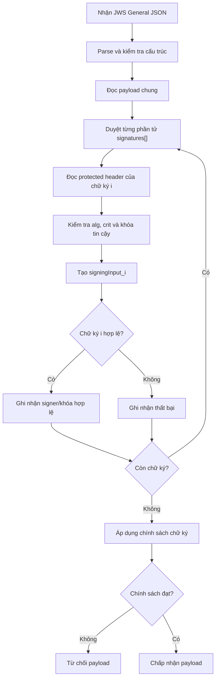
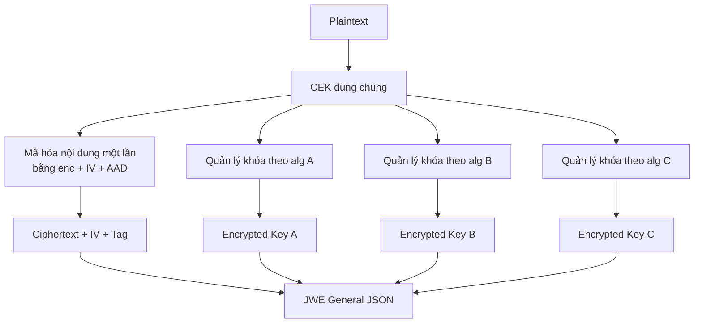

# Nhiều chữ ký hoặc nhiều bên nhận trong biểu diễn JSON

## 1. Hai bài toán khác nhau trong JOSE

Trong **SECURITY_TOKEN_SECURITY_JWT — Security - JSON Web Token (JWT)**, các biểu diễn JSON của JOSE cho phép một thông điệp có nhiều chữ ký hoặc có nhiều bên nhận. Hai khả năng này giải quyết hai bài toán bảo mật khác nhau:

- **Nhiều chữ ký trong JWS JSON General Serialization:** nhiều khóa/người ký cùng xác thực tính toàn vẹn và nguồn gốc của **một payload chung**. Mỗi chữ ký được tạo và xác minh độc lập.
- **Nhiều bên nhận trong JWE JSON General Serialization:** nhiều recipient được trao khả năng giải mã **một ciphertext chung**. Nội dung được mã hóa một lần; thông tin quản lý khóa được tạo riêng để từng recipient có thể khôi phục Content Encryption Key (CEK).

Vì vậy, không được nhầm:

| Câu hỏi | JWS nhiều chữ ký | JWE nhiều recipient |
| --- | --- | --- |
| Ai tham gia? | Người ký hoặc bên xác thực thông điệp | Người nhận được phép đọc nội dung |
| Cấu trúc JSON | Mảng `signatures` | Mảng `recipients` |
| Phần dùng chung | Payload | Protected Header, IV, ciphertext, tag và AAD |
| Phần riêng từng thành viên | Protected/unprotected header và chữ ký | Header recipient và Encrypted Key |
| Thao tác lặp | Ký/xác minh riêng từng chữ ký | Quản lý khóa/khôi phục CEK riêng từng recipient |
| Có tự tạo chính sách ngưỡng không? | Không | Không |

Đây là các khả năng của **General JSON Serialization**. JWS Flattened chỉ biểu diễn một chữ ký; JWE Flattened chỉ biểu diễn một recipient. Các dạng Compact cũng chỉ có một chữ ký hoặc một recipient tương ứng.

## 2. JWS General: nhiều chữ ký trên cùng payload

### 2.1. Cấu trúc signatures

JWS JSON General Serialization chứa một `payload` chung và mảng `signatures`. Mỗi phần tử của mảng là một chữ ký/MAC riêng:

```json
{
  "payload": "<payload-base64url>",
  "signatures": [
    {
      "protected": "<protected-header-A-base64url>",
      "header": {
        "kid": "signer-A"
      },
      "signature": "<signature-A-base64url>"
    },
    {
      "protected": "<protected-header-B-base64url>",
      "header": {
        "kid": "signer-B"
      },
      "signature": "<signature-B-base64url>"
    }
  ]
}
```

Các giá trị trong dấu ngoặc nhọn chỉ là placeholder, không phải chữ ký hoặc token có thể xác minh.

Ý nghĩa:

- `payload` là dữ liệu chung được tất cả chữ ký xác thực.
- `signatures` là mảng chứa một hoặc nhiều chữ ký.
- `protected` là protected header riêng của chữ ký đó, được mã hóa UTF-8 rồi base64url.
- `header` là unprotected header riêng của chữ ký đó, nếu có.
- `signature` là kết quả chữ ký số hoặc MAC tương ứng.

Mỗi chữ ký có thể sử dụng thuật toán và khóa khác nhau. Ví dụ, bên A có thể dùng RSA-PSS với SHA-256 (`PS256`), còn bên B dùng ECDSA P-256 với SHA-256 (`ES256`). Bên nhận phải xác minh từng chữ ký bằng đúng thuật toán và khóa được chính sách tin cậy cho phép.

**Payload chỉ xuất hiện một lần.** General Serialization không tạo bản payload riêng cho từng người ký, cũng không làm chữ ký sau ký lên chữ ký trước. Mỗi chữ ký độc lập ràng buộc với payload chung và protected header của chính nó.

### 2.2. Signing input của từng chữ ký

Với JWS thông thường, đặt:

- `protected_i`: chuỗi base64url của protected header trong chữ ký thứ *i*.
- `payload`: chuỗi base64url dùng chung của payload.

Signing input của chữ ký thứ *i* là:

```text
signingInput_i = ASCII(protected_i + "." + payload)
signature_i = SIGN_OR_MAC(alg_i, key_i, signingInput_i)
```

Do protected header có thể khác nhau, **signing input của các chữ ký không nhất thiết giống nhau**, dù payload giống nhau. Bên xác minh phải dùng nguyên protected segment và payload segment nhận được, không parse JSON rồi tuần tự hóa lại trước khi xác minh.

Unprotected header của chữ ký không nằm trong signing input. Nếu `kid` đặt trong vùng này, nó chỉ là gợi ý tra cứu; khóa cuối cùng vẫn phải đến từ nguồn tin cậy và phải tương thích với thuật toán được chấp nhận.

### 2.3. Mỗi chữ ký có thể có chính sách thuật toán riêng

Ví dụ hai protected header:

```json
{
  "alg": "PS256",
  "typ": "application/example"
}
```

```json
{
  "alg": "ES256",
  "typ": "application/example"
}
```

Hai header có thể thuộc hai chữ ký khác nhau trên cùng payload. Việc cho phép nhiều thuật toán không có nghĩa là bên nhận được chấp nhận mọi giá trị `alg` do thông điệp cung cấp. Mỗi thuật toán phải nằm trong allowlist của ngữ cảnh, khóa phải đúng loại và chính sách phải xác định rõ chữ ký nào được công nhận.

Trong profile bảo mật, nên đặt `alg` trong protected header để ràng buộc thuật toán với chữ ký. Dù `alg` nằm trong protected header, bên nhận vẫn phải kiểm tra allowlist; chữ ký hợp lệ không tự cấp quyền sử dụng một thuật toán yếu hoặc không được phép.

## 3. Chính sách chấp nhận nhiều chữ ký

JWS General Serialization chỉ **mang** nhiều chữ ký. Nó không định nghĩa ý nghĩa nghiệp vụ của chúng. Ứng dụng phải xác định chữ ký nào cần hợp lệ và điều kiện nào dẫn tới chấp nhận payload.

### 3.1. Các kiểu chính sách thường gặp

| Chính sách | Điều kiện chấp nhận | Ví dụ |
| --- | --- | --- |
| **Một chữ ký được tin cậy** | Có ít nhất một chữ ký hợp lệ từ một bên/khóa thuộc tập được phép | Một trong các nhà cung cấp dịch vụ được ủy quyền xác nhận |
| **Tất cả chữ ký bắt buộc** | Mọi người ký bắt buộc đều có chữ ký hợp lệ | Người lập và người phê duyệt đều phải ký |
| **Một nhóm chữ ký cụ thể** | Một tập định danh người ký được chỉ định phải xuất hiện và hợp lệ | Đại diện pháp lý và kiểm soát nội bộ |
| **Ngưỡng N trên M** | Ít nhất N người ký khác nhau trong nhóm M được xác thực | Cần 2 trong 3 thành viên hội đồng |

Các chính sách trên là logic ứng dụng đặt trên kết quả xác minh JWS. Mảng `signatures` tự nó không thể biểu diễn rằng “cần 2 trong 3 chữ ký”, cũng không xác định `kid` nào thuộc người có thẩm quyền.

### 3.2. Vì sao nhiều chữ ký không tự tạo chữ ký ngưỡng?

Giả sử một thông điệp có ba chữ ký hợp lệ. JWS cho biết ba phép xác minh tương ứng đều thành công theo khóa/thuật toán đã chọn. JWS không biết:

- Ba khóa có thuộc ba cá nhân khác nhau hay không.
- Một cá nhân có đang sở hữu nhiều khóa hay không.
- Có chữ ký nào bắt buộc theo quy trình phê duyệt không.
- Có cần 2/3, 3/3 hay chỉ một chữ ký không.
- Một chữ ký đã bị thu hồi hoặc người ký không còn quyền phê duyệt hay không.

Để triển khai chính sách N-trên-M, hệ thống cần ánh xạ khóa đã xác minh sang danh tính/vai trò tin cậy, loại bỏ việc đếm trùng một người, kiểm tra trạng thái ủy quyền và áp dụng điều kiện ngưỡng riêng. Đây là **quy tắc phê duyệt ở tầng ứng dụng**, không phải tính năng threshold cryptography của JWS.

### 3.3. Thứ tự và chữ ký trùng lặp

Không nên dùng vị trí phần tử trong mảng `signatures` để suy ra thứ bậc người ký hoặc mức độ tin cậy. Nếu nghiệp vụ có thứ tự phê duyệt, thứ tự đó phải được ràng buộc trong dữ liệu được ký hoặc trong một quy trình đáng tin cậy khác.

Tương tự, không nên đếm hai phần tử có cùng `kid` hoặc cùng khóa như hai người ký độc lập. Danh tính người ký phải được xác định từ khóa đã xác minh và nguồn quản lý danh tính/ủy quyền.

## 4. Quy trình tạo và xác minh JWS nhiều chữ ký

### 4.1. Bên tạo

1. Chuẩn bị payload duy nhất và tuần tự hóa thành bytes.
2. Xác định danh sách người ký/khóa và chính sách thuật toán.
3. Với từng người ký, tạo protected header riêng, gồm `alg` và các tham số được bảo vệ cần thiết.
4. Mã hóa protected header và payload bằng base64url.
5. Tạo signing input riêng cho từng chữ ký.
6. Ký/MAC bằng khóa tương ứng và tạo phần tử trong mảng `signatures`.
7. Ghép các phần tử với payload chung thành JWS General JSON.

### 4.2. Bên nhận

1. Parse JSON nghiêm ngặt; kiểm tra cấu trúc, giới hạn số chữ ký và từ chối tên thành viên JSON trùng lặp.
2. Lấy payload segment chung và giữ nguyên biểu diễn gốc.
3. Với mỗi chữ ký, giải mã protected header, kiểm tra tham số trùng giữa protected/unprotected header và xử lý `crit`.
4. Kiểm tra `alg` có trong allowlist và tương thích với khóa.
5. Chọn khóa từ tập khóa tin cậy theo issuer/đối tác và `kid` (nếu có).
6. Tạo signing input từ protected segment của chữ ký đó và payload segment chung.
7. Xác minh chữ ký/MAC và ghi nhận kết quả cùng danh tính/khóa đã xác thực.
8. Áp dụng chính sách: tất cả, một chữ ký được phép, nhóm bắt buộc hoặc N-trên-M.
9. Chỉ chấp nhận payload sau khi chính sách được thỏa mãn.



Mã giả minh họa:

```text
function verifyMultiSignatureJws(jws, policy, trustedKeys):
    require isStrictJsonObject(jws)
    rejectDuplicateJsonMemberNames(jws)
    require isBase64UrlString(jws.payload)
    require isNonEmptyArray(jws.signatures)
    require length(jws.signatures) <= policy.maxSignatures

    results = []

    for entry in jws.signatures:
        protectedSegment = entry.protected or ""
        protected = parseProtectedHeader(protectedSegment)
        unprotected = entry.header or {}

        require noDuplicateNames(protected, unprotected)
        require criticalParametersAreSupported(protected)
        require protected.alg in policy.allowedAlgorithms

        key = selectKeyFromTrustedSource(
            trustedKeys,
            policy.expectedIssuer,
            protected.kid or unprotected.kid,
            protected.alg
        )
        require key exists and isCompatible(key, protected.alg)

        signingInput = ASCII(protectedSegment + "." + jws.payload)
        signature = base64urlDecodeStrict(entry.signature)
        valid = verifySignatureOrMac(
            protected.alg, key, signingInput, signature
        )

        results.append({
            "valid": valid,
            "principal": trustedPrincipalFor(key),
            "keyId": trustedKeyIdFor(key)
        })

    require policy.acceptanceRule(results)
    return base64urlDecodeStrict(jws.payload)
```

Đây là mã giả khái quát. Việc tra khóa từ unprotected `kid` chỉ được dùng như gợi ý; khóa tìm được phải thuộc nguồn tin cậy đã cấu hình. `acceptanceRule` phải kiểm tra danh tính duy nhất, vai trò, trạng thái ủy quyền và điều kiện chữ ký cụ thể, không chỉ đếm số phần tử có `valid = true`.

## 5. JWE General: nhiều recipient cùng giải mã một nội dung

### 5.1. Cấu trúc recipients

JWE JSON General Serialization có một tập dữ liệu mã hóa dùng chung và mảng `recipients`. Mỗi recipient có phần tử riêng để khôi phục CEK:

```json
{
  "protected": "<protected-header-base64url>",
  "recipients": [
    {
      "header": {
        "alg": "RSA-OAEP-256",
        "kid": "recipient-A"
      },
      "encrypted_key": "<encrypted-cek-for-A>"
    },
    {
      "header": {
        "alg": "ECDH-ES+A256KW",
        "kid": "recipient-B"
      },
      "encrypted_key": "<encrypted-cek-for-B>"
    }
  ],
  "iv": "<shared-iv>",
  "ciphertext": "<shared-ciphertext>",
  "tag": "<shared-authentication-tag>"
}
```

Đây là cấu trúc minh họa; giá trị placeholder không thể giải mã. Trong ví dụ, Protected Header chung có thể chứa `enc`, ví dụ `A256GCM`. Mỗi recipient có thuật toán quản lý khóa (`alg`) và `kid` phù hợp với khóa của mình.

Các thành phần:

- `protected`: header được bảo vệ chung cho toàn JWE.
- `recipients`: danh sách người nhận có quyền khôi phục CEK.
- `header`: tham số riêng của recipient đang xét.
- `encrypted_key`: CEK đã được mã hóa/bọc cho recipient đó; nếu thuật toán không dùng Encrypted Key, giá trị là chuỗi rỗng theo quy tắc JWE JSON.
- `iv`, `ciphertext`, `tag`: một bộ dùng chung cho mọi recipient.
- `aad`: dữ liệu bổ sung được xác thực nhưng không mã hóa, nếu có.

### 5.2. Mã hóa nội dung một lần, quản lý CEK theo từng recipient

JWE nhiều recipient **không tạo một ciphertext riêng cho từng người nhận**. Bên gửi tạo hoặc thiết lập một CEK dùng để mã hóa plaintext một lần. Sau đó, CEK được phân phối cho từng recipient bằng thuật toán quản lý khóa tương ứng:

1. Tạo plaintext và CEK.
2. Chọn một `enc` dùng chung, ví dụ `A256GCM`.
3. Mã hóa plaintext bằng CEK, IV và AAD, thu được ciphertext và tag.
4. Với mỗi recipient, sử dụng khóa và `alg` tương ứng để mã hóa/bọc cùng CEK hoặc thiết lập cách khôi phục CEK theo quy tắc thuật toán.
5. Đưa từng kết quả quản lý khóa vào `encrypted_key` của recipient tương ứng.
6. Đóng gói một bộ ciphertext/IV/tag cùng toàn bộ phần tử recipient trong General JSON.



Các `alg` có thể khác nhau giữa recipient, nhưng thuật toán mã hóa nội dung `enc` và dữ liệu cần cho thao tác mã hóa nội dung là chung. Cấu hình thuật toán phải bảo đảm mọi recipient có thể khôi phục **cùng CEK**. Chẳng hạn, chế độ thỏa thuận khóa trực tiếp tạo CEK riêng theo từng cặp khóa không thể tùy tiện dùng như thể nó đang phân phối một CEK chung; cần chọn chế độ quản lý khóa phù hợp, như thỏa thuận KEK rồi bọc CEK khi cần nhiều recipient.

### 5.3. Một recipient giải mã là đủ

JWE nhiều recipient mang nghĩa: **mỗi recipient được liệt kê có thể tự mình khôi phục CEK và giải mã cùng nội dung**, nếu sở hữu khóa phù hợp. Bên nhận chỉ cần xử lý một recipient mà mình có quyền truy cập; không cần tất cả recipient cùng tham gia.

Vì thế:

- Thêm recipient mở rộng số bên có thể đọc plaintext.
- Recipient A không cần recipient B cung cấp khóa hoặc chấp thuận.
- JWE General không phải cơ chế đồng thuận hay mã hóa ngưỡng.
- Nếu cần nhiều người cùng phê duyệt trước khi đọc nội dung, phải thiết kế cơ chế kiểm soát bổ sung hoặc dùng giải pháp threshold cryptography/secret sharing phù hợp; chỉ thêm nhiều phần tử vào `recipients` không tạo ra điều kiện N-trên-M.

## 6. Quy trình tạo và giải mã JWE nhiều recipient

### 6.1. Bên gửi

1. Xác định danh sách recipient được phép nhận cùng nội dung.
2. Chọn `enc` và tạo CEK/IV theo yêu cầu thuật toán.
3. Xây dựng Protected Header và AAD chung.
4. Mã hóa plaintext một lần để tạo ciphertext và Authentication Tag.
5. Với từng recipient, chọn `alg` được chính sách cho phép và tương thích khóa; tạo `encrypted_key` tương ứng.
6. Tạo một phần tử `recipients` cho mỗi recipient.
7. Kiểm tra header không có tên tham số trùng giữa Protected Header, Shared Unprotected Header và Per-Recipient Header.
8. Xuất JWE General JSON.

### 6.2. Bên nhận

1. Parse đối tượng JSON nghiêm ngặt và kiểm tra số lượng recipient trong giới hạn.
2. Xác định recipient của chính mình từ cấu hình/định danh tin cậy; không thử tùy tiện mọi khóa.
3. Hợp nhất Protected Header, Shared Unprotected Header và header của recipient; từ chối tên tham số trùng.
4. Kiểm tra `alg`, `enc`, `crit`, `kid` và chính sách khóa.
5. Dùng khóa riêng/khóa đối xứng phù hợp để khôi phục CEK từ `encrypted_key`, hoặc thực hiện key agreement theo thuật toán.
6. Tạo lại AAD từ Protected Header và trường `aad` (nếu có).
7. Giải mã ciphertext và xác minh Authentication Tag.
8. Chỉ khi tag hợp lệ mới cung cấp plaintext cho tầng xử lý.

Nếu recipient không có khóa tương ứng hoặc không thể khôi phục CEK, việc thử recipient đó thất bại; một recipient hợp lệ khác vẫn có thể giải mã cùng JWE. Không được trả plaintext một phần trước khi xác thực tag thành công.

## 7. So sánh JWS nhiều chữ ký và JWE nhiều recipient

| Thuộc tính | JWS General nhiều chữ ký | JWE General nhiều recipient |
| --- | --- | --- |
| Mục đích | Thu thập nhiều bằng chứng xác thực cho cùng payload | Cấp quyền giải mã cùng nội dung cho nhiều bên |
| Mảng JSON | `signatures` | `recipients` |
| Dữ liệu chung | Payload | Protected Header, IV, ciphertext, tag, AAD |
| Dữ liệu riêng | Protected/unprotected header và signature | Header recipient và encrypted_key |
| Mỗi thành viên làm gì? | Ký hoặc xác minh payload | Khôi phục CEK và giải mã payload |
| Thành viên có thể dùng thuật toán khác nhau? | Có, theo chính sách từng chữ ký | Có thể khác `alg`; `enc` vẫn dùng chung |
| Điều kiện tối thiểu ở tầng giao thức | Từng chữ ký được kiểm tra riêng | Ít nhất một recipient hợp lệ có thể giải mã và xác thực |
| Tự tạo quorum? | Không | Không |
| Bảo mật nội dung? | Không; payload JWS không được mã hóa | Có; ciphertext được mã hóa và xác thực |

Một cách ghi nhớ:

- **JWS nhiều chữ ký:** “Ai đã xác nhận thông điệp này?”
- **JWE nhiều recipient:** “Những ai có thể đọc thông điệp này?”

## 8. Kết hợp chữ ký và nhiều recipient

Một quy trình JOSE có thể cần cả xác thực nguồn gốc lẫn tính bí mật:

1. Nội dung được ký bằng JWS để bên nhận có thể xác minh bên ký.
2. Đối tượng đã ký được mã hóa bằng JWE để chỉ recipient được cấp CEK mới đọc được.
3. Nếu dùng JWE General, cùng bản mã có thể được cấp cho nhiều recipient; mỗi recipient có một cách khôi phục CEK riêng.

Trong mô hình **Nested JWT** theo RFC 7519, cấu trúc JWT lồng nhau tiêu chuẩn sử dụng JWT bên trong ở dạng Compact, ví dụ JWS Compact được đặt làm plaintext của JWE Compact. Nếu thay lớp JWS bên trong bằng General JWS JSON để mang nhiều chữ ký, đó là một cấu trúc JOSE tổng quát do giao thức ứng dụng quy định, **không còn là biểu diễn JWT Compact tiêu chuẩn theo RFC 7519**.

Đối với nội dung cần nhiều chữ ký và nhiều recipient, có thể thiết kế một envelope JOSE gồm JWS JSON General được JWE JSON General bảo vệ. Giao thức phải quy định rõ thứ tự xử lý, loại nội dung (`cty` nếu dùng), khóa/issuer tin cậy, chính sách chữ ký và recipient. Bên nhận phải giải mã JWE, xác minh từng chữ ký JWS, rồi áp dụng chính sách chấp nhận trước khi sử dụng payload.

**Mã hóa không thay thế chữ ký.** Người có khóa công khai mã hóa của recipient có thể tạo JWE mà recipient giải mã được; nếu cần chứng minh nội dung do một issuer cụ thể phát hành, phải xác minh chữ ký hoặc cơ chế xác thực nguồn gốc tương ứng.

## 9. Rủi ro và cách kiểm soát

### 9.1. Đếm phần tử thay vì xác minh danh tính

Kẻ tấn công có thể thêm nhiều chữ ký từ cùng một khóa hoặc các khóa không được tin cậy. Nếu ứng dụng chỉ đếm số phần tử trong `signatures`, nó có thể chấp nhận sai điều kiện phê duyệt.

**Kiểm soát:** ánh xạ khóa đã xác minh sang principal/role tin cậy; đếm người ký duy nhất; kiểm tra quyền và trạng thái ủy quyền tại thời điểm chấp nhận.

### 9.2. Chấp nhận chữ ký bất kỳ

Một chữ ký hợp lệ không nhất thiết là chữ ký của người có thẩm quyền. `kid` hoặc `alg` do thông điệp cung cấp không tự xác lập danh tính.

**Kiểm soát:** nguồn khóa phải gắn với issuer/đối tác được cấu hình; thuật toán phải có allowlist; chính sách phải chỉ rõ người ký/nhóm khóa được chấp nhận.

### 9.3. Coi nhiều recipient là cần nhiều người cùng mở

Trong JWE General, một recipient có thể tự khôi phục CEK và đọc plaintext. Thêm recipient không tạo ra quorum.

**Kiểm soát:** chỉ liệt kê người nhận thực sự được phép đọc. Nếu cần nhiều người cùng kiểm soát, dùng cơ chế phê duyệt hoặc mật mã ngưỡng riêng.

### 9.4. Để lộ nội dung qua recipient ngoài dự kiến

Mỗi recipient bổ sung là một bên có thể đọc cùng plaintext. Việc gửi JWE tới danh sách rộng hơn yêu cầu nghiệp vụ có thể làm lộ dữ liệu.

**Kiểm soát:** xác thực danh sách recipient trước khi tạo JWE; kiểm tra `kid`, chứng thư và nguồn khóa; giới hạn quyền phân phối CEK.

### 9.5. Trộn thuật toán hoặc khóa không tương thích

Một JWE nhiều recipient dùng chung CEK và `enc`; nếu cấu hình key management không tương thích, recipient có thể không khôi phục được CEK hoặc hệ thống xử lý sai.

**Kiểm soát:** kiểm tra từng `alg` theo khóa và đảm bảo chế độ có thể phân phối cùng CEK tới tất cả recipient. Không tùy tiện trộn direct key agreement với cơ chế bọc CEK.

### 9.6. Tin header không được bảo vệ

Unprotected header của chữ ký hoặc recipient có thể bị sửa mà không làm chữ ký/tag thất bại. Một `alg`, `kid` hoặc URL không được bảo vệ không thể tự quyết định chính sách khóa.

**Kiểm soát:** bảo vệ tham số cần bảo vệ khi cấu trúc cho phép; ràng buộc mọi lựa chọn khóa/thuật toán với cấu hình tin cậy; từ chối header trùng tên và tham số critical không được hỗ trợ.

### 9.7. Không giới hạn kích thước và số lượng

Mảng `signatures` hoặc `recipients` quá lớn có thể làm tăng chi phí xác minh, thao tác khóa, cấp phát bộ nhớ và thời gian xử lý.

**Kiểm soát:** giới hạn kích thước JSON, payload, số chữ ký, số recipient và tổng công việc mật mã; từ chối cấu trúc sai sớm.

### 9.8. Hiểu sai khả năng thu hồi recipient

Xóa một recipient khỏi bản JWE đang lưu có thể ngăn recipient đó giải mã **bản JSON đã sửa** nếu họ chưa lưu Encrypted Key/CEK. Tuy nhiên, không thể thu hồi plaintext hoặc CEK mà recipient đã lấy trước đó. Với nội dung mới, nên tạo JWE mới và quản lý khóa/recipient theo vòng đời rõ ràng.

**Kiểm soát:** coi việc cấp quyền đọc là quyết định không thể đảo ngược đối với dữ liệu đã giải mã; dùng mã hóa khóa theo phiên bản, thời hạn và quy trình xoay vòng cho các thông điệp tiếp theo.

## 10. Checklist thiết kế

- [ ] Xác định rõ bài toán là nhiều chữ ký xác thực hay nhiều recipient giải mã.
- [ ] Dùng JWS General khi cần nhiều chữ ký trên cùng payload; dùng JWE General khi cần nhiều recipient cho cùng ciphertext.
- [ ] Không dùng Flattened hoặc Compact nếu giao thức cần mảng nhiều thành viên.
- [ ] Với JWS, xác minh từng chữ ký trên đúng protected header và payload gốc.
- [ ] Ánh xạ khóa đã xác minh sang danh tính/ủy quyền; không đếm trùng người ký.
- [ ] Định nghĩa rõ chính sách tất cả/một nhóm/N-trên-M chữ ký.
- [ ] Với JWE, tạo một CEK và mã hóa nội dung một lần; quản lý CEK riêng cho từng recipient.
- [ ] Đảm bảo mọi recipient có thể khôi phục cùng CEK và dùng chung `enc`.
- [ ] Chỉ đưa recipient được phép đọc nội dung vào `recipients`.
- [ ] Không coi nhiều recipient là cơ chế yêu cầu nhiều người cùng phê duyệt hoặc giải mã.
- [ ] Kiểm tra protected/unprotected header, tên tham số trùng, `crit`, allowlist thuật toán và nguồn khóa.
- [ ] Chỉ chấp nhận payload sau khi các chữ ký hoặc Authentication Tag cần thiết đã được xác minh.
- [ ] Giới hạn số chữ ký, số recipient, kích thước payload và tài nguyên xử lý.
- [ ] Xác định rõ cấu trúc có phải JWT theo RFC 7519 hay chỉ là envelope JOSE tổng quát.

## 11. Câu hỏi tự kiểm tra

**Câu 1.** Trong JWS General Serialization, các chữ ký có cùng payload không?

**Đáp án:** Có. Payload xuất hiện một lần và được dùng chung; mỗi chữ ký có protected header, signing input và giá trị chữ ký riêng.

**Câu 2.** JWS General có tự đảm bảo tất cả chữ ký phải hợp lệ không?

**Đáp án:** Không. Ứng dụng phải quy định chữ ký nào bắt buộc và điều kiện chấp nhận payload.

**Câu 3.** Ba chữ ký hợp lệ có tự động tương đương ba người phê duyệt không?

**Đáp án:** Không. Cần ánh xạ khóa sang danh tính duy nhất và kiểm tra vai trò/ủy quyền; một người có thể sở hữu nhiều khóa.

**Câu 4.** Trong JWE General, ciphertext có được mã hóa riêng cho từng recipient không?

**Đáp án:** Không. Plaintext được mã hóa một lần; ciphertext, IV và tag dùng chung. Encrypted Key/thông tin quản lý CEK được tạo riêng cho mỗi recipient.

**Câu 5.** Một recipient có thể giải mã JWE General mà không cần các recipient khác không?

**Đáp án:** Có. Mỗi recipient được cấp khả năng khôi phục CEK có thể tự giải mã và xác thực cùng nội dung.

**Câu 6.** JWE General có thể dùng `alg` khác nhau cho từng recipient không?

**Đáp án:** Có thể, vì mỗi recipient có thể dùng phương thức quản lý CEK riêng; tuy nhiên `enc` và dữ liệu mã hóa nội dung vẫn dùng chung, và từng cấu hình phải hỗ trợ cùng CEK.

**Câu 7.** Thêm nhiều recipient có tạo ra cơ chế N-trên-M để giải mã không?

**Đáp án:** Không. Chỉ cần một recipient có thể khôi phục CEK là đủ. Muốn cơ chế ngưỡng phải dùng giải pháp riêng.

**Câu 8.** Có thể dùng JWS General JSON thay JWT Compact trong giao thức yêu cầu JWT theo RFC 7519 không?

**Đáp án:** Không. JWS General JSON là biểu diễn JWS tổng quát; JWT theo RFC 7519 sử dụng JWS Compact hoặc JWE Compact.

## 12. Tài liệu chuẩn tham khảo

- [RFC 7515 — JSON Web Signature (JWS)](https://www.rfc-editor.org/rfc/rfc7515): JWS General/Flattened JSON Serialization, mảng `signatures`, signing input và xác minh.
- [RFC 7516 — JSON Web Encryption (JWE)](https://www.rfc-editor.org/rfc/rfc7516): JWE General/Flattened JSON Serialization, mảng `recipients`, CEK, Encrypted Key và AAD.
- [RFC 7517 — JSON Web Key (JWK)](https://www.rfc-editor.org/rfc/rfc7517): biểu diễn khóa và JWK Set.
- [RFC 7518 — JSON Web Algorithms (JWA)](https://www.rfc-editor.org/rfc/rfc7518): thuật toán chữ ký/MAC, quản lý khóa và mã hóa nội dung.
- [RFC 7519 — JSON Web Token (JWT)](https://www.rfc-editor.org/rfc/rfc7519): Claims Set, Compact Serialization và Nested JWT.
- [RFC 8725 — JSON Web Token Best Current Practices](https://www.rfc-editor.org/rfc/rfc8725): thực hành an toàn về thuật toán, khóa, loại token và ngữ cảnh xác minh.

**Ghi nhớ:** JWS General dùng `signatures[]` để nhiều khóa xác thực cùng payload; JWE General dùng `recipients[]` để nhiều bên có thể khôi phục cùng CEK và đọc cùng ciphertext. Chính sách chữ ký và danh sách người nhận đều phải được ứng dụng kiểm soát. Nhiều chữ ký không tự tạo quorum; nhiều recipient cũng không yêu cầu tất cả cùng tham gia giải mã.
