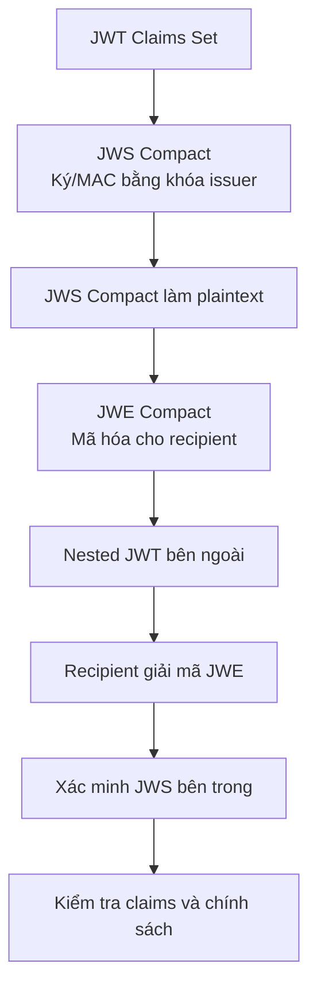

# JWT có chữ ký, JWT được mã hóa và Unsecured JWT

## 1. Ba cách biểu diễn JWT theo mức bảo vệ

**JSON Web Token (JWT)** là định dạng biểu diễn một tập claims (*JWT Claims Set*) dưới dạng JSON. JWT mô tả các phát biểu về một chủ thể, bên phát hành, bên nhận hoặc ngữ cảnh sử dụng. Bản thân việc dữ liệu có hình dạng JWT **không tự bảo đảm tính toàn vẹn, tính xác thực hay tính bí mật**. Những thuộc tính đó phụ thuộc vào cách JWT được bảo vệ.

Trong module **SECURITY_TOKEN_SECURITY_JWT — Security - JSON Web Token (JWT)**, nội dung này tập trung vào các lựa chọn bảo vệ JWT theo tiêu chuẩn JOSE: JWS có chữ ký/MAC, JWE mã hóa và Unsecured JWT không có bảo vệ mật mã. Đây là kiến thức ở mức giao thức bảo mật tổng quát, không phụ thuộc một ngôn ngữ lập trình hoặc framework cụ thể.

Theo [RFC 7519](https://www.rfc-editor.org/rfc/rfc7519), JWT có thể được biểu diễn theo ba trường hợp quan trọng:

1. **JWT có chữ ký hoặc MAC (JWS):** claims được bảo vệ tính toàn vẹn và có thể xác thực bên sở hữu khóa phù hợp. Nội dung thường vẫn đọc được.
2. **JWT được mã hóa (JWE):** claims được mã hóa để chỉ bên có khả năng khôi phục khóa nội dung mới đọc được; thuật toán mã hóa có xác thực còn bảo vệ tính toàn vẹn của bản mã.
3. **Unsecured JWT:** JWT không có chữ ký/MAC, sử dụng thuật toán `alg: none`; nội dung không có bảo vệ mật mã ở cấp JWT.

| Loại JWT | Cơ chế | Tính toàn vẹn ở cấp token | Tính bí mật của claims | Biểu diễn Compact |
| --- | --- | --- | --- | --- |
| **JWT có chữ ký/MAC** | JWS | Có, nếu xác minh thành công | Không | 3 phần |
| **JWT được mã hóa** | JWE | Có xác thực bản mã theo thuật toán JWE | Có | 5 phần |
| **Unsecured JWT** | JWS với `alg: none` | Không | Không | 3 phần, phần chữ ký rỗng |

Trong thực tế API, JWT có chữ ký/MAC thường được dùng khi bên nhận cần xác minh claims; JWT được mã hóa được dùng khi nội dung cần giữ kín; Unsecured JWT thường không phù hợp cho xác thực hoặc phân quyền nếu không có một cơ chế bảo vệ độc lập được giao thức quy định rõ.

## 2. Cùng một Claims Set, cách bảo vệ khác nhau

Giả sử một bên phát hành tạo claims:

```json
{
  "iss": "https://issuer.example",
  "sub": "account-42",
  "aud": "orders-api",
  "iat": 1795000000,
  "exp": 1795003600,
  "scope": "orders:read"
}
```

Đây là ví dụ minh họa. Các claim có ý nghĩa:

- `iss` (*issuer*): bên phát hành token.
- `sub` (*subject*): chủ thể được token nói đến.
- `aud` (*audience*): bên nhận dự kiến.
- `iat` (*issued at*): thời điểm phát hành.
- `exp` (*expiration time*): thời điểm hết hạn.
- `scope`: ví dụ về claim do giao thức/ứng dụng quy ước; không phải claim đăng ký cốt lõi bắt buộc của JWT.

Cùng một Claims Set có thể được:

- Đưa vào payload của JWS Compact và ký/MAC.
- Dùng làm plaintext của JWE Compact và mã hóa.
- Đưa vào một JWS với `alg: none`, không tạo chữ ký/MAC.

Claims không đổi ý nghĩa chỉ vì cách bảo vệ thay đổi. Nhưng khả năng tin cậy và xử lý chúng thay đổi đáng kể: claims chỉ được sử dụng sau khi bên nhận thực hiện đúng cơ chế bảo vệ mà giao thức yêu cầu.

## 3. JWT có chữ ký hoặc MAC: JWS

### 3.1. Cấu trúc

JWT có chữ ký/MAC thường dùng **JWS Compact Serialization**, gồm ba phần:

```text
BASE64URL(UTF8(Protected Header))
    .
BASE64URL(JWT Claims Set)
    .
BASE64URL(Signature-or-MAC)
```

Ví dụ header:

```json
{
  "alg": "PS256",
  "typ": "JWT",
  "kid": "issuer-signing-2026-01"
}
```

- `alg` chỉ thuật toán JWS được dùng để tạo/xác minh chữ ký hoặc MAC.
- `typ` có thể xác định loại đối tượng là JWT; giá trị này hữu ích để phân biệt token theo profile.
- `kid` gợi ý định danh khóa dùng để tìm khóa phù hợp trong nguồn khóa đã tin cậy.

Ví dụ `PS256` là chữ ký RSA-PSS với SHA-256. Một JWS cũng có thể sử dụng MAC đối xứng như `HS256`. Vì vậy, cách gọi phổ biến “JWT có chữ ký” thường bao gồm cả JWT được bảo vệ bằng MAC; xét chính xác về mật mã, HMAC là MAC chứ không phải chữ ký số bất đối xứng.

### 3.2. Dữ liệu được ký/MAC

Với JWS Compact thông thường:

```text
headerSegment  = BASE64URL(UTF8(protectedHeaderJSON))
payloadSegment = BASE64URL(UTF8(claimsSetJSON))

signingInput = ASCII(headerSegment + "." + payloadSegment)

signatureOrMAC = SIGN_OR_MAC(alg, key, signingInput)

token = headerSegment + "." + payloadSegment
        + "." + BASE64URL(signatureOrMAC)
```

Chữ ký/MAC bảo vệ chính xác hai đoạn đầu cùng dấu chấm ở giữa. Khi xác minh, bên nhận phải dùng nguyên hai đoạn gốc trong token. Không parse JSON rồi serialize lại để tạo signing input, vì thứ tự thuộc tính, khoảng trắng hoặc biểu diễn bytes có thể khác.

### 3.3. Mô hình khóa và mức tin cậy

| Cơ chế | Thuật toán ví dụ | Khóa tạo | Khóa xác minh | Ý nghĩa |
| --- | --- | --- | --- | --- |
| MAC đối xứng | `HS256` | Khóa bí mật chung | Cùng khóa bí mật | Bên tạo và bên xác minh đều có khả năng tạo MAC |
| Chữ ký bất đối xứng | `PS256`, `ES256` | Khóa riêng của issuer | Khóa công khai tương ứng | Bên nhận có thể xác minh mà không giữ khóa ký riêng |

Với chữ ký bất đối xứng, khóa công khai có thể được phân phối qua JWK/JWKS từ nguồn đã được cấu hình tin cậy. Với MAC, mọi bên giữ khóa chung đều có khả năng tạo token hợp lệ, vì thế không thể dùng MAC để phân biệt bên nào trong nhóm đã tạo token.

### 3.4. JWS không che giấu claims

Header và payload của JWS Compact chỉ được base64url-encode. Người sở hữu token có thể giải mã hai phần này và đọc claims mà không cần khóa bí mật.

Vì vậy:

- Không đặt mật khẩu, khóa bí mật hoặc dữ liệu cần giữ kín vào payload JWS.
- Không xem base64url là mã hóa.
- Nếu chỉ cần bảo vệ tính toàn vẹn và xác thực, JWS có thể phù hợp.
- Nếu claims cần được giữ kín, cần JWE hoặc cơ chế mã hóa phù hợp.

**Chữ ký hợp lệ không có nghĩa claims hợp lệ về nghiệp vụ.** Bên nhận vẫn phải kiểm tra issuer, audience, thời hạn, loại token và quyền được yêu cầu.

## 4. JWT được mã hóa: JWE

### 4.1. Cấu trúc năm phần

JWT được mã hóa thường dùng **JWE Compact Serialization**, có năm đoạn:

```text
BASE64URL(Protected Header)
    .
BASE64URL(Encrypted Key)
    .
BASE64URL(IV)
    .
BASE64URL(Ciphertext)
    .
BASE64URL(Authentication Tag)
```

Ví dụ Protected Header:

```json
{
  "alg": "RSA-OAEP-256",
  "enc": "A256GCM",
  "cty": "JWT",
  "kid": "recipient-encryption-2026-01"
}
```

Các trường quan trọng:

- `alg`: thuật toán quản lý/thiết lập Content Encryption Key (CEK), ví dụ `RSA-OAEP-256`.
- `enc`: thuật toán mã hóa nội dung bằng CEK, ví dụ `A256GCM`.
- `cty`: loại nội dung bên trong. `cty: JWT` thường được dùng khi JWE chứa một JWT lồng nhau.
- `kid`: gợi ý khóa recipient dùng để giải mã hoặc khôi phục CEK.

Năm phần của JWE Compact:

| Phần | Ý nghĩa |
| --- | --- |
| Protected Header | Thông tin thuật toán và tham số JOSE, được bảo vệ tính toàn vẹn |
| Encrypted Key | CEK đã được mã hóa/bọc cho recipient; có thể rỗng với một số thuật toán |
| IV | Giá trị khởi tạo/nonce của thuật toán mã hóa nội dung |
| Ciphertext | Plaintext sau khi mã hóa |
| Authentication Tag | Giá trị xác thực bản mã và dữ liệu AAD |

### 4.2. Hai lớp thuật toán: alg và enc

JWE tách biệt quản lý khóa và mã hóa nội dung:

1. Bên gửi tạo hoặc thiết lập CEK phù hợp với `enc`.
2. Bên gửi dùng `alg` để mã hóa/bọc CEK cho recipient hoặc thực hiện thỏa thuận khóa.
3. CEK được dùng cùng IV và AAD để mã hóa plaintext, tạo ciphertext và Authentication Tag.
4. Bên nhận dùng khóa phù hợp để khôi phục CEK, sau đó giải mã và xác minh tag.

Ví dụ, với `RSA-OAEP-256` và `A256GCM`, CEK được bọc cho khóa công khai của recipient; recipient dùng khóa riêng tương ứng để khôi phục CEK và dùng CEK giải mã ciphertext.

### 4.3. JWE bảo vệ điều gì?

JWE cung cấp:

- **Tính bí mật:** người không có khả năng khôi phục CEK không thể đọc plaintext theo giả định an toàn của thuật toán và khóa.
- **Tính toàn vẹn/xác thực bản mã:** thay đổi ciphertext, IV hoặc AAD sẽ khiến kiểm tra Authentication Tag thất bại theo thuật toán được sử dụng.
- **Bảo vệ Protected Header:** các tham số được bảo vệ được ràng buộc vào AAD.

JWE không tự chứng minh ai đã phát hành nội dung. Ví dụ, bất kỳ ai có khóa công khai mã hóa của recipient thường đều có thể tạo một JWE mà recipient giải mã được. Nếu cần xác minh nội dung do issuer cụ thể phát hành, cần chữ ký JWS bên trong hoặc cơ chế xác thực nguồn gốc khác.

### 4.4. JWE JSON và JWE Compact trong JWT

RFC 7519 quy định JWT được biểu diễn bằng JWS Compact hoặc JWE Compact. JWE JSON General/Flattened là các serialization JWE tổng quát; không nên tự động xem một đối tượng JWE JSON có claims bên trong là JWT Compact.

## 5. Unsecured JWT: JWT không có chữ ký/MAC

### 5.1. Cấu trúc với alg: none

RFC 7519 định nghĩa **Unsecured JWT** là JWT được biểu diễn dưới dạng JWS với thuật toán `none`. Header có dạng:

```json
{
  "alg": "none",
  "typ": "JWT"
}
```

Dạng Compact có ba phần, nhưng phần chữ ký rỗng:

```text
BASE64URL(Protected Header).BASE64URL(Claims Set).
```

Dấu chấm cuối cùng vẫn là dấu phân tách phần thứ ba. Ví dụ hình dạng:

```text
eyJhbGciOiJub25lIiwidHlwIjoiSldUIn0.eyJzdWIiOiJhY2NvdW50LTQyIn0.
```

Chuỗi trên chỉ minh họa cấu trúc. Nó không có chữ ký/MAC và không cung cấp bảo đảm toàn vẹn ở cấp JWT.

### 5.2. Hệ quả bảo mật

Vì không có chữ ký/MAC:

- Bất kỳ ai có thể sửa payload đều có thể thay đổi claims mà không cần khóa ký.
- Không có bằng chứng mật mã rằng token được tạo bởi issuer đã khai báo trong `iss`.
- Không có cơ chế phát hiện chỉnh sửa header hoặc payload ở cấp JWT.
- Claims như `sub`, `aud`, `exp`, `scope` không thể được tin chỉ vì chúng xuất hiện trong token.

TLS có thể bảo vệ dữ liệu trong quá trình truyền giữa hai điểm kết nối, nhưng **không biến một Unsecured JWT thành JWT có chữ ký**. Nếu token bị lộ, lưu trữ sai hoặc được chuyển qua một thành phần không đáng tin, nội dung có thể bị sửa mà không có kiểm tra mật mã ở cấp token.

### 5.3. Có nên chấp nhận alg: none?

Trong hệ thống xác thực/phân quyền thông thường, chính sách nên **từ chối Unsecured JWT**. RFC 8725 khuyến nghị tránh các cấu hình thuật toán không an toàn và yêu cầu kiểm soát thuật toán chặt chẽ.

Một giao thức đặc biệt có thể định nghĩa ngữ cảnh sử dụng token không được bảo vệ mật mã nếu nó có cơ chế bảo vệ độc lập và xác định rõ ranh giới tin cậy. Khi đó, việc chấp nhận phải được cấu hình tường minh cho đúng loại token và đúng ngữ cảnh. Không được:

- Chấp nhận `none` chỉ vì thư viện có hỗ trợ.
- Cho token tự chọn `alg` mà không có allowlist.
- Dùng cùng một luồng xác minh cho token có chữ ký và token không chữ ký.
- Chấp nhận Unsecured JWT để cấp quyền chỉ dựa trên claims chưa được xác thực.

## 6. Nested JWT: vừa ký vừa mã hóa

Khi cần cả xác thực nguồn gốc và tính bí mật, có thể kết hợp JWS và JWE theo mô hình **Nested JWT**:

1. Tạo JWT Claims Set.
2. Đóng gói claims thành JWS Compact và ký/MAC bằng khóa của issuer.
3. Dùng toàn bộ JWS Compact làm plaintext của JWE.
4. Mã hóa JWE cho recipient.

Sơ đồ:



Protected Header của JWS bên trong có thể là:

```json
{
  "alg": "PS256",
  "typ": "JWT",
  "kid": "issuer-signing-key"
}
```

Protected Header của JWE bên ngoài có thể là:

```json
{
  "alg": "RSA-OAEP-256",
  "enc": "A256GCM",
  "cty": "JWT",
  "kid": "recipient-encryption-key"
}
```

Trong trường hợp này:

- Lớp JWE bên ngoài bảo vệ tính bí mật của JWS bên trong.
- Lớp JWS bên trong bảo vệ tính toàn vẹn và xác thực nội dung theo khóa ký/MAC.
- `cty: JWT` trên lớp ngoài chỉ ra nội dung bên trong là một JWT lồng nhau.

Khi nhận, recipient phải giải mã JWE thành công, sau đó xác minh JWS bên trong và kiểm tra claims. **Giải mã JWE thành công không thay thế xác minh chữ ký JWS.**

## 7. So sánh ba loại JWT

| Tiêu chí | JWT có chữ ký/MAC (JWS) | JWT được mã hóa (JWE) | Unsecured JWT |
| --- | --- | --- | --- |
| Serialization phổ biến | JWS Compact | JWE Compact | JWS với `alg: none` |
| Số phần Compact | 3 | 5 | 3, signature rỗng |
| Bảo vệ toàn vẹn | Có | Có xác thực bản mã | Không |
| Xác thực nguồn tạo | Có thể, theo mô hình khóa | Không tự có | Không |
| Giữ kín claims | Không | Có | Không |
| Có thể đọc payload trực tiếp? | Có | Không nếu không giải mã | Có |
| Khóa cần thiết ở bên nhận | Khóa xác minh/MAC | Khóa khôi phục CEK/giải mã | Không có khóa xác minh JWT |
| Dùng phổ biến cho API | Có | Khi cần bí mật nội dung | Không nên dùng cho xác thực/phân quyền |

**Lưu ý:** JWE bảo vệ bản mã bằng thuật toán mã hóa có xác thực, nhưng không đồng nghĩa có chữ ký số của issuer. Nếu yêu cầu cả hai thuộc tính, sử dụng Nested JWT hoặc cơ chế xác thực nguồn gốc tương đương.

## 8. Quy trình tiếp nhận và xác minh JWT

Không nên chỉ nhìn số đoạn hoặc decode payload để quyết định token có hợp lệ hay không. Bên nhận phải biết giao thức mong đợi loại JWT nào và thực hiện đúng các bước.

### 8.1. Kiểm tra cấu trúc và loại token

1. Xác định endpoint/giao thức đang chờ JWS, JWE hay Nested JWT.
2. Kiểm tra cấu trúc Compact tương ứng: JWS có ba phần; JWE có năm phần.
3. Parse header theo quy tắc nghiêm ngặt và giới hạn kích thước token.
4. Kiểm tra token type/profile theo cấu hình; không để token thuộc loại khác được sử dụng thay thế.

Số phần chỉ là kiểm tra cấu trúc sơ bộ. Một chuỗi ba phần chưa chắc là JWT hợp lệ; một chuỗi năm phần chưa chắc có thể giải mã hoặc được chấp nhận.

### 8.2. Với JWT có chữ ký/MAC

1. Chỉ chấp nhận `alg` nằm trong allowlist đã cấu hình.
2. Chọn khóa từ nguồn tin cậy gắn với issuer/ngữ cảnh dự kiến; `kid` chỉ là gợi ý tra cứu.
3. Xác minh chữ ký/MAC trên signing input tạo từ hai đoạn gốc.
4. Nếu xác minh thất bại, từ chối token; không tiếp tục sử dụng claims.
5. Khi thành công, parse Claims Set và kiểm tra các điều kiện nghiệp vụ.

Không dùng thuật toán do token tự khai báo như một chính sách. Không cho phép thuật toán `none` trong luồng yêu cầu token có bảo vệ mật mã.

### 8.3. Với JWT được mã hóa

1. Chỉ chấp nhận `alg` và `enc` được cho phép.
2. Chọn recipient/key phù hợp từ cấu hình tin cậy.
3. Khôi phục CEK và giải mã JWE.
4. Xác minh Authentication Tag trước khi cung cấp plaintext.
5. Nếu plaintext là JWS lồng nhau, tiếp tục xác minh chữ ký/MAC bên trong.
6. Parse Claims Set và kiểm tra các điều kiện nghiệp vụ.

Không coi JWE giải mã thành công là bằng chứng issuer đã ký claims.

### 8.4. Với Unsecured JWT

Trong luồng xác thực/phân quyền thông thường, từ chối `alg: none`. Chỉ xử lý nếu một profile đặc biệt đã quy định rõ cách bảo vệ độc lập, loại token, nguồn gửi và giới hạn sử dụng; tuyệt đối không trộn vào luồng xác minh JWS có chữ ký/MAC.

## 9. Kiểm tra claims sau khi bảo vệ mật mã

JWS/JWE chỉ giải quyết một phần yêu cầu an ninh. Sau khi hoàn tất các bước mật mã, bên nhận vẫn phải kiểm tra claims theo giao thức và mục đích sử dụng.

| Claim/điều kiện | Cách kiểm tra |
| --- | --- |
| `iss` | So khớp chính xác với issuer được cấu hình tin cậy |
| `aud` | Đảm bảo bên nhận hiện tại nằm trong audience được phép |
| `exp` | Từ chối khi thời điểm hiện tại bằng hoặc sau thời điểm hết hạn, có thể áp dụng clock skew nhỏ theo chính sách |
| `nbf` | Không chấp nhận trước thời điểm bắt đầu hiệu lực |
| `iat` | Kiểm tra thời điểm phát hành và giới hạn tuổi token nếu chính sách yêu cầu |
| `sub` | Diễn giải chủ thể trong đúng issuer và ngữ cảnh |
| `jti` | Có thể hỗ trợ nhận diện token/replay nếu hệ thống lưu và kiểm tra trạng thái tương ứng |
| Token type | Đảm bảo token được dùng đúng mục đích, tránh nhầm access token, ID token hoặc loại JWT khác |
| Quyền/claims ứng dụng | Kiểm tra quyền cần thiết và phạm vi tài nguyên trước khi thực hiện hành động |

Không phải mọi claim đều bắt buộc cho mọi JWT. Profile/giao thức cụ thể phải xác định claim nào bắt buộc, cách so khớp và chính sách thời gian.

## 10. Những lỗi bảo mật thường gặp

### 10.1. Chỉ decode rồi tin claims

Base64url decoding không xác minh chữ ký/MAC và không giải mã JWE. Kẻ tấn công có thể sửa payload của JWS hoặc Unsecured JWT.

**Cách xử lý:** xác minh mật mã theo loại token trước khi sử dụng claims.

### 10.2. Nhầm JWS với JWE

JWS thường để lộ payload; JWE mã hóa plaintext. Dùng JWS khi dữ liệu cần bí mật sẽ làm lộ claims cho bất kỳ ai có token.

**Cách xử lý:** xác định rõ thuộc tính cần bảo vệ: tính toàn vẹn/xác thực, tính bí mật hay cả hai.

### 10.3. Cho phép alg: none ngoài ý muốn

Một bộ xác minh chấp nhận `none` trong luồng vốn yêu cầu chữ ký/MAC sẽ cho phép token không có bảo vệ mật mã.

**Cách xử lý:** allowlist thuật toán rõ ràng; từ chối `none` trong các luồng xác thực/phân quyền thông thường.

### 10.4. Nhầm JWE với chữ ký issuer

Mã hóa bằng khóa công khai của recipient không chứng minh ai đã tạo JWE. Bất kỳ ai biết khóa công khai đó có thể tạo bản mã.

**Cách xử lý:** thêm chữ ký JWS bên trong nếu cần xác thực nguồn phát hành.

### 10.5. Dùng một loại JWT cho nhiều mục đích

Một token được phát hành cho một audience hoặc một giao thức không tự động hợp lệ trong ngữ cảnh khác. Việc dùng lẫn loại token có thể tạo ra lỗi nhầm lẫn ngữ cảnh (*cross-JWT confusion*).

**Cách xử lý:** kiểm tra `iss`, `aud`, token type và các claim bắt buộc; tách biệt profile xác minh cho các loại JWT khác nhau.

### 10.6. Coi chữ ký hợp lệ là đủ để cấp quyền

Chữ ký hợp lệ không chứng minh token chưa hết hạn, đúng audience, có quyền phù hợp hoặc chưa bị thu hồi theo chính sách ứng dụng.

**Cách xử lý:** xác minh mật mã trước, sau đó kiểm tra toàn bộ claims và quyền theo ngữ cảnh.

### 10.7. Phát plaintext JWE trước khi tag hợp lệ

Nếu ứng dụng dùng dữ liệu giải mã một phần trước khi xác minh Authentication Tag, có thể tạo kênh rò rỉ hoặc xử lý nội dung bị chỉnh sửa.

**Cách xử lý:** chỉ sử dụng plaintext sau khi xác thực tag thành công; xử lý lỗi giải mã thống nhất.

## 11. Checklist lựa chọn và triển khai

- [ ] Xác định claims có cần giữ kín hay chỉ cần bảo vệ tính toàn vẹn/xác thực.
- [ ] Dùng JWS Compact cho JWT có chữ ký/MAC khi payload có thể được đọc.
- [ ] Dùng JWE Compact cho JWT cần mã hóa và chỉ có một recipient.
- [ ] Dùng Nested JWT nếu vừa cần bí mật vừa cần xác minh chữ ký issuer.
- [ ] Không chấp nhận Unsecured JWT trong luồng xác thực/phân quyền thông thường.
- [ ] Allowlist `alg` và `enc`; ràng buộc thuật toán với khóa và loại token.
- [ ] Chọn khóa từ nguồn tin cậy; không tin `kid` hoặc URL khóa do token tự cung cấp.
- [ ] Xác minh chữ ký/MAC hoặc Authentication Tag trước khi sử dụng claims/plaintext.
- [ ] Kiểm tra `iss`, `aud`, `exp`, `nbf`, token type và quyền ứng dụng.
- [ ] Phân biệt các loại token để tránh cross-JWT confusion.
- [ ] Bảo vệ token khỏi bị đánh cắp, rò rỉ và replay theo yêu cầu của giao thức.
- [ ] Giới hạn kích thước, thời hạn và phạm vi quyền của token.

## 12. Câu hỏi tự kiểm tra

**Câu 1.** JWT có chữ ký/MAC có che giấu payload không?

**Đáp án:** Không. Payload JWS thường chỉ base64url-encode nên người sở hữu token có thể đọc.

**Câu 2.** JWS dùng `HS256` có phải chữ ký số bất đối xứng không?

**Đáp án:** Không. `HS256` là HMAC-SHA-256, một MAC đối xứng. Bên tạo và bên xác minh cùng giữ khóa bí mật.

**Câu 3.** JWE giải mã thành công có chứng minh issuer đã phát hành claims không?

**Đáp án:** Không. JWE bảo vệ tính bí mật và tính toàn vẹn của bản mã; cần JWS bên trong hoặc cơ chế xác thực nguồn gốc nếu cần chứng minh issuer.

**Câu 4.** Unsecured JWT có cấu trúc Compact thế nào?

**Đáp án:** Ba phần `header.payload.` với phần signature rỗng và `alg: none`.

**Câu 5.** Vì sao không nên chấp nhận `alg: none` trong API thông thường?

**Đáp án:** Vì token không có chữ ký/MAC ở cấp JWT, nên claims có thể bị sửa mà không bị phát hiện bằng xác minh mật mã.

**Câu 6.** Khi nào cần Nested JWT?

**Đáp án:** Khi cần cả tính bí mật của JWE và khả năng xác minh chữ ký/MAC của JWS. Thường ký JWT trước, sau đó mã hóa JWS bằng JWE.

**Câu 7.** Sau khi xác minh chữ ký hoặc giải mã JWE, có cần kiểm tra `aud` và `exp` không?

**Đáp án:** Có. Xác minh mật mã không thay thế việc kiểm tra audience, thời hạn, issuer, token type và quyền theo ngữ cảnh.

## 13. Tài liệu chuẩn tham khảo

- [RFC 7519 — JSON Web Token (JWT)](https://www.rfc-editor.org/rfc/rfc7519): JWT Claims Set, signed JWT, encrypted JWT, Unsecured JWT và Nested JWT.
- [RFC 7515 — JSON Web Signature (JWS)](https://www.rfc-editor.org/rfc/rfc7515): JWS Compact Serialization, chữ ký/MAC và quy trình xác minh.
- [RFC 7516 — JSON Web Encryption (JWE)](https://www.rfc-editor.org/rfc/rfc7516): JWE Compact Serialization, mã hóa nội dung và Authentication Tag.
- [RFC 7518 — JSON Web Algorithms (JWA)](https://www.rfc-editor.org/rfc/rfc7518): tên thuật toán JWS/JWE, bao gồm thuật toán `none` và thuật toán mã hóa.
- [RFC 7517 — JSON Web Key (JWK)](https://www.rfc-editor.org/rfc/rfc7517): biểu diễn khóa và JWK Set.
- [RFC 8725 — JSON Web Token Best Current Practices](https://www.rfc-editor.org/rfc/rfc8725): thực hành an toàn, kiểm soát thuật toán, phân biệt loại token và xác minh claims.

**Ghi nhớ:** JWT có chữ ký/MAC dùng JWS để bảo vệ tính toàn vẹn và xác thực theo khóa, nhưng payload vẫn đọc được. JWT được mã hóa dùng JWE để giữ kín nội dung và xác thực bản mã, nhưng không tự chứng minh issuer đã ký claims. Unsecured JWT với `alg: none` không có bảo vệ mật mã ở cấp token. Khi cần cả bí mật và xác thực nguồn gốc, dùng Nested JWT hoặc cơ chế tương đương; trong mọi trường hợp, phải xác minh mật mã và kiểm tra claims theo đúng ngữ cảnh trước khi cấp quyền.
