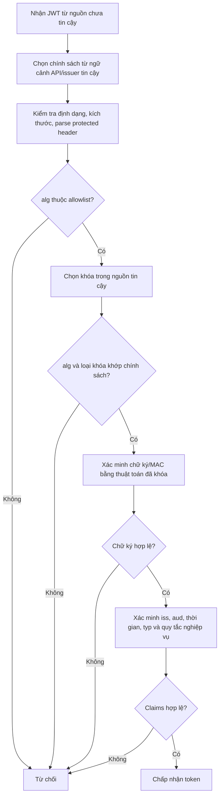

# `alg` trong JOSE Header và danh sách thuật toán được bên xác minh cho phép

## 1. Bối cảnh và mục tiêu

JSON Web Token (JWT) thường được bảo vệ bằng JSON Web Signature (JWS) hoặc JSON Web Encryption (JWE). JOSE Header mang các tham số mô tả cách token được bảo vệ. Trong đó, `alg` (**algorithm**) cho biết thuật toán được sử dụng. Đây là thông tin cần thiết để xử lý token, nhưng header đến từ bên gửi nên **chưa đáng tin trước khi xác minh mật mã**.

Đối với JWT có chữ ký, mục tiêu an toàn không phải là “dùng bất kỳ thuật toán nào mà token yêu cầu”, mà là:

1. Bên xác minh đặt trước một **danh sách thuật toán cho phép (allowlist)** cho từng loại token, nguồn phát hành và ngữ cảnh sử dụng.
2. Token chỉ được xử lý nếu `alg` thuộc chính sách đó và phù hợp với khóa xác minh đã được tin cậy.
3. Thư viện xác minh thực sự kiểm tra chữ ký theo đúng thuật toán và khóa được ràng buộc; không xem việc giải mã Base64URL là xác minh.
4. Sau khi chữ ký hợp lệ, ứng dụng vẫn phải kiểm tra các claim liên quan như `iss`, `aud`, `exp`, `nbf` và loại token được chấp nhận.

Bài học này áp dụng cho **JOSE/JWT nói chung**, không phụ thuộc ngôn ngữ lập trình, framework hay nhà cung cấp danh tính cụ thể.

## 2. `alg` thể hiện điều gì?

Trong **JWS**, `alg` xác định thuật toán tạo và kiểm tra chữ ký hoặc mã xác thực thông điệp (MAC). Một JWT dạng JWS Compact có cấu trúc:

```text
BASE64URL(protected-header).BASE64URL(payload).BASE64URL(signature)
```

Ví dụ phần protected header sau khi giải mã:

```json
{
  "typ": "JWT",
  "alg": "PS256",
  "kid": "issuer-key-2026-01"
}
```

- `typ` cho biết loại đối tượng được mong đợi; với JWT có thể là `JWT` hoặc một kiểu tường minh hơn theo giao thức.
- `alg: "PS256"` khai báo JWS dùng RSA-PSS với SHA-256.
- `kid` là gợi ý định danh khóa để tìm **trong bộ khóa đã được bên xác minh tin cậy**; tự nó không chứng minh khóa đáng tin.

Với JWS Compact, header là protected header và là một phần của dữ liệu được ký. **Nội dung header chỉ có tính toàn vẹn sau khi chữ ký được xác minh thành công.** Khi chưa xác minh, kẻ tấn công có thể thay đổi `alg`, `kid` hoặc bất kỳ byte nào của token.

Trong **JWE**, `alg` có ý nghĩa khác: nó xác định thuật toán **quản lý hoặc thỏa thuận khóa** (ví dụ `RSA-OAEP-256`), còn `enc` xác định thuật toán **mã hóa nội dung** (ví dụ `A256GCM`). Không dùng allowlist của JWS để quyết định chấp nhận JWE, hoặc ngược lại.

| Loại JOSE | `alg` mô tả | Tham số bổ sung quan trọng | Ví dụ |
| --- | --- | --- | --- |
| JWS | Thuật toán chữ ký/MAC | `kid`, `typ`, `crit` khi được dùng | `PS256`, `ES256`, `HS256` |
| JWE | Thuật toán quản lý/thỏa thuận khóa | `enc` để mã hóa nội dung | `RSA-OAEP-256` cùng `A256GCM` |

## 3. Vì sao `alg` không được tự quyết định chính sách?

Header được đọc **trước** bước xác minh để chọn cách xử lý, vì vậy `alg` là một đầu vào do bên gửi kiểm soát. Nếu chương trình tự động tin vào lựa chọn này, nó có thể vô tình chấp nhận thuật toán yếu hoặc xác minh bằng loại khóa sai.

Hai tình huống điển hình:

**Bỏ qua chữ ký bằng `alg: "none"`.** JOSE có định nghĩa `none` cho JWS không bảo vệ bằng chữ ký. Với API hoặc hệ thống đăng nhập yêu cầu xác thực JWT, nếu thư viện chấp nhận `none` theo header của token, người gửi có thể tự tạo payload mà không có chữ ký hợp lệ. Vì vậy, chính sách của hệ thống xác thực thông thường phải loại `none`. Sự tồn tại của `none` trong tiêu chuẩn **không** đồng nghĩa với việc token không ký được chấp nhận ở mọi ứng dụng.

**Nhầm lẫn thuật toán bất đối xứng và đối xứng (algorithm confusion).** Giả sử một dịch vụ chỉ dự định xác minh chữ ký `RS256` bằng khóa công khai RSA. Nếu bộ xác minh lại tin `alg: "HS256"` do token đưa vào, rồi coi chính khóa công khai RSA đó là bí mật HMAC, kẻ tấn công biết khóa công khai có thể tính MAC cho token giả. Lỗ hổng xuất hiện khi **ứng dụng/thư viện dùng sai loại khóa và thuật toán**, không phải vì bản thân `HS256` luôn không an toàn.

Nguyên tắc cốt lõi:

> `alg` trong token chỉ là giá trị để **đối chiếu với chính sách có sẵn**. Nó không được quyền mở rộng tập thuật toán hoặc lựa chọn một khóa ngoài phạm vi tin cậy của bên xác minh.

## 4. Các thuật toán JWS thường gặp và điều kiện chấp nhận

| `alg` | Cơ chế | Khóa dùng để xác minh | Lưu ý chính sách |
| --- | --- | --- | --- |
| `HS256` | HMAC-SHA-256, đối xứng | Bí mật dùng chung | Chỉ dùng bí mật ngẫu nhiên có entropy đủ mạnh (thường ít nhất 256 bit); không lấy mật khẩu dễ đoán làm khóa. Mọi bên giữ bí mật đều có thể tạo token. |
| `RS256` | RSA PKCS#1 v1.5 + SHA-256 | Khóa công khai RSA | Phù hợp nếu hệ thống đang dùng RSA và quản lý khóa đúng; yêu cầu khóa RSA đủ mạnh (thông thường từ 2048 bit). |
| `PS256` | RSA-PSS + SHA-256 | Khóa công khai RSA | Lựa chọn hiện đại cho chữ ký RSA nếu cả bên phát hành và bên xác minh đều hỗ trợ. |
| `ES256` | ECDSA + SHA-256 | Khóa công khai EC P-256 | Phải dùng đúng đường cong và kiểm tra chữ ký ECDSA đúng định dạng JOSE. |
| `EdDSA` | Edwards-curve DSA | Khóa công khai phù hợp, ví dụ Ed25519 | Chỉ bật khi hệ sinh thái và thư viện hỗ trợ đúng biến thể/khóa được cấu hình. |
| `none` | JWS không có bảo vệ chữ ký | Không có | **Không cho phép** với token dùng để chứng thực danh tính hoặc cấp quyền truy cập. |

Các hậu tố `256`, `384`, `512` trong tên thuật toán không đủ để suy ra mọi tính chất bảo mật; cần xét cơ chế, kích thước/kiểu khóa, cách sinh khóa và hỗ trợ thực tế. Một ứng dụng **không cần bật tất cả thuật toán mạnh**. Ví dụ, nếu nhà phát hành chỉ ký bằng `PS256`, allowlist của bộ xác minh tương ứng có thể chỉ gồm `PS256`.

Các giới hạn quan trọng cần thực thi:

- **Không trộn vai trò khóa:** khóa công khai của RSA/EC không bao giờ là khóa bí mật HMAC. Cùng một khóa chỉ nên được dùng với **một thuật toán** theo ràng buộc cấu hình.
- **Không chọn thuật toán dựa trên khả năng có sẵn của thư viện:** thư viện hỗ trợ mười thuật toán không có nghĩa ứng dụng cho phép cả mười.
- **Không chấp nhận thuật toán ngoài dự kiến để “tương thích”:** việc đổi hoặc thêm thuật toán cần đi kèm thay đổi cấu hình đáng tin cậy, phân phối khóa và kiểm thử.
- **Không coi `kid` hoặc các thông số JWK là nguồn cấp quyền:** chúng hỗ trợ chọn khóa nhưng không xác lập chính sách tin cậy.

## 5. Thiết kế allowlist ở phía bên xác minh

Allowlist phải bắt nguồn từ cấu hình phía máy chủ hoặc chính sách đã được quản trị, **không** lấy từ danh sách tự khai của token. Nó nên được phân tách theo **nguồn phát hành (issuer)**, **loại token**, **bên nhận (audience)** hoặc ranh giới tin cậy tương ứng.

Ví dụ cấu hình khái niệm cho một API chỉ chấp nhận access token JWS:

```yaml
tokenVerification:
  tokenType: access-token
  representation: JWS
  trustedIssuer: https://identity.example
  expectedAudience: orders-api
  allowedAlgorithms:
    - PS256
  keySource: preconfigured-issuer-jwks
  acceptedKeyType: RSA
```

Đây là **cấu hình minh họa**, không phải cấu trúc bắt buộc của một thư viện. `preconfigured-issuer-jwks` biểu thị nguồn khóa công khai do người vận hành cấu hình và kiểm soát. Nó không có nghĩa là cho phép token tự cung cấp địa chỉ JWKS.

Nếu hệ thống hỗ trợ nhiều issuer hoặc nhiều loại token, mỗi ngữ cảnh cần có chính sách rõ ràng. Chẳng hạn, JWT do nội bộ phát hành bằng `HS256` không nên tự động được coi là hợp lệ tại điểm cuối vốn chỉ chấp nhận token đối tác ký `PS256`.

### Ràng buộc khóa và thuật toán

Khi chọn khóa, cần kiểm tra đồng thời:

1. Khóa xuất phát từ **nguồn đáng tin cậy dành cho issuer/ngữ cảnh đó**.
2. `kid`, nếu được dùng, khớp một khóa có trong tập đã cấu hình; `kid` lạ phải bị từ chối theo chính sách, không làm phát sinh truy vấn tùy ý.
3. `alg` của token đúng allowlist và đúng thuật toán được gắn với khóa đã chọn.
4. Loại khóa (`kty`, đường cong `crv`, độ dài khóa, các thuộc tính `use`, `key_ops`, `alg` của JWK khi có) phù hợp với thao tác xác minh và không mâu thuẫn với chính sách.

Header có thể chứa `jku`, `jwk`, `x5u` hoặc `x5c`. Không tự động tin khóa hoặc tải URL tùy ý do token cung cấp: cách làm đó có thể dẫn đến **thay thế khóa tin cậy**, **SSRF** hoặc bỏ qua giới hạn issuer. Nếu cần lấy JWKS qua mạng, URL và quy tắc cập nhật phải được kiểm soát ở phía bộ xác minh, có TLS, giới hạn kết nối, cache và quy trình xoay khóa thích hợp.

## 6. Quy trình xác minh JWS an toàn

Sơ đồ xử lý:



Mã giả độc lập nền tảng:

```text
function verifyAccessToken(token, requestContext):
    policy = trustedPolicyFor(requestContext)
    require policy.expectedFormat == "JWS"

    header = parseProtectedHeaderWithLimits(token)
    require header.hasUniqueString("alg")
    require header.alg in policy.allowedAlgorithms
    require header.alg != "none"
    require supportedCriticalHeadersOnly(header)

    key = selectTrustedKey(policy.keySet, header.kid)
    require key exists
    require key.boundAlgorithm == header.alg
    require key.typeAndPropertiesMatch(header.alg)

    claims = verifyJwsSignature(
        token,
        key,
        allowedAlgorithms = [key.boundAlgorithm]
    )
    require signatureVerificationSucceeded

    require claims.iss == policy.expectedIssuer
    require policy.expectedAudience in claims.aud
    require claims.exp is valid and not expired
    require claims.nbf is absent or already effective
    require tokenTypeAndApplicationRulesMatch(claims, header, policy)
    return claims
```

Mã giả mô tả các điều kiện kiểm tra; tên hàm và cách xử lý lỗi tùy thư viện. Việc chọn chính sách phải dựa trên ranh giới tin cậy đã cấu hình. Trong hệ thống nhiều issuer, một giá trị `iss` chưa xác minh có thể được dùng **chỉ như gợi ý định tuyến đến tập issuer đã cho phép**, sau đó bắt buộc kiểm tra lại `iss` khi chữ ký hợp lệ; không dùng `iss` tùy ý để tin một khóa/URL mới.

Các lưu ý bổ sung:

- Đối với JWS JSON Serialization, yêu cầu `alg` nằm trong **protected header** và từ chối trường trùng lặp/mâu thuẫn giữa phần protected và unprotected. Nếu chỉ hỗ trợ JWT Compact, từ chối serialization khác ngay từ đầu.
- Tránh chấp nhận JSON có tên header trùng lặp (ví dụ hai trường `alg`) gây khác cách hiểu giữa các bộ phân tích.
- Không bỏ qua tham số mở rộng `crit` chưa được hỗ trợ. Không tự bật chế độ ký detached payload hoặc `b64=false` trừ khi giao thức yêu cầu và đã triển khai đúng.
- Giới hạn độ dài token, kích thước header, số lượng khóa thử và thời gian xử lý để tránh tiêu hao tài nguyên.
- Kiểm tra `typ`/loại JWT và các claim phù hợp nhằm tránh dùng nhầm ID token, access token hoặc loại JWT khác trong cùng một ứng dụng.
- Việc **decode** payload thành JSON, kiểm tra cú pháp hoặc thấy `exp` chưa hết hạn **không phải** là xác minh chữ ký.

## 7. Minh họa tấn công algorithm confusion

Giả định một API dự kiến:

```text
Expected: JWS alg = RS256
Trusted verification key: RSA public key of issuer
```

Kẻ tấn công có khóa công khai của issuer (vốn có thể được công khai hợp lệ) và gửi token với protected header:

```json
{
  "alg": "HS256",
  "typ": "JWT"
}
```

Kẻ tấn công tính HMAC bằng chính dữ liệu khóa công khai làm “bí mật”. Bộ xác minh **bị lỗi** sẽ gặp rủi ro nếu nó tin `HS256` theo header và đưa khóa công khai vào hàm kiểm tra HMAC. Bộ xác minh **đúng** có allowlist `["RS256"]` nên từ chối ngay khi đọc `alg: "HS256"`; ngay cả khi chính sách chứa nhiều thuật toán, ràng buộc **thuật toán–khóa** vẫn phải chặn việc dùng khóa RSA công khai như khóa HMAC.

Ví dụ này giải thích vì sao chỉ kiểm tra “token có chữ ký” hoặc “thư viện trả về payload” chưa đủ. Điều kiện an toàn là **đúng thuật toán, đúng khóa, đúng bên phát hành và đúng ngữ cảnh sử dụng**.

## 8. Khi xử lý JWE: allowlist `alg` và `enc` riêng

Nếu ứng dụng nhận JWT mã hóa, JWE thường có hai tầng lựa chọn:

```json
{
  "alg": "RSA-OAEP-256",
  "enc": "A256GCM",
  "kid": "recipient-key-01"
}
```

- `alg` xác định phương thức quản lý hoặc thiết lập khóa dùng để bảo vệ khóa mã hóa nội dung.
- `enc` xác định phép mã hóa nội dung có xác thực.
- Bên nhận phải cho phép **cả cặp** `alg` và `enc` theo chính sách và kiểm tra kết quả giải mã/xác thực thành công.
- **Mã hóa không tự chứng minh ai đã phát hành token.** Nếu cần bằng chứng về nguồn phát hành, giao thức phải ràng buộc danh tính hoặc sử dụng cấu trúc ký và mã hóa lồng nhau theo quy tắc rõ ràng.

Không để một endpoint chờ JWS bất ngờ nhận JWE, hoặc tự đổi cơ chế kiểm tra theo header từ nguồn không đáng tin. Nếu có JWT lồng nhau, cần nêu rõ thứ tự xác minh, kiểu token và chính sách cho từng lớp.

## 9. Các lỗi triển khai thường gặp

| Lỗi | Hậu quả có thể xảy ra | Cách xử lý |
| --- | --- | --- |
| Cho phép mọi `alg` mà thư viện hỗ trợ | Token dùng thuật toán ngoài thiết kế vẫn được thử xác minh | Chỉ định allowlist khi gọi API xác minh |
| Chấp nhận `none` cho access token | Token không ký có thể được chấp nhận | Từ chối `none` theo chính sách xác thực |
| Trộn `HS256` và `RS256` trên cùng dữ liệu khóa | Algorithm confusion | Ràng buộc thuật toán, loại khóa và mục đích của từng khóa |
| Dùng mật khẩu yếu làm khóa HMAC | Kẻ tấn công có token có thể thử đoán khóa ngoại tuyến | Dùng bí mật ngẫu nhiên đủ mạnh và xoay khóa theo quy trình |
| Lấy `jku` hoặc `jwk` từ header làm nguồn tin cậy | Thay thế khóa, có thể gây SSRF | Chỉ dùng nguồn khóa đã cấu hình trước |
| Chỉ kiểm tra chữ ký mà không kiểm tra `iss`, `aud`, `exp` | Token có chữ ký hợp lệ nhưng sai người nhận, sai nguồn hoặc hết hạn được dùng nhầm | Kiểm tra đầy đủ claim và mục đích token |
| Dùng hàm decode thay cho verify | Payload giả bị coi là đáng tin | Chỉ cấp quyền sau khi xác minh mật mã thành công |
| Có khóa mới thì tự mở rộng allowlist | Vô tình thay đổi mức bảo đảm bảo mật | Quản lý thay đổi thuật toán riêng với xoay khóa |

## 10. Kiểm thử chính sách chấp nhận thuật toán

Giả sử bộ xác minh chỉ cho phép `PS256`, với khóa RSA phù hợp từ issuer đã tin cậy:

| Trường hợp kiểm thử | Kết quả mong đợi |
| --- | --- |
| JWS `PS256`, chữ ký hợp lệ, đúng issuer/audience/thời hạn | **Chấp nhận** |
| JWS `PS256` nhưng chữ ký sai | **Từ chối** |
| JWS `RS256` hoặc `HS256`, dù khai đúng `kid` | **Từ chối** vì ngoài allowlist |
| JWS `alg: "none"` và chữ ký rỗng | **Từ chối** |
| Header thiếu `alg`, `alg` không phải chuỗi, hoặc trùng trường `alg` | **Từ chối** |
| `PS256` nhưng `kid` không có trong bộ khóa tin cậy | **Từ chối** |
| `PS256` nhưng khóa được chọn là EC hoặc khóa HMAC | **Từ chối** |
| Header chỉ đến URL `jku` lạ chứa khóa của người gửi | **Không tải/tin URL đó; từ chối** |
| Chữ ký đúng nhưng sai `aud`, sai `iss`, hết hạn hoặc sai loại token | **Từ chối** |
| Header có `crit` yêu cầu phần mở rộng chưa hỗ trợ | **Từ chối** |
| JWE đưa vào endpoint chỉ nhận JWS | **Từ chối** |

Trong vận hành, nên ghi nhận **nhóm nguyên nhân từ chối** (thuật toán ngoài allowlist, khóa không hợp lệ, chữ ký sai, claim sai) để theo dõi và điều tra, nhưng không để phản hồi công khai lộ bí mật, chi tiết khóa hoặc nội dung nhạy cảm của token.

## 11. Ghi nhớ

- `alg` là lời khai của token về thuật toán; **bên xác minh** mới là nơi quyết định thuật toán nào được chấp nhận.
- Allowlist phải được cấu hình theo loại JWT, issuer và ngữ cảnh; không lấy động từ JOSE Header.
- Chấp nhận một thuật toán chỉ an toàn khi **thuật toán, loại khóa, khóa tin cậy và thao tác xác minh** khớp nhau.
- Với JWS, cần xác minh chữ ký rồi mới tin các claim. Với JWE, phải kiểm tra riêng cả `alg` và `enc`.
- Các trường hợp `none`, algorithm confusion, nguồn khóa động và dùng nhầm decode/verify cần có ca kiểm thử từ chối rõ ràng.

### Tài liệu chuẩn để tra cứu thêm

- **RFC 7515 — JSON Web Signature (JWS):** cấu trúc JWS, protected/unprotected header và xác minh chữ ký.
- **RFC 7516 — JSON Web Encryption (JWE):** cấu trúc JWE, `alg` và `enc`.
- **RFC 7518 — JSON Web Algorithms (JWA):** định danh và các tham số thuật toán JOSE.
- **RFC 7519 — JSON Web Token (JWT):** biểu diễn JWT và các claim.
- **RFC 8725 — JSON Web Token Best Current Practices:** thực hành an toàn, chống nhầm lẫn thuật toán, ràng buộc khóa và loại JWT.
