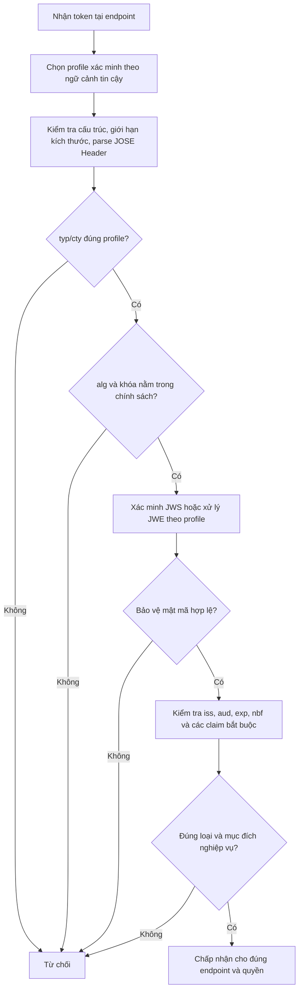

# `typ` trong JOSE Header và cách phân biệt JWT theo mục đích sử dụng

## 1. Vấn đề: Một JWT hợp lệ chưa chắc là JWT đúng mục đích

JSON Web Token (JWT) là định dạng biểu diễn các claim có thể được bảo vệ bằng chữ ký/MAC (JWS) hoặc mã hóa (JWE). Nó không tự quy định token phải dùng để đăng nhập, gọi API, làm mới phiên hay thông báo sự kiện. Trong một hệ thống, nhiều loại JWT có thể cùng được phát hành bởi một issuer, dùng cùng thuật toán hoặc thậm chí cùng khóa.

Ví dụ, một hệ thống có thể phát hành:

- **ID token** để ứng dụng khách (client) nhận thông tin về sự kiện xác thực người dùng.
- **Access token** để một API quyết định có cho phép yêu cầu truy cập tài nguyên hay không.
- **Refresh token** để client xin token mới tại máy chủ cấp quyền, nếu hệ thống chọn biểu diễn refresh token bằng JWT.
- **Security event token** để truyền thông báo sự kiện bảo mật cho bên tiếp nhận.
- **DPoP proof JWT** để chứng minh bên gửi đang sở hữu khóa riêng gắn với một yêu cầu HTTP.

Một JWT có chữ ký đúng vẫn có thể là **sai loại token** đối với API đang nhận nó. Đây là nguy cơ *cross-JWT confusion*: kẻ tấn công dùng một token được cấp hợp lệ cho ngữ cảnh A để thử truy cập ngữ cảnh B.

Tham số JOSE Header **`typ`** hỗ trợ khai báo loại đối tượng/token nhằm tách các ngữ cảnh sử dụng. Tuy nhiên, `typ` **không phải cơ chế xác thực hoặc cấp quyền tự thân**. Bên nhận cần chính sách xác minh riêng cho từng loại JWT.

> Nguyên tắc: Chỉ chấp nhận token khi **đúng dạng bảo vệ, đúng loại, đúng nguồn phát hành, đúng người nhận, đúng claim và đúng mục đích nghiệp vụ**. Chữ ký hợp lệ là điều kiện cần nhưng chưa đủ.

## 2. `typ` là gì?

`typ` (*type*) là một JOSE Header Parameter dùng để khai báo **media type của đối tượng JOSE hoàn chỉnh**. Với JWT, nó thường được dùng để biểu thị loại JWT hoặc profile mà ứng dụng cần xử lý.

Ví dụ một JWS Compact JWT:

```text
BASE64URL(protected-header).BASE64URL(payload).BASE64URL(signature)
```

Protected header có thể là:

```json
{
  "alg": "RS256",
  "typ": "at+jwt",
  "kid": "issuer-key-01"
}
```

Ý nghĩa của các trường:

| Tham số | Mục đích | Điều cần nhớ |
| --- | --- | --- |
| `alg` | Thuật toán được dùng cho chữ ký/MAC trong JWS; quản lý khóa trong JWE | Phải khớp allowlist và khóa tin cậy do bên xác minh cấu hình |
| `typ` | Loại đối tượng JOSE/JWT theo quy ước hoặc profile | Giúp phân biệt ngữ cảnh, nhưng phải được ứng dụng kiểm tra |
| `kid` | Gợi ý định danh khóa | Chỉ tra cứu trong bộ khóa tin cậy; không xác định mục đích token |
| `cty` | *Content type*: loại nội dung **bên trong** đối tượng JOSE | Khác `typ`; đặc biệt quan trọng với JWT lồng nhau |

Trong JOSE, `typ` là **gợi ý dành cho ứng dụng**: bộ xử lý JOSE chung có thể không tự kiểm tra hoặc không diễn giải nó. Vì thế, không thể giả định rằng thư viện báo “verify thành công” đồng nghĩa với `typ` phù hợp.

Các giá trị `typ` dùng cú pháp media type; ở những trường hợp phù hợp, tiền tố `application/` có thể được lược bỏ. Ví dụ, profile OAuth 2.0 JWT access token tại RFC 9068 dùng `at+jwt` (hoặc dạng đầy đủ `application/at+jwt`). Bên nhận cần chuẩn hóa và so khớp theo **quy định của profile** mà mình thực sự hỗ trợ, không tự suy luận loại token từ một chuỗi gần giống.

### `typ` có bắt buộc không?

Không có yêu cầu phổ quát rằng **mọi JWT đều phải mang `typ`**. RFC 7519 xem việc dùng `typ` là tùy chọn trong JWT tổng quát, nhưng một số profile hoặc giao thức cụ thể yêu cầu giá trị nhất định.

Hai hệ quả:

1. Với **profile quy định `typ`**, bên nhận cần kiểm tra đúng giá trị đã định nghĩa. Ví dụ, JWT access token theo RFC 9068 có quy định cụ thể về `typ`.
2. Với **token cũ không có `typ`** mà giao thức cho phép, bên nhận vẫn phải có các quy tắc độc lập để phân biệt; không nên mở rộng một endpoint thành “nhận mọi JWT” chỉ vì thiếu `typ`.

Để chống nhầm lẫn giữa các loại JWT mới, thực hành tốt là **explicit typing**: dùng giá trị `typ` tường minh và thiết kế bộ quy tắc chấp nhận riêng, lý tưởng là các quy tắc **loại trừ lẫn nhau**.

## 3. Phân biệt các loại JWT thường gặp

| Loại token | Ai dùng và để làm gì? | Ví dụ `typ` | Điều kiện phân biệt quan trọng |
| --- | --- | --- | --- |
| **Access token dạng JWT** | Resource server/API kiểm tra quyền truy cập tài nguyên | `at+jwt` theo RFC 9068 | Đúng issuer, `aud` dành cho API, thời hạn, scope/quyền và profile |
| **ID token** | Client trong OpenID Connect nhận thông tin về phiên xác thực | Có thể là `JWT` hoặc không khai báo, tùy yêu cầu giao thức/profile | `aud` là client dự kiến, nonce và các điều kiện OIDC thích hợp; không dùng như access token |
| **Refresh token** | Client gửi tới token endpoint để xin token mới | Không có `typ` chuẩn chung áp dụng cho mọi refresh token | Đúng token endpoint, client, trạng thái thu hồi/xoay vòng và ràng buộc phiên |
| **Security Event Token (SET)** | Bộ tiếp nhận sự kiện xử lý thông báo bảo mật | `secevent+jwt` theo RFC 8417 | Đúng bên gửi, bên nhận, tập `events` được phép và cơ chế chống phát lại |
| **DPoP proof JWT** | Bên nhận kiểm chứng quyền sở hữu khóa gắn với yêu cầu HTTP | `dpop+jwt` theo RFC 9449 | Khóa công khai trong proof, `htm`, `htu`, `iat`, `jti`, nonce nếu yêu cầu; ràng buộc với access token khi áp dụng |
| **JWT theo profile nội bộ** | Phục vụ một luồng nghiệp vụ cụ thể | Giá trị riêng được quy ước và quản trị | Chính sách tường minh cho mục đích, issuer, audience, claims và khóa |

**Chú ý về phạm vi:** Access token và refresh token không nhất thiết là JWT. OAuth cho phép các cách biểu diễn khác, thường là chuỗi opaque. ID token là JWT trong OpenID Connect, còn `at+jwt` được dùng cho access token theo **profile RFC 9068**, không nên coi đó là yêu cầu bắt buộc với tất cả hệ thống phát hành access token dạng JWT.

### 3.1. Access token dành cho API

API tài nguyên là nơi xác minh access token. Nếu giao thức chọn RFC 9068, ví dụ protected header:

```json
{
  "typ": "at+jwt",
  "alg": "RS256",
  "kid": "issuer-signing-key"
}
```

Payload minh họa:

```json
{
  "iss": "https://identity.example",
  "sub": "user-42",
  "aud": "orders-api",
  "exp": 1893456000,
  "iat": 1893452400,
  "client_id": "web-client",
  "scope": "orders:read"
}
```

API `orders-api` cần kiểm tra `aud`, issuer, chữ ký, hạn sử dụng, loại token và các quyền cần thiết để đọc đơn hàng. Giá trị `scope` chỉ là dữ liệu đầu vào để áp dụng chính sách; bản thân việc xuất hiện chuỗi `orders:read` không làm token trở nên đáng tin nếu chữ ký hoặc bối cảnh sử dụng sai.

### 3.2. ID token dùng cho client

Trong OpenID Connect, ID token chứng minh cho **client được chỉ định** những thông tin về sự kiện xác thực tại OpenID Provider. Ví dụ:

```json
{
  "iss": "https://identity.example",
  "sub": "user-42",
  "aud": "web-client",
  "exp": 1893456000,
  "iat": 1893452400,
  "nonce": "random-client-nonce"
}
```

ID token có thể được phát hành từ cùng issuer và dùng cùng khóa với access token. Dù chữ ký hợp lệ, API `orders-api` **phải từ chối** token có `aud: "web-client"` vì nó không dành cho API. Client khi kiểm tra ID token phải áp dụng các quy tắc OpenID Connect tương ứng, bao gồm `aud`, `azp` khi cần, thời gian, `nonce` trong luồng yêu cầu và những điều kiện khác theo profile.

Không chuyển ID token thành “vé gọi API” chỉ vì payload chứa `sub` hoặc thông tin người dùng.

### 3.3. Refresh token dành cho token endpoint

Refresh token cho phép client yêu cầu cấp token mới theo chính sách của authorization server. Nó có thể là chuỗi opaque hoặc được biểu diễn bằng JWT, nhưng **không có một giá trị `typ` chung bảo đảm mọi refresh token đều được nhận diện đúng**.

Nếu một tổ chức dùng JWT làm refresh token, token endpoint cần có quy tắc riêng về loại token, danh tính client, phiên, thời hạn, trạng thái thu hồi và xoay vòng (rotation) nếu áp dụng. Resource server/API thông thường **không được chấp nhận refresh token** như access token. Chỉ kiểm tra chữ ký không đủ để phát hiện token đã bị thu hồi hoặc đã dùng qua một lần xoay vòng.

### 3.4. JWT dành cho sự kiện hoặc chứng minh quyền sở hữu khóa

**Security Event Token** mang các sự kiện được định nghĩa theo profile; nó không đại diện cho quyền gọi API của người dùng. Cần xác minh người phát sự kiện, người nhận, loại sự kiện hợp lệ và kiểm soát phát lại.

**DPoP proof JWT** dùng để chứng minh bên yêu cầu sở hữu khóa riêng. Khác với access token, proof cần được đối chiếu với **phương thức HTTP** (`htm`), **URI đích** (`htu`), thời gian (`iat`), định danh chống phát lại (`jti`), nonce theo yêu cầu và liên kết với access token nếu có. `typ: "dpop+jwt"` không biến DPoP proof thành access token và không thay thế những điều kiện kiểm chứng nói trên.

## 4. Tấn công dùng nhầm loại JWT (cross-JWT confusion)

Giả sử một hệ thống có hai nơi sử dụng token:

```text
OpenID Connect Client
  - Nhận ID token
  - Mong đợi: aud = web-client

Orders Resource Server
  - Nhận access token
  - Mong đợi: typ = at+jwt, aud = orders-api
```

Kẻ tấn công có một ID token hợp lệ dành cho `web-client` và gửi ID token ấy vào API đơn hàng. Nếu API chỉ kiểm tra “chữ ký hợp lệ + chưa hết hạn”, token có thể bị dùng nhầm. Đây là lỗ hổng **sai mục đích sử dụng token**; nó vẫn tồn tại ngay cả khi thuật toán chữ ký và khóa hoàn toàn an toàn.

Cách xử lý đúng:

1. API chọn **chính sách access token** dựa trên endpoint và cấu hình tin cậy, trước khi quyết định chấp nhận token.
2. API xác minh chữ ký với issuer và khóa được phép.
3. API kiểm tra `typ` theo profile đang dùng (ví dụ `at+jwt`), `aud = orders-api`, issuer, thời hạn và các claim/quy tắc cấp quyền cần thiết.
4. Token mang `typ` không hợp lệ, có `aud` dành cho client, hoặc không đáp ứng profile đều bị từ chối.

**Thay đổi riêng `typ` không giải quyết được tấn công.** Header của JWS được bảo vệ bởi chữ ký, nên một bên không giữ khóa ký thường không thể sửa `typ` của token hiện có mà vẫn giữ chữ ký đúng. Nhưng nếu bộ phát hành ký nhiều loại token có cấu trúc chồng lấn, hoặc bộ xác minh không kiểm tra `typ` và `aud`, lỗi phân biệt ngữ cảnh vẫn xảy ra.

## 5. Thiết kế chính sách riêng cho mỗi loại JWT

Một bộ xác minh an toàn cần xác định **trước** mình đang nhận loại token nào. Ví dụ:

```yaml
# Ví dụ khái niệm; không phải định dạng cấu hình chuẩn
verificationProfiles:
  ordersApiAccessToken:
    expectedSerialization: JWS-Compact
    acceptedTypes: ["at+jwt"]
    trustedIssuer: https://identity.example
    expectedAudience: orders-api
    allowedAlgorithms: ["RS256"]
    trustedKeySource: configured-issuer-jwks
    requireExpiration: true
    requiredPermission: orders:read

  signInIdToken:
    expectedSerialization: JWS-Compact
    typePolicy: oidc-client-profile
    trustedIssuer: https://identity.example
    expectedAudience: web-client
    allowedAlgorithms: ["RS256"]
    trustedKeySource: configured-issuer-jwks
    requireOidcValidation: true

  securityEvent:
    expectedSerialization: JWS-Compact
    acceptedTypes: ["secevent+jwt"]
    trustedIssuer: https://events.example
    expectedAudience: event-receiver
    allowedAlgorithms: ["ES256"]
    trustedKeySource: configured-event-issuer-keys
    requireAllowedEventType: true
```

Trong cấu hình minh họa:

- Mỗi nhóm có **mục đích** và quy tắc nhận token riêng. `typePolicy: oidc-client-profile` biểu thị chính sách tuân theo profile OIDC, vì ID token không có một `typ` bắt buộc duy nhất cho mọi triển khai.
- Các thuật toán, khóa và issuer được cấu hình từ phía bên nhận. `typ`, `kid` hoặc `iss` tự khai trong token không có quyền thêm issuer hay khóa tin cậy mới.
- `aud` phân biệt bên nhận dự kiến. Khi một claim như `aud` có thể là chuỗi hoặc mảng theo chuẩn, bộ xác minh phải xử lý đầy đủ các dạng hợp lệ trong phạm vi profile.
- Các claim cũng phải có **ý nghĩa khác nhau** theo loại token. Ví dụ `scope` ở access token không được suy diễn thành quyền API từ ID token.

Để giảm lỗi cross-JWT confusion, có thể kết hợp nhiều ranh giới:

| Biện pháp | Giảm nguy cơ nào? |
| --- | --- |
| `typ` tường minh theo profile | Cho phép từ chối sớm token thuộc loại khác |
| `aud` khác nhau giữa client và API | Ngăn token cấp cho bên nhận A được sử dụng ở bên nhận B |
| Claim bắt buộc và quy tắc xác minh riêng | Ngăn coi cùng một payload là hợp lệ ở nhiều luồng |
| Issuer hoặc khóa ký riêng khi phù hợp | Hạn chế phạm vi ảnh hưởng giữa các loại token |
| Endpoint và handler riêng | Giảm khả năng nhầm giữa access/refresh/event/proof token |
| Thời hạn, trạng thái thu hồi và chống phát lại | Kiểm soát cách sử dụng phù hợp với từng loại token |

Không phải lúc nào cũng cần issuer hoặc khóa riêng, nhưng **bộ quy tắc nhận token phải loại trừ các loại không được phép**. Các profile có thể chia sẻ công nghệ JWT nhưng không nên chia sẻ một hàm “verify mọi JWT rồi tin payload”.

## 6. Luồng xác minh JWT theo mục đích sử dụng



Mã giả mô tả việc xác minh access token cho một API:

```text
function verifyOrdersRequest(request):
    profile = trustedConfiguration("ordersApiAccessToken")
    token = extractBearerToken(request)
    require token has allowed size and serialization

    header = parseProtectedHeaderWithStrictJson(token)
    require header.typ matches profile.acceptedTypes
    require header.alg in profile.allowedAlgorithms
    require supportedCriticalHeadersOnly(header)

    key = selectKeyFromTrustedSource(profile.trustedKeySource, header.kid)
    require key matches header.alg and issuer policy
    claims = verifyJwsSignature(token, key, profile.allowedAlgorithms)
    require signature verification succeeded

    require claims.iss == profile.trustedIssuer
    require claims.aud contains profile.expectedAudience
    require timeClaimsAreValid(claims, profile)
    require accessTokenProfileRulesAreSatisfied(claims, header)
    require permissionsAllowRequest(claims, request)
    return authenticatedRequestContext(claims)
```

Đây là mã giả để biểu đạt các **điều kiện bảo mật**, không phải API của một thư viện cụ thể. Nếu cho phép nhiều issuer, token có thể cung cấp `iss` chưa xác minh như một *gợi ý định tuyến* tới **tập issuer tin cậy đã cấu hình**, nhưng bộ xác minh vẫn phải kiểm tra issuer một lần nữa sau khi xác minh mật mã. Không tải khóa từ URL bất kỳ do token tự khai.

## 7. `typ` khác gì `cty`?

Hai trường này dễ bị nhầm vì đều liên quan đến “type”:

| Tham số | Mô tả | Ví dụ |
| --- | --- | --- |
| `typ` | Loại **đối tượng JOSE hoàn chỉnh** | `JWT`, `at+jwt`, `dpop+jwt` |
| `cty` | Loại **nội dung payload bên trong đối tượng JOSE** | `JWT` khi payload là JWT lồng nhau |

Ở JWT thông thường chỉ có một lớp JWS, thường **không cần `cty`**. Khi một JWT được ký rồi mã hóa, ta có cấu trúc lồng nhau:

```text
JWE (bên ngoài)
    payload được giải mã = JWS Compact (bên trong)
                                payload = claims JSON
```

Ví dụ protected header bên ngoài của JWE:

```json
{
  "alg": "RSA-OAEP-256",
  "enc": "A256GCM",
  "cty": "JWT"
}
```

Protected header của JWS bên trong có thể là:

```json
{
  "alg": "PS256",
  "typ": "at+jwt",
  "kid": "access-signing-key"
}
```

Theo RFC 7519, khi áp dụng **nested JWT**, `cty` của lớp bao ngoài phải biểu thị `JWT`. Tuy vậy, `cty: "JWT"` chỉ nói payload là một JWT khác; nó **không xác định** JWT bên trong là access token hay ID token. Bên nhận cần kiểm tra quy tắc mã hóa và nguồn khóa cho JWE, sau đó kiểm tra JWS bên trong, `typ` và các claim theo profile.

Đối với JWE, `alg` là thuật toán quản lý/thỏa thuận khóa còn `enc` là thuật toán mã hóa nội dung. Giải mã thành công không tự động chứng minh danh tính bên phát hành; yêu cầu xác thực nguồn phát hành phải được đáp ứng bằng cấu trúc và chính sách phù hợp (ví dụ chữ ký JWS bên trong).

## 8. Những điều `typ` không thể bảo đảm

### 8.1. `typ` có thể do người gửi tự đặt

JOSE Header là dữ liệu đầu vào chưa tin cậy cho đến khi bảo vệ mật mã được kiểm tra. Với JWS Compact, toàn bộ protected header nằm trong dữ liệu có chữ ký; với JWE, tính toàn vẹn của protected header được bảo đảm bởi quá trình giải mã có xác thực. **Không cấp quyền chỉ dựa trên `typ` trước các bước này.**

Khi dùng JWS JSON Serialization có header được bảo vệ và không được bảo vệ, một ứng dụng có yêu cầu bảo mật về `typ` phải đặt và kiểm tra nó trong **protected header**; tránh trường hợp các giá trị mâu thuẫn hoặc nội dung header không được bảo vệ bị tin nhầm. Từ chối thuộc tính JSON trùng lặp/mâu thuẫn và những dạng serialization không được profile hỗ trợ.

### 8.2. `typ: "JWT"` còn quá chung

`JWT` chỉ mô tả họ định dạng. ID token và access token đều có thể xuất hiện với `typ: "JWT"` trong các hệ thống khác nhau. Do đó, nếu ứng dụng cần phân biệt loại token, `typ: "JWT"` **không đủ**; phải dựa thêm vào profile, issuer, audience, claim bắt buộc và ranh giới sử dụng.

### 8.3. `typ` không thay thế `aud`, chữ ký hoặc quyền truy cập

Một token khai `typ: "at+jwt"` vẫn phải có chữ ký đúng, issuer được tin cậy, audience trùng API và quyền thích hợp. Ngược lại, token có chữ ký đúng nhưng khai `typ: "dpop+jwt"` vẫn không thể trở thành access token bằng cách đặt ở HTTP `Authorization: Bearer`.

### 8.4. Không tự tạo giá trị `typ` rồi coi là chuẩn chung

Giá trị kiểu `my-refresh+jwt` hoặc `internal-session+jwt` có thể dùng trong giao thức nội bộ nếu có đặc tả rõ ràng và tránh xung đột với type khác. Chúng **không** trở thành chuẩn phổ quát chỉ nhờ có đuôi `+jwt`. Khi tích hợp giữa các bên, dùng chính xác tên media type và quy tắc nhận token mà profile đã thống nhất.

## 9. Cách thiết kế và di chuyển sang explicit typing

Với một hệ thống hiện có nhiều loại JWT, có thể thực hiện theo trình tự:

1. **Lập bảng loại token**: token nào được phát hành, ai nhận, điểm cuối nào chấp nhận, format JWS/JWE, issuer, audience, khóa và claim liên quan.
2. **Định nghĩa profile riêng**: loại JWT nào có `typ` bắt buộc, giá trị hợp lệ, claim bắt buộc, thuật toán, khóa và mục đích cấp quyền.
3. **Cập nhật bên phát hành**: phát hành `typ` tường minh theo chuẩn phù hợp; giữ các giá trị `aud`, claim và loại token nhất quán.
4. **Cập nhật bên xác minh**: chọn profile theo ngữ cảnh tin cậy và từ chối các loại JWT khác; kiểm tra `typ` trong phần được bảo vệ cùng các điều kiện xác minh còn lại.
5. **Kiểm thử tương thích**: xác định rõ các token cũ có thể thiếu `typ`; chỉ cho phép giai đoạn chuyển tiếp ở những endpoint được quản trị với ranh giới và thời hạn xác định.
6. **Theo dõi từ chối**: ghi nhận mã nguyên nhân như sai `typ`, sai `aud`, sai issuer, sai chữ ký hoặc sai quyền. Tránh ghi log toàn bộ token hay dữ liệu nhạy cảm.

Tại bất kỳ thời điểm nào, một token chỉ nên được chấp nhận trong **những ngữ cảnh mà chính sách cấp phép rõ ràng**. Không thêm `typ` vào header theo cách bỏ qua tương thích giao thức hiện tại; đặc biệt, ID token phải tuân theo OpenID Connect và các profile ràng buộc của hệ thống.

## 10. Bộ ca kiểm thử chống dùng nhầm loại token

Giả sử `orders-api` chỉ chấp nhận JWT access token theo RFC 9068 với `typ: "at+jwt"`, issuer `https://identity.example` và audience `orders-api`.

| Đầu vào | Kết quả mong đợi và lý do |
| --- | --- |
| Access token đúng `typ`, chữ ký, issuer, audience, hạn và quyền | **Chấp nhận** |
| Token `typ: "JWT"`, chữ ký đúng, `aud: "orders-api"` | **Từ chối** nếu endpoint bắt buộc profile `at+jwt` |
| ID token hợp lệ, `aud: "web-client"` | **Từ chối** vì sai audience và mục đích |
| DPoP proof với `typ: "dpop+jwt"` | **Từ chối** vì sai loại; proof không là access token |
| SET với `typ: "secevent+jwt"` | **Từ chối** vì token sự kiện không cấp quyền API |
| Token có `typ: "at+jwt"` nhưng chữ ký sai | **Từ chối** vì `typ` không chứng minh tính xác thực |
| Token có `typ: "at+jwt"`, chữ ký đúng nhưng `aud` khác | **Từ chối** vì không dành cho API |
| Token thiếu `typ` | **Từ chối** theo chính sách profile bắt buộc `typ` |
| Token có hai trường `typ` mâu thuẫn hoặc header không được bảo vệ | **Từ chối** nếu vi phạm quy tắc protected header/parse nghiêm ngặt |
| Token có `typ` đúng nhưng thiếu claim profile bắt buộc | **Từ chối** |
| JWE lồng JWS nhưng không tuân theo quy tắc `cty`, `typ` hoặc thứ tự bảo vệ | **Từ chối** |
| Refresh token JWT được gửi vào API | **Từ chối** vì sai điểm cuối và loại token |

Nên bổ sung các ca kiểm thử “chéo”: lấy **mỗi loại JWT** hợp lệ do hệ thống phát hành, thử gửi tới **mọi endpoint nhận JWT khác**, và xác nhận tất cả cặp ngoài thiết kế đều bị từ chối.

## 11. Tóm tắt cần ghi nhớ

- `typ` là tham số JOSE Header khai báo **loại đối tượng/token**; nó hỗ trợ phân biệt access token, DPoP proof, security event token và các profile khác.
- `typ` **không bắt buộc với mọi JWT**, nhưng có thể bắt buộc trong một profile; chẳng hạn `at+jwt` với OAuth 2.0 JWT Access Token Profile.
- `typ: "JWT"` không đủ để phân biệt mọi mục đích. Cần kết hợp **profile, issuer, audience, thuật toán/khóa, claim và ngữ cảnh nghiệp vụ**.
- `cty` mô tả **payload bên trong**, đặc biệt `cty: "JWT"` với nested JWT; không thay thế `typ`.
- Không nhận ID token làm access token, refresh token làm access token hoặc DPoP proof làm bearer token chỉ vì tất cả đều có dạng JWT.
- Bộ xử lý JWT phải xác minh mật mã và áp dụng chính sách **riêng, loại trừ lẫn nhau** cho từng mục đích sử dụng.

### Tài liệu tham khảo chuẩn

- [RFC 7515 — JSON Web Signature (JWS)](https://www.rfc-editor.org/rfc/rfc7515): JOSE Header và tính toàn vẹn của protected header.
- [RFC 7516 — JSON Web Encryption (JWE)](https://www.rfc-editor.org/rfc/rfc7516): JOSE Header trong JWE, `alg` và `enc`.
- [RFC 7519 — JSON Web Token (JWT)](https://www.rfc-editor.org/rfc/rfc7519): `typ`, `cty`, nested JWT và các claim.
- [RFC 8725 — JWT Best Current Practices](https://www.rfc-editor.org/rfc/rfc8725): explicit typing, chống cross-JWT confusion và ràng buộc ngữ cảnh xác minh.
- [RFC 9068 — JWT Profile for OAuth 2.0 Access Tokens](https://www.rfc-editor.org/rfc/rfc9068): profile access token và giá trị `at+jwt`.
- [RFC 8417 — Security Event Token (SET)](https://www.rfc-editor.org/rfc/rfc8417): token thông báo sự kiện bảo mật.
- [RFC 9449 — OAuth 2.0 Demonstrating Proof of Possession (DPoP)](https://www.rfc-editor.org/rfc/rfc9449): `dpop+jwt` và điều kiện kiểm chứng proof.
