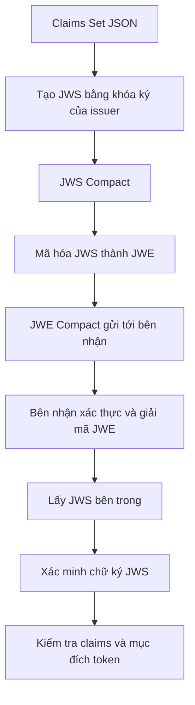
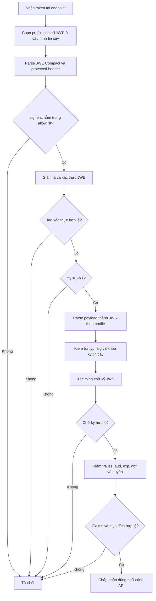

# `cty` trong JOSE Header và cách nhận diện nội dung JWT lồng nhau

## 1. Vì sao cần nhận diện nội dung bên trong JWT?

JSON Web Token (JWT) thường mang một Claims Set được bảo vệ bằng JSON Web Signature (JWS) hoặc JSON Web Encryption (JWE). Trong một số giao thức, một đối tượng JWT còn được đặt bên trong payload của một JWT khác. Cách kết hợp này gọi là **Nested JWT** (JWT lồng nhau).

Ví dụ phổ biến là ký JWT trước rồi mã hóa JWT đã ký:

- JWT bên trong là JWS, cung cấp chữ ký để bên nhận kiểm tra nguồn phát hành và tính toàn vẹn.
- JWT bên ngoài là JWE, bảo vệ tính bí mật của nội dung trên đường truyền và khi lưu trữ.

Khi nhận được JWE, bên xử lý cần biết payload sau giải mã là Claims Set JSON thông thường hay là một JWT khác cần tiếp tục xử lý. Tham số JOSE Header **`cty` (content type)** được dùng để mô tả kiểu nội dung bên trong. Theo quy tắc JWT tại RFC 7519, khi sử dụng nested signing hoặc encryption và một JWT được mang bên trong JWT khác, `cty` phải có giá trị `JWT`.

Điều cần nhớ: `cty` giúp nhận diện cấu trúc nội dung; nó **không xác minh chữ ký, không giải mã, không xác nhận issuer và không cấp quyền**. Bên nhận phải xác thực lớp ngoài trước khi tin thông tin về nội dung, sau đó xử lý lớp bên trong theo chính sách riêng.

## 2. `cty` là gì?

`cty` là tham số **Content Type** trong JOSE Header, mô tả kiểu nội dung được mang trong payload của đối tượng JOSE. JWT sử dụng tham số này để biểu đạt cấu trúc khi có JWT lồng nhau.

Ví dụ protected header của một JWE chứa JWS:

```json
{
  "alg": "RSA-OAEP-256",
  "enc": "A256GCM",
  "cty": "JWT",
  "kid": "recipient-encryption-key"
}
```

Ý nghĩa:

- `alg`: thuật toán quản lý hoặc thỏa thuận khóa của JWE.
- `enc`: thuật toán mã hóa nội dung của JWE.
- `cty: "JWT"`: payload sau khi giải mã là một JWT khác.
- `kid`: gợi ý chọn khóa trong tập khóa đã được cấu hình tin cậy.

Sau khi giải mã và xác thực JWE thành công, payload có thể là một JWS Compact:

```text
BASE64URL(protected-header).BASE64URL(payload).BASE64URL(signature)
```

Header của JWS bên trong có thể là:

```json
{
  "alg": "PS256",
  "typ": "at+jwt",
  "kid": "issuer-signing-key"
}
```

Trong ví dụ này, `cty` ở lớp JWE nói rằng nội dung bên trong là một JWT; `typ` ở lớp JWS mô tả loại/profile của JWT bên trong. Hai trường giải quyết hai câu hỏi khác nhau.

### Quy tắc `cty` trong JWT

RFC 7519 quy định:

- Khi **không** dùng nested signing hoặc nested encryption, việc sử dụng `cty` trong JWT thông thường không được khuyến nghị.
- Khi dùng nested signing hoặc encryption và một JWT được chứa trong JWT khác, `cty` **phải hiện diện** và giá trị phải là `JWT`.
- Tên media type không phân biệt chữ hoa/chữ thường, nhưng RFC khuyến nghị viết `JWT` bằng chữ hoa để tương thích với các triển khai cũ.

Vì vậy, `cty: "JWT"` không phải một trường bắt buộc cho mọi JWT. Nó có ý nghĩa đặc biệt khi payload là một JWT lồng bên trong. Một profile ứng dụng có thể đặt thêm yêu cầu riêng, nhưng không nên tự diễn giải `cty` theo quy ước không được các bên tham gia thống nhất.

## 3. Phân biệt `cty` với `typ`

Hai tham số đều liên quan đến kiểu dữ liệu nhưng mô tả hai lớp khác nhau:

| Tham số | Câu hỏi được trả lời | Ví dụ |
| --- | --- | --- |
| `typ` (*type*) | Đối tượng JOSE/JWT hoàn chỉnh này thuộc loại nào? | `JWT`, `at+jwt`, `dpop+jwt` |
| `cty` (*content type*) | Payload bên trong đối tượng JOSE có kiểu nội dung gì? | `JWT` khi payload là một JWT khác |

Minh họa một JWT lồng nhau:

```text
JWE bên ngoài
  typ: loại đối tượng bên ngoài (nếu profile quy định)
  cty: JWT
  payload sau giải mã:
    JWS bên trong
      typ: at+jwt
      payload: Claims Set
```

Trong cấu trúc này:

- `cty: "JWT"` ở header JWE cho biết payload là một JWT khác.
- `typ: "at+jwt"` ở header JWS cho biết JWT bên trong là access token theo profile tương ứng.
- `cty` không thay thế `typ`, và `typ` không cho biết có một lớp JWT bên trong hay không.

Không được suy luận rằng `cty: "JWT"` đồng nghĩa với access token. JWT bên trong có thể là ID token, access token, security event token hoặc một profile khác. Bên nhận phải kiểm tra `typ` và toàn bộ chính sách của lớp bên trong.

## 4. Các cấu trúc JWT lồng nhau

### 4.1. Ký trước, mã hóa sau (JWS bên trong JWE)

Đây là cấu trúc thường gặp khi cần vừa xác minh người phát hành vừa giữ bí mật nội dung:



Header JWE bên ngoài:

```json
{
  "alg": "RSA-OAEP-256",
  "enc": "A256GCM",
  "cty": "JWT",
  "kid": "api-recipient-key"
}
```

JWS bên trong:

```json
{
  "alg": "PS256",
  "typ": "at+jwt",
  "kid": "issuer-signing-key"
}
```

Trình tự xử lý:

1. Bên nhận kiểm tra cấu trúc JWE và đối chiếu `alg`, `enc`, `kid` với chính sách đã cấu hình.
2. Bên nhận dùng khóa giải mã phù hợp để giải mã và kiểm tra xác thực toàn vẹn của JWE.
3. Chỉ sau khi JWE hợp lệ, bên nhận mới tin protected header của lớp ngoài và diễn giải `cty: "JWT"`.
4. Payload sau giải mã phải là một JWT đúng định dạng mà profile mong đợi, ở ví dụ này là JWS.
5. Bên nhận xác minh chữ ký JWS bằng khóa công khai của issuer đáng tin cậy.
6. Sau khi chữ ký hợp lệ, bên nhận kiểm tra issuer, audience, thời hạn, loại token và các quy tắc cấp quyền.

JWE bảo vệ tính bí mật và tính toàn vẹn của ciphertext theo cơ chế mã hóa có xác thực. Tuy nhiên, **giải mã JWE thành công không tự chứng minh ai là người phát hành**. Với mô hình mã hóa khóa công khai, bất kỳ ai có khóa công khai của người nhận đều có thể tạo ciphertext gửi cho người nhận. Chữ ký JWS bên trong cung cấp bằng chứng về bên ký theo khóa đã tin cậy.

### 4.2. Mã hóa trước, ký sau (JWE bên trong JWS)

Một giao thức cũng có thể đặt một JWE bên trong payload của JWS:

```text
Claims Set
  -> mã hóa thành JWE
  -> ký đối tượng JWE thành JWS bên ngoài
  -> gửi JWS
```

Ở cấu trúc này, chữ ký ngoài bảo vệ chính chuỗi JWE và cho phép bên nhận xác minh chữ ký trước khi giải mã lớp trong. Nếu payload JWS là một JWT khác, header JWS bên ngoài phải dùng `cty: "JWT"` theo quy tắc nested JWT. Sau khi xác minh chữ ký ngoài, bên nhận mới giải mã JWE bên trong theo chính sách của nó.

Hai thứ tự có mục đích và thuộc tính khác nhau:

| Cấu trúc | Xử lý phía nhận | Đặc điểm |
| --- | --- | --- |
| JWS bên trong, JWE bên ngoài | Giải mã/xác thực JWE trước, sau đó xác minh JWS | Chữ ký nằm trong lớp mã hóa; nội dung và chữ ký được che khỏi người quan sát không có khóa giải mã |
| JWE bên trong, JWS bên ngoài | Xác minh JWS trước, sau đó giải mã JWE | Có thể xác minh bên ký trước khi giải mã; đối tượng JWE được ký ở lớp ngoài |

Không tự động thử cả hai thứ tự để “tìm cách giải mã được”. Endpoint hoặc profile phải quy định trước cấu trúc được chấp nhận. Tự động dò cấu trúc làm tăng nguy cơ nhầm loại token, downgrade và khác biệt xử lý giữa các thành phần.

## 5. Khi nào cần có `cty`?

| Nội dung payload | Có phải nested JWT? | Cách xử lý `cty` |
| --- | --- | --- |
| Claims Set JSON thông thường | Không | Theo JWT tổng quát, không khuyến nghị thêm `cty` chỉ để nói payload là JSON |
| Một JWS Compact JWT | Có | Đặt `cty: "JWT"` ở header của JWT lớp ngoài |
| Một JWE Compact JWT | Có | Đặt `cty: "JWT"` ở header của JWT lớp ngoài |
| Một JWT được đặt bên trong nhiều lớp JWT | Có | Mỗi lớp mang một JWT khác cần mô tả nội dung theo cấu trúc/profile; xác định rõ thứ tự và giới hạn độ sâu |
| Văn bản, dữ liệu nhị phân hoặc nội dung không phải JWT | Không phải nested JWT | Chỉ dùng content type khác khi giao thức JOSE cụ thể định nghĩa và các bên thống nhất; không giả mạo `JWT` |

Ví dụ JWE chỉ mã hóa Claims Set JSON:

```json
{
  "alg": "RSA-OAEP-256",
  "enc": "A256GCM",
  "kid": "recipient-key"
}
```

Payload sau giải mã là JSON chứa claim, không phải chuỗi JWS/JWE khác. Đây không phải nested JWT chỉ vì nội dung là JSON hoặc vì đối tượng ngoài là JWE. Không thêm `cty: "JWT"` trong trường hợp này.

Ngược lại, nếu header khai `cty: "JWT"` nhưng payload sau khi xác thực/giải mã không phải JWT đúng định dạng, bên nhận phải từ chối. Không được coi `cty` là bằng chứng rằng payload chắc chắn có cấu trúc JWT.

## 6. Bảo vệ và tin cậy `cty`

`cty` nằm trong JOSE Header. Mức độ tin cậy của nó phụ thuộc vào cách header được bảo vệ:

- **JWS Compact:** protected header là một phần của dữ liệu được ký. Chỉ tin `cty` sau khi chữ ký JWS hợp lệ.
- **JWE Compact:** protected header được đưa vào dữ liệu xác thực bổ sung (AAD) của JWE. Chỉ tin `cty` sau khi giải mã và kiểm tra authentication tag thành công.
- **JWS/JWE JSON Serialization:** có thể tồn tại protected header và unprotected header. Nếu quyết định xử lý bảo mật phụ thuộc vào `cty`, hãy yêu cầu nó nằm trong protected header. Giá trị ở phần unprotected có thể bị sửa mà không làm hỏng chữ ký hoặc tag xác thực.

Không dùng `cty` chưa được xác thực để quyết định tải khóa, chọn issuer, cấp quyền hoặc thực hiện hành động nhạy cảm. Có thể parse header trước để kiểm tra cú pháp và định tuyến tới một profile đã cấu hình, nhưng mọi quyết định tin cậy phải chờ xác minh lớp mật mã tương ứng.

Các quy tắc bổ sung:

1. Chọn cấu trúc JWT dự kiến từ endpoint hoặc profile tin cậy, không chọn tùy ý theo `cty` do người gửi khai báo.
2. Yêu cầu `cty: "JWT"` ở đúng lớp ngoài khi profile sử dụng nested JWT.
3. Sau khi xác thực lớp ngoài, kiểm tra payload thật sự là dạng JWT mà profile quy định.
4. Xác minh độc lập từng lớp: thuật toán, khóa, issuer, audience, thời hạn và mục đích sử dụng.
5. Từ chối header có tham số trùng lặp, mâu thuẫn hoặc phần mở rộng `crit` chưa được hỗ trợ.
6. Đặt giới hạn kích thước token và độ sâu lồng nhau để tránh tiêu hao tài nguyên hoặc đệ quy không giới hạn.

## 7. Quy trình xử lý JWS bên trong JWE

Giả sử một API chỉ nhận access token được ký bởi issuer tin cậy rồi mã hóa cho API đó. Profile quy định rõ:

- Lớp ngoài phải là JWE Compact.
- `alg` và `enc` thuộc allowlist của API.
- `cty` của JWE phải là `JWT`.
- Payload sau giải mã phải là JWS Compact.
- JWS bên trong phải có `typ: "at+jwt"`, thuật toán ký và issuer nằm trong chính sách.



Mã giả:

```text
function verifyNestedAccessToken(token, endpoint):
    policy = trustedPolicyFor(endpoint)
    require policy.expectedOuterFormat == "JWE-Compact"

    outer = parseJweCompactWithLimits(token)
    outerHeader = outer.protectedHeader
    require outerHeader.alg in policy.allowedKeyManagementAlgorithms
    require outerHeader.enc in policy.allowedContentEncryptionAlgorithms

    recipientKey = selectConfiguredRecipientKey(policy, outerHeader.kid)
    require recipientKey matches outerHeader.alg

    innerToken = decryptAndAuthenticateJwe(outer, recipientKey)
    require jweAuthenticationSucceeded
    require outerHeader.cty == "JWT"

    require innerToken is an allowed JWS Compact representation
    inner = parseJwsCompactWithLimits(innerToken)
    innerHeader = inner.protectedHeader
    require innerHeader.typ == policy.expectedInnerType
    require innerHeader.alg in policy.allowedSignatureAlgorithms

    signingKey = selectTrustedIssuerKey(policy, innerHeader.kid)
    require signingKey matches innerHeader.alg
    claims = verifyJwsSignature(inner, signingKey)
    require signatureVerificationSucceeded

    require claims.iss == policy.expectedIssuer
    require claims.aud contains policy.expectedAudience
    require timeClaimsAreValid(claims)
    require accessTokenClaimsMatchPolicy(claims)
    return claims
```

Đây là mã giả mô tả các điều kiện an toàn, không phải API của một thư viện cụ thể. Việc parse protected header có thể diễn ra trước khi xác thực để kiểm tra cú pháp và chọn khóa trong tập đã cấu hình; không được tin nội dung header hoặc payload trước khi bước mật mã tương ứng thành công.

## 8. Các lỗi thường gặp

| Lỗi | Hậu quả | Cách xử lý |
| --- | --- | --- |
| Xem `cty: "JWT"` là bằng chứng payload hợp lệ | Kẻ gửi có thể khai kiểu nội dung sai hoặc gửi payload không phải JWT | Xác thực lớp ngoài rồi kiểm tra định dạng và nội dung thực |
| Bỏ qua `cty` trong profile nested JWT | Không nhận diện đúng cấu trúc hoặc xử lý sai lớp payload | Bắt buộc `cty: "JWT"` theo RFC 7519 khi dùng nested JWT |
| Đặt `cty` trong unprotected header nhưng vẫn tin nó | Giá trị có thể bị thay đổi mà không làm hỏng bảo vệ mật mã | Đặt `cty` trong protected header khi nó quyết định cách xử lý |
| Dùng `typ` thay cho `cty` | Nhầm loại đối tượng bên ngoài với loại nội dung bên trong | Kiểm tra đúng trường ở đúng lớp |
| Cho rằng giải mã JWE chứng minh issuer | Chấp nhận nhầm dữ liệu do người khác mã hóa cho người nhận | Xác minh chữ ký JWS bên trong hoặc cơ chế xác thực nguồn phát hành đã được profile quy định |
| Tự dò JWS/JWE và thứ tự lồng nhau | Tạo đường xử lý mơ hồ, có thể dẫn tới downgrade hoặc khác biệt triển khai | Quy định một cấu trúc cụ thể cho từng endpoint/profile |
| Chỉ xác minh lớp ngoài | Claim hoặc chữ ký của JWT bên trong có thể không được kiểm tra | Xác minh đầy đủ từng lớp trước khi tin claims |
| Không giới hạn độ sâu và kích thước | Có thể tiêu hao bộ nhớ, CPU hoặc stack | Giới hạn kích thước token, số lớp lồng và thời gian xử lý |
| Chấp nhận JWT bên trong mà không kiểm tra mục đích | ID token, refresh token hoặc proof token có thể bị dùng nhầm làm access token | Kiểm tra `typ`, issuer, audience và claim theo profile |

## 9. Bộ ca kiểm thử cho nested JWT

Giả sử endpoint chỉ chấp nhận cấu trúc JWS bên trong JWE, `cty: "JWT"`, JWE được mã hóa cho endpoint và JWS được ký bởi issuer đã cấu hình.

| Trường hợp | Kết quả mong đợi |
| --- | --- |
| JWE hợp lệ, tag xác thực đúng, `cty: "JWT"`, payload là JWS hợp lệ, claims đúng profile | **Chấp nhận** |
| JWE có `cty` bị thiếu | **Từ chối** vì vi phạm profile nested JWT |
| JWE có `cty` khác `JWT` | **Từ chối** |
| `cty: "JWT"` nhưng payload sau giải mã là Claims Set JSON trực tiếp | **Từ chối** vì cấu trúc không khớp |
| JWE có authentication tag sai | **Từ chối** trước khi xử lý payload bên trong |
| JWE dùng `alg` hoặc `enc` ngoài allowlist | **Từ chối** |
| JWE hợp lệ nhưng JWS bên trong bị sai định dạng | **Từ chối** |
| JWS bên trong có chữ ký sai hoặc khóa không tin cậy | **Từ chối** |
| JWS hợp lệ nhưng `typ` là ID token thay vì access token | **Từ chối** |
| JWS hợp lệ nhưng sai issuer, audience hoặc đã hết hạn | **Từ chối** |
| `cty` chỉ xuất hiện trong unprotected header trong khi profile yêu cầu header được bảo vệ | **Từ chối** |
| Token lồng sâu hơn giới hạn cấu hình | **Từ chối** |
| Endpoint chỉ nhận JWE chứa JWS nhưng nhận JWS chứa JWE | **Từ chối** |

Nên kiểm thử cả trường hợp token hợp lệ ở từng lớp riêng nhưng kết hợp sai thứ tự. Việc một JWS hợp lệ và một JWE hợp lệ không đảm bảo rằng cấu trúc kết hợp của chúng phù hợp với endpoint.

## 10. Ghi nhớ

- `cty` mô tả **kiểu nội dung payload** của đối tượng JOSE; `typ` mô tả loại đối tượng JOSE/JWT hoàn chỉnh.
- Theo quy tắc JWT tại RFC 7519, khi dùng nested signing/encryption và JWT nằm trong JWT khác, `cty` phải có giá trị `JWT`.
- `cty: "JWT"` chỉ báo cấu trúc dự kiến; bên nhận vẫn phải kiểm tra payload thực sự là JWT hợp lệ.
- Với JWS bên trong JWE, bên nhận xác thực/giải mã JWE trước rồi xác minh chữ ký JWS bên trong.
- Giải mã JWE thành công không tự chứng minh danh tính issuer; xác minh chữ ký hoặc cơ chế xác thực nguồn phát hành là bước riêng.
- Chỉ tin `cty` sau khi lớp bảo vệ tương ứng thành công; nếu quyết định bảo mật phụ thuộc vào `cty`, đặt nó trong protected header.
- Mỗi lớp cần chính sách thuật toán, khóa, issuer, audience, thời hạn và mục đích sử dụng riêng; giới hạn độ sâu lồng nhau.

### Tài liệu chuẩn tham khảo

- [RFC 7515 — JSON Web Signature (JWS)](https://www.rfc-editor.org/rfc/rfc7515): protected header, payload và xác minh chữ ký.
- [RFC 7516 — JSON Web Encryption (JWE)](https://www.rfc-editor.org/rfc/rfc7516): cấu trúc JWE, protected header, AAD và xác thực nội dung.
- [RFC 7519 — JSON Web Token (JWT), mục 5.2 và 7.2](https://www.rfc-editor.org/rfc/rfc7519): ý nghĩa `cty`, nested JWT và quy trình xác minh.
- [RFC 8725 — JSON Web Token Best Current Practices](https://www.rfc-editor.org/rfc/rfc8725): phân tách loại JWT và xác minh theo ngữ cảnh.
