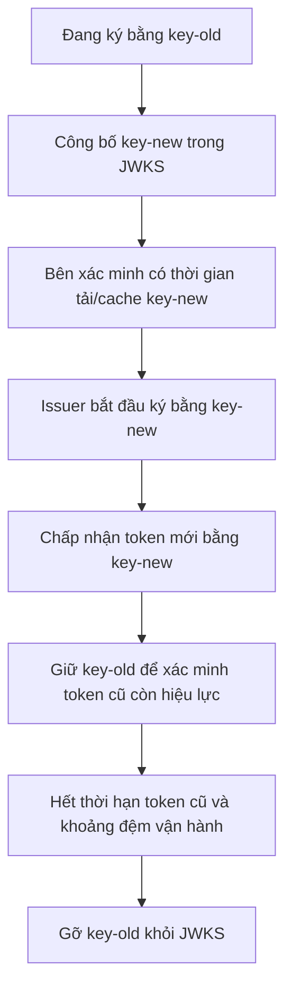

# `kid` và định danh khóa trong tập khóa đã tin cậy

## 1. Vai trò của `kid` trong JOSE và JWT

JSON Web Token (JWT) được bảo vệ bằng các cơ chế JOSE như JSON Web Signature (JWS) hoặc JSON Web Encryption (JWE). Khi một issuer hoặc recipient quản lý nhiều khóa, bên xử lý cần biết khóa nào có liên quan đến một token cụ thể. Tham số **`kid` (Key ID)** trong JOSE Header hỗ trợ việc đó bằng cách cung cấp một định danh để tìm khóa tương ứng.

Ví dụ protected header của một JWS:

```json
{
  "alg": "PS256",
  "typ": "JWT",
  "kid": "issuer-signing-2026-02"
}
```

Giá trị `kid` cho biết bên gửi muốn bên nhận tìm khóa ký có định danh `issuer-signing-2026-02`. Nó **không chứa khóa**, không chứng minh ai sở hữu khóa và không tự xác nhận chữ ký. Khóa thực tế phải được tìm trong một tập khóa mà bên xác minh đã tin cậy từ trước.

Đối với JWE, `kid` thường giúp xác định khóa của recipient được dùng trong thao tác quản lý khóa hoặc giải mã. Ví dụ, bên gửi mã hóa cho khóa công khai của recipient; recipient dùng `kid` để tìm khóa riêng tương ứng trong kho khóa của mình.

Nguyên tắc xuyên suốt:

> `kid` là **gợi ý tra cứu khóa**. Chính sách tin cậy xác định tập khóa được phép; thao tác mật mã xác nhận token có thực sự được bảo vệ bằng khóa phù hợp hay không.

Bài học này áp dụng cho bảo mật JOSE/JWT nói chung, không phụ thuộc ngôn ngữ lập trình, framework hay nền tảng triển khai.

## 2. Định nghĩa và đặc tính của `kid`

`kid` là một JOSE Header Parameter tùy chọn. RFC 7515 định nghĩa nó cho JWS và RFC 7516 định nghĩa nó cho JWE; RFC 7517 dùng cùng khái niệm trong JSON Web Key (JWK).

Các đặc tính quan trọng:

- Giá trị `kid` là một chuỗi (string).
- Cấu trúc bên trong của chuỗi do ứng dụng hoặc hệ thống phát hành quy ước; tiêu chuẩn không bắt buộc phải là UUID, số thứ tự, tên file hay fingerprint.
- Khi dùng theo JWK, giá trị được so sánh **phân biệt chữ hoa và chữ thường**.
- `kid` thường được dùng để chọn khóa trong quá trình xoay vòng khóa (key rollover).
- Nó chỉ cần có ý nghĩa trong phạm vi tập khóa và chính sách liên quan; không cần duy nhất trên toàn thế giới hoặc giữa mọi issuer.

Ví dụ các giá trị hợp lệ về mặt hình thức:

```text
key-2026-02
issuer-a-signing-03
prod-recipient-rsa-01
7f9c2e1a
```

Các ví dụ chỉ minh họa hình thức chuỗi, không phải quy ước bắt buộc. Bên nhận không nên tự suy diễn thuật toán, môi trường, quyền hoặc nguồn phát hành chỉ từ cách đặt tên `kid`.

### `kid` là tùy chọn

Không phải mọi JWS/JWE đều bắt buộc phải có `kid`. Ví dụ:

- Một ứng dụng chỉ có đúng một khóa xác minh đã cấu hình cho issuer và mục đích đang xử lý có thể không cần `kid`.
- Một giao thức có cơ chế xác định khóa khác có thể không dùng `kid`.
- Một hệ thống có nhiều khóa hoạt động đồng thời thường nên yêu cầu `kid` để chọn khóa rõ ràng.

Nếu thiếu `kid` trong khi có nhiều khóa ứng viên, không nên tùy tiện lấy khóa đầu tiên hoặc thử không giới hạn mọi khóa. Chính sách cần quy định rõ cách xử lý: chỉ chấp nhận khi có đúng một khóa phù hợp, hoặc cho phép thử một tập ứng viên nhỏ, xác định trước và có giới hạn. Nếu không xác định được khóa một cách an toàn, từ chối token.

## 3. `kid` liên kết với JWK và JWKS như thế nào?

**JSON Web Key (JWK)** là biểu diễn JSON của một khóa mật mã cùng một số metadata. **JSON Web Key Set (JWKS)** là một đối tượng JSON chứa danh sách JWK trong thuộc tính `keys`.

Ví dụ JWKS minh họa với một khóa công khai RSA dùng để xác minh chữ ký:

```json
{
  "keys": [
    {
      "kty": "RSA",
      "kid": "issuer-signing-2026-02",
      "use": "sig",
      "alg": "PS256",
      "n": "<RSA-modulus-base64url>",
      "e": "AQAB"
    }
  ]
}
```

Các giá trị modulus trong ví dụ là placeholder, không phải một khóa có thể sử dụng.

Ý nghĩa các thuộc tính:

| Thuộc tính JWK | Vai trò |
| --- | --- |
| `kty` | Loại khóa, ví dụ `RSA`, `EC`, `OKP` hoặc `oct` |
| `kid` | Định danh để đối chiếu khóa với header hoặc cấu hình |
| `use` | Mục đích sử dụng tổng quát, ví dụ `sig` hoặc `enc` |
| `key_ops` | Các thao tác khóa được phép, ví dụ `verify`, `decrypt` hoặc `unwrapKey` |
| `alg` | Thuật toán mà khóa được dự định sử dụng, nếu thuộc tính này được cung cấp |
| `n`, `e` | Thành phần khóa công khai RSA |

Khi xác minh JWS, bên nhận có thể lấy `kid` trong JOSE Header rồi tìm JWK có cùng `kid` trong JWKS đã tin cậy. Sau đó, nó còn phải kiểm tra loại khóa, thuật toán, mục đích và các giới hạn khác trước khi xác minh chữ ký.

Không được kết luận rằng một JWK đáng tin chỉ vì nó có `kid` trùng với token. **Nguồn JWKS và quan hệ giữa JWKS với issuer** mới là nền tảng của sự tin cậy.

### Phạm vi duy nhất của `kid`

`kid` không phải định danh toàn cục. Hai issuer khác nhau có thể cùng phát hành khóa với `kid: "key-01"`. Điều đó không tạo ra xung đột nếu bộ xác minh tách riêng tập khóa theo issuer và mục đích.

Trong một JWK Set, RFC 7517 khuyến nghị các khóa khác nhau sử dụng `kid` khác nhau. Nếu một ứng dụng cho phép nhiều khóa trùng `kid`, nó phải có quy tắc phân biệt rõ ràng bằng metadata và chính sách. Nếu vẫn còn nhiều ứng viên không thể phân biệt, cần từ chối thay vì tùy tiện chọn một khóa.

Không dùng một bảng tra cứu toàn cục chỉ theo `kid` cho nhiều issuer, tenant, môi trường hoặc mục đích khác nhau. Khóa cần được định danh trong một ngữ cảnh tin cậy, chẳng hạn:

```text
(issuer, token-purpose, key-id)
```

Đây là mô hình khóa tra cứu khái niệm, không phải định dạng bắt buộc của JWK.

## 4. Chọn khóa xác minh JWS an toàn

Quy trình xác minh cần phân biệt hai việc:

1. **Chọn ứng viên:** dùng header và ngữ cảnh yêu cầu để tìm khóa trong tập khóa tin cậy.
2. **Xác minh mật mã:** dùng khóa ứng viên và thuật toán được phép để kiểm tra chữ ký.

Header do người gửi cung cấp nên trước khi xác minh, `kid` vẫn là dữ liệu chưa đáng tin cậy. Nó có thể được đọc để tra cứu, nhưng chỉ được dùng như một chỉ dẫn trong tập khóa đã cấu hình.

Một quy trình hợp lý:

1. Chọn chính sách issuer và loại token dựa trên endpoint hoặc cấu hình tin cậy.
2. Parse protected header theo quy tắc JSON nghiêm ngặt, giới hạn kích thước và từ chối tham số trùng lặp.
3. Kiểm tra `alg` thuộc allowlist của chính sách.
4. Đọc `kid` nếu có và tìm ứng viên **chỉ trong JWKS đã được gắn với issuer/ngữ cảnh đó**.
5. Kiểm tra `kty`, `alg`, `use`, `key_ops`, đường cong/kích thước khóa và các ràng buộc phù hợp.
6. Xác minh chữ ký bằng thuật toán được khóa theo chính sách.
7. Sau khi chữ ký hợp lệ, kiểm tra `iss`, `aud`, thời hạn và các claim theo profile.

Ví dụ mã giả:

```text
function verifyJws(token, endpoint):
    policy = trustedPolicyFor(endpoint)
    require policy.expectedFormat == "JWS"

    header = parseProtectedHeaderWithLimits(token)
    require header.alg in policy.allowedAlgorithms

    if header.kid exists:
        candidates = policy.trustedJwks.keys where
            key.kid == header.kid
            and keyMatchesAlgorithmAndPurpose(key, header.alg, "verify")
    else:
        candidates = policy.keysAllowedWithoutKid

    require candidates contain exactly one acceptable key
    key = candidates[0]

    claims = verifyJwsSignature(
        token,
        key,
        allowedAlgorithms = [policy.allowedAlgorithmFor(key)]
    )
    require signatureVerificationSucceeded
    require claims.iss == policy.expectedIssuer
    require policy.expectedAudience is in claims.aud
    require timeClaimsAreValid(claims)
    return claims
```

Đây là mã giả mô tả chính sách. Một triển khai có thể xử lý trường hợp thiếu `kid` theo giao thức cụ thể, nhưng phải có giới hạn và quy tắc xác định khóa rõ ràng. Không để thư viện tự mở rộng tập thuật toán dựa trên header.

### Các điều kiện phải khớp ngoài `kid`

| Điều kiện | Ví dụ kiểm tra |
| --- | --- |
| Nguồn khóa | JWK nằm trong tập khóa đã gắn với issuer tin cậy |
| Thuật toán | Header `alg` nằm trong allowlist và khớp ràng buộc của JWK |
| Loại khóa | `PS256` cần khóa RSA; `ES256` cần EC trên P-256; `EdDSA` cần khóa Edwards phù hợp |
| Mục đích | JWS dùng khóa có `use: "sig"` nếu metadata này được cung cấp |
| Thao tác | JWS xác minh cần `verify` nếu JWK khai báo `key_ops` |
| Thuộc tính khóa | Kích thước, đường cong và thành phần khóa hợp lệ |
| Ngữ cảnh | Issuer, audience, loại token và endpoint phù hợp |

`use`, `key_ops` và `alg` trong JWK là metadata cần đối chiếu khi có mặt; chúng không tự tạo ra niềm tin nếu JWK đến từ nguồn không đáng tin. Chính sách của bên xác minh vẫn là giới hạn cuối cùng.

## 5. Chọn khóa cho JWE

Trong JWE, `kid` thường xác định khóa recipient được dùng cho thuật toán quản lý khóa. Ví dụ:

```json
{
  "alg": "RSA-OAEP-256",
  "enc": "A256GCM",
  "kid": "api-recipient-rsa-2026"
}
```

Bên gửi có thể dùng khóa công khai của API để tạo JWE; API dùng `kid` để tìm khóa riêng tương ứng trong kho khóa được quản trị.

Việc chọn khóa JWE cần kiểm tra:

- `alg` có được cho phép trong chính sách JWE hay không.
- Khóa có đúng loại và tham số cho thuật toán quản lý khóa hay không.
- Khóa có đúng mục đích `use: "enc"` nếu metadata này được khai báo hay không.
- `key_ops` có cho phép thao tác thực tế, chẳng hạn `decrypt`, `unwrapKey`, `deriveKey` hoặc `deriveBits`, hay không.
- Khóa riêng được chọn có thuộc recipient và môi trường dự kiến hay không.
- `enc` có nằm trong allowlist thuật toán mã hóa nội dung hay không.

JWE JSON Serialization có thể biểu diễn nhiều recipient. Khi đó, thông tin `kid` có thể xuất hiện trong header dành cho recipient tương ứng. Bên nhận cần tuân theo cấu trúc và chính sách của serialization, chỉ chọn recipient/key được endpoint cho phép. Không thử mọi khóa riêng trong kho khóa hoặc mọi recipient không giới hạn.

**Giải mã JWE thành công không tự xác thực issuer.** Nếu ứng dụng cần xác minh ai đã phát hành nội dung, nó phải có cơ chế xác thực nguồn phát hành thích hợp, ví dụ JWS lồng bên trong JWE theo profile đã quy định.

## 6. Ranh giới tin cậy: không để token tự chọn nguồn khóa

Các tham số JOSE Header như `kid`, `jku`, `jwk`, `x5u` và `x5c` có thể xuất hiện trong token. Chúng có vai trò khác nhau, nhưng không được mặc nhiên xem là nguồn tin cậy.

### Dùng JWKS từ nguồn đã cấu hình

Một issuer thường công bố JWKS tại một URL. Bên xác minh chỉ nên lấy JWKS từ URL được xác định qua cấu hình quản trị hoặc metadata issuer đã được tin cậy và kiểm tra theo giao thức discovery phù hợp.

Không lấy URL `jku` hoặc `x5u` bất kỳ từ token rồi tải khóa/chứng chỉ từ đó. Nếu làm vậy, kẻ tấn công có thể:

- Trỏ bộ xác minh tới máy chủ do họ kiểm soát để cung cấp khóa của chính họ.
- Lợi dụng truy vấn từ máy chủ xác minh tới địa chỉ nội bộ hoặc dịch vụ metadata, tạo nguy cơ SSRF.
- Gây tiêu hao tài nguyên bằng cách khiến hệ thống tải URL mới cho mỗi token.
- Lợi dụng chuyển hướng hoặc phản hồi mạng không được kiểm soát.

Tương tự, JWK nhúng trong header (`jwk`) là dữ liệu do người gửi đưa ra. Không chấp nhận nó làm khóa xác minh issuer chỉ vì chữ ký được kiểm tra thành công bằng khóa đó. Với `x5c`, chuỗi chứng chỉ cần được xác minh theo trust store, chính sách chứng chỉ và ràng buộc issuer; sự hiện diện của chứng chỉ trong token không tự làm chứng chỉ đáng tin.

### `kid` không phải đường dẫn hay câu lệnh

Giá trị `kid` là dữ liệu đầu vào. Không ghép trực tiếp nó thành:

- Đường dẫn file hoặc tên file để mở khóa.
- Tên bảng, tên cột hoặc đoạn SQL.
- URL hoặc hostname để truy cập mạng.
- Lệnh hệ điều hành hay biểu thức truy vấn không được kiểm soát.

Hãy dùng phép so khớp chuỗi chính xác trong tập khóa đã nạp và tin cậy. Giới hạn độ dài đầu vào, xử lý log an toàn và tránh ghi toàn bộ token vào log. Vì cấu trúc `kid` không được tiêu chuẩn cố định, đừng tự áp đặt quy tắc phân tích tên có thể làm sai giao thức; hãy xác định giới hạn theo profile của hệ thống.

## 7. Xử lý `kid` không tồn tại, trùng lặp hoặc thiếu

| Tình huống | Hướng xử lý |
| --- | --- |
| `kid` khớp đúng một khóa phù hợp | Tiếp tục kiểm tra thuật toán, loại khóa và xác minh mật mã |
| `kid` không có trong tập khóa | Từ chối; nếu dùng JWKS từ xa, có thể làm mới nguồn đã cấu hình theo cơ chế có giới hạn |
| `kid` khớp nhiều khóa | Dùng metadata/policy để phân biệt nếu đã quy định; nếu vẫn mơ hồ thì từ chối và xử lý lỗi cấu hình |
| `kid` bị thiếu, chỉ có một khóa phù hợp | Có thể chọn khóa đó nếu profile cho phép thiếu `kid` |
| `kid` bị thiếu, có nhiều khóa phù hợp | Từ chối, trừ khi giao thức cho phép thử một tập ứng viên nhỏ và giới hạn rõ ràng |
| `kid` có kiểu dữ liệu sai hoặc quá dài | Từ chối theo quy tắc parse và giới hạn đầu vào |
| `kid` hợp lệ nhưng thuật toán/loại khóa không khớp | Từ chối; không chuyển sang thuật toán hoặc loại khóa khác |

Không được “cứ thử hết khóa cho đến khi chữ ký đúng” mà không giới hạn. Cách làm đó có thể tạo chi phí CPU lớn, làm lộ khác biệt xử lý và che giấu lỗi cấu hình. Nếu một giao thức đặc thù cho phép thử nhiều khóa, tập ứng viên phải đến từ nguồn tin cậy, có kích thước tối đa và chỉ chứa khóa phù hợp với thuật toán đã khóa trước.

## 8. Xoay vòng khóa và vòng đời của `kid`

`kid` đặc biệt hữu ích khi một issuer thay khóa ký hoặc recipient thay khóa mã hóa. Một quy trình xoay khóa an toàn cần phối hợp giữa công bố khóa, thời điểm sử dụng, cache và thời hạn tồn tại của token.

### Xoay khóa ký JWS

Ví dụ issuer chuyển từ khóa cũ sang khóa mới:



Các nguyên tắc:

1. Công bố khóa công khai mới trước khi bắt đầu ký token bằng khóa đó, để bên xác minh có cơ hội cập nhật JWKS.
2. Gắn `kid` mới cho khóa mới và không dùng lại `kid` cũ cho vật liệu khóa khác trong thời gian hai khóa có thể cùng tồn tại.
3. Khi chuyển sang ký bằng khóa mới, tiếp tục công bố khóa công khai cũ để xác minh token được ký trước đó.
4. Chỉ gỡ khóa cũ sau khi token được ký bằng nó đã hết thời hạn tối đa, cộng thêm clock skew và khoảng đệm cần thiết cho cache/độ trễ phân phối.
5. Khi khóa bị lộ hoặc bị thu hồi khẩn cấp, áp dụng quy trình thu hồi và vô hiệu hóa tương ứng; không chờ lịch xoay khóa thông thường.

### Xoay khóa mã hóa JWE

Với khóa recipient, trình tự thường là:

1. Recipient tạo cặp khóa mới và công bố khóa công khai mới cho bên gửi qua kênh tin cậy.
2. Bên gửi bắt đầu mã hóa bằng khóa công khai mới và dùng `kid` tương ứng.
3. Recipient giữ khóa riêng cũ trong thời gian cần giải mã các JWE đã phát hành trước đó.
4. Sau khi ciphertext cũ hết thời gian sử dụng hoặc bị loại bỏ theo chính sách, recipient mới xóa khóa riêng cũ.

Không áp dụng máy móc thời gian giữ khóa JWS cho JWE: một bên là xác minh token đã ký, bên kia là khả năng giải mã dữ liệu đã mã hóa. Vòng đời phụ thuộc vào thời hạn và yêu cầu lưu trữ của từng giao thức.

## 9. Cache JWKS và chống lạm dụng làm mới khóa

Nếu bộ xác minh lấy JWKS từ xa, cache giúp giảm độ trễ và tải cho issuer. Nhưng cache cũng ảnh hưởng trực tiếp đến khả năng nhận diện khóa mới và thu hồi khóa cũ.

Một thiết kế vận hành nên có:

- Cache theo **issuer và nguồn JWKS tin cậy**, không cache một khóa chỉ theo `kid` toàn cục.
- Tuân thủ thời gian cache hợp lý, có chính sách làm mới và xử lý lỗi mạng.
- Khi gặp `kid` chưa biết, chỉ làm mới JWKS từ URL đã cấu hình; không tải URL do token cung cấp.
- Giới hạn tần suất refresh, gộp các yêu cầu đồng thời và có thể dùng negative cache ngắn cho `kid` không tồn tại để chống việc gửi liên tục các ID ngẫu nhiên.
- Có giới hạn timeout, kích thước phản hồi, số khóa và chuyển hướng mạng.
- Khi nguồn JWKS tạm thời lỗi, chỉ dùng cache cũ theo chính sách đã xác định; không tự nới lỏng thuật toán hoặc bỏ xác minh.
- Có cách xử lý khi khóa bị thu hồi khẩn cấp, vì cache cũ có thể tiếp tục chứa khóa không còn được phép.

Ví dụ mã giả cho việc tìm khóa:

```text
function findTrustedKey(policy, kid):
    require kid is a bounded string
    jwks = cache.get(policy.issuer, policy.configuredJwksSource)

    candidates = selectMatchingKeys(jwks, kid, policy)
    if candidates is empty:
        refreshConfiguredJwksWithRateLimit(policy)
        jwks = cache.get(policy.issuer, policy.configuredJwksSource)
        candidates = selectMatchingKeys(jwks, kid, policy)

    require candidates contain exactly one acceptable key
    return candidates[0]
```

Đây là mô hình khái niệm. Refresh phải có timeout, giới hạn tần suất và xử lý đồng thời phù hợp. Nếu sau khi cập nhật vẫn không tìm thấy khóa, token phải bị từ chối.

## 10. Những lỗi bảo mật thường gặp

| Lỗi | Hậu quả có thể xảy ra | Cách phòng tránh |
| --- | --- | --- |
| Tin `kid` là bằng chứng token do issuer phát hành | Chọn khóa sai hoặc bỏ qua xác minh nguồn | Chỉ tra cứu trong tập khóa gắn với issuer tin cậy, rồi xác minh chữ ký và claim |
| Tra cứu `kid` trong kho khóa toàn cục | Trùng ID giữa issuer/tenant có thể dẫn tới chọn nhầm khóa | Phân vùng theo issuer, mục đích và môi trường |
| Lấy `jku`/`x5u` từ token để tải khóa | SSRF hoặc thay thế nguồn khóa | Dùng URL JWKS/certificate đã cấu hình và kiểm soát |
| Tin JWK nhúng trong `jwk` như khóa issuer | Kẻ gửi tự cung cấp khóa rồi tạo token giả | Chỉ chấp nhận khóa từ trust store/JWKS đã xác thực |
| Bỏ qua `alg`, `kty`, `use`, `key_ops` | Algorithm confusion hoặc dùng sai mục đích khóa | Ràng buộc khóa với thuật toán và thao tác được phép |
| Chọn khóa đầu tiên khi `kid` trùng | Kết quả phụ thuộc thứ tự JWKS, có thể chọn sai | Kiểm tra duy nhất hoặc từ chối khi mơ hồ |
| Thử vô hạn tất cả khóa khi thiếu `kid` | Tiêu hao CPU và hành vi xác minh khó kiểm soát | Chỉ cho phép một khóa hoặc tập ứng viên nhỏ có giới hạn |
| Làm mới JWKS với mọi `kid` ngẫu nhiên | Tấn công gây tải mạng/issuer | Rate limit, request coalescing và negative cache |
| Tái sử dụng `kid` cho khóa mới trong lúc token cũ còn hiệu lực | Cache hoặc bên nhận có thể ánh xạ ID sang vật liệu khóa khác nhau | Dùng ID mới cho vật liệu khóa mới trong giai đoạn chồng lấn |
| Xóa khóa cũ quá sớm | Token hợp lệ đã phát hành không thể xác minh/giải mã | Giữ khóa theo vòng đời token hoặc ciphertext và khoảng đệm |
| Giữ khóa bị xâm phạm quá lâu vì cache | Token do kẻ tấn công ký có thể tiếp tục được chấp nhận | Quy trình thu hồi khẩn cấp và vô hiệu hóa cache có kiểm soát |

## 11. Bộ ca kiểm thử cho lựa chọn khóa

Giả sử endpoint nhận JWS từ một issuer đã cấu hình, chỉ cho phép `PS256` và có hai khóa công khai trong JWKS.

| Trường hợp | Kết quả mong đợi |
| --- | --- |
| `kid` khớp đúng một khóa RSA phù hợp, chữ ký đúng, claim hợp lệ | **Chấp nhận** |
| `kid` không tồn tại trong JWKS sau lần refresh được giới hạn | **Từ chối** |
| `kid` khớp khóa của issuer khác nhưng cùng chuỗi ID | **Từ chối** vì tra cứu trong sai phạm vi |
| `kid` khớp khóa EC trong khi token dùng `PS256` | **Từ chối** vì loại khóa không phù hợp |
| `kid` đúng nhưng JWK khai báo `use: "enc"` | **Từ chối** cho thao tác xác minh chữ ký |
| `kid` đúng nhưng `key_ops` không cho phép `verify` | **Từ chối** |
| Hai JWK phù hợp cùng có một `kid`, không có quy tắc phân biệt | **Từ chối** vì mơ hồ |
| Không có `kid`, chỉ một khóa được profile cho phép | Chỉ **chấp nhận** nếu profile cho phép thiếu `kid` và chữ ký hợp lệ |
| Không có `kid`, nhiều khóa phù hợp | **Từ chối** nếu không có quy tắc thử ứng viên giới hạn |
| Token chứa `jku` trỏ tới máy chủ do người gửi kiểm soát | Không tải URL; **từ chối** nếu không đáp ứng nguồn khóa tin cậy |
| Token chứa JWK riêng trong header và chữ ký đúng bằng khóa đó nhưng khóa không được tin cậy | **Từ chối** |
| `kid` rất dài hoặc có kiểu dữ liệu không phải chuỗi | **Từ chối** theo giới hạn parse |
| JWKS được cập nhật, token dùng khóa mới đã công bố và chữ ký hợp lệ | **Chấp nhận** sau khi cache làm mới theo chính sách |
| Token cũ còn hạn, khóa cũ vẫn được công bố trong giai đoạn rollover | **Chấp nhận** nếu mọi điều kiện xác minh khác hợp lệ |

Với JWE, bổ sung các ca kiểm thử cho khóa recipient: `kid` đúng nhưng `alg` sai, khóa riêng không thuộc recipient, thao tác khóa không cho phép giải mã, authentication tag sai và ciphertext cũ trong thời gian chuyển khóa.

## 12. Ghi nhớ

- `kid` là định danh/gợi ý chọn khóa trong JOSE Header; nó không phải khóa mật mã và không chứng minh nguồn phát hành.
- `kid` là tùy chọn, có phạm vi theo tập khóa/ngữ cảnh và được so sánh phân biệt chữ hoa, chữ thường.
- JWKS phải đến từ nguồn đã cấu hình và gắn với issuer tin cậy; không tải khóa từ URL do token tùy ý chỉ định.
- Chọn khóa cần kiểm tra cả issuer, `alg`, `kty`, `use`, `key_ops`, thuộc tính khóa và mục đích token.
- Khi không tìm được đúng một khóa phù hợp, từ chối hoặc chỉ áp dụng chiến lược thử ứng viên đã được giao thức quy định chặt chẽ.
- Xoay vòng khóa cần có giai đoạn công bố trước, thời gian chồng lấn và thời điểm gỡ khóa cũ phù hợp với vòng đời token/ciphertext.
- Cache JWKS cần có refresh giới hạn, xử lý `kid` lạ và cơ chế thu hồi khóa khẩn cấp.

### Tài liệu chuẩn tham khảo

- [RFC 7515 — JSON Web Signature (JWS), mục 4.1.4](https://www.rfc-editor.org/rfc/rfc7515): `kid` trong JWS Header.
- [RFC 7516 — JSON Web Encryption (JWE)](https://www.rfc-editor.org/rfc/rfc7516): `kid` và lựa chọn khóa trong JWE.
- [RFC 7517 — JSON Web Key (JWK), mục 4.5 và 5](https://www.rfc-editor.org/rfc/rfc7517): `kid`, metadata khóa và JWK Set.
- [RFC 7518 — JSON Web Algorithms (JWA)](https://www.rfc-editor.org/rfc/rfc7518): thuật toán JOSE và yêu cầu về khóa.
- [RFC 7638 — JSON Web Key (JWK) Thumbprint](https://www.rfc-editor.org/rfc/rfc7638): fingerprint chuẩn hóa của JWK, có thể dùng làm định danh theo quy ước.
- [RFC 8725 — JSON Web Token Best Current Practices](https://www.rfc-editor.org/rfc/rfc8725): xác minh theo issuer, thuật toán, khóa và ngữ cảnh tin cậy.
