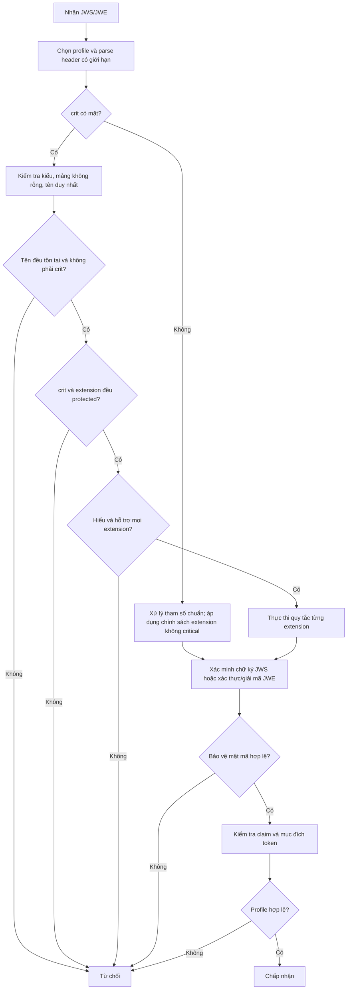

# `crit` trong JOSE Header và cách xử lý tham số quan trọng chưa được hỗ trợ

## 1. Vì sao JOSE cần `crit`?

JSON Web Signature (JWS) và JSON Web Encryption (JWE) cho phép mở rộng JOSE Header bằng các tham số mới. Một bên phát hành có thể sử dụng một tham số mở rộng để thay đổi cách tạo chữ ký, xác minh chữ ký, mã hóa, giải mã hoặc diễn giải nội dung. Nếu bên nhận không hiểu tham số đó nhưng vẫn tiếp tục xử lý token, hai bên có thể hiểu cùng một token theo hai cách khác nhau.

Tham số **`crit` (Critical)** giải quyết vấn đề này. Nó liệt kê những JOSE Header Parameter mở rộng mà bên nhận **bắt buộc phải hiểu và xử lý**. Nếu một tham số được đánh dấu là critical nhưng bên nhận không hỗ trợ, đối tượng JOSE phải bị từ chối.

Ví dụ, phần protected header của JWS có thể chứa:

```json
{
  "alg": "HS256",
  "b64": false,
  "crit": ["b64"]
}
```

Ở đây, `b64` là phần mở rộng được định nghĩa trong RFC 7797. Giá trị `false` thay đổi cách payload tham gia vào dữ liệu ký. `crit: ["b64"]` yêu cầu bên nhận phải hiểu và áp dụng chính xác quy tắc đó. Nếu bên nhận bỏ qua `b64` và xử lý payload theo cách mặc định, nó có thể xác minh sai dữ liệu hoặc diễn giải sai token.

Nguyên tắc:

> Khi một JOSE Header Parameter được liệt kê trong `crit`, bên nhận chỉ được tiếp tục nếu nó hỗ trợ và thực thi đúng ngữ nghĩa của tham số đó.

Bài học này áp dụng cho JOSE/JWT nói chung, không phụ thuộc ngôn ngữ lập trình, framework hay nền tảng triển khai.

## 2. Cấu trúc và quy tắc của `crit`

`crit` là một JOSE Header Parameter có giá trị là **mảng các chuỗi**, mỗi chuỗi là tên một JOSE Header Parameter đang được sử dụng như một phần mở rộng quan trọng.

Ví dụ:

```json
{
  "alg": "PS256",
  "kid": "issuer-signing-key",
  "custom-mode": "strict",
  "crit": ["custom-mode"]
}
```

Ví dụ trên chỉ minh họa cấu trúc. `custom-mode` không phải tham số chuẩn được định nghĩa bởi ví dụ này; một giao thức thực tế phải có đặc tả riêng mô tả chính xác ý nghĩa, cách xác minh và cách xử lý nó.

Các quy tắc cốt lõi theo JWS/JWE:

1. Giá trị `crit` phải là một mảng các chuỗi tên header parameter.
2. Mảng phải có ít nhất một phần tử; không dùng `crit: []` để biểu thị không có phần mở rộng quan trọng.
3. Mỗi tên được liệt kê phải là một tham số có mặt trong cùng JOSE Header.
4. Các tên phải duy nhất trong mảng; không liệt kê một tham số nhiều lần.
5. Không được liệt kê chính `crit` trong mảng.
6. `crit` và mọi tham số được liệt kê phải nằm trong **protected header**, tức được bảo vệ toàn vẹn bằng chữ ký JWS hoặc cơ chế xác thực của JWE.
7. Bên phát hành không được đánh dấu một tham số là critical nếu chính nó không hiểu và hỗ trợ tham số đó.
8. Bên nhận phải từ chối nếu có tham số critical mà nó không hiểu, không hỗ trợ hoặc không thể xử lý theo đúng đặc tả.

`crit` không phải danh sách các trường “nên chú ý” hay một ghi chú tùy chọn. Nó là một cam kết tương thích và bảo mật giữa bên tạo và bên xử lý JOSE.

## 3. Phạm vi áp dụng trong JWS và JWE

`crit` được dùng trong cả JWS và JWE. Cách xử lý có điểm chung là phải hiểu mọi phần mở rộng critical và bảo đảm chúng được bảo vệ toàn vẹn; phần mở rộng cụ thể có thể khác nhau theo loại đối tượng.

| Đối tượng | Vai trò của `crit` | Điều kiện bảo vệ |
| --- | --- | --- |
| JWS Compact | Đánh dấu các header extension ảnh hưởng tới cách xử lý chữ ký/payload | Protected header được đưa vào signing input |
| JWS JSON Serialization | Đánh dấu extension quan trọng trong JOSE Header | `crit` và extension được liệt kê phải nằm trong protected header, không chỉ ở unprotected header |
| JWE Compact | Đánh dấu extension ảnh hưởng tới quản lý khóa, mã hóa hoặc diễn giải payload | Protected header được xác thực như một phần của AAD |
| JWE JSON Serialization | Đánh dấu extension quan trọng cho đối tượng JWE/recipient theo quy tắc JOSE | Các tham số critical phải được đặt trong protected header chung và được xác thực toàn vẹn |

Trong JSON Serialization, một đối tượng có thể có protected header và unprotected header; JWE còn có thể có header dành cho từng recipient. Nếu một phần mở rộng được liệt kê trong `crit` nhưng chỉ xuất hiện ở vùng không được bảo vệ, bên nhận phải từ chối. Không được lấy một giá trị unprotected rồi coi nó đã được chữ ký hoặc authentication tag bảo vệ.

Với JWS Compact và JWE Compact, JOSE Header là protected header nên các tham số được liệt kê trong `crit` được bảo vệ cùng lớp tương ứng.

## 4. Phân biệt extension thông thường và extension critical

Không phải mọi tham số mở rộng đều nhất thiết phải được liệt kê trong `crit`. Điểm phân biệt là liệu việc không hiểu tham số đó có làm cho bên nhận xử lý sai đối tượng JOSE hay không.

| Trường hợp | Hành vi của bên nhận |
| --- | --- |
| Tham số chuẩn mà bên nhận hỗ trợ | Xử lý theo định nghĩa của tham số |
| Tham số mở rộng không được liệt kê trong `crit` | Theo quy tắc JOSE tổng quát, có thể bỏ qua nếu không hiểu; profile ứng dụng có thể đặt chính sách chặt hơn |
| Tham số mở rộng được liệt kê trong `crit` và bên nhận hỗ trợ | Bắt buộc áp dụng đúng ngữ nghĩa trước khi chấp nhận đối tượng |
| Tham số mở rộng được liệt kê trong `crit` nhưng bên nhận không hỗ trợ | Bắt buộc từ chối |
| Tên được liệt kê trong `crit` không có trong JOSE Header | Bắt buộc từ chối |
| `crit` hoặc tham số critical chỉ nằm trong header không được bảo vệ | Bắt buộc từ chối |

Ví dụ, một header có thể chứa tham số mở rộng không critical:

```json
{
  "alg": "PS256",
  "typ": "JWT",
  "display-hint": "compact"
}
```

Nếu `display-hint` chỉ là gợi ý hiển thị không ảnh hưởng đến xác minh hoặc cách hiểu token, bên nhận không hỗ trợ có thể bỏ qua theo quy tắc JOSE tổng quát. Nếu cùng tham số đó được dùng để thay đổi cách diễn giải payload hoặc quyết định bảo mật, nó cần được định nghĩa đúng cách và đánh dấu critical.

Không dùng `crit` để biến một tham số tùy ý thành tiêu chuẩn. Tham số mở rộng phải có đặc tả xác định tên, kiểu dữ liệu, vị trí, ngữ nghĩa, tác động bảo mật, cách tạo và cách xử lý.

## 5. Ví dụ phần mở rộng `b64` trong JWS

RFC 7797 định nghĩa tham số JWS Header `b64` để điều khiển việc Base64URL encode payload trong JWS Signing Input:

- `b64: true` là hành vi mặc định: payload được Base64URL encode.
- `b64: false` yêu cầu dùng payload chưa Base64URL encode trong signing input.
- Khi `b64` có giá trị `false`, nó **phải được liệt kê trong `crit`**.

Ví dụ protected header:

```json
{
  "alg": "PS256",
  "b64": false,
  "crit": ["b64"]
}
```

Lý do cần critical marking: một bộ xác minh không hỗ trợ RFC 7797 có thể mặc định Base64URL decode payload trước khi dựng signing input. Khi đó, nó kiểm tra một chuỗi dữ liệu khác với chuỗi mà bên ký đã sử dụng.

Đối với JWS Compact Serialization, việc dùng payload chưa mã hóa còn có ràng buộc định dạng để dấu chấm phân cách không làm mơ hồ cấu trúc Compact; một triển khai phải tuân thủ đầy đủ RFC 7797 thay vì chỉ đọc `b64: false` rồi tự xử lý chuỗi. Với JSON Serialization và detached payload, cũng phải áp dụng đúng các quy tắc tương ứng của RFC.

Nếu bên nhận không hỗ trợ `b64` với `false`, nó phải từ chối JWS có `crit: ["b64"]`. Không được âm thầm bỏ qua `crit`, bỏ qua `b64` hoặc tự chuyển về hành vi mặc định.

## 6. Vì sao tham số critical phải nằm trong protected header?

Giả sử một JWS JSON Serialization chứa:

```json
{
  "protected": "eyJhbGciOiJQUzI1NiJ9",
  "header": {
    "custom-mode": "strict"
  },
  "payload": "...",
  "signature": "..."
}
```

Trong ví dụ này, `custom-mode` nằm ở unprotected header. Nếu nó ảnh hưởng đến cách xác minh hoặc diễn giải payload, một bên trung gian có thể thay đổi giá trị mà không làm chữ ký JWS mất hiệu lực. Vì thế, nó không đủ điều kiện để được dùng như một critical extension.

Một header đúng nguyên tắc phải đặt cả `crit` và tham số được liệt kê trong protected header. Minh họa JSON dưới đây thể hiện cấu trúc logic; giá trị Base64URL thực tế của `protected` phải được tạo từ JSON header tương ứng:

```json
{
  "protected": "<BASE64URL({\"alg\":\"PS256\",\"custom-mode\":\"strict\",\"crit\":[\"custom-mode\"]})>",
  "payload": "...",
  "signature": "..."
}
```

Trong JWE, protected header cũng được đưa vào dữ liệu xác thực của quá trình mã hóa có xác thực. Nếu một phần mở rộng ảnh hưởng tới cách giải mã hoặc diễn giải plaintext, nó phải được bảo vệ theo yêu cầu của JOSE.

## 7. Quy trình kiểm tra `crit` an toàn

Việc kiểm tra critical extension cần được thực hiện như một phần của quy trình xử lý JOSE. Có thể parse header trước khi xác minh để xác định cấu trúc và thuật toán, nhưng mọi giá trị header vẫn là dữ liệu chưa tin cậy cho đến khi chữ ký hoặc authentication tag hợp lệ.

Quy trình tổng quát:

1. **Chọn profile tin cậy:** endpoint hoặc ngữ cảnh quyết định nhận JWS hay JWE, loại token và tập thuật toán.
2. **Parse có giới hạn:** kiểm tra cấu trúc Compact/JSON Serialization, giới hạn kích thước, từ chối JSON có tên thành viên trùng lặp hoặc header mâu thuẫn.
3. **Kiểm tra `crit`:** nếu có, yêu cầu đúng kiểu mảng chuỗi, không rỗng, tên không trùng, không chứa `crit` và mọi tên đều hiện diện.
4. **Kiểm tra vị trí bảo vệ:** `crit` và mọi extension được liệt kê phải nằm trong protected header.
5. **Kiểm tra khả năng hỗ trợ:** từng tên phải nằm trong tập extension mà implementation thực sự hiểu và hỗ trợ.
6. **Kiểm tra ngữ nghĩa:** xác nhận kiểu dữ liệu, giá trị, điều kiện áp dụng và cách xử lý theo đặc tả của từng extension.
7. **Xác minh mật mã:** thực hiện JWS signature verification hoặc JWE decryption/authentication với thuật toán và khóa đã được chính sách cho phép.
8. **Kiểm tra nội dung và mục đích:** sau khi lớp mật mã thành công, kiểm tra issuer, audience, thời hạn, loại token và các claim liên quan.
9. **Chấp nhận hoặc từ chối:** bất kỳ điều kiện critical nào không đáp ứng đều dẫn đến từ chối toàn bộ đối tượng.

Sơ đồ quyết định:



Đối với một extension như `b64`, bước thực thi ngữ nghĩa có thể ảnh hưởng trực tiếp đến cách dựng signing input trước khi xác minh chữ ký. Việc áp dụng quy tắc extension trước xác minh chỉ nhằm thực hiện đúng phép kiểm tra mật mã; không được tin payload hoặc thực hiện hành động ứng dụng cho đến khi xác minh thành công.

## 8. Xử lý khi gặp critical extension chưa hỗ trợ

Giả sử một bên phát hành gửi:

```json
{
  "alg": "PS256",
  "custom-canonicalization": "mode-2",
  "crit": ["custom-canonicalization"]
}
```

Nếu bên nhận không biết `custom-canonicalization` hoặc không thể thực hiện đúng thuật toán canonicalization được đặc tả, nó phải **từ chối token**. Việc chữ ký có thể được xác minh bằng một thư viện tổng quát không làm cho nội dung trở nên an toàn để sử dụng: bên nhận vẫn chưa biết dữ liệu được tạo hoặc diễn giải theo quy tắc nào.

Các tình huống bắt buộc từ chối:

- `crit` có kiểu không phải mảng chuỗi, chẳng hạn chuỗi, số hoặc object.
- Mảng `crit` rỗng.
- Có tên tham số trùng lặp trong mảng.
- Mảng liệt kê `crit` hoặc một tên không tồn tại trong JOSE Header.
- Tham số được liệt kê chỉ nằm trong unprotected header hoặc recipient header không được bảo vệ theo yêu cầu.
- Implementation không hiểu hoặc không hỗ trợ một extension được liệt kê.
- Giá trị hoặc kiểu dữ liệu của extension vi phạm đặc tả.
- Extension yêu cầu một tổ hợp thuật toán/serialization mà endpoint không cho phép.

Không nên:

- Bỏ qua `crit` vì “chữ ký vẫn hợp lệ”.
- Xóa tên extension khỏi mảng rồi tiếp tục.
- Bỏ qua riêng tham số không hiểu nhưng vẫn chấp nhận các tham số còn lại.
- Tự đoán ngữ nghĩa dựa trên tên extension.
- Thử cách diễn giải khác cho đến khi một cách cho kết quả hợp lệ.

Chính sách **fail closed** là cần thiết: không thể xử lý đúng một phần mở rộng critical thì không chấp nhận đối tượng JOSE đó.

## 9. Thiết kế và triển khai extension mới

Một extension được đánh dấu critical cần có đặc tả đủ rõ để các bên triển khai độc lập vẫn hiểu giống nhau. Tài liệu của extension nên xác định ít nhất:

| Nội dung | Câu hỏi phải trả lời |
| --- | --- |
| Tên tham số | Tên JOSE Header Parameter chính xác là gì? |
| Kiểu dữ liệu | String, boolean, number, array hay object? Có giới hạn kích thước/giá trị không? |
| Vị trí | Phải nằm trong protected header nào? Có được dùng trong JWS, JWE hay cả hai? |
| Ngữ nghĩa | Tham số làm thay đổi bước xử lý hoặc cách hiểu nào? |
| Quy tắc critical | Khi nào bắt buộc đưa tên vào `crit`? |
| Xác minh | Bên nhận phải kiểm tra những điều kiện nào trước/sau bước mật mã? |
| Tương thích | Hành vi với implementation không hỗ trợ là gì? |
| An toàn | Có nguy cơ downgrade, parser differential, replay hoặc tiêu hao tài nguyên nào? |
| Kiểm thử | Có vector hợp lệ và không hợp lệ để các implementation đối chiếu không? |

Nhà phát hành chỉ nên gửi extension critical khi biết bên nhận đã hỗ trợ nó, hoặc chấp nhận rằng các bên cũ sẽ từ chối. Có thể triển khai theo các giai đoạn:

1. Đặc tả và đăng ký/quản trị tên tham số theo quy trình phù hợp.
2. Triển khai hỗ trợ ở bên nhận và kiểm thử tương thích.
3. Cấu hình endpoint/profile để cho phép extension.
4. Bên phát hành bắt đầu đưa tham số vào protected header và liệt kê trong `crit`.
5. Theo dõi lỗi từ chối và xử lý phiên bản không tương thích.

Không nên gửi một extension critical đến một nhóm recipient không đồng nhất nếu chưa biết năng lực của họ. Nếu có nhiều profile, mỗi profile cần công bố rõ extension được hỗ trợ.

## 10. Các lỗi thường gặp

| Lỗi | Hậu quả | Cách xử lý |
| --- | --- | --- |
| Bỏ qua `crit` | Bên nhận có thể xử lý token với ngữ nghĩa khác bên phát hành | Kiểm tra và xử lý tất cả extension được liệt kê |
| Chấp nhận extension critical không hiểu | Bỏ qua thay đổi quan trọng đối với xác minh hoặc nội dung | Từ chối nếu không hỗ trợ |
| `crit` chứa tên không tồn tại | Header tự mâu thuẫn hoặc bị tạo sai | Từ chối |
| Extension critical nằm trong unprotected header | Giá trị có thể bị thay đổi mà không làm hỏng bảo vệ mật mã | Yêu cầu extension ở protected header |
| Đưa `crit` vào chính mảng `crit` | Header vi phạm quy tắc của tham số | Từ chối |
| Cho phép mảng rỗng hoặc tên trùng | Parse và xử lý không nhất quán | Kiểm tra mảng không rỗng và tên duy nhất |
| Chỉ kiểm tra tên mà không thực thi ngữ nghĩa extension | Token được chấp nhận dù phần mở rộng chưa thực sự được áp dụng | Triển khai đầy đủ quy tắc extension |
| Dùng `crit` như danh sách mọi header parameter | Tăng lỗi tương thích và làm sai mục đích tham số | Chỉ liệt kê extension mà bên nhận bắt buộc phải hiểu |
| Dùng một parser khác nhau giữa bước kiểm tra và bước xác minh | Parser differential có thể tạo ra cách hiểu khác nhau | Parse nghiêm ngặt một lần, từ chối duplicate/malformed JSON |
| Chấp nhận tham số critical từ lớp ngoài nhưng bỏ qua lớp trong | Nested JWT có thể bị xử lý sai | Kiểm tra `crit` độc lập ở từng JOSE object |

## 11. Bộ ca kiểm thử cho `crit`

Giả sử implementation hỗ trợ RFC 7797 `b64` và một extension nội bộ `custom-mode` đã được đặc tả, nhưng không hỗ trợ `future-mode`.

| Trường hợp | Kết quả mong đợi |
| --- | --- |
| Không có `crit`, chỉ dùng tham số chuẩn được hỗ trợ | Xử lý theo profile bình thường |
| `crit: ["b64"]`, `b64: false` nằm trong protected header và xử lý đúng RFC 7797 | **Chấp nhận** nếu chữ ký và các điều kiện khác hợp lệ |
| `crit: ["custom-mode"]`, tham số có mặt và implementation hỗ trợ đúng đặc tả | **Chấp nhận** nếu các bước còn lại hợp lệ |
| `crit: ["future-mode"]` mà implementation không hỗ trợ | **Từ chối** |
| `crit` là chuỗi thay vì mảng | **Từ chối** |
| `crit: []` | **Từ chối** |
| `crit: ["custom-mode", "custom-mode"]` | **Từ chối** vì tên trùng |
| `crit: ["crit"]` | **Từ chối** |
| `crit: ["missing-param"]` nhưng header không có `missing-param` | **Từ chối** |
| `crit: ["custom-mode"]` nhưng `custom-mode` chỉ nằm trong unprotected header | **Từ chối** |
| `crit` chỉ nằm trong unprotected header | **Từ chối** |
| Extension có mặt nhưng giá trị sai kiểu hoặc ngoài miền cho phép | **Từ chối** |
| Chữ ký đúng nhưng critical extension chưa được hỗ trợ | **Từ chối** |
| JWE có critical extension chưa hỗ trợ dù authentication tag hợp lệ | **Từ chối** |
| Nested JWE có `crit` hợp lệ nhưng JWS bên trong có `crit` không hỗ trợ | **Từ chối** khi xử lý lớp JWS bên trong |

Các ca kiểm thử phải kiểm tra cả việc từ chối trước khi ứng dụng sử dụng claims. Một token bị từ chối do critical extension không được tạo authenticated principal, cấp quyền, cập nhật trạng thái phiên hoặc kích hoạt hành động nghiệp vụ.

## 12. Ghi nhớ

- `crit` liệt kê các JOSE Header Parameter mở rộng mà bên nhận **bắt buộc phải hiểu và xử lý**.
- Mảng `crit` phải là mảng chuỗi không rỗng, tên duy nhất, mỗi tên có mặt trong header và không chứa chính `crit`.
- `crit` cùng mọi extension được liệt kê phải nằm trong protected header.
- Không hiểu hoặc không hỗ trợ một critical extension thì phải từ chối toàn bộ JWS/JWE.
- Tham số mở rộng không được liệt kê trong `crit` có thể bị bỏ qua theo quy tắc JOSE tổng quát, trừ khi profile ứng dụng đặt yêu cầu nghiêm ngặt hơn.
- `crit` không thay thế xác minh chữ ký, authentication tag, thuật toán, khóa, issuer, audience hay claim.
- Với nested JWT, kiểm tra `crit` độc lập ở từng lớp JOSE; một lớp hợp lệ không làm cho lớp khác tự động hợp lệ.

### Tài liệu chuẩn tham khảo

- [RFC 7515 — JSON Web Signature (JWS), mục 4.1.11 và 5.2](https://www.rfc-editor.org/rfc/rfc7515): Critical Header Parameter và xử lý tham số không được nhận diện.
- [RFC 7516 — JSON Web Encryption (JWE), mục 4.1.13 và 5.2](https://www.rfc-editor.org/rfc/rfc7516): Critical Header Parameter trong JWE.
- [RFC 7517 — JSON Web Key (JWK)](https://www.rfc-editor.org/rfc/rfc7517): quy tắc mở rộng và metadata JOSE liên quan.
- [RFC 7797 — JSON Web Signature (JWS) Unencoded Payload Option](https://www.rfc-editor.org/rfc/rfc7797): tham số `b64` và yêu cầu critical marking.
- [RFC 8725 — JSON Web Token Best Current Practices](https://www.rfc-editor.org/rfc/rfc8725): xử lý JWT theo profile và tránh khác biệt diễn giải.
