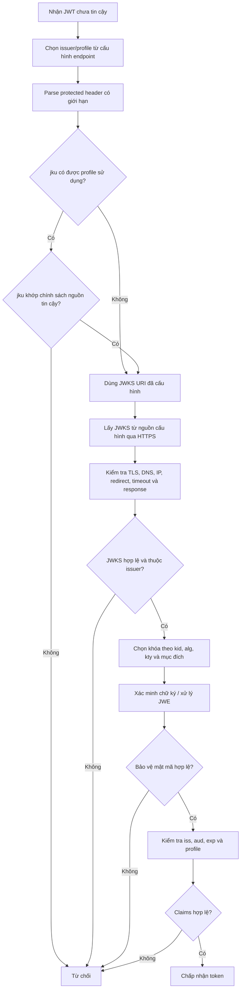

# `jku` và rủi ro tải tập khóa từ địa chỉ không tin cậy

## 1. `jku` dùng để làm gì?

JSON Web Signature (JWS) và JSON Web Encryption (JWE) có thể mang tham số JOSE Header **`jku` (JWK Set URL)**. Tham số này chứa một URI trỏ tới tài nguyên cung cấp JSON Web Key Set (JWKS), tức tập hợp các JSON Web Key (JWK). Một JWK trong tập có thể tương ứng với khóa được dùng để ký JWS hoặc xử lý mã hóa JWE.

Ví dụ protected header của JWS:

```json
{
  "alg": "PS256",
  "kid": "issuer-signing-2026-02",
  "jku": "https://keys.example.org/issuer-a/jwks.json"
}
```

Khi triển khai theo mô hình có sử dụng `jku`, bên nhận có thể dùng URI để lấy JWKS, rồi dùng `kid` và chính sách khóa để tìm khóa phù hợp. Tuy nhiên, JOSE Header đến từ bên gửi. Trước khi chữ ký được xác minh, giá trị `jku` là **dữ liệu chưa đáng tin cậy**.

Nếu bộ xác minh lấy bất kỳ URL nào trong token rồi gửi HTTP request tới đó, token có thể trở thành phương tiện khiến máy chủ xác minh truy cập các hệ thống khác. Đây là một dạng **Server-Side Request Forgery (SSRF)**. Nếu JWKS lấy từ địa chỉ do kẻ tấn công kiểm soát được chấp nhận làm nguồn khóa, kẻ tấn công còn có thể cung cấp khóa của chính họ để tạo token giả.

Nguyên tắc:

> `jku` chỉ là tham chiếu tới một tập khóa. Bên xác minh phải có chính sách tin cậy độc lập cho nguồn JWKS trước khi tải hoặc sử dụng khóa.

Bài học này áp dụng cho JOSE/JWT nói chung, không phụ thuộc Java, Spring Security hay một nền tảng cụ thể.

## 2. Cấu trúc và ý nghĩa của `jku`

`jku` có kiểu chuỗi URI. Tài nguyên được tham chiếu phải biểu diễn một JWK Set theo định dạng JSON Web Key Set.

Ví dụ phản hồi JWKS:

```json
{
  "keys": [
    {
      "kty": "RSA",
      "kid": "issuer-signing-2026-02",
      "use": "sig",
      "alg": "PS256",
      "n": "<RSA-modulus-base64url>",
      "e": "AQAB"
    }
  ]
}
```

Các thành phần:

- `keys` là mảng các JWK.
- `kty` mô tả loại khóa.
- `kid` giúp đối chiếu khóa với định danh trong JOSE Header.
- `use` và `alg`, nếu được khai báo, cung cấp metadata về mục đích và thuật toán dự kiến.
- `n`, `e` là các thành phần công khai của khóa RSA.

Các giá trị modulus ở trên là placeholder, không phải khóa có thể dùng để xác minh thực tế.

### `jku` không phải là khóa

`jku` không mang vật liệu khóa mật mã. Nó chỉ chỉ tới nơi lấy JWKS. Bên nhận vẫn phải:

1. Xác định nguồn JWKS có được tin cậy trong ngữ cảnh issuer và loại token đang xử lý hay không.
2. Tải JWKS theo chính sách mạng an toàn.
3. Parse và kiểm tra cấu trúc, kích thước và metadata của JWK.
4. Chọn khóa phù hợp với `kid`, `alg`, loại khóa và mục đích.
5. Xác minh chữ ký hoặc thực hiện thao tác JWE theo chính sách.
6. Kiểm tra issuer, audience, thời hạn và profile token.

Chỉ việc tải được JSON hợp lệ hoặc tìm thấy `kid` khớp không làm cho khóa trở nên đáng tin.

## 3. Vì sao dùng `jku` trực tiếp từ token có thể gây SSRF?

SSRF xảy ra khi một ứng dụng phía máy chủ bị khiến gửi request tới một địa chỉ do đầu vào không đáng tin kiểm soát. Nếu logic xác minh JWT tự động tải `jku`, người gửi token có thể điều khiển đích của request từ máy chủ xác minh.

Ví dụ token giả có protected header:

```json
{
  "alg": "PS256",
  "kid": "attacker-key",
  "jku": "http://127.0.0.1:8080/admin/jwks.json"
}
```

Nếu dịch vụ xác minh tự tải URL này, request có thể chạm tới dịch vụ chỉ lắng nghe trên loopback của chính máy chủ. Các mục tiêu khác có thể bao gồm:

- Địa chỉ private trong mạng nội bộ hoặc các dịch vụ quản trị.
- Dịch vụ metadata của hạ tầng cloud.
- Cổng quản trị, metrics, debug hoặc API nội bộ.
- Máy chủ khác có thể truy cập từ vùng mạng của dịch vụ xác minh.
- Tài nguyên bên ngoài dùng để quét cổng, gây tải hoặc quan sát hành vi mạng.

Kẻ tấn công không nhất thiết phải đọc được response. Việc khiến máy chủ phát request tới một địa chỉ nhạy cảm đã có thể gây tác động, ví dụ kích hoạt hành động nội bộ, tạo request giả hoặc dùng response timing để suy luận khả năng truy cập.

### Các đường vòng thường gặp

Chỉ kiểm tra chuỗi host ban đầu là chưa đủ. Những trường hợp sau có thể làm chính sách kiểm soát URL thất bại nếu không được xử lý:

- URL dùng địa chỉ IPv4/IPv6 dạng khác nhau, dạng số hoặc biểu diễn không chuẩn.
- Hostname phân giải sang IP private sau khi kiểm tra chuỗi.
- DNS thay đổi kết quả giữa lần kiểm tra và lần kết nối (DNS rebinding).
- HTTP redirect chuyển từ host được phép sang host không được phép.
- URL chứa userinfo, port bất thường, fragment, ký tự mã hóa hoặc hostname quốc tế hóa được chuẩn hóa không nhất quán.
- Proxy mạng tự phân giải DNS hoặc thực hiện chuyển hướng theo quy tắc khác với ứng dụng.
- URL trỏ tới dịch vụ metadata hoặc một địa chỉ đặc biệt mà bộ lọc chỉ kiểm tra IPv4 nhưng bỏ sót IPv6.

Do đó, việc xác thực URI cần được kết hợp với giới hạn mạng ở tầng kết nối và môi trường triển khai.

## 4. Rủi ro thay thế nguồn khóa

SSRF là một vấn đề; **tin nhầm JWKS** là vấn đề khác. Giả sử bộ xác minh nhận token có:

```json
{
  "alg": "PS256",
  "kid": "attacker-key",
  "jku": "https://attacker.example/jwks.json"
}
```

Nếu bộ xác minh tải JWKS từ địa chỉ này rồi dùng khóa trong đó để kiểm tra chữ ký, kẻ tấn công có thể:

1. Tạo cặp khóa của họ.
2. Công bố khóa công khai trong JWKS do họ kiểm soát.
3. Ký JWT giả bằng khóa riêng của họ.
4. Gửi JWT với `jku` trỏ tới JWKS của họ.
5. Khi bộ xác minh tự tin vào nguồn khóa theo token, chữ ký giả có thể được xác minh thành công.

Đây là lỗi **trust-on-first-use từ dữ liệu token**: bên nhận để đối tượng đang cần xác minh tự chỉ định khóa dùng để xác minh chính nó. Chữ ký toán học có thể hoàn toàn hợp lệ, nhưng khóa không thuộc issuer được tin cậy.

TLS không tự giải quyết vấn đề này. HTTPS xác thực máy chủ theo tên miền và bảo vệ đường truyền tới máy chủ đó; nó không chứng minh rằng tên miền do token khai báo là issuer hợp lệ. Một endpoint HTTPS do kẻ tấn công sở hữu vẫn có chứng chỉ TLS hợp lệ cho chính tên miền của họ.

## 5. Mô hình tin cậy an toàn cho JWKS

Nguồn JWKS nên được gắn với issuer hoặc cấu hình quản trị đã tin cậy. Bên xác minh phải xác định trước **issuer nào được phép**, **JWKS URI nào thuộc issuer đó**, **thuật toán nào được chấp nhận** và **khóa nào được dùng cho mục đích nào**.

Mô hình khuyến nghị:

```text
Endpoint / application policy
  -> chọn issuer và token profile tin cậy
  -> lấy JWKS URI từ cấu hình hoặc metadata đã xác minh
  -> tải JWKS qua HTTPS với kiểm soát mạng
  -> kiểm tra JWKS và chọn khóa theo kid + alg + key purpose
  -> xác minh chữ ký / xử lý JWE
  -> kiểm tra iss, aud, exp và các claim
```

Ví dụ cấu hình khái niệm:

```yaml
trustedIssuers:
  - issuer: "https://identity.example"
    jwksUri: "https://identity.example/.well-known/jwks.json"
    allowedAlgorithms:
      - "PS256"
    acceptedTokenTypes:
      - "at+jwt"
    allowedKeyTypes:
      - "RSA"
```

Đây là ví dụ cấu hình do ứng dụng quản trị, không phải định dạng chuẩn bắt buộc. URI JWKS được gắn với issuer trong cấu hình. Nếu token chứa `jku`, bên xác minh có thể:

- Bỏ qua `jku` và dùng JWKS URI đã cấu hình; hoặc
- Chỉ chấp nhận nó khi giá trị khớp chính xác với URI đã được cấu hình cho issuer/profile đó, sau khi áp dụng quy tắc chuẩn hóa được định nghĩa rõ ràng.

Không nên dùng `jku` để tự thêm issuer, host hoặc nguồn khóa mới. Nếu một giao thức cho phép nhiều nguồn JWKS, danh sách nguồn phải được thiết lập ngoài token và gắn với danh tính issuer đã được xác minh.

## 6. Yêu cầu khi truy cập JWKS qua mạng

RFC JOSE quy định việc lấy tài nguyên JWKS qua HTTP phải sử dụng TLS và bên nhận phải xác minh danh tính máy chủ. Khi triển khai, cần bảo đảm cả xác thực TLS lẫn chính sách cho phép đích truy cập.

### Chỉ sử dụng HTTPS và xác minh TLS

- Chỉ cho phép scheme `https`; từ chối `http`, `file`, `ftp`, `gopher` và các scheme không được profile hỗ trợ.
- Kiểm tra chuỗi chứng chỉ, hostname và thời hạn chứng chỉ theo quy tắc TLS thông thường.
- Không tắt xác minh chứng chỉ để “khắc phục” lỗi tải JWKS.
- Không tự động hạ cấp từ HTTPS xuống HTTP khi endpoint lỗi.
- Không gửi cookie, thông tin xác thực nội bộ hoặc header nhạy cảm tới máy chủ JWKS trừ khi giao thức có quy định và nguồn đã được tin cậy.

HTTPS là điều kiện bảo vệ đường truyền, không phải thay thế allowlist nguồn JWKS.

### Kiểm soát host, port và địa chỉ IP

Nếu có nhu cầu dùng URI động trong một giao thức được quản trị, hãy áp dụng allowlist nghiêm ngặt:

1. Parse URI bằng một parser chuẩn, từ chối URI sai cú pháp hoặc có thành phần không được cho phép.
2. Chỉ chấp nhận hostname đã đăng ký trong allowlist theo issuer/profile; giới hạn port theo chính sách, thông thường chỉ dùng cổng HTTPS chuẩn.
3. Từ chối userinfo, fragment và các thành phần không cần thiết theo profile.
4. Resolve toàn bộ địa chỉ A/AAAA; từ chối loopback, private, link-local, multicast, unspecified, reserved và các dải đặc biệt khác.
5. Bảo đảm IP thực sự được kết nối là IP đã kiểm tra; tránh DNS rebinding và chênh lệch giữa bước resolve với bước connect.
6. Kết hợp egress firewall hoặc network policy để chặn máy chủ xác minh truy cập mạng nội bộ và metadata service.

Không dựa duy nhất vào một biểu thức regex hoặc phép so chuỗi hostname. Việc chuẩn hóa hostname, IDN/punycode, dấu chấm cuối, IPv6 literal và port cần nhất quán giữa allowlist, DNS resolver, HTTP client và proxy.

### Xử lý redirect

Redirect có thể biến một URL ban đầu được phép thành đích không được phép. Cách an toàn nhất cho endpoint JWKS là **tắt redirect tự động**. Nếu giao thức vận hành yêu cầu redirect, phải kiểm tra lại scheme, hostname, port, DNS và địa chỉ IP ở **mọi bước chuyển hướng**, đồng thời giới hạn số lần redirect. Không chuyển tiếp authorization header hoặc cookie sang host khác.

### Giới hạn request và response

Thiết lập các giới hạn rõ ràng:

- Timeout kết nối, TLS handshake và đọc response.
- Giới hạn số lần redirect nếu có hỗ trợ.
- Giới hạn kích thước response sau giải nén và trước giải nén.
- Giới hạn số JWK trong `keys`, kích thước từng khóa và độ sâu/độ phức tạp JSON.
- Chỉ chấp nhận định dạng JWKS JSON theo profile; từ chối HTML, trang đăng nhập hoặc response sai cấu trúc.
- Kiểm tra HTTP status và xử lý lỗi theo chính sách; không parse response lỗi như JWKS hợp lệ.
- Giới hạn tần suất tải và số kết nối đồng thời.

Không để một token có thể khiến dịch vụ tải dữ liệu không giới hạn hoặc tải lại cùng một tài nguyên cho từng request.

## 7. Quy trình xử lý `jku` an toàn

Sơ đồ dưới đây minh họa một API chỉ tin JWKS URI đã cấu hình:



Mã giả:

```text
function verifyToken(token, endpoint):
    policy = trustedPolicyFor(endpoint)
    header = parseProtectedHeaderWithLimits(token)

    require header.alg in policy.allowedAlgorithms

    jwksUri = policy.configuredJwksUri
    if header.jku exists:
        require policy.acceptsJku
        require header.jku matches policy.configuredJwksUri
        jwksUri = policy.configuredJwksUri

    jwks = fetchJwksSafely(
        jwksUri,
        requireHttps = true,
        validateTls = true,
        validateDestination = true,
        redirects = false,
        timeouts = policy.timeouts,
        responseLimit = policy.maxJwksBytes
    )

    require jwks is a valid bounded JWK Set
    key = selectExactlyOneKey(jwks, header.kid, header.alg, policy)
    claims = verifyJwsSignature(token, key, [policy.allowedAlgorithm])
    require signatureVerificationSucceeded
    require claims.iss == policy.expectedIssuer
    require policy.expectedAudience in claims.aud
    require timeClaimsAreValid(claims)
    return claims
```

Mã giả thể hiện chính sách, không phải API của một thư viện cụ thể. Nếu profile không sử dụng `jku`, bỏ qua việc lấy URI từ header và luôn dùng nguồn JWKS đã cấu hình. Nếu profile cho phép `jku`, phép so khớp phải được định nghĩa chặt chẽ; không coi một hostname có vẻ giống nhau là đủ để xác lập tin cậy.

## 8. Kiểm tra JWKS sau khi tải

Sau khi request hoàn tất, response vẫn cần được kiểm tra trước khi đưa vào cache hoặc sử dụng.

Các bước cơ bản:

1. Kiểm tra HTTP status, Content-Type theo profile và giới hạn kích thước response.
2. Parse JSON nghiêm ngặt, từ chối tên thành viên trùng lặp và cấu trúc không đúng.
3. Yêu cầu đối tượng JWK Set có thuộc tính `keys` là mảng.
4. Giới hạn số lượng khóa, kích thước thành phần khóa và tổng thời gian parse.
5. Từ chối khóa không hợp lệ về cấu trúc hoặc tham số mật mã.
6. Chọn khóa trong tập của đúng issuer; kiểm tra `kid`, `kty`, `alg`, `use`, `key_ops` và các ràng buộc profile.
7. Không dùng private key material từ JWKS công khai; nếu phát hiện trường khóa riêng ở nguồn công khai, xử lý như sự cố nghiêm trọng và không sử dụng khóa đó.
8. Chỉ cache response sau khi mọi kiểm tra cấu trúc và chính sách cần thiết thành công.

JWK Set có thể chứa khóa dành cho nhiều mục đích hoặc nhiều thuật toán. Không phải mọi khóa trong `keys` đều phù hợp để xác minh token hiện tại. Chọn khóa phải có ràng buộc cụ thể với thuật toán và ngữ cảnh.

## 9. Cache, refresh và xử lý `kid` không tìm thấy

Tải JWKS ở mọi request vừa tốn tài nguyên vừa mở rộng bề mặt tấn công. Cache giúp giảm số request mạng nhưng cần gắn với nguồn tin cậy và có quy tắc làm mới rõ ràng.

Khuyến nghị:

- Cache theo issuer và JWKS URI đã cấu hình, không theo URL `jku` tùy ý trong token.
- Tuân thủ cache metadata phù hợp và đặt giới hạn tuổi tối đa theo chính sách.
- Khi `kid` chưa tồn tại, chỉ refresh nguồn JWKS đã cấu hình; không tạo request tới URI mới do token cung cấp.
- Giới hạn refresh, gộp các request đồng thời (single-flight/request coalescing) và cân nhắc negative cache ngắn cho `kid` lạ.
- Không cho phép nhiều token với các `jku` khác nhau làm tăng không giới hạn số cache entry.
- Khi JWKS endpoint lỗi, chỉ dùng cache cũ trong thời gian và điều kiện được chính sách cho phép; nếu không thể xác minh an toàn, từ chối.
- Có quy trình cập nhật nhanh khi khóa bị thu hồi hoặc nguồn JWKS bị xâm phạm.

Ví dụ:

```text
cache key = (trusted issuer, configured JWKS URI)
lookup key = (kid, allowed algorithm, key purpose)

if kid is not found:
    refresh configured JWKS once within rate limit
    retry lookup

if no unique acceptable key:
    reject token
```

Không cache một khóa chỉ bằng `kid` trên toàn hệ thống. Nhiều issuer có thể dùng cùng giá trị `kid`; cache phải giữ được ranh giới issuer và nguồn JWKS.

## 10. So sánh `jku`, `jwk`, `kid` và `x5u`

Các tham số sau có liên quan tới khóa nhưng không thay thế nhau:

| Header Parameter | Ý nghĩa | Rủi ro/điều cần kiểm soát |
| --- | --- | --- |
| `jku` | URI trỏ tới JWK Set từ xa | SSRF, nguồn JWKS giả mạo, redirect và DNS |
| `jwk` | Một JWK được nhúng trực tiếp trong JOSE Header | Kẻ gửi có thể tự đưa khóa của họ; chỉ tin khi profile có cơ chế xác lập nguồn khóa rõ ràng |
| `kid` | Định danh khóa để tìm trong tập khóa | Trùng lặp, thiếu, mơ hồ hoặc tra cứu sai issuer |
| `x5u` | URI trỏ tới tài nguyên chứng chỉ X.509 | Rủi ro SSRF tương tự và yêu cầu xác minh chuỗi chứng chỉ |
| `x5c` | Chuỗi chứng chỉ X.509 được nhúng | Phải kiểm tra chuỗi tới trust anchor và ràng buộc danh tính; không tin chỉ vì chứng chỉ có mặt |

Điểm chung: **tham số chỉ dẫn tới khóa/chứng chỉ không tự xác lập niềm tin**. Bên nhận cần nguồn tin cậy, chính sách thuật toán và xác minh mật mã.

## 11. Các lỗi triển khai thường gặp

| Lỗi | Hậu quả | Cách phòng tránh |
| --- | --- | --- |
| Tải trực tiếp `jku` từ token | SSRF tới mạng nội bộ hoặc metadata service | Dùng JWKS URI đã cấu hình, hoặc so khớp với allowlist chính xác |
| Chỉ yêu cầu URL bắt đầu bằng `https://` | Host HTTPS của kẻ tấn công vẫn có thể được tải | Gắn URI với issuer/profile tin cậy |
| Không xác minh chứng chỉ TLS | Kẻ trung gian có thể thay response JWKS | Bật xác minh TLS và hostname đầy đủ |
| Cho phép redirect tự động | URL hợp lệ chuyển sang địa chỉ nội bộ hoặc host khác | Tắt redirect hoặc xác thực lại mọi bước |
| Chỉ kiểm tra DNS một lần | DNS rebinding hoặc thay đổi IP giữa kiểm tra và kết nối | Gắn IP được kiểm tra với kết nối, kiểm soát resolver và egress |
| Chỉ chặn IPv4 private | Bỏ sót IPv6 loopback/link-local hoặc dải đặc biệt | Kiểm tra toàn bộ A/AAAA và dùng egress policy |
| Chấp nhận mọi khóa từ JWKS tải được | Attacker cung cấp khóa và token giả | Ràng buộc JWKS với issuer đã tin cậy |
| Không giới hạn response | Tốn bộ nhớ/CPU hoặc parser DoS | Giới hạn bytes, số khóa, thời gian và độ sâu JSON |
| Refresh với mỗi `kid` ngẫu nhiên | Làm quá tải JWKS endpoint | Rate limit, single-flight và negative cache |
| Cache theo URL hoặc `kid` do token tự khai | Trộn nguồn tin cậy và cache poisoning | Cache theo issuer và URI đã cấu hình |
| Dùng JWKS khi issuer/audience không đúng | Token có chữ ký hợp lệ nhưng sai ngữ cảnh vẫn được nhận | Kiểm tra đầy đủ `iss`, `aud`, thời gian và profile |

## 12. Bộ ca kiểm thử cho `jku`

Giả sử API chỉ tin issuer `https://identity.example` và JWKS URI đã cấu hình là `https://identity.example/.well-known/jwks.json`.

| Trường hợp | Kết quả mong đợi |
| --- | --- |
| Token không có `jku`, khóa lấy từ JWKS URI cấu hình, chữ ký và claims hợp lệ | **Chấp nhận** |
| Token có `jku` khớp URI cấu hình, profile cho phép dùng `jku`, mọi kiểm tra thành công | **Chấp nhận** theo chính sách |
| Token có `jku` là domain bên ngoài do người gửi kiểm soát | **Từ chối**, không tải URL |
| Token có `jku` trỏ tới `127.0.0.1`, `::1` hoặc địa chỉ private | **Từ chối**, không tạo request |
| Token có `jku` dùng scheme `http` hoặc scheme không hỗ trợ | **Từ chối** |
| URL ban đầu được phép nhưng redirect sang host khác | **Từ chối** hoặc không theo redirect |
| Hostname phân giải sang IP private/link-local | **Từ chối** |
| DNS thay đổi giữa bước kiểm tra và kết nối | Kết nối không được đi tới địa chỉ không được phép; nếu không bảo đảm được thì **từ chối** |
| TLS certificate không hợp lệ hoặc hostname mismatch | **Từ chối** |
| JWKS response vượt giới hạn kích thước hoặc số khóa | **Từ chối** |
| JWKS JSON sai cấu trúc hoặc có tên thành viên trùng lặp | **Từ chối** |
| JWKS hợp lệ nhưng không có `kid` phù hợp | **Từ chối** sau refresh giới hạn |
| `kid` có khóa phù hợp nhưng `alg`/key type không khớp | **Từ chối** |
| JWKS endpoint lỗi nhưng cache còn hạn theo chính sách | Chỉ tiếp tục nếu cache đáp ứng chính sách tin cậy và freshness |
| JWKS endpoint lỗi và không có khóa cache còn được phép dùng | **Từ chối** |
| Token có chữ ký đúng nhưng sai `iss` hoặc `aud` | **Từ chối** |

Kiểm thử SSRF cần quan sát cả việc **không có request nào được gửi** tới địa chỉ cấm, không chỉ kiểm tra response cuối cùng của API. Nên kiểm thử IPv4, IPv6, redirect, DNS rebinding, proxy và các địa chỉ metadata trong môi trường kiểm thử cô lập.

## 13. Ghi nhớ

- `jku` là URI tham chiếu tới JWKS; nó không phải khóa và không chứng minh nguồn phát hành.
- JOSE Header là dữ liệu chưa tin cậy trước khi xác minh. Không để token tự chọn tùy ý nơi máy chủ sẽ tải khóa.
- Dùng JWKS URI được cấu hình và gắn với issuer tin cậy; nếu profile cho phép `jku`, so khớp với nguồn đã được cho phép.
- Khi lấy JWKS qua mạng, dùng HTTPS, xác minh TLS và kiểm soát host, DNS, IP, redirect, timeout, kích thước response và egress.
- Kiểm tra JWKS, JWK, `kid`, `alg`, loại khóa và mục đích trước khi sử dụng.
- Cache và refresh phải giới hạn, phân vùng theo issuer/nguồn tin cậy và có quy trình thu hồi khóa.
- Sau khi xác minh chữ ký, vẫn phải kiểm tra `iss`, `aud`, thời hạn và mục đích token.

### Tài liệu chuẩn tham khảo

- [RFC 7515 — JSON Web Signature (JWS), mục 4.1.2](https://www.rfc-editor.org/rfc/rfc7515): định nghĩa `jku` và yêu cầu bảo vệ khi lấy JWK Set.
- [RFC 7516 — JSON Web Encryption (JWE), mục 4.1.4](https://www.rfc-editor.org/rfc/rfc7516): `jku` trong JWE và việc tham chiếu tập khóa.
- [RFC 7517 — JSON Web Key (JWK), mục 5](https://www.rfc-editor.org/rfc/rfc7517): JSON Web Key Set và tập khóa.
- [RFC 8725 — JSON Web Token Best Current Practices](https://www.rfc-editor.org/rfc/rfc8725): ràng buộc issuer, thuật toán, khóa và ngữ cảnh xác minh.
- [RFC 9110 — HTTP Semantics](https://www.rfc-editor.org/rfc/rfc9110): ngữ nghĩa HTTP và redirect.
