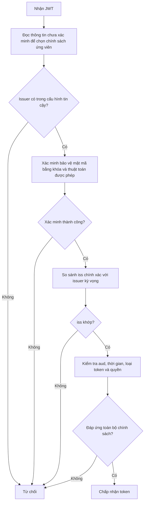

# `iss`: Xác định và đối chiếu chính xác bên phát hành JWT

## 1. `iss` trả lời câu hỏi gì?

Trong JSON Web Token (JWT), **`iss` (issuer)** là *registered claim* dùng để xác định **chủ thể phát hành token**. Đây là một trong những thông tin quan trọng để hệ thống nhận token quyết định liệu token đến từ một nguồn được phép tin cậy hay không.

Ví dụ, một API chỉ chấp nhận access token do hệ thống định danh `https://identity.example.com/realms/acme` phát hành. Nếu nhận một JWT có `iss` là `https://identity.example.com/realms/other`, API phải xem đó là một bên phát hành khác, ngay cả khi hai token có cấu trúc giống nhau.

Theo [RFC 7519, mục 4.1.1](https://www.rfc-editor.org/rfc/rfc7519#section-4.1.1):

- `iss` xác định principal đã phát hành JWT. Principal có thể là một dịch vụ định danh, authorization server, tổ chức hoặc thành phần được ủy quyền phát hành token, tùy kiến trúc.
- Giá trị của `iss` là một chuỗi **`StringOrURI`**, có phân biệt chữ hoa/chữ thường.
- Bản thân RFC 7519 **không bắt buộc mọi JWT đều có `iss`**. Tuy nhiên, một giao thức sử dụng JWT hoặc chính sách của ứng dụng có thể yêu cầu claim này. Ví dụ, các profile dành cho token xác thực hoặc access token thường có quy tắc về issuer chặt chẽ hơn.

Điểm cốt lõi: **token tự khai báo ai phát hành bằng `iss`, nhưng lời khai đó chỉ đáng tin khi token đã được xác minh bằng cơ chế mật mã và chính sách tin cậy phù hợp**. Việc nhìn thấy một URL quen thuộc trong payload chưa chứng minh bất cứ điều gì.

## 2. Ví dụ về `iss` trong payload

Một JWT dạng JWS (token có chữ ký hoặc mã xác thực) thường có payload như sau:

```json
{
  "iss": "https://identity.example.com/realms/acme",
  "sub": "user-7821",
  "aud": "inventory-api",
  "iat": 1893452400,
  "exp": 1893456000
}
```

Trong ví dụ này:

| Thành phần | Ý nghĩa | Câu hỏi bên nhận phải xử lý |
| --- | --- | --- |
| `iss` | Bên phát hành token | Bên phát hành này có nằm trong danh sách được tin cậy không? |
| `sub` | Chủ thể mà token nói đến | Chủ thể này là ai trong phạm vi issuer tương ứng? |
| `aud` | Đối tượng nhận token dự kiến | Token này có được cấp cho `inventory-api` không? |
| `iat` | Thời điểm phát hành | Thông tin thời gian có hợp lý với chính sách không? |
| `exp` | Thời điểm hết hạn | Token đã hết hạn hay chưa? |

Các mốc `iat` và `exp` ở đây là ví dụ minh họa dưới dạng NumericDate (số giây tính từ Unix epoch), không phải token dùng trong hệ thống thực tế.

Trong header của JWS có thể xuất hiện `alg` (thuật toán) và `kid` (định danh khóa). Chúng **không thay thế** `iss`: `kid` chỉ giúp lựa chọn khóa trong tập khóa được phép, còn `alg` không phải bằng chứng về bên phát hành và không được tự quyết định chính sách xác minh.

## 3. Thế nào là “đối chiếu chính xác” issuer?

Ứng dụng nhận JWT cần có một hoặc nhiều **giá trị issuer đã được cấu hình tin cậy trước**. Với mỗi token, hệ thống đối chiếu `iss` trong payload đã xác minh với giá trị kỳ vọng theo phép so sánh chuỗi chính xác.

Giả sử issuer tin cậy được cấu hình là:

```text
https://identity.example.com/realms/acme
```

| `iss` xuất hiện trong token | Kết quả so với issuer trên | Lý do |
| --- | --- | --- |
| `https://identity.example.com/realms/acme` | Khớp | Cùng chuỗi ký tự |
| `https://identity.example.com/realms/acme/` | Không khớp | Có thêm dấu `/` cuối |
| `https://IDENTITY.example.com/realms/acme` | Không khớp | Khác chữ hoa/chữ thường |
| `http://identity.example.com/realms/acme` | Không khớp | Khác scheme `http` và `https` |
| `https://identity.example.com/realms/other` | Không khớp | Khác đường dẫn/tenant |
| `https://identity.example.com/realms/acme?x=1` | Không khớp | Có thêm query |
| `https://identity.example.com.evil.test/realms/acme` | Không khớp | Khác hostname, dù có tiền tố nhìn giống nhau |

Theo quy định `StringOrURI` trong [RFC 7519, mục 2](https://www.rfc-editor.org/rfc/rfc7519#section-2), các giá trị được so sánh **có phân biệt chữ hoa/chữ thường, không thực hiện biến đổi hoặc chuẩn hóa**. Vì vậy:

- Không dùng phép so sánh theo tiền tố, hậu tố, substring hoặc biểu thức `contains` để xác nhận issuer.
- Không tự chuyển thành chữ thường, bỏ dấu `/`, giải mã rồi mã hóa lại URL, hoặc áp dụng quy tắc tương đương URL trước khi so sánh.
- Không mặc định hai issuer giống nhau chỉ vì DNS có thể phân giải tên miền không phân biệt chữ hoa/chữ thường.
- Không suy ra `iss` từ `Host`, `Origin`, URL request hoặc địa chỉ IP nơi token được gửi tới. Các giá trị này mô tả những khía cạnh khác nhau.

`StringOrURI` cho phép giá trị chuỗi không chứa dấu `:`; nếu **có dấu `:`**, giá trị phải là URI. `iss` **không bắt buộc là URL có thể truy cập qua HTTP** theo RFC 7519. Trong những hệ thống có quy ước issuer là HTTPS URL, hãy tuân thủ chính quy ước đó, nhưng đừng tự biến claim thành một endpoint mạng tùy ý.

## 4. Vì sao so sánh `iss` đơn thuần vẫn chưa đủ?

Payload JWT có thể được đọc bằng cách giải mã Base64URL mà không cần biết bí mật hay khóa ký. Kẻ tấn công cũng có thể tự tạo một payload chứa `iss` của một nhà phát hành hợp lệ:

```json
{
  "iss": "https://identity.example.com/realms/acme",
  "sub": "administrator",
  "aud": "inventory-api"
}
```

Chuỗi JSON này **không phải bằng chứng** token được phát hành bởi issuer trên. Để chấp nhận JWT sử dụng làm bằng chứng xác thực hoặc cấp quyền, bên nhận cần kiểm tra ít nhất các lớp sau, tùy định dạng token và giao thức đang sử dụng:

1. **Nguồn phát hành được phép:** `iss` phải khớp với một issuer được tin cậy cho đúng loại token và ngữ cảnh tiếp nhận.
2. **Bằng chứng mật mã:** xác minh chữ ký/MAC của JWS bằng khóa được quản lý hoặc liên kết với issuer đã tin cậy; chỉ cho phép những thuật toán nằm trong chính sách. Với JWT được bảo vệ bằng JWE, phải xử lý bảo vệ mật mã tương ứng và xác lập bên phát hành theo giao thức, không chỉ đọc payload sau giải mã.
3. **Đúng đối tượng nhận:** đối chiếu `aud` với API hoặc dịch vụ đang xử lý token; token hợp lệ của issuer nhưng cấp cho dịch vụ khác vẫn phải bị từ chối.
4. **Đúng thời gian:** xác nhận `exp`, `nbf` và các ràng buộc về thời gian khác nếu được sử dụng, theo chính sách rõ ràng.
5. **Đúng mục đích và ngữ cảnh:** phân biệt loại token (ví dụ access token và ID token), kiểm tra ràng buộc subject, scope, tenant hoặc các claim khác mà giao thức yêu cầu.

Trong triển khai dùng khóa công khai, có thể lấy khóa từ tài liệu JWKS của nhà phát hành **đã được cấu hình hoặc xác minh là tin cậy**. Chỉ vì token cung cấp `iss`, `kid`, `jku` hoặc một đường dẫn trông hợp lý không có nghĩa hệ thống được phép kết nối đến địa chỉ bất kỳ hoặc tin khóa do chính token đề xuất.

Một cách nhìn hữu ích:



Sơ đồ mô tả trường hợp nhận JWT đã được ký. Tùy thư viện và cấu trúc hệ thống, trình tự giải mã, lựa chọn khóa, xác minh và kiểm tra claim có thể được đóng gói khác nhau; điều kiện bắt buộc là **không sử dụng claim chưa xác minh để đưa ra quyết định tin cậy cuối cùng**.

## 5. Quy trình kiểm tra với một issuer cố định

Giả sử `inventory-api` chỉ nhận JWS từ issuer `https://identity.example.com/realms/acme`, sử dụng thuật toán ký được cho phép và tập khóa xác minh do cấu hình tin cậy cung cấp.

```text
EXPECTED_ISSUER = "https://identity.example.com/realms/acme"
EXPECTED_AUDIENCE = "inventory-api"
ALLOWED_ALGORITHMS = {"RS256"}
TRUSTED_VERIFICATION_KEYS = keys_configured_for(EXPECTED_ISSUER)

function validateIncomingToken(token):
    # Hàm minh họa ý tưởng; không phải API của thư viện cụ thể.
    verifiedClaims = verifySignedJwt(
        token,
        keys = TRUSTED_VERIFICATION_KEYS,
        allowedAlgorithms = ALLOWED_ALGORITHMS
    )

    if verificationFailed(verifiedClaims):
        reject("invalid signature or token format")

    if verifiedClaims.iss !== EXPECTED_ISSUER:
        reject("unexpected issuer")

    if not audienceContains(verifiedClaims.aud, EXPECTED_AUDIENCE):
        reject("wrong audience")

    if tokenIsExpiredOrNotYetValid(verifiedClaims):
        reject("token outside valid time window")

    if not requiredTokenTypeAndPermissionsMatch(verifiedClaims):
        reject("invalid token context")

    accept(verifiedClaims)
```

`aud` theo JWT có thể là một chuỗi hoặc mảng chuỗi; hàm kiểm tra phải xử lý đúng hai dạng. `tokenIsExpiredOrNotYetValid` và kiểm tra quyền là những hàm mang tính khái niệm, phụ thuộc vào quy ước của ứng dụng. Trong thực tế, thư viện JWT đáng tin cậy thường thực hiện một phần các bước này nhưng người tích hợp vẫn phải bảo đảm cấu hình issuer, audience, thuật toán và khóa là đúng.

Đối với một issuer cố định, cách cấu hình gắn khóa xác minh với issuer mong đợi giúp tránh việc lấy chính `iss` chưa xác minh làm nguồn xác định khóa được tin cậy.

## 6. Nhiều issuer và nhiều tenant: phạm vi tin cậy phải rõ ràng

Một hệ thống có thể chấp nhận token từ nhiều nhà phát hành hoặc nhiều tenant. Khi đó, bên nhận cần duy trì ánh xạ được quản lý, ví dụ:

| Issuer được phép | Khóa xác minh dùng cho issuer đó | Audience hợp lệ trong ví dụ |
| --- | --- | --- |
| `https://identity.example.com/realms/acme` | Tập khóa đã tin cậy cho tenant `acme` | `inventory-api` |
| `https://identity.example.com/realms/partner` | Tập khóa đã tin cậy cho tenant `partner` | `partner-integration-api` |

Một cách triển khai hợp lý là đọc `iss` **chưa xác minh chỉ để tra cứu ứng viên** trong danh sách issuer cố định, từ chối ngay nếu không có ứng viên, sau đó xác minh token bằng khóa và thuật toán thuộc ứng viên đó. Cuối cùng, đối chiếu `iss` một lần nữa trên claims **đã xác minh** và kiểm tra audience, thời gian, loại token, quyền.

Điều không được làm là nhận bất kỳ `iss` nào rồi tải metadata/JWKS từ URL tương ứng và mặc nhiên tin khóa tìm thấy. Cách đó khiến kẻ tấn công có thể tự tạo issuer, tự xuất bản khóa và ký một token mà hệ thống lại chấp nhận. Việc truy cập URL từ claim hoặc header không được kiểm soát còn có thể dẫn tới rủi ro truy cập mạng nội bộ ngoài ý muốn (SSRF).

### Phân biệt danh tính theo cặp `(iss, sub)`

Giá trị `sub` thường chỉ có nghĩa trong phạm vi issuer đã cấp token. Hai issuer có thể cùng phát hành `sub = "user-42"` nhưng đó **không mặc nhiên là cùng một người dùng**:

```text
("https://issuer-a.example.test", "user-42")
("https://issuer-b.example.test", "user-42")
```

Vì vậy, khi mô hình danh tính cần tránh trùng lặp giữa các nhà phát hành, có thể dùng cặp `(iss, sub)` làm khóa liên kết danh tính trong nội bộ hệ thống, sau khi đã xác minh và chuẩn hóa theo quy tắc **của chính ứng dụng**. Không gộp người dùng chỉ dựa trên `sub`, email, tên hiển thị hoặc sự giống nhau của hai issuer.

Với hệ thống nhiều tenant, cần nhớ rằng `iss` không phải lúc nào cũng chính là tenant ID. Có kiến trúc dùng issuer riêng cho từng tenant; cũng có kiến trúc dùng chung issuer và phân biệt tenant bằng claim hoặc ngữ cảnh khác. Phải kiểm tra theo mô hình token thực tế, không suy ra tenant từ phần đường dẫn của `iss` nếu hợp đồng tích hợp không quy định điều đó.

## 7. Các lỗi bảo mật thường gặp

| Lỗi | Hệ quả | Cách xử lý |
| --- | --- | --- |
| Chỉ decode payload rồi so sánh `iss` | Chấp nhận thông tin do kẻ tấn công tự khai báo | Xác minh mật mã bằng khóa tin cậy trước khi chấp nhận claims |
| Kiểm tra `iss` bằng `startsWith` hoặc `contains` | Có thể nhận issuer giả có tiền tố tương tự | So sánh chính xác với giá trị trong allowlist |
| Tự sửa chữ hoa/thường hoặc dấu `/` | Gộp nhầm các issuer khác nhau | Giữ nguyên chuỗi và so sánh phân biệt ký tự |
| Dùng `iss` hoặc `jku` tùy ý để tải khóa rồi tin ngay | Token tự cung cấp nguồn khóa tin cậy; nguy cơ SSRF | Chỉ sử dụng issuer và nguồn khóa được quản trị cho phép |
| Chọn khóa bằng `kid` toàn cục, không ràng buộc issuer | Nhầm khóa giữa các nhà phát hành | Giới hạn lựa chọn `kid` trong tập khóa của issuer được phép |
| Chỉ kiểm tra chữ ký mà bỏ qua `iss` | Có thể chấp nhận token từ nguồn ký khác với chính sách ứng dụng | Kiểm tra issuer trên claims đã xác minh |
| Đúng `iss` nhưng bỏ qua `aud` | Token dành cho ứng dụng khác bị dùng lại ở API hiện tại | Kiểm tra audience độc lập với issuer |
| Thiếu `iss` nhưng vẫn chấp nhận trong môi trường yêu cầu issuer | Không xác định được bên phát hành theo chính sách | Từ chối khi claim bắt buộc bị thiếu hoặc sai kiểu |
| Dùng token xác thực danh tính cho API chỉ vì issuer hợp lệ | Nhầm mục đích token | Kiểm tra token type, audience và quy tắc của giao thức |

Đặc biệt, **`iss` trỏ tới một thực thể được gọi là issuer, chứ không tự chứng minh thực thể đó sở hữu token**. Sự tin cậy đến từ cấu hình mối quan hệ với issuer, khóa hoặc cơ chế bảo vệ hợp lệ, cùng các kiểm tra ngữ cảnh. Đây là nguyên tắc quan trọng trong việc ngăn token bị đưa sang sai hệ thống (*token substitution* hoặc *cross-issuer confusion*).

## 8. Tình huống thực tế

Một tổ chức có hai hệ thống đăng nhập:

- Nhân viên nội bộ được cấp token từ `https://login.example.test/workforce`.
- Đối tác được cấp token từ `https://login.example.test/partners`.

Cả hai loại token đều có thể mang `sub = "12345"`, sử dụng cùng định dạng JWT, thậm chí cùng tên claim `role`. API quản trị nhân sự chỉ cho nhân viên truy cập.

Nếu API chỉ kiểm tra token có chữ ký hợp lệ từ **bất kỳ** nhà phát hành nào mà hệ thống tổ chức biết đến, rồi dựa vào `role = "admin"`, token của đối tác có thể được hiểu nhầm là token nhân viên. Phương án kiểm tra đúng là gắn API quản trị với issuer nội bộ kỳ vọng, tập khóa tương ứng, audience của API và các quyền cụ thể. Khi nhận token đối tác, API từ chối ngay cả khi token đó hoàn toàn hợp lệ trong hệ thống đối tác.

Tình huống này cho thấy **“JWT hợp lệ về kỹ thuật” khác với “JWT được phép sử dụng tại tài nguyên hiện tại”**. `iss` là một điều kiện then chốt để phân biệt hai việc đó, nhưng không thay thế các điều kiện còn lại.

## 9. Kịch bản kiểm thử nên có

Với một API chỉ chấp nhận issuer `https://identity.example.com/realms/acme`, nên kiểm thử tối thiểu:

| Trường hợp | Kỳ vọng | Điều cần chứng minh |
| --- | --- | --- |
| Token ký hợp lệ, `iss` đúng, `aud` đúng, thời hạn và quyền hợp lệ | Chấp nhận | Toàn bộ chính sách hoạt động |
| Token ký hợp lệ nhưng `iss` thuộc tenant khác | Từ chối | Cách ly issuer/tenant |
| Token có `iss` đúng nhưng chữ ký sai | Từ chối | Không tin payload chưa xác minh |
| Token có `iss` đúng nhưng ký bằng khóa của issuer khác | Từ chối | Ràng buộc khóa theo issuer |
| Token có `iss` đúng nhưng `aud` khác | Từ chối | Không chấp nhận token cấp cho dịch vụ khác |
| `iss` có thêm `/`, khác chữ hoa/thường hoặc bị thay hostname | Từ chối | So sánh chuỗi chính xác |
| `iss` thiếu, `null`, là số hoặc đối tượng JSON | Từ chối khi `iss` bắt buộc | Kiểm tra sự hiện diện và kiểu dữ liệu |
| Header trỏ `jku` hoặc `kid` đến nguồn khóa không được phép | Từ chối, không tin nguồn được đề xuất | Chống token tự chỉ định nguồn tin cậy |
| Token hết hạn hoặc chưa đến thời điểm có hiệu lực | Từ chối | Kiểm tra thời gian độc lập |
| Token hợp lệ từ issuer đúng nhưng sai loại token | Từ chối | Cách ly mục đích sử dụng token |

Nếu hỗ trợ nhiều issuer, mở rộng kiểm thử để bảo đảm từng issuer chỉ dùng tập khóa, audience và quyền đã cấu hình cho chính issuer đó.

## 10. Ghi nhớ khi thiết kế chính sách JWT

1. **Xác định issuer kỳ vọng từ cấu hình đáng tin cậy** theo API, môi trường, tenant hoặc đối tác tích hợp.
2. **Xác minh bảo vệ mật mã trước khi tin claims.** Nếu cần đọc `iss` chưa xác minh để chọn cấu hình, chỉ dùng nó làm gợi ý tra cứu trong allowlist, không dùng để kết luận token đáng tin.
3. **So sánh `iss` chính xác**, có phân biệt chữ hoa/chữ thường, không tự chuẩn hóa URI.
4. **Ràng buộc khóa và thuật toán với issuer tin cậy**, đồng thời kiểm tra `aud`, thời gian, token type và các quy tắc nghiệp vụ.
5. **Từ chối mặc định** khi `iss` thiếu hoặc không khớp trong hệ thống yêu cầu issuer; ghi log ở mức an toàn, tránh đưa toàn bộ JWT nhạy cảm vào nhật ký.

### Tài liệu chuẩn tham khảo

- [RFC 7519 — JSON Web Token (JWT), mục 2 và 4.1.1](https://www.rfc-editor.org/rfc/rfc7519): định nghĩa `StringOrURI` và `iss`.
- [RFC 8725 — JSON Web Token Best Current Practices](https://www.rfc-editor.org/rfc/rfc8725): thực hành xác minh thuật toán, khóa, issuer, audience và ngăn nhầm lẫn giữa các loại JWT.
- [RFC 9068 — JSON Web Token (JWT) Profile for OAuth 2.0 Access Tokens](https://www.rfc-editor.org/rfc/rfc9068): ví dụ về profile áp dụng quy tắc bắt buộc và xác minh issuer cho JWT access token.

**Kết luận:** `iss` xác định **ai tuyên bố đã phát hành JWT**. Chỉ chấp nhận lời tuyên bố đó khi nó khớp chính xác với issuer được phép và được củng cố bằng xác minh mật mã cùng toàn bộ chính sách sử dụng token.
