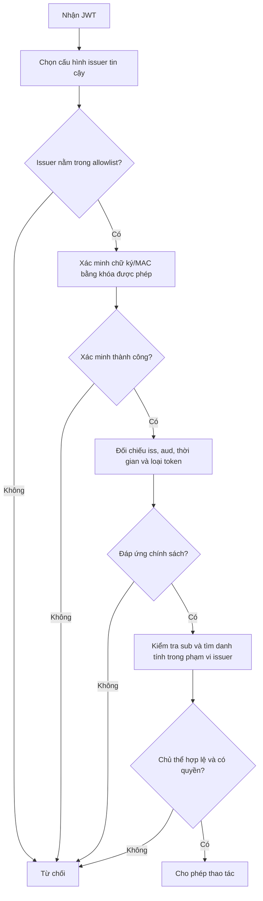

# `sub`: Chủ thể và phạm vi duy nhất trong ngữ cảnh bên phát hành JWT

## 1. `sub` là gì?

Trong **Security - JSON Web Token (JWT)**, claim tiêu chuẩn **`sub` (subject)** cho biết **chủ thể mà JWT đề cập đến**. Chủ thể có thể là người dùng, tài khoản dịch vụ, ứng dụng khách, thiết bị hoặc một thực thể khác, tùy loại token và giao thức sử dụng.

Ví dụ, một hệ thống định danh phát hành token có payload:

```json
{
  "iss": "https://identity.example.com/organizations/acme",
  "sub": "usr_8f42b6",
  "aud": "orders-api",
  "iat": 1893452400,
  "exp": 1893456000
}
```

Trong ngữ cảnh trên:

- `iss` xác định **bên phát hành** JWT.
- `sub` xác định **chủ thể** được token nói đến theo cách định danh của bên phát hành.
- `aud` xác định **đối tượng nhận dự kiến** của token.
- `iat` và `exp` cho biết thời điểm phát hành và hết hạn, thể hiện bằng NumericDate (số giây từ Unix epoch).

Trong ví dụ này, `usr_8f42b6` là định danh của một chủ thể theo quy ước của issuer `https://identity.example.com/organizations/acme`. Giá trị đó **không tự chứng minh** chủ thể có quyền truy cập `orders-api`; hệ thống vẫn phải xác minh token và kiểm tra audience, thời gian, quyền cùng những điều kiện áp dụng khác.

Theo [RFC 7519, mục 4.1.2](https://www.rfc-editor.org/rfc/rfc7519#section-4.1.2), `sub` là một *registered claim* **không bắt buộc trong mọi JWT**. Tuy nhiên, một profile như OpenID Connect, OAuth access token dạng JWT hoặc giao thức ứng dụng có thể yêu cầu `sub` và đặt ra quy tắc cụ thể về ý nghĩa của nó.

## 2. Quy tắc cốt lõi: duy nhất trong phạm vi issuer hoặc duy nhất toàn cục

RFC 7519 nêu rằng giá trị `sub` **phải có tính duy nhất trong ngữ cảnh của bên phát hành (`iss`), hoặc có tính duy nhất toàn cục**. Từ đó có hai phương án định danh hợp lệ về mặt nguyên tắc:

| Cách định danh | Ví dụ `sub` | Phạm vi duy nhất |
| --- | --- | --- |
| Định danh cục bộ theo issuer | `usr_8f42b6` | Cùng issuer không dùng giá trị đó cho hai chủ thể khác nhau |
| Định danh toàn cục | `urn:example:subject:7b12f0` | Định danh được quy ước duy nhất trên phạm vi rộng hơn một issuer |

**Một giá trị `sub` không bắt buộc phải duy nhất giữa các issuer khác nhau.** Hai nhà phát hành có thể cùng cấp `sub = "user-123"` cho những chủ thể hoàn toàn khác nhau.

Hãy xét hai token:

```json
{
  "iss": "https://login.example.com/tenant/alpha",
  "sub": "user-123",
  "aud": "reporting-api"
}
```

```json
{
  "iss": "https://login.example.com/tenant/beta",
  "sub": "user-123",
  "aud": "reporting-api"
}
```

Dù cùng `sub`, hai token có **issuer khác nhau**; hệ thống nhận không được tự suy ra rằng `user-123` của `alpha` chính là `user-123` của `beta`.

Vì vậy, khi làm việc với nhiều issuer, **cặp (`iss`, `sub`)** thường là khóa định danh tự nhiên của chủ thể trong phạm vi tin cậy của ứng dụng:

```text
("https://login.example.com/tenant/alpha", "user-123")
    !=
("https://login.example.com/tenant/beta",  "user-123")
```

Cần phân biệt rõ hai ý:

1. **Tính duy nhất theo chuẩn JWT:** issuer phải gán `sub` sao cho phân biệt được các chủ thể trong phạm vi mà mình chịu trách nhiệm, hoặc sử dụng định danh toàn cục.
2. **Tính ổn định theo thời gian:** RFC 7519 không tự bảo đảm rằng một giá trị `sub` sẽ tồn tại vĩnh viễn, không bị thay đổi hoặc không bao giờ được cấp lại. Các bảo đảm dài hạn phụ thuộc vào quy ước của nhà phát hành và profile sử dụng. Một số profile như OpenID Connect yêu cầu tính ổn định chặt chẽ hơn.

Khi xây dựng hệ thống danh tính bền vững, nên thỏa thuận rõ quy tắc cấp phát, không tái sử dụng và vòng đời của `sub` với issuer, thay vì tự suy ra từ định dạng chuỗi.

## 3. Kiểu dữ liệu và quy tắc so sánh

Theo [RFC 7519, mục 2](https://www.rfc-editor.org/rfc/rfc7519#section-2), `sub` phải là một giá trị JSON **kiểu chuỗi**, thuộc dạng `StringOrURI`. Quy tắc so sánh của `StringOrURI` có phân biệt chữ hoa/chữ thường và không tự thực hiện biến đổi hay chuẩn hóa.

Ví dụ:

| Giá trị A | Giá trị B | Cùng chuỗi không? |
| --- | --- | --- |
| `"user-123"` | `"user-123"` | Có |
| `"user-123"` | `"User-123"` | Không |
| `"00123"` | `"123"` | Không |
| `"urn:example:user:42"` | `"urn:example:user:042"` | Không |
| `"https://id.example.com/u/42"` | `"https://id.example.com/u/42/"` | Không |

Chú ý:

- Giá trị `sub` **không phải là số** dù chỉ chứa chữ số: `"123"` là chuỗi, còn `123` là JSON number và không hợp lệ theo kiểu dữ liệu của claim này.
- Không tự chuyển chữ hoa/thường, cắt khoảng trắng, bỏ số 0 đầu, thay dấu phân cách hoặc chuẩn hóa URI để quyết định hai `sub` là một.
- Nếu chuỗi `StringOrURI` chứa dấu hai chấm `:`, giá trị đó phải là URI. Tuy nhiên, **không có yêu cầu rằng mọi `sub` là URL truy cập được**. `"user-123"` là ví dụ về định danh chuỗi hợp lệ, còn `"urn:example:user:42"` minh họa định danh dạng URI.
- Khi `sub` có dạng URL, không tự động truy cập URL đó để xác minh danh tính, tải hồ sơ hoặc lấy khóa. Giá trị này là một **định danh**, không phải chỉ dẫn kết nối mạng được tin cậy.
- Khi profile của hệ thống bắt buộc phải có `sub`, cần từ chối token có `sub` vắng mặt hoặc không đúng kiểu; nếu yêu cầu định danh không rỗng, hãy quy định và kiểm tra thêm trong chính sách.

Việc ứng dụng có quy tắc ánh xạ định danh nội bộ không cho phép thay đổi tùy tiện phép so sánh claim ở ranh giới tin cậy. Nếu cần hợp nhất nhiều định danh, hãy quản lý quan hệ ánh xạ đó một cách riêng biệt, có kiểm soát.

## 4. `sub` không đồng nghĩa với người dùng đang đăng nhập

`sub` là *subject* của JWT. Nó **không mặc nhiên là tên người dùng, email, số điện thoại, ID phiên đăng nhập hoặc người trực tiếp gửi HTTP request**.

| Tình huống | Chủ thể có thể xuất hiện trong `sub` | Cần xem xét thêm |
| --- | --- | --- |
| Token xác thực người dùng | Một định danh người dùng trong issuer | Token type, audience, ngữ cảnh đăng nhập |
| Access token cho API | Người dùng hoặc chủ thể khác theo profile token | Scope, quyền, loại grant, actor/delegation nếu có |
| Token dành cho giao tiếp dịch vụ | Một tài khoản dịch vụ hoặc client | Ràng buộc client, audience, mục đích token |
| Token có ủy quyền/đại diện | Chủ thể được đại diện theo quy tắc của giao thức | Ai đang hành động, ai được đại diện, quyền ủy quyền |

Với một số giao thức trao đổi token hoặc ủy quyền, chủ thể được mô tả bởi `sub` và tác nhân thực hiện hành động có thể khác nhau. Khi đó cần dựa vào các claim và quy tắc như `act`, `client_id` hoặc các thông tin ràng buộc được profile quy định. Không thể suy ra “ai đang trực tiếp thao tác” chỉ từ `sub`.

Trong hệ thống cấp quyền, `sub` thường là **đầu vào để tìm chủ thể**, nhưng quyết định cho phép hay từ chối phải dựa thêm vào:

- Token được phát hành bởi issuer tin cậy hay không.
- Token có hướng đến tài nguyên/API hiện tại hay không (`aud`).
- Token còn hiệu lực và được bảo vệ mật mã đúng cách hay không.
- Chủ thể có quyền với hành động và tài nguyên cụ thể hay không (scope, role, policy và quy tắc nghiệp vụ).
- Có yêu cầu chứng minh chủ thể hiện diện, ràng buộc thiết bị hoặc ủy quyền hay không.

Ví dụ, hai token cùng có `sub = "user-123"` nhưng khác `aud`, thời hạn hoặc quyền truy cập thì **không thể sử dụng thay thế cho nhau**.

## 5. Xác minh `sub` trong chuỗi kiểm tra JWT

Một JWT có thể được giải mã Base64URL để đọc payload mà **không cần xác minh chữ ký**. Vì thế, kẻ tấn công có thể tự viết payload mang `sub = "admin"` hoặc `sub` của một tài khoản hợp lệ.

Ví dụ payload giả mạo:

```json
{
  "iss": "https://identity.example.com/organizations/acme",
  "sub": "system-admin",
  "aud": "orders-api",
  "exp": 1893456000
}
```

Đọc được chuỗi này chưa có nghĩa token thật sự do issuer nêu trên phát hành hoặc chủ thể `system-admin` đã được xác nhận. Một hệ thống nhận JWS dùng làm bằng chứng xác thực/cấp quyền cần kiểm tra:

1. **Issuer được phép:** xác định issuer tin cậy phù hợp với API, tenant, môi trường và mục đích token. Không tự tạo quan hệ tin cậy từ `iss` chưa xác minh.
2. **Bảo vệ mật mã hợp lệ:** xác minh chữ ký/MAC bằng khóa đã gắn với issuer tin cậy và thuật toán nằm trong allowlist.
3. **Claims đã xác minh:** so khớp chính xác `iss` với issuer kỳ vọng; kiểm tra `sub` là chuỗi và đáp ứng điều kiện hiện diện/định dạng của profile.
4. **Mục đích token:** xác minh `aud`, thời gian (`exp`, `nbf` khi áp dụng), token type và ràng buộc cần thiết khác.
5. **Ánh xạ và quyền:** tìm đúng chủ thể theo phạm vi issuer, sau đó áp dụng quyền đối với tài nguyên cụ thể.



Sơ đồ mô tả trường hợp token đã được ký. Đối với JWE, cách thiết lập tính xác thực của issuer và quan hệ tin cậy phụ thuộc vào profile/cơ chế bảo vệ được dùng; giải mã được nội dung **không tự chứng minh** ai đã phát hành. Trong mọi trường hợp, không cấp quyền dựa trên `sub` chưa được xác minh trong đúng ngữ cảnh.

### Pseudocode không phụ thuộc ngôn ngữ hay nền tảng

```text
TRUSTED_ISSUERS = {
    "https://identity.example.com/organizations/acme": {
        allowedAlgorithms: ["RS256"],
        trustedKeys: ACME_KEYS,
        audience: "orders-api"
    }
}

function resolvePrincipal(jwt):
    # Chỉ dùng dữ liệu chưa xác minh để tra cứu cấu hình cố định.
    issuerHint = peekIssuerWithoutTrust(jwt)
    config = TRUSTED_ISSUERS.get(issuerHint)
    if config is null:
        reject("unknown issuer")

    claims = verifySignedJwt(
        jwt,
        keys = config.trustedKeys,
        allowedAlgorithms = config.allowedAlgorithms
    )
    if verificationFailed(claims):
        reject("invalid JWT protection")

    if claims.iss !== issuerHint:
        reject("issuer mismatch")
    if not audienceContains(claims.aud, config.audience):
        reject("incorrect audience")
    if not timeAndTokenTypePolicyMatches(claims):
        reject("invalid token context")

    if not isString(claims.sub) or claims.sub is empty:
        reject("missing/invalid subject for this API")

    # Định danh nội bộ theo issuer và subject đã xác minh.
    principal = accountDirectory.findByIssuerAndSubject(
        claims.iss,
        claims.sub
    )
    if principal is null:
        reject("unrecognized subject")
    return principal
```

Đây là mã giả mô tả nguyên tắc. Dấu `!==` tượng trưng cho so sánh chuỗi chính xác. Kiểm tra `aud` phải hỗ trợ cả chuỗi và mảng chuỗi theo định dạng JWT; quy tắc kiểm tra thời gian và loại token là trách nhiệm của profile/ứng dụng. Mọi truy vấn tới kho danh tính cần dùng cơ chế tham số hóa và ràng buộc dữ liệu tương ứng.

## 6. Thiết kế khóa danh tính cho hệ thống nhiều issuer

Một ứng dụng có thể tích hợp nhiều nhà phát hành. Để tránh trùng định danh, cấu trúc nội bộ có thể lưu:

| Trường | Ví dụ | Vai trò |
| --- | --- | --- |
| `issuer` | `https://login.example.com/tenant/alpha` | Namespace định danh |
| `subject` | `user-123` | Định danh theo issuer |
| `internal_principal_id` | `p-7c8d` | Khóa nội bộ do ứng dụng quản lý |
| `state` | `active` | Trạng thái chủ thể trong ứng dụng |

Ràng buộc duy nhất trên **(`issuer`, `subject`)** sẽ giúp phân biệt chính xác chủ thể của từng bên phát hành. Nếu chỉ lưu `sub` làm khóa duy nhất toàn hệ thống, hai chủ thể có cùng giá trị từ hai issuer khác nhau có thể bị gộp nhầm.

Một ví dụ ánh xạ:

```text
(issuer="https://login.example.com/tenant/alpha", sub="user-123")
    -> internal_principal_id = "p-7c8d"

(issuer="https://login.example.com/tenant/beta",  sub="user-123")
    -> internal_principal_id = "p-2a9e"
```

**Trường hợp chỉ một issuer:** một `sub` đã xác minh có thể đủ để tra cứu trong namespace cố định của hệ thống. Tuy nhiên, việc lưu issuer rõ ràng thường thuận lợi hơn khi mở rộng tích hợp, phân tách môi trường hoặc di chuyển nhà cung cấp danh tính.

**Trường hợp nhiều tenant dùng chung issuer:** không được mặc nhiên gắn tenant bằng cách tách chuỗi `sub` hay bằng đường dẫn URL nếu hợp đồng token không quy định. Nếu tenant là ranh giới danh tính, issuer phải bảo đảm tính duy nhất của `sub` trong phạm vi của mình, hoặc profile/thiết kế ứng dụng cần một ràng buộc tenant rõ ràng và được xác minh. Không chấp nhận tình huống hai chủ thể khác nhau trong cùng issuer bị gán trùng `sub` mà không có cơ chế phân biệt được định nghĩa chặt chẽ.

### Có nên dùng email hoặc username làm `sub`?

Một issuer có thể lựa chọn cấu trúc `sub` theo quy tắc của mình, nhưng **email và username thường không phải khóa định danh lâu dài lý tưởng** vì có thể đổi tên, chuyển quyền sở hữu hoặc được cấp lại. Cách thiết kế phổ biến là issuer phát hành một định danh kỹ thuật ổn định, không mang thông tin cá nhân trực tiếp, chẳng hạn `usr_8f42b6`.

Điều này cũng giúp giảm rủi ro coi một chuỗi có hình thức giống email là căn cứ liên kết hai tài khoản. Việc hai tài khoản ở hai issuer có cùng địa chỉ email **không chứng minh đó là cùng một chủ thể hoặc đã được phép hợp nhất**.

### Một người có thể có nhiều `sub`

Trong một số profile, định danh của cùng một người có thể thay đổi theo ứng dụng nhận token hoặc chính sách riêng tư. Ví dụ, OpenID Connect hỗ trợ *public subject identifier* và *pairwise subject identifier*. Với pairwise, cùng một người dùng có thể có các giá trị `sub` khác nhau đối với những nhóm ứng dụng dựa vào danh tính khác nhau.

Do đó, **khác `sub` không phải lúc nào cũng chứng minh là hai con người khác nhau**. Việc liên kết tài khoản trên nhiều ứng dụng/issuer phải theo cơ chế được cho phép và xác minh riêng; không nối tự động bằng tên, email, hay suy đoán định dạng `sub`.

## 7. Tính duy nhất không có nghĩa là được phép truy cập

Giả sử một API báo cáo nhận token:

```json
{
  "iss": "https://login.example.com/tenant/alpha",
  "sub": "user-123",
  "aud": "reports-api",
  "scope": "reports:read",
  "exp": 1893456000
}
```

Sau khi xác minh chữ ký và các claim bắt buộc, API có thể dùng cặp (`iss`, `sub`) để tra cứu tài khoản. Tuy nhiên:

- `sub` không mang nghĩa “được phép đọc toàn bộ báo cáo”.
- `scope` chỉ cung cấp thông tin quyền trong phạm vi đã được issuer và API thống nhất; chính sách có thể còn yêu cầu quyền đối với từng báo cáo.
- Nếu token dành cho `reports-api` được gửi tới `billing-api`, `billing-api` phải kiểm tra `aud` và từ chối theo chính sách của mình.
- Nếu tài khoản nội bộ bị vô hiệu hóa hoặc bị thu hồi quyền, API cần áp dụng chính sách xử lý trạng thái/thu hồi phù hợp, dù JWT vẫn còn thời hạn mật mã.

Xác định được chủ thể là một bước của **authentication và identity resolution** trong ngữ cảnh token, còn quyết định thao tác được phép thuộc **authorization**. Cả hai phải dựa trên claims đã được tin cậy và ngữ cảnh hiện hành.

## 8. Những sai lầm phổ biến với `sub`

| Sai lầm | Rủi ro | Cách xử lý |
| --- | --- | --- |
| Dùng `sub` làm khóa toàn cục mà không lưu `iss` khi có nhiều issuer | Nhầm hai chủ thể từ hai bên phát hành | Ánh xạ theo (`iss`, `sub`) đã xác minh |
| Chỉ Base64URL-decode JWT rồi dùng `sub` | Chủ thể do kẻ tấn công tự khai báo | Xác minh bảo vệ mật mã và chính sách token |
| Tin `sub = "admin"` đồng nghĩa quyền quản trị | Leo thang đặc quyền do suy diễn quyền từ định danh | Cấp quyền bằng chính sách và thông tin quyền được kiểm tra |
| So sánh `sub` sau khi chuyển chữ thường hoặc bỏ số 0 | Gộp nhầm danh tính khác nhau | So sánh đúng chuỗi gốc theo quy tắc `StringOrURI` |
| Dùng email/username làm khóa kết nối tài khoản từ nhiều issuer | Gộp nhầm tài khoản, ảnh hưởng riêng tư | Liên kết danh tính qua quy trình đã xác minh |
| Cho rằng `sub` chỉ có thể là người dùng | Hiểu sai token dịch vụ hoặc token ủy quyền | Đọc profile, token type và vai trò của subject |
| Cho rằng giá trị `sub` sẽ không bao giờ đổi hoặc cấp lại | Mất liên kết hoặc chiếm nhầm tài khoản khi lifecycle thay đổi | Thỏa thuận chính sách cấp phát, không tái sử dụng, migration |
| Tự động gọi URL trong `sub` | Truy cập nguồn không được tin cậy, có thể phát sinh SSRF | Xử lý `sub` như dữ liệu định danh |
| Không kiểm tra `aud` và loại token khi tra cứu `sub` | Dùng nhầm token của ứng dụng/mục đích khác | Xác minh audience, token type và ngữ cảnh |
| Không ràng buộc issuer với bộ khóa xác minh | Có thể xác minh token bằng khóa không thuộc issuer kỳ vọng | Dùng khóa và thuật toán được gắn với issuer tin cậy |

## 9. Các ca kiểm thử đề xuất

Với API yêu cầu `sub` để ánh xạ danh tính, nên có các ca sau:

| Ca kiểm thử | Kết quả kỳ vọng |
| --- | --- |
| Token ký hợp lệ, `iss` đúng, `sub` đúng kiểu, audience và thời gian hợp lệ | Tìm được chủ thể theo cặp (`iss`, `sub`) |
| Hai token từ hai issuer có cùng `sub` | Ánh xạ thành hai chủ thể riêng, trừ khi có liên kết được xác minh |
| Token có `sub` trùng tài khoản quản trị nhưng chữ ký sai | Từ chối trước khi cấp quyền |
| Token đúng chữ ký nhưng `aud` khác API nhận | Từ chối |
| Token có `sub` là JSON number, object, array hoặc `null` | Từ chối theo yêu cầu kiểu chuỗi |
| Token thiếu `sub` trong API bắt buộc có chủ thể | Từ chối |
| Token có `sub` chỉ khác chữ hoa/thường hoặc số 0 đầu | Xem là định danh khác, không tự gộp |
| Token thuộc issuer không có trong allowlist dù `sub` có trong kho | Từ chối |
| Token hợp lệ nhưng không có quyền với tài nguyên | Từ chối thao tác |
| Tài khoản được đổi email nhưng giữ nguyên subject ổn định theo hợp đồng issuer | Liên kết bằng subject vẫn hoạt động, không dựa trên email |
| Cùng một người dùng xuất hiện dưới hai pairwise `sub` khác nhau | Không tự gộp định danh nếu thiếu cơ chế liên kết được phép |
| Token có `sub` dạng URL trỏ vào mạng nội bộ | Không tự truy cập URL để giải quyết chủ thể |

Các tình huống này giúp kiểm tra đồng thời **tính chính xác của định danh**, **phạm vi duy nhất** và **điều kiện tin cậy của token**.

## 10. Nguyên tắc thực hành

1. **Hiểu đúng `sub`:** nó cho biết chủ thể được JWT nói đến, không tự biểu thị quyền, phiên đăng nhập, email hay người đang trực tiếp thao tác.
2. **Tôn trọng phạm vi duy nhất:** issuer phải bảo đảm `sub` duy nhất trong namespace của mình hoặc toàn cục; khi chấp nhận nhiều issuer, thường dùng cặp (`iss`, `sub`) làm khóa định danh.
3. **Xác minh trước khi tin:** chỉ sử dụng `sub` cho các quyết định danh tính và quyền sau khi kiểm tra bảo vệ mật mã, issuer, audience và những điều kiện của profile.
4. **So sánh chính xác:** `sub` là chuỗi `StringOrURI`, phân biệt chữ hoa/chữ thường; không tự chuẩn hóa thành khóa định danh khác.
5. **Phân biệt định danh với ánh xạ nội bộ:** kho danh tính có thể dùng khóa nội bộ riêng và quy trình liên kết tài khoản; không tự hợp nhất dựa vào email/username.
6. **Thống nhất vòng đời:** kiểm tra chính sách của issuer về ổn định, thay đổi, tái cấp phát và riêng tư của subject; tránh lưu các giả định không được bảo đảm.
7. **Tuân thủ profile token:** những quy tắc chi tiết của OpenID Connect, OAuth JWT access token hay giao thức riêng có thể nghiêm ngặt hơn JWT cơ bản.

### Tài liệu tham khảo

- [RFC 7519 — JSON Web Token (JWT), mục 2 và 4.1.2](https://www.rfc-editor.org/rfc/rfc7519): kiểu `StringOrURI`, định nghĩa `sub` và yêu cầu tính duy nhất.
- [RFC 8725 — JSON Web Token Best Current Practices](https://www.rfc-editor.org/rfc/rfc8725): thực hành xác minh issuer, audience, thuật toán, khóa và phòng tránh nhầm lẫn giữa các JWT.
- [RFC 9068 — JSON Web Token (JWT) Profile for OAuth 2.0 Access Tokens](https://www.rfc-editor.org/rfc/rfc9068): quy tắc diễn giải và xác minh claims trong profile access token.
- [OpenID Connect Core 1.0 — Subject Identifier Types](https://openid.net/specs/openid-connect-core-1_0.html#SubjectIDTypes): public và pairwise subject identifiers, ngữ cảnh định danh của người dùng.

**Kết luận:** `sub` chỉ định **chủ thể** theo phạm vi duy nhất của **issuer**. Để nhận diện chính xác và an toàn, phải gắn subject với nguồn phát hành được xác minh, giữ nguyên quy tắc so sánh chuỗi và áp dụng đầy đủ chính sách dành cho loại JWT đang sử dụng.
