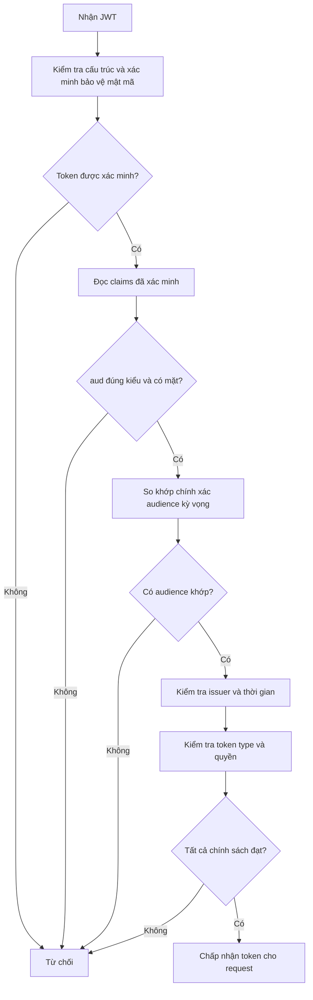

# `aud`: Đối tượng nhận JWT và dạng chuỗi hoặc mảng chuỗi

## 1. `aud` biểu thị điều gì?

Trong JSON Web Token (JWT), **`aud` (audience)** là *registered claim* xác định một hoặc nhiều **đối tượng nhận dự kiến** của token. Đối tượng nhận thường là một API, resource server, ứng dụng hoặc principal có trách nhiệm xử lý token, tùy giao thức sử dụng JWT.

Theo [RFC 7519, mục 4.1.3](https://www.rfc-editor.org/rfc/rfc7519#section-4.1.3), khi một JWT có claim `aud`, mỗi principal xử lý token phải xác định được chính mình trong audience. Nếu principal đó không được liệt kê trong `aud`, token phải bị từ chối.

Ví dụ, access token được cấp để gọi `inventory-api` có thể mang:

```json
{
  "iss": "https://identity.example.com/",
  "sub": "user-7821",
  "aud": "https://api.example.com/inventory"
}
```

Giá trị `aud` cho biết token được phát hành với mục đích dành cho tài nguyên có định danh `https://api.example.com/inventory`. Một API thanh toán không được chấp nhận token này chỉ vì chữ ký hợp lệ hoặc vì token được phát hành bởi cùng một issuer.

`aud` giúp bên nhận trả lời câu hỏi: **“Token này có được cấp để sử dụng tại chính tài nguyên hoặc ứng dụng mà tôi đại diện không?”** Claim này là một phần của chính sách chấp nhận token, giúp ngăn việc sử dụng token ở sai dịch vụ (*token substitution* hoặc *cross-service token use*).

## 2. Hai dạng hợp lệ của `aud`

RFC 7519 định nghĩa mỗi giá trị audience là một `StringOrURI`. Claim `aud` có thể được biểu diễn theo hai dạng JSON:

### Dạng 1: Một chuỗi

Khi JWT chỉ có một audience, `aud` có thể là một chuỗi:

```json
{
  "aud": "https://api.example.com/inventory"
}
```

Đây là dạng phù hợp khi token chỉ dành cho một API hoặc một ứng dụng nhận cụ thể.

### Dạng 2: Mảng các chuỗi

Khi JWT có nhiều audience, `aud` được biểu diễn bằng một mảng chuỗi:

```json
{
  "aud": [
    "https://api.example.com/inventory",
    "https://api.example.com/reporting"
  ]
}
```

Token này khai báo hai đối tượng nhận dự kiến. Mỗi đối tượng nhận khi xử lý token phải tìm thấy định danh của chính mình trong mảng; một dịch vụ không có tên trong mảng phải từ chối token.

| Dạng JSON | Ý nghĩa | Cách kiểm tra tại bên nhận |
| --- | --- | --- |
| `"aud": "inventory-api"` | Một audience | So sánh chuỗi với định danh audience của dịch vụ |
| `"aud": ["inventory-api", "reporting-api"]` | Nhiều audience | Kiểm tra định danh dịch vụ có là một phần tử của mảng không |
| `"aud": []` | Không liệt kê đối tượng nhận nào | Không có audience nào khớp; từ chối |
| `"aud": 123` | Sai kiểu dữ liệu | Từ chối token không hợp lệ |
| `"aud": {"name": "inventory-api"}` | Sai kiểu dữ liệu | Từ chối token không hợp lệ |

Một ứng dụng nhận JWT nên xử lý đúng cả dạng chuỗi và mảng chuỗi nếu profile/giao thức mà nó hỗ trợ cho phép cả hai. Không được giả định `aud` luôn là mảng hoặc luôn là chuỗi. Một profile cụ thể có thể quy định chặt hơn; khi đó phải tuân thủ profile đó.

## 3. `StringOrURI` và phép so sánh audience chính xác

Mỗi audience là một giá trị `StringOrURI` theo [RFC 7519, mục 2](https://www.rfc-editor.org/rfc/rfc7519#section-2):

- Giá trị được biểu diễn dưới dạng chuỗi JSON.
- Chuỗi có thể là một URI hoặc một định danh dạng chuỗi khác.
- Nếu chuỗi chứa dấu hai chấm (`:`), nó phải tuân theo cú pháp URI.
- So sánh giá trị có phân biệt chữ hoa/chữ thường; không tự động chuẩn hóa trước khi so sánh.

Giả sử API được cấu hình với audience kỳ vọng:

```text
https://api.example.com/inventory
```

| Giá trị trong token | Khớp? | Giải thích |
| --- | --- | --- |
| `https://api.example.com/inventory` | Có | Trùng khớp chính xác |
| `https://api.example.com/inventory/` | Không | Có thêm dấu `/` cuối |
| `https://API.example.com/inventory` | Không | Khác chữ hoa/chữ thường |
| `http://api.example.com/inventory` | Không | Khác scheme |
| `https://api.example.com/inventory-v2` | Không | Đường dẫn khác |
| `https://api.example.com/inventory?mode=read` | Không | Có thêm query string |
| `https://api.example.com.evil.test/inventory` | Không | Hostname khác |

Vì vậy, không dùng `startsWith`, `endsWith`, `contains`, so khớp gần đúng hoặc kiểm tra hostname một cách tùy tiện để xác nhận audience. Cũng không tự chuyển chữ thường, bỏ dấu `/`, giải mã URL hoặc chuẩn hóa URI trước khi so sánh. Định danh audience được các bên tích hợp thống nhất phải được giữ nguyên và so khớp chính xác.

`aud` không bắt buộc phải là URL có thể truy cập được qua mạng. Một hệ thống có thể dùng định danh như `inventory-api` hoặc một URI ổn định. Điều quan trọng là bên phát hành và bên nhận thống nhất cùng một định danh, đồng thời định danh đó được cấu hình trong chính sách tin cậy của bên nhận.

## 4. Cách bên nhận xác định token có dành cho mình

Mỗi API hoặc ứng dụng cần biết trước **audience identifier** mà nó đại diện. Giá trị này đến từ cấu hình triển khai hoặc hợp đồng tích hợp đã được quản lý, không lấy từ dữ liệu tùy ý trong request.

Quy tắc kiểm tra cơ bản:

1. Xác minh cấu trúc và cơ chế bảo vệ mật mã của JWT theo profile đang dùng.
2. Đọc claim `aud` từ claims đã xác minh.
3. Xác nhận claim tồn tại nếu chính sách hoặc profile yêu cầu audience.
4. Nếu `aud` là chuỗi, so sánh chính xác chuỗi đó với audience identifier kỳ vọng.
5. Nếu `aud` là mảng, kiểm tra có phần tử chuỗi nào khớp chính xác với audience identifier kỳ vọng hay không.
6. Từ chối nếu claim sai kiểu, thiếu khi bắt buộc, không có phần tử phù hợp hoặc vi phạm quy tắc riêng của profile.

Ví dụ giả mã:

```text
EXPECTED_AUDIENCE = "https://api.example.com/inventory"

function audienceMatches(claims):
    if claims.aud is missing:
        return false

    if claims.aud is a string:
        return claims.aud == EXPECTED_AUDIENCE

    if claims.aud is an array:
        if any element is not a string:
            return false

        return EXPECTED_AUDIENCE is an exact element of claims.aud

    return false

function acceptRequest(token):
    claims = verifyTokenAndReadClaims(token)

    if verification failed:
        reject("invalid token")

    if not audienceMatches(claims):
        reject("token was not issued for this recipient")

    # Tiếp tục kiểm tra issuer, thời gian, loại token và quyền.
    acceptOnlyIfAllRemainingPolicyChecksPass(claims)
```

Đây là giả mã mô tả chính sách, không phải API của một thư viện cụ thể. Ví dụ trên yêu cầu `aud` có mặt; đó là lựa chọn phù hợp với API cần audience restriction. RFC 7519 xem `aud` là claim tùy chọn ở cấp JWT tổng quát, nên một hệ thống không yêu cầu claim này phải xác định rõ chính sách khác của nó. Nếu giao thức hoặc profile quy định `aud` bắt buộc, thiếu claim phải dẫn đến từ chối.

## 5. Một audience khớp trong mảng có nghĩa gì?

Theo quy tắc chung của RFC 7519, nếu một JWT chứa mảng audience, principal xử lý token phải được nhận diện trong danh sách đó. Ví dụ:

```json
{
  "aud": [
    "https://api.example.com/inventory",
    "https://api.example.com/reporting"
  ]
}
```

- `inventory-api` có thể tiếp tục xử lý token nếu định danh kỳ vọng của nó là phần tử thứ nhất và các kiểm tra khác đều đạt.
- `reporting-api` có thể tiếp tục xử lý token nếu định danh kỳ vọng của nó là phần tử thứ hai và các kiểm tra khác đều đạt.
- `billing-api` không được xử lý token này nếu định danh của nó không có trong mảng.

Việc một phần tử khớp chỉ chứng minh token được khai báo dành cho đối tượng nhận đó. Nó **không tự cấp quyền** cho mọi thao tác và cũng không có nghĩa mọi dịch vụ cùng xuất hiện trong mảng phải chia sẻ cùng quyền truy cập.

Một số profile hoặc hệ thống có thể yêu cầu token chỉ có đúng một audience để giảm phạm vi sử dụng và rủi ro nhầm lẫn. Chính sách đó chặt hơn quy tắc chung của JWT và cần được áp dụng nhất quán ở bên phát hành lẫn bên nhận. Không được tự suy ra rằng mọi mảng nhiều audience đều hợp lệ với mọi giao thức.

## 6. Phân biệt `aud` với các claim và thông tin khác

`aud` thường xuất hiện cùng nhiều claim khác, nhưng mỗi claim trả lời một câu hỏi riêng:

| Claim/thông tin | Câu hỏi | Ví dụ |
| --- | --- | --- |
| `iss` | Ai phát hành token? | `https://identity.example.com/` |
| `sub` | Token nói về chủ thể nào? | `user-7821` |
| `aud` | Token dành cho đối tượng nhận nào? | `https://api.example.com/inventory` |
| `scope` | Token cho phép những phạm vi thao tác nào theo giao thức/chính sách? | `inventory.read inventory.write` |
| `client_id` | Ứng dụng client nào đã yêu cầu token trong một số profile OAuth? | `warehouse-portal` |
| HTTP `Host` | Request hiện tại được gửi đến host nào? | `api.example.com` |

Một vài điểm cần nhớ:

- **`iss` không thay thế `aud`:** cùng một issuer có thể cấp token cho nhiều API. API vẫn phải kiểm tra token có dành cho mình không.
- **`sub` không thay thế `aud`:** xác định người dùng hoặc chủ thể không cho biết token được cấp để gọi dịch vụ nào.
- **`scope` không thay thế `aud`:** token có scope `inventory.read` nhưng được cấp cho một API khác vẫn không được tự động chấp nhận tại `inventory-api`.
- **`client_id` không đồng nghĩa với `aud`:** client là ứng dụng yêu cầu hoặc sử dụng token; audience là đối tượng nhận token. Hai giá trị có thể khác nhau.
- **HTTP `Host` không xác nhận audience:** không lấy hostname trong request làm giá trị tin cậy để tự quyết định token có hợp lệ hay không. Dùng định danh audience đã được cấu hình cho tài nguyên.

## 7. `aud` trong access token và ID token

Ý nghĩa cụ thể của audience phụ thuộc vào giao thức hoặc profile tạo ra JWT.

### JWT access token

Với access token, audience thường nhận diện **resource server hoặc API** mà client được phép gọi. Ví dụ, token dành cho `orders-api` không nên được chấp nhận tại `payments-api` chỉ vì cả hai API tin cùng một authorization server.

[RFC 9068 — JWT Profile for OAuth 2.0 Access Tokens](https://www.rfc-editor.org/rfc/rfc9068) quy định `aud` là claim bắt buộc trong profile access token của nó. Bên nhận access token phải xác minh audience theo định danh của resource server. Đây là ví dụ về profile cụ thể bổ sung yêu cầu chặt hơn so với JWT tổng quát.

### OpenID Connect ID token

Trong OpenID Connect, `aud` của ID token nhận diện **OAuth 2.0 client** mà ID token được phát hành cho. Client phải xác minh rằng client ID của chính nó nằm trong audience. Khi ID token có nhiều audience, OpenID Connect còn quy định các kiểm tra bổ sung, bao gồm việc sử dụng `azp` trong những trường hợp áp dụng.

Do đó, không nên áp dụng máy móc cách diễn giải `aud` của access token sang ID token hoặc ngược lại. Hãy xác định loại token và tuân theo đúng profile. Tham khảo [OpenID Connect Core, mục 2 và 3.1.3.7](https://openid.net/specs/openid-connect-core-1_0.html#IDToken) để biết các quy tắc dành cho ID token.

## 8. Rủi ro khi bỏ qua hoặc kiểm tra sai `aud`

Giả sử một tổ chức có hai API:

- `orders-api` xử lý đơn hàng.
- `payments-api` xử lý thanh toán.

Authorization server cấp token riêng cho từng tài nguyên:

```json
{
  "iss": "https://identity.example.com/",
  "sub": "user-7821",
  "aud": "https://api.example.com/orders",
  "scope": "orders.read"
}
```

Token trên được cấp cho `orders-api`. Nếu `payments-api` chỉ xác minh chữ ký và issuer rồi bỏ qua `aud`, API thanh toán có thể chấp nhận một token được cấp cho mục đích khác. Khi đó, token có thể bị sử dụng sai ngữ cảnh; các scope có tên tương tự hoặc quy tắc quyền không đồng nhất còn làm tăng nguy cơ truy cập ngoài dự kiến.

`payments-api` cần yêu cầu audience của chính nó, ví dụ `https://api.example.com/payments`. Token có audience `/orders` phải bị từ chối, dù chữ ký và issuer đều hợp lệ.

### Các cách triển khai sai thường gặp

| Cách làm sai | Rủi ro | Cách xử lý |
| --- | --- | --- |
| Chỉ giải mã payload và đọc `aud` | Kẻ tấn công có thể tự tạo payload khai báo audience mong muốn | Xác minh bảo vệ mật mã trước khi tin claims |
| Bỏ qua `aud` vì chữ ký hợp lệ | Token dành cho API khác có thể được dùng tại API hiện tại | Kiểm tra audience theo tài nguyên nhận |
| Chỉ kiểm tra chuỗi con hoặc tiền tố | Audience giả có thể được coi là khớp | So sánh chính xác toàn bộ giá trị |
| Chỉ hỗ trợ dạng mảng | Token có một audience ở dạng chuỗi bị xử lý sai hoặc từ chối nhầm | Hỗ trợ cả hai dạng nếu profile cho phép |
| Chỉ hỗ trợ dạng chuỗi | Token có nhiều audience ở dạng mảng bị xử lý sai | Xử lý mảng và kiểm tra từng phần tử |
| Ép kiểu số, object hoặc giá trị khác thành chuỗi | Dữ liệu sai định dạng có thể vượt qua kiểm tra không dự kiến | Kiểm tra kiểu dữ liệu nghiêm ngặt |
| Tin audience lấy từ HTTP `Host` hoặc header do client gửi | Client có thể tác động đến định danh dùng để xác thực token | Dùng audience kỳ vọng từ cấu hình đáng tin cậy |
| Coi audience là quyền truy cập | Token dành cho API vẫn có thể bị dùng vượt scope/role | Kiểm tra quyền độc lập sau audience |
| Chấp nhận mọi audience chỉ vì đều thuộc cùng issuer | Token giữa các dịch vụ bị dùng thay thế cho nhau | Ràng buộc từng API với audience được phép |

## 9. Quy trình xử lý và kiểm tra tổng thể

Luồng dưới đây minh họa API kiểm tra một JWT access token có audience bắt buộc:



Trình tự nội bộ có thể thay đổi theo thư viện hoặc giao thức, nhưng quyết định chấp nhận phải dựa trên claims đã được xác minh và chính sách rõ ràng. Một số thành phần có thể kiểm tra issuer, thời gian và audience trong cùng một bước xác minh token.

Với JWT có mã hóa (JWE), hệ thống cũng phải xử lý đúng bảo vệ mật mã và profile tương ứng trước khi sử dụng claims. Không được coi dữ liệu chỉ vừa giải mã là dữ liệu đã được xác thực.

## 10. Kịch bản kiểm thử audience

Giả sử API chỉ chấp nhận audience `https://api.example.com/inventory` và profile cho phép cả dạng chuỗi lẫn mảng.

| Trường hợp | Kỳ vọng | Mục tiêu kiểm tra |
| --- | --- | --- |
| `aud` là chuỗi đúng chính xác | Chấp nhận bước audience | Dạng đơn hợp lệ |
| `aud` là mảng có phần tử đúng chính xác | Chấp nhận bước audience | Dạng nhiều audience hợp lệ |
| `aud` là mảng chỉ chứa audience API khác | Từ chối | Cách ly giữa các API |
| `aud` là chuỗi gần giống, có thêm `/` | Từ chối | So sánh chính xác |
| `aud` khác chữ hoa/chữ thường | Từ chối | Phân biệt chữ hoa/chữ thường |
| `aud` thiếu trong token mà profile yêu cầu | Từ chối | Claim bắt buộc |
| `aud` là số, object hoặc `null` | Từ chối | Kiểm tra kiểu dữ liệu |
| `aud` là mảng rỗng | Từ chối | Không có recipient phù hợp |
| `aud` là mảng có phần tử không phải chuỗi | Từ chối theo chính sách định dạng nghiêm ngặt | Không ép kiểu dữ liệu |
| Audience đúng nhưng chữ ký không hợp lệ | Từ chối toàn bộ token | Không tin claims chưa xác minh |
| Audience đúng nhưng token hết hạn | Từ chối toàn bộ token | Kiểm tra thời gian độc lập |
| Audience đúng nhưng scope/role không đủ | Từ chối request | Audience không cấp quyền |

Nếu hệ thống hỗ trợ nhiều audience, bổ sung kiểm thử để xác nhận mỗi API chỉ chấp nhận định danh của mình, và kiểm tra các giới hạn về số lượng audience nếu profile quy định.

## 11. Nguyên tắc cần ghi nhớ

1. `aud` xác định đối tượng nhận dự kiến của JWT; bên xử lý token phải được nhận diện trong audience khi claim này được sử dụng.
2. `aud` có thể là một chuỗi `StringOrURI` hoặc một mảng các chuỗi `StringOrURI`.
3. So sánh audience chính xác, có phân biệt chữ hoa/chữ thường; không tự chuẩn hóa URI hay dùng so khớp một phần.
4. Định danh audience kỳ vọng phải đến từ cấu hình hoặc hợp đồng tích hợp đáng tin cậy.
5. Xác minh bảo vệ mật mã và kiểm tra `aud` trên claims đã xác minh; không tin giá trị chỉ được đọc từ payload chưa xác thực.
6. `aud` không thay thế `iss`, `sub`, thời hạn, token type, scope hoặc các kiểm tra quyền.
7. Diễn giải `aud` theo đúng loại token và profile: access token thường hướng tới resource server, còn ID token của OpenID Connect hướng tới client.

### Tài liệu chuẩn tham khảo

- [RFC 7519 — JSON Web Token (JWT), mục 2 và 4.1.3](https://www.rfc-editor.org/rfc/rfc7519): định nghĩa `StringOrURI` và claim `aud`.
- [RFC 8725 — JSON Web Token Best Current Practices, mục 3.9](https://www.rfc-editor.org/rfc/rfc8725#section-3.9): yêu cầu xác minh audience phù hợp với từng ứng dụng.
- [RFC 9068 — JWT Profile for OAuth 2.0 Access Tokens](https://www.rfc-editor.org/rfc/rfc9068): quy tắc audience trong profile JWT access token.
- [OpenID Connect Core 1.0, mục 2 và 3.1.3.7](https://openid.net/specs/openid-connect-core-1_0.html#IDToken): audience và các bước xác minh ID token.

**Kết luận:** `aud` cho biết JWT được dành cho đối tượng nhận nào. Bên nhận phải kiểm tra định danh của mình khớp chính xác với chuỗi hoặc một phần tử trong mảng audience theo đúng profile, sau đó tiếp tục xác minh các điều kiện bảo mật và quyền sử dụng token.
