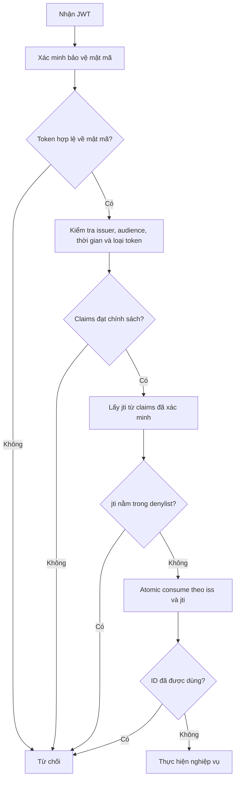

# `jti`: Mã định danh JWT và cách dùng để chống phát lại hoặc thu hồi

## 1. `jti` biểu thị điều gì?

Trong JSON Web Token (JWT), **`jti` (JWT ID)** là *registered claim* cung cấp một mã định danh duy nhất cho một JWT cụ thể. Claim này giúp hệ thống nhận diện một token cụ thể trong suốt vòng đời của nó.

Theo [RFC 7519, mục 4.1.7](https://www.rfc-editor.org/rfc/rfc7519#section-4.1.7):

- `jti` cung cấp một định danh duy nhất cho JWT.
- Giá trị phải được tạo theo cách khiến xác suất vô tình gán cùng một giá trị cho hai đối tượng dữ liệu khác nhau là không đáng kể.
- Nếu ứng dụng sử dụng nhiều issuer, phải ngăn xung đột giữa các giá trị do các issuer khác nhau tạo ra.
- Giá trị `jti` là một chuỗi **phân biệt chữ hoa và chữ thường** (*case-sensitive string*).
- Ở cấp JWT tổng quát, claim này là **tùy chọn**.

Ví dụ:

```json
{
  "iss": "https://identity.example.com/",
  "sub": "user-7821",
  "aud": "https://api.example.com/inventory",
  "iat": 1893452400,
  "exp": 1893456000,
  "jti": "7f3d9a1e-4d52-4a10-9f21-1b5a6c8d0e34"
}
```

Trong ví dụ, `jti` nhận diện chính token này. Nếu issuer phát hành một JWT khác cho cùng người dùng, token mới cần có một `jti` khác. Hai token có thể có cùng `sub`, `aud` hoặc quyền nhưng vẫn là hai đối tượng token riêng biệt.

`jti` giúp trả lời câu hỏi: **“Đây là token cụ thể nào?”** Nó có thể được dùng làm khóa tra cứu trong danh sách thu hồi, danh sách token đã sử dụng hoặc hệ thống kiểm toán.

## 2. `jti` là định danh, không phải bí mật hay bằng chứng xác thực

`jti` chỉ là một giá trị định danh nằm trong claims. Bản thân nó:

- Không chứng minh ai phát hành token.
- Không xác minh chữ ký hoặc tính toàn vẹn của JWT.
- Không chứng minh người gửi request là chủ thể được cấp token.
- Không tự ngăn một token được gửi lại nhiều lần.
- Không tự thu hồi token khi người dùng đăng xuất hoặc bị khóa.

Một JWT có `jti` vẫn phải được xác minh bảo vệ mật mã theo định dạng và profile đang sử dụng. Với JWS, bên nhận cần xác minh chữ ký hoặc MAC bằng khóa và thuật toán được phép. Với JWE, cần xác minh cơ chế bảo vệ mật mã và tính toàn vẹn theo profile. Không được tin `jti` chỉ vì có thể giải mã payload.

`jti` cũng không phải mật khẩu hoặc credential độc lập. Không nên nhúng bí mật, thông tin cá nhân hoặc dữ liệu nhạy cảm vào giá trị này. Một mã định danh ngẫu nhiên, không mang ý nghĩa nghiệp vụ thường phù hợp hơn.

## 3. Định dạng và tính duy nhất của `jti`

RFC 7519 yêu cầu `jti` là chuỗi phân biệt chữ hoa/chữ thường và có tính duy nhất theo phạm vi ứng dụng. RFC không bắt buộc một định dạng cụ thể như UUID, cũng không quy định độ dài cố định.

Ví dụ các dạng chuỗi có thể được dùng theo hợp đồng của ứng dụng:

```json
{
  "jti": "7f3d9a1e-4d52-4a10-9f21-1b5a6c8d0e34"
}
```

```json
{
  "jti": "b7d0d0f4e5a14b5e9a6f3c2d1e0f8a77"
}
```

Các hệ thống thường chọn UUID ngẫu nhiên hoặc một mã định danh có không gian giá trị đủ lớn. Điều quan trọng là xác suất va chạm phải không đáng kể trong toàn bộ phạm vi issuer và thời gian hoạt động của hệ thống.

### Phân biệt chữ hoa và chữ thường

Vì `jti` là chuỗi phân biệt chữ hoa/chữ thường, các giá trị sau là khác nhau theo quy tắc so sánh chuỗi:

```text
Token-A7F3
token-a7f3
TOKEN-A7F3
```

Không tự chuyển `jti` thành chữ thường, xóa ký tự hoặc chuẩn hóa theo quy tắc riêng trước khi tra cứu nếu hợp đồng không quy định. Việc chuẩn hóa khác nhau giữa issuer và verifier có thể làm hai ID khác nhau bị coi là một hoặc một ID bị tra cứu sai.

### Có cần `jti` khó đoán không?

Yêu cầu cốt lõi của RFC là tính duy nhất với xác suất va chạm không đáng kể. `jti` không phải bí mật và tính khó đoán không thay thế việc xác minh JWT. Tuy nhiên, dùng bộ sinh số ngẫu nhiên mật mã với không gian đủ lớn thường là cách thực tế để tạo ID khó trùng, khó bị đoán và không để lộ số lượng token tuần tự.

Không dùng số tăng dần ngắn hoặc ID dễ lặp nếu nhiều issuer, nhiều node hoặc nhiều vùng triển khai có thể phát hành token đồng thời. Nếu chọn ID theo cấu trúc riêng, cần có cơ chế bảo đảm không trùng trên phạm vi mà hệ thống yêu cầu.

## 4. `jti` có bắt buộc trong mọi JWT không?

Ở cấp JWT tổng quát, `jti` là registered claim **tùy chọn**. Một JWT hợp lệ theo RFC 7519 không nhất thiết phải có `jti`.

Tuy nhiên, profile hoặc giao thức cụ thể có thể yêu cầu claim này. Ví dụ:

- [RFC 9068 — JWT Profile for OAuth 2.0 Access Tokens](https://www.rfc-editor.org/rfc/rfc9068) đưa `jti` vào tập claim bắt buộc của JWT access token theo profile này.
- [RFC 9449 — OAuth 2.0 Demonstrating Proof of Possession (DPoP)](https://www.rfc-editor.org/rfc/rfc9449) sử dụng `jti` trong JWT proof để định danh từng proof; việc phát hiện proof bị phát lại được xử lý theo cơ chế replay protection của DPoP.

Chính sách bên nhận cần xác định rõ:

| Tình huống | Hành vi phù hợp |
| --- | --- |
| JWT không có `jti`, profile không yêu cầu và không dùng chức năng tra cứu theo ID | Có thể tiếp tục các bước xác minh khác |
| Profile hoặc chính sách yêu cầu `jti` nhưng token thiếu claim | Từ chối |
| `jti` có mặt và là chuỗi hợp lệ theo profile | Có thể dùng làm định danh token |
| `jti` có mặt nhưng sai kiểu dữ liệu | Từ chối token không hợp lệ |
| Hai token khác nhau vô tình có cùng `jti` trong phạm vi phải duy nhất | Sự cố phát hành/định danh; cần xử lý theo chính sách và điều tra va chạm |

Không được mặc định rằng mọi JWT đều có `jti`, hoặc tự sinh `jti` tại bên nhận cho một token đã được phát hành mà không có claim này. Nếu tính năng replay detection hoặc revocation cần `jti`, hãy yêu cầu claim từ issuer hoặc dùng một định danh token khác được xác định rõ trong hợp đồng.

## 5. `jti` và replay attack

**Replay attack** xảy ra khi một thông điệp hoặc credential hợp lệ bị ghi lại rồi gửi lại để thực hiện hành động lần nữa. Với bearer JWT, ai có được token thường có thể gửi token đó đến resource server trong thời gian token còn được chấp nhận.

Ví dụ:

1. Client gửi JWT hợp lệ đến API để thực hiện một thao tác.
2. Kẻ tấn công lấy được bản sao JWT từ một kênh lưu trữ hoặc truyền tải không an toàn.
3. Kẻ tấn công gửi lại chính JWT đó đến API.
4. Nếu API chỉ kiểm tra chữ ký, issuer, audience và thời hạn, token có thể tiếp tục được chấp nhận.

Việc JWT có `jti` **không tự động ngăn replay**. Nếu API không lưu trạng thái token đã sử dụng hoặc không có cơ chế proof-of-possession phù hợp, cùng một JWT có thể được dùng nhiều lần cho các request hợp lệ.

### Khi nào nên dùng `jti` để chống phát lại?

Replay detection theo `jti` phù hợp với những token hoặc proof được thiết kế để chỉ được sử dụng một lần, ví dụ:

- JWT assertion dùng trong một giao dịch hoặc lần trao đổi cụ thể.
- Token xác nhận thao tác nhạy cảm chỉ được phép thực hiện một lần.
- JWT proof có ID riêng cho từng request theo một giao thức chống phát lại.
- Một thông điệp ký có yêu cầu phát hiện việc gửi lại cùng thông điệp.

Với access token bearer thông thường, việc đánh dấu `jti` đã dùng sau request đầu tiên có thể làm hỏng mô hình sử dụng: client cần dùng cùng access token cho nhiều API request trong suốt thời hạn. Chỉ áp dụng one-time-use khi profile và nghiệp vụ thực sự yêu cầu.

## 6. Điều kiện để replay detection bằng `jti` hoạt động

Để phát hiện một JWT đã được sử dụng, bên nhận cần có trạng thái dùng chung về những ID đã tiêu thụ. Quy trình tổng quát:

1. Xác minh bảo vệ mật mã của JWT và các điều kiện cơ bản như issuer, audience, thời hạn, loại token.
2. Lấy `iss` và `jti` từ claims đã xác minh.
3. Tạo khóa tra cứu trong phạm vi issuer, thường là cặp `(iss, jti)`.
4. Thực hiện thao tác **kiểm tra và đánh dấu đã sử dụng một cách nguyên tử**.
5. Nếu ID chưa tồn tại, đánh dấu thành công và tiếp tục xử lý nghiệp vụ.
6. Nếu ID đã tồn tại, từ chối request vì token/proof đã được sử dụng.

Điểm quan trọng là thao tác kiểm tra và ghi phải nguyên tử. Nếu hai request đồng thời cùng kiểm tra một `jti`, cả hai có thể cùng thấy ID chưa tồn tại rồi cùng được xử lý nếu hệ thống tách thao tác đọc và ghi.

Giả mã:

```text
function acceptOneTimeJwt(token):
    claims = verifyTokenAndReadClaims(token)

    if verification failed:
        reject("invalid token")

    if not issuerAudienceTimeAndTypeChecksPass(claims):
        reject("token does not satisfy policy")

    if claims.jti is missing or not a valid string:
        reject("required jti is missing or invalid")

    replayKey = (claims.iss, claims.jti)

    inserted = atomicInsertIfAbsent(
        replayKey,
        expiresAt = claims.exp + configuredLeeway
    )

    if not inserted:
        reject("token or proof has already been used")

    processBusinessOperation()
```

Đây là giả mã mô tả chính sách, không phải API của một kho dữ liệu cụ thể. `atomicInsertIfAbsent` có thể được triển khai bằng unique constraint, transaction hoặc thao tác set-if-absent có bảo đảm nguyên tử. Nếu thao tác nghiệp vụ cũng cần bảo đảm chỉ thực hiện một lần, cần phối hợp việc tiêu thụ ID và ghi nhận kết quả nghiệp vụ bằng transaction hoặc thiết kế idempotency phù hợp.

Ví dụ trên giả định token có `exp` và hệ thống giữ replay entry đến hết cửa sổ token có thể được chấp nhận. Nếu profile không yêu cầu `exp`, chính sách one-time-use cần tự xác định một thời hạn chấp nhận hữu hạn hoặc thời gian lưu trạng thái phù hợp; không được tự đặt TTL ngắn hơn khoảng thời gian token vẫn có thể được chấp nhận.

### Vì sao cần kho trạng thái dùng chung?

Giả sử API chạy trên ba node. Nếu mỗi node chỉ lưu các `jti` đã dùng trong bộ nhớ cục bộ:

- Request đầu tiên có thể đến node A và được chấp nhận.
- Request phát lại có thể đến node B, nơi chưa biết ID đó đã dùng.
- Request phát lại tiếp tục được chấp nhận.

Do đó, replay detection trong hệ thống phân tán cần kho trạng thái chung hoặc cơ chế đồng bộ đủ mạnh để các verifier nhìn thấy cùng kết quả. Cũng cần xử lý độ trễ sao chép, tính nhất quán và lỗi khi kho trạng thái không khả dụng.

## 7. Phạm vi định danh: vì sao nên kết hợp `(iss, jti)`?

RFC 7519 yêu cầu ngăn xung đột `jti` giữa các issuer nếu ứng dụng sử dụng nhiều issuer. Khi lưu trạng thái replay hoặc revocation, dùng cặp:

```text
(iss, jti)
```

là cách rõ ràng để đặt ID trong phạm vi issuer đã xác minh. Ví dụ:

| Issuer | `jti` | Khóa tra cứu |
| --- | --- | --- |
| `https://issuer-a.example.test` | `token-123` | `(issuer-a, token-123)` |
| `https://issuer-b.example.test` | `token-123` | `(issuer-b, token-123)` |

Hai issuer trong ví dụ tạo cùng chuỗi `jti`, nhưng khóa tra cứu vẫn phân biệt được nguồn phát hành. Điều này không có nghĩa issuer được phép bỏ qua yêu cầu duy nhất toàn cục theo RFC; namespace `(iss, jti)` là lớp phân tách bổ sung hữu ích cho dữ liệu lưu trữ và vận hành.

Các lưu ý:

- Chỉ lấy `iss` sau khi claims đã được xác minh.
- So sánh và lưu issuer theo giá trị chính xác, không tự chuẩn hóa URL.
- Không lấy issuer từ header HTTP hoặc dữ liệu request do client tự khai báo.
- Nếu hệ thống có nhiều môi trường hoặc tenant với quy tắc định danh riêng, có thể cần thêm phạm vi như môi trường hoặc tenant vào khóa nội bộ theo hợp đồng đã xác định.

## 8. `jti` dùng để thu hồi JWT

**Thu hồi token (token revocation)** là việc ngăn một token đã được phát hành tiếp tục được chấp nhận trước khi nó tự hết hạn. Ví dụ, người dùng đăng xuất, thiết bị bị mất, refresh token bị phát hiện lộ hoặc một credential cần bị vô hiệu hóa khẩn cấp.

Với JWT tự chứa, resource server có thể xác minh token mà không truy vấn issuer ở mỗi request. Điều này giúp giảm phụ thuộc trạng thái nhưng khiến việc thu hồi tức thời khó hơn. `jti` cung cấp một định danh để xây dựng **denylist** (danh sách token bị thu hồi):

1. Khi cần thu hồi, hệ thống xác minh token hoặc lấy định danh từ nguồn tin cậy.
2. Ghi `(iss, jti)` vào denylist.
3. Khi nhận request, verifier xác minh JWT và lấy `(iss, jti)` từ claims đã xác minh.
4. Nếu khóa có trong denylist, từ chối token dù chữ ký còn hợp lệ và `exp` chưa đến.
5. Nếu khóa không có trong denylist, tiếp tục các bước kiểm tra khác.

Ví dụ cấu trúc dữ liệu:

```text
revoked_tokens:
    key: (issuer, jwt_id)
    value: revoked_at
    expires_at: token_expiration + verifier_leeway
```

### Vì sao denylist cần thời hạn lưu trữ?

Nếu token đã hết hạn và không còn được bất kỳ verifier nào chấp nhận, ID thu hồi thường không cần được giữ vô thời hạn. Hệ thống có thể đặt TTL đến sau `exp` cộng leeway tối đa mà các verifier áp dụng.

Ví dụ:

```text
exp = 1893456000
maximumVerifierLeeway = 30 seconds
denylistEntryExpiresAt = 1893456030
```

Nếu hệ thống không yêu cầu `exp`, cần xác định giới hạn chấp nhận token khác hoặc chính sách lưu trữ rõ ràng; không được xóa denylist theo một TTL tùy tiện trong khi token vẫn có thể được chấp nhận.

`(iss, jti)` thường thu hồi **một token cụ thể**. Nếu yêu cầu là vô hiệu hóa mọi token của một người dùng hoặc toàn bộ token trong một phiên, chỉ thêm một `jti` vào denylist là chưa đủ. Hệ thống cần cơ chế ở phạm vi chủ thể/phiên như trạng thái phiên, phiên bản credential hoặc danh sách thu hồi theo `sid` nếu giao thức có định nghĩa.

### Kiểm tra denylist phải nằm trong luồng xác minh

Việc ghi `jti` vào denylist không có tác dụng nếu verifier không kiểm tra danh sách đó ở mỗi lần xử lý token thuộc phạm vi thu hồi. Cần bảo đảm:

- Tất cả node cần tuân thủ cùng một denylist hoặc cùng trạng thái thu hồi.
- Cập nhật thu hồi được truyền tới verifier trong khoảng thời gian chấp nhận được.
- Lỗi kết nối kho denylist có chính sách rõ ràng; không âm thầm bỏ qua kiểm tra khi yêu cầu bảo mật đòi hỏi thu hồi.
- Khóa tra cứu được tạo nhất quán từ claims đã xác minh.
- Entry được giữ đủ lâu để bao phủ thời hạn token và leeway.

## 9. Phân biệt replay prevention và token revocation

Hai mục đích này đều có thể dùng `jti`, nhưng ý nghĩa khác nhau:

| Tiêu chí | Replay prevention | Token revocation |
| --- | --- | --- |
| Mục tiêu | Ngăn cùng một token/proof được tiêu thụ nhiều lần | Ngăn token tiếp tục được chấp nhận sau khi bị thu hồi |
| Trạng thái lưu | ID đã sử dụng/đã tiêu thụ | ID bị thu hồi |
| Thời điểm ghi | Khi token/proof được chấp nhận lần đầu | Khi có sự kiện thu hồi |
| Quyết định | Từ chối nếu ID đã được sử dụng | Từ chối nếu ID nằm trong denylist |
| Trường hợp dùng | Assertion một lần, proof theo request, thao tác một lần | Logout, mất thiết bị, credential bị lộ, vô hiệu hóa token cụ thể |

Không dùng chung một trạng thái mà không phân biệt ý nghĩa. Một ID đã được tiêu thụ có thể là hợp lệ trong replay cache nhưng không đồng nghĩa token đã bị thu hồi; ngược lại, token bị thu hồi không nhất thiết từng được sử dụng.

## 10. `jti` không tự ràng buộc token với người gửi hoặc request

`jti` nhận diện token, nhưng không chứng minh người gửi request hiện tại chính là client hoặc thiết bị ban đầu. Nếu một bearer token bị đánh cắp, kẻ tấn công có thể phát lại toàn bộ token bao gồm cả `jti`.

Đối với access token bearer được thiết kế để sử dụng nhiều lần, chỉ lưu `jti` của token rồi từ chối mọi request tiếp theo sẽ không phù hợp. Các hướng bảo vệ bổ sung có thể gồm:

- **Sender-constrained token:** ràng buộc việc sử dụng token với khóa hoặc credential của client, ví dụ mutual TLS hoặc DPoP theo giao thức tương ứng.
- **Request proof:** yêu cầu bằng chứng riêng cho từng request, có nonce hoặc định danh duy nhất và được ràng buộc với nội dung/ngữ cảnh request theo giao thức.
- **Timestamp và nonce:** dùng khi giao thức quy định cách tạo, kiểm tra và lưu nonce để phát hiện thông điệp cũ hoặc gửi lại.
- **Idempotency key:** với thao tác nghiệp vụ có thể được gửi lại do retry mạng, dùng khóa idempotency và lưu kết quả để tránh thực hiện hiệu ứng nghiệp vụ nhiều lần.

Không tự thiết kế một header `jti` tùy ý rồi xem đó là cơ chế chống replay. Bằng chứng phải được bảo vệ mật mã và ràng buộc với đúng request theo một giao thức hoặc hợp đồng an toàn.

### Phân biệt `jti` của access token và `jti` của DPoP proof

Trong mô hình DPoP, access token và proof JWT là hai đối tượng khác nhau:

- `jti` trong access token nhận diện token truy cập.
- `jti` trong DPoP proof nhận diện một proof cụ thể, thường được tạo cho một request.

Vì vậy, cùng một access token có thể được dùng trong nhiều request, trong khi mỗi proof DPoP cần có định danh riêng theo quy tắc của giao thức. Không dùng `jti` của access token thay cho `jti` của proof để phát hiện việc gửi lại proof.

## 11. `jti` khác gì với `nonce`, `sub` và `sid`?

| Giá trị | Mục đích | Phạm vi |
| --- | --- | --- |
| `jti` | Định danh một JWT cụ thể | Một token/proof |
| `nonce` | Giá trị dùng một lần hoặc challenge để liên kết một phản hồi với một yêu cầu/ngữ cảnh | Một lần trao đổi hoặc challenge theo giao thức |
| `sub` | Định danh chủ thể mà token nói đến | Người dùng hoặc principal trong phạm vi issuer |
| `sid` | Định danh phiên trong những giao thức/profile có định nghĩa claim này | Một phiên đăng nhập hoặc phiên làm việc |

Một người dùng có thể có nhiều JWT khác nhau: mỗi token có `jti` riêng nhưng có thể cùng `sub`. Một phiên có thể tạo nhiều access token, vì vậy `jti` không thay thế `sid` hoặc dữ liệu phiên.

`nonce` thường có vai trò challenge hoặc liên kết request-response. `jti` là định danh của chính JWT. Một giao thức có thể sử dụng cả hai, nhưng không nên coi chúng là cùng một khái niệm.

## 12. Quy trình phát hành và kiểm tra `jti`

### Khi phát hành JWT

1. Xác định profile có yêu cầu `jti` hay không.
2. Sinh một ID duy nhất trong phạm vi các issuer và hệ thống liên quan.
3. Dùng bộ sinh ID có xác suất va chạm không đáng kể; không tái sử dụng ID cho token khác.
4. Ghi `jti` dưới dạng JSON string, giữ nguyên phân biệt chữ hoa/chữ thường.
5. Bảo vệ JWT bằng chữ ký/MAC hoặc cơ chế JWE phù hợp.
6. Nếu cần replay detection hoặc revocation, bảo đảm verifier và kho trạng thái dùng cùng quy tắc tạo khóa tra cứu.

### Khi xác minh JWT

1. Xác minh cấu trúc và bảo vệ mật mã của token.
2. Kiểm tra issuer, audience, thời hạn, token type và các claim bắt buộc.
3. Lấy `jti` từ claims đã xác minh và kiểm tra kiểu dữ liệu.
4. Tạo khóa tra cứu theo phạm vi, thường là `(iss, jti)`.
5. Nếu cần revocation, kiểm tra denylist.
6. Nếu token/proof là one-time-use, thực hiện atomic consume để phát hiện ID đã dùng.
7. Chỉ xử lý nghiệp vụ khi tất cả điều kiện đạt.

Sơ đồ minh họa một token one-time-use có kiểm tra thu hồi:



Với access token reusable, bỏ bước atomic consume và chỉ thực hiện kiểm tra denylist nếu hệ thống có chính sách thu hồi theo `jti`. Sơ đồ phải được điều chỉnh theo đúng mục đích token; không áp dụng one-time-use cho mọi JWT.

## 13. Lỗi thường gặp khi sử dụng `jti`

| Lỗi | Hệ quả | Cách xử lý |
| --- | --- | --- |
| Cho rằng chỉ cần có `jti` là token không thể bị phát lại | Token vẫn có thể được gửi lại nếu verifier không lưu trạng thái hoặc kiểm tra proof | Xây dựng replay detection hoặc sender-constrained proof phù hợp |
| Dùng one-time-use cho access token reusable | Request hợp lệ thứ hai bị từ chối | Chỉ tiêu thụ một lần với token/proof được thiết kế one-time |
| Dùng ID tuần tự ngắn ở nhiều issuer | Có thể va chạm hoặc dễ dự đoán số lượng token | Dùng ID có không gian đủ lớn và bảo đảm uniqueness toàn phạm vi |
| Lưu `jti` mà không có issuer namespace | Có thể nhầm token giữa các issuer nếu ID bị trùng | Dùng khóa `(iss, jti)` sau khi xác minh |
| Chuyển `jti` thành chữ thường | Tra cứu sai hoặc gộp các ID khác nhau | So sánh chính xác, phân biệt hoa/thường |
| Đọc `jti` từ payload chưa xác minh | Kẻ tấn công có thể tự khai báo ID tùy ý | Chỉ dùng claims sau xác minh mật mã |
| Kiểm tra rồi ghi trạng thái bằng hai thao tác không nguyên tử | Hai request đồng thời có thể cùng vượt qua replay check | Dùng atomic insert-if-absent hoặc transaction |
| Chỉ lưu replay cache trong bộ nhớ từng node | Request phát lại có thể đến node khác và được chấp nhận | Dùng kho trạng thái dùng chung hoặc đồng bộ đủ mạnh |
| Xóa denylist trước khi token hết thời hạn và leeway | Token đã thu hồi có thể được chấp nhận lại | Giữ entry đủ đến hết cửa sổ chấp nhận |
| Ghi denylist nhưng verifier không kiểm tra | Thu hồi không có tác dụng | Đưa denylist vào luồng xác minh bắt buộc |
| Coi `jti` là định danh người dùng | Không thể quản lý đúng nhiều token của cùng chủ thể | Dùng `sub` cho subject và `jti` cho token |
| Dùng `jti` thay cho nonce hoặc request proof | Không ràng buộc token với request hiện tại | Dùng cơ chế challenge/proof theo giao thức |

## 14. Tình huống thực tế

Một hệ thống phê duyệt thanh toán nhận JWT assertion cho mỗi lệnh xác nhận. Mỗi assertion chỉ được phép sử dụng một lần. Issuer phát hành:

```json
{
  "iss": "https://identity.example.com/",
  "sub": "payment-operator-17",
  "aud": "https://api.example.com/payment-approval",
  "iat": 1893452400,
  "exp": 1893452700,
  "jti": "approval-7f3d9a1e"
}
```

Khi API nhận assertion lần đầu:

1. Xác minh chữ ký và các claim bắt buộc.
2. Kiểm tra `iss`, `aud`, `iat`, `exp` và quyền phê duyệt.
3. Tạo khóa `(iss, jti)`.
4. Dùng thao tác nguyên tử để ghi nhận ID chưa từng được tiêu thụ.
5. Nếu ghi thành công, thực hiện nghiệp vụ phê duyệt theo cơ chế idempotency/transaction phù hợp.

Nếu cùng assertion được gửi lại, thao tác atomic consume phát hiện ID đã tồn tại và API từ chối lần gửi lại. Nếu hai request đến đồng thời, chỉ một request được phép tiêu thụ ID; request còn lại phải bị từ chối hoặc nhận kết quả idempotent theo hợp đồng nghiệp vụ.

Trong một tình huống khác, nếu người dùng báo mất thiết bị và cần thu hồi một access token còn hạn, hệ thống có thể thêm `(iss, jti)` của token vào denylist. Những request sau đó mang token này bị từ chối dù `exp` chưa đến. Đây là thu hồi token, không phải replay prevention.

## 15. Kịch bản kiểm thử `jti`

Nên kiểm thử các trường hợp sau:

| Trường hợp | Kỳ vọng | Mục tiêu |
| --- | --- | --- |
| `jti` là chuỗi duy nhất, token hợp lệ | Chấp nhận theo chính sách | Định danh hợp lệ |
| `jti` bị thiếu khi profile yêu cầu | Từ chối | Claim bắt buộc |
| `jti` là số, boolean, object hoặc `null` | Từ chối | Kiểm tra kiểu chuỗi |
| Hai token trong cùng phạm vi có cùng `jti` | Phát hiện vi phạm uniqueness hoặc va chạm | Tính duy nhất |
| `jti` chỉ khác chữ hoa/chữ thường | Xử lý như hai chuỗi khác nhau theo RFC | Case sensitivity |
| Hai issuer tạo cùng chuỗi `jti` | Khóa lưu trữ vẫn phân biệt theo `(iss, jti)`; đồng thời cảnh báo vi phạm uniqueness cross-issuer | Namespace và collision |
| Token one-time-use được gửi lần đầu | Chấp nhận nếu mọi kiểm tra đạt và atomic consume thành công | Tiêu thụ lần đầu |
| Cùng token one-time-use được gửi lần thứ hai | Từ chối | Replay detection |
| Hai request cùng `jti` đến đồng thời | Chỉ một request tiêu thụ ID thành công | Atomicity/race condition |
| Replay request được phân phối sang node khác | Vẫn phát hiện ID đã dùng | Shared state |
| Token reusable được gửi nhiều lần theo đúng nghiệp vụ | Chấp nhận nếu không có chính sách one-time-use và các kiểm tra khác đạt | Không áp dụng replay policy sai |
| Token có `jti` nằm trong denylist | Từ chối | Revocation |
| Denylist entry còn hiệu lực đến `exp + leeway` | Token vẫn bị từ chối trong toàn cửa sổ chấp nhận | Retention/TTL |
| Denylist store không khả dụng | Xử lý theo fail-closed/fail-open policy đã phê duyệt; không âm thầm bỏ qua | Dependency failure |
| Payload chứa `jti` tùy ý nhưng chữ ký sai | Từ chối toàn bộ token | Không tin claims chưa xác minh |

Nên kiểm thử cả tính nhất quán giữa các node, độ trễ cập nhật denylist và trường hợp kho trạng thái bị gián đoạn. Nếu nghiệp vụ có side effect như thanh toán, cần kiểm tra cả tính nguyên tử giữa việc tiêu thụ `jti` và ghi nhận kết quả giao dịch.

## 16. Nguyên tắc cần ghi nhớ

1. `jti` là định danh duy nhất cho một JWT cụ thể, có kiểu chuỗi và phân biệt chữ hoa/chữ thường.
2. `jti` tùy chọn trong JWT tổng quát, nhưng profile như RFC 9068 có thể yêu cầu claim này.
3. `jti` không phải bí mật, không chứng minh nguồn phát hành và không tự ngăn replay.
4. Replay detection cần trạng thái ID đã sử dụng và thao tác kiểm tra/ghi nguyên tử; chỉ áp dụng one-time-use khi đúng nghiệp vụ.
5. Token revocation có thể dùng denylist theo `(iss, jti)` và phải được kiểm tra trong luồng xác minh.
6. Giữ trạng thái đủ lâu để bao phủ thời hạn token và leeway; đồng bộ trạng thái giữa các verifier.
7. Không dùng `jti` thay cho `nonce`, `sub`, `sid` hoặc proof ràng buộc request.
8. Xác minh bảo vệ mật mã và claims trước khi dùng `jti` làm khóa ra quyết định.

### Tài liệu chuẩn tham khảo

- [RFC 7519 — JSON Web Token (JWT), mục 4.1.7](https://www.rfc-editor.org/rfc/rfc7519#section-4.1.7): định nghĩa claim `jti`, tính duy nhất và khả năng dùng để chống replay.
- [RFC 8725 — JSON Web Token Best Current Practices](https://www.rfc-editor.org/rfc/rfc8725): thực hành xác minh JWT, phân tách ngữ cảnh và xử lý token an toàn.
- [RFC 9068 — JWT Profile for OAuth 2.0 Access Tokens](https://www.rfc-editor.org/rfc/rfc9068): profile JWT access token và các claim bắt buộc, bao gồm `jti`.
- [RFC 9449 — OAuth 2.0 Demonstrating Proof of Possession (DPoP)](https://www.rfc-editor.org/rfc/rfc9449): sử dụng `jti` trong proof JWT và cơ chế chống phát lại proof.

**Kết luận:** `jti` nhận diện một JWT cụ thể và tạo điểm tham chiếu cho replay detection hoặc revocation. Để các cơ chế này thực sự có tác dụng, hệ thống phải xác minh token trước, lưu trạng thái theo phạm vi issuer, kiểm tra hoặc tiêu thụ ID một cách nhất quán và chỉ áp dụng one-time-use cho token/proof được thiết kế đúng mục đích.
