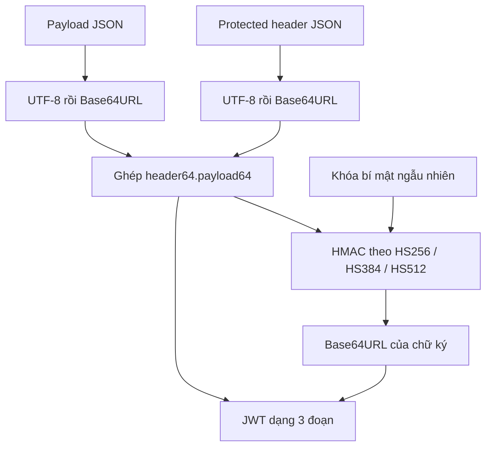

# HMAC và nhóm thuật toán HS256, HS384, HS512

## 1. Bức tranh tổng quan

Trong hệ thống **Security - JSON Web Token (JWT)**, một JWT thường được truyền dưới dạng **JWS Compact Serialization**: hai phần chứa thông tin được bảo vệ bởi một chữ ký ở phần thứ ba. Nhóm thuật toán `HS256`, `HS384`, `HS512` dùng **HMAC** (Hash-based Message Authentication Code) để tạo và kiểm tra chữ ký này bằng **cùng một khóa bí mật**.

Ba mục tiêu chính của chữ ký HMAC là:

- **Toàn vẹn (integrity):** phát hiện thay đổi đối với phần header và payload đã được ký.
- **Xác thực nguồn theo khóa (key-based authenticity):** bên xác minh biết rằng chữ ký hợp lệ được tạo bởi một bên sở hữu khóa bí mật dùng chung.
- **Ràng buộc nội dung:** chữ ký gắn với chính xác chuỗi byte được ký; chỉ thay đổi một byte cũng làm chữ ký kỳ vọng thay đổi.

Chữ ký HMAC **không mã hóa JWT**. Header và payload của JWS thông thường chỉ được mã hóa biểu diễn bằng Base64URL, vì vậy người nhận hoặc người quan sát có token đều có thể giải mã để đọc nội dung. Chữ ký cũng **không tự động kiểm tra** thời hạn, issuer, audience hay quyền truy cập: ứng dụng phải kiểm tra các điều kiện đó sau khi xác minh chữ ký.

**Phạm vi bài học:** nguyên lý HMAC, cách nhóm thuật toán HS hoạt động trong JWS/JWT, so sánh và lựa chọn thuật toán, quy trình tạo và xác minh token, cũng như quản lý khóa và những rủi ro bảo mật. Kiến thức áp dụng cho JWT nói chung, không phụ thuộc ngôn ngữ lập trình hoặc framework.

## 2. HMAC là gì?

### 2.1. MAC khác với hàm băm thông thường

Một hàm băm như SHA-256 nhận dữ liệu và trả về một giá trị băm; bất kỳ ai có dữ liệu đều có thể tính lại giá trị đó. Nếu chỉ đặt `SHA256(payload)` vào cuối token, kẻ tấn công có thể thay payload rồi tính lại hash mà không cần biết bí mật nào.

HMAC đưa **khóa bí mật `K`** vào phép tính. Việc biết thông điệp và mã HMAC hợp lệ không đủ để tạo mã HMAC cho một thông điệp khác nếu không biết khóa có đủ độ mạnh. Trong mô hình JWT dùng HS256/HS384/HS512, *người ký* và *người xác minh* phải có cùng khóa.

Với hàm băm `H`, mô tả chuẩn của HMAC là:

```text
HMAC(K, m) = H((K' XOR opad) || H((K' XOR ipad) || m))

K       : khóa bí mật
m       : thông điệp cần xác thực
K'      : khóa đã chuẩn hóa theo kích thước block của H
ipad    : hằng số đệm bên trong (inner padding)
opad    : hằng số đệm bên ngoài (outer padding)
||      : nối chuỗi byte
XOR     : phép XOR trên từng byte
```

Nếu khóa dài hơn kích thước block của hàm băm, thuật toán băm khóa trước; sau đó khóa được đệm cho đủ kích thước block. Hai lớp băm với `ipad` và `opad` là một phần quan trọng của cấu trúc HMAC. Vì vậy **HMAC-SHA256 không tương đương với** `SHA256(secret || message)` hoặc `SHA256(message || secret)`; không nên tự thay bằng các phép nối và băm thủ công.

Các thư viện mật mã chuẩn đã có hàm HMAC. Nên sử dụng triển khai được kiểm chứng, nhận đầu vào là **mảng byte khóa**, **mảng byte thông điệp** và thuật toán băm mong muốn.

### 2.2. Tính đối xứng và ranh giới tin cậy

Điểm khác biệt cốt lõi giữa HMAC và chữ ký số bất đối xứng là người xác minh HMAC **cũng có khả năng tạo chữ ký mới**, vì họ sở hữu cùng khóa bí mật. Ví dụ, nếu dịch vụ A phát JWT bằng HS256 và dịch vụ B xác minh bằng cùng khóa, B cũng có đủ khả năng tự tạo token mà A hoặc dịch vụ khác sẽ chấp nhận nếu những điều kiện còn lại khớp.

Điều này phù hợp với hệ thống mà tất cả bên giữ khóa thuộc **cùng một ranh giới tin cậy**. Nếu nhiều đối tác hoặc hệ thống độc lập chỉ cần quyền xác minh, cân nhắc thuật toán bất đối xứng như `RS256`, `ES256` hoặc `EdDSA`: bên phát hành giữ khóa riêng, bên xác minh chỉ nhận khóa công khai.

## 3. HS256, HS384 và HS512 khác nhau ở đâu?

Tên `HS` có nghĩa là **HMAC sử dụng SHA-2**. Phần số chỉ thuật toán băm bên dưới, không phải độ dài token hay độ dài một chuỗi password.

| Thuật toán JWS | Phép tính MAC | Độ dài kết quả HMAC | Khóa bí mật tối thiểu theo JWA (RFC 7518) | Độ dài chữ ký Base64URL, bỏ `=` |
| --- | --- | --- | --- | --- |
| `HS256` | HMAC với SHA-256 | 256 bit = 32 byte | 256 bit = 32 byte | 43 ký tự |
| `HS384` | HMAC với SHA-384 | 384 bit = 48 byte | 384 bit = 48 byte | 64 ký tự |
| `HS512` | HMAC với SHA-512 | 512 bit = 64 byte | 512 bit = 64 byte | 86 ký tự |

RFC 7518, mục 3.2, yêu cầu khóa HMAC có kích thước **ít nhất bằng độ dài kết quả băm** tương ứng. Đây là **độ dài byte của khóa sau khi giải mã/đọc vào bộ nhớ**, không phải độ dài chuỗi Base64, hex hoặc số ký tự trong biến cấu hình. Một khóa ngẫu nhiên đủ mạnh có thể dài hơn mức tối thiểu.

Chẳng hạn, **32 byte ngẫu nhiên** là một kích thước khóa phù hợp cho HS256; cùng 32 byte đó **không đáp ứng** mức tối thiểu 64 byte của HS512, dù thư viện HMAC vẫn có thể tính toán được. Nếu lưu 32 byte dưới dạng Base64URL không padding, chuỗi biểu diễn sẽ có khoảng 43 ký tự, nhưng khóa thực tế vẫn chỉ là 32 byte.

Một số hệ quả thực tiễn:

- `HS256` thường được dùng khi cần chữ ký ngắn, khả năng tương thích rộng và chính sách bảo mật cho phép.
- `HS384` hoặc `HS512` tạo mã MAC dài hơn; kích thước phần chữ ký trong JWT tăng theo.
- Chuyển từ `HS256` sang `HS512` **không sửa được** vấn đề khóa yếu, khóa bị lộ, kiểm tra claims sai hoặc cấu hình xác minh chấp nhận thuật toán không mong muốn.
- Chọn thuật toán dựa trên yêu cầu chính sách, khả năng tương thích giữa các bên, kích thước token, quản trị khóa và mô hình tin cậy; không suy luận rằng số càng lớn thì toàn bộ hệ thống tự động an toàn hơn.

## 4. HMAC được áp dụng vào JWT như thế nào?

### 4.1. Ba thành phần của JWS Compact

Một JWT có chữ ký theo dạng JWS Compact thường có cấu trúc:

```text
<base64url(protected-header)>.<base64url(payload)>.<base64url(signature)>
```

Ví dụ về **header trước khi mã hóa Base64URL**:

```json
{
  "alg": "HS256",
  "typ": "JWT"
}
```

Ví dụ về **payload trước khi mã hóa Base64URL**:

```json
{
  "iss": "https://identity.example",
  "sub": "user-123",
  "aud": "orders-api",
  "iat": 1893452400,
  "exp": 1893456000
}
```

Đây là dữ liệu minh họa, không phải token hoàn chỉnh. Theo JWT, `iat` và `exp` ở đây là **NumericDate**: số giây tính từ Unix epoch theo thời gian UTC. `typ` giúp ứng dụng phân biệt loại đối tượng nhưng bản thân nó không thay thế chính sách xác minh token.

Để tạo JWS dùng HS256, trước hết xây dựng hai đoạn đầu:

```text
encodedHeader  = BASE64URL(UTF8(headerJSON))
encodedPayload = BASE64URL(UTF8(payloadJSON))
signingInput   = ASCII(encodedHeader + "." + encodedPayload)

signatureBytes = HMAC_SHA256(secretKeyBytes, signingInput)
encodedSig     = BASE64URL(signatureBytes)

jwt = encodedHeader + "." + encodedPayload + "." + encodedSig
```

Thay `HMAC_SHA256` bằng `HMAC_SHA384` hoặc `HMAC_SHA512` khi cấu hình hệ thống cho phép `HS384` hoặc `HS512` và khóa đáp ứng yêu cầu của thuật toán đó.

**Base64URL** dùng `-` và `_` thay cho `+` và `/` của Base64 thông thường; chuỗi JWS Compact bỏ dấu `=` ở cuối. Bản thân Base64URL là **mã hóa biểu diễn, không phải mã hóa bảo mật**.

### 4.2. Chính xác những byte nào được ký?

Với JWS Compact thông dụng dành cho JWT, chữ ký tính trên **hai đoạn đã mã hóa Base64URL và dấu chấm ở giữa**, chứ không phải tính trên đối tượng JSON sau khi parse.



Độ dài, thứ tự trường, dấu cách và cách escape trong JSON có thể khác nhau giữa các bộ serializer, dù ý nghĩa JSON tương đương. Khi **xác minh** JWT, phải lấy **nguyên văn hai đoạn đầu từ token nhận được** để dựng `signingInput`, thay vì parse JSON rồi serialize lại; nếu không, chữ ký hợp lệ có thể bị so sánh với một chuỗi byte khác.

### 4.3. Ví dụ thay đổi payload

Giả sử token ban đầu chứa claim `"sub": "user-123"`. Ai đó sửa payload thành `"sub": "admin"` và mã hóa Base64URL lại. Khi bên nhận tính lại HMAC từ `encodedHeader + "." + encodedPayload` mới bằng khóa thật, kết quả sẽ khác chữ ký cũ, nên token bị từ chối.

Tuy nhiên, nếu kẻ tấn công **biết khóa bí mật**, họ có thể tạo chữ ký mới cho payload giả mạo. Vì vậy an toàn của cả nhóm HS phụ thuộc trực tiếp vào việc sinh, lưu trữ và giới hạn người biết khóa.

## 5. Quy trình ký và xác minh an toàn

### 5.1. Khi phát hành JWT

1. Chọn **thuật toán từ cấu hình phía bên phát hành**, chẳng hạn cố định `HS256`; không để dữ liệu không đáng tin quyết định thuật toán.
2. Lấy khóa bí mật ngẫu nhiên có đủ entropy và độ dài cho thuật toán. Cấu hình `kid` (key ID) nếu hệ thống hỗ trợ luân chuyển nhiều khóa.
3. Tạo protected header và claims, trong đó có issuer, audience, thời hạn và các thông tin cần thiết cho ngữ cảnh sử dụng.
4. Mã hóa header và payload thành đúng chuỗi byte Base64URL, ghép thành signing input.
5. Dùng HMAC theo thuật toán đã chọn để tạo chữ ký, Base64URL chữ ký rồi ghép token ba phần.

### 5.2. Khi xác minh JWT

1. Giới hạn kích thước token; kiểm tra hình thức JWS Compact, số đoạn, ký tự Base64URL và khả năng giải mã. Loại bỏ cấu trúc hoặc header mở rộng không được hỗ trợ.
2. Đọc protected header để biết các thông tin phục vụ kiểm tra, nhưng coi header là **dữ liệu chưa được xác thực** cho đến khi chữ ký hợp lệ. So khớp `alg` với **danh sách thuật toán cho phép từ cấu hình**; không tự chấp nhận bất kỳ `alg` nào token khai báo.
3. Chọn đúng khóa từ tập khóa **được cấu hình hoặc quản trị tin cậy**, tương ứng issuer/đối tượng sử dụng. Nếu có `kid`, chỉ dùng nó làm mã tra cứu trong tập khóa hợp lệ; không biến `kid` thành đường dẫn file, câu truy vấn hoặc URL tải khóa tùy ý.
4. Dựng lại signing input từ **hai chuỗi mã hóa nguyên vẹn** ở đầu token; tính HMAC bằng khóa/thuật toán đã chọn.
5. Giải mã chữ ký nhận được, kiểm tra kích thước chữ ký và so sánh **theo thời gian hằng số (constant-time)** với MAC vừa tính. Từ chối nếu khác nhau.
6. Chỉ sau khi xác minh chữ ký mới dùng claims cho quyết định bảo mật: kiểm tra `iss`, `aud`, `exp`, `nbf` (nếu có), định dạng và ngữ nghĩa `sub`, `iat`, quyền hạn và các ràng buộc theo ứng dụng.

Mã giả sau mô tả việc xác minh với **một thuật toán cố định** từ cấu hình:

```text
function verifySignedJwt(token, expectedAlgorithm, trustedKey, policy):
    require expectedAlgorithm in {HS256, HS384, HS512}
    require trustedKey is valid for expectedAlgorithm

    (header64, payload64, signature64) = parseThreeSegmentsStrictly(token)
    header = parseProtectedHeader(BASE64URL_DECODE(header64))

    require header.alg == expectedAlgorithm
    require no unsupported critical header parameters

    inputBytes = ASCII(header64 + "." + payload64)
    receivedMac = BASE64URL_DECODE(signature64)
    expectedMac = HMAC(hashFor(expectedAlgorithm), trustedKey, inputBytes)

    require length(receivedMac) == length(expectedMac)
    require constantTimeEqual(receivedMac, expectedMac)

    claims = parseAndValidateJson(BASE64URL_DECODE(payload64))
    require claims.iss == policy.expectedIssuer
    require policy.expectedAudience is present in claims.aud
    require now < claims.exp                  # nếu token phải có exp
    require claims.nbf absent or now >= claims.nbf
    require all remaining context-specific policy checks pass

    return claims
```

Đây là **mã giả mô tả thứ tự kiểm tra**, không phải hàm dùng trực tiếp trong production. Hệ thống thật phải áp dụng quy tắc thời gian UTC, sai lệch đồng hồ nhỏ nếu chính sách cho phép, kiểm tra JSON chặt chẽ (chẳng hạn xử lý trường khóa trùng), loại token mong đợi, giới hạn thời gian sống và xử lý lỗi phù hợp. Thư viện JOSE/JWT đáng tin cậy giúp tránh tự triển khai nhiều chi tiết nhạy cảm này.

### 5.3. Hai lớp xác minh phải độc lập

| Lớp kiểm tra | Câu hỏi được trả lời | Ví dụ từ chối |
| --- | --- | --- |
| **Mật mã** | Token có được ký hợp lệ bằng đúng thuật toán và khóa tin cậy không? | Payload bị sửa, MAC sai, `alg` không nằm trong allowlist |
| **Ngữ nghĩa/chính sách** | Token hợp lệ có được dùng cho ứng dụng và thời điểm này không? | Hết hạn `exp`, sai `aud`, sai `iss`, chưa tới `nbf`, quyền không đủ |

Một JWT có chữ ký hợp lệ vẫn có thể là **token không được phép sử dụng**: chẳng hạn access token dành cho API khác, token đã hết hạn hoặc token bị thu hồi theo chính sách. Chữ ký hợp lệ không thay thế phân quyền.

## 6. Quản lý khóa bí mật cho nhóm HS

### 6.1. Sinh khóa đủ mạnh

Khóa HMAC phải được sinh bằng **bộ sinh số ngẫu nhiên an toàn mật mã (CSPRNG)**. Mức tối thiểu theo thuật toán đã nêu ở bảng mục 3; entropy thực tế quan trọng không kém độ dài.

Không dùng trực tiếp các giá trị như `my-secret`, tên dự án, mật khẩu dễ nhớ, chuỗi mặc định của ví dụ hoặc khóa được copy chung cho mọi môi trường. Một chuỗi 64 ký tự lặp đi lặp lại có thể dài nhưng vẫn có entropy thấp. Đưa mật khẩu yếu qua SHA-512 hoặc Base64 cũng không biến nó thành bí mật ngẫu nhiên mạnh.

Khi lưu khóa dưới dạng Base64/hex, phải **giải mã về đúng byte gốc** trước khi cung cấp cho HMAC. Tránh lỗi một hệ thống dùng các byte giải mã, còn hệ thống khác dùng chính chuỗi Base64 dưới dạng UTF-8, khiến chữ ký không khớp hoặc quản trị khóa bị sai.

### 6.2. Lưu trữ và phân phối

- Giữ khóa trong secret manager hoặc cơ chế quản lý bí mật phù hợp; phân quyền theo nguyên tắc ít quyền nhất.
- Không đưa khóa vào source code, lịch sử Git, ảnh chụp màn hình, URL, nhật ký ứng dụng hoặc payload của JWT.
- Dùng khóa riêng cho môi trường phát triển, kiểm thử và production; phân tách thêm theo issuer, tenant, loại token hoặc ranh giới tin cậy khi mô hình đòi hỏi.
- Truyền token qua TLS và hạn chế ghi toàn bộ token vào log; dù JWT có chữ ký, ai lấy được bearer token còn hiệu lực vẫn có thể sử dụng lại nó.
- Mọi dịch vụ nắm khóa HS để xác minh đều có khả năng ký. Chỉ chia sẻ khóa cho bên thực sự được tin cậy với khả năng đó.

### 6.3. Luân chuyển khóa với `kid`

Header JWS có thể chứa `kid`, ví dụ:

```json
{
  "alg": "HS256",
  "typ": "JWT",
  "kid": "jwt-signing-2026-11"
}
```

`kid` chỉ là **định danh khóa**, không phải khóa bí mật. Giá trị này phải được tra trong tập khóa đã cấu hình, kết hợp với issuer, thuật toán và mục đích sử dụng nếu cần. Header chưa xác thực không được phép khiến ứng dụng tự động tải khóa từ URL do token khai báo.

Quy trình luân chuyển thông thường:

1. Chuẩn bị khóa mới và cho các bộ xác minh biết **cả khóa cũ lẫn khóa mới** trong khoảng chuyển tiếp.
2. Chuyển bên phát hành sang **ký bằng khóa mới** và gán `kid` mới; các token cũ vẫn có thể xác minh bằng khóa cũ đến khi hết hạn.
3. Khi mọi token hợp lệ ký bằng khóa cũ đã hết hạn (cộng biên sai lệch thời gian nếu áp dụng), gỡ khóa cũ khỏi danh sách xác minh.

Nếu nghi ngờ **khóa đã lộ**, không chờ vòng đời token thông thường: vô hiệu hóa khóa bị lộ, thu hồi hoặc chặn token liên quan bằng biện pháp phù hợp và cấp lại phiên truy cập. Việc bỏ khóa cũ có thể làm token còn hạn bị từ chối, nhưng đó là yêu cầu xử lý sự cố.

## 7. Lỗi triển khai và kiểu tấn công cần nhận biết

| Lỗi | Vì sao nguy hiểm hoặc gây lỗi | Cách xử lý |
| --- | --- | --- |
| Dùng mật khẩu dễ đoán làm secret | Kẻ có token mẫu có thể thử đoán khóa ngoại tuyến bằng cách tính HMAC và so với chữ ký | Sinh khóa ngẫu nhiên đủ entropy, lưu an toàn và luân chuyển khi cần |
| Tin `alg` do token tự khai báo | Có thể dẫn tới chấp nhận `none`, nhầm thuật toán đối xứng/bất đối xứng hoặc dùng khóa sai mục đích | Gắn thuật toán được phép với cấu hình verifier và từng khóa; từ chối mọi giá trị khác |
| Chấp nhận cả `HS256` và `RS256` không kiểm soát kiểu khóa | Một số triển khai sai có thể dùng khóa công khai RSA như bí mật HMAC (algorithm confusion) | Phân tách rõ khóa/thuật toán; dùng thư viện JOSE cấu hình allowlist nghiêm ngặt |
| Parse JSON rồi serialize lại trước khi xác minh | Chuỗi byte ký ban đầu có thể thay đổi dù ý nghĩa JSON giống nhau | Dùng nguyên văn `header64.payload64` nhận được làm signing input |
| So sánh chữ ký bằng phép so sánh chuỗi thông thường | Một số kiểu so sánh có thể rò rỉ khác biệt thời gian | Dùng hàm so sánh byte constant-time do thư viện cung cấp |
| Kiểm tra chữ ký nhưng bỏ qua `exp`, `iss`, `aud` | Token còn chữ ký hợp lệ vẫn có thể hết hạn hoặc bị dùng sai đối tượng | Áp dụng đầy đủ chính sách claims và phân quyền theo ngữ cảnh |
| Dùng chung khóa HS ở nhiều bên không cùng độ tin cậy | Bên chỉ được phép xác minh cũng có thể tự tạo JWT hợp lệ | Tách ranh giới chia sẻ hoặc dùng chữ ký bất đối xứng |
| Tin `kid`, `jku` hoặc tham chiếu khóa từ header để truy cập tài nguyên tùy ý | Header chưa xác thực có thể điều hướng việc tìm/tải khóa tới nguồn không tin cậy | Chỉ tra cứu trong danh sách khóa đã cấu hình và giới hạn nguồn khóa |
| Nhầm Base64URL với mã hóa | Thông tin nhạy cảm trong payload có thể bị đọc | Chỉ đưa thông tin cần thiết vào claims; dùng JWE hoặc cơ chế mã hóa riêng khi yêu cầu bí mật dữ liệu |

Ngoài ra, JWT kiểu bearer có nguy cơ **replay**: người lấy được token hợp lệ có thể gửi lại cho đến khi token hết hiệu lực hoặc bị chặn. HMAC không tự giải quyết vấn đề này. Dùng thời hạn hợp lý, giới hạn audience và phạm vi quyền, quản lý thu hồi nếu yêu cầu, cùng các biện pháp ràng buộc token với người dùng/phiên theo mô hình bảo mật.

## 8. Khi nào nên chọn HS256, HS384, HS512?

**Tình huống A — Một hệ thống phát và kiểm tra token trong cùng ranh giới tin cậy.** `HS256` cùng khóa ngẫu nhiên tối thiểu 32 byte thường là lựa chọn thực dụng nếu chính sách cho phép; cần thiết lập kiểm tra `alg`, `iss`, `aud`, `exp` và quyền.

**Tình huống B — Chính sách tổ chức hoặc hợp đồng tích hợp yêu cầu SHA-384/SHA-512.** Có thể chọn `HS384` hoặc `HS512` nếu tất cả thành phần hỗ trợ, kích thước chữ ký chấp nhận được, và khóa đạt lần lượt tối thiểu 48/64 byte. Việc nâng thuật toán cần phối hợp cấu hình issuer, verifier và luân chuyển khóa phù hợp.

**Tình huống C — Nhiều đơn vị độc lập cần xác minh nhưng không được phép phát hành token.** Không nên phát chung khóa HMAC chỉ để họ xác minh. Cân nhắc các thuật toán JWS bất đối xứng để công bố khóa kiểm tra mà không tiết lộ khả năng ký.

**Tình huống D — Cần giấu dữ liệu chứa trong JWT.** Đổi từ HS256 sang HS512 không làm payload trở nên bí mật. Cần giảm dữ liệu nhạy cảm trong token hoặc sử dụng cơ chế mã hóa như JWE khi phù hợp.

Các câu hỏi nên được trả lời trước khi chốt thuật toán gồm: bên nào có quyền ký, bên nào có quyền xác minh, có phải chia sẻ secret hay không, yêu cầu thời gian sống/thu hồi ra sao, và chính sách quản trị khóa là gì. Mức an toàn tổng thể do toàn bộ chuỗi xử lý quyết định.

## 9. Những hiểu lầm phổ biến

**"HS512 luôn an toàn hơn HS256."** Không nhất thiết. HS512 có đầu ra HMAC dài hơn và yêu cầu khóa dài hơn theo JWA, nhưng không cứu được khóa đoán được, một secret bị lộ hoặc verifier cấu hình sai. Nên đánh giá yêu cầu hệ thống và mô hình đe dọa thay vì chỉ nhìn hậu tố số.

**"Header và payload đã được ký nên không ai đọc được."** Sai. JWS bảo vệ chống sửa đổi không được phát hiện; payload thường vẫn có thể đọc được bằng Base64URL decode.

**"Chỉ issuer mới ký được vì token ghi `iss` của issuer."** Sai. Trường `iss` chỉ là claim bên trong payload; mọi bên biết khóa HMAC có thể tạo claim `iss` và chữ ký cho nó. Bên xác minh phải kiểm tra cả chữ ký lẫn issuer tin cậy.

**"Thấy chữ ký đúng là cho phép truy cập."** Sai. Token cần được kiểm tra audience, thời gian, loại token, scope/role, trạng thái thu hồi và chính sách truy cập của tài nguyên.

**"Khóa dài 64 ký tự có thể dùng cho HS512."** Không thể kết luận chỉ từ số ký tự. Cần xem số **byte khóa thực tế** và entropy; 64 ký tự Base64 biểu diễn khoảng 48 byte nếu không padding, trong khi HS512 đòi tối thiểu 64 byte khóa.

## 10. Tự kiểm tra kiến thức

1. Vì sao thay `HMAC(secret, message)` bằng `SHA256(message)` làm mất khả năng xác thực nguồn?
2. Trong JWS Compact, chính xác phần nào được đưa vào HMAC, và vì sao không nên serialize JSON lại khi xác minh?
3. Nếu hệ thống dùng HS512 nhưng chỉ có 32 byte khóa ngẫu nhiên, vấn đề tuân thủ tiêu chuẩn là gì?
4. Tại sao một dịch vụ có quyền xác minh JWT bằng HS256 cũng có khả năng phát hành JWT mới?
5. Một JWT có chữ ký hợp lệ nhưng `aud` chỉ đến hệ thống khác có được chấp nhận không? Vì sao?
6. `kid` giúp ích gì khi luân chuyển khóa? Tại sao không thể tin tưởng URL hoặc đường dẫn do header chưa xác thực cung cấp?

## 11. Tài liệu chuẩn để tra cứu

- [RFC 2104 — HMAC: Keyed-Hashing for Message Authentication](https://www.rfc-editor.org/rfc/rfc2104), cấu trúc và nguyên lý HMAC.
- [RFC 7515 — JSON Web Signature (JWS)](https://www.rfc-editor.org/rfc/rfc7515), định dạng JWS và cách xây dựng signing input.
- [RFC 7518 — JSON Web Algorithms (JWA)](https://www.rfc-editor.org/rfc/rfc7518), đặc biệt **mục 3.2** về `HS256`, `HS384`, `HS512` và kích thước khóa.
- [RFC 7519 — JSON Web Token (JWT)](https://www.rfc-editor.org/rfc/rfc7519), cấu trúc JWT và các registered claims.
- [RFC 8725 — JSON Web Token Best Current Practices](https://www.rfc-editor.org/rfc/rfc8725), khuyến nghị phòng ngừa nhầm thuật toán, khóa yếu, lẫn loại token và các lỗi xác minh.
