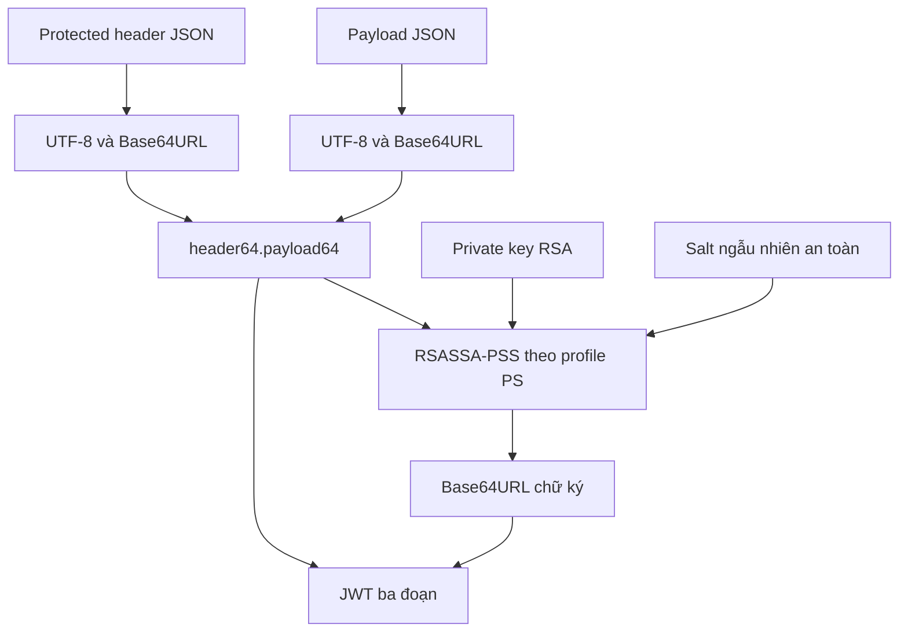

# RSA-PSS và nhóm thuật toán PS256, PS384, PS512

## 1. RSA-PSS trong hệ sinh thái JWT

Trong **Security - JSON Web Token (JWT)**, một JWT có chữ ký thường được biểu diễn theo chuẩn **JSON Web Signature (JWS)**. Bên phát hành ký dữ liệu bằng khóa riêng; bên nhận dùng khóa công khai tương ứng để xác minh. Nhóm thuật toán `PS256`, `PS384`, `PS512` sử dụng RSA với lược đồ chữ ký **RSASSA-PSS** và các hàm băm SHA-2.

RSA-PSS là một lược đồ chữ ký bất đối xứng:

- **Private key** được issuer giữ bí mật và dùng để tạo chữ ký.
- **Public key** được phân phối cho các verifier đáng tin cậy để kiểm tra chữ ký.
- Bên chỉ có public key có thể xác minh chữ ký hợp lệ, nhưng không thể tạo chữ ký mới tương ứng với private key trong điều kiện bảo mật thông thường.

Đặc điểm nổi bật của PSS là dùng **salt ngẫu nhiên** trong quá trình mã hóa thông điệp trước phép toán RSA. Vì vậy, cùng một thông điệp, cùng khóa riêng và cùng thuật toán có thể tạo ra những chữ ký khác nhau ở mỗi lần ký. Bộ xác minh vẫn kiểm tra được chúng bằng public key và các tham số PSS tương ứng.

Chữ ký RSA-PSS cung cấp khả năng phát hiện sửa đổi và xác thực nguồn theo khóa ký. Nó **không mã hóa nội dung JWT**. Với JWS Compact, header và payload thường chỉ được mã hóa biểu diễn bằng Base64URL nên người có token có thể đọc chúng. Nếu cần giữ bí mật dữ liệu, cần thiết kế claims phù hợp hoặc dùng cơ chế mã hóa như JWE.

Bài học thuộc chương **Thuật toán chữ ký** của module **Security - JSON Web Token (JWT)**. Nội dung tập trung vào chuẩn RSA-PSS, ánh xạ thuật toán JWA, định dạng JWS, quản lý khóa và xác minh an toàn; không phụ thuộc Java hay bất kỳ framework cụ thể nào.

## 2. RSA-PSS là gì?

### 2.1. RSA là nền tảng, PSS là lược đồ chữ ký

RSA là hệ mật mã khóa công khai dựa trên cặp khóa có quan hệ toán học:

- Public key gồm mô-đun `n` và số mũ công khai `e`.
- Private key chứa thông tin bí mật để thực hiện phép toán ký, thường gồm số mũ riêng `d` và các tham số RSA liên quan.

Chỉ nói “ký bằng RSA” là chưa đủ để xác định cách tạo và kiểm tra chữ ký. Một lược đồ chữ ký còn quy định cách băm thông điệp, cách mã hóa kết quả băm, padding và cách xác minh.

Hai lược đồ RSA phổ biến trong JWS là:

- **RSASSA-PKCS1-v1_5:** nhóm `RS256`, `RS384`, `RS512`.
- **RSASSA-PSS:** nhóm `PS256`, `PS384`, `PS512`.

Chúng dùng cùng nền tảng RSA nhưng cách tạo cấu trúc đầu vào cho phép toán RSA khác nhau. Chữ ký tạo bởi RS256 không thể đem xác minh như PS256, dù cả hai đều dùng SHA-256 và cùng cặp khóa RSA.

### 2.2. Cấu trúc EMSA-PSS

Trong RSASSA-PSS, thông điệp trước hết được băm. Sau đó lược đồ **EMSA-PSS** kết hợp digest với một salt ngẫu nhiên để tạo encoded message (`EM`). Ở mức khái niệm, với thông điệp `M`, hàm băm `H`, salt `salt` và độ dài digest `hLen`:

```text
mHash = H(M)

M' = 0x00 00 00 00 00 00 00 00 || mHash || salt
H' = H(M')

DB = PS || 0x01 || salt
dbMask = MGF1(H', emLen - hLen - 1)
maskedDB = DB XOR dbMask
clear the leftmost unused bits of maskedDB's first octet

EM = maskedDB || H' || 0xBC
```

Trong đó:

- `salt` là chuỗi byte ngẫu nhiên có độ dài do cấu hình lược đồ quy định.
- `PS` là chuỗi byte `0x00` có độ dài phù hợp để toàn bộ cấu trúc đạt đúng kích thước.
- `MGF1` (Mask Generation Function 1) tạo mặt nạ từ digest và độ dài yêu cầu.
- Sau phép XOR, các bit cao không sử dụng ở octet đầu của `maskedDB` phải được xóa theo `emBits`; đây là một phần của mã hóa EMSA-PSS.
- `0x01` phân tách phần đệm với salt.
- `0xBC` là trailer byte của EMSA-PSS.
- `emLen` là độ dài encoded message tính theo byte; theo chuẩn, nó được xác định từ số bit của mô-đun RSA trừ một bit.

Sau khi tạo `EM`, phép toán RSA với private key tạo ra chữ ký. Khi xác minh, public key được dùng để khôi phục encoded message và kiểm tra cấu trúc PSS, digest, salt cùng các tham số theo chuẩn.

Đây là mô tả khái niệm của cấu trúc. Trong triển khai thực tế, không tự ghép padding, tự tạo mask hoặc tự thực hiện phép toán RSA. Hãy dùng thư viện mật mã/JOSE đã được kiểm chứng để tránh lỗi ở các chi tiết như độ dài, bit không sử dụng, MGF1 và kiểm tra salt.

### 2.3. Vì sao PSS có salt ngẫu nhiên?

Salt là thành phần riêng biệt được đưa vào quá trình tạo digest PSS. Nó làm cho quá trình ký có tính ngẫu nhiên:

1. Lần ký thứ nhất tạo salt ngẫu nhiên A và chữ ký tương ứng.
2. Lần ký thứ hai với cùng thông điệp và khóa tạo salt ngẫu nhiên B.
3. Nếu A khác B, chữ ký tạo ra thường cũng khác nhau.
4. Cả hai chữ ký đều có thể xác minh thành công nếu được tạo đúng tham số.

Salt không phải mật khẩu, không phải khóa bí mật và không cần được giữ bí mật. Nó được mã hóa bên trong cấu trúc chữ ký để verifier khôi phục và kiểm tra. Yêu cầu quan trọng là nguồn ngẫu nhiên phải an toàn và độ dài salt phải đúng với profile đang dùng.

Với các thuật toán PS trong JWA, độ dài salt được cố định bằng độ dài digest tương ứng. Điều này giúp các hệ thống độc lập có thể thống nhất tham số khi ký và xác minh.

## 3. PS256, PS384 và PS512 theo chuẩn JWA

**JSON Web Algorithms (JWA), RFC 7518** định nghĩa ba thuật toán RSA-PSS dành cho JWS:

| Giá trị `alg` | Lược đồ | Hàm băm | MGF | Độ dài salt |
| --- | --- | --- | --- | --- |
| `PS256` | RSASSA-PSS | SHA-256 | MGF1 với SHA-256 | 32 byte |
| `PS384` | RSASSA-PSS | SHA-384 | MGF1 với SHA-384 | 48 byte |
| `PS512` | RSASSA-PSS | SHA-512 | MGF1 với SHA-512 | 64 byte |

Các tham số này là một phần của định nghĩa thuật toán JWA, không phải tùy chọn để mỗi bên tự chọn. Cụ thể, MGF1 dùng cùng hàm băm với thuật toán chính; salt có độ dài bằng digest; trailer field sử dụng giá trị chuẩn của PSS là `1` (byte cuối `0xBC`).

**RFC 7518, mục 3.5 yêu cầu khóa RSA có kích thước mô-đun ít nhất 2.048 bit.** Đây là mức tối thiểu tương thích JWA. Tổ chức có thể yêu cầu kích thước lớn hơn theo chính sách mật mã, thời gian cần bảo vệ dữ liệu, hiệu năng và khuyến nghị an toàn hiện hành.

### 3.1. Độ dài chữ ký phụ thuộc khóa RSA

Hậu tố `256`, `384`, `512` biểu thị hàm băm, không phải số bit của khóa RSA hoặc độ dài chữ ký. Chữ ký RSA có độ dài bằng kích thước mô-đun tính theo byte:

| Kích thước mô-đun RSA | Chữ ký nhị phân | Base64URL không padding |
| --- | --- | --- |
| 2.048 bit | 256 byte | 342 ký tự |
| 3.072 bit | 384 byte | 512 ký tự |
| 4.096 bit | 512 byte | 683 ký tự |

Vì vậy, với cùng một khóa RSA 2.048 bit, PS256, PS384 và PS512 đều tạo chữ ký có độ dài 256 byte. Digest và salt bên trong PSS khác nhau, nhưng độ dài chữ ký cuối cùng vẫn do mô-đun RSA quyết định.

### 3.2. Bảng tham số phải khớp giữa hai phía

Để xác minh thành công, issuer và verifier phải thống nhất toàn bộ profile:

- Cùng họ lược đồ: RSASSA-PSS.
- Cùng hàm băm: SHA-256, SHA-384 hoặc SHA-512.
- Cùng hàm tạo mặt nạ: MGF1.
- MGF1 dùng cùng hàm băm với thuật toán PS tương ứng.
- Độ dài salt đúng bằng số byte của digest.
- Cùng cặp khóa RSA và định dạng signing input JWS.

Một triển khai PSS tổng quát có thể cho phép nhiều lựa chọn salt length hoặc MGF1 hash. Tuy nhiên, verifier JWS không được tự do chấp nhận mọi cấu hình PSS: phải tuân theo tham số cố định của PS256/PS384/PS512.

## 4. Phân biệt PS với RS

Nhóm `RS256` và `PS256` đều dùng RSA và SHA-256, nhưng padding/lược đồ chữ ký khác nhau:

| Tiêu chí | RS256 | PS256 |
| --- | --- | --- |
| Lược đồ | RSASSA-PKCS1-v1_5 | RSASSA-PSS |
| Hàm băm | SHA-256 | SHA-256 |
| Padding/encoding | Cấu trúc PKCS#1 v1.5 | PSS với MGF1 và salt |
| Salt ngẫu nhiên | Không | Có, 32 byte theo JWA |
| Tính xác định | Cùng khóa và thông điệp tạo cùng chữ ký | Salt mới khiến chữ ký thay đổi giữa các lần ký |
| Cấu hình xác minh | Phải dùng RSASSA-PKCS1-v1_5 | Phải dùng đúng profile PSS của JWA |

Các cặp tương ứng khác cũng cùng nguyên tắc:

- `RS384` và `PS384` đều dùng SHA-384, nhưng khác lược đồ.
- `RS512` và `PS512` đều dùng SHA-512, nhưng khác lược đồ.

PSS được thiết kế với các đặc tính bảo mật hiện đại và thường được ưu tiên trong những hệ thống mới khi các bên hỗ trợ đầy đủ. PKCS#1 v1.5 vẫn được dùng rộng rãi vì khả năng tương thích với hệ thống cũ. Việc chọn thuật toán cần xét chính sách, hỗ trợ của các bên tích hợp và yêu cầu vận hành; không thể đổi tên `alg` mà giữ nguyên chữ ký cũ.

## 5. Tạo chữ ký PS trong JWS/JWT

### 5.1. Cấu trúc JWS Compact

JWT có chữ ký thường dùng JWS Compact với ba đoạn:

```text
BASE64URL(UTF8(protectedHeaderJSON))
.
BASE64URL(UTF8(payloadJSON))
.
BASE64URL(signatureBytes)
```

Ví dụ protected header trước khi mã hóa:

```json
{
  "alg": "PS256",
  "typ": "JWT",
  "kid": "issuer-signing-2026-11"
}
```

Ví dụ payload trước khi mã hóa:

```json
{
  "iss": "https://identity.example",
  "sub": "user-123",
  "aud": "payments-api",
  "iat": 1893452400,
  "exp": 1893456000
}
```

Đây là dữ liệu minh họa. `iat` và `exp` là **NumericDate**, biểu diễn giây tính từ Unix epoch theo UTC. `kid` là mã định danh khóa; `typ` hỗ trợ phân biệt loại token. Các giá trị header này chưa được xác thực cho đến khi chữ ký hợp lệ.

Base64URL chỉ là cách biểu diễn byte an toàn cho URL, không phải mã hóa bí mật. Người có token có thể giải mã header và payload để đọc claims.

### 5.2. Signing input

JWS Compact tạo signing input bằng cách nối nguyên văn hai đoạn Base64URL đầu tiên với dấu chấm:

```text
header64 = BASE64URL(UTF8(protectedHeaderJSON))
payload64 = BASE64URL(UTF8(payloadJSON))

signingInput = ASCII(header64 + "." + payload64)
```

Sau đó PS256 ký signing input bằng private key RSA:

```text
signatureBytes = RSASSA_PSS_SIGN(
    privateKey,
    signingInput,
    hash = SHA-256,
    maskGenerationFunction = MGF1(SHA-256),
    saltLength = 32
)

jwt = header64 + "." + payload64 + "." + BASE64URL(signatureBytes)
```

Với PS384, dùng SHA-384, MGF1(SHA-384), salt 48 byte; với PS512, dùng SHA-512, MGF1(SHA-512), salt 64 byte.

**Không ký riêng payload JSON** và không ký chuỗi JSON tùy ý sau khi đã parse. Dấu chấm cùng hai đoạn Base64URL là một phần của dữ liệu ký. Thứ tự trường, khoảng trắng hoặc cách escape JSON có thể làm thay đổi byte sau khi mã hóa; vì vậy verifier phải dùng chính xác hai đoạn gốc nhận được.



### 5.3. Tính ngẫu nhiên và khả năng xác minh

Nếu issuer ký cùng một JWT hai lần bằng PS256, hai chữ ký thường khác nhau do salt khác nhau. Đây là hành vi đúng của PSS. Verifier không được so sánh chữ ký với một giá trị đã lưu hoặc kỳ vọng chữ ký luôn giống nhau; phải thực hiện phép xác minh theo chuẩn trên token nhận được.

Sự ngẫu nhiên của salt không làm token tự hết hạn, không chống replay và không thay thế việc quản lý phiên. Một bearer token hợp lệ vẫn có thể bị gửi lại trong thời gian hiệu lực nếu bị đánh cắp.

## 6. Phát hành và xác minh JWT bằng RSA-PSS

### 6.1. Phát hành bằng private key

Quy trình phát hành:

1. Chọn thuật toán từ cấu hình tin cậy của issuer, chẳng hạn PS256.
2. Lấy private key RSA thuộc đúng issuer và đáp ứng kích thước khóa tối thiểu.
3. Tạo protected header với `alg` đã chọn và `kid` tương ứng.
4. Tạo claims cần thiết: issuer, subject, audience, thời hạn, quyền và thông tin nghiệp vụ tối thiểu.
5. Mã hóa header và payload theo Base64URL, ghép signing input.
6. Ký bằng đúng profile PSS của JWA, bao gồm hash, MGF1 và salt length.
7. Base64URL chữ ký và ghép thành token ba đoạn.

Mã giả:

```text
function issueJwt(claims, signerConfig):
    require signerConfig.algorithm in {PS256, PS384, PS512}
    require signerConfig.privateKey.modulusBits >= 2048

    header = {
        "alg": signerConfig.algorithm,
        "typ": "JWT",
        "kid": signerConfig.keyId
    }

    header64 = BASE64URL(UTF8(JSON_SERIALIZE(header)))
    payload64 = BASE64URL(UTF8(JSON_SERIALIZE(claims)))
    signingInput = ASCII(header64 + "." + payload64)

    parameters = jwaPssParameters(signerConfig.algorithm)
    signature = RSA_PSS_SIGN(
        signerConfig.privateKey,
        signingInput,
        parameters,
        secureRandom
    )

    return header64 + "." + payload64 + "." + BASE64URL(signature)
```

Hàm `jwaPssParameters` trong mã giả đại diện cho profile cố định của PS256/384/512, không phải hàm cho phép người gọi tùy chọn salt length hoặc MGF1 hash ngoài tiêu chuẩn.

### 6.2. Xác minh bằng public key

Verifier cần thực hiện các bước:

1. Giới hạn kích thước token và parse JWS Compact nghiêm ngặt thành đúng ba đoạn.
2. Parse protected header như dữ liệu chưa xác thực. Kiểm tra `alg` nằm trong allowlist được cấu hình và được hỗ trợ.
3. Chọn public key RSA từ tập khóa đã tin cậy của issuer; dùng `kid` để tra cứu trong tập này, không để header chỉ định nguồn khóa tùy ý.
4. Ràng buộc public key với issuer, mục đích sử dụng và thuật toán PS được phép.
5. Dựng signing input từ nguyên văn `header64.payload64`.
6. Giải mã chữ ký Base64URL và xác minh bằng đúng profile PSS: hash, MGF1 cùng hash, salt length theo JWA.
7. Chỉ sau khi chữ ký hợp lệ mới sử dụng claims để kiểm tra issuer, audience, thời hạn, loại token và quyền.

Mã giả:

```text
function verifyJwt(token, policy, trustedKeySet):
    (header64, payload64, signature64) = parseThreeSegmentsStrictly(token)
    header = parseProtectedHeader(BASE64URL_DECODE(header64))

    require header.alg in policy.allowedAlgorithms
    require header.alg in {PS256, PS384, PS512}
    require no unsupported critical header parameters

    publicKey = trustedKeySet.find(
        issuer = policy.expectedIssuer,
        kid = header.kid,
        algorithm = header.alg
    )

    require publicKey exists
    require publicKey.type == RSA
    require publicKey.modulusBits >= 2048
    require publicKey is trusted for this issuer and algorithm

    signingInput = ASCII(header64 + "." + payload64)
    signature = BASE64URL_DECODE(signature64)
    parameters = jwaPssParameters(header.alg)

    require RSA_PSS_VERIFY(
        publicKey,
        signingInput,
        signature,
        parameters
    )

    claims = parseAndValidateJson(BASE64URL_DECODE(payload64))
    require claims.iss == policy.expectedIssuer
    require claims.aud contains policy.expectedAudience
    require claims.exp is valid and now < claims.exp
    require claims.nbf absent or now >= claims.nbf
    require token type, subject, scopes and other policy checks pass

    return claims
```

Đây là mã giả mô tả trình tự. Hệ thống thật cần xử lý NumericDate theo giây UTC, sai lệch đồng hồ nếu chính sách cho phép, audience có thể là chuỗi hoặc mảng, JSON không hợp lệ hoặc có tên trường trùng, giới hạn thời gian sống và các quy tắc riêng của ứng dụng. Nếu loại token bắt buộc có `exp`, phải từ chối khi claim này vắng mặt.

### 6.3. Chữ ký hợp lệ chưa đồng nghĩa token được phép

Xác minh mật mã trả lời câu hỏi: token có được ký bằng private key tương ứng với public key tin cậy, theo đúng thuật toán hay không? Nó không trả lời token có dành cho API hiện tại hay còn hiệu lực hay không.

| Kiểm tra | Ý nghĩa | Ví dụ từ chối |
| --- | --- | --- |
| Chữ ký PSS | Toàn vẹn và nguồn ký theo khóa | Payload bị sửa, chữ ký sai, thuật toán không được phép |
| `iss` | Đúng issuer tin cậy | Token do issuer khác phát hành |
| `aud` | Đúng đối tượng nhận | Token dành cho API khác |
| `exp`, `nbf` | Đúng thời điểm sử dụng | Token hết hạn hoặc chưa có hiệu lực |
| Token type | Đúng loại thông tin xác thực | ID token bị dùng thay access token |
| Scope/role | Có quyền thao tác | Người dùng không có quyền với tài nguyên |

Ví dụ, một token ký PS256 hợp lệ với `aud: inventory-api` phải bị Billing API từ chối nếu audience dự kiến là `billing-api`.

## 7. Quản lý khóa RSA-PSS và JWKS

### 7.1. Sinh và bảo vệ khóa

- Sinh cặp khóa bằng thư viện mật mã đáng tin cậy và bộ sinh số ngẫu nhiên an toàn mật mã (CSPRNG).
- Dùng mô-đun RSA tối thiểu 2.048 bit theo JWA; cân nhắc kích thước lớn hơn theo chính sách và thời hạn bảo vệ.
- Giữ private key trong KMS, HSM hoặc secret manager phù hợp; giới hạn quyền ký theo nguyên tắc ít quyền nhất.
- Không đưa private key vào source code, kho Git, log, URL, payload JWT hoặc cấu hình công khai.
- Tách khóa theo môi trường, issuer, tenant hoặc mục đích khi cần để giảm phạm vi ảnh hưởng.
- Kiểm soát truy cập, theo dõi thao tác ký và chuẩn bị quy trình xử lý khi nghi ngờ lộ khóa.

Public key có thể được phân phối rộng hơn private key, nhưng vẫn phải đảm bảo nguồn phân phối đúng issuer. Nếu attacker thay được public key mà verifier tin cậy, họ có thể tạo một cặp khóa riêng của mình và giả mạo issuer trong phạm vi verifier bị ảnh hưởng.

### 7.2. JWK và JWKS

**JSON Web Key (JWK)** biểu diễn một khóa mật mã dưới dạng JSON. Public JWK cho RSA thường có:

| Trường | Ý nghĩa |
| --- | --- |
| `kty` | Loại khóa; với RSA là `RSA` |
| `n` | Mô-đun RSA dạng Base64URLUInt |
| `e` | Số mũ công khai dạng Base64URLUInt |
| `kid` | Định danh khóa |
| `use` | Mục đích, thường là `sig` cho chữ ký |
| `alg` | Thuật toán dự kiến, nếu được công bố |
| `key_ops` | Các thao tác được phép, ví dụ `verify` |

Ví dụ minh họa, không phải khóa có thể dùng thật:

```json
{
  "kty": "RSA",
  "kid": "issuer-signing-2026-11",
  "use": "sig",
  "alg": "PS256",
  "key_ops": ["verify"],
  "n": "<base64url-modulus>",
  "e": "AQAB"
}
```

Trường `n` là placeholder. `e = AQAB` biểu diễn số mũ công khai phổ biến 65537. Public JWK không được chứa các tham số private như `d`, `p`, `q`, `dp`, `dq`, `qi`.

**JWKS (JSON Web Key Set)** là một tập JWK. Issuer thường công bố JWKS qua endpoint HTTPS đã được cấu hình trong hệ thống xác minh. Verifier phải gắn tập khóa với đúng issuer và chính sách tin cậy. Không được tin một URL do JWT chưa xác thực cung cấp chỉ vì URL đó có vẻ hợp lệ.

### 7.3. Luân chuyển khóa

Một đợt rotation có kế hoạch có thể thực hiện như sau:

1. Tạo cặp khóa RSA mới, kiểm tra kích thước và lưu private key an toàn.
2. Công bố public key mới trong JWKS để các verifier cập nhật trước khi issuer bắt đầu dùng nó.
3. Trong giai đoạn chuyển tiếp, giữ cả public key cũ và mới; issuer bắt đầu ký token mới bằng private key mới và đặt `kid` tương ứng.
4. Chờ các token được ký bằng khóa cũ hết hạn, cộng khoảng trễ hoặc clock skew mà chính sách cho phép.
5. Gỡ public key cũ khỏi JWKS và verifier, sau đó xử lý private key cũ theo chính sách lưu trữ/hủy.

Nếu private key bị lộ, đây là xử lý sự cố chứ không còn là rotation thông thường. Cần ngừng tin tưởng khóa bị lộ, đánh giá token đã phát hành, thu hồi phiên/token liên quan bằng cơ chế phù hợp và triển khai khóa mới. Không thể chỉ đổi PS256 thành PS512 rồi coi sự cố đã được giải quyết.

### 7.4. Header chưa xác thực và nguồn khóa

`kid` có thể được dùng để tìm public key trong tập khóa tin cậy, nhưng header chứa `kid` chưa được xác thực trước khi chữ ký kiểm tra thành công. Do đó:

- Tra `kid` trong danh sách khóa được quản trị; không dùng trực tiếp làm đường dẫn file hoặc câu truy vấn không an toàn.
- Ràng buộc khóa với issuer và thuật toán được phép; cùng một `kid` có thể xuất hiện ở các issuer khác nhau.
- Không tự động tải `jku` hoặc `x5u` từ URL tùy ý trong token; có thể tạo nguy cơ SSRF hoặc làm verifier tin khóa của attacker.
- Nếu tải JWKS từ xa, endpoint phải được cấu hình tin cậy, kết nối bảo vệ bằng TLS, kiểm soát redirect, cache và lỗi cập nhật.

## 8. Lỗi triển khai và rủi ro bảo mật

| Lỗi | Hệ quả | Cách phòng tránh |
| --- | --- | --- |
| Chỉ kiểm tra tên `alg` mà không allowlist | Token có thể chọn thuật toán ngoài chính sách | Cấu hình danh sách thuật toán chấp nhận ở verifier |
| Dùng tham số PSS tùy ý | MGF1 hash hoặc salt length khác profile JWA làm kết quả không tương thích; kiểm tra lỏng có thể tạo lỗ hổng | Dùng đúng profile PS256/384/512 do thư viện JOSE hỗ trợ |
| Nhầm PS256 với RS256 | Sai lược đồ padding, xác minh thất bại hoặc triển khai sai đường xử lý | Gắn từng thuật toán với đúng kiểu khóa và lược đồ |
| Dùng public key RSA như secret HMAC | Có thể dẫn tới algorithm confusion nếu verifier trộn các họ thuật toán | Phân tách thuật toán, kiểu khóa và cấu hình; không tự suy luận từ token |
| Dùng RNG yếu để tạo salt | Tính ngẫu nhiên PSS không đạt yêu cầu, ảnh hưởng giả định bảo mật | Dùng CSPRNG và thư viện mật mã tiêu chuẩn |
| Tự viết EMSA-PSS | Dễ sai MGF1, bit mask, salt, độ dài hoặc trailer | Không tự triển khai primitive mật mã trong mã nghiệp vụ |
| Tin public key từ URL trong header | Attacker có thể điều khiển khóa verifier sử dụng hoặc gây SSRF | Chỉ lấy khóa từ issuer/endpoint đã cấu hình tin cậy |
| Chỉ kiểm tra chữ ký | Token sai audience, hết hạn hoặc sai loại vẫn được chấp nhận | Kiểm tra claims và chính sách sau xác minh |
| Nghĩ salt ngẫu nhiên ngăn replay | Bearer token vẫn có thể bị sử dụng lại | Dùng hạn token, audience, thu hồi và biện pháp chống replay phù hợp |
| Nghĩ chữ ký làm payload bí mật | Người có token vẫn đọc được claims | Không đưa dữ liệu nhạy cảm vào JWS; dùng JWE nếu cần |

### 8.1. Algorithm confusion

Giả sử verifier dự kiến chỉ nhận PS256 bằng public key RSA nhưng lại cho phép cả HS256 và dùng cùng byte biểu diễn public key làm secret HMAC. Kẻ tấn công biết public key có thể tự tính chữ ký HMAC cho token giả mạo. Một verifier cấu hình sai có thể chấp nhận token đó.

Biện pháp bảo vệ là **ràng buộc thuật toán với cấu hình tin cậy**, phân biệt kiểu khóa RSA với secret HMAC và chỉ chấp nhận thuật toán đã được chỉ định cho issuer/loại token. Không để giá trị `alg` trong header tự quyết định toàn bộ cơ chế xác minh.

### 8.2. Sai salt length hoặc MGF1

Một thư viện PSS tổng quát có thể cung cấp các tùy chọn:

- MGF1 dùng SHA-1 hoặc một hàm băm khác.
- Salt có độ dài cố định, bằng digest hoặc tự động theo kích thước thông điệp.
- Trailer field theo cấu hình riêng.

Các tùy chọn đó không có nghĩa verifier JWT được phép chấp nhận mọi cấu hình. Ví dụ PS256 của JWA yêu cầu SHA-256, MGF1-SHA-256 và salt 32 byte. Nếu issuer dùng salt 20 byte hoặc MGF1-SHA-1, chữ ký không phải PS256 đúng chuẩn và verifier tuân thủ JWA phải từ chối.

## 9. Khi nào nên chọn PS256, PS384 hoặc PS512?

**Tình huống A — Thiết kế issuer mới và toàn bộ hệ thống hỗ trợ PSS.** Có thể chọn PS256 làm profile thực dụng nếu đáp ứng chính sách. Cần xác nhận thư viện ký, verifier, dịch vụ tích hợp và công cụ vận hành đều hỗ trợ đúng PSS parameters của JWA.

**Tình huống B — Chính sách yêu cầu SHA-384 hoặc SHA-512.** Chọn PS384 hoặc PS512 nếu các thành phần hỗ trợ và kích thước khóa phù hợp. Độ dài chữ ký vẫn phụ thuộc mô-đun RSA, không tăng chỉ vì đổi hàm băm.

**Tình huống C — Phải tích hợp hệ thống cũ chỉ hỗ trợ PKCS#1 v1.5.** Có thể cần nhóm RS theo yêu cầu tương thích và chính sách được phê duyệt. Không tự đổi `alg` trong header của token đã ký; cần cấu hình issuer và verifier nhất quán.

**Tình huống D — Muốn verifier không có quyền phát hành token.** RSA-PSS phù hợp với mô hình issuer giữ private key, còn API nhận public key để xác minh. Cần bảo vệ nguồn public key và giới hạn quyền truy cập private key.

**Tình huống E — Cần JWT nhỏ hơn.** PS256, PS384, PS512 có cùng độ dài chữ ký khi dùng cùng mô-đun RSA. Giảm hậu tố SHA không làm chữ ký RSA ngắn hơn; phải cân nhắc kích thước khóa hoặc họ thuật toán khác theo yêu cầu bảo mật và tương thích.

**Tình huống F — Cần giữ bí mật claims.** Chuyển RS sang PS hoặc PS512 không mã hóa payload. Cần hạn chế dữ liệu đưa vào token hoặc dùng cơ chế mã hóa phù hợp.

## 10. Những hiểu lầm phổ biến

**“PS512 tạo chữ ký dài gấp đôi PS256.”** Sai khi dùng cùng cặp khóa RSA. Hậu tố chỉ hàm băm; độ dài chữ ký phụ thuộc mô-đun RSA.

**“Ký cùng một JWT luôn cho cùng chữ ký.”** Sai với PSS. Salt ngẫu nhiên làm chữ ký thay đổi giữa các lần ký, dù nội dung và khóa giống nhau.

**“Verifier cần biết salt bí mật.”** Sai. Salt được chứa trong cấu trúc chữ ký và được khôi phục trong quá trình xác minh; nó không phải khóa bí mật.

**“PS256 và RS256 có thể xác minh thay thế nhau vì đều là RSA/SHA-256.”** Sai. PSS và PKCS#1 v1.5 là hai lược đồ khác nhau, có cấu trúc mã hóa và quy tắc xác minh riêng.

**“Chữ ký hợp lệ có nghĩa token hợp lệ trong mọi API.”** Sai. Verifier còn phải kiểm tra issuer, audience, thời hạn, loại token và quyền.

**“PSS tự ngăn token bị phát lại.”** Sai. Salt chỉ tham gia tạo chữ ký; một bearer JWT hợp lệ vẫn có thể được gửi lại cho tới khi hết hạn hoặc bị thu hồi.

## 11. Câu hỏi tự kiểm tra

1. Điểm khác nhau cốt lõi giữa RSASSA-PSS và RSASSA-PKCS1-v1_5 là gì?
2. Vì sao hai lần ký cùng một thông điệp bằng PS256 có thể tạo hai chữ ký khác nhau nhưng cả hai đều hợp lệ?
3. Theo JWA, PS256 sử dụng hash, MGF1 và salt length nào?
4. Vì sao verifier không nên cho phép cấu hình salt length tùy ý khi xác minh PS256?
5. Nếu dùng cùng khóa RSA 2.048 bit, PS256 và PS512 có độ dài chữ ký khác nhau không? Giải thích.
6. Vì sao phải xác minh nguyên văn `header64.payload64` thay vì parse rồi serialize lại JSON?
7. Một token có chữ ký PS256 hợp lệ nhưng `aud` không khớp API hiện tại có được chấp nhận không?
8. Khi private key bị lộ, cần làm gì ngoài việc tạo một khóa mới?

## 12. Tiêu chuẩn và tài liệu tham khảo

- [RFC 8017 — PKCS #1: RSA Cryptography Specifications Version 2.2](https://www.rfc-editor.org/rfc/rfc8017), đặc biệt các mục về RSASSA-PSS và EMSA-PSS.
- [RFC 7515 — JSON Web Signature (JWS)](https://www.rfc-editor.org/rfc/rfc7515), định dạng JWS Compact và signing input.
- [RFC 7518 — JSON Web Algorithms (JWA)](https://www.rfc-editor.org/rfc/rfc7518), đặc biệt **mục 3.5** định nghĩa PS256, PS384, PS512 và tham số PSS.
- [RFC 7517 — JSON Web Key (JWK)](https://www.rfc-editor.org/rfc/rfc7517), cấu trúc JWK/JWKS và metadata khóa.
- [RFC 7519 — JSON Web Token (JWT)](https://www.rfc-editor.org/rfc/rfc7519), cấu trúc JWT và registered claims.
- [RFC 8725 — JSON Web Token Best Current Practices](https://www.rfc-editor.org/rfc/rfc8725), khuyến nghị về thuật toán, nguồn khóa, xác minh và phân biệt loại token.
