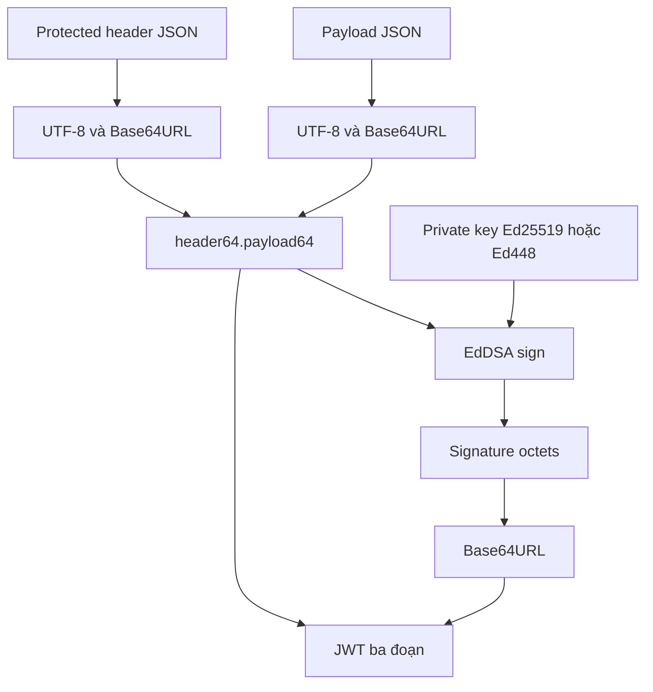
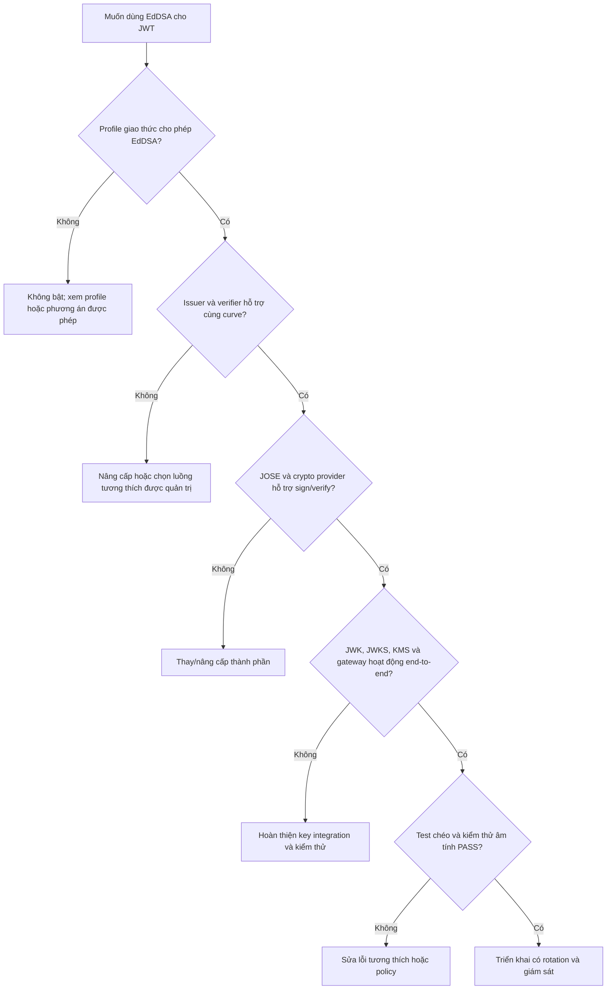

# EdDSA và kiểm tra khả năng hỗ trợ của hồ sơ, thư viện và hệ thống

## 1. EdDSA trong hệ sinh thái JWT

Trong **Security - JSON Web Token (JWT)**, bên phát hành thường ký token để bên nhận kiểm tra tính toàn vẹn và nguồn phát hành. Khi JWT được biểu diễn theo chuẩn **JSON Web Signature (JWS)**, thuật toán **EdDSA** cho phép dùng chữ ký số dựa trên đường cong elliptic với cặp khóa riêng/công khai.

EdDSA là tên họ thuật toán chữ ký được chuẩn hóa trong RFC 8032. Trong JOSE/JWA, RFC 8037 định nghĩa giá trị `alg` là **`EdDSA`**, sử dụng hai biến thể đường cong:

- **Ed25519:** dùng đường cong Edwards 25519.
- **Ed448:** dùng đường cong Edwards 448.

Issuer giữ **private key** để ký. Các API hoặc dịch vụ nhận **public key** từ nguồn đã được tin cậy để xác minh. Bên chỉ có public key có thể kiểm tra chữ ký nhưng không thể tạo chữ ký hợp lệ cho thông điệp mới trong điều kiện bảo mật thông thường.

EdDSA cung cấp tính toàn vẹn và xác thực nguồn theo khóa. Nó **không mã hóa payload JWT**. Header và payload của JWS Compact thông thường chỉ được mã hóa biểu diễn bằng Base64URL; người có token có thể giải mã và đọc claims. Nếu dữ liệu cần bí mật, hãy hạn chế thông tin đưa vào token hoặc sử dụng cơ chế mã hóa như JWE.

Bài học thuộc chương **Thuật toán chữ ký** của module **Security - JSON Web Token (JWT)**. Trọng tâm là EdDSA trong JOSE, sự khác nhau giữa Ed25519 và Ed448, cách kiểm tra khả năng hỗ trợ xuyên suốt từ hồ sơ giao thức đến thư viện và hệ thống đang triển khai. Nội dung áp dụng độc lập với ngôn ngữ lập trình và framework.

## 2. EdDSA, Ed25519 và Ed448

### 2.1. Cặp khóa và chữ ký

EdDSA dùng cặp khóa bất đối xứng:

- **Private key:** dữ liệu bí mật ban đầu (seed) dùng để tạo chữ ký.
- **Public key:** điểm trên đường cong tương ứng với private key, được phân phối cho bên xác minh.
- **Signature:** chuỗi byte cố định theo biến thể đường cong.

Khác với ECDSA, EdDSA không yêu cầu ứng dụng tự chọn một nonce ngẫu nhiên mới cho từng lần ký. Thuật toán EdDSA chuẩn sử dụng cách tạo chữ ký xác định từ khóa riêng và thông điệp. Điều này loại bỏ một nhóm lỗi triển khai do tái sử dụng nonce ECDSA, nhưng không làm private key trở nên ít nhạy cảm hơn: nếu seed bị lộ, attacker vẫn có thể ký token giả.

Khóa phải được sinh bằng thư viện mật mã và nguồn ngẫu nhiên an toàn. Tính xác định của chữ ký **không có nghĩa** quá trình sinh khóa có thể dùng dữ liệu dễ đoán.

### 2.2. Kích thước và đặc điểm hai biến thể

| Thuộc tính | Ed25519 | Ed448 |
| --- | ---: | ---: |
| Đường cong | Edwards25519 | Edwards448 |
| Độ dài public key | 32 byte | 57 byte |
| Độ dài private key seed | 32 byte | 57 byte |
| Độ dài chữ ký | 64 byte | 114 byte |
| Hàm băm nội bộ của biến thể chuẩn | SHA-512 | SHAKE256 với đầu ra 114 byte |
| Giá trị JWA `alg` | `EdDSA` | `EdDSA` |
| Giá trị JWK `crv` | `Ed25519` | `Ed448` |

**Lưu ý:** tên thuật toán JWS là `EdDSA` cho cả hai đường cong; trường `crv` của khóa cho biết đang dùng Ed25519 hay Ed448. Không nhầm tên đường cong với giá trị `alg`.

Ed25519 được hỗ trợ rộng rãi trong nhiều hệ sinh thái mật mã hiện đại. Ed448 cũng được chuẩn hóa nhưng khả năng hỗ trợ thực tế thường ít phổ biến hơn. Không được suy ra một thư viện hỗ trợ Ed448 chỉ vì nó hỗ trợ Ed25519, hoặc ngược lại.

### 2.3. EdDSA chuẩn và các biến thể prehash

RFC 8032 mô tả Ed25519, Ed448 cùng các biến thể prehash như Ed25519ph và Ed448ph. **Giá trị `EdDSA` trong JWA theo RFC 8037 dùng các thuật toán Ed25519/Ed448 chuẩn, không tự động đồng nghĩa với các biến thể `ph`.**

Vì vậy, nếu một thư viện có tùy chọn tên gần giống như `Ed25519ph`, `Ed448ph`, `Ed25519ctx` hoặc một API prehash, không thể mặc định rằng tùy chọn đó tương thích với JWS `alg: EdDSA`. Hai phía phải triển khai đúng profile được giao thức quy định.

### 2.4. Chữ ký xác định không phải cơ chế chống phát lại

Với cùng private key và cùng signing input, EdDSA chuẩn tạo ra chữ ký xác định. Điều này hữu ích cho việc triển khai và kiểm thử vì kết quả ký có thể lặp lại. Tuy nhiên:

- Chữ ký xác định không làm token hết hạn.
- Chữ ký xác định không ngăn bearer token bị gửi lại.
- Không nên dùng chuỗi chữ ký làm định danh duy nhất của phiên.
- Muốn quản lý phiên hoặc chống replay, cần thời hạn, audience, trạng thái thu hồi, `jti` hoặc cơ chế ràng buộc token phù hợp.

## 3. EdDSA được biểu diễn như thế nào trong JOSE/JWT?

### 3.1. Giá trị `alg` và `crv` có vai trò khác nhau

Trong JWS, protected header có thể chứa:

```json
{
  "alg": "EdDSA",
  "typ": "JWT",
  "kid": "issuer-ed25519-2026-11"
}
```

Trong JWK, khóa công khai cho Ed25519 có thể được biểu diễn:

```json
{
  "kty": "OKP",
  "crv": "Ed25519",
  "kid": "issuer-ed25519-2026-11",
  "use": "sig",
  "alg": "EdDSA",
  "key_ops": ["verify"],
  "x": "<base64url-public-key>"
}
```

Các giá trị khóa ở trên chỉ là ví dụ placeholder, không phải khóa thật. Ý nghĩa các trường:

| Trường | Ý nghĩa |
| --- | --- |
| `alg` trong JWS/JWK | Thuật toán JWA: `EdDSA` |
| `kty` | Loại khóa: `OKP` (Octet Key Pair) |
| `crv` | Đường cong: `Ed25519` hoặc `Ed448` |
| `x` | Public key dưới dạng Base64URL |
| `d` | Private key seed; không được công bố trong public JWKS |
| `kid` | Định danh khóa để tra cứu trong tập khóa tin cậy |
| `use` | Mục đích, thường là `sig` |
| `key_ops` | Thao tác được phép, ví dụ `verify` |

**Không dùng `kty: EC` cho khóa EdDSA** chỉ vì EdDSA cũng dựa trên đường cong elliptic. Trong JWK, Ed25519 và Ed448 thuộc loại khóa `OKP`, với `crv` tương ứng.

### 3.2. JWK cho Ed448

JWK Ed448 dùng cùng cấu trúc nhưng `crv` là `Ed448`, và public key `x` có 57 byte trước khi Base64URL. Ví dụ:

```json
{
  "kty": "OKP",
  "crv": "Ed448",
  "kid": "issuer-ed448-2026-11",
  "use": "sig",
  "alg": "EdDSA",
  "key_ops": ["verify"],
  "x": "<base64url-ed448-public-key>"
}
```

Không đưa `d` vào JWKS công khai. Khi trao đổi private JWK nội bộ, phải bảo vệ toàn bộ tài liệu như bí mật có khả năng ký token.

### 3.3. Không nhầm định dạng EdDSA với ECDSA

JWS biểu diễn chữ ký Ed25519 thành 64 byte và Ed448 thành 114 byte. Đây là chuỗi byte chữ ký theo định dạng của EdDSA; không phải chữ ký ECDSA dạng ASN.1 DER và cũng không phải cách ứng dụng tự tách R/S của ECDSA.

| Thuật toán | Độ dài chữ ký nhị phân | Độ dài Base64URL không padding |
| --- | ---: | ---: |
| EdDSA với Ed25519 | 64 byte | 86 ký tự |
| EdDSA với Ed448 | 114 byte | 152 ký tự |

Nếu API mật mã trả về một định dạng đóng gói riêng, cần xác nhận nó đúng với biểu diễn octet mà JWS yêu cầu. Không tự áp dụng bước chuyển đổi DER của ECDSA cho chữ ký EdDSA.

## 4. Cách EdDSA ký một JWT

### 4.1. JWS Compact Serialization

JWT có chữ ký ở dạng JWS Compact gồm ba phần:

```text
BASE64URL(UTF8(protectedHeaderJSON))
.
BASE64URL(UTF8(payloadJSON))
.
BASE64URL(signatureBytes)
```

Ví dụ payload:

```json
{
  "iss": "https://identity.example",
  "sub": "user-123",
  "aud": "catalog-api",
  "iat": 1893452400,
  "exp": 1893456000
}
```

Các giá trị là minh họa. `iat` và `exp` là **NumericDate**, tính theo giây từ Unix epoch. Base64URL chỉ mã hóa biểu diễn, không che giấu claims.

### 4.2. Signing input

JWS ký chính xác hai đoạn đầu đã mã hóa, nối bằng dấu chấm:

```text
header64 = BASE64URL(UTF8(protectedHeaderJSON))
payload64 = BASE64URL(UTF8(payloadJSON))

signingInput = ASCII(header64 + "." + payload64)
```

Quy trình tạo token:

```text
signatureBytes = EdDSA_SIGN(
    privateKey,
    signingInput
)

jwt = header64 + "." + payload64 + "." + BASE64URL(signatureBytes)
```

Private key phải thuộc đường cong phù hợp với JWK `crv`. Khi ký với Ed25519, chữ ký dài 64 byte; với Ed448, dài 114 byte.



Thứ tự trường JSON, khoảng trắng hoặc cách escape có thể làm thay đổi byte được ký. Vì vậy verifier phải sử dụng **nguyên văn** `header64.payload64` nhận từ token, không parse JSON rồi serialize lại.

### 4.3. Thuật toán EdDSA bên trong

JWS `EdDSA` chuyển signing input cho thuật toán Ed25519 hoặc Ed448 tương ứng. Ed25519 dùng SHA-512 trong thiết kế thuật toán; Ed448 dùng SHAKE256. Đây là các thành phần nội bộ của EdDSA, không có nghĩa issuer phải tự băm signing input thành digest rồi mới gọi một API EdDSA tổng quát.

Đối với JOSE, dùng đúng chế độ EdDSA chuẩn được thư viện JWS hỗ trợ. Không tự thay bằng prehash mode hoặc một biến thể có context khác.

## 5. Kiểm tra khả năng hỗ trợ ở cấp hồ sơ giao thức

Một hệ thống có thể hỗ trợ Ed25519 ở tầng mật mã nhưng hồ sơ giao thức, sản phẩm định danh hoặc API tích hợp vẫn không cho phép dùng nó. Vì vậy cần kiểm tra từ **profile/protocol** trước khi cấu hình issuer.

### 5.1. Kiểm tra chuẩn và profile áp dụng

Trước hết xác định tài liệu giao thức hoặc profile JWT/JWS đang dùng:

1. Profile có cho phép thuật toán JWA `EdDSA` không?
2. Profile có giới hạn curve cụ thể, ví dụ chỉ Ed25519 hay cả Ed448?
3. Profile có quy định nguồn khóa, cách công bố JWK/JWKS và cách gắn khóa với issuer không?
4. Profile có yêu cầu thuật toán khác theo chính sách tổ chức, ngành hoặc đối tác không?
5. Có yêu cầu tuân thủ hoặc chứng nhận mật mã nào giới hạn thuật toán được sử dụng không?

**Không suy luận rằng một thuật toán được RFC định nghĩa thì mọi profile đều bắt buộc hỗ trợ nó.** RFC 8037 đưa EdDSA vào JOSE; profile cấp cao hơn có thể giới hạn tập thuật toán được phép.

### 5.2. Kiểm tra metadata của nhà cung cấp định danh

Nếu tích hợp OpenID Connect, đọc metadata discovery của OpenID Provider và kiểm tra đúng thuộc tính cho loại JWT đang dùng. Ví dụ:

- `id_token_signing_alg_values_supported`: thuật toán ký ID Token được công bố hỗ trợ.
- `userinfo_signing_alg_values_supported`: thuật toán ký UserInfo Response nếu sản phẩm cung cấp chức năng này.
- Metadata tương ứng cho request object hoặc loại thông điệp khác nếu profile yêu cầu, chẳng hạn `request_object_signing_alg_values_supported`.
- Kiểm tra cả cấu hình đăng ký client và chính sách của RP/OP nếu thuật toán được thương lượng hoặc cố định trong quá trình đăng ký.

Các danh sách này có thể khác nhau theo loại đối tượng. Việc thấy `EdDSA` trong một trường metadata không chứng minh mọi loại token hoặc endpoint của nhà cung cấp đều hỗ trợ EdDSA.

Nếu metadata không công bố `EdDSA`, hãy xem tài liệu chính thức hoặc xác nhận với nhà cung cấp trước khi triển khai. Không tự thêm `EdDSA` vào cấu hình và giả định phía đối tác sẽ hiểu.

### 5.3. Kiểm tra hợp đồng tích hợp

Với hệ thống do nhiều đội hoặc nhiều tổ chức vận hành, cần ghi rõ trong hợp đồng kỹ thuật:

- JWS `alg` được chấp nhận: `EdDSA`.
- Curve được hỗ trợ: `Ed25519`, `Ed448`, hoặc tập con cụ thể.
- Định dạng khóa: JWK `OKP`, `crv`, `x` và cách phân phối JWKS.
- Định dạng chữ ký: octet signature đúng chuẩn JWS.
- Cách chọn khóa: `kid`, issuer và nguồn key set.
- Quy trình rotation, cache và thời gian cập nhật public key.
- Hành vi khi gặp thuật toán, curve hoặc khóa không được hỗ trợ.

Nếu một đối tác chỉ hỗ trợ Ed25519, không gửi token được ký bằng Ed448 dù cả hai đều dùng `alg: EdDSA`. Verifier phải hiểu curve của public key và thuật toán thực tế.

## 6. Kiểm tra khả năng hỗ trợ của thư viện và nền tảng mật mã

### 6.1. Tách tầng JOSE khỏi tầng mật mã

Khả năng hỗ trợ cần được kiểm tra ở ít nhất hai tầng:

| Tầng | Cần hỗ trợ | Ví dụ lỗi nếu thiếu |
| --- | --- | --- |
| JOSE/JWT library | JWS `alg: EdDSA`, parse/sign/verify token, xử lý protected header | Crypto provider có Ed25519 nhưng JWT library không đăng ký EdDSA |
| Crypto provider | Sinh/import/export khóa Ed25519/Ed448, ký và xác minh | JWT library biết thuật toán nhưng provider không có primitive hoặc curve |
| JWK/JWKS layer | `kty: OKP`, `crv`, `x`, private `d`, import/export key | Có thể ký bằng key object nhưng không đọc được public JWK |
| Key storage/KMS/HSM | Lưu private key và thực hiện thao tác ký EdDSA | Thư viện cục bộ hỗ trợ nhưng khóa trong KMS không ký được |
| Runtime/OS | Phiên bản runtime, provider và hệ điều hành có hỗ trợ cần thiết | Chạy được trên máy phát triển nhưng lỗi ở production |

Một thư viện quảng cáo hỗ trợ EdDSA có thể chỉ hỗ trợ Ed25519, chỉ xác minh mà không ký, hoặc chỉ hoạt động khi có provider cụ thể. Cần kiểm tra đúng thao tác và biến thể đường cong.

### 6.2. Ma trận kiểm tra tính năng

Đánh dấu riêng cho Ed25519 và Ed448:

| Khả năng | Ed25519 | Ed448 | Bằng chứng cần thu thập |
| --- | --- | --- | --- |
| Sinh cặp khóa | Có/Không | Có/Không | Test key generation và kiểm tra kích thước |
| Import private key | Có/Không | Có/Không | Import seed/key format đang dùng |
| Import public key | Có/Không | Có/Không | Import public JWK hoặc key format thực tế |
| Export public JWK | Có/Không | Có/Không | `kty=OKP`, đúng `crv`, `x` |
| Sign JWS | Có/Không | Có/Không | Tạo token với `alg=EdDSA` |
| Verify JWS | Có/Không | Có/Không | Xác minh token do implementation độc lập tạo |
| JWKS rotation | Có/Không | Có/Không | Cập nhật, chọn `kid`, loại khóa cũ |
| KMS/HSM operation | Có/Không | Có/Không | Ký/xác minh bằng key handle thực tế |
| Production runtime | Có/Không | Có/Không | Test trong image, OS và cấu hình production |

Không điền “Có” chỉ dựa vào tài liệu marketing hoặc một bài test gọi primitive ở môi trường phát triển. Bằng chứng tốt là test end-to-end bằng đúng phiên bản thư viện, provider, định dạng khóa và môi trường sẽ triển khai.

### 6.3. Kiểm tra phiên bản và cấu hình

Khi đánh giá thư viện, ghi nhận:

- Tên và phiên bản chính xác của thư viện JOSE/JWT.
- Tên và phiên bản crypto provider hoặc thư viện mật mã nền.
- Runtime, OS/container image và cấu hình provider.
- Hỗ trợ ký và xác minh riêng biệt.
- Hỗ trợ Ed25519 và Ed448 riêng biệt.
- Hỗ trợ import/export JWK `OKP` và JWKS.
- Hành vi với `alg` không hỗ trợ, curve không khớp và key không hợp lệ.
- Chính sách FIPS hoặc chứng nhận nếu hệ thống có yêu cầu tuân thủ.

Nếu yêu cầu dùng module mật mã đã được đánh giá/chứng nhận, phải kiểm tra đúng chứng nhận, phiên bản, chế độ vận hành và danh sách thuật toán được phê duyệt. Một thư viện có tính năng EdDSA không tự chứng minh thao tác đó nằm trong phạm vi chứng nhận của môi trường.

## 7. Kiểm tra tương thích end-to-end giữa các hệ thống

### 7.1. Vẽ đường đi của token

Liệt kê tất cả thành phần có thể phát hành, truyền, kiểm tra hoặc biến đổi JWT:

```text
Issuer / Identity Provider
        |
        | JWS alg=EdDSA
        v
API Gateway / Reverse Proxy
        |
        v
Service A -----> Service B
        |
        v
JWKS / Key Distribution
```

Mỗi verifier phải hỗ trợ cùng profile thuật toán và định dạng khóa. Một gateway có thể từ chối token trước khi request tới service; một service có thể hỗ trợ EdDSA nhưng gateway hoặc thành phần kiểm tra token ở biên lại không hỗ trợ.

### 7.2. Ma trận signer-verifier

Kiểm tra theo từng cặp phát hành và xác minh, không chỉ test trong cùng một thư viện:

| Signer | Verifier | Kết quả mong đợi |
| --- | --- | --- |
| Thư viện A, Ed25519 | Thư viện A, Ed25519 | PASS |
| Thư viện A, Ed25519 | Thư viện B, Ed25519 | PASS nếu B tuyên bố hỗ trợ profile |
| Thư viện B, Ed25519 | Gateway, Ed25519 | PASS nếu gateway hỗ trợ và tin issuer |
| Thư viện A, Ed448 | Verifier chỉ có Ed25519 | FAIL có kiểm soát, không fallback |
| Thư viện A, Ed25519 | Verifier có key khác | FAIL |
| Thư viện A, Ed25519 | Verifier nhận token bị sửa | FAIL |

Nếu có nhiều ngôn ngữ hoặc nền tảng, tạo token bằng từng signer và xác minh ở tất cả verifier quan trọng. Điều này phát hiện khác biệt giữa cách import key, cách hiểu JWK, cấu hình thuật toán và phiên bản provider.

### 7.3. Bộ kiểm thử dương tính và âm tính

**Kiểm thử dương tính:**

1. Dùng vector kiểm thử chuẩn của RFC 8032 để kiểm tra primitive Ed25519/Ed448.
2. Ký JWS bằng Ed25519 và xác minh ở ít nhất một implementation độc lập.
3. Lặp lại với Ed448 nếu hệ thống tuyên bố hỗ trợ.
4. Import/export public JWK và xác minh chữ ký sau khi truyền qua JWKS.
5. Kiểm tra rotation: public key mới được phân phối trước khi issuer chuyển sang ký bằng private key mới.
6. Kiểm tra đúng kích thước chữ ký sau Base64URL decode: 64 byte hoặc 114 byte.

**Kiểm thử âm tính:**

1. Sửa một byte ở header hoặc payload: chữ ký phải thất bại.
2. Dùng public key không tương ứng: phải thất bại.
3. Đổi `alg` hoặc dùng curve khác với khóa: phải bị từ chối.
4. Gửi chữ ký bị cắt ngắn, thừa byte hoặc sai Base64URL: phải bị từ chối.
5. Dùng khóa không tin cậy, `kid` không tồn tại hoặc issuer không đúng: phải bị từ chối.
6. Gửi Ed448 tới verifier chỉ hỗ trợ Ed25519: phải báo lỗi hỗ trợ rõ ràng và không tự fallback.
7. Dùng biến thể prehash thay cho EdDSA chuẩn: không được chấp nhận như JWS EdDSA.
8. Gửi token hết hạn, sai audience hoặc sai loại: phải bị từ chối dù chữ ký mật mã đúng.

### 7.4. Kiểm thử tải và vận hành

Ngoài tính đúng đắn, đo trong môi trường gần production:

- Thời gian ký và xác minh.
- Throughput khi nhiều request đồng thời.
- CPU, bộ nhớ và chi phí khi gọi KMS/HSM từ xa.
- Kích thước JWT trong các payload thực tế.
- Độ trễ làm mới JWKS và hành vi khi endpoint khóa tạm thời không truy cập được.
- Thời gian triển khai rotation đến khi tất cả verifier nhận public key mới.

Không chọn Ed25519 hay Ed448 chỉ dựa trên một benchmark nhỏ. Đo với đúng phiên bản thư viện, runtime, key storage, tải và thiết bị triển khai.

## 8. Quy trình triển khai EdDSA an toàn

### 8.1. Trước khi bật ở production

1. Xác định profile JWT/JWS và xác nhận `EdDSA` được phép.
2. Xác nhận curve cần dùng: Ed25519, Ed448 hoặc cả hai.
3. Xác nhận issuer, verifier, gateway và mọi dịch vụ trung gian đều hỗ trợ cùng profile.
4. Kiểm tra JOSE library, crypto provider, key store/KMS/HSM và định dạng JWK.
5. Chạy bộ test vector và ma trận signer-verifier.
6. Cấu hình allowlist `EdDSA` ở verifier; ràng buộc public key với issuer và curve.
7. Chuẩn bị rotation, rollback và xử lý khi một verifier không nhận được JWKS mới.

### 8.2. Chuyển đổi từ thuật toán cũ

Nếu hệ thống đang dùng RS256 hoặc ES256 và muốn chuyển sang EdDSA:

1. Phân phối public key EdDSA mới tới tất cả verifier.
2. Cấu hình verifier chấp nhận đúng tập thuật toán chuyển tiếp đã phê duyệt, ví dụ thuật toán cũ và `EdDSA`; ràng buộc từng thuật toán với đúng loại khóa.
3. Kiểm thử token được ký bằng khóa mới ở mọi đường đi.
4. Chuyển issuer sang ký token mới bằng EdDSA và theo dõi lỗi xác minh.
5. Chờ token ký bằng khóa cũ hết hạn theo TTL và clock skew cho phép.
6. Gỡ thuật toán/khóa cũ khỏi allowlist và JWKS khi không còn cần thiết.

Không mở rộng allowlist thành “chấp nhận mọi thuật toán”. Không cho một khóa RSA, EC hoặc OKP được dùng tùy tiện với thuật toán ngoài mục đích của nó. Nếu một verifier chưa hỗ trợ EdDSA, phải xác định rõ thành phần cần nâng cấp hoặc duy trì một luồng tương thích được quản trị.

### 8.3. Xử lý khi một thành phần không hỗ trợ

Khi phát hiện một gateway, library hoặc dịch vụ không hỗ trợ EdDSA:

- Xác định thiếu hỗ trợ ở profile, JOSE layer, crypto provider, key import hay KMS/HSM.
- Ghi rõ thành phần, phiên bản, curve và thao tác bị thiếu (sign, verify, JWK, rotation).
- Kiểm tra khả năng nâng cấp hoặc thay thế thành phần.
- Nếu phải dùng thuật toán khác tạm thời, tạo cấu hình và khóa riêng đúng loại cho luồng đó; không dùng chung khóa sai mục đích.
- Chạy lại ma trận end-to-end sau khi thay đổi.

Thông báo “không hỗ trợ EdDSA” cần cụ thể: không hỗ trợ JWS `EdDSA`, không hỗ trợ Ed448, không nhập được OKP JWK hay không thể gọi thao tác ký trong KMS là các vấn đề khác nhau.

## 9. Rủi ro và lỗi triển khai thường gặp

| Lỗi | Hệ quả | Cách phòng tránh |
| --- | --- | --- |
| Ghi `alg: Ed25519` thay cho `EdDSA` | Không đúng tên thuật toán JWA | Dùng `alg: EdDSA`; curve nằm trong khóa `crv` |
| Nhầm `kty: EC` với `kty: OKP` | JWK không hợp lệ hoặc import thất bại | Dùng `kty: OKP`, `crv: Ed25519/Ed448` |
| Giả định mọi thư viện hỗ trợ Ed448 | Production có thể không import hoặc verify được | Kiểm tra từng curve và từng thao tác |
| Dùng Ed25519ph/Ed448ph như JWS EdDSA | Hai profile không tương đương | Dùng đúng pure EdDSA theo RFC 8037 |
| Đưa private `d` vào public JWKS | Lộ khả năng ký token | Chỉ công bố public `x`; bảo vệ private key |
| Tin `kid` hoặc URL khóa từ header | Có thể chọn khóa attacker hoặc tạo SSRF | Tra khóa trong tập đã cấu hình tin cậy |
| Không ràng buộc `alg` với `crv` | Nhầm lẫn cấu hình và xác minh sai profile | Allowlist thuật toán và kiểm tra đường cong |
| Giả định chữ ký EdDSA là DER ECDSA | Sai định dạng và độ dài | Dùng chữ ký octet đúng JWS, không áp dụng DER conversion |
| Chỉ test ký/xác minh trong cùng thư viện | Bỏ sót lỗi tương thích liên thư viện | Test chéo signer-verifier |
| Chỉ kiểm tra thư viện, bỏ qua gateway/KMS | Luồng production vẫn thất bại | Test mọi thành phần trên đường đi |
| Nghĩ chữ ký xác định chống replay | Bearer token vẫn có thể bị dùng lại | Dùng TTL, audience và cơ chế phiên phù hợp |
| Bỏ qua policy tuân thủ | Thuật toán có thể không được phép trong môi trường | Kiểm tra chứng nhận và chế độ vận hành thực tế |

## 10. Cách quyết định có thể sử dụng EdDSA hay không

Có thể dùng quy trình quyết định sau:



Trước khi quyết định, cần trả lời:

- Profile nào đang điều khiển JWT/JWS?
- Có yêu cầu chỉ dùng Ed25519 hay cần Ed448?
- Ai ký, ai xác minh và ai quản lý public key?
- Thư viện JOSE có hỗ trợ `EdDSA` ở cả sign và verify không?
- Crypto provider và KMS/HSM có thao tác cần thiết không?
- Tất cả gateway và verifier đã qua test chéo chưa?
- Có quy trình rotation, rollback và xử lý sự cố khóa không?

Nếu chưa chứng minh được khả năng hỗ trợ ở một thành phần quan trọng, trạng thái phù hợp là **chưa sẵn sàng triển khai**. Ghi rõ giới hạn và bằng chứng cần bổ sung thay vì suy đoán từ tên thư viện.

## 11. Những hiểu lầm phổ biến

**“Ed25519 là giá trị `alg` của JWS.”** Sai. JWA dùng `alg: EdDSA`; JWK dùng `crv: Ed25519` hoặc `Ed448`.

**“Thư viện hỗ trợ Ed25519 thì chắc chắn hỗ trợ EdDSA JWT.”** Sai. Nó có thể chỉ hỗ trợ primitive mật mã mà không hỗ trợ JWS, JWK hoặc cấu hình key phù hợp.

**“Hỗ trợ EdDSA nghĩa là hỗ trợ cả Ed448.”** Sai. Phải kiểm tra riêng từng đường cong và thao tác.

**“EdDSA dùng SHA-256 vì JWT có chữ ký 256.”** Sai. Ed25519 dùng SHA-512 bên trong; Ed448 dùng SHAKE256. Tên JWA `EdDSA` không mang hậu tố hash như ES256.

**“EdDSA và ECDSA đều là elliptic curve nên chữ ký có cùng định dạng.”** Sai. ECDSA trong JWS có raw R||S theo độ rộng đường cong; EdDSA có định dạng chữ ký octet riêng theo RFC 8032/8037.

**“Ký xác định có nghĩa token không thể bị phát lại.”** Sai. Tính xác định chỉ nói về kết quả ký với cùng đầu vào; replay là vấn đề quản lý token và phiên.

**“RFC cho phép thì mọi sản phẩm phải hỗ trợ.”** Sai. Profile, thư viện, provider, KMS, gateway và chính sách tổ chức đều có thể giới hạn thuật toán.

## 12. Câu hỏi tự kiểm tra

1. Trong JWS, giá trị `alg` cho EdDSA là gì và trường JWK nào cho biết dùng Ed25519 hay Ed448?
2. Ed25519 và Ed448 khác nhau thế nào về độ dài public key, private seed và chữ ký?
3. Vì sao không được coi Ed25519ph là tương đương với JWS `EdDSA`?
4. Vì sao thư viện có primitive Ed25519 chưa chắc đã hỗ trợ ký JWT?
5. Một hệ thống tuyên bố hỗ trợ EdDSA nhưng gateway không xác minh được token thì cần kiểm tra những tầng nào?
6. Vì sao phải chạy test chéo giữa các signer và verifier độc lập?
7. Public JWKS được phép chứa trường nào của khóa OKP? Trường nào phải giữ bí mật?
8. Tại sao phải kiểm tra riêng Ed448 thay vì suy ra từ Ed25519?
9. Chữ ký xác định có giải quyết replay hoặc thu hồi token không?

## 13. Tiêu chuẩn và tài liệu tham khảo

- [RFC 8032 — Edwards-Curve Digital Signature Algorithm (EdDSA)](https://www.rfc-editor.org/rfc/rfc8032), định nghĩa Ed25519, Ed448, chữ ký và các biến thể prehash.
- [RFC 8037 — CFRG Elliptic Curve Diffie-Hellman (ECDH) and Signatures in JOSE](https://www.rfc-editor.org/rfc/rfc8037), đặc biệt phần EdDSA trong JWS và OKP JWK.
- [RFC 7515 — JSON Web Signature (JWS)](https://www.rfc-editor.org/rfc/rfc7515), cấu trúc JWS Compact và signing input.
- [RFC 7517 — JSON Web Key (JWK)](https://www.rfc-editor.org/rfc/rfc7517), định dạng JWK/JWKS.
- [RFC 7519 — JSON Web Token (JWT)](https://www.rfc-editor.org/rfc/rfc7519), cấu trúc JWT và registered claims.
- [OpenID Connect Discovery 1.0](https://openid.net/specs/openid-connect-discovery-1_0.html), metadata công bố các thuật toán ký được hỗ trợ cho từng loại thông điệp OIDC.
- [RFC 8725 — JSON Web Token Best Current Practices](https://www.rfc-editor.org/rfc/rfc8725), khuyến nghị về allowlist thuật toán, quản lý khóa và xác minh ngữ cảnh.
