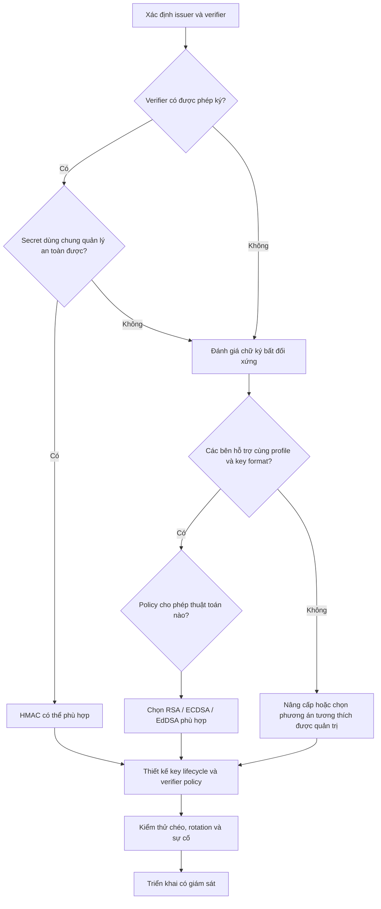

# Lựa chọn thuật toán theo mô hình phân phối và bảo vệ khóa

## 1. Vì sao phải chọn thuật toán từ mô hình khóa?

Trong **Security - JSON Web Token (JWT)**, thuật toán chữ ký xác định cách bên phát hành chứng minh token chưa bị sửa và bên nhận xác minh nguồn ký. Nhưng lựa chọn thuật toán không chỉ là so sánh SHA-256 với SHA-512 hoặc chọn tên thuật toán mới hơn. Quyết định quan trọng nhất là **ai cần giữ bí mật nào, ai có quyền ký, ai chỉ cần quyền xác minh và khóa được phân phối qua ranh giới tin cậy nào**.

Một JWT được ký bằng HMAC, RSA, ECDSA hoặc EdDSA có thể cùng dùng định dạng JWS, nhưng mô hình quản trị khóa rất khác:

- Với **HMAC**, bên ký và mọi bên xác minh dùng chung một secret. Mỗi verifier có khả năng tạo token hợp lệ.
- Với **chữ ký bất đối xứng**, issuer giữ private key; verifier chỉ cần public key. Có thể phân phối public key rộng hơn mà không trao quyền ký.
- Với **RSA, ECDSA và EdDSA**, kích thước chữ ký, định dạng khóa, hỗ trợ thư viện và yêu cầu vận hành khác nhau.

Vì vậy, phải bắt đầu từ kiến trúc tin cậy và vòng đời khóa, sau đó mới chọn thuật toán đáp ứng được các yêu cầu về bảo mật, khả năng tương thích, hiệu năng và chính sách.

Bài thuộc chương **Thuật toán chữ ký** của module **Security - JSON Web Token (JWT)**. Nội dung áp dụng cho hệ thống JWT nói chung, không phụ thuộc ngôn ngữ lập trình hay framework.

## 2. Xác định mô hình tin cậy trước khi chọn thuật toán

### 2.1. Ai phát hành và ai xác minh token?

Liệt kê các thành phần:

- **Issuer:** hệ thống phát hành và ký JWT.
- **Verifier/resource server:** API, gateway hoặc dịch vụ xác minh token.
- **Client:** ứng dụng nhận và gửi token; thông thường không cần giữ khóa ký.
- **Key distribution service:** nguồn phân phối public key hoặc secret theo chính sách.
- **Key management service:** nơi sinh, lưu, luân chuyển, thu hồi và kiểm soát quyền sử dụng khóa.

Không chỉ đếm số dịch vụ. Cần phân loại chúng theo **ranh giới tin cậy**. Hai API cùng thuộc một tổ chức nhưng do hai đội độc lập vận hành có thể có mức tin cậy khác nhau. Một đối tác bên ngoài không nên tự động được xem là cùng ranh giới chỉ vì họ cần xác minh token.

### 2.2. Phân biệt quyền ký và quyền xác minh

Đặt câu hỏi: nếu một verifier bị xâm nhập, attacker có thể tự phát hành token được các thành phần khác chấp nhận hay không?

- Với HMAC, nếu verifier lấy được secret dùng chung thì câu trả lời là **có**. Nó có khả năng tạo MAC hợp lệ cho claims tùy ý.
- Với RSA/ECDSA/EdDSA, nếu verifier chỉ có public key thì attacker kiểm soát verifier không tự nhiên có khả năng ký token mới.
- Nếu verifier được cấp quyền gọi một dịch vụ ký từ xa, quyền đó vẫn là quyền phát hành và cần được quản lý như một quyền nhạy cảm.

Đây là điểm khác biệt kiến trúc quan trọng nhất khi chọn giữa thuật toán đối xứng và bất đối xứng.

### 2.3. Phạm vi ảnh hưởng khi khóa bị lộ

Một khóa dùng chung cho nhiều issuer, môi trường hoặc tenant làm tăng phạm vi ảnh hưởng:

- Lộ secret HMAC dùng chung có thể cho phép tạo token cho mọi verifier đang tin secret đó.
- Lộ private key của một issuer ảnh hưởng đến token được ký bằng khóa đó, nhưng không nhất thiết ảnh hưởng issuer khác nếu khóa được tách biệt.
- Lộ public key không làm lộ khả năng ký; tuy nhiên, thay thế nguồn public key mà verifier tin cậy có thể khiến verifier chấp nhận chữ ký của attacker.

Hãy xác định phạm vi của mỗi khóa theo issuer, loại token, tenant, môi trường và mục đích. Không dùng một khóa cho mọi nơi chỉ để giảm công việc cấu hình.

## 3. So sánh các họ thuật toán theo mô hình phân phối khóa

| Họ thuật toán JWS | Ví dụ | Khóa bên ký | Khóa bên xác minh | Ai có khả năng tạo chữ ký? |
| --- | --- | --- | --- | --- |
| HMAC | `HS256`, `HS384`, `HS512` | Secret dùng chung | Cùng secret | Mọi bên biết secret |
| RSA PKCS#1 v1.5 | `RS256`, `RS384`, `RS512` | RSA private key | RSA public key | Bên giữ private key hoặc có quyền dùng nó |
| RSA-PSS | `PS256`, `PS384`, `PS512` | RSA private key | RSA public key | Bên giữ private key hoặc có quyền dùng nó |
| ECDSA | `ES256`, `ES384`, `ES512` | EC private key | EC public key | Bên giữ private key hoặc có quyền dùng nó |
| EdDSA | `EdDSA` | Ed25519/Ed448 private key | Public key tương ứng | Bên giữ private key hoặc có quyền dùng nó |

### 3.1. HMAC: đơn giản khi ranh giới tin cậy nhỏ

HMAC phù hợp khi:

- Chỉ có một issuer hoặc một nhóm nhỏ thành phần cùng tin cậy và cùng được phép ký.
- Việc phân phối, lưu trữ và luân chuyển secret có thể kiểm soát chặt.
- Mọi verifier được chấp nhận có quyền sở hữu khả năng phát hành token.
- Profile tích hợp yêu cầu hoặc chỉ hỗ trợ thuật toán HMAC.

Ưu điểm là cấu trúc đơn giản, thao tác MAC thường hiệu quả và không cần phân phối cặp khóa công khai/riêng. Tuy nhiên, mỗi verifier phải nhận secret. Khi số lượng verifier tăng hoặc có nhiều tổ chức độc lập, việc chia sẻ secret làm mở rộng phạm vi tin cậy và rủi ro.

**Không chọn HMAC chỉ vì token có ít dịch vụ xác minh.** Điều cần đánh giá là các dịch vụ đó có được phép phát hành token hay không nếu bị kiểm soát.

### 3.2. RSA: phù hợp khi cần phân phối public key rộng

RSA tách quyền ký và quyền xác minh rõ ràng:

- Issuer giữ private key.
- Verifier nhận public key.
- Public key có thể được công bố qua JWKS mà không tiết lộ khả năng ký.

RSA có hệ sinh thái hỗ trợ rộng và nhiều hệ thống cũ đã tích hợp. Đổi lại, chữ ký dài hơn các lựa chọn EC phổ biến; với RSA 2.048 bit, chữ ký nhị phân dài 256 byte. Việc ký và xác minh có đặc tính hiệu năng riêng, cần benchmark theo tải thực tế.

Trong JOSE, cần phân biệt:

- `RS256/384/512`: RSASSA-PKCS1-v1_5.
- `PS256/384/512`: RSASSA-PSS với tham số được JWA quy định.

Không thể đổi `RS256` thành `PS256` chỉ bằng cách sửa header. Hai bên phải hỗ trợ đúng lược đồ và cùng dùng cấu hình khóa phù hợp.

### 3.3. ECDSA: chữ ký gọn, cần quản lý nonce và định dạng

ECDSA cho phép dùng public key để xác minh và private key để ký, với chữ ký nhỏ hơn RSA ở các cấu hình thường gặp:

- ES256: P-256, chữ ký JWS 64 byte.
- ES384: P-384, chữ ký JWS 96 byte.
- ES512: P-521, chữ ký JWS 132 byte.

Điểm cần chú ý là nonce ECDSA. Tái sử dụng hoặc tạo nonce yếu có thể làm lộ private key. Ngoài ra, JWS yêu cầu chữ ký raw `R || S`, không phải ASN.1 DER. Hệ thống cần thư viện JOSE xử lý đúng chuyển đổi và kiểm tra miền giá trị.

ECDSA phù hợp khi cần chữ ký nhỏ và các issuer/verifier hỗ trợ thống nhất đường cong, định dạng chữ ký và quản lý khóa.

### 3.4. EdDSA: thiết kế hiện đại, cần xác nhận hỗ trợ thực tế

Trong JOSE, `EdDSA` sử dụng Ed25519 hoặc Ed448:

- Ed25519: public key 32 byte, chữ ký 64 byte.
- Ed448: public key 57 byte, chữ ký 114 byte.

EdDSA có chữ ký xác định theo thiết kế chuẩn, không yêu cầu ứng dụng tự sinh nonce ECDSA cho từng chữ ký. Tuy vậy, phải kiểm tra riêng khả năng hỗ trợ Ed25519 và Ed448 ở profile giao thức, thư viện JOSE, crypto provider, KMS/HSM, gateway và các verifier.

JWA dùng `alg: EdDSA`; JWK dùng `kty: OKP` và `crv: Ed25519` hoặc `Ed448`. Không suy ra rằng mọi hệ thống hỗ trợ Ed25519 đều hỗ trợ Ed448 hoặc hỗ trợ EdDSA trong JWS.

Ví dụ header JWS:

~~~json
{
  "alg": "EdDSA",
  "typ": "JWT",
  "kid": "issuer-ed25519-2026-11"
}
~~~

Ví dụ public JWK Ed25519:

~~~json
{
  "kty": "OKP",
  "crv": "Ed25519",
  "kid": "issuer-ed25519-2026-11",
  "use": "sig",
  "alg": "EdDSA",
  "key_ops": ["verify"],
  "x": "<base64url-public-key>"
}
~~~

## 4. Bảng quyết định theo mô hình phân phối khóa

| Mô hình triển khai | Hướng lựa chọn thường phù hợp | Lý do và điều kiện |
| --- | --- | --- |
| Một issuer và một verifier cùng ranh giới tin cậy | HMAC hoặc chữ ký bất đối xứng | HMAC đơn giản nếu verifier cũng được phép ký; dùng bất đối xứng nếu muốn tách quyền |
| Một issuer, nhiều API nội bộ độc lập | RSA, ECDSA hoặc EdDSA | Phân phối public key, không chia sẻ private key |
| Một issuer, nhiều đối tác bên ngoài | Chữ ký bất đối xứng | Đối tác xác minh bằng public key mà không có quyền phát hành |
| Nhiều issuer độc lập, một API xác minh | Chữ ký bất đối xứng với key set tách theo issuer | Mỗi issuer có cặp khóa riêng; verifier ràng buộc khóa với issuer |
| Nhiều tenant cần cách ly | Khóa riêng theo tenant hoặc issuer | Giới hạn phạm vi ảnh hưởng và khả năng giả mạo chéo tenant |
| Hệ thống cũ chỉ hỗ trợ RSA PKCS#1 v1.5 | RS256/384/512 nếu được chính sách cho phép | Tương thích; cần quản lý khóa và allowlist nghiêm ngặt |
| Hệ thống mới hỗ trợ PSS đầy đủ | PS256/384/512 | Dùng đúng profile PSS và kiểm tra liên thông |
| Cần chữ ký EC nhỏ | ES256/384/512 | Chọn curve theo JWA; xử lý raw R||S và nonce đúng chuẩn |
| Muốn dùng EdDSA | EdDSA | Chỉ bật khi toàn bộ profile, thư viện, key store và verifier hỗ trợ |

Đây là định hướng kiến trúc, không phải danh sách thuật toán bắt buộc. Quyết định cuối cùng còn phụ thuộc profile, chính sách tổ chức, mức độ tương thích, chứng nhận mật mã và thời hạn bảo vệ dữ liệu.

## 5. Thiết kế phân phối khóa

### 5.1. Phân phối secret HMAC

Với HMAC, mọi bên ký và xác minh cần cùng một secret. Việc phân phối phải đảm bảo:

1. Secret được sinh ngẫu nhiên với entropy phù hợp và đủ độ dài theo thuật toán.
2. Truyền secret qua kênh được bảo vệ và chỉ tới đúng thành phần được phép.
3. Lưu secret trong secret manager hoặc cơ chế quản trị bí mật tương đương.
4. Không ghi secret vào source code, Git, log, URL, ticket hoặc tài liệu chia sẻ rộng.
5. Tách secret theo môi trường, issuer, tenant hoặc mục đích khi cần.
6. Có quy trình thay secret đồng bộ và thời gian chuyển tiếp được kiểm soát.

Không gửi secret qua email hoặc chat thông thường để “cấu hình nhanh”. Nếu một verifier bên ngoài cần xác minh nhưng không được phép phát hành, không nên phân phối secret HMAC cho bên đó.

### 5.2. Phân phối public key bất đối xứng

Với RSA, EC hoặc OKP, issuer có thể công bố public key qua **JSON Web Key Set (JWKS)**. Mỗi JWK chứa metadata phù hợp với loại khóa:

| Loại khóa | `kty` | Thông tin chính |
| --- | --- | --- |
| RSA | `RSA` | `n`, `e` |
| ECDSA | `EC` | `crv`, `x`, `y` |
| Ed25519/Ed448 | `OKP` | `crv`, `x` |

Public key không phải bí mật, nhưng **tính xác thực của nguồn khóa là bắt buộc**. Verifier phải biết JWKS thuộc issuer nào qua cấu hình tin cậy, discovery đã được xác minh hoặc cơ chế bootstrap đáng tin cậy.

Ví dụ quy trình phân phối:

~~~text
1. Verifier được cấu hình tin cậy với issuer A.
2. Verifier lấy JWKS từ endpoint đã gắn với issuer A.
3. Verifier kiểm tra nguồn, TLS, cache và cấu trúc key set.
4. Khi nhận JWT, verifier tra kid trong key set của issuer A.
5. Verifier kiểm tra alg và loại khóa rồi mới xác minh chữ ký.
~~~

HTTPS bảo vệ kết nối tới endpoint đã chọn, nhưng không tự giải quyết việc chọn đúng issuer. Không để JWT chưa xác thực cung cấp URL tùy ý qua `jku` hoặc `x5u` rồi khiến verifier tải khóa từ đó.

### 5.3. Vai trò của `kid`

`kid` là định danh giúp chọn một khóa trong tập khóa đã được tin cậy. Nó không phải bằng chứng rằng khóa đó thuộc issuer:

- Tra `kid` trong key set đã cấu hình cho issuer tương ứng.
- Ràng buộc khóa với `alg`, loại khóa, mục đích và loại token.
- Không dùng `kid` trực tiếp làm đường dẫn tệp, tên bảng hoặc URL.
- Xử lý rõ trường hợp thiếu, trùng hoặc không tìm thấy `kid`.

Một `kid` có thể được tái sử dụng bởi issuer khác; không tra khóa trên phạm vi toàn cục chỉ dựa vào chuỗi `kid`.

### 5.4. Phân phối khóa trong nhiều môi trường

Tối thiểu nên tách khóa giữa:

- Development và test.
- Staging/pre-production.
- Production.
- Các issuer hoặc tenant có ranh giới tin cậy khác nhau.

Nếu khóa test bị lộ, không để nó có thể xác minh hoặc ký token được production chấp nhận. Không dùng cùng một secret HMAC hoặc private key cho nhiều môi trường chỉ để đơn giản hóa cấu hình.

## 6. Bảo vệ khóa trong suốt vòng đời

### 6.1. Sinh khóa

Khóa phải được tạo bằng cơ chế mật mã đáng tin cậy:

- HMAC: secret ngẫu nhiên đủ entropy; độ dài tối thiểu theo JWA tương ứng HS256/384/512 là 32/48/64 byte.
- RSA: dùng bộ sinh khóa an toàn; JWA yêu cầu mô-đun tối thiểu 2.048 bit cho RS/PS.
- ECDSA: dùng đúng curve của ES256/384/512 và bảo vệ private scalar cùng nonce.
- EdDSA: sinh private seed bằng nguồn ngẫu nhiên an toàn; xác nhận Ed25519/Ed448 được hỗ trợ.

Không dùng mật khẩu dễ nhớ, tên hệ thống, UUID tự tạo, timestamp hoặc chuỗi cố định làm secret HMAC/private key. Độ dài chuỗi biểu diễn Base64 hoặc hex không phải độ dài khóa thực tế sau khi giải mã.

### 6.2. Lưu trữ và quyền sử dụng

| Tài sản | Nơi lưu phù hợp | Quyền cần kiểm soát |
| --- | --- | --- |
| HMAC secret | Secret manager hoặc HSM/KMS hỗ trợ MAC | Đọc secret hoặc thực hiện MAC; mọi quyền này có thể cho phép tạo token |
| RSA private key | HSM/KMS hoặc kho khóa được bảo vệ | Ký bằng đúng key ID và đúng thuật toán |
| EC private key | HSM/KMS hoặc kho khóa được bảo vệ | Ký bằng đúng curve và thuật toán |
| EdDSA private key | HSM/KMS hoặc kho khóa hỗ trợ EdDSA | Ký Ed25519/Ed448 theo profile |
| Public key/JWKS | Endpoint hoặc kho cấu hình công khai đã xác thực | Chỉ đọc; bảo vệ tính toàn vẹn và nguồn gốc |

HSM/KMS không tự động bảo đảm cấu hình an toàn. Cần xác minh sản phẩm hỗ trợ đúng thuật toán, định dạng khóa, thao tác ký, quyền truy cập, audit log và quy trình rotation. Nếu private key không thể export, thư viện JOSE phải tích hợp được với thao tác ký qua key handle hoặc dịch vụ ký phù hợp.

### 6.3. Luân chuyển khóa có kế hoạch

Một quy trình rotation cho chữ ký bất đối xứng:

1. Sinh cặp khóa mới và lưu private key ở nơi được bảo vệ.
2. Phân phối public key mới đến JWKS và các verifier.
3. Xác nhận verifier đã cập nhật public key mới.
4. Chuyển issuer sang ký token mới bằng private key mới, đặt `kid` mới.
5. Giữ public key cũ trong thời gian token cũ còn hiệu lực, cộng clock skew và độ trễ cập nhật được cho phép.
6. Sau thời gian chuyển tiếp, gỡ public key cũ và xử lý private key cũ theo chính sách.

Với HMAC, mọi bên dùng chung secret nên rotation cần phối hợp cập nhật signer và verifier. Có thể hỗ trợ hai secret trong thời gian chuyển tiếp nếu thiết kế cho phép, nhưng verifier phải biết chính xác secret nào dùng cho từng `kid`/issuer và không mở rộng chấp nhận tùy tiện.

### 6.4. Khi khóa bị lộ

Khi có dấu hiệu private key hoặc HMAC secret bị lộ:

- Xác định khóa, issuer, tenant, môi trường và token có thể bị ảnh hưởng.
- Ngừng sử dụng hoặc ngừng tin tưởng khóa bị lộ theo kế hoạch ứng phó.
- Tạo và phân phối khóa thay thế; cập nhật verifier.
- Thu hồi phiên/token liên quan bằng cơ chế trạng thái, denylist hoặc yêu cầu xác thực lại phù hợp.
- Kiểm tra log/audit để đánh giá hoạt động ký bất thường.
- Không tiếp tục chấp nhận khóa bị lộ chỉ vì token ký bằng nó chưa hết hạn.

Với HMAC, mọi nơi biết secret có thể đã tạo token giả. Với private key bất đối xứng, attacker có thể giả mạo issuer cho tới khi verifier ngừng tin khóa tương ứng.

## 7. Ràng buộc thuật toán với khóa và chính sách xác minh

### 7.1. Allowlist ở phía verifier

Verifier phải xác định thuật toán được phép từ **cấu hình tin cậy**, không để token quyết định thuật toán. Ví dụ:

- Một issuer chỉ được chấp nhận RS256.
- Một issuer khác chỉ được chấp nhận EdDSA/Ed25519.
- Một hệ thống chuyển đổi có thể tạm chấp nhận hai thuật toán cụ thể trong một giai đoạn đã kiểm soát.

Không bật mọi thuật toán chỉ để tăng khả năng tương thích. Cấu hình phải ràng buộc:

1. Issuer và loại token.
2. Thuật toán JWS được phép.
3. Loại khóa và curve/modulus tương ứng.
4. Key ID và nguồn khóa tin cậy.
5. Chính sách claims sau xác minh.

### 7.2. Không trộn loại khóa

Các họ thuật toán có loại khóa khác nhau:

| Họ | Loại khóa | Ràng buộc cần có |
| --- | --- | --- |
| HS | Secret đối xứng | Secret riêng cho mục đích HMAC; không dùng public key làm secret |
| RS/PS | RSA | RSA key, đúng modulus và đúng lược đồ |
| ES | EC | Đúng curve và public point |
| EdDSA | OKP | Đúng Ed25519/Ed448 và đúng profile |

Một lỗi phổ biến là algorithm confusion: verifier dự kiến dùng RSA public key nhưng lại cho phép token chọn HS và diễn giải byte của public key như HMAC secret. Attacker biết public key có thể tạo MAC tương ứng. Biện pháp phòng vệ là tách allowlist, loại khóa và cấu hình theo issuer; không tự suy ra cách xác minh chỉ từ header.

### 7.3. Xác minh chữ ký và kiểm tra claims là hai lớp

Sau khi chữ ký hợp lệ, verifier vẫn phải kiểm tra:

- `iss`: issuer đúng và được tin cậy.
- `aud`: token dành cho API/resource hiện tại.
- `exp`, `nbf`: thời gian hiệu lực.
- `iat`: thời điểm phát hành theo chính sách.
- Loại token, subject, scope/role và quyền truy cập.
- `jti`, trạng thái phiên hoặc thu hồi nếu hệ thống yêu cầu.

Một token có chữ ký đúng nhưng sai audience hoặc hết hạn vẫn phải bị từ chối. Chữ ký không tự cấp quyền.

Mã giả rút gọn cho verifier bất đối xứng:

~~~text
function verifyAsymmetricJwt(token, policy, trustedKeySet):
    (header64, payload64, signature64) = parseJwsCompact(token)
    header = parseProtectedHeader(BASE64URL_DECODE(header64))

    require header.alg in policy.allowedAlgorithms
    key = trustedKeySet.find(policy.expectedIssuer, header.kid)
    require key exists
    require key.algorithm == header.alg
    require key.type and key.curve_or_modulus match header.alg

    signingInput = ASCII(header64 + "." + payload64)
    require JOSE_VERIFY(header.alg, key.publicKey,
                        signingInput, BASE64URL_DECODE(signature64))

    claims = parsePayloadStrictly(payload64)
    require claims.iss == policy.expectedIssuer
    require policy.expectedAudience in claims.aud
    require currentTime is within claims validity window
    require token type and authorization policy pass
    return claims
~~~

Đây là mã giả khái quát cho các họ RSA, EC và OKP; hàm `JOSE_VERIFY` phải là triển khai chuẩn của thuật toán đã allowlist. HMAC có luồng khóa khác vì verifier cần secret dùng chung.

## 8. Các yếu tố ngoài mô hình khóa

### 8.1. Khả năng tương thích giao thức và thư viện

Trước khi chốt thuật toán, kiểm tra:

- Profile JWT/JWS hoặc OIDC có cho phép thuật toán không.
- Issuer và mọi verifier có hỗ trợ cùng thuật toán và định dạng khóa không.
- JOSE library hỗ trợ cả sign lẫn verify hay chỉ một thao tác.
- Crypto provider hỗ trợ đúng curve, RSA padding hoặc HMAC.
- JWK/JWKS có import/export đúng `kty`, `crv`, `n`, `e`, `x`, `y` không.
- KMS/HSM có thể thực hiện thao tác ký theo đúng profile không.
- Gateway, reverse proxy, dịch vụ trung gian và hệ thống quan sát có chấp nhận token không.

Thư viện có primitive mật mã chưa chắc hỗ trợ JWS. Tương tự, thư viện JOSE hỗ trợ Ed25519 không có nghĩa KMS của production hỗ trợ Ed25519.

### 8.2. Chính sách và chứng nhận

Một profile tổ chức hoặc yêu cầu tuân thủ có thể giới hạn thuật toán, đường cong, kích thước khóa hoặc crypto module được phép. Nếu môi trường yêu cầu module đã được đánh giá/chứng nhận, cần kiểm tra chính xác chứng nhận, phiên bản, chế độ vận hành và thuật toán nằm trong phạm vi được phê duyệt.

Không kết luận rằng một thuật toán được RFC chuẩn hóa thì chắc chắn được phép trong mọi môi trường tuân thủ. Cũng không kết luận một thư viện có tùy chọn FIPS thì mọi thuật toán mà thư viện hỗ trợ đều nằm trong phạm vi FIPS.

### 8.3. Hiệu năng, kích thước token và tải

So sánh theo dữ liệu đo thực tế:

- Thời gian ký và xác minh.
- Throughput và độ trễ p95/p99.
- Kích thước chữ ký và tổng JWT.
- Chi phí gọi KMS/HSM từ xa.
- Chi phí tải và cache JWKS.
- Số lượng issuer, verifier và tần suất rotation.

Độ dài chữ ký là một phần token; payload, header và Base64URL cũng góp phần vào kích thước. Với RSA 2.048 bit, chữ ký 256 byte; ES256 là 64 byte; Ed25519 là 64 byte. HMAC-SHA256 cũng có MAC 32 byte. Tuy nhiên, không nên chọn thuật toán chỉ dựa trên kích thước vì mô hình tin cậy và chính sách khóa quan trọng hơn.

## 9. Các kịch bản kiến trúc minh họa

### 9.1. Một dịch vụ nội bộ duy nhất

Một ứng dụng nhỏ có issuer và verifier cùng nằm trong một ranh giới tin cậy. HMAC có thể là lựa chọn đơn giản nếu cả hai bên được phép ký và secret được bảo vệ tốt. Nếu cần tách quyền ký khỏi thành phần xác minh ngay từ đầu, dùng chữ ký bất đối xứng.

### 9.2. Một issuer phát token cho nhiều API

Issuer phát JWT cho Inventory, Billing và Reporting. Mỗi API chỉ cần xác minh:

- Issuer giữ private key trong KMS/HSM.
- Các API nhận public key qua JWKS.
- Mỗi API kiểm tra audience riêng.
- Các API không có private key và không được gọi quyền ký.

Mô hình này phù hợp với RSA, ECDSA hoặc EdDSA tùy mức hỗ trợ, chính sách và hiệu năng.

### 9.3. Nhiều tổ chức độc lập xác minh token

Một issuer cấp token cho nhiều đối tác. Nếu dùng HMAC, mỗi đối tác phải giữ secret có khả năng ký. Điều đó trao quyền phát hành token cho các bên bên ngoài. Chữ ký bất đối xứng thường phù hợp hơn: issuer giữ private key, đối tác nhận public key.

### 9.4. Nhiều issuer dùng chung một API

API nhận token từ nhiều issuer. Không dùng một secret hoặc một khóa chung không phân biệt nguồn. Mỗi issuer có key set riêng; verifier:

1. Xác định issuer theo cấu hình được phép.
2. Chọn JWKS/key set gắn với issuer đó.
3. Ràng buộc `kid`, `alg`, loại khóa và mục đích.
4. Xác minh chữ ký.
5. Kiểm tra issuer và audience theo policy của API.

Không tải JWKS từ URL bất kỳ chỉ vì payload hoặc header chưa xác thực chứa một `iss`/URL.

### 9.5. Nhiều tenant cần cô lập

Nếu mỗi tenant là một ranh giới bảo mật, cân nhắc khóa riêng theo tenant hoặc theo issuer. Khi một tenant bị xâm nhập, việc tách khóa giúp giảm khả năng giả mạo token cho tenant khác. Verifier phải xác định tenant từ nguồn tin cậy và ràng buộc token với đúng tenant, không chỉ tin claim do token tự khai báo.

## 10. Quy trình ra quyết định và triển khai

### 10.1. Quy trình lựa chọn

### 10.2. Checklist trước khi production

- [ ] Đã liệt kê tất cả issuer, verifier, gateway và tổ chức tích hợp.
- [ ] Đã xác định ranh giới tin cậy và quyền ký của từng thành phần.
- [ ] Đã xác định phạm vi ảnh hưởng nếu từng khóa bị lộ.
- [ ] Đã chọn thuật toán được profile và chính sách cho phép.
- [ ] Đã ràng buộc thuật toán với đúng loại khóa và issuer.
- [ ] Đã sinh khóa bằng nguồn ngẫu nhiên an toàn và đúng kích thước.
- [ ] Đã bảo vệ private key/secret trong hệ thống quản trị khóa.
- [ ] Đã phân phối khóa qua kênh và nguồn tin cậy.
- [ ] Đã có `kid`, JWKS/cache và quy trình rotation phù hợp.
- [ ] Đã kiểm tra thư viện JOSE, crypto provider, KMS/HSM và gateway.
- [ ] Đã chạy test vector và test chéo signer-verifier.
- [ ] Đã chạy kiểm thử âm tính cho token sửa đổi, sai issuer, sai audience, hết hạn và sai thuật toán.
- [ ] Đã có quy trình ứng phó khi khóa bị lộ.
- [ ] Đã đo hiệu năng và kích thước token dưới tải thực tế.

### 10.3. Ghi lại quyết định kiến trúc

Một quyết định chọn thuật toán nên ghi rõ:

| Hạng mục | Nội dung cần ghi |
| --- | --- |
| Issuer | Danh tính và ranh giới tin cậy |
| Verifier | Danh sách API/gateway/đối tác |
| Thuật toán JWS | Giá trị `alg` được phép |
| Loại khóa | Secret, RSA, EC hoặc OKP |
| Key custody | Secret manager, KMS, HSM hoặc cơ chế bảo vệ |
| Key distribution | Cách cấp secret hoặc public JWKS |
| Rotation | Chu kỳ, overlap, cache và thu hồi |
| Compatibility | Profile, thư viện, provider, gateway, KMS |
| Claims policy | Issuer, audience, expiry, token type, scopes |
| Incident response | Cách vô hiệu khóa và xử lý token liên quan |
| Evidence | Test vector, test chéo, benchmark và kết quả kiểm tra |

Tài liệu quyết định này giúp đội vận hành hiểu tại sao thuật toán được chọn, thành phần nào phải hỗ trợ và cần làm gì khi mở rộng hệ thống.

## 11. Những hiểu lầm phổ biến

**“Thuật toán mạnh nhất luôn là lựa chọn tốt nhất.”** Không có lựa chọn tách rời mô hình tin cậy. Thuật toán không phù hợp với cách phân phối khóa hoặc không được các verifier hỗ trợ sẽ làm hệ thống lỗi hoặc dẫn đến cấu hình fallback nguy hiểm.

**“Public key công khai nên không cần xác thực nguồn.”** Sai. Public key không cần bí mật, nhưng verifier phải biết nó thuộc issuer nào và không bị thay thế.

**“Dùng HMAC sẽ an toàn hơn vì secret không công khai.”** Secret phải được phân phối tới mọi verifier. Mỗi bên nhận secret đều có khả năng ký token; rủi ro phụ thuộc số bên và ranh giới tin cậy.

**“Dùng RSA/ECDSA/EdDSA thì không cần quản lý khóa.”** Sai. Private key vẫn phải được sinh, lưu, phân quyền, luân chuyển và thu hồi.

**“Có JWKS là tự động rotation an toàn.”** Sai. Cần cập nhật public key trước khi ký bằng khóa mới, giữ overlap phù hợp, cache đúng và xử lý khóa cũ.

**“Chữ ký hợp lệ là đủ để chấp nhận JWT.”** Sai. Cần kiểm tra issuer, audience, thời hạn, loại token và quyền.

**“Tăng SHA-256 lên SHA-512 giải quyết được mọi rủi ro.”** Sai. Độ mạnh tổng thể còn phụ thuộc entropy khóa, bảo vệ khóa, verifier policy và mô hình tin cậy.

## 12. Câu hỏi tự kiểm tra

1. Vì sao HMAC trao quyền ký cho mọi verifier giữ secret?
2. Trong hệ thống có nhiều đối tác độc lập, chữ ký bất đối xứng giải quyết vấn đề phân phối khóa nào?
3. Khi nào HMAC là lựa chọn hợp lý và điều kiện tin cậy nào phải đúng?
4. Phân biệt RS256 với PS256; ES256 với EdDSA về loại khóa và định dạng chữ ký.
5. Vì sao public key có thể phân phối rộng nhưng nguồn JWKS vẫn phải được xác thực?
6. `kid` có chứng minh khóa thuộc issuer không? Verifier cần ràng buộc nó với những thông tin nào?
7. Nếu một verifier HMAC bị xâm nhập, phạm vi ảnh hưởng khác gì so với verifier chỉ có public key RSA?
8. Những tầng nào phải được kiểm tra trước khi bật EdDSA ở production?
9. Tại sao rotation cần giai đoạn overlap và xử lý riêng khi khóa bị lộ?
10. Ngoài chữ ký, những claims và chính sách nào cần được kiểm tra trước khi cấp quyền?

## 13. Tiêu chuẩn và tài liệu tham khảo

- [RFC 2104 — HMAC: Keyed-Hashing for Message Authentication](https://www.rfc-editor.org/rfc/rfc2104), nguyên lý HMAC.
- [RFC 7515 — JSON Web Signature (JWS)](https://www.rfc-editor.org/rfc/rfc7515), định dạng JWS Compact và signing input.
- [RFC 7517 — JSON Web Key (JWK)](https://www.rfc-editor.org/rfc/rfc7517), JWK/JWKS và metadata khóa.
- [RFC 7518 — JSON Web Algorithms (JWA)](https://www.rfc-editor.org/rfc/rfc7518), thuật toán HS, RS, PS, ES và tham số JWA.
- [RFC 7519 — JSON Web Token (JWT)](https://www.rfc-editor.org/rfc/rfc7519), cấu trúc JWT và registered claims.
- [RFC 8032 — Edwards-Curve Digital Signature Algorithm (EdDSA)](https://www.rfc-editor.org/rfc/rfc8032), Ed25519 và Ed448.
- [RFC 8037 — CFRG Elliptic Curve Diffie-Hellman (ECDH) and Signatures in JOSE](https://www.rfc-editor.org/rfc/rfc8037), EdDSA và OKP trong JOSE.
- [RFC 8725 — JSON Web Token Best Current Practices](https://www.rfc-editor.org/rfc/rfc8725), khuyến nghị lựa chọn thuật toán, quản lý khóa và xác minh token.
