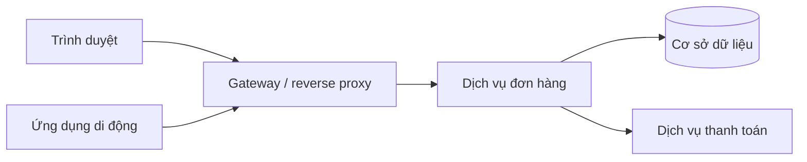

# REST là gì và bài toán kiến trúc hệ thống phân tán

## Mục tiêu bài học

Một lời gọi hàm trong cùng tiến trình thường cho cảm giác đơn giản: truyền tham số, thực thi rồi nhận kết quả. Khi chức năng đó nằm ở máy khác và phải đi qua mạng, người thiết kế cần trả lời thêm nhiều câu hỏi: nếu phản hồi đến chậm thì sao, nếu yêu cầu đã được xử lý nhưng kết nối đứt thì sao, và nếu nhiều ứng dụng cùng sửa dữ liệu thì sao?

Bài học này giới thiệu REST trong bối cảnh đó. Đây là phần tổng quan của module **INTEGRATION_API_REST**, hướng tới thiết kế API dựa trên resource, URI, phương thức và mã trạng thái HTTP, cùng hợp đồng dữ liệu rõ ràng. Các chủ đề như phân trang, cache, idempotency, OpenAPI, xác thực, phân quyền, xử lý lỗi và kiểm thử sẽ được đặt vào bức tranh kiến trúc chung trước khi đi sâu ở những bài tiếp theo.

Sau bài học, bạn có thể:

- Giải thích REST là gì và phân biệt REST với HTTP, JSON hay CRUD.
- Phân biệt resource, URI, representation và trạng thái của ứng dụng.
- Nhận diện các ràng buộc của REST, đặc biệt là stateless và uniform interface.
- Giải thích những vấn đề do giao tiếp qua mạng tạo ra và giới hạn giải quyết của REST.
- Đọc một trao đổi HTTP đơn giản và đánh giá các quyết định thiết kế cơ bản.
- Liên hệ các khái niệm này với việc triển khai bằng Java/Spring hoặc công nghệ tương đương.

## 1. Bắt đầu từ một hệ thống đặt hàng

Giả sử một ứng dụng bán hàng có trình duyệt, ứng dụng di động, dịch vụ quản lý đơn hàng và dịch vụ thanh toán.



Người dùng bấm “Đặt hàng”. Ứng dụng gửi yêu cầu tạo đơn qua mạng. Dịch vụ đơn hàng kiểm tra dữ liệu, lưu đơn và trả kết quả. Trong một lượt thành công, toàn bộ quá trình có thể chỉ mất vài trăm mili giây.

Nhưng mỗi thành phần có thể hoạt động khác nhau:

- Trình duyệt có kết nối mạng yếu.
- Gateway hết thời gian chờ trong khi dịch vụ đơn hàng vẫn đang xử lý.
- Dịch vụ đơn hàng lưu dữ liệu thành công nhưng phản hồi bị mất.
- Dịch vụ thanh toán tạm thời không phục vụ được.
- Hai thiết bị cùng cập nhật một đơn hàng.
- Một bản sao dữ liệu hoặc cache chưa nhìn thấy thay đổi mới nhất.

Những thành phần trao đổi thông tin qua mạng tạo nên một hệ thống phân tán, ngay cả khi nhóm phát triển chỉ gọi nó là “ứng dụng có backend”. Không cần triển khai hàng chục microservice mới gặp các vấn đề này.

### 1.1. Gọi qua mạng khác gọi hàm ở đâu?

| Khía cạnh | Trong cùng tiến trình | Qua mạng |
| --- | --- | --- |
| Truyền dữ liệu | Có thể truyền trực tiếp tham chiếu đối tượng | Cần tuần tự hóa thành thông điệp theo hợp đồng |
| Độ trễ | Thường thấp và dễ dự đoán hơn | Biến động do đường truyền, hàng đợi và tải |
| Lỗi | Chủ yếu quan sát trong tiến trình đang chạy | Có thể hỏng riêng một phần, mất kết nối hoặc mất phản hồi |
| Phiên bản | Thường được cập nhật cùng một bản triển khai | Client và server có thể được cập nhật độc lập |
| Kết quả chưa rõ | Có thể dùng cơ chế trong tiến trình để theo dõi | Timeout có thể khiến client chưa biết thao tác đã hoàn tất hay chưa |
| Chi phí tương tác | Nhiều lời gọi nhỏ có thể chấp nhận được | Nhiều lượt đi về làm tăng độ trễ tổng thể |

Thiết kế API vì vậy không chỉ là đổi tên một phương thức Java thành đường dẫn URL. API cần cung cấp một cách tương tác mà các ứng dụng độc lập có thể hiểu, vận hành và phát triển lâu dài.

## 2. REST là một phong cách kiến trúc

**REST** là viết tắt của **Representational State Transfer**. Roy Fielding trình bày phong cách kiến trúc này trong luận án năm 2000, khi mô tả các nguyên tắc kiến trúc của Web.

REST là một tập hợp các ràng buộc áp dụng cho cách các thành phần trong hệ thống phân tán tương tác với nhau. Những ràng buộc đó hướng đến các thuộc tính như khả năng mở rộng, khả năng phát triển độc lập, tính quan sát được của thông điệp và khả năng tận dụng thành phần trung gian.

Trong module này, bối cảnh thực hành chủ yếu là API chạy trên HTTP. HTTP cung cấp phương thức, URI, header, mã trạng thái và cơ chế cache để hiện thực nhiều ý tưởng của REST.

Cần tách các khái niệm thường bị gộp chung:

| Khái niệm | Vai trò |
| --- | --- |
| REST | Phong cách kiến trúc, mô tả các ràng buộc tương tác |
| HTTP | Giao thức với ngữ nghĩa yêu cầu, phản hồi, phương thức và mã trạng thái |
| URI | Cơ chế định danh tài nguyên; trong ví dụ HTTP thường xuất hiện dưới dạng URL |
| JSON | Một định dạng biểu diễn dữ liệu |
| CRUD | Các thao tác tạo, đọc, cập nhật, xóa dữ liệu |
| Spring MVC | Công nghệ có thể dùng để hiện thực HTTP API |

Một API dùng HTTP và JSON chưa đủ để kết luận rằng nó tuân thủ REST. Tương tự, đặt tên lớp là `RestController` hay đặt URL là `/api/v1/orders` không tự tạo ra các thuộc tính kiến trúc.

REST cũng không bắt buộc resource phải tương ứng với một bảng cơ sở dữ liệu, không quy định phải dùng JSON và không đòi hỏi hệ thống phải chia thành microservice.

## 3. Resource, URI và representation

### 3.1. Resource: điều gì đang được nói đến?

**Resource**, hay tài nguyên, là khái niệm mà API cho phép định danh và tương tác. Resource có thể là:

- Một đơn hàng cụ thể.
- Một tập hợp đơn hàng.
- Hồ sơ người dùng hiện tại.
- Kết quả của một tác vụ xuất báo cáo.
- Một yêu cầu hủy đơn hàng.

Ví dụ:

| Resource | URI minh họa |
| --- | --- |
| Tập hợp đơn hàng | `/orders` |
| Đơn hàng có định danh 842 | `/orders/842` |
| Các dòng hàng thuộc đơn 842 | `/orders/842/items` |
| Một tác vụ xuất báo cáo | `/report-jobs/job-73` |

Resource là mô hình giao tiếp bên ngoài. Dữ liệu biểu diễn một đơn hàng có thể được tổng hợp từ nhiều bảng, một bộ nhớ đệm hoặc nhiều dịch vụ.

Việc dùng danh từ trong URI là một quy ước hữu ích để làm rõ resource. Tuy nhiên, “URI có danh từ” chỉ là một phần rất nhỏ của thiết kế; quyền truy cập, phương thức, phản hồi và chuyển trạng thái mới quyết định cách client thực sự tương tác.

### 3.2. Representation: resource được thể hiện như thế nào?

Khi client đọc một đơn hàng, client nhận một **representation**, tức biểu diễn của resource tại thời điểm xử lý yêu cầu.

```http
GET /orders/842 HTTP/1.1
Host: api.example.com
Accept: application/json
```

Một phản hồi có thể có dạng sau; các ví dụ HTTP trong bài lược bỏ một số header truyền tải:

```http
HTTP/1.1 200 OK
Content-Type: application/json
Cache-Control: no-store

{
  "id": "842",
  "status": "PENDING_PAYMENT",
  "total": {
    "amount": 450000,
    "currency": "VND"
  }
}
```

Ở đây:

- Resource là đơn hàng 842.
- URI định danh resource là `https://api.example.com/orders/842`.
- JSON là một representation của đơn hàng.
- `Content-Type` mô tả định dạng của representation trả về.
- `Accept` thể hiện kiểu nội dung client mong muốn nhận.

Client không nhận một đối tượng Java đang sống trong server và cũng không nhận quyền truy cập trực tiếp vào bản ghi cơ sở dữ liệu. Client nhận thông điệp theo hợp đồng API.

Representation thường cần che giấu chi tiết lưu trữ và thông tin nội bộ. Ví dụ, API có thể trả `status`, `total` nhưng không trả khóa ngoại nội bộ, bí mật xác thực hoặc ghi chú riêng của nhân viên.

### 3.3. Resource state và application state

Hai loại trạng thái này có liên quan nhưng không đồng nhất:

- **Resource state** là trạng thái của tài nguyên, chẳng hạn đơn hàng đang `PENDING_PAYMENT` hay `SHIPPED`. Server có thể lưu trạng thái đó trong cơ sở dữ liệu.
- **Application state** là trạng thái tiến trình tương tác của client: đang xem danh sách, đã chọn đơn nào, đang theo một liên kết để thanh toán hay quay về trang trước.

REST hướng tới việc client điều khiển tiến trình tương tác bằng representation và các điều khiển mà server cung cấp, chẳng hạn liên kết hoặc biểu mẫu. Server vẫn quản lý dữ liệu và kiểm tra quy tắc nghiệp vụ.

Phân biệt này rất quan trọng khi nói đến ràng buộc stateless: **stateless không có nghĩa server không được lưu đơn hàng hoặc không được dùng cơ sở dữ liệu**.

## 4. Các ràng buộc cốt lõi của REST

REST thường được trình bày với sáu ràng buộc dưới đây. Năm ràng buộc đầu là bắt buộc trong phong cách REST; code on demand là tùy chọn.

| Ràng buộc | Ý nghĩa chính | Lợi ích và chi phí cần cân nhắc |
| --- | --- | --- |
| Client–server | Tách trách nhiệm giao diện người dùng khỏi cung cấp dữ liệu và dịch vụ | Hai phía dễ phát triển độc lập hơn, nhưng phải duy trì hợp đồng |
| Stateless | Mỗi yêu cầu mang đủ ngữ cảnh cần thiết để được hiểu; server không dựa vào phiên hội thoại ngầm của client giữa các yêu cầu | Dễ phân phối yêu cầu hơn, có thể tăng dữ liệu lặp trong mỗi yêu cầu |
| Cache | Thông tin phản hồi cho biết khả năng lưu và tái sử dụng | Giảm độ trễ và tải, đồng thời cần quản lý độ cũ và phạm vi dùng lại |
| Uniform interface | Tương tác qua giao diện thống nhất thay vì giao thức riêng cho từng chức năng | Giảm phụ thuộc vào triển khai cụ thể, đôi khi kém tối ưu cho một tác vụ chuyên biệt |
| Layered system | Thành phần làm việc với lớp tiếp xúc trực tiếp, không cần biết toàn bộ chuỗi phía sau | Cho phép proxy, gateway, cache và cân bằng tải, đồng thời có thêm độ trễ và điểm lỗi |
| Code on demand, tùy chọn | Server có thể gửi mã để mở rộng khả năng của client | Tăng tính linh hoạt nhưng giảm khả năng quan sát đầy đủ chỉ từ thông điệp dữ liệu |

### 4.1. Client–server: chia trách nhiệm qua hợp đồng

Ứng dụng di động quyết định cách hiển thị đơn hàng. Dịch vụ đơn hàng quyết định dữ liệu nào được công bố và thao tác nghiệp vụ nào hợp lệ.

Nếu API công bố một hợp đồng ổn định, server có thể đổi cách lưu dữ liệu mà không bắt client đổi theo. Client cũng có thể thay đổi giao diện mà không cần thay cấu trúc cơ sở dữ liệu của server.

Sự độc lập này chỉ đạt được trong phạm vi hợp đồng được giữ tương thích. Đổi nghĩa một trường, loại bỏ trường mà client đang dùng hoặc thay đổi quyền truy cập vẫn có thể gây lỗi tích hợp.

### 4.2. Stateless: yêu cầu tự mang ngữ cảnh

Xét một giao thức có hội thoại ngầm:

```text
Yêu cầu 1: Chọn đơn hàng 842.
Yêu cầu 2: Hãy trả lại đơn hàng đã chọn.
```

Nếu server chỉ biết yêu cầu thứ hai nhờ một biến phiên được tạo ở yêu cầu thứ nhất, một instance khác sẽ không thể xử lý độc lập nếu không chia sẻ phiên đó.

Một tương tác rõ ngữ cảnh hơn là:

```http
GET /orders/842 HTTP/1.1
Host: api.example.com
Authorization: Bearer <access-token>
Accept: application/json
```

Yêu cầu chỉ ra resource, phương thức và thông tin xác thực cần cho việc xử lý. Server vẫn có thể tra cứu người dùng, quyền truy cập, trạng thái token và đơn hàng trong các kho dữ liệu.

Stateless không đồng nghĩa với:

- Không có trạng thái nghiệp vụ ở server.
- Không dùng cache hay cơ sở dữ liệu.
- Bắt buộc dùng JWT.
- Token luôn được kiểm tra hoàn toàn cục bộ.
- Không bao giờ có session ở bất kỳ ứng dụng web nào.

Điểm cần đánh giá là API có phụ thuộc vào một ngữ cảnh hội thoại của client được giữ ngầm giữa các yêu cầu hay không. Dữ liệu nghiệp vụ có định danh rõ ràng, chẳng hạn giỏ hàng `/carts/cart-7`, vẫn có thể được lưu ở server.

### 4.3. Cache: khai báo cách tái sử dụng phản hồi

Một phản hồi có thể được dùng lại để tránh gọi server liên tục, nhưng khả năng dùng lại phải được xác định theo ngữ nghĩa và chỉ dẫn cache.

Ví dụ với dữ liệu danh mục được phép công khai:

```http
HTTP/1.1 200 OK
Content-Type: application/json
Cache-Control: public, max-age=60
ETag: "catalog-r17"

{
  "items": [
    { "id": "book-1", "name": "Sổ tay" }
  ]
}
```

Trong điều kiện phù hợp, cache có thể coi phản hồi là còn mới trong khoảng thời gian được chỉ định, tính theo tuổi phản hồi. `ETag` là bộ xác thực để client hoặc cache hỏi lại xem representation có thay đổi hay không.

Với dữ liệu nhạy cảm, chính sách có thể là `Cache-Control: no-store`. Nếu dùng `private`, ý nghĩa là shared cache không được lưu; chỉ dẫn này không thay thế xác thực, phân quyền hoặc kiểm soát dữ liệu nhạy cảm ở client.

Thiết kế cache luôn có đánh đổi: muốn giảm độ trễ thì có thể phải chấp nhận dữ liệu cũ trong một khoảng thời gian. REST cung cấp khuôn khổ biểu đạt đánh đổi đó, không làm mọi bản sao tự đồng bộ tức thì.

### 4.4. Uniform interface: giao diện thống nhất

Đây là phần đặc trưng của REST. Uniform interface có bốn khía cạnh:

1. **Định danh resource**: client có thể chỉ ra tài nguyên cần tương tác.
2. **Tương tác với resource thông qua representation**: representation và metadata cung cấp thông tin cần thiết cho những thao tác được phép.
3. **Thông điệp tự mô tả**: phương thức, mã trạng thái, header, media type và nội dung giúp bên nhận hiểu cách xử lý thông điệp theo hợp đồng.
4. **Hypermedia điều khiển trạng thái ứng dụng**: client khám phá và thực hiện những chuyển trạng thái qua các điều khiển trong representation.

Trong HTTP, `GET`, `POST`, `PUT`, `DELETE` cùng các mã trạng thái và header tạo ra ngữ nghĩa chung. Client, proxy và công cụ quan sát có thể sử dụng ngữ nghĩa đó mà không phải hiểu toàn bộ mã nguồn nghiệp vụ.

Chẳng hạn, dùng `GET /orders/842/cancel` để hủy đơn làm sai kỳ vọng về tính an toàn của GET. Công cụ kiểm tra liên kết hoặc cơ chế tải trước có thể gọi URI mà không biết đang kích hoạt một thay đổi nghiệp vụ.

#### Hypermedia cần được hiểu đến đâu?

Một representation minh họa có thể cung cấp các thao tác theo trạng thái hiện tại:

```json
{
  "id": "842",
  "status": "PENDING_PAYMENT",
  "links": [
    {
      "rel": "self",
      "href": "/orders/842"
    },
    {
      "rel": "create-payment",
      "href": "/orders/842/payments",
      "method": "POST"
    }
  ]
}
```

Trong hợp đồng ví dụ, `create-payment` nghĩa là tạo một yêu cầu thanh toán. Khi trạng thái thay đổi, server có thể cung cấp tập điều khiển khác. Client hiểu quan hệ và kiểu điều khiển được định nghĩa trong media type hoặc quy ước ứng dụng, thay vì tự lắp mọi URI từ các chuỗi cố định.

Cấu trúc `links`, trường `method` và quan hệ `create-payment` ở trên là quy ước minh họa, không phải các từ khóa mà JSON hay HTTP tự hiểu. Chỉ thêm một mảng liên kết cũng chưa chứng minh toàn bộ API đã đáp ứng ràng buộc hypermedia.

Nhiều API thực tế sử dụng resource và ngữ nghĩa HTTP nhưng ít hoặc không có hypermedia. Có thể mô tả chính xác chúng là “HTTP API theo định hướng resource” và chỉ rõ những ràng buộc REST đã áp dụng. Không nên coi hypermedia là một ràng buộc tùy chọn của REST.

Các điều khiển trong response hỗ trợ client, nhưng server vẫn phải kiểm tra quyền và trạng thái nghiệp vụ ở mỗi yêu cầu. Một liên kết có mặt không bảo đảm thao tác sẽ còn hợp lệ vài giây sau.

### 4.5. Layered system: có thể có thành phần trung gian

Client có thể kết nối tới gateway, gateway chuyển tới dịch vụ, còn phản hồi có thể đến từ cache hợp lệ. Client không cần biết cấu trúc triển khai nội bộ để hiểu hợp đồng bên ngoài.

Các lớp trung gian có thể đảm nhiệm kết thúc kết nối TLS, giới hạn lưu lượng, định tuyến, cân bằng tải hoặc cache. Tuy vậy, nhiều lớp hơn cũng có thể làm tăng độ trễ, khiến lỗi khó truy vết và gây khác biệt giữa timeout của từng lớp.

Layered system không bắt buộc dự án phải có gateway, service mesh hay một số lượng tầng cố định. Đây là ràng buộc về cách tương tác và mức độ biết nhau giữa các thành phần.

### 4.6. Code on demand: ràng buộc tùy chọn

Server có thể gửi mã thực thi để mở rộng chức năng phía client, chẳng hạn JavaScript được trình duyệt tải về. API JSON cho ứng dụng di động thường không sử dụng khả năng này.

Không dùng code on demand không làm một kiến trúc vi phạm REST, vì đây là ràng buộc tùy chọn.

## 5. Ngữ nghĩa HTTP làm hợp đồng dễ hiểu hơn

Khi dùng HTTP để xây API, cần giữ ý nghĩa của các phương thức thay vì coi chúng chỉ là những nhãn gắn lên một hàm xử lý.

| Phương thức | Mục đích thường gặp | Safe theo ngữ nghĩa HTTP | Idempotent theo ngữ nghĩa HTTP |
| --- | --- | --- | --- |
| GET | Lấy representation của resource | Có | Có |
| HEAD | Lấy metadata tương ứng với GET, không có nội dung phản hồi | Có | Có |
| POST | Yêu cầu resource xử lý dữ liệu theo ngữ nghĩa đã công bố; thường dùng để tạo resource con | Không | Không được bảo đảm |
| PUT | Tạo hoặc thay thế trạng thái của resource đích theo representation được gửi | Không | Có |
| PATCH | Áp dụng thay đổi theo định dạng bản vá đã công bố | Không | Không được bảo đảm |
| DELETE | Yêu cầu xóa mối liên hệ của URI đích với chức năng hiện tại của resource | Không | Có |

**Safe** nghĩa là client không yêu cầu thay đổi trạng thái của server qua thao tác đó. Server vẫn có thể ghi access log, thống kê hay thực hiện các hiệu ứng phụ nội bộ; các hoạt động ấy không biến GET thành một phương thức ghi nghiệp vụ.

**Idempotent** nghĩa là tác động dự định lên server của nhiều yêu cầu giống nhau tương đương với tác động của một yêu cầu như vậy. Điều này không yêu cầu mọi phản hồi phải giống nhau.

Ví dụ, lần đầu xóa một resource có thể nhận `204 No Content`; lần sau có thể nhận `404 Not Found`, tùy hợp đồng. Trạng thái cuối vẫn là resource không còn được cung cấp tại URI đó. DELETE không có nghĩa mọi dữ liệu vật lý liên quan phải biến mất ngay khỏi mọi hệ thống lưu trữ.

PATCH có thể được thiết kế theo cách idempotent, nhưng phương thức này không bảo đảm điều đó cho mọi bản vá. Đặt `displayName` thành một giá trị cố định khác với thao tác tăng bộ đếm thêm một đơn vị.

Tính idempotent giúp xây dựng chính sách retry hợp lý, nhưng không phải chỉ cần nhìn tên phương thức rồi gửi lại mọi lỗi vô điều kiện. Client còn phải xét nội dung yêu cầu, điều kiện cập nhật, thời hạn xử lý và hợp đồng của thao tác.

### 5.1. Mã trạng thái có ý nghĩa nghiệp vụ và giao thức

| Mã | Ý nghĩa trong ví dụ API |
| --- | --- |
| 200 OK | Yêu cầu thành công, thường kèm representation |
| 201 Created | Resource đã được tạo; có thể chỉ ra URI qua `Location` |
| 202 Accepted | Yêu cầu đã được chấp nhận xử lý, chưa xác nhận công việc đã hoàn tất |
| 204 No Content | Thành công và không có nội dung phản hồi |
| 400 Bad Request | Yêu cầu không hợp lệ theo điều kiện kiểm tra của API |
| 401 Unauthorized | Thiếu hoặc không có thông tin xác thực hợp lệ; phản hồi cần challenge phù hợp qua `WWW-Authenticate` |
| 403 Forbidden | Server hiểu yêu cầu nhưng từ chối thực hiện, chẳng hạn do quyền truy cập |
| 404 Not Found | Resource không được tìm thấy hoặc server không công bố sự tồn tại của nó |
| 409 Conflict | Thao tác xung đột với trạng thái hiện tại của resource |
| 412 Precondition Failed | Điều kiện gửi kèm yêu cầu, chẳng hạn `If-Match`, không còn đúng |
| 503 Service Unavailable | Server tạm thời chưa phục vụ được, có thể kèm `Retry-After` |

Không nên trả `200 OK` cho mọi trường hợp rồi bắt client phân tích một trường `success` để đoán lỗi. Cũng không nên dùng `500 Internal Server Error` cho các lỗi đầu vào hoặc xung đột nghiệp vụ đã biết.

Mã trạng thái là một phần của hợp đồng. Client thường còn cần mã lỗi ổn định, mô tả phù hợp và định danh truy vết trong nội dung phản hồi. Lỗi trả ra ngoài không nên chứa stack trace, câu SQL hoặc bí mật của hệ thống.

## 6. Một luồng tạo và đọc đơn hàng

### 6.1. Client yêu cầu tạo đơn

Giả sử API nhận danh sách sản phẩm và số lượng, còn server xác định giá bán theo quy tắc nghiệp vụ.

```http
POST /orders HTTP/1.1
Host: api.example.com
Authorization: Bearer <access-token>
Content-Type: application/json
Accept: application/json
Idempotency-Key: checkout-a8c3

{
  "items": [
    {
      "productId": "book-1",
      "quantity": 2
    }
  ]
}
```

Trong ví dụ này, API **có hợp đồng hỗ trợ** `Idempotency-Key` cho thao tác tạo đơn. Tên header không tự mang lại cơ chế chống tạo trùng; server phải triển khai và công bố cách sử dụng.

Server cần kiểm tra ít nhất thông tin xác thực, quyền đặt hàng, sản phẩm được phép mua và số lượng hợp lệ. Hợp đồng cần làm rõ kiểu dữ liệu và các giới hạn, chẳng hạn `quantity` là số nguyên dương.

### 6.2. Server xác nhận resource đã được tạo

```http
HTTP/1.1 201 Created
Location: /orders/842
Content-Type: application/json
Cache-Control: no-store

{
  "id": "842",
  "status": "PENDING_PAYMENT",
  "total": {
    "amount": 450000,
    "currency": "VND"
  },
  "links": [
    {
      "rel": "self",
      "href": "/orders/842"
    },
    {
      "rel": "create-payment",
      "href": "/orders/842/payments",
      "method": "POST"
    }
  ]
}
```

`201 Created` xác nhận đã tạo resource đơn hàng; nó không có nghĩa mọi bước của quy trình mua hàng, chẳng hạn thanh toán và giao hàng, đều hoàn tất. Trạng thái nghiệp vụ hiện tại là `PENDING_PAYMENT`.

Số tiền trong hợp đồng ví dụ là số nguyên theo đơn vị được quy định cho đồng tiền tương ứng; với VND trong ví dụ là đồng. API cần công bố quy tắc đơn vị và làm tròn khi hỗ trợ nhiều loại tiền, thay vì để mỗi client tự suy đoán.

Nếu công việc chỉ được nhận vào hàng đợi và resource kết quả chưa được tạo, có thể chọn `202 Accepted` và cung cấp một resource theo dõi tiến độ, chẳng hạn `/report-jobs/job-73`. Hợp đồng phải nói rõ cách kiểm tra kết quả hoặc lỗi về sau.

### 6.3. Client đọc trạng thái mới nhất theo hợp đồng

Client gửi `GET /orders/842` để lấy representation được phép xem. Nếu hệ thống cam kết đọc thấy dữ liệu vừa tạo thì kiến trúc lưu trữ, định tuyến và cache phải đáp ứng được cam kết đó.

Chỉ sử dụng URI đúng và mã HTTP đúng chưa bảo đảm mọi bản sao dữ liệu đã nhìn thấy đơn hàng ngay lập tức. Một thiết kế dùng bản sao có độ trễ cần có chính sách đọc và kỳ vọng nhất quán rõ ràng.

## 7. REST đối diện các vấn đề phân tán như thế nào?

REST giúp tổ chức tương tác, nhưng nhiều bảo đảm vẫn phải được thiết kế thêm. Cần phân biệt ràng buộc REST với những cơ chế vận hành bổ trợ như timeout, retry, kiểm soát đồng thời hoặc xử lý thông điệp.

### 7.1. Độ trễ: mỗi lượt đi về đều có chi phí

Giả sử một màn hình cần 20 lời gọi nối tiếp và mỗi lời gọi mất khoảng 100 ms. Chỉ phần chờ các lượt gọi đã vào khoảng 2 giây, chưa tính các chi phí khác.

Một API cần cân nhắc kích thước representation, số lượng lời gọi, phân trang, cache và nhu cầu dữ liệu thực tế của màn hình. Có thể cần representation tổng hợp phù hợp với một ca sử dụng.

Điều đó không có nghĩa trả toàn bộ dữ liệu trong một response khổng lồ. Trả quá nhiều làm tăng băng thông, thời gian tuần tự hóa, chi phí xử lý và nguy cơ lộ dữ liệu.

### 7.2. Timeout: chưa nhận kết quả không có nghĩa chưa xử lý

Đây là tình huống đặc biệt quan trọng với thao tác tạo đơn hoặc thanh toán:

```mermaid
sequenceDiagram
    participant C as Client
    participant S as Dịch vụ đơn hàng
    participant D as Cơ sở dữ liệu
    C->>S: POST /orders
    S->>D: Lưu đơn hàng 842
    D-->>S: Commit thành công
    S--xC: Phản hồi 201 bị mất
    Note over C: Hết thời gian chờ; kết quả chưa rõ
```

Client chỉ biết rằng mình chưa nhận được phản hồi đúng hạn. Client không thể kết luận đơn hàng chưa được tạo.

Nếu client gửi lại một POST và server coi đó là yêu cầu tạo mới, hệ thống có thể sinh thêm đơn thứ hai. Đây là lỗi do giả định sai về kết quả, không phải do JSON hay URI chưa đẹp.

Timeout ở gateway hoặc việc client hủy kết nối cũng không bảo đảm công việc đang chạy phía sau đã bị hủy. Cơ chế hủy, nếu có, cần một hợp đồng riêng.

### 7.3. Retry: cần kiểm soát tác động lặp

Với một thao tác có hợp đồng idempotency, client có thể dùng lại cùng khóa cho cùng một ý định tạo đơn. Server nhận diện yêu cầu đã thực hiện và trả lại kết quả theo hợp đồng, thay vì tạo thêm đơn mới.

Thiết kế đó phải xác định:

- Phạm vi khóa, chẳng hạn theo người dùng hoặc tenant và loại thao tác.
- Cách xử lý cùng khóa nhưng nội dung yêu cầu khác nhau.
- Cách xử lý hai yêu cầu cùng khóa đến đồng thời.
- Thời gian giữ bản ghi chống trùng và hành vi sau khi hết thời hạn.
- Cách phối hợp giữa ghi nhận khóa và thay đổi nghiệp vụ để tránh khoảng hở khi tiến trình lỗi.
- Kết quả trả lại khi thao tác còn đang xử lý hoặc đã thất bại.

Với thanh toán qua hệ thống bên ngoài, còn cần phối hợp cơ chế chống trùng và đối soát của phía đó. Một bản ghi khóa nằm riêng trong bộ nhớ của một instance không tự bảo vệ được toàn bộ chuỗi xử lý.

Retry cũng làm tăng tải. Chính sách thực tế cần giới hạn số lần, giới hạn tổng thời gian, khoảng chờ tăng dần và độ ngẫu nhiên phù hợp; cần xét chỉ dẫn như `Retry-After` khi được cung cấp. Không retry vô hạn một lỗi xác thực hoặc một đầu vào vốn đã không hợp lệ.

### 7.4. Cập nhật đồng thời: tránh ghi đè âm thầm

Hai nhân viên cùng đọc đơn hàng ở phiên bản 3. Người thứ nhất sửa địa chỉ nhận; người thứ hai gửi một bản cập nhật dựa trên dữ liệu cũ. Nếu không có kiểm soát, thay đổi trước có thể bị ghi đè.

Một cơ chế thường dùng với HTTP là điều kiện cập nhật:

1. Server trả representation cùng `ETag: "order-842-r3"`.
2. Client gửi cập nhật kèm `If-Match: "order-842-r3"`.
3. Server kiểm tra điều kiện và thực hiện thay đổi một cách nguyên tử.
4. Nếu phiên bản hiện tại không còn khớp, server trả `412 Precondition Failed`.

Đây là kiểm soát đồng thời lạc quan. Việc kiểm tra phải gắn với thao tác ghi ở tầng dữ liệu, chẳng hạn bằng cập nhật có điều kiện theo phiên bản, để tránh một thay đổi xen vào giữa lúc kiểm tra và lưu.

ETag có thể hỗ trợ xác thực cache hoặc điều kiện cập nhật; nó không tạo giao dịch phân tán giữa đơn hàng và thanh toán.

### 7.5. Tính nhất quán: hợp đồng phải nói được trạng thái trung gian

REST không bắt buộc hệ thống dùng nhất quán mạnh hay nhất quán cuối cùng. Những lựa chọn đó phụ thuộc vào mô hình dữ liệu, cơ chế sao chép và yêu cầu nghiệp vụ.

Ví dụ, một quy trình có thể có các trạng thái:

```text
PENDING_PAYMENT → CONFIRMED → SHIPPED
       ↓
   CANCELLED
```

Đây chỉ là mô hình minh họa. Hệ thống thực tế cần định nghĩa chuyển trạng thái hợp lệ, điều kiện hủy, cách xử lý hết hạn và cách đối soát thanh toán.

Nếu cập nhật giữa nhiều dịch vụ không diễn ra trong một giao dịch chung, client cần thấy trạng thái có ý nghĩa thay vì nhận một lời hứa hoàn tất không đúng. Có thể cần tác vụ nền, thông điệp bền vững, cơ chế bù trừ và quy trình khôi phục.

Resource và mã trạng thái giúp biểu đạt tiến trình; chúng không thay thế các cơ chế bảo đảm dữ liệu phía sau.

### 7.6. Mở rộng và quan sát: stateless chỉ là một phần

Nếu mỗi yêu cầu có đủ ngữ cảnh, bộ cân bằng tải dễ chuyển các yêu cầu đến những instance khác nhau. Tuy nhiên, năng lực toàn hệ thống vẫn bị giới hạn bởi cơ sở dữ liệu, phụ thuộc bên ngoài, băng thông hoặc tranh chấp khóa.

Thông điệp HTTP có ngữ nghĩa rõ giúp công cụ thống kê tỷ lệ lỗi, độ trễ và lượng truy cập theo thao tác. Trong hệ thống có nhiều lớp, còn cần định danh yêu cầu hoặc trace để lần theo một tương tác qua gateway và các dịch vụ.

Tránh ghi token, mật khẩu hoặc toàn bộ dữ liệu nhạy cảm vào log. Tính quan sát được cần đi cùng việc chọn dữ liệu phù hợp để ghi nhận.

## 8. Liên hệ với Java/Spring

Trong Spring MVC, `@RestController` và các annotation mapping giúp ánh xạ HTTP vào mã Java. Chúng hỗ trợ hiện thực API, còn các quyết định về resource, quyền, hợp đồng và tính nhất quán vẫn do người thiết kế chịu trách nhiệm.

Ví dụ dưới đây minh họa một endpoint đọc đơn hàng:

```java
import java.util.Optional;

import org.springframework.http.CacheControl;
import org.springframework.http.HttpStatus;
import org.springframework.http.MediaType;
import org.springframework.http.ResponseEntity;
import org.springframework.web.bind.annotation.GetMapping;
import org.springframework.web.bind.annotation.PathVariable;
import org.springframework.web.bind.annotation.RequestMapping;
import org.springframework.web.bind.annotation.RestController;
import org.springframework.web.server.ResponseStatusException;

@RestController
@RequestMapping("/orders")
public class OrderController {

    private final OrderQuery orderQuery;

    public OrderController(OrderQuery orderQuery) {
        this.orderQuery = orderQuery;
    }

    @GetMapping(value = "/{id}", produces = MediaType.APPLICATION_JSON_VALUE)
    public ResponseEntity<OrderView> getOrder(@PathVariable("id") String id) {
        OrderView order = orderQuery.findById(id)
                .orElseThrow(() -> new ResponseStatusException(
                        HttpStatus.NOT_FOUND, "Order not found"));

        return ResponseEntity.ok()
                .cacheControl(CacheControl.noStore())
                .body(order);
    }

    public record OrderView(String id, String status) {
    }

    public interface OrderQuery {
        Optional<OrderView> findById(String id);
    }
}
```

Đây là đoạn minh họa trong một ứng dụng Spring đã có cấu hình phù hợp, không phải dự án chạy độc lập. Cần cung cấp bean hiện thực `OrderQuery`, cấu hình chuyển đổi JSON, xử lý lỗi thống nhất và cơ chế bảo mật.

Những điểm liên quan đến thiết kế:

- `GET /orders/{id}` đọc một resource có định danh.
- `OrderView` là DTO công bố ra ngoài, không bắt buộc trùng với entity lưu trữ.
- Khi không tìm thấy, endpoint trả lỗi HTTP 404.
- Phản hồi thành công khai báo `no-store` theo chính sách minh họa dành cho dữ liệu đơn hàng.
- Hợp đồng còn phải quy định các giá trị của `status`, kiểu định danh và những trường mà người gọi được phép xem.

Đặc biệt, `findById` trong ví dụ chỉ thể hiện luồng truy vấn. Trong ứng dụng thực tế, việc lấy đơn phải gắn với người gọi đã xác thực và kiểm tra quyền trên chính đơn đó. Đoán được URI hoặc định danh không tạo ra quyền truy cập.

Đổi controller này sang một framework khác không làm thay đổi các nguyên tắc kiến trúc. Chất lượng API nằm ở hành vi quan sát được qua giao thức và hợp đồng.

## 9. Hợp đồng dữ liệu, bảo mật và kiểm thử nằm ở đâu?

REST là nền tảng tổ chức tương tác; một API dùng được trong thực tế còn cần các quyết định cụ thể.

| Mối quan tâm | Điều cần làm rõ ngay khi thiết kế |
| --- | --- |
| Hợp đồng dữ liệu | Kiểu, ý nghĩa, tính bắt buộc, trường có thể null, đơn vị, định dạng thời gian, enum và quy tắc tương thích |
| Phân trang | Giới hạn kích thước trang, thứ tự ổn định, cách lấy trang tiếp và hành vi khi dữ liệu thay đổi |
| Cache | Dữ liệu nào được lưu, dùng lại ở đâu, trong bao lâu và cách xác thực lại |
| Xác thực | Client hoặc người dùng là ai, thông tin xác thực được gửi và kiểm tra thế nào |
| Phân quyền | Người gọi được xem hoặc thay đổi resource nào và trường dữ liệu nào |
| Xử lý lỗi | Mã HTTP, cấu trúc lỗi, mã nghiệp vụ ổn định và khả năng truy vết |
| OpenAPI | Cách mô tả các endpoint, schema, response và yêu cầu bảo mật để người và công cụ cùng sử dụng |
| Kiểm thử | Hành vi thành công, đầu vào sai, quyền truy cập, điều kiện đồng thời và các lần gọi lặp |
| Vận hành | Timeout, giới hạn tải, đo lường, truy vết và xử lý phụ thuộc không sẵn sàng |

OpenAPI hỗ trợ công bố hợp đồng, sinh tài liệu hoặc công cụ kiểm tra. Một mô tả OpenAPI hợp lệ không chứng minh hệ thống đã đáp ứng mọi ràng buộc REST, cũng không bảo đảm triển khai giữ đúng tài liệu.

Tương tự, HTTPS bảo vệ dữ liệu trên đường truyền nhưng không thay thế kiểm tra quyền. Với `GET /orders/842`, server phải quyết định người gọi có được đọc đơn hàng đó không, cho dù token của họ hợp lệ.

Các phép kiểm thử API nên kiểm tra hành vi tại ranh giới HTTP và các bảo đảm nghiệp vụ. Ví dụ: đọc đơn của người khác bị từ chối theo hợp đồng; một GET không hủy đơn; gửi lại yêu cầu tạo với cùng khóa không sinh thêm đơn trong phạm vi bảo đảm đã công bố.

## 10. Khi nào REST phù hợp và giới hạn ở đâu?

REST đặc biệt hữu ích khi ứng dụng tương tác với các resource có định danh ổn định, cần hợp đồng HTTP dễ hiểu, có nhiều loại client và có lợi từ hệ sinh thái cache, proxy, công cụ kiểm tra hoặc quan sát.

Một ứng dụng nguyên khối vẫn có thể cung cấp API theo REST. Ngược lại, một kiến trúc microservice chưa chắc sử dụng REST.

Không phải mọi tương tác đều có hình thức request–response thông thường:

- Luồng sự kiện liên tục hoặc thông báo chủ động có thể cần SSE, WebSocket hay một cơ chế truyền sự kiện khác.
- Công việc dài có thể cần tài nguyên theo dõi tiến độ và xử lý bất đồng bộ.
- Tương tác nội bộ đòi hỏi hợp đồng gọi thủ tục rõ hoặc streaming có thể phù hợp với RPC.
- Quy trình nhiều dịch vụ có thể cần hàng đợi, xử lý thông điệp và cơ chế khôi phục riêng.

Một hệ thống có thể kết hợp REST cho quản lý resource với các cơ chế khác cho sự kiện hoặc tác vụ nền. Lựa chọn cần dựa trên kiểu tương tác và các bảo đảm mong muốn, thay vì kỳ vọng một phong cách kiến trúc giải quyết mọi bài toán.

REST không tự cung cấp:

- Giao dịch nguyên tử xuyên mọi dịch vụ.
- Bảo đảm “chỉ thực hiện đúng một lần” cho mọi thao tác qua mạng.
- Tính nhất quán tức thì của mọi bản sao.
- Xác thực và phân quyền hoàn chỉnh.
- Hiệu năng tốt bất kể mô hình dữ liệu, số lượt gọi và hạ tầng.

## 11. Những ngộ nhận thường gặp

| Ngộ nhận | Cách hiểu chính xác hơn |
| --- | --- |
| “REST là API trả JSON” | JSON là một định dạng representation; REST là phong cách kiến trúc |
| “Có GET, POST và DELETE là đã đủ REST” | Cần xét các ràng buộc, đặc biệt uniform interface và hypermedia |
| “Stateless nghĩa là không lưu dữ liệu” | Server vẫn quản lý resource; điều cần tránh là ngữ cảnh hội thoại ngầm để hiểu yêu cầu tiếp theo |
| “Một resource phải là một bảng” | Resource là mô hình giao tiếp, có thể tổng hợp từ nhiều nguồn |
| “GET có thể dùng để ghi nếu giao diện chỉ có một nút” | GET có ngữ nghĩa safe; những công cụ khác cũng có thể gọi URI |
| “Idempotent nghĩa là response luôn giống nhau” | Tính chất này nói về tác động dự định của việc lặp yêu cầu |
| “Timeout nghĩa là server chưa làm gì” | Tác vụ có thể đã hoàn thành, còn phản hồi không tới client |
| “Đặt header chống trùng là đủ” | Cần triển khai lưu dấu, kiểm soát đồng thời và phối hợp với thay đổi nghiệp vụ |
| “REST bảo đảm mọi dịch vụ thấy dữ liệu ngay” | Bảo đảm nhất quán phụ thuộc kiến trúc và hợp đồng cụ thể |
| “Biết ID thì được truy cập resource” | Mỗi yêu cầu vẫn cần xác thực và phân quyền phù hợp |

## 12. Bài tập tự kiểm tra

Hãy tự giải thích bằng lời của mình trước khi xem gợi ý:

1. Client gọi `POST /orders`, hết thời gian chờ rồi báo “đặt hàng thất bại, chưa tạo đơn nào”. Kết luận này có chắc chắn không?
2. Server lưu giỏ hàng trong cơ sở dữ liệu tại `/carts/cart-7`. Chỉ riêng việc lưu này có vi phạm stateless không?
3. Một API cung cấp `GET /deleteOrder?id=842`. Vấn đề quan trọng nằm ở tên URI hay ở ngữ nghĩa tương tác?
4. Hai lần DELETE cùng URI trả lần lượt 204 và 404. Chỉ khác response như vậy có đủ kết luận thao tác không idempotent không?
5. Server trả 201 cho đơn hàng đang `PENDING_PAYMENT`. Điều đó có mâu thuẫn không?
6. Một API có OpenAPI đầy đủ, dùng JSON và Spring. Cần biết thêm điều gì trước khi kết luận API tuân thủ REST?
7. Client sửa đơn dựa trên dữ liệu cũ. Cơ chế HTTP nào có thể giúp phát hiện xung đột phiên bản?

Gợi ý đối chiếu:

1. Không chắc chắn. Đơn có thể đã được lưu; client đang thiếu thông tin về kết quả. Cần kiểm tra trạng thái hoặc retry theo hợp đồng chống trùng.
2. Không. Giỏ hàng là trạng thái resource; cần xem yêu cầu tiếp theo có đủ ngữ cảnh để được xử lý hay phụ thuộc vào phiên hội thoại ngầm.
3. Dùng GET để yêu cầu xóa làm sai ngữ nghĩa safe. Chỉ đổi tên đường dẫn vẫn chưa sửa được hành vi.
4. Không. Cần xét tác động dự định lên resource, không đòi mọi response giống nhau.
5. Không. 201 xác nhận đã tạo đơn; thanh toán là bước nghiệp vụ tiếp theo.
6. Cần đánh giá các ràng buộc kiến trúc, cách sử dụng HTTP, tính tự mô tả của thông điệp và hypermedia; công cụ và định dạng không đủ làm bằng chứng.
7. Có thể dùng ETag với If-Match, kết hợp kiểm tra phiên bản và ghi nguyên tử ở server.

Khi thiết kế endpoint đầu tiên, hãy bắt đầu từ resource, những người được phép tương tác, các chuyển trạng thái và ý nghĩa từng phản hồi. Sau đó mới ánh xạ sang URI, phương thức, schema và mã Java. Cách đi này giúp hợp đồng API phản ánh đúng nghiệp vụ và những giới hạn thực tế của giao tiếp qua mạng.
