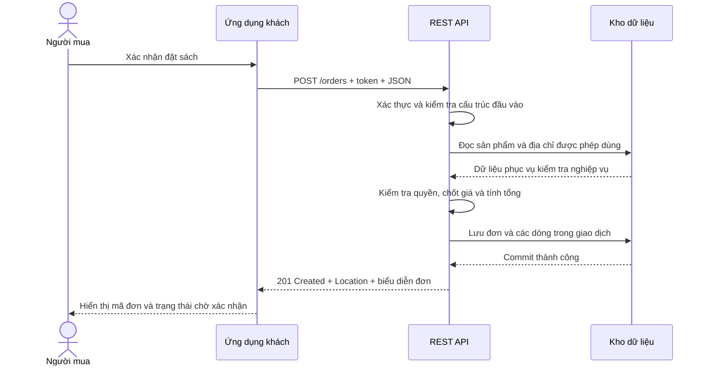

# Từ yêu cầu nghiệp vụ đến một lượt trao đổi tài nguyên

Một yêu cầu như “cho phép khách hàng đặt sách” chưa phải là hợp đồng API. Nó chưa xác định khách hàng gửi dữ liệu gì, hệ thống tạo ra tài nguyên nào, khi nào được xem là thành công và ứng dụng phía khách phải làm gì nếu nhận lỗi hoặc mất kết nối.

Trong thiết kế REST API, ta chuyển yêu cầu đó thành một lượt trao đổi có ý nghĩa rõ ràng: một chủ thể gửi HTTP request đến URI của tài nguyên, máy chủ kiểm tra điều kiện nghiệp vụ, rồi trả HTTP response mô tả kết quả. Phương thức HTTP, mã trạng thái, header và dữ liệu biểu diễn cùng tạo nên hợp đồng; chỉ viết một JSON đúng cú pháp là chưa đủ.

Bài học thuộc chương **Tổng quan** của module **INTEGRATION_API_REST**, tập trung vào cách đi từ ngôn ngữ nghiệp vụ đến hợp đồng trao đổi tài nguyên. Ví dụ có thể được triển khai bằng Java/Spring hoặc công nghệ tương đương. Các chủ đề như phân trang, cache, idempotency, OpenAPI, xác thực, phân quyền và kiểm thử được đặt vào đúng vị trí trong luồng; cơ chế triển khai chi tiết có thể được học riêng sau đó.

Sau bài học, bạn cần có khả năng:

- Tách mục tiêu của người dùng khỏi cách đặt tên endpoint và cấu trúc cơ sở dữ liệu.
- Xác định tài nguyên, định danh, biểu diễn và thay đổi trạng thái mà một yêu cầu tạo ra.
- Viết được một cặp request/response thành công cùng các nhánh thất bại chính.
- Giải thích được điều gì đã hoàn tất khi máy chủ trả thành công và điều gì ứng dụng phía khách vẫn chưa thể kết luận.

## 1. Làm rõ yêu cầu trước khi chọn endpoint

Giả sử cửa hàng sách đưa ra yêu cầu:

> Khách đã đăng nhập có thể gửi đơn đặt sách bằng một địa chỉ giao nhận đã lưu. Sau khi gửi thành công, khách nhìn thấy mã đơn, tổng tiền và trạng thái để tra cứu lại.

Ta cần chốt thêm các quy tắc cho ví dụ này:

1. Một đơn chứa ít nhất một loại sách; số lượng của mỗi loại là số nguyên dương. Một sản phẩm chỉ xuất hiện một lần trong danh sách đầu vào.
2. Địa chỉ giao nhận phải thuộc người đang đăng nhập và còn sử dụng được.
3. Sản phẩm phải tồn tại và đang được phép bán tại thời điểm kiểm tra.
4. Giá do máy chủ lấy từ danh mục. Giá được chốt vào từng dòng đơn khi tạo; khách không được tự gửi tổng tiền để máy chủ tin dùng.
5. Ví dụ chỉ dùng tiền VND, không có phí vận chuyển, thuế bổ sung hoặc khuyến mại. Tổng tiền bằng tổng thành tiền các dòng.
6. Đơn mới có trạng thái `PENDING_CONFIRMATION`, nghĩa là cửa hàng đã nhận thông tin và còn phải xác nhận. Tạo đơn chưa đồng nghĩa với đã thanh toán, đã giữ hàng hay sẽ giao được hàng.
7. Khi API báo tạo thành công, toàn bộ đơn và các dòng của nó đã được lưu bền vững. Người mua được phép đọc lại đơn của mình.

Những quyết định này làm rõ phạm vi thành công. Nếu nghiệp vụ sau đó yêu cầu giữ tồn kho hoặc thu tiền ngay lúc đặt hàng, hợp đồng và cách bảo đảm tính nhất quán sẽ phải được xem xét thêm.

| Cụm từ trong yêu cầu | Câu hỏi cần giải quyết | Quyết định trong ví dụ |
|---|---|---|
| “Khách đã đăng nhập” | Ai đang thực hiện? | Xác định người mua từ thông tin xác thực |
| “Gửi đơn đặt sách” | Tài nguyên nào được tạo? | Một tài nguyên đơn hàng `Order` |
| “Địa chỉ đã lưu” | Khách được dùng địa chỉ nào? | Chỉ địa chỉ thuộc chính người mua |
| “Tổng tiền” | Ai quyết định giá? | Máy chủ tính và lưu giá tại lúc tạo |
| “Gửi thành công” | Đã tiếp nhận hay đã tạo xong? | Đã tạo và lưu đơn, trả `201 Created` |
| “Tra cứu lại” | Khách dùng định danh nào? | URI của đơn vừa tạo |

Đừng bắt đầu bằng việc ánh xạ mọi động từ thành một endpoint. Nếu chưa rõ “gửi thành công” có nghĩa gì, việc chọn giữa `/orders`, `/createOrder` hay `/submit` chưa giải quyết được phần khó nhất.

## 2. Xác định chủ thể, tài nguyên và biểu diễn

### 2.1. Chủ thể thực hiện khác với dữ liệu được gửi

**Chủ thể** là người mua đã được xác thực. Trong ví dụ, ứng dụng gửi access token bằng header `Authorization`. Máy chủ xác minh token rồi tìm danh tính người mua theo cơ chế xác thực đã chọn.

Request không cần một trường `buyerId` để quyết định đơn thuộc ai. Nếu máy chủ tin vào `buyerId` tùy ý do khách gửi, một người có thể thử tạo đơn dưới danh tính người khác.

Xác thực và phân quyền giải quyết hai câu hỏi riêng:

- Xác thực: thông tin đăng nhập có hợp lệ và đại diện cho ai?
- Phân quyền: người đó có được dùng địa chỉ này hoặc đọc đơn này không?

Token hợp lệ không tự động cho phép truy cập mọi tài nguyên.

### 2.2. Tài nguyên trung tâm là đơn hàng

Ta chọn `Order` làm tài nguyên trung tâm vì nó có danh tính, có dữ liệu để quan sát và có vòng đời nghiệp vụ. Một đơn cụ thể vẫn là cùng một đơn khi trạng thái hoặc một phần biểu diễn của nó thay đổi theo các thao tác được phép.

| Thành phần | Ví dụ | Vai trò |
|---|---|---|
| Tập hợp tài nguyên | `/orders` | Nơi nhận yêu cầu tạo đơn |
| Một tài nguyên cụ thể | `/orders/ord_1001` | Định danh một đơn để đọc lại |
| Tài nguyên liên quan | Sản phẩm `p_101`, địa chỉ `addr_27` | Dữ liệu được tham chiếu khi tạo |
| Biểu diễn đầu vào | JSON chứa sản phẩm, số lượng, mã địa chỉ | Thể hiện ý định của người mua |
| Biểu diễn đầu ra | JSON chứa mã đơn, giá đã chốt, tổng tiền, trạng thái | Mô tả kết quả do máy chủ xác lập |

Một tài nguyên API không bắt buộc tương ứng với một bảng dữ liệu. Biểu diễn đơn hàng có thể được dựng từ bảng đơn, bảng dòng đơn và dữ liệu liên quan. Ngược lại, có bảng `order_items` trong cơ sở dữ liệu không có nghĩa là bài toán này bắt buộc phải cung cấp một endpoint công khai cho từng dòng đơn.

Địa chỉ cũng có thể thay đổi về sau. Khi triển khai, hệ thống cần giữ dữ liệu giao nhận đã chốt cho đơn theo quy tắc nghiệp vụ; chỉ giữ một tham chiếu rồi luôn đọc địa chỉ mới nhất có thể làm thay đổi ý nghĩa của đơn đã tạo.

### 2.3. Chọn URI và phương thức theo tác động mong muốn

| Ý định | Phương thức và URI | Tác động |
|---|---|---|
| Tạo một đơn, để máy chủ cấp mã | `POST /orders` | Tạo thêm tài nguyên trong tập hợp |
| Đọc đơn đã biết mã | `GET /orders/{orderId}` | Lấy biểu diễn của đơn được phép đọc |

`POST /orders` diễn đạt ý định tạo đơn trong hợp đồng này; máy chủ cấp định danh. Không nên dùng `GET /orders/create?...` để tạo đơn, vì `GET` có ngữ nghĩa đọc an toàn: phía khách không yêu cầu một thay đổi trạng thái nghiệp vụ bằng phương thức đó.

`GET` vẫn có thể khiến hệ thống ghi log hoặc cập nhật số liệu vận hành. Điều cần tránh là biến việc đọc thành hành động đặt hàng, thu tiền hoặc thay đổi dữ liệu nghiệp vụ mà khách không yêu cầu theo ngữ nghĩa của phương thức.

## 3. Viết hợp đồng đầu vào

Một HTTP request cần nêu rõ phương thức, đích, header và body nếu có. Ví dụ minh họa dưới đây dùng HTTPS; chuỗi token chỉ là chỗ giữ chỗ, không phải thông tin đăng nhập thật.

```http
POST /orders HTTP/1.1
Host: api.bookshop.example
Authorization: Bearer <access-token>
Content-Type: application/json
Accept: application/json

{
  "items": [
    { "productId": "p_101", "quantity": 2 },
    { "productId": "p_202", "quantity": 1 }
  ],
  "shippingAddressId": "addr_27"
}
```

Trong request này:

- `Content-Type` mô tả định dạng của body đang gửi.
- `Accept` cho biết kiểu biểu diễn phía khách muốn nhận.
- `Authorization` mang thông tin xác thực theo cơ chế đã chọn.
- Body chỉ chứa dữ liệu cần để mô tả ý định tạo đơn.

Hai header `Content-Type` và `Accept` phục vụ hai chiều khác nhau của trao đổi; không nên coi chúng là một.

### 3.1. Quy định rõ từng trường

| Trường | Kiểu dữ liệu | Bắt buộc | Ràng buộc |
|---|---|---|---|
| `items` | Mảng đối tượng | Có | Có ít nhất một phần tử |
| `items[].productId` | Chuỗi | Có | Không rỗng, tham chiếu sản phẩm được phép bán |
| `items[].quantity` | Số nguyên | Có | Lớn hơn hoặc bằng 1 |
| `shippingAddressId` | Chuỗi | Có | Địa chỉ còn dùng được và thuộc người mua |

Hợp đồng này từ chối sản phẩm trùng trong `items` thay vì tự cộng số lượng. Các trường ngoài hợp đồng cũng bị từ chối bằng lỗi validation. Đây là quyết định của API ví dụ, cần được thể hiện trong tài liệu và kiểm thử; không phải hành vi mặc định giống nhau ở mọi framework.

Các trường sau do máy chủ quyết định và không được nhận như giá trị để tạo đơn:

- `id`, `createdAt`: định danh và thời gian tạo.
- `buyerId`: suy ra từ chủ thể đã xác thực.
- `status`: trạng thái ban đầu theo quy tắc nghiệp vụ.
- `unitPrice`, `lineTotal`, `totalAmount`: kết quả tính toán của máy chủ.

Tách DTO đầu vào khỏi mô hình lưu trữ giúp tránh việc vô tình cho phép khách gán trực tiếp các trường nội bộ. Với Java/Spring, đây là lý do nên nhận một request DTO chuyên biệt thay vì bind body thẳng vào entity đơn hàng.

### 3.2. Phân biệt dữ liệu hợp lệ về cấu trúc và hợp lệ về nghiệp vụ

JSON có dấu ngoặc sai là lỗi cú pháp. `quantity: 0` là JSON đúng cú pháp nhưng vi phạm hợp đồng. Một `productId` đúng kiểu chuỗi vẫn có thể trỏ đến sản phẩm ngừng bán.

Việc phân biệt này giúp thiết kế thông báo lỗi và kiểm thử chính xác. Một annotation kiểm tra số lượng trong DTO không thay thế được bước kiểm tra quyền sở hữu địa chỉ hoặc trạng thái sản phẩm trong lớp nghiệp vụ.

## 4. Định nghĩa thành công bằng response cụ thể

Giả sử giá hiện tại của `p_101` là 120.000 VND, của `p_202` là 90.000 VND. Máy chủ tính:

```text
Dòng 1: 2 × 120.000 = 240.000 VND
Dòng 2: 1 ×  90.000 =  90.000 VND
Tổng:                 330.000 VND
```

Sau khi lưu đầy đủ đơn và các dòng, máy chủ trả:

```http
HTTP/1.1 201 Created
Content-Type: application/json
Location: /orders/ord_1001
Cache-Control: no-store

{
  "id": "ord_1001",
  "status": "PENDING_CONFIRMATION",
  "currency": "VND",
  "items": [
    {
      "productId": "p_101",
      "quantity": 2,
      "unitPrice": 120000,
      "lineTotal": 240000
    },
    {
      "productId": "p_202",
      "quantity": 1,
      "unitPrice": 90000,
      "lineTotal": 90000
    }
  ],
  "shippingAddressId": "addr_27",
  "totalAmount": 330000,
  "createdAt": "2026-11-17T02:30:00Z"
}
```

### 4.1. Mã trạng thái, header và body bổ sung cho nhau

`201 Created` báo rằng request đã được thực hiện và tạo tài nguyên. Header `Location` chỉ nơi nhận diện tài nguyên vừa tạo; URI tương đối trong ví dụ được giải theo URI của request. Body cung cấp biểu diễn hữu ích để ứng dụng cập nhật giao diện ngay.

Không nên chỉ trả `200 OK` với `{"success": true}` rồi bắt khách đoán mã đơn hoặc nơi đọc lại. `200` có thể diễn tả nhiều thao tác thành công, nhưng ở hợp đồng tạo tài nguyên này, `201` truyền đạt kết quả cụ thể hơn.

`Cache-Control: no-store` là lựa chọn cho dữ liệu đơn hàng của ví dụ: cache tuân thủ chỉ thị này không được lưu response. Đây không phải cơ chế xác thực hay mã hóa. HTTPS và kiểm tra quyền vẫn cần thực hiện. Khi học cache, cần phân biệt rõ lựa chọn bảo mật dữ liệu cá nhân với các tài nguyên công khai như danh mục sách.

### 4.2. Thành công kỹ thuật phải khớp với trạng thái nghiệp vụ

`201 Created` không có nghĩa là đơn đã được cửa hàng xác nhận. Hai tầng kết quả là:

- HTTP: tài nguyên đơn đã được tạo theo yêu cầu.
- Nghiệp vụ: tài nguyên đó đang ở trạng thái `PENDING_CONFIRMATION`.

Giao diện nên hiển thị “Đã nhận đơn, đang chờ xác nhận”, tránh tự diễn giải thành “Đã thanh toán” hoặc “Đã giữ hàng”. Nếu người mua nhận thông báo “Đặt hàng thành công”, nội dung kèm theo vẫn phải làm rõ trạng thái này.

Nếu nghiệp vụ chỉ nhận một tác vụ để xử lý sau và chưa tạo xong đơn, có thể cần hợp đồng `202 Accepted` cùng cách theo dõi tác vụ. Không thay `201` bằng `202` chỉ vì bên trong có gửi email bất đồng bộ: trong ví dụ, đơn đã được tạo đồng bộ, còn email là công việc phụ.

### 4.3. Tiền và thời gian cần có quy ước

Các số tiền trong ví dụ là số nguyên tính bằng đồng Việt Nam, kèm `currency: "VND"`. Không hiểu `120000` là 120.000 đơn vị nhỏ của một tiền tệ khác. Với nhiều loại tiền hoặc phép tính phức tạp hơn, cần quy định rõ thang đo và cách làm tròn; không dùng số thực nhị phân như `double` để xử lý tiền tùy tiện.

`createdAt` dùng dạng thời gian có thông tin múi giờ; ký tự `Z` trong ví dụ biểu thị UTC. Máy chủ quyết định thời gian tạo, còn ứng dụng có thể chuyển sang múi giờ hiển thị của người dùng.

## 5. Theo dõi một lượt trao đổi từ đầu đến cuối



Sơ đồ mô tả đường đi thành công. Một lỗi tại bước xác thực, validation hoặc lưu dữ liệu phải rẽ sang response lỗi thích hợp.

### 5.1. Bên trong máy chủ cần những trách nhiệm nào?

| Bước | Trách nhiệm | Ví dụ đầu ra |
|---|---|---|
| Tiếp nhận HTTP | Đọc URI, header, body; nhận diện định dạng | Request DTO hoặc lỗi cú pháp |
| Xác thực | Kiểm tra thông tin đăng nhập | Danh tính người mua |
| Validation đầu vào | Kiểm tra kiểu, bắt buộc, số lượng, trường lạ | Dữ liệu đầu vào đúng hợp đồng |
| Kiểm tra nghiệp vụ và quyền | Kiểm tra sản phẩm, địa chỉ và quyền sử dụng | Dữ liệu đủ điều kiện tạo đơn |
| Xử lý nghiệp vụ | Chốt giá, tính tiền, đặt trạng thái ban đầu | Mô hình đơn cần lưu |
| Lưu trữ | Lưu đơn và dòng đơn một cách nhất quán | Định danh và dữ liệu đã commit |
| Trả HTTP | Ánh xạ kết quả ra mã, header và body | Response theo hợp đồng |

Trong một ứng dụng Spring, các trách nhiệm này thường được phân bổ giữa security filter, controller, validator, service, repository và bộ xử lý ngoại lệ. Bảng thể hiện trách nhiệm logic; không yêu cầu mọi ứng dụng phải tách thành đúng số lớp hoặc chạy theo đúng một thứ tự nội bộ duy nhất.

### 5.2. Ranh giới giao dịch quyết định ý nghĩa của thành công

Không được lưu phần đầu đơn, trả `201`, rồi mới phát hiện không lưu được các dòng. Với giả định lưu trong cùng cơ sở dữ liệu, phần đầu và các dòng phải được lưu trong cùng giao dịch phù hợp. Nếu giao dịch thất bại, không có đơn hoàn chỉnh để báo tạo thành công.

Các dữ liệu có thể thay đổi đồng thời cũng cần chiến lược nhất quán ở lúc triển khai. Chẳng hạn, nếu cửa hàng cam kết giá phải đúng tại thời điểm chốt đơn, chỉ đọc giá rồi lưu rất lâu sau đó có thể chưa đủ; cần quy định thời điểm chốt và cách kiểm soát thay đổi cạnh tranh tương ứng.

Ví dụ này chưa cam kết giữ tồn kho. Vì vậy, một kiểm tra “sản phẩm đang bán” không được diễn giải thành “đã dành đủ số lượng cho người mua”. Cam kết giữ hàng cần quy tắc và cơ chế cập nhật tồn kho riêng.

### 5.3. Stateless không có nghĩa là không lưu đơn hàng

Để xử lý request, máy chủ có dữ liệu cần thiết từ thông điệp và từ trạng thái tài nguyên được lưu trữ. Request tạo đơn không dựa vào một cuộc hội thoại ẩn trên máy chủ như “sản phẩm mà khách đã nói ở request trước”.

Máy chủ vẫn lưu đơn, địa chỉ và sản phẩm. Ràng buộc stateless của REST liên quan đến trạng thái hội thoại với phía khách, không cấm trạng thái nghiệp vụ trong cơ sở dữ liệu. Việc dùng token tự nó cũng chưa đủ để chứng minh toàn bộ hệ thống đáp ứng ràng buộc này.

## 6. Đọc lại tài nguyên bằng URI đã nhận

Sau khi nhận `Location: /orders/ord_1001`, ứng dụng có thể gửi:

```http
GET /orders/ord_1001 HTTP/1.1
Host: api.bookshop.example
Authorization: Bearer <access-token>
Accept: application/json
```

Nếu người gọi là chủ đơn và đơn tồn tại, response là `200 OK`, `Content-Type: application/json`, `Cache-Control: no-store`, cùng biểu diễn của đơn. Trong thời điểm chưa có thay đổi nghiệp vụ, biểu diễn có các giá trị như response tạo đơn ở trên.

Máy chủ vẫn kiểm tra quyền trên request `GET`. Đã tạo được đơn bằng một request trước đó không khiến các request tiếp theo được miễn xác thực hoặc phân quyền.

Đơn mới tạo phải đọc lại được theo cam kết của ví dụ. Nếu hệ thống có bản sao chỉ đọc hoặc mô hình đọc cập nhật trễ, cần thiết kế tuyến đọc và hợp đồng nhất quán để đáp ứng cam kết đó, thay vì để ứng dụng gặp `404` ngẫu nhiên ngay sau khi tạo.

Ở mức tổng quan, phương thức, URI và JSON giúp mô tả lượt trao đổi này. Một API dùng các thành phần đó chưa mặc nhiên đáp ứng đầy đủ mọi ràng buộc REST. Khi mở rộng, còn cần xem xét các ràng buộc như giao diện thống nhất, khả năng cache, hệ thống phân lớp và cách liên kết các tài nguyên.

## 7. Thiết kế các nhánh thất bại trước khi triển khai

Một hợp đồng có ích phải giúp khách xử lý cả thất bại. Bảng dưới đây là quy ước được chọn cho API ví dụ, không phải khẳng định mọi hệ thống phải ánh xạ mọi tình huống giống hệt nhau.

| Tình huống | Mã HTTP | Mã lỗi ứng dụng minh họa | Cách phía khách phản ứng |
|---|---|---|---|
| Body JSON sai cú pháp | `400 Bad Request` | `MALFORMED_JSON` | Sửa cách tạo request |
| Gửi định dạng body không hỗ trợ | `415 Unsupported Media Type` | `UNSUPPORTED_MEDIA_TYPE` | Gửi đúng `Content-Type` và body |
| Thiếu token hoặc token không hợp lệ | `401 Unauthorized` | `AUTHENTICATION_REQUIRED` | Thực hiện lại luồng xác thực |
| Đã xác thực nhưng không được phép thực hiện thao tác | `403 Forbidden` | `ACCESS_DENIED` | Không tự lặp lại cùng yêu cầu |
| Đọc đơn không tồn tại hoặc không được phép biết nó tồn tại | `404 Not Found` | `ORDER_NOT_FOUND` | Hiển thị không tìm thấy đơn |
| Số lượng sai, sản phẩm không dùng được hoặc địa chỉ không hợp lệ | `422 Unprocessable Content` | `VALIDATION_FAILED` | Sửa dữ liệu theo chi tiết lỗi |
| Lỗi bất ngờ khi xử lý hoặc lưu | `500 Internal Server Error` | `INTERNAL_ERROR` | Báo thất bại, giữ thông tin để tra cứu |

Trong hợp đồng này, đơn thuộc người khác cũng trả `404` khi đọc để hạn chế tiết lộ sự tồn tại. Với `shippingAddressId` không tồn tại hoặc không thuộc người mua, lỗi validation dùng cùng thông điệp “Địa chỉ giao nhận không hợp lệ”; không trả thông tin về chủ sở hữu thực tế.

Response `401` cần có header `WWW-Authenticate` phù hợp với cơ chế xác thực, chẳng hạn challenge `Bearer` trong ví dụ. `403` dùng khi đã xác thực nhưng thiếu quyền; yêu cầu người dùng đăng nhập lại không tự giải quyết được trường hợp đó.

Một response validation có thể là:

```http
HTTP/1.1 422 Unprocessable Content
Content-Type: application/json
Cache-Control: no-store

{
  "code": "VALIDATION_FAILED",
  "message": "Dữ liệu tạo đơn chưa hợp lệ.",
  "errors": [
    {
      "field": "items[0].quantity",
      "code": "MIN_VALUE",
      "message": "Số lượng phải lớn hơn hoặc bằng 1."
    }
  ],
  "requestId": "req_7b32"
}
```

`code` giúp ứng dụng xử lý ổn định mà không phân tích câu tiếng Việt trong `message`. `field` chỉ vị trí cần sửa; `requestId` giúp đối chiếu log. HTTP status vẫn là mã lỗi thực tế, không trả `200 OK` cho mọi lỗi rồi yêu cầu khách chỉ nhìn vào body.

Đây là cấu trúc lỗi riêng của API ví dụ. Nếu chọn chuẩn Problem Details cho một hệ thống khác, cần tuân theo cấu trúc và media type của chuẩn đó; không chỉ đổi `Content-Type` rồi giữ nguyên một body tùy ý.

Stack trace, câu SQL, access token và dữ liệu nhạy cảm không nằm trong response lỗi. Log nội bộ cũng cần tránh ghi token hoặc toàn bộ dữ liệu giao nhận không cần thiết.

## 8. Mất response: vì sao tạo đơn cần nghĩ đến idempotency?

Có một tình huống khác với lỗi validation:

1. Ứng dụng gửi `POST /orders`.
2. Máy chủ tạo và commit `ord_1001`.
3. Kết nối đứt trước khi ứng dụng nhận được response.
4. Ứng dụng không biết đơn đã được tạo hay chưa.

Timeout chỉ cho biết phía khách chưa nhận được kết quả trong thời gian chờ. Nó không chứng minh thao tác tạo đơn đã thất bại. Gửi lại cùng body bằng một `POST` thông thường có thể tạo thêm đơn thứ hai; `POST` không có bảo đảm idempotent theo ngữ nghĩa chung của HTTP.

Hợp đồng cơ bản trong bài chưa cung cấp cơ chế chống tạo trùng. Vì vậy, ứng dụng không nên tự động lặp lại vô hạn thao tác tạo đơn khi mất response. Một thiết kế mở rộng có thể dùng khóa idempotency, nhưng phải quy định ít nhất:

- Khóa gắn với chủ thể và thao tác nào, có hiệu lực bao lâu.
- Cùng khóa và cùng nội dung sẽ trả lại kết quả đã ghi nhận như thế nào.
- Cùng khóa nhưng khác nội dung bị từ chối ra sao.
- Hai request trùng khóa đến đồng thời được xử lý thế nào.
- Việc lưu khóa và kết quả có nhất quán với việc tạo đơn không.

Thêm một header có tên `Idempotency-Key` mà không có cơ chế xử lý tương ứng không làm thao tác trở nên an toàn để thử lại. Một `GET` đọc đơn khi đã biết URI có đặc tính khác: lặp lại việc đọc không yêu cầu tạo thêm đơn.

## 9. Ghi hợp đồng thành tiêu chí chấp nhận và kiểm thử

Hợp đồng cần đủ rõ để hai nhóm triển khai client và server có thể làm việc độc lập. Mỗi quy tắc nghiệp vụ nên dẫn đến một kết quả quan sát được qua API.

| Trường hợp kiểm thử | Kết quả cần quan sát |
|---|---|
| Tạo đơn hợp lệ với dữ liệu ví dụ | `201`, có `Location`, tổng 330.000 VND, trạng thái chờ xác nhận |
| Đọc URI trong `Location` bằng chủ đơn | `200`, đúng định danh, số lượng và giá đã chốt |
| Đọc cùng đơn bằng người khác | `404`, không lộ chi tiết đơn |
| Gửi `quantity: 0` | `422`, chỉ rõ trường sai, không tạo đơn |
| Gửi `quantity: 1.5` | `422` theo hợp đồng kiểu dữ liệu, không âm thầm làm tròn |
| Gửi cùng sản phẩm hai lần | `422` theo quy tắc đã chọn |
| Gửi thêm `totalAmount` hoặc `buyerId` | `422` theo chính sách từ chối trường ngoài hợp đồng |
| Thiếu hoặc sai thông tin xác thực | `401` và challenge phù hợp |
| Dùng địa chỉ của người khác | `422`, không tạo đơn và không tiết lộ chủ địa chỉ |
| Lưu một dòng đơn thất bại trong giao dịch | Không trả `201`, không để lại đơn dở dang |
| Đổi giá danh mục sau khi tạo đơn | Đơn cũ vẫn thể hiện giá đã chốt |

Kiểm thử “không tạo đơn” hoặc “không có đơn dở dang” cần kiểm tra trạng thái lưu trữ hoặc dùng cơ chế quan sát phù hợp trong môi trường kiểm thử. Chỉ nhìn response lỗi chưa chứng minh rằng máy chủ không ghi dữ liệu ngoài ý muốn.

Nếu triển khai với Spring, cần cấu hình ánh xạ lỗi để đúng hợp đồng này. Ví dụ, lỗi deserialize hoặc validation mặc định có thể trả `400`; nếu hợp đồng đã chọn `422` cho JSON có cú pháp hợp lệ nhưng sai kiểu trường, phải ánh xạ và kiểm thử rõ ràng, tránh để tài liệu và hành vi thực tế lệch nhau.

Khi đưa vào OpenAPI, mô tả ít nhất hai operation `POST /orders` và `GET /orders/{orderId}`, cơ chế bảo mật, schema đầu vào/đầu ra, trường chỉ đọc, header `Location` và các response lỗi. Những quy tắc như “địa chỉ phải thuộc người mua” và “giá được chốt lúc tạo” vẫn cần mô tả bằng ngôn ngữ nghiệp vụ cùng ví dụ; schema kiểu dữ liệu không tự diễn tả đầy đủ chúng.

Phân trang chỉ xuất hiện khi bổ sung nhu cầu xem danh sách đơn, chẳng hạn `GET /orders`. Không đưa tham số trang vào thao tác tạo hoặc đọc một đơn chỉ để mọi endpoint trông giống nhau.

## 10. Tự thực hành với một yêu cầu mới

Hãy áp dụng cùng cách suy luận cho yêu cầu:

> Học viên đã đăng nhập muốn đăng ký một lớp còn chỗ và xem lại thông tin đăng ký.

Trước khi viết code, hãy tạo một bản hợp đồng ngắn trả lời các câu hỏi:

1. Tài nguyên được tạo là lớp học, học viên hay lượt đăng ký? Nó được định danh ra sao?
2. Danh tính học viên lấy từ đâu? Request cần những trường nào và không được tự gán những trường nào?
3. “Đăng ký thành công” nghĩa là đã giữ chỗ, chờ duyệt hay đã hoàn tất thanh toán?
4. Máy chủ trả mã HTTP nào, biểu diễn gì và URI nào để đọc lại?
5. Nếu lớp hết chỗ đúng lúc xử lý, làm sao để không tạo một lượt đăng ký sai?
6. Nếu response bị mất, gửi lại có tạo đăng ký trùng không?

Một hướng thiết kế ban đầu là tài nguyên `Enrollment`, tạo bằng `POST /enrollments` với `classId`, lấy học viên từ thông tin xác thực, rồi trả `201` và `Location: /enrollments/{id}` khi đã tạo xong. Tuy nhiên, quy tắc giữ chỗ, đăng ký trùng và thanh toán phải được chốt trước khi có thể hoàn thiện hợp đồng. Việc đặt tên resource chỉ là một bước trong chuỗi quyết định đó.

Khi tự kiểm tra bản thiết kế, hãy lần theo một hành trình cụ thể: người dùng muốn đạt điều gì, request biểu đạt ý định ra sao, trạng thái nào được thay đổi, response chứng minh kết quả nào và người dùng có thể làm gì tiếp theo với tài nguyên đã nhận.
