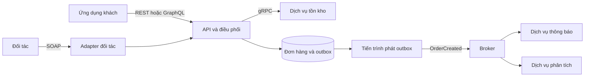

# So sánh REST với SOAP, GraphQL, gRPC và tích hợp bằng sự kiện

## Mục tiêu và phạm vi

Trong chương **Tổng quan** của module **INTEGRATION_API_REST**, bài học này đặt REST cạnh SOAP, GraphQL, gRPC và tích hợp bằng sự kiện để giải thích mỗi cách tiếp cận giải quyết bài toán nào, trao đổi dữ liệu ra sao và kéo theo những đánh đổi gì.

Module tập trung vào thiết kế REST API dựa trên resource, URI, phương thức và mã trạng thái HTTP, với hợp đồng dữ liệu rõ ràng. Việc so sánh giúp bạn hiểu khi nào thiết kế theo tài nguyên phù hợp, khi nào cần một mô hình bổ sung, và cách đặt REST trong một hệ thống Java/Spring hoặc công nghệ tương đương. Các vấn đề phân trang, cache, idempotency, OpenAPI, xác thực, phân quyền, xử lý lỗi và kiểm thử được nhắc đến ở mức định hướng; bài này không triển khai chi tiết từng công nghệ.

Sau bài học, bạn có thể:

- Phân biệt phong cách kiến trúc, giao thức thông điệp, ngôn ngữ truy vấn, khung RPC và mô hình tích hợp.
- So sánh cùng một nghiệp vụ bằng REST, SOAP, GraphQL, gRPC và sự kiện.
- Giải thích tác động của đồng bộ, bất đồng bộ, timeout, retry và nhất quán dữ liệu.
- Chọn một tổ hợp phù hợp với người dùng API và yêu cầu nghiệp vụ, thay vì chọn theo tên công nghệ.

## 1. Đang so sánh những khái niệm ở các tầng khác nhau

Năm cách gọi này không phải năm giao thức có thể thay thế trực tiếp cho nhau trong mọi hoàn cảnh.

| Cách tiếp cận | Bản chất | Trọng tâm của hợp đồng |
| --- | --- | --- |
| REST | Phong cách kiến trúc cho hệ thống phân tán | Tài nguyên, biểu diễn và giao diện tương tác thống nhất |
| SOAP | Giao thức trao đổi thông điệp có cấu trúc bằng XML | Envelope, header tùy chọn, body và lỗi SOAP |
| GraphQL | Ngôn ngữ truy vấn API và quy tắc thực thi trên schema có kiểu | Các field mà client yêu cầu, các kiểu dữ liệu và các operation |
| gRPC | Khung giao tiếp theo mô hình Remote Procedure Call | Service, phương thức, kiểu request và response |
| Tích hợp bằng sự kiện | Mô hình cộng tác thông qua các thông báo về sự việc đã xảy ra | Ý nghĩa sự kiện, schema, cách phát và cách tiêu thụ |

REST thường được áp dụng trên HTTP. SOAP có thể dùng HTTP làm cơ chế vận chuyển nhưng không chỉ giới hạn ở HTTP. GraphQL thường được phục vụ qua HTTP và có thể có cơ chế riêng cho subscription. gRPC thường dùng HTTP/2 và Protocol Buffers. Tích hợp sự kiện thường dùng broker hoặc nền tảng log, nhưng sự kiện cũng có thể được chuyển qua webhook HTTP.

Vì các khái niệm nằm ở các tầng khác nhau, một hệ thống có thể đồng thời cung cấp REST API, gọi một service bằng gRPC và phát sự kiện. Một subscription GraphQL cũng có thể lấy dữ liệu từ luồng sự kiện phía sau; nó không tự trở thành một hàng đợi bền vững chỉ vì có dữ liệu đẩy tới client.

Điểm cần so sánh là **đơn vị tương tác, hợp đồng, vòng đời xử lý và cách vận hành** của từng lựa chọn.

## 2. Dùng cùng một nghiệp vụ để so sánh

Giả sử hệ thống bán hàng cần thực hiện bốn việc:

1. Tạo đơn hàng gồm mã sản phẩm và số lượng.
2. Đọc trạng thái đơn hàng.
3. Trao đổi với dịch vụ tồn kho.
4. Cho dịch vụ thông báo và phân tích biết rằng đơn hàng đã được tạo.

Đơn `ord-123` có thể ở trạng thái `PENDING` sau khi được tạo. Điều đó chỉ nói đơn hàng đã tồn tại và đang chờ các bước tiếp theo; chưa có nghĩa đã thanh toán, giữ hàng hoặc giao hàng thành công.

Trong tất cả các cách tiếp cận, hợp đồng vẫn phải trả lời những câu hỏi chung:

- Ai được tạo và đọc đơn hàng này?
- `quantity` có phải số nguyên dương không?
- Tạo đơn xong có bảo đảm giữ hàng ngay không?
- Client phải làm gì nếu không nhận được phản hồi?
- Gửi lại yêu cầu có tạo trùng đơn không?
- Định dạng dữ liệu thay đổi thì các bên cũ có tiếp tục hoạt động không?

Không công nghệ nào tự trả lời đầy đủ các câu hỏi đó chỉ bằng việc được lựa chọn.

## 3. REST: tương tác với tài nguyên qua ngữ nghĩa HTTP

### 3.1. Cách thể hiện nghiệp vụ

Với thiết kế theo tài nguyên trên HTTP, client có thể tạo đơn bằng:

```http
POST /orders HTTP/1.1
Host: api.example.test
Content-Type: application/json
Accept: application/json

{
  "items": [
    { "productId": "prd-10", "quantity": 2 }
  ]
}
```

Nếu tài nguyên đơn hàng đã được tạo, server trả:

```http
HTTP/1.1 201 Created
Location: /orders/ord-123
Content-Type: application/json

{
  "id": "ord-123",
  "status": "PENDING"
}
```

Client đọc lại bằng `GET /orders/ord-123`. URI định danh tài nguyên, còn phương thức và mã trạng thái HTTP góp phần diễn đạt yêu cầu và kết quả.

Một API không trở thành REST chỉ vì có URI dạng danh từ và trả JSON. REST còn có các ràng buộc client–server, stateless, cache, uniform interface, layered system và code on demand tùy chọn. Uniform interface bao gồm cả hypermedia dẫn dắt các tương tác tiếp theo. Ví dụ đơn giản trên minh họa cách thiết kế tài nguyên, chưa chứng minh toàn bộ hệ thống tuân thủ mọi ràng buộc REST.

### 3.2. Thế mạnh và chi phí

REST trên HTTP cho phép tận dụng ngữ nghĩa chuẩn của phương thức, mã trạng thái, header, cache có điều kiện và các lớp trung gian. Hợp đồng HTTP dễ được quan sát qua công cụ thông dụng và có thể mô tả bằng OpenAPI.

Chi phí nằm ở việc mô hình hóa tài nguyên và thống nhất quy ước: phân trang, lọc dữ liệu, biểu diễn lỗi, chuyển trạng thái và idempotency. Những việc này không tự xuất hiện khi thêm `@RestController` trong Spring.

Một màn hình cần thông tin từ nhiều tài nguyên có thể phải gọi nhiều endpoint, hoặc cần một endpoint tổng hợp phù hợp. Đây là quyết định thiết kế, không phải bằng chứng REST luôn gây nhiều lượt gọi. REST không cấm server trả biểu diễn tổng hợp hoặc hỗ trợ chọn field theo hợp đồng.

Cache cũng không tự động đúng cho mọi tài nguyên. Dữ liệu đơn hàng thường gắn với quyền truy cập; khả năng lưu và tái sử dụng response phải được công bố phù hợp, thay vì suy ra chỉ từ phương thức `GET`.

## 4. SOAP: trao đổi thông điệp XML theo hợp đồng

### 4.1. Envelope và thao tác nghiệp vụ

SOAP định nghĩa một envelope XML. Header là phần tùy chọn cho thông tin mở rộng; body mang nội dung cần xử lý hoặc một SOAP Fault. SOAP không bắt buộc mọi tương tác phải được hiểu như một lời gọi hàm; nó cũng hỗ trợ cách tổ chức thông điệp theo tài liệu.

Ví dụ request SOAP 1.2 trên HTTP, với body do hợp đồng nghiệp vụ quy định:

```http
POST /OrderService HTTP/1.1
Host: partner.example.test
Content-Type: application/soap+xml; charset=utf-8; action="urn:orders:CreateOrder"

<soap:Envelope xmlns:soap="http://www.w3.org/2003/05/soap-envelope"
               xmlns:ord="urn:orders">
  <soap:Body>
    <ord:CreateOrderRequest>
      <ord:Item>
        <ord:ProductId>prd-10</ord:ProductId>
        <ord:Quantity>2</ord:Quantity>
      </ord:Item>
    </ord:CreateOrderRequest>
  </soap:Body>
</soap:Envelope>
```

Namespace của envelope và media type trong ví dụ thuộc SOAP 1.2; không nên trộn tùy tiện với envelope hoặc quy ước header của SOAP 1.1. Tên `CreateOrderRequest`, namespace `urn:orders` và cấu trúc `Item` là phần hợp đồng ví dụ, không do SOAP tự quy định.

SOAP service thường dùng WSDL để mô tả service, operation, message và binding; XML Schema có thể mô tả các cấu trúc dữ liệu liên quan. Công cụ có thể dựa trên hợp đồng đó để sinh mã phía client và server.

### 4.2. Thế mạnh và chi phí

SOAP đáng cân nhắc khi đối tác đã có hợp đồng WSDL, các kiểu dữ liệu XML và bộ công cụ tích hợp tương ứng. Một tổ chức có thể đang phụ thuộc vào các tiêu chuẩn mở rộng thuộc họ WS-* cho yêu cầu cụ thể.

Các khả năng như bảo mật ở mức thông điệp, truyền tin tin cậy hoặc phối hợp giao dịch thuộc các tiêu chuẩn và cấu hình bổ sung. Dùng SOAP cơ bản không tự bảo đảm các khả năng đó.

Chi phí thường nằm ở việc quản lý XML, namespace, schema, binding và khả năng tương thích của các extension. Envelope và XML có thể làm payload lớn hơn một số biểu diễn khác cho cùng dữ liệu, nhưng kết luận hiệu năng cần đo trên thông điệp và hạ tầng thực tế.

SOAP có cơ chế Fault riêng. Khi vận chuyển qua HTTP, cần phân biệt lỗi HTTP, lỗi phân tích envelope và lỗi nghiệp vụ trong thông điệp. Chỉ kiểm tra xem client có nhận được một XML hay không chưa đủ xác định lời gọi thành công.

Trong hệ sinh thái Java, có thể triển khai hoặc tiêu thụ SOAP bằng các công cụ phù hợp, chẳng hạn Spring Web Services hoặc một bộ công cụ hỗ trợ WSDL. Việc chọn công cụ phải theo đúng binding và yêu cầu của đối tác.

## 5. GraphQL: client chọn dữ liệu trên một schema có kiểu

### 5.1. Schema và tập field được yêu cầu

GraphQL cho phép client mô tả hình dạng dữ liệu cần lấy từ schema mà server công bố. Nó không phải ngôn ngữ truy vấn trực tiếp mọi database, và client chỉ được truy cập những field được schema cùng logic thực thi cho phép.

Ví dụ operation đọc đơn hàng:

```graphql
query OrderDetail($id: ID!) {
  order(id: $id) {
    id
    status
    items {
      productId
      quantity
    }
  }
}
```

Variables tương ứng:

```json
{
  "id": "ord-123"
}
```

Server có thể trả:

```json
{
  "data": {
    "order": {
      "id": "ord-123",
      "status": "PENDING",
      "items": [
        { "productId": "prd-10", "quantity": 2 }
      ]
    }
  }
}
```

Một màn hình khác có thể chỉ chọn `id` và `status`. Điều đó giúp giảm dữ liệu không cần thiết so với một response cố định chứa nhiều field. Tuy nhiên, client chọn ít field không tự bảo đảm server truy vấn database ít hơn; resolver và lớp truy cập dữ liệu vẫn phải được thiết kế phù hợp.

### 5.2. Thay đổi dữ liệu, lỗi và cache

GraphQL phân biệt query, mutation và subscription. Ví dụ mutation, giả sử schema đã định nghĩa input và field tương ứng:

```graphql
mutation CreateOrder($input: CreateOrderInput!) {
  createOrder(input: $input) {
    id
    status
  }
}
```

Mutation không tự tạo transaction bao trùm mọi service, không tự chống tạo trùng khi retry và không bảo đảm mọi side effect được rollback nếu một bước thất bại. Những điều đó thuộc triển khai và hợp đồng nghiệp vụ.

Một GraphQL server có thể tổng hợp dữ liệu từ database, REST API hoặc các service khác. Nếu mỗi đơn hoặc mỗi item làm phát sinh thêm một truy vấn riêng, server có thể gặp vấn đề N+1: một truy vấn ban đầu kéo theo nhiều truy vấn con. Batching và thiết kế resolver giúp xử lý vấn đề này, nhưng GraphQL không tự loại bỏ nó.

Khi dùng HTTP, nhiều triển khai cung cấp một endpoint như `/graphql`. Đường dẫn này là quy ước triển khai, không phải yếu tố duy nhất định nghĩa GraphQL. Query có thể được vận chuyển bằng `GET` theo hợp đồng hỗ trợ; không thể suy ra mọi GraphQL operation đều bắt buộc dùng `POST` hoặc không thể cache.

So với `GET` trên các URI tài nguyên ổn định, cache dùng chung có thể cần thêm thiết kế cho operation, variables, danh tính người gọi và định dạng vận chuyển. Client cũng có thể có cache riêng dựa trên định danh dữ liệu.

Response GraphQL có thể chứa cả `data` và `errors` khi có kết quả một phần. Client cần xem nội dung này cùng mã HTTP; không nên mặc định mọi response `200` đều có đủ dữ liệu, hoặc mọi lỗi GraphQL đều luôn được trả bằng `200`.

GraphQL phù hợp với các giao diện cần nhiều hình dạng dữ liệu và thường xuyên thay đổi cách tổng hợp. Đổi lại, server phải quản lý chi phí truy vấn, phân quyền theo đối tượng hoặc field, quan sát resolver và tiến hóa schema. Trong Java/Spring, Spring for GraphQL là một lựa chọn để tích hợp mô hình này với ứng dụng.

## 6. gRPC: gọi service với hợp đồng có kiểu

### 6.1. Service và message

gRPC tổ chức API thành service và các phương thức từ xa. Cách dùng phổ biến là định nghĩa hợp đồng bằng Protocol Buffers rồi sinh mã client/server cho những ngôn ngữ được hỗ trợ.

Một hợp đồng minh họa:

```proto
syntax = "proto3";

package orders.v1;

service OrderService {
  rpc CreateOrder(CreateOrderRequest) returns (Order);
  rpc GetOrder(GetOrderRequest) returns (Order);
}

message OrderItem {
  string product_id = 1;
  int32 quantity = 2;
}

message CreateOrderRequest {
  repeated OrderItem items = 1;
}

message GetOrderRequest {
  string order_id = 1;
}

message Order {
  string id = 1;
  string status = 2;
  repeated OrderItem items = 3;
}
```

Client gọi `OrderService.GetOrder` với một `GetOrderRequest`, rồi nhận một `Order`. Cách nhìn của client là gọi phương thức có kiểu, thay vì tự chọn phương thức HTTP để tương tác với URI tài nguyên.

Các số `1`, `2`, `3` là field number trong hợp đồng Protocol Buffers. Chúng tham gia định danh field trên wire; không thể đổi hoặc tái sử dụng tùy tiện chỉ vì tên field đã thay đổi. Hợp đồng có kiểu cũng chưa bảo đảm `quantity` dương: quy tắc nghiệp vụ đó vẫn cần validation.

Trong Java, mã được sinh cung cấp stub và các lớp message. Tên phương thức Java cụ thể tuân theo quy tắc của bộ sinh mã; ứng dụng không gọi trực tiếp một biểu thức Java tên `OrderService.GetOrder` chỉ vì hợp đồng dùng cách viết đó.

### 6.2. Streaming, deadline và môi trường client

gRPC hỗ trợ unary RPC, server streaming, client streaming và bidirectional streaming. Các phương thức trong ví dụ trên là unary: một request, một response. Không phải mỗi service gRPC đều sử dụng streaming.

HTTP/2 và biểu diễn Protocol Buffers thường tạo điều kiện thuận lợi cho giao tiếp có kiểu và truyền dữ liệu hiệu quả. Điều đó không đủ để khẳng định gRPC luôn nhanh hơn REST: thời gian nghiệp vụ, số lượt gọi, kích thước payload, mạng và cách quản lý kết nối đều ảnh hưởng kết quả.

gRPC có status của RPC như `NOT_FOUND` hoặc `DEADLINE_EXCEEDED`. Client cần hiểu status đó theo cơ chế gRPC, thay vì ánh xạ máy móc mỗi lỗi thành một mã HTTP tương ứng.

Một deadline cho biết client sẵn sàng chờ đến lúc nào. Nếu deadline hết hạn, không thể mặc định server chắc chắn chưa tạo đơn hoặc đã rollback. Lời gọi từ xa có thể đã tạo side effect trước khi client biết kết quả; hợp đồng idempotency vẫn cần thiết cho thao tác có thể được gửi lại.

Native gRPC không được gọi từ mọi trình duyệt theo cùng cách với một request HTTP thông thường bằng `fetch`. Khi phục vụ trình duyệt, có thể cần gRPC-Web, gateway hoặc một API thích ứng phù hợp. Các lựa chọn đó có khả năng và chi phí riêng; phải xem nhu cầu client trước khi chọn giao diện công khai.

gRPC đáng cân nhắc cho giao tiếp giữa các service cần schema có kiểu, code generation hoặc streaming. Đổi lại, các bên phải quản lý bộ sinh mã, tương thích schema, deadline, status và hạ tầng hỗ trợ giao thức.

## 7. Tích hợp bằng sự kiện: công bố một sự việc đã xảy ra

### 7.1. Phân biệt command và event

**Command** yêu cầu một bên thực hiện công việc, ví dụ `CreateOrder`. **Event** thông báo một sự việc đã xảy ra, ví dụ `OrderCreated`.

Tên gọi có thể là dấu hiệu, nhưng ý nghĩa hợp đồng mới quyết định. Một message tên `OrderCreated` được phát trước khi tạo đơn, với mong muốn consumer tạo đơn giúp mình, thực chất đang mang vai trò command dù tên ở thì quá khứ.

Cả command và event đều có thể đi qua message broker. Vì vậy, dùng queue hoặc xử lý bất đồng bộ chưa đủ để kết luận hệ thống đang tích hợp bằng sự kiện.

Ví dụ một event sau khi đơn đã được tạo:

```json
{
  "eventId": "evt-456",
  "eventType": "OrderCreated",
  "eventVersion": 1,
  "occurredAt": "2026-11-17T03:00:00Z",
  "producer": "orders",
  "aggregateId": "ord-123",
  "data": {
    "orderId": "ord-123",
    "status": "PENDING",
    "items": [
      { "productId": "prd-10", "quantity": 2 }
    ]
  }
}
```

Cấu trúc này là envelope ví dụ do hệ thống tự định nghĩa, không phải một chuẩn sự kiện bắt buộc. `eventVersion` là phiên bản schema của loại event trong hợp đồng này, không phải số lần đơn hàng đã thay đổi. `eventId` nhận diện một sự kiện, không tự tạo cơ chế chống thực thi lặp ở consumer.

`OrderCreated` không có nghĩa `OrderPaid`, `StockReserved` hay `OrderDelivered`. Tên và tài liệu sự kiện phải xác định rõ sự thật nào đã được xác nhận.

### 7.2. Nhiều consumer và nhất quán cuối cùng

Sau khi đơn được lưu, dịch vụ đơn hàng phát sự kiện. Dịch vụ thông báo có thể gửi thông báo; dịch vụ phân tích cập nhật báo cáo. Producer không nhất thiết phải chờ cả hai consumer xử lý xong để trả kết quả tạo đơn cho client.

Ưu điểm là giảm phụ thuộc về thời điểm hoạt động và cho phép thêm các consumer độc lập, nếu cơ chế phân phối và lưu giữ hỗ trợ. Tuy nhiên, các bên vẫn phụ thuộc vào ý nghĩa và schema của sự kiện.

Dữ liệu ở consumer có thể chậm hơn dữ liệu của dịch vụ đơn hàng. Đây là một trường hợp **eventual consistency**: các bản sao hoặc projection được cập nhật sau, theo các điều kiện xử lý và phục hồi đã thiết kế. Không có bảo đảm hệ thống sẽ hội tụ chỉ bằng cách gọi nó là eventual consistency; còn cần xử lý lỗi và bảo đảm sự kiện có thể được xử lý lại khi cần.

Tích hợp bằng sự kiện cũng không thay thế mọi API đọc. Ứng dụng có thể vẫn dùng REST hoặc GraphQL để đọc một projection do consumer xây dựng. Khi đó, hợp đồng cần nói rõ mức độ trễ mà người dùng có thể quan sát.

### 7.3. Delivery, thứ tự và chống xử lý trùng

Không nên mặc định một broker bất kỳ bảo đảm mọi sự kiện được xử lý đúng một lần hoặc giữ nguyên thứ tự toàn cục.

- Với cơ chế phân phối ít nhất một lần, cùng event có thể đến consumer nhiều lần.
- Thứ tự có thể chỉ được bảo đảm trong một phạm vi như partition hoặc khóa; phạm vi cụ thể phụ thuộc hệ thống và cấu hình.
- Retry có thể kéo dài thời gian hoàn tất, còn một sự kiện lỗi liên tục có thể cần cơ chế cách ly và xử lý lại có kiểm soát.
- Khả năng phát lại phụ thuộc thời gian lưu, cách lưu và quyền truy cập; không phải mọi queue đều là một log cho phép đọc lại tùy ý.

Consumer có thể dùng `eventId` để nhận biết sự kiện đã xử lý. Việc ghi dấu đã xử lý và cập nhật dữ liệu cục bộ cần phối hợp phù hợp, chẳng hạn trong cùng transaction cục bộ khi có thể. Nếu ghi dấu trước rồi ứng dụng chết trước khi cập nhật dữ liệu, lần nhận lại có thể bị bỏ qua sai.

Với side effect bên ngoài như gửi thông báo qua một nhà cung cấp khác, một transaction database cục bộ chưa đủ bao trùm tất cả. Cần xem khả năng idempotency của bên nhận hoặc cách đối soát kết quả. Một nhãn “exactly once” trên một thành phần không tự bảo đảm toàn bộ quy trình nghiệp vụ chỉ gây tác động đúng một lần.

### 7.4. Tránh khoảng trống giữa lưu đơn và phát sự kiện

Nếu ứng dụng làm hai việc độc lập:

```text
1. Lưu đơn hàng vào database.
2. Gửi OrderCreated tới broker.
```

ứng dụng có thể dừng sau bước 1. Đơn đã có nhưng các consumer không nhận được sự kiện. Nếu gửi trước rồi transaction lưu đơn thất bại, consumer có thể nhận một sự kiện không phản ánh dữ liệu đã commit.

Một cách xử lý là **transactional outbox**:

1. Ghi đơn hàng và bản ghi outbox trong cùng transaction cục bộ.
2. Một tiến trình đọc outbox đã commit và phát sự kiện.
3. Tiến trình quản lý trạng thái phát và retry khi cần.

Outbox giúp nối việc lưu trạng thái với ý định phát sự kiện, nhưng tiến trình phát vẫn có thể gửi lặp. Consumer vẫn phải xử lý duplicate phù hợp. Outbox cũng không tự hoàn tất các bước giữ hàng, thanh toán hoặc giao hàng; những quy trình đó có hợp đồng và cơ chế điều phối riêng.

## 8. Bảng so sánh theo các câu hỏi thiết kế

### 8.1. Hợp đồng và trải nghiệm client

| Tiêu chí | REST trên HTTP | SOAP | GraphQL | gRPC | Sự kiện |
| --- | --- | --- | --- | --- | --- |
| Đơn vị chính | Tài nguyên và biểu diễn | Thông điệp và operation theo hợp đồng | Field và operation trên schema | Phương thức của service | Sự việc đã xảy ra |
| Hợp đồng thường dùng | OpenAPI cho phần HTTP | WSDL và XML Schema | GraphQL schema | File `.proto` | Schema payload và hợp đồng kênh phân phối |
| Cách nhận kết quả phổ biến | HTTP response; có thể theo dõi tác vụ | Response hoặc mẫu trao đổi đã quy định | Kết quả query/mutation; subscription theo cơ chế hỗ trợ | Response unary hoặc stream | Consumer xử lý độc lập; không có response nghiệp vụ tức thời mặc định |
| Ai chọn hình dạng dữ liệu? | Server định nghĩa biểu diễn; có thể hỗ trợ chọn field | Hợp đồng message định nghĩa | Client chọn các field được schema cho phép | Kiểu message trong hợp đồng | Producer và hợp đồng sự kiện định nghĩa |
| Phù hợp với trình duyệt | Thường thuận tiện qua HTTP | Có thể gọi nhưng cần xử lý SOAP và các ràng buộc trình duyệt | Thường thuận tiện qua HTTP client | Thường cần lớp thích ứng cho native gRPC | Thường cần API, webhook hoặc kênh đẩy phù hợp |

OpenAPI không phải bằng chứng tuân thủ REST; nó cũng mô tả được HTTP API theo kiểu RPC. Schema sự kiện có thể dùng JSON Schema, Avro hoặc Protocol Buffers; hợp đồng như AsyncAPI có thể mô tả thêm kênh và message. Công cụ mô tả hợp đồng không thay thế quy định về ý nghĩa nghiệp vụ, quyền truy cập và hành vi khi lỗi.

### 8.2. Hiệu năng, lỗi và vận hành

| Câu hỏi | Điều cần đánh giá |
| --- | --- |
| Lựa chọn nào có ít lượt gọi hơn? | So sánh theo đúng màn hình hoặc luồng nghiệp vụ. REST có thể có endpoint tổng hợp; GraphQL vẫn có thể gọi nhiều nguồn ở phía server; RPC có thể quá nhỏ lẻ. |
| Lựa chọn nào truyền ít dữ liệu hơn? | Đo payload thực tế, biểu diễn, compression và field cần dùng. JSON, XML hay nhị phân không tự quyết định toàn bộ độ trễ. |
| Lựa chọn nào cache tốt hơn? | REST dùng HTTP có thể tận dụng cache chuẩn khi hợp đồng cho phép; các cách khác có thể cache ở client, ứng dụng hoặc lớp vận chuyển thích hợp. |
| Có thể gửi lại khi timeout không? | Xem tính idempotent và cơ chế chống trùng của thao tác. HTTP request, SOAP call, GraphQL mutation, gRPC call và event handler đều có thể gây side effect lặp. |
| Dữ liệu có nhất quán ngay không? | Xem transaction, replica, cache và luồng cập nhật. Đồng bộ không tự bảo đảm nhất quán xuyên nhiều service; bất đồng bộ cần mô tả độ trễ và cách hội tụ. |
| Cần theo dõi những gì? | API cần latency, lỗi và tracing. Sự kiện cần thêm độ trễ consumer, số message tồn, retry, duplicate và khả năng xử lý lại. |

Một gRPC unary call vẫn là chờ phản hồi dù client sử dụng API lập trình bất đồng bộ. Một REST endpoint trả `202 Accepted` có thể khởi động công việc chạy sau. Cần phân biệt **cách chương trình chờ I/O** với **mô hình nghiệp vụ yêu cầu–phản hồi hay xử lý tách thời điểm**.

## 9. Lựa chọn theo ràng buộc thực tế

| Bối cảnh | Cách tiếp cận đáng cân nhắc | Đánh đổi cần chấp nhận hoặc kiểm chứng |
| --- | --- | --- |
| API đơn hàng cho nhiều ứng dụng và bên tích hợp | REST trên HTTP | Cần thiết kế tài nguyên, HTTP semantics và quy ước nhất quán |
| Đối tác bắt buộc một hợp đồng WSDL hiện có | SOAP hoặc adapter SOAP | Cần tương thích binding, schema và extension mà đối tác sử dụng |
| Nhiều màn hình cần các tập field và dữ liệu tổng hợp khác nhau | GraphQL | Cần quản lý resolver, chi phí truy vấn, cache và phân quyền chi tiết |
| Service nội bộ cần hợp đồng có kiểu, code generation hoặc streaming | gRPC | Cần hạ tầng và client phù hợp, quản lý schema, deadline và retry |
| Nhiều bên cần phản ứng độc lập khi đơn đã được tạo | Sự kiện | Cần quản lý độ trễ, delivery, duplicate, thứ tự và tiến hóa schema |

Đây là gợi ý dựa trên đặc điểm bài toán, không phải quy tắc “API công khai phải REST” hoặc “service nội bộ phải gRPC”. Hệ thống hiện hữu, kỹ năng đội ngũ và hệ sinh thái đối tác có thể làm thay đổi lựa chọn.

Đừng thay một phản hồi bắt buộc bằng sự kiện chỉ để gọi hệ thống là bất đồng bộ. Nếu người dùng cần biết ngay việc giữ hàng đã thành công hay chưa, hợp đồng phải xác định rõ thời điểm có kết quả. Có thể chờ một bước đồng bộ, hoặc tạo một tác vụ và cho phép theo dõi; một thông báo “đã nhận yêu cầu” không được trình bày như “đã giữ hàng thành công”.

Tương tự, nếu API trả `201 Created` cho đơn hàng nhưng tồn kho đang xử lý sau, tài liệu phải mô tả chính xác trạng thái `PENDING`. Nếu trả `202 Accepted` để tiếp tục xử lý, cần nói rõ cách client theo dõi kết quả cuối cùng và lỗi.

## 10. Phối hợp nhiều cách tiếp cận trong một hệ thống

Một kiến trúc minh họa có thể như sau:



Sơ đồ thể hiện các ranh giới giao tiếp, không quy định mọi bước diễn ra trong một transaction. Luồng có thể được thiết kế như sau:

1. Client gửi yêu cầu tạo đơn và nhận kết quả theo hợp đồng REST hoặc GraphQL.
2. Lớp nghiệp vụ xác thực yêu cầu, kiểm tra quyền và phối hợp việc tạo đơn. Nếu có gọi tồn kho, hợp đồng phải nói rõ kết quả nào được chờ.
3. Đơn và outbox được ghi trong transaction cục bộ phù hợp.
4. Tiến trình phát outbox gửi `OrderCreated` đến broker.
5. Thông báo và phân tích xử lý theo khả năng của từng consumer.

Adapter SOAP chuyển đổi hợp đồng của đối tác sang mô hình nghiệp vụ phía trong. Nó không nên chỉ đổi XML thành JSON mà làm mất ý nghĩa lỗi, định danh hoặc quy tắc gửi lại của hợp đồng gốc.

Trong ứng dụng Java/Spring, các lớp tiếp nhận HTTP, SOAP, GraphQL, gRPC hoặc message listener có thể gọi chung một lớp nghiệp vụ. Logic như “đơn đã giao không được hủy” cần được bảo vệ ở nơi thực thi nghiệp vụ phù hợp, thay vì chỉ có trong một controller rồi bị bỏ qua khi yêu cầu đến từ listener.

Giữ nhiều giao diện cũng có chi phí: thêm hợp đồng, bộ công cụ, quan sát và kiểm thử. Chỉ nên thêm một giao diện khi nó đáp ứng một nhu cầu cụ thể, chẳng hạn tương thích đối tác, tổng hợp dữ liệu cho giao diện hoặc phân phối sự kiện tới nhiều consumer.

## 11. Các tiêu chí cần kiểm tra với mọi lựa chọn

### 11.1. Hợp đồng dữ liệu và tiến hóa

Một field có cùng tên chưa chắc mang cùng nghĩa giữa các giao diện. Cần xác định đơn vị, giá trị hợp lệ, khả năng thiếu hoặc rỗng và định danh. Ví dụ, `status: PENDING` phải có nghĩa nhất quán khi xuất hiện trong REST response, gRPC message và sự kiện.

Thay đổi schema cần được đánh giá từ góc nhìn consumer hiện có. Việc GraphQL cho phép thêm field, Protocol Buffers dùng field number hoặc XML có schema không làm mọi thay đổi trở nên tương thích. Đổi kiểu, đổi ý nghĩa, xóa field hay đổi hành vi lỗi đều có thể phá vỡ client.

Với sự kiện được lưu giữ, consumer mới còn có thể phải đọc payload cũ. Chiến lược phiên bản vì vậy cần xem cả dữ liệu đã phát trong quá khứ, không chỉ producer và consumer đang chạy.

### 11.2. Xác thực, phân quyền và dữ liệu

Mọi cách tiếp cận đều cần xác định danh tính và quyền thực hiện nghiệp vụ. Một GraphQL resolver không được trả đơn của người khác chỉ vì client biết ID; gRPC service cũng không được tin mọi caller chỉ vì nằm trong mạng nội bộ.

Với sự kiện, cần quản lý quyền phát và đọc kênh, cùng dữ liệu được đưa vào message. Consumer có thể lưu hoặc phát lại payload lâu hơn một request HTTP; nên truyền dữ liệu phù hợp với mục đích tích hợp và chính sách của hệ thống.

SOAP có hỗ trợ extension hoặc gRPC có cơ chế truyền metadata không đồng nghĩa phân quyền nghiệp vụ đã được triển khai. Cơ chế truyền thông tin xác thực và quyết định người gọi được làm gì là hai phần cần phối hợp.

### 11.3. Kiểm thử đúng ranh giới

| Giao diện | Những điều kiểm thử hợp đồng cần bao quát |
| --- | --- |
| REST trên HTTP | Phương thức, URI, status, header, schema và quyền với tài nguyên |
| SOAP | Namespace, schema XML, message hoặc operation, Fault và binding cần hỗ trợ |
| GraphQL | Validation operation, field được phép, dữ liệu một phần, lỗi và quyền truy cập |
| gRPC | Message, RPC status, deadline, tương thích và hành vi stream nếu có |
| Sự kiện | Schema, ý nghĩa thời điểm phát, duplicate, retry, thứ tự trong phạm vi đã cam kết và xử lý payload cũ |

Ngoài contract test, cần kiểm thử các bất biến nghiệp vụ như không tạo trùng đơn khi thực hiện cơ chế retry đã cam kết. Một schema hợp lệ không chứng minh quy trình nghiệp vụ đúng.

## 12. Cách tự đánh giá một quyết định tích hợp

Trước khi chọn, hãy viết câu trả lời ngắn cho những câu hỏi sau:

1. **Ai là consumer?** Trình duyệt, ứng dụng di động, service nội bộ hay đối tác có hợp đồng sẵn?
2. **Client cần điều gì?** Đọc tài nguyên, chọn hình dạng dữ liệu, gọi thao tác có kiểu hay nhận thông báo về một sự việc?
3. **Khi nào có kết quả cuối cùng?** Trong response hiện tại, qua API theo dõi hay sau khi consumer xử lý?
4. **Khi mất kết nối thì sao?** Bên nào biết công việc đã thực thi, có được gửi lại và có cơ chế chống trùng nào?
5. **Dữ liệu có thể trễ bao lâu?** Có cần đọc ngay trạng thái vừa ghi từ nguồn có thẩm quyền không?
6. **Đội ngũ vận hành được không?** Có đủ công cụ, quan sát, kiểm thử hợp đồng và quy trình thay đổi schema không?

Ví dụ, yêu cầu “ứng dụng đọc trạng thái đơn, đối tác dùng WSDL, phân tích nhận đơn mới” không cần một công nghệ duy nhất thay thế tất cả. REST có thể phục vụ việc đọc đơn, SOAP đáp ứng hợp đồng đối tác, còn sự kiện phân phối sự thật `OrderCreated` cho phân tích. Chất lượng thiết kế nằm ở các ranh giới và cam kết rõ ràng giữa chúng.
