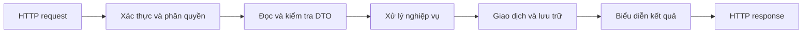

# Lộ trình thiết kế, triển khai và kiểm chứng một API hoàn chỉnh

Một API hoàn chỉnh cho một phạm vi nghiệp vụ không chỉ có các endpoint chạy được. Người gọi cần biết phải gửi gì, thành công nghĩa là gì, lỗi được diễn đạt ra sao và việc thử lại có an toàn không. Người vận hành cần triển khai, quan sát và khôi phục dịch vụ. Nhóm phát triển cần có bằng chứng rằng hành vi thực tế phù hợp với hợp đồng đã công bố.

Bài học thuộc chương **Tổng quan** của module **INTEGRATION_API_REST**. Lộ trình dưới đây kết nối thiết kế theo resource, URI, phương thức và mã trạng thái HTTP với hợp đồng dữ liệu, phân trang, cache, idempotency, OpenAPI, xác thực, phân quyền, xử lý lỗi và kiểm thử. Ví dụ triển khai hướng đến Java/Spring hoặc công nghệ tương đương; các mốc không phụ thuộc vào một phiên bản framework cụ thể.

Mục tiêu là biết **làm việc gì, tạo ra sản phẩm gì và dựa vào bằng chứng nào để đi tiếp**. Đây là lộ trình thực hành; các đoạn HTTP minh họa hợp đồng, còn phần xử lý bên trong được mô tả ở mức thiết kế.

## 1. Chốt phạm vi và định nghĩa “hoàn chỉnh”

Ta xây dựng API quản lý danh mục sách của một thư viện:

- Người đọc được xem danh sách và chi tiết sách công khai.
- Người đã được xác thực và có quyền `CATALOG_EDITOR` được thêm, sửa, xóa sách.
- Mỗi sách có định danh do máy chủ cấp, mã sách `code`, tên `title` và tác giả `author`.
- `code` không trùng với sách đang tồn tại và không được sửa sau khi tạo.
- Khi sửa hoặc xóa, người biên tập phải cung cấp phiên bản đã đọc để tránh ghi đè thay đổi của người khác.
- Việc tạo sách có cơ chế chống tạo trùng khi client gửi lại cùng một yêu cầu do mất response.

Ví dụ không quản lý bản sao vật lý, lượt mượn, người mượn, đặt chỗ hoặc tiền phạt. Một sách trong danh mục không đồng nghĩa với một bản sách đang sẵn sàng cho mượn.

Chốt thêm các quy ước để có thể kiểm chứng:

| Nội dung | Quyết định cho API ví dụ |
|---|---|
| Định dạng trao đổi | JSON, truyền qua HTTPS |
| Mã sách | Chuỗi 3–32 ký tự, chỉ gồm `A-Z`, `0-9`, dấu `-`; từ chối đầu vào không đúng mẫu |
| Tên sách | Chuỗi không chỉ chứa khoảng trắng, tối đa 200 ký tự |
| Tác giả | Chuỗi không chỉ chứa khoảng trắng, tối đa 120 ký tự |
| Phân trang | Phân trang theo `page` và `size`, có thứ tự ổn định |
| Dữ liệu công khai được cache | Chi tiết sách được phép cũ tối đa 60 giây theo chính sách cache đã chọn |
| Dữ liệu cần thay đổi chính xác | Sửa/xóa kiểm tra phiên bản hiện tại tại máy chủ |
| Lỗi | HTTP status đúng ý nghĩa, body có mã lỗi ổn định và mã đối chiếu request |

Giới hạn ký tự cần được quy định nhất quán giữa validation, lưu trữ và kiểm thử, nhất là với Unicode. Đừng để một tầng hiểu độ dài theo byte trong khi tầng khác hiểu theo số ký tự mà không có chủ đích.

“Hoàn chỉnh” ở đây có nghĩa là hoàn tất phạm vi đã chốt với hợp đồng, triển khai, kiểm thử và hướng dẫn vận hành tương ứng. Nó không có nghĩa phải bổ sung mọi tính năng của một hệ thống thư viện thực tế.

**Sản phẩm của mốc này:** danh sách tác nhân, quy tắc nghiệp vụ, phạm vi loại trừ và tiêu chí chấp nhận. Nếu chưa biết sách có công khai hay không, chưa nên quyết định cache hoặc phân quyền theo thói quen.

## 2. Thiết kế resource, URI và ngữ nghĩa HTTP

Tài nguyên trung tâm là `Book`, được nhận diện bằng URI của nó. Cấu trúc API xuất phát từ cách người dùng thao tác với tài nguyên, không xuất phát trực tiếp từ tên bảng hoặc tên phương thức Java.

| Nhu cầu | Operation | Kết quả thành công | Quyền |
|---|---|---|---|
| Xem danh sách | `GET /books` | `200 OK`, danh sách có phân trang | Công khai |
| Xem một sách | `GET /books/{bookId}` | `200 OK`, biểu diễn sách | Công khai |
| Thêm sách | `POST /books` | `201 Created`, `Location`, biểu diễn sách mới | `CATALOG_EDITOR` |
| Sửa tên hoặc tác giả | `PATCH /books/{bookId}` | `200 OK`, biểu diễn sau sửa | `CATALOG_EDITOR`, điều kiện phiên bản |
| Xóa sách | `DELETE /books/{bookId}` | `204 No Content`, không có body | `CATALOG_EDITOR`, điều kiện phiên bản |

Một số quyết định cần được viết thành lời:

- `GET` chỉ phục vụ đọc; không dùng nó để thêm hoặc xóa sách.
- `PATCH` trong ví dụ nhận JSON gồm các trường muốn sửa. Trường vắng mặt được giữ nguyên, `null` bị từ chối, và phải có ít nhất một trường được phép sửa. Đây là định dạng cập nhật riêng của hợp đồng, không phải JSON Patch hoặc JSON Merge Patch.
- `id`, `code`, thời điểm tạo và các trường nội bộ không được sửa bằng `PATCH`.
- `DELETE` lần đầu có thể trả `204`, lần sau trả `404`; hiệu ứng xóa vẫn idempotent. Idempotency không yêu cầu các lần gọi phải có response giống hệt nhau.
- `POST` không có bảo đảm idempotent theo ngữ nghĩa chung của HTTP. Khả năng thử lại an toàn trong ví dụ đến từ hợp đồng bổ sung được thiết kế ở mốc sau.

Không cần tạo `/getAllBooks`, `/createBook` hoặc `/deleteBookById` chỉ vì các phương thức nội bộ có tên như vậy. URI xác định tài nguyên; phương thức HTTP biểu đạt thao tác trong hợp đồng này.

**Sản phẩm của mốc này:** bảng operation, quyền, tác động và mã thành công. Mỗi operation phải giải thích được nó đọc hay thay đổi tài nguyên nào.

## 3. Chốt biểu diễn và hợp đồng trước khi triển khai

### 3.1. Tách dữ liệu được nhận và dữ liệu được trả

| Nhóm dữ liệu | Các trường | Nguồn quyết định |
|---|---|---|
| Tạo sách | `code`, `title`, `author` | Client gửi; máy chủ kiểm tra |
| Sửa sách | Một hoặc cả hai trường `title`, `author` | Client gửi; máy chủ kiểm tra |
| Biểu diễn sách | `id`, `code`, `title`, `author`, `createdAt`, `updatedAt` | Máy chủ trả theo trạng thái đã lưu |
| Phiên bản biểu diễn | Header `ETag` | Máy chủ tạo; client xem như giá trị opaque |

Trong ví dụ, trường ngoài hợp đồng bị từ chối bằng lỗi validation. Không bind trực tiếp JSON đầu vào vào entity rồi mặc nhiên cho phép khách sửa mọi thuộc tính của entity đó.

Định danh sách là một chuỗi do máy chủ cấp. Client không phân tích ý nghĩa từ `b_42` hoặc tự suy ra định danh tiếp theo. Thời gian trả về có thông tin múi giờ; ví dụ dùng UTC với hậu tố `Z`.

### 3.2. Viết trước một cặp request/response chuẩn

```http
POST /books HTTP/1.1
Host: library-api.example
Authorization: Bearer <access-token>
Idempotency-Key: 2f4d6c8e-1012-4356-9abc-1234567890ab
Content-Type: application/json
Accept: application/json

{
  "code": "JAVA-001",
  "title": "Nhập môn Java",
  "author": "Nguyễn An"
}
```

Sau khi dữ liệu và kết quả chống trùng đã được ghi nhận nhất quán, response thành công có thể là:

```http
HTTP/1.1 201 Created
Content-Type: application/json
Location: /books/b_42
ETag: "book-b_42-v1"
Cache-Control: no-store

{
  "id": "b_42",
  "code": "JAVA-001",
  "title": "Nhập môn Java",
  "author": "Nguyễn An",
  "createdAt": "2026-11-17T03:00:00Z",
  "updatedAt": "2026-11-17T03:00:00Z"
}
```

`201` xác nhận tài nguyên đã được tạo; `Location` chỉ URI tài nguyên mới. `Content-Type` mô tả body được gửi, còn `Accept` trong request mô tả loại biểu diễn client mong muốn nhận. Các giá trị header có vai trò riêng, không được thay bằng một trường `success: true` trong JSON.

Token trong ví dụ là chỗ giữ chỗ. Khóa idempotency là dữ liệu minh họa, không phải bí mật đăng nhập và không thay thế kiểm tra quyền.

### 3.3. Đưa hợp đồng vào OpenAPI

Tài liệu OpenAPI cần mô tả các operation đã chốt, gồm:

- Path parameter, query parameter, header bắt buộc và media type.
- Schema tạo, sửa, biểu diễn, trang kết quả và lỗi.
- Trường bắt buộc, độ dài, mẫu mã sách, chính sách trường lạ và `null`.
- Response thành công, `Location`, `ETag` và các nhánh lỗi cần thiết.
- Security scheme và yêu cầu bảo mật ở từng operation; đọc công khai khác với ghi có bảo vệ.
- Ví dụ hợp lệ và mô tả các quy tắc như mã không trùng hoặc xử lý cùng khóa idempotency.

OpenAPI không tự chứng minh rằng database có ràng buộc duy nhất hoặc service kiểm tra đúng quyền. Có thể dùng nó để sinh tài liệu hoặc công cụ client, nhưng vẫn phải kiểm chứng hành vi chạy thật.

**Sản phẩm của mốc này:** hợp đồng đủ để một người khác viết client mẫu mà không đọc mã nguồn máy chủ.

## 4. Triển khai một luồng hoàn chỉnh trước khi mở rộng

Thay vì viết toàn bộ controller, rồi toàn bộ service, rồi mới thử lưu dữ liệu, hãy hoàn tất một luồng nhỏ đi qua các tầng: người biên tập tạo một sách hợp lệ và người đọc lấy lại được sách đó. Đường ghi đầu tiên cần có xác thực, phân quyền và validation; không để đến cuối dự án mới gắn bảo vệ vào một endpoint đã đưa ra sử dụng.



Sơ đồ thể hiện các trách nhiệm logic. Thứ tự thực thi chi tiết có thể khác tùy cơ chế bảo mật và framework; không phải mọi thao tác đều cần xác thực nếu hợp đồng cho phép đọc công khai.

Trong một ứng dụng Java/Spring, có thể phân chia như sau:

| Thành phần | Trách nhiệm chính | Dấu hiệu đang làm quá nhiều |
|---|---|---|
| Lớp bảo mật | Xác thực thông tin đăng nhập, áp dụng chính sách quyền | Tin role do client gửi trong body |
| Controller và request DTO | Ánh xạ HTTP, đọc dữ liệu, kiểm tra cấu trúc | Chứa toàn bộ SQL và quy tắc nghiệp vụ |
| Service | Điều phối nghiệp vụ, ranh giới giao dịch, chống trùng và kiểm tra phiên bản | Chỉ chuyển tiếp lời gọi, để quy tắc rải rác nhiều nơi |
| Repository | Truy vấn và lưu dữ liệu | Tự quyết định mã HTTP trả cho client |
| Response DTO và bộ ánh xạ lỗi | Giữ hợp đồng đầu ra ổn định | Trả entity hoặc stack trace trực tiếp |

Đây là cách phân chia trách nhiệm thường hữu ích, không phải yêu cầu phải tạo một lớp cho từng dòng trong bảng. Một API nhỏ vẫn cần hợp đồng rõ và quy tắc đúng, ngay cả khi cấu trúc mã nguồn gọn hơn.

Ở cuối luồng đầu tiên, phải quan sát được rằng `POST` trả `201`, có `Location`, và `GET` tại URI đó trả đúng sách vừa tạo. Không báo thành công chỉ vì controller đã nhận được body hoặc vì câu lệnh lưu được đưa vào hàng đợi.

**Sản phẩm của mốc này:** một luồng tạo–đọc hoạt động trong môi trường phát triển và có kiểm thử tích hợp phù hợp. Chỉ mở rộng sang danh sách, sửa và xóa sau khi hiểu được đường đi của dữ liệu và lỗi trong luồng đầu tiên.

## 5. Bảo đảm dữ liệu đúng khi có lỗi và cạnh tranh

### 5.1. Ràng buộc lưu trữ bảo vệ quy tắc nghiệp vụ

Kiểm tra trước “mã sách đã tồn tại chưa” có ích để phản hồi sớm, nhưng không đủ để chống hai request đồng thời cùng tạo một mã. Giữa lúc kiểm tra và lúc ghi, một request khác có thể đã tạo sách đó.

Vì vậy cần phối hợp:

- Validation và kiểm tra nghiệp vụ trong ứng dụng.
- Ràng buộc duy nhất phù hợp ở nơi lưu trữ cho `code`.
- Giao dịch bao phủ các thay đổi phải thành công hoặc thất bại cùng nhau.
- Ánh xạ vi phạm ràng buộc đã nhận diện thành `409 Conflict`, tránh để lộ thông báo database.

Không ánh xạ mọi ngoại lệ database thành “mã trùng”. Mất kết nối, hết dung lượng và vi phạm một quy tắc khác cần được phân loại đúng.

### 5.2. Tránh mất cập nhật bằng điều kiện phiên bản

Giả sử hai người cùng đọc sách `b_42` với ETag `"book-b_42-v1"`. Người thứ nhất sửa tên, sau đó người thứ hai sửa tác giả dựa trên dữ liệu cũ. Nếu hệ thống ghi mà không kiểm tra phiên bản, một lần cập nhật có thể vô tình ghi đè dữ liệu vừa đổi.

Hợp đồng yêu cầu người sửa gửi ETag đã đọc:

```http
PATCH /books/b_42 HTTP/1.1
Host: library-api.example
Authorization: Bearer <access-token>
If-Match: "book-b_42-v1"
Content-Type: application/json
Accept: application/json

{
  "title": "Nhập môn Java thực hành"
}
```

Nếu phiên bản vẫn phù hợp và cập nhật thành công, response trả `200`, biểu diễn mới và ETag mới, ví dụ `"book-b_42-v2"`. Nếu phiên bản đã thay đổi, trả `412 Precondition Failed`. Nếu thiếu điều kiện bắt buộc, hợp đồng này trả `428 Precondition Required`. Với tài nguyên không tồn tại, trả `404` theo chính sách đã công bố.

Kiểm tra phiên bản và ghi thay đổi phải gắn với nhau một cách nguyên tử, chẳng hạn cập nhật có điều kiện theo phiên bản trong database hoặc cơ chế khóa lạc quan phù hợp. Đọc phiên bản, so sánh trong bộ nhớ rồi cập nhật không điều kiện vẫn có cửa sổ cạnh tranh.

Client coi ETag là giá trị opaque, gửi lại nguyên giá trị đã nhận; không tự tăng số phiên bản. Ví dụ dùng strong ETag cho `If-Match`; cơ chế tạo ETag cần phản ánh đúng biểu diễn và các biến thể mà máy chủ phục vụ. Không gắn nhãn một ETag yếu rồi kỳ vọng nó đáp ứng strong comparison của `If-Match`.

Khi nhận `412`, client đọc lại và cho người dùng xử lý khác biệt. Không tự lấy ETag mới rồi ghi đè ngay chỉ để request tiếp theo thành công. `DELETE` cũng áp dụng điều kiện phiên bản theo hợp đồng này.

**Sản phẩm của mốc này:** kiểm thử được trường hợp mã trùng, rollback và hai người cập nhật cạnh tranh; chỉ một thay đổi phù hợp với cùng phiên bản ban đầu được chấp nhận.

## 6. Kiểm chứng xác thực, phân quyền và lỗi

### 6.1. Viết ma trận quyền trước khi viết nhánh kiểm tra

| Chủ thể | Đọc danh sách/chi tiết | Thêm/sửa/xóa |
|---|---|---|
| Không có thông tin đăng nhập | Được | `401 Unauthorized` |
| Đã xác thực, thiếu `CATALOG_EDITOR` | Được | `403 Forbidden` |
| Đã xác thực, có `CATALOG_EDITOR` | Được | Được nếu thỏa các điều kiện còn lại |

Xác thực trả lời “người gọi là ai”; phân quyền trả lời “người đó được làm gì”. Tên role được máy chủ lấy từ nguồn danh tính tin cậy theo cơ chế đã chọn, không lấy từ trường `role` trong body. Endpoint công khai cũng cần chính sách xử lý credential sai rõ ràng; không suy diễn rằng “đọc công khai” đồng nghĩa với bỏ qua mọi thông tin xác thực không hợp lệ.

Nếu dùng bearer token, response `401` phải có challenge `WWW-Authenticate` phù hợp. Không chỉ giải mã nội dung token rồi tin dùng; phải xác minh token theo cơ chế và cấu hình bảo mật tương ứng.

### 6.2. Chuẩn hóa lỗi quan sát được

| Tình huống | Mã HTTP của ví dụ |
|---|---|
| JSON sai cú pháp hoặc tham số phân trang không phân tích được | `400 Bad Request` |
| Body dùng media type không được hỗ trợ | `415 Unsupported Media Type` |
| JSON đúng cú pháp nhưng vi phạm schema hoặc quy tắc validation | `422 Unprocessable Content` |
| Chưa xác thực hợp lệ cho thao tác được bảo vệ | `401 Unauthorized` |
| Đã xác thực nhưng thiếu quyền | `403 Forbidden` |
| Không có sách tại URI được yêu cầu | `404 Not Found` |
| Mã sách trùng hoặc khóa idempotency bị dùng sai nội dung | `409 Conflict` |
| Điều kiện phiên bản không khớp | `412 Precondition Failed` |
| Thiếu điều kiện phiên bản bắt buộc | `428 Precondition Required` |
| Lỗi ngoài dự kiến | `500 Internal Server Error` |

Một body lỗi riêng của API có thể là:

```json
{
  "code": "BOOK_CODE_EXISTS",
  "message": "Mã sách đã được sử dụng.",
  "requestId": "req_81c2",
  "errors": [
    {
      "field": "code",
      "code": "DUPLICATE_VALUE"
    }
  ]
}
```

Trả body trên cùng `409` và chính sách không lưu cache phù hợp. Client dùng `code` để quyết định hành vi, không phân tích câu chữ trong `message`. Không trả `200` cho mọi lỗi rồi yêu cầu client tự tìm lỗi trong JSON.

Các mã ở bảng là hợp đồng của ví dụ. Nếu framework mặc định trả một mã khác cho validation, cần cấu hình ánh xạ hoặc điều chỉnh hợp đồng có chủ đích và cập nhật các bên liên quan. Tránh để tài liệu nói `422` còn chương trình luôn trả `400` mà không ai nhận ra.

**Sản phẩm của mốc này:** kiểm thử cả được phép và bị từ chối, body lỗi nhất quán, không lộ stack trace, câu SQL hoặc token.

## 7. Hoàn thiện đọc dữ liệu: phân trang và cache

### 7.1. Danh sách phải có giới hạn và thứ tự

Ví dụ request:

```http
GET /books?page=0&size=20 HTTP/1.1
Host: library-api.example
Accept: application/json
```

Hợp đồng chọn `page` bắt đầu từ 0, `size` mặc định 20, tối đa 100. Giá trị âm, `size` bằng 0, vượt trần hoặc không phân tích được đều trả `400`; không âm thầm biến đầu vào sai thành một giá trị khác.

Response có thể là:

```json
{
  "items": [
    {
      "id": "b_42",
      "code": "JAVA-001",
      "title": "Nhập môn Java",
      "author": "Nguyễn An"
    }
  ],
  "page": 0,
  "size": 20,
  "hasNext": false
}
```

Các sách được sắp theo `createdAt` giảm dần và `id` giảm dần để phá hòa. Phải quy định rõ hướng và khóa sắp xếp; database không có nghĩa vụ tự trả thứ tự ổn định khi truy vấn không chỉ định thứ tự.

`hasNext` cho biết còn trang sau, không ngụ ý API đã tính tổng toàn bộ bản ghi. Danh sách rỗng trả `200` với `items: []`, không phải `404`.

Phân trang theo số trang vẫn có thể trùng hoặc bỏ qua bản ghi khi dữ liệu thay đổi giữa hai lần đọc. Thứ tự ổn định không biến nhiều request thành một snapshot. Nếu cần duyệt tập dữ liệu lớn hoặc đang thay đổi liên tục, có thể chọn cursor và quy định tính nhất quán tương ứng; không đổi cơ chế âm thầm khi client đã phụ thuộc vào hợp đồng cũ.

### 7.2. Cache dựa trên độ mới mà nghiệp vụ chấp nhận

Ví dụ cho phép cache công khai chi tiết sách:

```http
HTTP/1.1 200 OK
Content-Type: application/json
Cache-Control: public, max-age=60
ETag: "book-b_42-v1"
```

Đoạn trên chỉ minh họa các header; response `200` thực tế còn có body biểu diễn sách. Danh sách trong ví dụ dùng `Cache-Control: no-store` để giữ phạm vi chính sách cache ban đầu đơn giản.

Khi bản cache đã cần kiểm tra lại, client có thể gửi `If-None-Match` với ETag đã nhận. Nếu biểu diễn chưa đổi, máy chủ trả `304 Not Modified` không có body, cùng ETag và thông tin cache phù hợp; nếu đã đổi, trả `200` với biểu diễn mới.

`If-None-Match` phục vụ điều kiện đọc/cache ở đây, còn `If-Match` bảo vệ thao tác ghi ở mốc trước. Chúng không thay thế nhau.

Sau sửa hoặc xóa, các bản cache chi tiết có thể vẫn phục vụ dữ liệu cũ trong thời gian còn tươi theo chính sách đã công bố. Chọn `max-age=60` nghĩa là nghiệp vụ chấp nhận độ trễ đó; nếu yêu cầu phản ánh ngay ở mọi nơi, phải đổi chính sách và có cách vô hiệu hóa phù hợp. Không giả định một response ghi tự xóa mọi bản cache của mọi URI liên quan.

Chỉ dùng chính sách cache công khai khi biểu diễn thực sự công khai và không phụ thuộc người gọi. Nếu bổ sung ghi chú nội bộ hoặc dữ liệu theo tài khoản, phải xem lại biểu diễn, khóa cache và header trước khi đưa ra sử dụng.

**Sản phẩm của mốc này:** kiểm thử được trang rỗng, giới hạn trang, thứ tự khi trùng thời gian, `200`/`304` và độ trễ dữ liệu đã cam kết.

## 8. Thiết kế thử lại an toàn cho thao tác tạo

Tình huống cần giải quyết là máy chủ đã tạo sách nhưng response bị mất. Timeout ở client chỉ có nghĩa là client chưa nhận được kết quả đúng hạn; nó không chứng minh database chưa ghi gì.

Hợp đồng `POST /books` trong ví dụ yêu cầu header `Idempotency-Key` và có các quy tắc:

| Nội dung | Quyết định |
|---|---|
| Định dạng khóa | Chuỗi không rỗng, tối đa 128 ký tự; client tạo khóa mới khó trùng cho mỗi ý định tạo mới |
| Thiếu khóa hoặc khóa sai định dạng | `400` với mã lỗi ứng dụng phù hợp |
| Phạm vi khóa | Chủ thể đã xác thực, operation tạo sách và giá trị khóa |
| Dấu vân tay nội dung | Tạo từ nội dung nghiệp vụ đã được phân tích và chuẩn hóa nhất quán |
| Cùng khóa, cùng nội dung, đã hoàn tất | Phát lại kết quả tạo đã ghi nhận, không tạo sách mới |
| Cùng khóa, khác nội dung | `409`, mã `IDEMPOTENCY_KEY_REUSED` |
| Request cùng khóa vẫn đang xử lý | Chờ có giới hạn; nếu chưa có kết quả, trả `409`, mã `REQUEST_IN_PROGRESS`, có thể kèm `Retry-After` |
| Thời hạn giữ kết quả hoàn tất | Ít nhất 24 giờ từ khi hoàn tất; ngoài cửa sổ này không bảo đảm phát lại |

Client cần gửi lại **cùng khóa và cùng ý định dữ liệu** khi thử lại một request chưa rõ kết quả. Nếu tạo khóa mới cho mỗi lần thử, máy chủ sẽ nhìn thấy các yêu cầu khác nhau.

Dấu vân tay không nên thay đổi chỉ vì thứ tự thuộc tính JSON khác nhau. Ngược lại, nó phải thay đổi khi tên hoặc tác giả gửi vào thực sự khác theo quy tắc chuẩn hóa đã chọn. Không đưa access token vào dấu vân tay để rồi một lần làm mới token vô tình biến cùng yêu cầu thành nội dung khác.

Tại máy chủ, cần bảo đảm đồng thời:

1. Kiểm tra xác thực và quyền trước khi trả kết quả, kể cả kết quả phát lại.
2. Chặn hai xử lý cùng khóa tạo hai sách.
3. Ghi sách và bản ghi kết quả dùng để phát lại trong cùng ranh giới nhất quán phù hợp. Với ví dụ một database, có thể dùng giao dịch cho cả hai.
4. Lưu đủ status, body và các header cần thiết như `Location`, `ETag` để phát lại kết quả tạo.
5. Xử lý rollback, khóa đang xử lý bị bỏ dở và dọn dữ liệu hết hạn có chủ đích.

Validation thất bại không tạo sách và không được ghi thành một kết quả tạo thành công. Nếu giao dịch tạo bị rollback thì cũng không để lại một bản ghi khẳng định đã tạo xong.

Kết quả phát lại là kết quả của lần tạo ban đầu, không phải một lần đọc trạng thái hiện tại. Nếu sách đã được sửa sau đó, body hoặc ETag trong kết quả phát lại có thể cũ; client đọc URI tài nguyên khi cần trạng thái mới nhất. Việc tài nguyên đã bị xóa sau khi tạo cũng không cho phép âm thầm tạo lại nó bằng một khóa còn hiệu lực.

Ràng buộc mã sách duy nhất và idempotency bổ sung cho nhau. Ràng buộc duy nhất ngăn vi phạm nghiệp vụ; bản ghi idempotency giúp client nhận lại kết quả của đúng yêu cầu cũ. Chỉ phát hiện “mã đã tồn tại” không tự chứng minh đó là kết quả của lần gửi trước của cùng client.

**Sản phẩm của mốc này:** mô phỏng được mất response sau commit, gửi lại cùng khóa nhận cùng kết quả tạo, và hai request đồng thời không tạo hai tài nguyên.

## 9. Tạo bằng chứng kiểm chứng ở nhiều ranh giới

Không đánh giá API chỉ bằng một lần gọi thành công trong công cụ thử HTTP. Mỗi loại kiểm thử phát hiện một nhóm sai lệch khác nhau.

| Loại kiểm thử | Câu hỏi chính | Ví dụ có giá trị |
|---|---|---|
| Kiểm thử đơn vị cho nghiệp vụ | Quy tắc có đúng với các đầu vào và trạng thái liên quan không? | Không cho sửa `code`, từ chối tên chỉ có khoảng trắng |
| Kiểm thử tích hợp lưu trữ | Giao dịch, truy vấn và ràng buộc có hoạt động với database dùng thực tế không? | Hai tạo trùng mã, rollback, cập nhật cạnh tranh |
| Kiểm thử tại ranh giới HTTP | Request được ánh xạ sang status, header, body đúng không? | `201` có `Location`, `204` không có body, lỗi validation đúng schema |
| Kiểm thử bảo mật | Chủ thể có đúng quyền ở từng operation không? | Người thiếu role không sửa được dù biết định danh |
| Kiểm thử hợp đồng | Triển khai có khớp OpenAPI và quy ước đã công bố không? | Trường bắt buộc, response schema, header điều kiện |
| Kiểm thử hành trình | Các thao tác nối với nhau có đáp ứng nhu cầu thực tế không? | Tạo, đọc, sửa có phiên bản, đọc lại, xóa |
| Kiểm thử tải có mục tiêu | Hệ thống có đáp ứng tải và giới hạn đã chốt không? | Danh sách có giới hạn, thời gian đáp ứng khi có nhiều người đọc |

Mock repository có thể hữu ích cho kiểm thử đơn vị, nhưng không chứng minh unique constraint hoặc transaction thật hoạt động đúng. Nếu database kiểm thử khác loại hoặc cấu hình quá khác môi trường chạy, cần hiểu phần hành vi nào chưa được kiểm chứng.

### 9.1. Ma trận kiểm chứng tối thiểu cho ví dụ

| Kịch bản | Bằng chứng cần có |
|---|---|
| Tạo hợp lệ | `201`, URI hợp lệ, đọc lại đúng dữ liệu, chỉ một bản ghi |
| Mã đã tồn tại | `409`, không tạo thêm tài nguyên |
| Trường lạ hoặc dữ liệu sai quy tắc | `422`, chi tiết lỗi nhất quán, không ghi dữ liệu |
| Chưa đăng nhập khi tạo | `401` và challenge phù hợp |
| Có đăng nhập nhưng thiếu quyền ghi | `403`, không có thay đổi |
| Danh sách rỗng hoặc trang vượt dữ liệu | `200`, `items: []`, thông tin trang đúng |
| Phân trang sai tham số | `400`, không truy vấn không giới hạn |
| Hai cập nhật dùng cùng ETag | Một cập nhật thành công, cập nhật còn lại bị từ chối `412` |
| Sửa/xóa thiếu `If-Match` | `428`, không thay đổi tài nguyên |
| Đọc có ETag chưa đổi | `304`, không có body, header cache phù hợp |
| Cùng khóa tạo và cùng dữ liệu | Cùng kết quả tạo trong cửa sổ hiệu lực, không tạo thêm sách |
| Cùng khóa tạo nhưng khác dữ liệu | `409`, không áp dụng dữ liệu mới |
| Mất response sau commit rồi thử lại | Không nhân đôi sách; nhận lại kết quả đã ghi nhận |
| Lỗi giữa các thao tác lưu cùng giao dịch | Không có dữ liệu dở dang hoặc kết quả chống trùng giả |
| Xóa thành công | `204`, body rỗng; đọc trực tiếp từ origin sau đó trả `404` |

Đọc từ một cache còn tươi ngay sau xóa có thể chưa trả `404` theo chính sách đã chốt. Kiểm thử phải phân biệt đọc trực tiếp origin với đọc qua cache, thay vì vô tình xem một hành vi cache đã cho phép là lỗi hoặc bỏ qua một lỗi ở origin.

Khi kiểm thử cạnh tranh, nên điều khiển để hai tác vụ thực sự chạm vào cùng trạng thái ban đầu, dùng điểm đồng bộ hoặc cơ chế tương đương. Chạy hai request nối tiếp rồi gọi đó là kiểm thử cạnh tranh sẽ bỏ sót vấn đề cần tìm.

Lưu bằng chứng dưới dạng kết quả kiểm thử tự động, request/response đã làm sạch và điều kiện môi trường cần thiết. Một ảnh chụp response `200` không chứng minh các nhánh quyền, rollback hoặc chống trùng đã đúng.

**Sản phẩm của mốc này:** các tiêu chí nghiệp vụ quan trọng đều có kiểm chứng tương ứng; những phần chưa kiểm chứng được ghi rõ để tránh hiểu nhầm về mức hoàn tất.

## 10. Chuẩn bị triển khai và vận hành

API cần chạy được ngoài máy của người viết. Trước khi bàn giao, hoàn thiện những phần gắn trực tiếp với cách dịch vụ sẽ được sử dụng:

- **Cấu hình:** tách endpoint database, cấu hình xác thực và bí mật khỏi mã nguồn; tài liệu nêu rõ biến cấu hình bắt buộc và giá trị mẫu an toàn.
- **Migration:** tạo bảng, chỉ mục, unique constraint và dữ liệu cần thiết bằng cơ chế có quản lý phiên bản; kiểm tra việc nâng cấp từ phiên bản đang có.
- **Giới hạn:** giới hạn kích thước request, số phần tử trả về, thời gian chờ và tài nguyên kết nối phù hợp với mục tiêu tải.
- **Quan sát:** ghi request ID, operation, status, độ trễ và mã lỗi cần thiết; theo dõi lỗi lưu trữ, xung đột và độ trễ. Không ghi access token hoặc bí mật vào log.
- **Kiểm tra sức khỏe:** phân biệt tiến trình đang sống với dịch vụ sẵn sàng nhận lưu lượng theo các phụ thuộc cần thiết; tránh một endpoint sức khỏe trả thành công vô điều kiện.
- **Phát hành:** có bước kiểm tra cấu hình, migration, smoke test và cách xử lý khi phiên bản mới không đạt yêu cầu.
- **Tài liệu dùng API:** có OpenAPI, ví dụ HTTP, cách lấy quyền trong môi trường kiểm thử, quy tắc thử lại, cache và thông tin liên hệ vận hành phù hợp.

Không mặc nhiên cho rằng quay lại bản ứng dụng cũ sẽ đảo ngược được mọi migration. Kế hoạch phát hành phải xét tính tương thích giữa mã nguồn và dữ liệu, đặc biệt với thay đổi xóa hoặc chuyển đổi dữ liệu.

Mục tiêu tải cần được chốt bằng con số phù hợp với môi trường và nhu cầu thực tế: lượng request, phân bố đọc/ghi, kích thước dữ liệu và ngưỡng độ trễ. Không dùng một mục tiêu tùy ý như “luôn dưới 100 ms” để thay cho yêu cầu đã được thống nhất.

### 10.1. Giữ hợp đồng khi API thay đổi

Sau khi có người dùng, đổi tên trường, đổi kiểu dữ liệu, thêm trường đầu vào bắt buộc hoặc đổi cách phân trang có thể làm client hỏng. Những thay đổi như tăng mức bảo vệ, đổi độ mới cache hoặc thay thời hạn idempotency cũng có thể tác động đến cách client hoạt động.

Mỗi thay đổi cần được xem xét trên hợp đồng đã công bố, kiểm thử tương thích và kế hoạch chuyển đổi. Không cho rằng mọi trường đầu ra mới đều được mọi client chấp nhận, nhất là khi client dùng schema đóng. Việc chọn chiến lược phiên bản phải dựa trên cách các bên sử dụng và nâng cấp API.

**Sản phẩm của mốc này:** một phiên bản có thể triển khai lặp lại, có hướng dẫn vận hành và có bằng chứng hoạt động trong môi trường đích.

## 11. Dùng các mốc để tổ chức việc học và thực hành

Không cần triển khai mọi cơ chế cùng một lúc, nhưng phải giữ hợp đồng cuối cùng rõ ràng và không công bố một bảo đảm chưa tồn tại. Có thể chia bài thực hành thành các lần hoàn thiện sau:

| Lần hoàn thiện | Phần việc chính | Điều kiện đi tiếp |
|---|---|---|
| A | Chốt phạm vi, resource, operation, schema và lỗi | Giải thích được hành vi thành công và thất bại của từng operation |
| B | Tạo–đọc với xác thực, quyền ghi, validation và lưu trữ | Có luồng hoàn chỉnh, không trả thành công trước khi commit |
| C | Danh sách, sửa, xóa, unique constraint và kiểm tra phiên bản | Đọc có giới hạn; ghi cạnh tranh không làm mất cập nhật |
| D | Cache, idempotency và các ca lỗi khó | Có kiểm chứng cache, thử lại, rollback và request đồng thời |
| E | Hoàn thiện hợp đồng, kiểm thử, cấu hình và phát hành thử | Hành vi chạy thật khớp tài liệu, có thể bàn giao và vận hành |

Nếu một giai đoạn tạm thời chưa có idempotency hoặc chưa có cache, tài liệu của phiên bản đó phải phản ánh đúng trạng thái hiện tại. Không ghi “đã hỗ trợ” chỉ vì tính năng nằm trong kế hoạch.

Trước khi coi bài thực hành hoàn tất, hãy tự giải thích một hành trình từ đầu đến cuối: ai được gửi request, tài nguyên nào được tác động, dữ liệu nào do máy chủ quyết định, khi nào được commit, client nhận status/header/body nào, và điều gì xảy ra nếu request trùng hoặc response bị mất. Khả năng nối các quyết định đó với bằng chứng kiểm thử là mục tiêu của lộ trình này.
