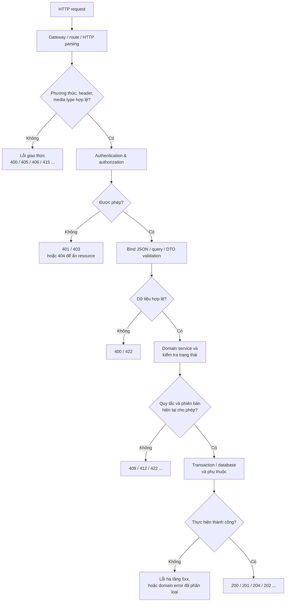
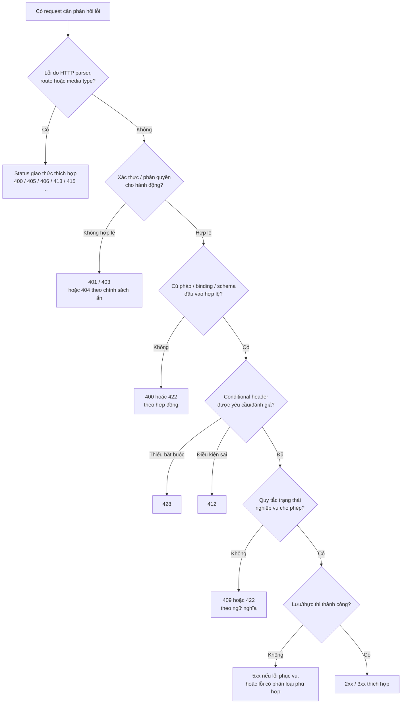
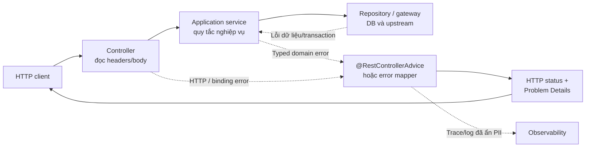

# Phân loại lỗi giao thức, dữ liệu đầu vào và nghiệp vụ

> **Chương:** Lỗi API  
> **Module:** `INTEGRATION_API_REST` — thiết kế REST API dựa trên resource, URI, phương thức và mã trạng thái HTTP, cùng hợp đồng dữ liệu rõ ràng; thực hành phân trang, cache, idempotency, OpenAPI, xác thực, phân quyền, xử lý lỗi và kiểm thử API với Java/Spring hoặc công nghệ tương đương.

Một API REST có thể trả `400`, `404` hoặc `500` rất dễ dàng. Khó hơn là **trả đúng lỗi để client biết điều gì sai, có nên gửi lại không, người dùng cần sửa gì và đội vận hành cần điều tra ở đâu**. Nếu một thanh toán bị đối tác từ chối nhưng server trả `500`, client có thể retry và gây giao dịch lặp. Nếu JSON không hợp lệ lại được trả `409`, client tưởng có xung đột trạng thái thay vì sửa dữ liệu.

Bài này trình bày phương pháp phân loại lỗi theo **nguồn gốc và trách nhiệm xử lý**, sau đó ánh xạ thành HTTP status, payload và hành vi client. Chúng ta dùng ví dụ hệ thống đặt hàng với các resource `/orders`, `/products`, `/payments` để thực hành nhất quán. Việc phân loại hữu ích cho cả API đồng bộ, xử lý bất đồng bộ và khi tích hợp nhiều dịch vụ.

## Mục tiêu học tập

Sau bài học, bạn có thể:

1. Nhận diện lỗi **giao thức và hợp đồng HTTP**, lỗi **cú pháp và dữ liệu đầu vào**, lỗi **quy tắc nghiệp vụ**, cùng lỗi **hạ tầng hoặc phụ thuộc**.
2. Hiểu vì sao **nguồn gốc lỗi không ánh xạ một-một** sang một HTTP status.
3. Chọn mã HTTP thích hợp trong các tình huống về method, media type, JSON, authentication, authorization, validation, vòng đời resource, optimistic concurrency, hạn mức và downstream failure.
4. Thiết kế phản hồi `application/problem+json` có cấu trúc ổn định, có thể quan sát và không rò rỉ thông tin nhạy cảm.
5. Tổ chức các lớp xử lý lỗi với Java/Spring, phân biệt validation với domain exceptions và lỗi bất ngờ.
6. Xây dựng hướng dẫn retry, idempotency, đo lường và bài kiểm thử contract theo từng nhóm lỗi.

## 1. Hai trục phân loại: nguyên nhân và phản hồi HTTP

Một câu hỏi đầu tiên là **“lỗi nằm ở lớp nào?”**; một câu hỏi khác là **“theo hợp đồng HTTP, client cần nhận status nào?”**. Hai câu hỏi liên quan nhưng không đồng nhất.

| Nhóm lỗi theo nguồn gốc | Biểu hiện thường gặp | Ai thường có thể xử lý? | Ví dụ status |
| --- | --- | --- | --- |
| **Giao thức / HTTP contract** | Sai method, URL, `Content-Type`, `Accept`, header điều kiện hoặc xác thực HTTP. | Client sửa request, đăng nhập/cấp quyền, gateway hoặc API owner chỉnh contract. | `400`, `401`, `403`, `404`, `405`, `406`, `412`, `415`, `428`. |
| **Dữ liệu đầu vào** | JSON sai, thiếu trường, sai kiểu, định dạng, độ dài, miền giá trị, tham chiếu không hợp lệ. | Client hoặc người dùng sửa input; API owner làm rõ schema và thông báo lỗi. | `400`, `422`, đôi khi `404` theo ngữ nghĩa resource. |
| **Nghiệp vụ / domain state** | Hủy đơn đã giao, đặt hàng vượt tồn, tên duy nhất bị giữ, yêu cầu thanh toán trùng logic. | Client thực hiện lại bước nghiệp vụ phù hợp, thay đổi trạng thái hoặc cần người quyết định. | `409`, `422`, một số tình huống là `403` hoặc mã khác theo hợp đồng. |
| **Hạ tầng / phụ thuộc / lỗi không mong đợi** | Database không kết nối, timeout upstream, hệ thống quá tải, exception chưa được xử lý. | Server, vận hành hoặc nhà cung cấp phụ thuộc; client chỉ retry theo chính sách an toàn. | `500`, `502`, `503`, `504`, đôi khi `429` cho giới hạn dành cho client. |

**Không có quy tắc “nghiệp vụ = luôn 409” hay “dữ liệu đầu vào = luôn 400”.** Ví dụ: giá trị âm không có nghĩa trong bất kỳ trạng thái nào có thể là `422` theo contract; yêu cầu trừ tồn kho vượt **số hiện có** là xung đột trạng thái `409`; còn một `If-Match` cũ là `412` vì điều kiện HTTP không còn đúng.

### HTTP 4xx và 5xx nói gì?

- **4xx:** server không thể hoặc không muốn thực hiện request vì một điều kiện gắn với request/khách hàng, ví dụ thiếu quyền, sai thông điệp, không tìm thấy resource, xung đột hoặc vượt hạn mức. Không đồng nghĩa người dùng cuối luôn làm sai; có thể client SDK, gateway hoặc hợp đồng API gặp vấn đề.
- **5xx:** server không thể đáp ứng yêu cầu hợp lệ do lỗi ở phía phục vụ hoặc hệ thống phụ thuộc, hay chưa thể hoàn thành vì vấn đề hạ tầng. Client không nên phải sửa JSON để chữa `503`.
- **2xx** không có nghĩa nghiệp vụ cuối cùng đã hoàn tất: `202 Accepted` chỉ báo request đã được nhận để xử lý và kết quả có thể chưa có. Với thao tác bất đồng bộ, lỗi nghiệp vụ xảy ra sau đó cần thể hiện trong resource trạng thái hoặc cơ chế callback/event đã công bố, không thể thay đổi HTTP status của response `202` đã gửi.

Hãy phân loại lỗi ngay tại lớp phát hiện, rồi **dịch sang HTTP response ở ranh giới API**. Không cần để mọi tầng service biết chi tiết về `ResponseEntity` hay `HttpStatus`.

## 2. Một mô hình xử lý request để định vị lỗi



Sơ đồ diễn giải các lớp trách nhiệm chứ **không quy định thứ tự tuyệt đối** của mọi framework và không thay thế điều kiện HTTP: `If-Match`, `If-None-Match` và các precondition còn có quy tắc đánh giá của giao thức. Thực tế, Spring Security filter có thể xử lý `401/403` trước MVC, một gateway có thể từ chối `413` trước khi request vào ứng dụng, và authorization có thể cần lấy resource sau khi bind path.

Cần xác định rõ **ranh giới hệ thống trả response**. Nếu reverse proxy trả `504` thì ứng dụng Java có thể không bao giờ nhìn thấy request. Khi điều tra, trace ID, gateway log và application log giúp tìm tầng thực sự phát lỗi.

## 3. Lỗi giao thức và hợp đồng HTTP

Đây là những lỗi liên quan đến cấu trúc request HTTP, route, negotiation, preconditions, xác thực/phân quyền hoặc quy tắc sử dụng endpoint.

### 3.1 Sai method, đường dẫn và media type

| Tình huống | Mã thường dùng | Lý do và điều cần lưu ý |
| --- | --- | --- |
| Gửi `POST` tới đường dẫn chỉ hỗ trợ `GET`, `PUT`. | **405 Method Not Allowed** | Đường dẫn được nhận diện nhưng method không được hỗ trợ; response `405` **phải có header `Allow`** liệt kê method hiện hỗ trợ của tài nguyên đích. |
| `GET /api/orders/9999`, order không tồn tại. | **404 Not Found** | Không có representation phù hợp hoặc server không muốn tiết lộ sự tồn tại. |
| Gửi `Content-Type: text/plain` tới endpoint chỉ nhận JSON. | **415 Unsupported Media Type** | Server không hỗ trợ định dạng nội dung request. |
| Client chỉ chấp nhận định dạng không có representation phù hợp qua `Accept`. | **406 Not Acceptable** | Server không tạo được representation chấp nhận được theo negotiation; việc trả `406` phụ thuộc cách server xử lý negotiation. |
| Request line, header hoặc cú pháp HTTP không hợp lệ. | **400 Bad Request** | Lỗi cú pháp/giao thức có thể bị server HTTP/gateway phát hiện trước ứng dụng. |
| Body lớn hơn giới hạn được cấu hình. | **413 Content Too Large** | Đừng biến thành `500`; giới hạn có thể ở gateway hoặc ứng dụng. |
| Header quá lớn. | **431 Request Header Fields Too Large** | Có thể do cookie/header bị phình to hoặc client gửi dữ liệu sai chỗ. |

Ví dụ:

```http
POST /api/products/15 HTTP/1.1
Accept: application/json
```

Endpoint chỉ cho đọc và cập nhật qua `GET`, `PUT`:

```http
HTTP/1.1 405 Method Not Allowed
Allow: GET, HEAD, PUT
Content-Type: application/problem+json

{
  "type": "https://api.example.test/problems/method-not-allowed",
  "title": "Method Not Allowed",
  "status": 405,
  "detail": "This resource does not support POST."
}
```

`HEAD` chỉ xuất hiện trong `Allow` khi server thực sự hỗ trợ. Không suy `Allow` từ danh sách tưởng tượng: lấy từ routing/contract thực tế.

### 3.2 `401` và `403` có ý nghĩa khác nhau

- **`401 Unauthorized`**: request thiếu xác thực hợp lệ, token hết hạn/không hợp lệ hoặc chưa cung cấp credentials. Đối với cơ chế HTTP authentication, response `401` **phải gửi `WWW-Authenticate`** chứa ít nhất một challenge thích hợp. Tên “Unauthorized” dễ gây nhầm; thực chất thường là **chưa được xác thực hợp lệ**.
- **`403 Forbidden`**: server hiểu request nhưng từ chối thực hiện; ví dụ người dùng đã xác thực không có quyền quản trị dự án. Có thể xảy ra cả khi hệ thống xác định việc cung cấp credentials không giúp yêu cầu được phép.
- **`404 Not Found`** đôi khi được chọn để **không tiết lộ sự tồn tại** của resource mà người dùng không được quyền biết. Đây là quyết định bảo mật nhất quán của API, không nên để lỗi body vô tình tiết lộ rằng đơn hàng hoặc tài khoản thực sự tồn tại.

Ví dụ một bearer challenge:

```http
HTTP/1.1 401 Unauthorized
WWW-Authenticate: Bearer realm="api"
Cache-Control: no-store
Content-Type: application/problem+json

{
  "type": "https://api.example.test/problems/authentication-required",
  "title": "Authentication required",
  "status": 401,
  "detail": "Valid credentials are required."
}
```

Không đặt access token, refresh token, giá trị secret hoặc lý do nhạy cảm trong `detail` hay log công khai. Bộ lọc Spring Security/gateway thường xử lý phần này; không nên bắt mọi security exception thành `500` trong controller advice.

### 3.3 Điều kiện HTTP và giới hạn tần suất

| Mã | Khi dùng | Client phục hồi thế nào? |
| --- | --- | --- |
| **412 Precondition Failed** | `If-Match`/`If-None-Match` hoặc điều kiện HTTP hợp lệ được đánh giá là sai. | Lấy lại trạng thái/ETag, kiểm tra thay đổi rồi gửi thao tác thích hợp. |
| **428 Precondition Required** | Server buộc request ghi phải có điều kiện HTTP thích hợp nhưng client không gửi. | Đọc validator, thêm `If-Match` hoặc điều kiện theo contract. Response `428` **không được lưu trong cache**. |
| **429 Too Many Requests** | Client/người dùng/token đã vượt chính sách giới hạn request. | Tôn trọng `Retry-After` nếu có, dùng backoff và giảm tần suất; không tự tăng retry vô hạn. |

```http
HTTP/1.1 429 Too Many Requests
Retry-After: 30
Content-Type: application/problem+json

{
  "type": "https://api.example.test/problems/rate-limit",
  "title": "Rate limit exceeded",
  "status": 429,
  "detail": "Retry after the indicated delay.",
  "code": "RATE_LIMIT_EXCEEDED"
}
```

`Retry-After` có thể là số giây hoặc ngày HTTP, tùy phản hồi. `429` là quy tắc giới hạn đối với khách hàng; `503` thường mô tả dịch vụ tạm không sẵn sàng do quá tải hoặc bảo trì. Có trường hợp API dùng cả hai loại giới hạn ở các tầng khác nhau; hãy tài liệu hóa chính sách.

## 4. Lỗi dữ liệu đầu vào: cú pháp, định dạng, giá trị

Đầu vào đi qua nhiều bước: đọc HTTP body, parse JSON, bind vào DTO, kiểm tra schema/Bean Validation, rồi kiểm tra các ràng buộc cần kiến thức nghiệp vụ. **Điểm thất bại khác nhau gợi ý thông báo và cách sửa khác nhau.**

### 4.1 Lỗi cú pháp hoặc kiểu dữ liệu — thường `400`

```http
POST /api/orders HTTP/1.1
Content-Type: application/json

{"quantity": 3, "productId":
```

Đây là JSON chưa hoàn chỉnh. Server không thể parse thành thông điệp hợp lệ:

```http
HTTP/1.1 400 Bad Request
Content-Type: application/problem+json

{
  "type": "https://api.example.test/problems/malformed-json",
  "title": "Malformed JSON request",
  "status": 400,
  "detail": "Request body could not be parsed.",
  "code": "INVALID_JSON"
}
```

Tương tự: giá trị số được truyền thành object khi schema cần integer, path ID không parse được kiểu cần thiết, query parameter sai cú pháp, thiếu query parameter bắt buộc, hoặc header mà controller không thể bind theo contract. Một số lỗi của framework có thể có status khác theo ngữ nghĩa đường dẫn/header; đừng khẳng định mọi trường hợp bind lỗi đều phải là `400`.

### 4.2 Dữ liệu đọc được nhưng không đạt ràng buộc

```json
{
  "productId": 15,
  "quantity": 0,
  "email": "not-an-email"
}
```

JSON hợp lệ nhưng `quantity` phải lớn hơn 0 và `email` phải có định dạng đã định nghĩa. Một API có thể dùng:

- **`400 Bad Request`** cho mọi lỗi validation contract, kể cả Bean Validation: đơn giản, nhiều framework mặc định áp dụng.
- **`422 Unprocessable Content`** khi media type và cú pháp đã đúng nhưng nội dung yêu cầu không thể được xử lý theo chỉ dẫn, đặc biệt hữu ích để **phân biệt cú pháp (`400`) với ngữ nghĩa đầu vào (`422`)**.

Cả hai chính sách có thể hợp lý tùy hợp đồng. Điểm quan trọng là **chọn nhất quán, ghi rõ trong OpenAPI và kiểm thử**, không trả `422` hôm nay và `400` ngày mai cho cùng một ràng buộc mà không có thay đổi contract.

Ví dụ nếu contract chọn `422` cho validation ở tầng nội dung:

```http
HTTP/1.1 422 Unprocessable Content
Content-Type: application/problem+json

{
  "type": "https://api.example.test/problems/validation",
  "title": "Validation failed",
  "status": 422,
  "detail": "Request contains invalid values.",
  "code": "VALIDATION_FAILED",
  "errors": [
    {"field": "quantity", "code": "MIN_VALUE", "message": "Must be greater than zero."},
    {"field": "email", "code": "INVALID_FORMAT", "message": "Invalid email format."}
  ]
}
```

**Không nên phản chiếu giá trị đầu vào nhạy cảm** (mật khẩu, số thẻ, token, giấy tờ) trong `errors`. Các `field`/`code` là phần của hợp đồng cho client; `message` dành cho người đọc có thể bản địa hóa.

### 4.3 Ranh giới với dữ liệu tham chiếu

Ví dụ `productId = 15` là một số hợp lệ nhưng sản phẩm 15 không tồn tại:

- Nếu URL đích là `GET /api/products/15`, `404` là tự nhiên.
- Nếu `POST /api/orders` tham chiếu `productId=15` không tồn tại, API có thể trả `422` cho tham chiếu không hợp lệ hoặc `404` nếu hợp đồng coi product là resource đích cần tìm; ghi rõ contract và tránh lộ tài nguyên mà client không được phép xem.
- Nếu product 15 **có tồn tại nhưng đã bị ngừng bán** thì đây thường là tình huống trạng thái nghiệp vụ, có thể dùng `409` hoặc lỗi nội dung `422` theo thiết kế lệnh và quy tắc.

Điều quan trọng là tách “không parse được”, “parse được nhưng dữ liệu sai theo schema” và “dữ liệu hợp lệ nhưng quy tắc hiện tại không cho phép thao tác”.

## 5. Lỗi nghiệp vụ: quy tắc và trạng thái tài nguyên

**Domain error** là trường hợp quy tắc nghiệp vụ từ chối một hành động đã được diễn đạt hợp lệ. Đây không nhất thiết là lỗi hệ thống: việc từ chối đặt hàng vượt tồn hay từ chối hủy đơn đã giao là hành vi có chủ đích.

| Tình huống | Status thường hợp lý | Căn cứ chọn |
| --- | --- | --- |
| Đơn hàng đã `SHIPPED`, client yêu cầu hủy. | **409 Conflict** | Hành động mâu thuẫn trạng thái hiện tại. |
| Đặt số lượng 9 khi chỉ còn 5 hàng, dưới hợp đồng kiểm tra tồn tức thời. | **409 Conflict** | Không thể thực hiện ở trạng thái tồn kho hiện tại. |
| `POST /projects` với slug đã được dùng. | **409 Conflict** | Ràng buộc duy nhất/xung đột trạng thái. |
| Mã khuyến mại sai định dạng theo schema công khai. | **400/422** | Input không hợp lệ, không cần xem trạng thái hệ thống. |
| Mã khuyến mại hợp lệ nhưng hết hiệu lực hoặc không dành cho nhóm khách này. | **422** hoặc **409** theo contract | Là điều kiện nghiệp vụ; `409` phù hợp nếu xung đột trạng thái hiện tại là bản chất vấn đề, `422` phù hợp nếu nội dung không thể được chấp nhận. |
| Cập nhật có `If-Match` nhưng ETag đã cũ. | **412 Precondition Failed** | Precondition chuẩn HTTP sai, không đổi thành `409`. |
| Không có `If-Match` trong endpoint bắt buộc conditional write. | **428 Precondition Required** | Thiếu điều kiện bắt buộc. |
| Không đủ quyền thực hiện thao tác admin. | **403 Forbidden** | Vấn đề quyền, không phải state conflict. |
| Tài nguyên đích không tồn tại. | **404 Not Found** | Vấn đề nhận diện tài nguyên, trừ khi policy cần che giấu. |

### 5.1 Lỗi nghiệp vụ cần có mã ổn định

Ví dụ `409` cho đơn hàng đã giao:

```http
POST /api/orders/900/cancel HTTP/1.1
Content-Type: application/json

{"reason": "CUSTOMER_REQUEST"}
```

```http
HTTP/1.1 409 Conflict
Content-Type: application/problem+json

{
  "type": "https://api.example.test/problems/order-state-conflict",
  "title": "Order state conflict",
  "status": 409,
  "detail": "This order cannot be cancelled in its current state.",
  "code": "ORDER_ALREADY_SHIPPED",
  "allowedActions": ["REQUEST_RETURN"]
}
```

Client nên dùng `code`/`type` làm tín hiệu máy đọc, đồng thời hiển thị hướng xử lý phù hợp. Nếu dữ liệu nhạy cảm hoặc người dùng không được xem trạng thái, response phải có nội dung trung tính.

### 5.2 Tính đồng thời là trách nhiệm của dữ liệu, không phải status

Đừng làm:

```java
if (inventory.getAvailable() >= requested) {
    inventory.setAvailable(inventory.getAvailable() - requested);
    repository.save(inventory);
}
```

Nếu hai request cùng đọc tồn kho 5 rồi đều trừ 4, cả hai có thể vượt kiểm tra và gây bán quá số lượng. Server cần thực thi kiểm tra và thay đổi một cách **nguyên tử**, ví dụ lệnh SQL có điều kiện:

```sql
UPDATE inventory
SET available = available - :requested
WHERE sku = :sku
  AND available >= :requested;
```

Nếu số hàng được cập nhật bằng 0, service xác định không có SKU hay thiếu tồn theo contract (thường `404` hoặc `409`), đồng thời tính đến các giao dịch cạnh tranh/xóa tài nguyên. Việc đổi response từ `500` sang `409` **không tự khắc phục race condition**.

Với các thao tác nhạy cảm như thanh toán, cần thêm idempotency key, unique constraint, outbox, reconciliation và chính sách retry an toàn. Lỗi domain là một phần hợp đồng kinh doanh, nhưng ứng dụng phải bảo vệ tính đúng đắn bên dưới.

## 6. Lỗi hạ tầng và phụ thuộc: tránh quy lỗi cho client

Một request có thể hoàn toàn hợp lệ nhưng server không xử lý được do database, DNS, mạng, queue, upstream hoặc chính ứng dụng lỗi.

| Status | Khi phù hợp | Tránh nhầm |
| --- | --- | --- |
| **500 Internal Server Error** | Server gặp tình huống không mong đợi, không có mã 5xx cụ thể hơn. | Không dùng cho validation hay business rejection có thể dự đoán. |
| **502 Bad Gateway** | Server hoạt động như gateway/proxy nhận phản hồi không hợp lệ từ upstream. | Không phải mã chung cho mọi lỗi từ đối tác; phụ thuộc vai trò thành phần và hợp đồng. |
| **503 Service Unavailable** | Dịch vụ tạm không phục vụ được do quá tải/bảo trì hoặc thiếu năng lực; có thể gửi `Retry-After`. | Không dùng `429` cho mọi quá tải toàn hệ thống nếu vấn đề không phải hạn mức của client. |
| **504 Gateway Timeout** | Gateway/proxy không nhận phản hồi kịp thời từ upstream cần thiết để hoàn thành request. | Không phải mọi Java `SocketTimeoutException` đều có nghĩa ứng dụng là gateway và phải trả `504`. |

### Một lỗi phụ thuộc có thể được chuyển thành trạng thái nghiệp vụ

Giả sử API nhận yêu cầu đặt hàng, gọi payment provider nhưng timeout. Có hai thiết kế khác nhau:

1. **API đồng bộ:** chưa có cách biết payment đã thu hay chưa. Server cần xử lý trạng thái không chắc chắn, không được tự quyết là “thất bại” rồi vô tư thu lại. Nếu không thể phục vụ yêu cầu, trả lỗi phù hợp với ranh giới API, nhưng luôn bảo đảm reconciliation/idempotency.
2. **API xử lý bất đồng bộ:** request hợp lệ được lưu bền vững và trả `202 Accepted` với resource theo dõi. Sau đó trạng thái nghiệp vụ có thể là `PENDING`, `PAID`, `FAILED`. Sự cố của đối tác được phản ánh qua trạng thái/trường lỗi domain của job khi có kết quả. Không thể gửi một `500` mới sau response `202` đã hoàn thành.

**Status mô tả kết quả của request HTTP hiện tại**, không phải luôn là kết quả cuối cùng của một tiến trình dài chạy phía sau.

### Chính sách retry phụ thuộc an toàn nghiệp vụ

Đối với `502`/`503`/`504` hoặc network timeout, retry có thể hữu ích nhưng cần:

- giới hạn số lần, tổng thời gian, **exponential backoff với jitter** và tôn trọng `Retry-After` nếu được trả;
- chỉ retry tự động khi thao tác an toàn/idempotent hoặc có **idempotency key + lưu kết quả** đủ bảo đảm không lặp side effect;
- phân biệt timeout phản hồi với **không thực thi**: mất response không chứng minh server chưa commit;
- có circuit breaker, deadline và giới hạn concurrency để tránh khuếch đại sự cố;
- với thao tác thanh toán, kiểm tra kết quả theo transaction/idempotency key trước khi thực hiện lại.

`GET` và `HEAD` là các phương thức an toàn theo ngữ nghĩa HTTP; `PUT` và `DELETE` là idempotent theo ngữ nghĩa phương thức nhưng vẫn cần xem ứng dụng, điều kiện và side effect ngoài hệ thống. `POST` thường cần cơ chế idempotency riêng nếu muốn tự retry an toàn.

## 7. Ma trận quyết định: lỗi nào xảy ra trước?

Trong thực tế, một request có thể đồng thời có JSON sai và token hết hạn; hoặc ETag cũ và resource chưa được phép truy cập. Không nên tạo cây ưu tiên máy móc bỏ qua framework, bảo mật hay ngữ nghĩa chuẩn.



Cây giúp học cách định vị, nhưng **bước thực thi thực tế có thể khác**: proxy từ chối body quá lớn trước khi xác thực, Spring Security thường chạy trước validation MVC, và HTTP precondition có những quy tắc đánh giá riêng. Một request vốn phải thất bại do method hoặc authorization có thể không được đánh giá `If-Match`. Đừng dùng bảng này để kết luận luôn phải trả `428` trước `403`.

### Những tình huống dễ phân loại sai

| Tình huống | Trả lời gợi ý | Lý do |
| --- | --- | --- |
| `POST /orders` với JSON thiếu dấu đóng ngoặc. | `400` | Sai cú pháp. |
| JSON hợp lệ, `quantity = 0`. | `400` hoặc `422` | Vi phạm ràng buộc input theo contract. |
| `GET /orders/123` không có resource. | `404` | Resource không tồn tại/không lộ. |
| `POST /orders/123/cancel` khi đã giao hàng. | `409` | Xung đột trạng thái. |
| `PATCH` thiếu `If-Match` dù endpoint yêu cầu. | `428` | Thiếu điều kiện HTTP. |
| `PATCH` có `If-Match` cũ. | `412` | Điều kiện HTTP sai. |
| `POST` với business key unique đã có. | `409` | Trùng ràng buộc duy nhất. |
| Token bearer hết hạn. | `401`, kèm challenge phù hợp. | Chưa xác thực hợp lệ. |
| User hợp lệ nhưng không có quyền xem dự án. | `403` hoặc `404` theo chính sách. | Kiểm soát quyền và tránh rò rỉ sự tồn tại. |
| `POST` bị API rate limit. | `429` | Throttling theo client/quota. |
| DB ngừng phục vụ, giao dịch không commit. | Thường `500` hoặc `503` tùy ngữ cảnh. | Không phải lỗi input. |
| Gateway chờ upstream quá hạn. | `504` | Timeout tại gateway. |
| Body `Content-Type` không được hỗ trợ. | `415` | Sai media type của request. |

Nếu client đã được phép thấy resource nhưng endpoint dùng `PATCH` và `Content-Type` không được hỗ trợ, `415` thường chính xác hơn `422`. Nếu API không hỗ trợ `POST` cho resource, `405` phù hợp hơn một phản hồi domain `409`.

## 8. Chuẩn lỗi thống nhất bằng Problem Details

**RFC 9457** mô tả định dạng Problem Details để biểu diễn lỗi bằng media type **`application/problem+json`** (và `application/problem+xml` trong những trường hợp hỗ trợ). Thay vì mỗi API trả `{"error":"..." }` với cấu trúc khác nhau, một chuẩn nhất quán giúp client và logging xử lý ổn định.

Các trường chuẩn thường gặp:

| Trường | Ý nghĩa | Ghi chú |
| --- | --- | --- |
| `type` | URI định danh loại vấn đề; có thể dẫn tới tài liệu giải thích. | Có thể dùng `about:blank` cho lỗi generic; khi đó `title` thường theo reason phrase của status. |
| `title` | Mô tả ngắn, ổn định về **loại lỗi**. | Không nên thay đổi tùy từng request. |
| `status` | Mã HTTP status mô tả lỗi; hữu ích nếu payload đi qua trung gian. | HTTP status line vẫn là nguồn chính trong response HTTP; không để hai giá trị mâu thuẫn. |
| `detail` | Giải thích cụ thể lần lỗi này. | Ngôn ngữ dành cho con người; không nên dùng để điều khiển logic client. |
| `instance` | URI định danh lần xuất hiện lỗi hoặc ngữ cảnh instance. | Có thể là URI tương đối; không bắt buộc là trang công khai. |
| **Extensions** | Thông tin do API thêm như `code`, `traceId`, `errors`, `allowedActions`. | Thiết kế namespace, kiểu và hợp đồng ổn định; không chứa thông tin nhạy cảm. |

Ví dụ validation:

```http
HTTP/1.1 422 Unprocessable Content
Content-Type: application/problem+json
Cache-Control: no-store
X-Request-Id: req-7a13

{
  "type": "https://api.example.test/problems/validation",
  "title": "Validation failed",
  "status": 422,
  "detail": "Two fields contain invalid values.",
  "instance": "/errors/req-7a13",
  "code": "VALIDATION_FAILED",
  "traceId": "req-7a13",
  "errors": [
    {"field": "quantity", "code": "MIN_VALUE", "message": "Must be greater than zero."},
    {"field": "email", "code": "INVALID_FORMAT", "message": "Invalid email address."}
  ]
}
```

Ví dụ hệ thống:

```http
HTTP/1.1 503 Service Unavailable
Content-Type: application/problem+json
Retry-After: 20
Cache-Control: no-store
X-Request-Id: req-7a14

{
  "type": "https://api.example.test/problems/service-unavailable",
  "title": "Service temporarily unavailable",
  "status": 503,
  "detail": "The service cannot complete this request at the moment.",
  "instance": "/errors/req-7a14",
  "code": "SERVICE_UNAVAILABLE",
  "traceId": "req-7a14"
}
```

**Không bao giờ** đưa SQL query, stack trace, host nội bộ, URL kết nối database, access token, mật khẩu hoặc chi tiết giao dịch người khác vào response công khai. Log nội bộ có thể mang nguyên nhân sâu hơn nhưng vẫn cần redaction và chính sách truy cập.

### Quy ước lỗi dùng lâu dài

Một hợp đồng nên quyết định:

1. **Mã HTTP:** cho hành vi giao thức tổng thể.
2. **`type` hoặc `code` ổn định:** cho loại lỗi ứng dụng client xử lý.
3. **`errors[]`:** chỉ dùng với field-level validation khi cần; không bắt client phân tích văn bản tiếng Anh.
4. **`traceId` / request ID:** liên kết với log và trace, không làm lộ ID bí mật.
5. **Thông điệp có thể bản địa hóa:** không đổi `code` khi dịch `detail`.
6. **`Retry-After`:** trả khi có cơ sở đưa ra thời gian/điều kiện retry, không bịa số giây.
7. **Bảo mật/caching:** cân nhắc `Cache-Control: no-store` cho lỗi mang thông tin cá nhân hoặc nhạy cảm; một số response như `404` có thể được cache theo HTTP nếu không được điều chỉnh, nên chính sách cache phải có chủ đích.

Không có yêu cầu mọi Problem Details bắt buộc có tất cả trường. `type` có thể được mặc định là `about:blank`; API nên công bố các extension và hạn chế rò rỉ dữ liệu.

## 9. Thiết kế domain exceptions độc lập với HTTP

Để giữ logic nghiệp vụ kiểm thử được, service có thể ném exception hoặc trả kết quả miền **không phụ thuộc Spring MVC**. Lớp API chuyển đổi sang status và Problem Details.

Một phân loại tối thiểu:

| Loại lỗi nội bộ | Ví dụ | Mapping tại HTTP boundary |
| --- | --- | --- |
| `MalformedRequest` | Không parse được body/param. | `400` hoặc mã giao thức thích hợp. |
| `InputValidationFailure` | Quantity dưới min, email sai định dạng. | `400` hoặc `422` theo convention. |
| `ResourceNotFound` | Không thấy order theo định danh và quyền hợp lệ. | `404`. |
| `DomainConflict` | Đơn đã giao, slug tồn tại, tồn kho thay đổi. | `409`. |
| `DomainRuleViolation` | Nội dung hợp lệ về cú pháp nhưng hành động vô nghĩa theo quy tắc đã định. | `422` hoặc `409` theo trạng thái/contract. |
| `StaleVersion` | Không khớp điều kiện `If-Match`. | `412`. |
| `PreconditionMissing` | Thiếu header được yêu cầu. | `428`. |
| `DependencyUnavailable` | Phụ thuộc tạm không đáp ứng; hoạt động server đang không khả dụng. | `503` hoặc `502/504` nếu đúng ngữ nghĩa gateway. |
| `UnexpectedFailure` | Bug, lỗi chưa dự kiến. | `500`, không lộ thông tin nội bộ. |

Không bao giờ ánh xạ `IllegalArgumentException` → `400` cho toàn ứng dụng vì một `IllegalArgumentException` có thể là **lỗi lập trình phía server**, không phải input client. Cũng không ánh xạ mọi `DataIntegrityViolationException` thành `409`: có thể là unique conflict do user tạo, nhưng cũng có thể do bug schema, quan hệ bị hỏng hoặc thao tác nội bộ sai.

### Phân tầng xử lý gợi ý



Security filter/gateway có error mapper riêng cho `401`, `403` và các lỗi diễn ra trước MVC. Cần chuẩn hóa payload ở những lớp đó nếu tổ chức yêu cầu cùng định dạng lỗi.

## 10. Java/Spring Boot: ví dụ phân loại và ánh xạ lỗi

Ví dụ sau hướng tới **Spring Boot 3 / Spring Framework 6 trở lên** (dùng `jakarta.validation`, `ProblemDetail`, `@RestControllerAdvice`). Đây là các đoạn minh họa ranh giới lớp; dự án thực cần bổ sung repository, security configuration, migration database, idempotency và logging.

### 10.1 DTO và controller

```java
import jakarta.validation.Valid;
import jakarta.validation.constraints.Min;
import jakarta.validation.constraints.NotNull;
import org.springframework.http.HttpStatus;
import org.springframework.http.ResponseEntity;
import org.springframework.web.bind.annotation.*;

import java.net.URI;

record CreateOrderRequest(
    @NotNull Long productId,
    @NotNull @Min(1) Integer quantity
) {}

record OrderResponse(long id, String status) {}

@RestController
@RequestMapping("/api/orders")
class OrderController {
    private final OrderService service;

    OrderController(OrderService service) {
        this.service = service;
    }

    @PostMapping
    ResponseEntity<OrderResponse> create(
            @Valid @RequestBody CreateOrderRequest request) {
        OrderResponse order = service.create(request.productId(), request.quantity());

        return ResponseEntity
            .created(URI.create("/api/orders/" + order.id()))
            .body(order);
    }

    @PostMapping("/{id}/cancel")
    ResponseEntity<Void> cancel(@PathVariable long id) {
        service.cancel(id);
        return ResponseEntity.noContent().build();
    }
}
```

- `@Valid`/`@NotNull`/`@Min` kiểm tra input đã parse. Mặc định Spring MVC thường trả `400` cho `MethodArgumentNotValidException`; dưới đây ta chọn **`422` cho Bean Validation** như chính sách của API minh họa.
- Nếu JSON không parse được, Spring MVC thường ném `HttpMessageNotReadableException`; khác với validation ở trên.
- Lỗi `OrderNotFoundException`, `OrderStateConflictException` từ service là domain events/errors. Controller không cần trả `500` cho chúng.
- Có thể bổ sung `@PreAuthorize` hoặc security filter để kiểm tra quyền; không tin `productId` hay path ID từ client là đủ xác định quyền truy cập.

### 10.2 Các exception có ý nghĩa ở tầng ứng dụng

```java
final class OrderNotFoundException extends RuntimeException {
    OrderNotFoundException() {
        super("Order not found");
    }
}

final class OrderStateConflictException extends RuntimeException {
    OrderStateConflictException(String safeMessage) {
        super(safeMessage);
    }
}

final class RuleViolationException extends RuntimeException {
    RuleViolationException(String safeMessage) {
        super(safeMessage);
    }
}
```

Trong dự án thật, có thể dùng sealed result types, error codes hoặc exception hierarchy; trọng tâm là **ngữ nghĩa rõ**, không để chuỗi message từ SQL quyết định status.

### 10.3 Controller Advice trả Problem Details

```java
import jakarta.servlet.http.HttpServletRequest;
import org.slf4j.Logger;
import org.slf4j.LoggerFactory;
import org.springframework.http.*;
import org.springframework.http.converter.HttpMessageNotReadableException;
import org.springframework.web.bind.MethodArgumentNotValidException;
import org.springframework.web.bind.annotation.*;
import org.springframework.web.method.annotation.MethodArgumentTypeMismatchException;

import java.net.URI;
import java.util.List;

@RestControllerAdvice
class ApiErrorHandler {
    private static final Logger log = LoggerFactory.getLogger(ApiErrorHandler.class);

    private static ProblemDetail problem(
            HttpStatusCode status, String type, String title, String detail, String code) {
        ProblemDetail p = ProblemDetail.forStatusAndDetail(status, detail);
        p.setType(URI.create("https://api.example.test/problems/" + type));
        p.setTitle(title);
        p.setProperty("code", code);
        return p;
    }

    @ExceptionHandler(HttpMessageNotReadableException.class)
    ResponseEntity<ProblemDetail> malformedJson() {
        var p = problem(
            HttpStatus.BAD_REQUEST, "malformed-json", "Malformed JSON",
            "Request body could not be parsed.", "INVALID_JSON");
        return ResponseEntity.badRequest().body(p);
    }

    @ExceptionHandler(MethodArgumentTypeMismatchException.class)
    ResponseEntity<ProblemDetail> pathOrQueryType() {
        var p = problem(
            HttpStatus.BAD_REQUEST, "invalid-parameter", "Invalid parameter",
            "A path or query parameter has an invalid type.", "INVALID_PARAMETER");
        return ResponseEntity.badRequest().body(p);
    }

    @ExceptionHandler(MethodArgumentNotValidException.class)
    ResponseEntity<ProblemDetail> invalidDto(MethodArgumentNotValidException ex) {
        var p = problem(
            HttpStatus.UNPROCESSABLE_ENTITY, "validation", "Validation failed",
            "Request contains invalid fields.", "VALIDATION_FAILED");
        List<FieldIssue> issues = ex.getBindingResult().getFieldErrors()
            .stream()
            .map(e -> new FieldIssue(
                e.getField(),
                e.getCode() == null ? "INVALID" : e.getCode(),
                "Invalid value for this field"))
            .toList();
        p.setProperty("errors", issues);
        return ResponseEntity.unprocessableEntity().body(p);
    }

    record FieldIssue(String field, String code, String message) {}

    @ExceptionHandler(OrderNotFoundException.class)
    ResponseEntity<ProblemDetail> missing() {
        var p = problem(
            HttpStatus.NOT_FOUND, "order-not-found", "Order not found",
            "The requested order is unavailable.", "ORDER_NOT_FOUND");
        return ResponseEntity.status(HttpStatus.NOT_FOUND).body(p);
    }

    @ExceptionHandler(OrderStateConflictException.class)
    ResponseEntity<ProblemDetail> conflict() {
        var p = problem(
            HttpStatus.CONFLICT, "order-state-conflict", "Order state conflict",
            "The requested operation conflicts with the current order state.",
            "ORDER_STATE_CONFLICT");
        return ResponseEntity.status(HttpStatus.CONFLICT).body(p);
    }

    @ExceptionHandler(RuleViolationException.class)
    ResponseEntity<ProblemDetail> businessRule() {
        var p = problem(
            HttpStatus.UNPROCESSABLE_ENTITY, "business-rule", "Business rule violation",
            "The requested action violates a business rule.", "BUSINESS_RULE_VIOLATION");
        return ResponseEntity.unprocessableEntity().body(p);
    }

    @ExceptionHandler(Exception.class)
    ResponseEntity<ProblemDetail> unexpected(Exception ex, HttpServletRequest request) {
        // Log nguyên nhân nội bộ theo chính sách redaction/access control.
        log.error("Unhandled API failure at {}", request.getRequestURI(), ex);
        var p = problem(
            HttpStatus.INTERNAL_SERVER_ERROR, "internal-error", "Internal server error",
            "The request could not be completed.", "INTERNAL_ERROR");
        return ResponseEntity.status(HttpStatus.INTERNAL_SERVER_ERROR).body(p);
    }
}
```

**Lưu ý triển khai:**

- Đây là ví dụ về **một chính sách cụ thể**: body parse sai → `400`, Bean Validation → `422`, trạng thái đơn không phù hợp → `409`, resource không tồn tại → `404`, bất ngờ → `500`. Nếu nhóm chọn `400` cho validation, đổi mapping và contract/test đồng bộ.
- Khi bắt rộng `Exception`, cần kiểm tra cách Spring/framework biểu diễn các lỗi HTTP có sẵn (ví dụ `405`, `415`, `406`). Trong ứng dụng production **không nên dùng handler 500 trên mọi exception MVC mặc định**, vì có thể vô tình biến lỗi giao thức thành `500`. Có thể kế thừa `ResponseEntityExceptionHandler` và override đúng các phương thức, hoặc cung cấp handler cho framework exceptions với nguyên status; đảm bảo handler tổng quát không làm mất status vốn đã được quyết định.
- `401/403` thường được xử lý trong Spring Security (`AuthenticationEntryPoint`, `AccessDeniedHandler`) trước controller advice. Nên dùng cùng format `ProblemDetail` nhưng áp dụng ở đúng lớp.
- Tình huống unique constraint cần handler **theo thao tác/cột/constraint được nhận diện**, sau đó service chuyển sang lỗi miền `409`; không bắt mọi lỗi database thành conflict.
- Thông báo `FieldIssue` trong ví dụ cố ý không đưa **rejected value** vào response. Hệ thống thật có thể dùng thông điệp bản địa hóa an toàn, không lộ dữ liệu nhạy cảm.
- Request ID/trace ID thường do filter hoặc gateway cấp; có thể thêm vào `ProblemDetail` trong lớp chung và dùng MDC để điều tra. Không tự lấy toàn bộ stack trace trả về khách hàng.

Nếu ứng dụng chọn `ResponseEntityExceptionHandler` để xử lý lỗi MVC sẵn có, phần override nên được thiết kế cùng với handler domain để tránh hai nhánh tạo payload khác cấu trúc. Các API lớn có thể tách mapper lỗi theo module nhưng phải dùng chung nguyên tắc status, code và bảo mật.

## 11. Cấu trúc OpenAPI và hợp đồng cho client

Lỗi là **một phần public API**, không phải chi tiết triển khai nội bộ. Định nghĩa status, media type, error types và ví dụ ở nơi client sẽ đọc.

Đoạn YAML sau minh họa resource `POST /api/orders`:

```yaml
paths:
  /api/orders:
    post:
      summary: Create an order
      requestBody:
        required: true
        content:
          application/json:
            schema:
              $ref: '#/components/schemas/CreateOrderRequest'
      responses:
        '201':
          description: Order created
        '400':
          description: Malformed JSON or invalid request framing
          content:
            application/problem+json:
              schema: { $ref: '#/components/schemas/ApiProblem' }
        '401':
          description: Authentication required
        '403':
          description: Forbidden
        '409':
          description: Inventory or order state conflict
          content:
            application/problem+json:
              schema: { $ref: '#/components/schemas/ApiProblem' }
        '415':
          description: Unsupported request media type
        '422':
          description: Valid JSON but invalid field values
          content:
            application/problem+json:
              schema: { $ref: '#/components/schemas/ApiProblem' }
        '429':
          description: Rate limit reached
        '503':
          description: Service temporarily unavailable
components:
  schemas:
    CreateOrderRequest:
      type: object
      required: [productId, quantity]
      properties:
        productId: { type: integer, format: int64 }
        quantity: { type: integer, minimum: 1 }
    ApiProblem:
      type: object
      properties:
        type: { type: string, format: uri-reference }
        title: { type: string }
        status: { type: integer }
        detail: { type: string }
        instance: { type: string, format: uri-reference }
        code: { type: string }
      additionalProperties: true
```

Đây là một đoạn hợp đồng rút gọn: ứng dụng thực phải thêm `securitySchemes`/`security`, ví dụ body lỗi, metadata chung và các status phù hợp với chính sách đã chọn. Không khai báo `409` hay `422` mà implementation trả toàn `500`; contract test cần đối chiếu hành vi thực.

Nếu nhiều endpoint dùng chung Problem Details, có thể gom `responses` thành reusable components, nhưng **`code` ứng dụng vẫn phải được tài liệu hóa theo nghiệp vụ**. Client nên kiểm tra status và mã ổn định trước khi quyết định UI/retry.

## 12. Hướng dẫn client xử lý lỗi một cách an toàn

Một response lỗi hữu ích phải dẫn đến hành động cụ thể.

| Nhóm/status | Hành động mặc định của client | Không nên làm |
| --- | --- | --- |
| `400` cú pháp | Sửa payload, kiểu, tham số/header theo contract; báo lỗi kỹ thuật rõ với developer. | Retry y nguyên request. |
| `422` validation | Hiển thị lỗi theo field, yêu cầu sửa nội dung. | Retry với cùng dữ liệu. |
| `401` | Đăng nhập/làm mới credentials an toàn theo cơ chế auth; đảm bảo không tạo vòng lặp vô hạn. | Gửi lại liên tục token đã hết hạn. |
| `403` | Thông báo thiếu quyền hoặc dùng quy trình xin quyền. | Tự động đổi account/token để vượt chính sách. |
| `404` | Hiển thị không có resource/không khả dụng, kiểm tra route hoặc quyền. | Đoán ID khác để truy cập dữ liệu. |
| `409` | Đọc mã conflict, tải lại trạng thái khi cần, giải quyết xung đột. | Retry mù nếu trạng thái không đổi. |
| `412` | Đọc lại ETag và representation, review thay đổi, merge trước khi ghi lại. | Thay ETag mới và ghi đè nội dung cũ ngay. |
| `428` | Lấy precondition bắt buộc và gửi request có điều kiện. | Dùng `If-Match: *` để bỏ qua version protection. |
| `429` | Tuân `Retry-After` và throttle/backoff có giới hạn. | Gửi retry song song làm vượt limit hơn. |
| `500/502/503/504` | Thử lại có điều kiện với idempotency, deadline, backoff; nếu sự cố dài, hiển thị trạng thái phù hợp. | Giả sử side effect chưa xảy ra vì response là lỗi/timeout. |

Đối với mobile/offline client, có thể lưu request chờ đồng bộ nhưng cần định nghĩa lại validation, auth expiry và conflict resolution khi kết nối trở lại. Không tự động gửi hàng loạt thao tác cũ khi trạng thái tài nguyên đã thay đổi.

### Một ví dụ xử lý trên UI

Khi màn hình checkout nhận `409` với `code=INSUFFICIENT_STOCK`, ứng dụng tải lại số lượng có thể bán, giữ giỏ hàng, đề nghị giảm số lượng và chỉ gửi lệnh tạo đơn sau khi người dùng đồng ý. Nếu nhận `503` do dịch vụ tạm dừng, ứng dụng thông báo chưa xác nhận đơn và cung cấp nút kiểm tra trạng thái theo request ID/idempotency key trước khi retry thanh toán.

Đây là **hai cách phục hồi khác nhau**: lỗi nghiệp vụ cần quyết định mới, lỗi hạ tầng cần kiểm tra kết quả và giới hạn retry.

## 13. Kiểm thử phân loại lỗi và hợp đồng end-to-end

Đừng dừng ở unit test của `@RestControllerAdvice`. Kiểm thử cần xác minh **status, body, header và trạng thái dữ liệu cuối**.

| Test | Bối cảnh | Kỳ vọng |
| --- | --- | --- |
| T01 | `POST /orders` với JSON bị cắt giữa chừng. | `400`, `Content-Type: application/problem+json`, `code=INVALID_JSON`; không tạo đơn. |
| T02 | `POST /orders` với `quantity=0`. | `422` theo contract minh họa, có `errors[].field=quantity`. |
| T03 | `POST /orders` với header `Content-Type: text/plain`. | `415`; framework/gateway không biến thành `500`. |
| T04 | `POST` vào một resource chỉ hỗ trợ `GET`. | `405` cùng `Allow` chính xác. |
| T05 | `GET` không có resource. | `404` và response không lộ dữ liệu nhạy cảm. |
| T06 | Không có token cho endpoint bảo vệ. | `401` và `WWW-Authenticate` phù hợp auth scheme. |
| T07 | Token hợp lệ nhưng không có quyền. | `403` hoặc `404` theo policy được định nghĩa; không rò rỉ dữ liệu. |
| T08 | Hủy đơn đã `SHIPPED`. | `409` với mã domain ổn định; đơn không đổi trạng thái. |
| T09 | Tạo hai project cùng slug đồng thời. | Một tạo thành công, request còn lại `409`; unique constraint không bị phá. |
| T10 | Thiếu `If-Match` ở endpoint bắt buộc. | `428`; không ghi thay đổi; response không cache. |
| T11 | `If-Match` chứa ETag cũ. | `412`, không mất cập nhật. |
| T12 | Vượt quota client. | `429` và backoff instruction (có `Retry-After` nếu server cung cấp). |
| T13 | Database unavailable với request hợp lệ. | 5xx đúng hợp đồng (thường `503` nếu là tạm unavailable), log có correlation ID, không lộ SQL. |
| T14 | Gateway chờ upstream quá hạn. | `504` tại gateway, không cần giả lập exception controller. |
| T15 | Retry `POST payment` sau timeout. | Không tạo hai khoản thu cho cùng key, có cách tra lại kết quả. |
| T16 | Test exception chưa phân loại. | `500` generic, chi tiết nội bộ chỉ ghi trong log bảo vệ. |
| T17 | Gửi `Accept` chỉ cho format API không cung cấp. | `406` nếu negotiation theo hợp đồng từ chối. |
| T18 | Body vượt giới hạn gateway. | `413` hoặc lỗi tương ứng theo policy; không rơi vào flow domain. |

### Kiểm thử song song bằng database thực

Nếu service kiểm tra `stock >= quantity` ở ứng dụng rồi ghi riêng lẻ, hai request đồng thời có thể đều qua. Bài test cần dùng database và transaction thật, cho hai client cố gắng đặt số lượng 4 khi chỉ còn 5:

```text
Given: SKU A100 có available = 5.
When:  Hai POST /orders độc lập gần đồng thời, mỗi request quantity = 4.
Then:  Tối đa một đơn được xác nhận giữ 4 sản phẩm.
       Request còn lại bị từ chối theo domain contract, ví dụ 409.
       available không âm; không có hai giao dịch đã cam kết trừ cùng tồn.
```

Tương tự, test optimistic concurrency ở `PATCH` bằng hai request có cùng ETag: một request commit, request còn lại nhận `412`. Chỉ kiểm tra exception mapper bằng mock không chứng minh được dữ liệu không mất cập nhật.

### Contract test cần kiểm tra

- Header `Content-Type` và status line thực khớp dữ liệu `status` bên trong problem.
- `type`, `code` và `errors` giữ định dạng ổn định giữa các phiên bản API.
- Lỗi validation không chứa rejected value nhạy cảm.
- Mã lỗi auth phù hợp layer/gateway, không bị handler `Exception` biến thành 500.
- `405` trả `Allow` và `401` có challenge khi cần.
- `428` tuân chính sách không cache.
- Dữ liệu không thay đổi khi request bị từ chối bởi validation, conflict hoặc precondition.
- Các lỗi lặp, retry và timeout vẫn bảo toàn tính đúng đắn nghiệp vụ.

## 14. Quan sát lỗi trong production và chống rò rỉ thông tin

Status code là tín hiệu vận hành, nhưng không đủ để tìm nguyên nhân. Nên ghi:

- `requestId`/`traceId` gắn với request, không mang thông tin cá nhân.
- HTTP method, route **template** (ví dụ `/orders/{id}` thay vì một ID cụ thể), status, error `code` và phiên bản API.
- Thời gian xử lý, dependency bị ảnh hưởng, thời điểm retry, correlation với downstream.
- Tỷ lệ lỗi theo lớp và theo hành trình nghiệp vụ, không chỉ tổng `4xx` hoặc `5xx`.
- Những mã có nhiều nguyên nhân (ví dụ `409`) cần `code` chi tiết như `ORDER_STATE_CONFLICT`, `SLUG_CONFLICT`.

Các metric hữu ích:

| Metric / chỉ số | Mục đích | Cảnh báo gợi ý |
| --- | --- | --- |
| `http_requests_total{route,status}` | Thống kê lỗi từng endpoint. | `5xx` tăng so với SLO/error budget. |
| `api_errors_total{route,code}` | Phát hiện client SDK hoặc business issue cụ thể. | `INVALID_JSON` tăng đột ngột sau release client. |
| `dependency_timeout_total{dependency}` | Theo dõi timeout upstream. | Tăng kéo dài kèm `502/504/503`. |
| `idempotency_conflict_total` | Nhận biết client tái dùng key sai cách hoặc cạnh tranh. | Phát sinh tăng với mã `409` đặc thù. |
| `validation_failure_total{field_code}` | Ưu tiên sửa UX/input contract. | Một trường lỗi quá nhiều sau thay đổi schema. |
| `checkout_success_rate` | Theo dõi kết quả nghiệp vụ. | Lỗi nghiệp vụ tăng dù API không có `5xx`. |

Không đặt `userId`, `orderId`, raw path, email, token làm metric label: cardinality cao và có thể lộ dữ liệu. Dùng tracing/log đã kiểm soát để tra từng request. `4xx` không luôn “ổn”: `401` tăng bất thường có thể là lỗi auth rollout, `429` tăng có thể làm gián đoạn người dùng, `409` tăng có thể phản ánh race condition hoặc UX không còn phù hợp.

Log stack trace và payload đầy đủ có thể rất nhạy cảm; thực thi redaction, retention, quyền truy cập và chọn log level theo loại lỗi. Validation dự đoán được không cần stack trace cho từng request như một lỗi không lường trước.

## 15. Các sai lầm phổ biến và cách sửa

| Sai lầm | Tác hại | Cách khắc phục |
| --- | --- | --- |
| Trả `200 OK` nhưng body `{"success":false}` cho mọi lỗi. | Proxy, SDK, monitoring và cache không thấy lỗi HTTP; client phải đoán. | Trả HTTP status đúng, dùng body chuẩn để giải thích. |
| Trả `500` cho JSON sai hoặc lỗi nghiệp vụ dự đoán được. | Client retry sai, nhiễu SLO và che bug. | Phân loại từ parser/validation/domain trước khi tới error mapper. |
| Mọi validation đều biến thành `409`. | Người dùng không biết cần sửa field nào. | Phân biệt cú pháp, ngữ nghĩa input và xung đột trạng thái. |
| Trả `401` cho người đã xác thực nhưng thiếu quyền. | Client liên tục refresh token. | Dùng `403` hoặc `404` theo policy. |
| Trả `403` cho token hết hạn khi cơ chế cần authentication mới. | Client không hiểu cần đăng nhập lại. | Dùng `401` kèm challenge phù hợp. |
| `@ExceptionHandler(Exception.class)` bắt mọi lỗi framework thành `500`. | Biến `405`, `415`, `406` thành lỗi hệ thống. | Giữ status có sẵn hoặc dùng handler MVC cụ thể. |
| Bắt mọi `DataIntegrityViolationException` thành `409`. | Che lỗi dữ liệu nội bộ và bug schema. | Chỉ mapping constraint có ý nghĩa nghiệp vụ đã biết. |
| Không phân biệt `412` với `409`. | Client không biết cần tải ETag mới hay thay nghiệp vụ. | Tuân ngữ nghĩa conditional headers. |
| Gửi SQL exception/stack trace về client. | Lộ cấu trúc hệ thống, tài khoản, thông tin cá nhân. | Problem Details công khai ngắn gọn; trace nội bộ bảo vệ. |
| Retry tự động mọi `4xx/5xx`. | Tăng tải, tạo side effect lặp hoặc vòng lặp vô hạn. | Retry policy theo loại lỗi, phương thức, idempotency và deadline. |
| Mọi `detail` được client so bằng chuỗi. | Bản địa hóa/sửa câu chữ làm hỏng SDK. | Có `type`/`code` ổn định, tài liệu hóa extension. |
| Chỉ test status, không test dữ liệu cuối cùng. | Race condition tồn tại dù mã lỗi nhìn đúng. | Integration test cạnh tranh, transaction, idempotency và state. |

## 16. Bài thực hành: thiết kế bảng lỗi cho API đặt hàng

Cho hệ thống gồm:

- `POST /api/orders`: tạo đơn với `productId` và `quantity`; trừ tồn kho nguyên tử.
- `POST /api/orders/{id}/cancel`: chỉ hủy khi trạng thái cho phép.
- `PATCH /api/orders/{id}`: cập nhật với `If-Match` bắt buộc.
- `POST /api/payments`: dùng idempotency key khi gọi đối tác thanh toán.
- `GET /api/orders/{id}`: chỉ chủ đơn hoặc quản trị được đọc.

### Phần A — Chọn status và hành động

| Số | Tình huống | Người học điền |
| --- | --- | --- |
| 1 | Client gửi body JSON thiếu dấu đóng `}`. | Status, `code`, có retry không? |
| 2 | `quantity = -3` nhưng JSON hoàn toàn hợp lệ. | Status theo policy validation và field error. |
| 3 | `Content-Type: text/plain` cho endpoint chỉ nhận JSON. | Status giao thức. |
| 4 | Token không còn hiệu lực. | Status, header nào cần? |
| 5 | Token hợp lệ nhưng đọc order người khác. | Chọn policy `403` hay `404`, giải thích. |
| 6 | Đơn đã giao, client yêu cầu hủy. | Status, `code` và hướng dẫn hành động. |
| 7 | Tồn kho chỉ còn 2, client đặt 5. | Status và ràng buộc transaction cần bảo vệ. |
| 8 | `PATCH` thiếu `If-Match`. | Status và cách lấy validator. |
| 9 | `PATCH` có `If-Match` cũ. | Status và quy trình giải quyết thay đổi. |
| 10 | Client vượt quota 100 request/phút. | Status và retry strategy. |
| 11 | DB tạm mất kết nối, request hợp lệ. | Status 5xx phù hợp và thông điệp an toàn. |
| 12 | API trả `202` rồi worker không thu được tiền. | Phản ánh lỗi ở đâu sau khi response đã gửi? |
| 13 | Client gửi lại payment request sau khi mất response. | Cần cơ chế nào ngoài status để không thu trùng? |

### Phần B — Thiết kế hợp đồng

Viết một ví dụ `application/problem+json` cho ít nhất ba nhóm **`INVALID_JSON`**, **`INSUFFICIENT_STOCK`** và **`SERVICE_UNAVAILABLE`**. Mỗi ví dụ phải có HTTP status phù hợp, `type`, `title`, `status`, `detail` và `code`. Chọn khi nào đưa `errors[]`, `traceId` và `Retry-After` vào response, giải thích vì sao không phản chiếu dữ liệu bí mật.

### Phần C — Kiểm thử Java/Spring

Thiết kế test MVC cho sai JSON, validation, 405, 415, 401/403 và domain `409`. Sau đó viết integration test với database thật cho hai request đồng thời trừ tồn kho; xác minh một request bị từ chối và tồn kho không âm. Thêm kiểm thử retry payment qua timeout: đối tác báo thành công nhưng response mất, client gửi lại key cũ.

### Gợi ý đáp án ngắn

| Số | Hướng xử lý |
| --- | --- |
| 1 | **400** `INVALID_JSON`; sửa request trước khi gửi lại. |
| 2 | **422** nếu chọn policy phân biệt nội dung hợp lệ cú pháp nhưng sai ngữ nghĩa; có thể **400** nếu contract validation thống nhất như vậy. |
| 3 | **415 Unsupported Media Type**. |
| 4 | **401 Unauthorized** với `WWW-Authenticate` phù hợp cơ chế xác thực. |
| 5 | **403**, hoặc **404** nếu chính sách ẩn sự tồn tại; nội dung không được tiết lộ thông tin đơn. |
| 6 | **409** `ORDER_STATE_CONFLICT`; gợi ý quy trình trả hàng khi hợp lệ. |
| 7 | **409** `INSUFFICIENT_STOCK` theo hợp đồng; bắt buộc cập nhật tồn kho nguyên tử và chống race. |
| 8 | **428**; lấy ETag và gửi `If-Match`. |
| 9 | **412**; đọc lại tài nguyên và quyết định merge thay đổi trước retry. |
| 10 | **429**, tôn trọng `Retry-After` nếu có; backoff có giới hạn. |
| 11 | Có thể **503** nếu server tạm không khả dụng; nếu lỗi bất ngờ khác, có thể **500**. Không lộ cấu hình DB. |
| 12 | Resource trạng thái của job/order/payment cần biểu diễn thất bại nghiệp vụ; không thể sửa status `202` cũ. |
| 13 | Stable idempotency key, dedup/result store, reconciliation với payment provider; không mặc định timeout là chưa xử lý. |

### Tiêu chí tự đánh giá

Một bài đạt yêu cầu khi:

- Phân biệt được **nguyên nhân lỗi** và **ngữ nghĩa HTTP response**.
- Không đánh đồng `400`, `422` và `409`; biết khi nào dùng `412`/`428`.
- Biết xử lý xác thực/phân quyền, method, media type và rate limit ở đúng lớp.
- Có payload lỗi công khai ổn định, đủ cho client nhưng không lộ nội bộ.
- Có chính sách retry an toàn và bằng chứng bảo toàn state trong tình huống cạnh tranh.
- Có test kiểm tra framework/gateway errors, không chỉ domain exceptions.

**Điểm cần nhớ:** phân loại lỗi API tốt có nghĩa là **xác định đúng tầng phát sinh, lựa chọn status theo ngữ nghĩa HTTP, đưa thông tin vừa đủ cho client hành động và bảo vệ dữ liệu trong mọi nhánh lỗi**. Khi làm được cả bốn, API dễ tích hợp hơn, ít retry sai hơn và dễ vận hành hơn.
