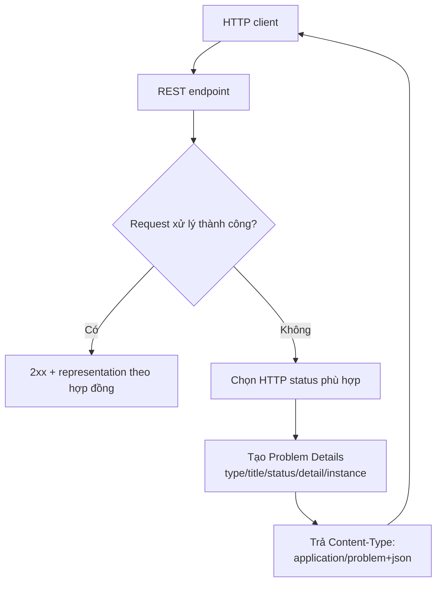
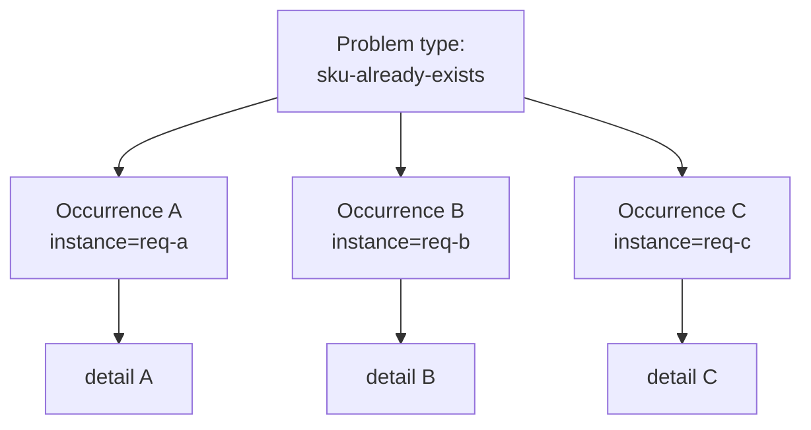
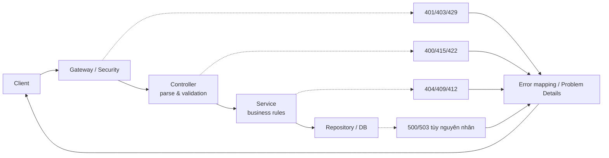

# type, title, status, detail và instance

> **Module:** INTEGRATION_API_REST — học thiết kế REST API dựa trên resource, URI, phương thức và mã trạng thái HTTP; xây dựng hợp đồng dữ liệu rõ ràng, phân trang, cache, idempotency, OpenAPI, xác thực, phân quyền, xử lý lỗi và kiểm thử API bằng Java/Spring hoặc công nghệ tương đương.  
> **Chương:** Lỗi API.  
> **Trọng tâm:** Năm thành viên tiêu chuẩn **`type`, `title`, `status`, `detail` và `instance`** trong HTTP Problem Details (RFC 9457), cách tạo một hợp đồng lỗi ổn định, an toàn và có thể kiểm thử.

## 1. Bài toán: API trả lỗi nhưng client không biết làm gì

Một ứng dụng gọi API tạo sản phẩm:

```http
POST /api/products HTTP/1.1
Host: api.example.com
Content-Type: application/json
Accept: application/problem+json

{"sku":"KB-001","name":"Bàn phím","price":1500000}
```

Nếu SKU đã tồn tại, server có thể trả một response sơ sài:

```http
HTTP/1.1 400 Bad Request
Content-Type: application/json

{"error":"Something went wrong"}
```

Client không biết đó là sai cú pháp, trùng SKU hay sự cố tạm thời; người dùng không biết phải sửa gì, đội vận hành không thể tìm request gây lỗi. Một nhóm backend khác có thể trả định dạng khác, chẳng hạn `{"message":"duplicate"}` hoặc `{"code":1234}`, khiến frontend phải viết nhiều nhánh phân tích tùy endpoint.

**Problem Details** là một định dạng HTTP chuẩn để mô tả vấn đề được trả về trong phản hồi lỗi, hiện được định nghĩa tại **RFC 9457** (thay thế RFC 7807). Với JSON, media type là **`application/problem+json`**. Nó giúp thống nhất hình dạng lỗi mà vẫn để từng API định nghĩa các loại lỗi riêng theo nghiệp vụ.

Ví dụ:

```http
HTTP/1.1 409 Conflict
Content-Type: application/problem+json
Cache-Control: no-store

{
  "type": "https://api.example.com/problems/sku-already-exists",
  "title": "Mã SKU đã tồn tại",
  "status": 409,
  "detail": "Không thể tạo sản phẩm vì mã SKU đã được sử dụng.",
  "instance": "/problems/occurrences/req-8b7d2",
  "code": "SKU_ALREADY_EXISTS"
}
```

Ở response này, HTTP status `409` nói rằng request xung đột với trạng thái hiện tại; `type` cho chương trình biết **loại vấn đề**; `title` tóm tắt; `detail` giải thích lần lỗi cụ thể; `instance` định danh lần xảy ra vấn đề; `code` là thành viên mở rộng do API tự định nghĩa.

Sau bài học, người học có thể:

1. Phân biệt vai trò, quy tắc và ví dụ sử dụng của năm thành viên chuẩn.
2. Thiết kế `type` ổn định, `title` nhất quán, `detail` có ích mà không làm lộ thông tin nhạy cảm.
3. Hiểu vì sao `status` trong body chỉ là thông tin bổ trợ cho **HTTP status thực tế**.
4. Dùng `instance` và correlation/trace ID để hỗ trợ điều tra sự cố.
5. Mở rộng Problem Details cho lỗi validation nhưng giữ nguyên hợp đồng chuẩn.
6. Xây dựng handler lỗi với Spring và đặc tả OpenAPI, viết kiểm thử cho cả nội dung lẫn mã trạng thái và header.

## 2. Vị trí của Problem Details trong REST API

Một HTTP response gồm **status line**, **headers** và tùy trường hợp **body**. Problem Details định nghĩa cấu trúc của **body mô tả vấn đề**, không thay thế những thành phần còn lại.



Ví dụ, khi xác thực thất bại, response phải có `401 Unauthorized` và header `WWW-Authenticate` khi áp dụng. Problem Details có thể mô tả lỗi trong body, nhưng **không được bỏ yêu cầu giao thức của header xác thực**. Tương tự, một `429 Too Many Requests` có thể có `Retry-After` để chỉ thời điểm hoặc khoảng chờ phù hợp, bên cạnh Problem Details.

Problem Details không bắt buộc API nào cũng phải dùng cho mọi lỗi. Có API chỉ trả status và header; có API dùng định dạng lỗi riêng theo hợp đồng. Tuy nhiên, khi đã chọn `application/problem+json`, client có thể kỳ vọng cấu trúc và semantics theo RFC 9457.

### 2.1. Các thành viên chuẩn có bắt buộc xuất hiện đủ không?

**Không.** Trong RFC 9457, năm thành viên `type`, `title`, `status`, `detail` và `instance` đều được định nghĩa với ngữ nghĩa riêng, nhưng **không có yêu cầu mọi phản hồi phải chứa đủ cả năm**. Nếu thiếu `type`, giá trị mặc định về mặt ngữ nghĩa là **`about:blank`**. Các thành viên khác có thể vắng mặt.

Dù vậy, một tổ chức có thể **quy định hợp đồng nội bộ** rằng các phản hồi do ứng dụng sinh luôn có `type`, `title` và `status`, đồng thời dùng `instance` khi có thông tin theo dõi. Khi thiết kế, cần phân biệt:

- **Quy tắc của RFC**: các thành viên có semantics chuẩn và có thể vắng mặt.
- **Quy ước của sản phẩm/API**: ứng dụng cam kết gửi trường nào cho client theo OpenAPI.
- **Bảo đảm ở runtime**: gateway, reverse proxy hoặc dịch vụ trung gian có thể sinh response khác ứng dụng; cần kiểm thử đường đi thực tế.

## 3. Tổng quan năm thành viên quan trọng

| Thành viên | Kiểu JSON | Ý nghĩa | Mức ổn định và cách sử dụng |
|---|---|---|---|
| **`type`** | String URI reference | Định danh **loại vấn đề** | Cần ổn định để client phân nhánh theo loại lỗi |
| **`title`** | String | Tóm tắt ngắn, dễ đọc của **loại vấn đề** | Thường không thay đổi giữa các lần lỗi cùng `type`, trừ bản địa hóa |
| **`status`** | Number nguyên | Mã HTTP status mà bên sinh response muốn thông báo | Phải thống nhất với HTTP status thực; body không thay thế status line |
| **`detail`** | String | Giải thích **lần xảy ra lỗi cụ thể** | Có thể thay đổi giữa các request; để hiển thị/hỗ trợ, không dùng như machine code |
| **`instance`** | String URI reference | Định danh **lần xảy ra vấn đề cụ thể** | Có thể dùng cho tra cứu/điều tra; không nhất thiết là URI tài nguyên được yêu cầu |

Ví dụ một response validation:

```json
{
  "type": "https://api.example.com/problems/invalid-product",
  "title": "Dữ liệu sản phẩm không hợp lệ",
  "status": 400,
  "detail": "Yêu cầu có 2 trường cần được sửa.",
  "instance": "/problems/occurrences/req-239b1",
  "violations": [
    {"field": "name", "message": "không được để trống"},
    {"field": "price", "message": "phải lớn hơn hoặc bằng 0"}
  ]
}
```

Ở đây, `violations` là **thành viên mở rộng**, không thuộc năm thành viên chuẩn. Client nên dùng `type` hoặc mã mở rộng ổn định để nhận biết loại lỗi; `violations` để xử lý từng trường. Không parse câu tiếng Việt trong `detail` để suy ra lỗi máy.

## 4. type: định danh loại vấn đề

### 4.1. `type` là gì?

`type` là **URI reference** xác định loại vấn đề, ví dụ:

```json
{
  "type": "https://api.example.com/problems/sku-already-exists",
  "title": "Mã SKU đã tồn tại",
  "status": 409
}
```

Thông thường, client có thể dùng chính `type` để quyết định hành vi:

```text
type = /problems/sku-already-exists
    -> hiển thị cảnh báo SKU bị trùng,
       giữ dữ liệu biểu mẫu và đề nghị người dùng chọn SKU khác

type = /problems/rate-limit-exceeded
    -> đọc HTTP Retry-After nếu có,
       thông báo chờ và giới hạn việc gửi lại

type = /problems/version-conflict
    -> lấy phiên bản tài nguyên mới,
       cho người dùng xem lại trước khi gửi cập nhật
```

Các đường dẫn trên chỉ là cách viết tắt để minh họa; trong hợp đồng thực tế nên công bố **URI `type` đầy đủ và ổn định**.

RFC cho phép `type` là URI reference (có thể tương đối), nhưng **dùng URI tuyệt đối** giúp tránh phụ thuộc vào cách resolve relative URI ở từng client. Nếu dùng HTTP(S) URL và có thể cung cấp tài liệu ở đó, việc xem được mô tả loại lỗi sẽ hỗ trợ người dùng tích hợp API. Tài liệu có thể nói nguyên nhân, các trường mở rộng, hướng xử lý, trạng thái điển hình và ví dụ.

**Không nhất thiết `type` phải trả tài liệu khi được truy cập**, nhưng API nên coi URI là định danh ổn định: đổi URI có thể khiến các client so khớp chuỗi chính xác ngừng nhận ra loại lỗi.

### 4.2. `type` không phải URI của resource bị lỗi

So sánh:

- Resource: `/api/products/42` — xác định sản phẩm.
- Problem type: `https://api.example.com/problems/product-not-found` — xác định loại lỗi “không tìm thấy sản phẩm”.
- Problem instance: `/problems/occurrences/req-8b7d2` — xác định một lần lỗi (nếu ứng dụng chọn cách này).

Không gán `type` là `/api/products/42` chỉ để chứa URI request. URI request có thể được cung cấp riêng theo nhu cầu, nhưng phải tránh lộ query token hoặc dữ liệu nhạy cảm.

### 4.3. `about:blank` khi không có loại lỗi riêng

Nếu loại lỗi chỉ cần biểu đạt bằng **HTTP status hiện tại**, có thể dùng `about:blank`:

```http
HTTP/1.1 404 Not Found
Content-Type: application/problem+json

{
  "type": "about:blank",
  "title": "Not Found",
  "status": 404
}
```

Khi `type` là `about:blank`, `title` nên mô tả ngắn gọn ý nghĩa mã HTTP tương ứng, ví dụ reason phrase `Not Found`, có thể được bản địa hóa. Không cần phát minh một Problem Type riêng cho mọi lỗi HTTP thông thường.

Nếu client **cần phân biệt** “không tồn tại sản phẩm”, “sản phẩm chưa được công bố” và “mã SKU đã tồn tại” để quyết định hành vi, những lỗi nghiệp vụ đó thường đáng có URI `type` riêng, nhưng hãy xem xét giới hạn thông tin mà người dùng có quyền biết.

### 4.4. Quy tắc thiết kế tập loại vấn đề

- Định nghĩa **một loại lỗi cho một ý nghĩa** mà client có thể cần xử lý khác nhau.
- Không sinh URI `type` ngẫu nhiên theo request hay gắn mã định danh lỗi cụ thể vào `type`.
- Cố định ý nghĩa của URI qua các phiên bản; khi thay đổi semantics theo cách làm hỏng client, cân nhắc tạo loại mới hoặc chiến lược versioning tương thích.
- Viết tài liệu cho từng `type` gồm HTTP status điển hình, nguyên nhân, khả năng retry, thao tác client được khuyến nghị và cấu trúc extension.
- Nếu các lỗi bảo mật cần che giấu sự tồn tại của resource, không đưa phân loại quá chi tiết vào `type` vì có thể tạo information disclosure.

## 5. title: tóm tắt ngắn của loại vấn đề

`title` là một **tóm tắt dễ đọc** về `type`. Nó hướng đến người dùng hoặc developer khi xem log và công cụ kiểm thử.

```json
{
  "type": "https://api.example.com/problems/version-conflict",
  "title": "Phiên bản tài nguyên đã thay đổi",
  "status": 412
}
```

Hai request khác nhau cùng gặp loại lỗi này thường giữ cùng `title`:

```text
Request A:
title  = "Phiên bản tài nguyên đã thay đổi"
detail = "Đơn hàng 42 đã có phiên bản mới hơn."

Request B:
title  = "Phiên bản tài nguyên đã thay đổi"
detail = "Không thể lưu sản phẩm 87 vì dữ liệu đã được cập nhật."
```

**Quy tắc quan trọng:** `title` không nên thay đổi giữa các lần xảy ra cùng `type`, ngoại trừ khi bản địa hóa theo ngôn ngữ yêu cầu. `detail` mới là nơi giải thích điều cụ thể. Nếu thêm tên người dùng, ID request hoặc giá trị input vào `title`, bạn đã làm nó trở thành một trường mô tả từng sự kiện và mất tính nhất quán.

Với một API có hỗ trợ tiếng Việt/tiếng Anh, `title` có thể được dịch theo `Accept-Language` khi hệ thống hỗ trợ; client **không được phân nhánh logic bằng cách so khớp chuỗi title**, vì ngôn ngữ và nội dung văn bản có thể đổi.

## 6. status: mã trạng thái HTTP mang tính bổ trợ

`status` là số nguyên biểu diễn mã HTTP status mà bên sinh Problem Details muốn thông báo:

```http
HTTP/1.1 422 Unprocessable Content
Content-Type: application/problem+json

{
  "type": "https://api.example.com/problems/invalid-order",
  "title": "Dữ liệu đơn hàng không thể xử lý",
  "status": 422,
  "detail": "Số lượng đặt vượt giới hạn cho phép."
}
```

`status` trong body có ý nghĩa **bổ trợ/advisory**. Mã trong status line của HTTP response mới là thông tin giao thức mà HTTP client, proxy, cache và framework dùng khi xử lý kết quả. Vì vậy:

- **Phải giữ chúng nhất quán trong ứng dụng.** Trả HTTP 200 kèm `"status":500` là thiết kế sai cho một lỗi không thành công.
- Nếu gateway/proxy thay đổi response code, `status` trong body có thể không tự động được sửa theo; đây là một lý do trường này chỉ có tính tham khảo.
- Không dùng `status` để đóng gói HTTP status của một request khác hoặc của downstream trong khi status line nói về request hiện tại. Có thể dùng extension được định nghĩa rõ hoặc log nội bộ để ghi nguyên nhân, tránh gây hiểu nhầm.
- `status` có thể vắng mặt theo RFC, dù nhiều API chọn luôn gửi để hỗ trợ client/log. Nếu ứng dụng cam kết gửi, ghi điều đó vào hợp đồng OpenAPI.

### 6.1. Lựa chọn mã status trước, viết body sau

Problem Details không thay việc chọn HTTP status chuẩn. Ví dụ:

| Tình huống | HTTP status thường phù hợp | Mô tả Problem Details |
|---|---|---|
| JSON sai cú pháp hoặc request không đọc được | `400 Bad Request` | `type` cho malformed request, `detail` ngắn gọn |
| Thiếu hoặc sai thông tin xác thực | `401 Unauthorized` | Kèm `WWW-Authenticate` theo yêu cầu giao thức |
| Người gọi đã xác thực nhưng không đủ quyền | `403 Forbidden` | Không tiết lộ thông tin tài nguyên ngoài quyền |
| Resource không tồn tại/được ẩn theo chính sách | `404 Not Found` | Không phân biệt quá chi tiết nếu cần che sự tồn tại |
| Request conflict với trạng thái nghiệp vụ | `409 Conflict` | Chẳng hạn SKU đã tồn tại |
| `If-Match` không khớp | `412 Precondition Failed` | Tài nguyên đã bị sửa bởi người khác |
| Media type đầu vào không được hỗ trợ | `415 Unsupported Media Type` | Cho biết định dạng được hỗ trợ ở mức an toàn |
| Nội dung đúng cú pháp nhưng không xử lý được | `422 Unprocessable Content` | Validation/ngữ nghĩa sai theo hợp đồng đã chọn |
| Thiếu precondition mà API bắt buộc | `428 Precondition Required` | Hướng client dùng `If-Match` |
| Vượt giới hạn request | `429 Too Many Requests` | Cân nhắc `Retry-After`; không mặc định retry tức thì |
| Lỗi không mong đợi trên server | `500 Internal Server Error` | Trả mô tả chung; chi tiết kỹ thuật lưu ở log có kiểm soát |
| Dịch vụ tạm thời không khả dụng | `503 Service Unavailable` | Có thể kèm `Retry-After` khi biết thời gian/khoảng chờ phù hợp |

**`400` và `422`:** nhiều API dùng `400` cho mọi lỗi đầu vào; một số phân biệt `400` cho cú pháp/kiểu dữ liệu và `422` cho ràng buộc nội dung đã hiểu nhưng không thể xử lý. Hãy chọn chính sách nhất quán, công bố trong OpenAPI và kiểm thử; `422` không phải bắt buộc cho mọi lỗi Bean Validation.

**`409` và `412`:** xung đột nghiệp vụ không nhất thiết là precondition HTTP. Nếu `If-Match` không đạt, `412` thể hiện đúng kết quả precondition; không thay bằng `409` chỉ vì muốn gom tất cả “conflict”.

## 7. detail: thông tin cho một lần xảy ra lỗi

`detail` là mô tả **dành cho người đọc**, gắn với lần lỗi cụ thể:

```json
{
  "type": "https://api.example.com/problems/insufficient-stock",
  "title": "Không đủ tồn kho",
  "status": 409,
  "detail": "Sản phẩm 42 hiện chỉ có thể đặt tối đa 3 đơn vị."
}
```

Một lần khác cùng `type` có thể nói “tối đa 1 đơn vị”. **Không viết client parse số lượng từ câu `detail`**. Nếu frontend cần con số để quyết định hành vi, hãy thêm extension có cấu trúc:

```json
{
  "type": "https://api.example.com/problems/insufficient-stock",
  "title": "Không đủ tồn kho",
  "status": 409,
  "detail": "Số lượng yêu cầu vượt mức đang có.",
  "availableQuantity": 3,
  "requestedQuantity": 5
}
```

Các extension này chỉ nên trả khi **người gọi có quyền biết tồn kho** và dữ liệu đủ tin cậy. Trên một số hệ thống, tồn kho chính xác là thông tin thương mại nhạy cảm; khi đó chỉ cung cấp thông báo chung.

### 7.1. Detail nên chứa gì?

- Một câu ngắn giải thích nguyên nhân mà client hoặc người dùng có thể hành động.
- Lời khuyên tiếp theo khi an toàn: “Hãy tải lại tài nguyên và kiểm tra thay đổi trước khi lưu.”
- Ngữ cảnh đúng mức: field nào không hợp lệ, vì sao không nhận request, trạng thái có thể thử lại hay không.
- Nội dung phù hợp ngôn ngữ hiển thị, có khả năng bản địa hóa mà không ảnh hưởng logic client.

### 7.2. Detail không nên chứa gì?

- Stack trace, tên lớp nội bộ, câu SQL, đường dẫn tệp máy chủ, host/IP mạng riêng.
- Access token, API key, session ID, mật khẩu, dữ liệu thanh toán hoặc thông tin định danh nhạy cảm.
- Toàn bộ request body khi có thể chứa PII.
- Chi tiết giúp người không đủ quyền suy đoán tài nguyên hoặc tenant của người khác.
- Các đoạn văn quá dài hoặc message được ghép trực tiếp từ `exception.getMessage()` khi exception có thể chứa chi tiết nội bộ.

**Phân biệt response cho client và log nội bộ:** người dùng nhận `detail` ngắn gọn cùng một mã tham chiếu; log/trace có stack trace và thông tin chẩn đoán được bảo vệ theo quyền truy cập. Không dùng Problem Details làm kênh xuất toàn bộ dữ liệu debug.

## 8. instance: xác định lần xảy ra vấn đề cụ thể

`instance` là một **URI reference** định danh **một lần xảy ra vấn đề**, ví dụ:

```json
{
  "type": "https://api.example.com/problems/payment-timeout",
  "title": "Thanh toán chưa được xác nhận",
  "status": 503,
  "detail": "Chưa thể xác nhận kết quả xử lý thanh toán.",
  "instance": "/problems/occurrences/req-8b7d2"
}
```

`instance` có thể là một URI tương đối hoặc tuyệt đối. RFC không yêu cầu URI này phải có endpoint truy cập được. Nếu hệ thống cung cấp endpoint để xem sự cố, quyền truy cập của endpoint đó phải được kiểm soát chặt.

**`type` và `instance` khác nhau:**

```text
type:
  https://api.example.com/problems/payment-timeout
  -> "Đây là loại lỗi gì?" (ổn định nhiều request)

instance:
  /problems/occurrences/req-8b7d2
  -> "Đây là lần lỗi cụ thể nào?"
```

### 8.1. Instance có phải URL của request không?

Không bắt buộc. Có API dùng `instance` là URI request như `/api/orders/42`; cách này nói lỗi xảy ra ở resource nào nhưng có thể **không phân biệt** hai lần lỗi cùng endpoint. Nếu cần hỗ trợ và đối chiếu sự cố, một URI instance riêng hoặc extension `traceId`/`requestId` sẽ hữu ích hơn.

Khi dùng request URI, cân nhắc xóa/sanitize query parameter chứa token, email hoặc giá trị nhạy cảm. Không tạo instance bằng cách ghép toàn bộ URL đầu vào chưa được kiểm soát.

### 8.2. Kết hợp instance với tracing

Một hợp đồng có thể có cả `instance` và extension `traceId`:

```http
HTTP/1.1 500 Internal Server Error
Content-Type: application/problem+json
Cache-Control: no-store
X-Request-Id: req-8b7d2

{
  "type": "https://api.example.com/problems/internal-error",
  "title": "Lỗi hệ thống",
  "status": 500,
  "detail": "Yêu cầu chưa thể hoàn thành. Hãy thử lại sau.",
  "instance": "/problems/occurrences/req-8b7d2",
  "requestId": "req-8b7d2"
}
```

Ở phía server, `requestId` hoặc trace context được gắn vào log/span cùng mốc thời gian và endpoint. Khi người dùng báo lỗi, đội hỗ trợ tìm được request mà không phải yêu cầu họ gửi secret hoặc dữ liệu nhạy cảm.

Mã `requestId` ở ví dụ là mã giả định. Trong hệ thống thực tế, nên lấy ID từ tầng gateway/tracing với chính sách tin cậy phù hợp, hoặc tạo ID ngẫu nhiên an toàn khi thiếu; bảo đảm dùng **cùng một ID** trong body, header và log.

## 9. Năm thành viên khi đặt cạnh nhau

Giả sử ba request khác nhau gặp cùng lỗi “SKU đã tồn tại”.

| Request | type | title | status | detail | instance |
|---|---|---|---|---|---|
| A | `.../sku-already-exists` | “Mã SKU đã tồn tại” | 409 | “SKU KB-001 không thể được sử dụng.” | `/problems/occurrences/req-a` |
| B | `.../sku-already-exists` | “Mã SKU đã tồn tại” | 409 | “SKU KB-002 không thể được sử dụng.” | `/problems/occurrences/req-b` |
| C | `.../sku-already-exists` | “Mã SKU đã tồn tại” | 409 | “SKU KB-003 không thể được sử dụng.” | `/problems/occurrences/req-c` |

Trong bảng, `.../sku-already-exists` viết tắt cho **cùng một URI tuyệt đối** đã công bố; không phải URI được trả về theo dạng dấu ba chấm.

Có thể hình dung:



**Nhóm cùng `type`** giúp phân tích tỷ lệ lỗi nghiệp vụ trên dashboard. **Phân biệt `instance`** giúp điều tra một request cụ thể. `title` và `detail` là văn bản hiển thị; `status` gắn với ngữ nghĩa HTTP.

## 10. Thành viên mở rộng: từ văn bản đến dữ liệu có cấu trúc

RFC 9457 cho phép thêm các thành viên ngoài năm thành viên chuẩn. Chúng cần được **định nghĩa trong tài liệu của Problem Type** để client biết cách dùng.

### 10.1. Lỗi validation nhiều field

Ví dụ request thiếu tên và giá âm:

```http
HTTP/1.1 400 Bad Request
Content-Type: application/problem+json
Cache-Control: no-store

{
  "type": "https://api.example.com/problems/validation-error",
  "title": "Dữ liệu gửi lên không hợp lệ",
  "status": 400,
  "detail": "Có 2 trường cần được chỉnh sửa.",
  "instance": "/problems/occurrences/req-42ac",
  "violations": [
    {"field": "name", "message": "không được để trống"},
    {"field": "price", "message": "phải lớn hơn hoặc bằng 0"}
  ]
}
```

`violations` là một extension do API tự định nghĩa, **không phải trường chuẩn bắt buộc** của RFC 9457. Các API khác có thể dùng `errors` hoặc cấu trúc khác; nên giữ một cách đặt tên xuyên suốt hệ thống.

Nếu frontend cần mã lỗi ổn định cho từng field, thêm `code` ở phần tử extension:

```json
{
  "type": "https://api.example.com/problems/validation-error",
  "title": "Dữ liệu gửi lên không hợp lệ",
  "status": 400,
  "violations": [
    {"field": "name", "code": "REQUIRED", "message": "không được để trống"},
    {"field": "price", "code": "MIN_VALUE", "message": "phải lớn hơn hoặc bằng 0"}
  ]
}
```

Không cố nhồi mọi lỗi field vào chuỗi `detail` rồi yêu cầu client tách câu. Việc thêm extension có cấu trúc giúp client xác định đúng input, hiển thị message theo ngôn ngữ và phản ứng ổn định.

### 10.2. Extension cần tránh làm gì?

- Không tự định nghĩa một member có tên trùng `type`, `title`, `status`, `detail` hoặc `instance` với ý nghĩa khác.
- Không đưa raw exception object vào JSON.
- Không tạo quá nhiều extension chưa có nhu cầu client.
- Không mặc định client phải hiểu mọi extension mới để xử lý lỗi; client nên bỏ qua extension không biết.
- Không dùng extension làm kênh lộ field nội bộ, ví dụ tên bảng, khóa chính của người khác hoặc trace stack.
- Không mã hóa dữ liệu máy vào `title`/`detail` khi có thể mô tả rõ bằng extension.

### 10.3. Một lỗi tổng hợp hay nhiều Problem Details?

Một HTTP response thông thường có **một Problem Details object** mô tả vấn đề ở cấp request. Với validation, một `type` như `validation-error` và một extension `violations[]` thường rõ ràng hơn việc trả một array các Problem Details không có hợp đồng.

Nếu một thao tác batch có thành công/thất bại từng item, cần thiết kế **hợp đồng batch riêng** (chẳng hạn tập kết quả theo từng item với status riêng), xác định mức atomicity và retry. Không tùy tiện đổi sang `207 Multi-Status` chỉ vì có nhiều lỗi validation; `207` có ngữ cảnh và ngữ nghĩa riêng, không thay thế thiết kế response batch đầy đủ.

## 11. Chuỗi xử lý lỗi trong ứng dụng REST

Một lỗi có thể xuất phát ở các tầng khác nhau:



Đây là **sơ đồ logic**, không có nghĩa một `@RestControllerAdvice` của Spring sẽ bắt được mọi lỗi phát sinh ở reverse proxy hoặc trong Security filter chain. Các tầng đó có thể sinh response trước khi request đi vào controller. Để đạt một error contract thống nhất end-to-end, cần cấu hình hoặc tích hợp handler phù hợp tại từng tầng.

### 11.1. Phân loại lỗi trước khi ánh xạ

| Nguồn lỗi | Ví dụ | Cách biểu diễn hợp lý |
|---|---|---|
| Parse/contract | JSON malformed, field sai kiểu, media type sai | `400`/`415`, loại lỗi đầu vào ổn định |
| Validation | Tên trống, giá không hợp lệ | `400` hoặc `422` theo hợp đồng, có `violations` |
| AuthN/AuthZ | Token không hợp lệ, thiếu quyền | `401`/`403`, tránh tiết lộ thông tin |
| Resource state | SKU trùng, không đủ tồn kho | `409` và `type` nghiệp vụ |
| HTTP precondition | ETag của client bị cũ | `412`, có hướng dẫn lấy bản mới |
| Rate limiting | Vượt quota | `429`, `Retry-After` nếu có |
| Downstream unavailable | Nhà cung cấp ngoài tạm lỗi | `503` khi hợp lý; retry có giới hạn |
| Unexpected error | Null pointer, bug, lỗi không biết nguyên nhân | `500` với mô tả chung; log kỹ thuật nội bộ |

Không trả cùng một `type` quá tổng quát cho mọi lỗi nếu client cần cách xử lý khác nhau. Cũng không phát minh loại lỗi cho mọi exception class nội bộ: lớp triển khai thay đổi thường xuyên, còn hợp đồng HTTP cần ổn định.

### 11.2. Quy tắc nhất quán

- Chọn status dựa trên **ngữ nghĩa HTTP của request hiện tại**.
- Chọn `type` dựa trên loại vấn đề mà client có thể nhận biết và xử lý.
- `title` ngắn và ổn định theo loại.
- `detail` chỉ có thông tin an toàn, cụ thể.
- `instance` hoặc correlation ID giúp truy vết.
- Header chuẩn vẫn phải đúng (`WWW-Authenticate`, `Retry-After`, `Allow`, v.v. khi áp dụng).
- Đối với lỗi có dữ liệu cá nhân, dùng chính sách cache phù hợp, thường `Cache-Control: no-store`, và giới hạn dữ liệu trả về.
- Logging và tracing phải ghi enough context nội bộ nhưng có kiểm soát quyền và retention.

## 12. Triển khai bằng Spring Boot / Spring MVC

Spring Framework 6 cung cấp lớp **`ProblemDetail`** và cơ chế xử lý lỗi HTTP; Spring Boot 3 dựa trên nền tảng đó. Ví dụ dưới đây dùng `@RestControllerAdvice` để chuyển một lỗi nghiệp vụ sang response `application/problem+json`.

### 12.1. Handler cho lỗi xung đột nghiệp vụ

Giả sử service ném exception `DuplicateSkuException` khi tạo sản phẩm trùng SKU (exception này do ứng dụng tự định nghĩa).

```java
import jakarta.servlet.http.HttpServletRequest;
import java.net.URI;
import java.util.UUID;
import org.springframework.http.HttpStatus;
import org.springframework.http.MediaType;
import org.springframework.http.ProblemDetail;
import org.springframework.http.ResponseEntity;
import org.springframework.web.bind.annotation.ExceptionHandler;
import org.springframework.web.bind.annotation.RestControllerAdvice;

@RestControllerAdvice
public class ApiProblemHandler {

    private static final MediaType PROBLEM_JSON =
            MediaType.parseMediaType("application/problem+json");

    @ExceptionHandler(DuplicateSkuException.class)
    public ResponseEntity<ProblemDetail> handleDuplicateSku(
            DuplicateSkuException ex,
            HttpServletRequest request) {

        ProblemDetail problem =
                ProblemDetail.forStatus(HttpStatus.CONFLICT);

        problem.setType(URI.create(
                "https://api.example.com/problems/sku-already-exists"));
        problem.setTitle("Mã SKU đã tồn tại");
        problem.setDetail(
                "Không thể tạo sản phẩm vì mã SKU đã được sử dụng.");

        // Ví dụ tối thiểu; ứng dụng thực nên lấy ID
        // từ request tracing/correlation ID đã được thiết lập.
        String occurrenceId = UUID.randomUUID().toString();
        problem.setInstance(URI.create(
                "/problems/occurrences/" + occurrenceId));
        problem.setProperty("code", "SKU_ALREADY_EXISTS");
        problem.setProperty("requestId", occurrenceId);

        return ResponseEntity.status(HttpStatus.CONFLICT)
                .contentType(PROBLEM_JSON)
                .cacheControl(
                        org.springframework.http.CacheControl.noStore())
                .body(problem);
    }
}
```

**Giải thích:**

- `ProblemDetail.forStatus(HttpStatus.CONFLICT)` đặt HTTP status tương ứng trong object; `ResponseEntity.status(...)` bảo đảm status line là `409`.
- `setType` dùng URI riêng ổn định, `setTitle` và `setDetail` dùng văn bản an toàn.
- `setInstance` ghi một URI cho occurrence. Trong production nên tạo/lấy correlation ID trước ở filter/gateway để cùng ID được đưa vào log, response và distributed trace. Đoạn mã tạo ngẫu nhiên ID chỉ minh họa cú pháp.
- `setProperty` dùng extension; khi Jackson serialization với cấu hình Spring MVC phù hợp, extension properties của `ProblemDetail` được hiển thị ở cấp cao nhất của JSON.
- `Cache-Control: no-store` tránh lưu response lỗi có thể chứa thông tin nhạy cảm về nghiệp vụ; cách áp dụng cache phải tuân theo chính sách thực tế.
- `DuplicateSkuException` là một kiểu custom chưa định nghĩa ở snippet; code yêu cầu project có service và exception tương ứng.
- Đừng xuất trực tiếp `ex.getMessage()` ra `detail` trừ khi chắc chắn nội dung đó được thiết kế an toàn để công khai.

### 12.2. Validation: giữ danh sách lỗi field có cấu trúc

Đối với `@Valid @RequestBody` trong Spring MVC, dữ liệu không đạt Bean Validation thường dẫn đến `MethodArgumentNotValidException`. Có thể ánh xạ sang một Problem Type và extension `violations`.

```java
import jakarta.servlet.http.HttpServletRequest;
import java.net.URI;
import java.util.List;
import java.util.Map;
import java.util.UUID;
import org.springframework.http.HttpStatus;
import org.springframework.http.MediaType;
import org.springframework.http.ProblemDetail;
import org.springframework.http.ResponseEntity;
import org.springframework.web.bind.MethodArgumentNotValidException;
import org.springframework.web.bind.annotation.ExceptionHandler;
import org.springframework.web.bind.annotation.RestControllerAdvice;

@RestControllerAdvice
public class ValidationProblemHandler {

    @ExceptionHandler(MethodArgumentNotValidException.class)
    public ResponseEntity<ProblemDetail> onInvalidBody(
            MethodArgumentNotValidException ex,
            HttpServletRequest request) {

        List<Map<String, String>> violations =
                ex.getBindingResult()
                  .getFieldErrors()
                  .stream()
                  .map(error -> Map.of(
                          "field", error.getField(),
                          "message", String.valueOf(
                                  error.getDefaultMessage())))
                  .toList();

        ProblemDetail problem =
                ProblemDetail.forStatus(HttpStatus.BAD_REQUEST);
        problem.setType(URI.create(
                "https://api.example.com/problems/validation-error"));
        problem.setTitle("Dữ liệu gửi lên không hợp lệ");
        problem.setDetail("Có " + violations.size()
                + " trường cần được chỉnh sửa.");

        String occurrenceId = UUID.randomUUID().toString();
        problem.setInstance(URI.create(
                "/problems/occurrences/" + occurrenceId));
        problem.setProperty("violations", violations);

        return ResponseEntity.badRequest()
                .contentType(MediaType.parseMediaType(
                        "application/problem+json"))
                .body(problem);
    }
}
```

**Giới hạn cần hiểu:** ví dụ trên dùng để minh họa cấu trúc; một ứng dụng thực tế thường gom các handler vào cùng class hoặc dùng `ResponseEntityExceptionHandler` để tránh xung đột với cách framework xử lý lỗi sẵn có. Validation của path/query, malformed JSON và lỗi bị chặn trong security filters cần các handler khác. Thông báo `error.getDefaultMessage()` có thể đến từ message bundle do ứng dụng quản lý; không chứa giá trị nhạy cảm hoặc mô tả exception thô. Nên có whitelist/chuẩn hóa thông điệp nếu validation framework hoặc custom validator trả chi tiết không phù hợp công khai.

### 12.3. Lưu ý về bảo mật khi dùng @ControllerAdvice

- **`@RestControllerAdvice` xử lý lỗi trong luồng MVC phù hợp**, không tự động chuẩn hóa mọi phản hồi tạo bởi gateway, WAF hoặc Spring Security filter chain.
- Lỗi authentication/authorization cần cấu hình các điểm xử lý của Spring Security (ví dụ `AuthenticationEntryPoint` và `AccessDeniedHandler`) để trả status/header đúng, nếu ứng dụng muốn dùng chung Problem Details.
- Giữ `requestId`/`traceId` nhất quán giữa handler, log và tracing; không tin tưởng một header ID do client tự gửi nếu chưa kiểm tra/chấp nhận theo quy tắc của hệ thống.
- Với `500`, tránh tiết lộ tên thư viện, câu SQL và stack trace; hỗ trợ xử lý thông qua ID và log nội bộ.
- Không tạo URI instance có chứa bearer token hoặc request query nhạy cảm.
- Các handler nên dùng chính sách lỗi thống nhất nhưng vẫn giữ đúng HTTP status cho từng loại exception.

### 12.4. Dùng ProblemDetail ở cấp controller

Trong một số tình huống đơn giản, controller có thể trả `ResponseEntity<ProblemDetail>` trực tiếp; nhưng lỗi nghiệp vụ thường nên được chuyển đổi tập trung ở error handler để tránh copy cùng logic `type/title/status` vào hàng chục endpoint.

Với những endpoint chạy qua nhiều version hoặc service, cần cùng một tài liệu `type` và bộ contract test. Nếu service A gọi service B, A phải quyết định **trạng thái lỗi của request đến A** dựa trên ngữ nghĩa endpoint của A, thay vì sao chép nguyên status/problem từ B cho mọi trường hợp.

## 13. OpenAPI: công bố hợp đồng Problem Details

Một API sử dụng Problem Details nên khai báo **media type `application/problem+json`**, schema của các thành viên chuẩn và các extension cho từng loại lỗi.

Ví dụ OpenAPI 3.0.3:

```yaml
openapi: 3.0.3
info:
  title: Product API
  version: 1.0.0
paths:
  /api/products:
    post:
      summary: Tạo sản phẩm
      requestBody:
        required: true
        content:
          application/json:
            schema:
              type: object
              required: [sku, name, price]
              properties:
                sku:
                  type: string
                name:
                  type: string
                price:
                  type: number
                  minimum: 0
      responses:
        '201':
          description: Sản phẩm đã được tạo
        '400':
          description: Request không hợp lệ
          content:
            application/problem+json:
              schema:
                $ref: '#/components/schemas/ValidationProblem'
        '409':
          description: SKU đã tồn tại
          content:
            application/problem+json:
              schema:
                $ref: '#/components/schemas/Problem'
              example:
                type: https://api.example.com/problems/sku-already-exists
                title: Mã SKU đã tồn tại
                status: 409
                detail: Không thể tạo sản phẩm vì mã SKU đã được sử dụng.
                instance: /problems/occurrences/req-8b7d2
                code: SKU_ALREADY_EXISTS
components:
  schemas:
    Problem:
      type: object
      description: >
        HTTP Problem Details (RFC 9457).
        Năm trường chuẩn có thể vắng mặt theo RFC;
        API cụ thể có thể cam kết tập trường riêng.
      properties:
        type:
          type: string
          description: URI reference định danh loại vấn đề
        title:
          type: string
        status:
          type: integer
          format: int32
        detail:
          type: string
        instance:
          type: string
          description: URI reference định danh occurrence
      additionalProperties: true
    ValidationProblem:
      allOf:
        - $ref: '#/components/schemas/Problem'
        - type: object
          properties:
            violations:
              type: array
              items:
                type: object
                required: [field, message]
                properties:
                  field:
                    type: string
                  message:
                    type: string
```

**Điểm quan trọng về schema:**

- RFC 9457 **không bắt buộc** tất cả năm trường luôn có mặt. Nếu hệ thống chủ động cam kết tất cả, có thể khai báo `required` trong schema riêng của API, nhưng đó là **chính sách API**, không phải quy định bắt buộc của RFC.
- `type` và `instance` là URI reference: có thể là URI tương đối hoặc tuyệt đối; hãy chọn schema validator phù hợp thay vì tự áp thêm ràng buộc không được hệ thống thực thi.
- `additionalProperties: true` cho phép các extension theo hợp đồng. Nếu muốn giới hạn extension cụ thể, cần đảm bảo không mâu thuẫn với kiểu Problem Details mà API đang công bố.
- `ValidationProblem` mô tả `violations` cho loại validation; các loại khác có thể thêm `code`, `retryable` hoặc metadata khác theo hợp đồng.
- Bổ sung `401`, `403`, `404`, `412`, `429` và `5xx` vào từng operation khi phù hợp. Header giao thức như `WWW-Authenticate` và `Retry-After` cần được khai báo riêng ở response.

### 13.1. API có nên dùng cùng một schema cho mọi lỗi?

Có thể tái sử dụng schema `Problem` làm nền chung, nhưng **đừng đồng nhất mọi loại lỗi** thành một “error chung” thiếu ngữ nghĩa. Khi một endpoint có `409` do SKU trùng và `409` do trạng thái giao dịch xung đột, client có thể cần hai `type` và các extension khác nhau. OpenAPI có thể mô tả qua example, `oneOf` hoặc tài liệu Problem Type riêng.

## 14. Kiểm thử Problem Details bằng MockMvc

Kiểm thử lỗi cần nhìn **đồng thời status line, Content-Type, body và header quan trọng**. Chỉ kiểm tra `jsonPath("$.status")` không đủ: ứng dụng có thể trả HTTP 200 nhưng body ghi 409.

Đoạn test sau là ví dụ **giả định** ứng dụng Spring có endpoint tạo sản phẩm, SKU `KB-001` đã tồn tại và handler ở mục 12. Đây không phải kết quả test thực thi trong bài học.

```java
import org.junit.jupiter.api.Test;
import org.springframework.beans.factory.annotation.Autowired;
import org.springframework.boot.test.autoconfigure.web.servlet.AutoConfigureMockMvc;
import org.springframework.boot.test.context.SpringBootTest;
import org.springframework.http.MediaType;
import org.springframework.test.web.servlet.MockMvc;

import static org.springframework.test.web.servlet.request.MockMvcRequestBuilders.post;
import static org.springframework.test.web.servlet.result.MockMvcResultMatchers.*;

@SpringBootTest
@AutoConfigureMockMvc
class ProductProblemDetailsTest {

    @Autowired
    MockMvc mockMvc;

    @Test
    void duplicateSkuUsesProblemDetails() throws Exception {
        mockMvc.perform(post("/api/products")
                .contentType(MediaType.APPLICATION_JSON)
                .content("""
                    {"sku":"KB-001","name":"Bàn phím","price":1500000}
                    """))
            .andExpect(status().isConflict())
            .andExpect(content().contentTypeCompatibleWith(
                    MediaType.parseMediaType("application/problem+json")))
            .andExpect(jsonPath("$.type").value(
                    "https://api.example.com/problems/sku-already-exists"))
            .andExpect(jsonPath("$.title").value("Mã SKU đã tồn tại"))
            .andExpect(jsonPath("$.status").value(409))
            .andExpect(jsonPath("$.detail").isString())
            .andExpect(jsonPath("$.instance").isString())
            .andExpect(jsonPath("$.code").value("SKU_ALREADY_EXISTS"));
    }

    @Test
    void invalidProductHasFieldViolations() throws Exception {
        mockMvc.perform(post("/api/products")
                .contentType(MediaType.APPLICATION_JSON)
                .content("""
                    {"sku":"KB-002","name":"","price":-1}
                    """))
            .andExpect(status().isBadRequest())
            .andExpect(content().contentTypeCompatibleWith(
                    MediaType.parseMediaType("application/problem+json")))
            .andExpect(jsonPath("$.type").value(
                    "https://api.example.com/problems/validation-error"))
            .andExpect(jsonPath("$.violations").isArray());
    }
}
```

Để chạy test thật cần có DTO validation (ví dụ `@NotBlank`, `@DecimalMin("0.0")`), service, persistence fixture, security setup và error handler phù hợp. Test phải tạo dữ liệu đầu vào riêng hoặc rollback giữa các case để tránh phụ thuộc thứ tự.

### 14.1. Ma trận kiểm thử cần thiết

| Test ID | Tình huống | Kỳ vọng |
|---|---|---|
| PD-01 | SKU đã tồn tại | HTTP 409, `application/problem+json`, `type` ổn định, `status` 409 |
| PD-02 | Dữ liệu validation sai | HTTP 400/422 theo contract, `violations[]` có field và message an toàn |
| PD-03 | JSON malformed | HTTP 400 với type phù hợp; không xuất stack trace |
| PD-04 | Không có token | HTTP 401, header `WWW-Authenticate` khi áp dụng |
| PD-05 | Đủ auth nhưng thiếu quyền | HTTP 403, không lộ dữ liệu resource |
| PD-06 | Tài nguyên không tồn tại | HTTP 404, không trả nhầm loại xung đột |
| PD-07 | `If-Match` bị cũ | HTTP 412, Problem Type dành cho precondition |
| PD-08 | Rate limit | HTTP 429, header `Retry-After` khi được cung cấp |
| PD-09 | Lỗi server không mong đợi | HTTP 500, `detail` chung và có correlation ID; không lộ stack |
| PD-10 | Cùng một Problem Type qua nhiều request | `type`, `title` ổn định; `instance` khác nhau nếu hệ thống dùng ID occurrence |
| PD-11 | Gateway chặn request trước MVC | Format và status theo hợp đồng end-to-end, hoặc tài liệu ghi rõ ngoại lệ |
| PD-12 | Client `Accept` không nhận problem+json | Content negotiation theo chính sách; không trả body sai media type |
| PD-13 | Error response chứa thông tin riêng | `Cache-Control` phù hợp, không cache chia sẻ ngoài chính sách |
| PD-14 | Cùng `type` nhưng đổi ngôn ngữ | Client nhận dạng loại bằng `type`, không phụ thuộc chuỗi title/detail |

### 14.2. Cách kiểm tra thủ công với curl

```bash
curl -i \
  -X POST "https://api.example.com/api/products" \
  -H "Content-Type: application/json" \
  -H "Accept: application/problem+json" \
  --data '{"sku":"KB-001","name":"Bàn phím","price":1500000}'
```

Khi đọc response, kiểm tra:

1. HTTP status line có đúng `409` hay không.
2. `Content-Type` có đúng `application/problem+json` hay không.
3. `type` có đúng loại lỗi đã công bố, ổn định giữa các lần gọi không.
4. `title` có tóm tắt ngắn, nhất quán; `detail` có hướng xử lý an toàn không.
5. `instance`/`requestId` có thể truy vết theo log mà không lộ thông tin nhạy cảm không.
6. Nếu là `429`, `401` hoặc `405`, các header giao thức tương ứng có được giữ đúng không.

Không chỉ nhìn mã trong body để suy ra kết quả request.

## 15. Thiết kế tương thích và versioning của hợp đồng lỗi

Client thường cần hành vi ổn định trong nhiều năm, trong khi hệ thống backend có thể đổi cơ sở dữ liệu, framework và tên exception. Vì vậy:

- **Ưu tiên phân nhánh theo `type`**, hoặc một extension mã máy như `code` nếu toàn hệ thống đã định nghĩa rõ; không phân nhánh theo `title` hay `detail`.
- Giữ nguyên semantics của một `type` sau khi công bố. Nếu thay đổi ý nghĩa đến mức client phải xử lý khác, cần migration/Problem Type mới.
- Thêm extension một cách **tương thích ngược**; client nên bỏ qua field không biết.
- Không đổi HTTP status một cách tùy tiện khi nghĩa của lỗi chưa thay đổi; client, middleware và observability thường dựa vào status.
- Nếu bỏ hoặc đổi tên extension mà client cần, phải công bố chiến lược versioning hoặc giai đoạn tương thích.
- Tài liệu Problem Type nên nêu extension và kiểu dữ liệu, retry policy, trạng thái điển hình và thông tin hỗ trợ; ghi nhận ADR khi quyết định tác động lớn đến các dịch vụ cùng hệ thống.
- Dịch vụ phía trước không nhất thiết được phép trả nguyên Problem Details của downstream ra Internet. Cần chuyển đổi bảo mật và hợp đồng cho ranh giới API công khai.

Ví dụ một lỗi thanh toán từ provider có `detail` rất dài hoặc lộ ID nội bộ. REST API bên ngoài chỉ nên trả Problem Type do API **sở hữu**, chẳng hạn `payment-temporarily-unavailable`, với thông điệp an toàn, status phù hợp, correlation ID và trạng thái thanh toán không bị thông báo sai.

## 16. Phản mẫu thường gặp

### 16.1. Trả HTTP 200 cho mọi lỗi

**Sai:**

```http
HTTP/1.1 200 OK
Content-Type: application/json

{"status":409,"message":"SKU duplicate"}
```

HTTP client và proxy thấy 200 là thành công, khiến retry, monitoring và xử lý lỗi không đúng. Nếu request bị từ chối vì conflict, trả **HTTP 409** và Problem Details phù hợp.

### 16.2. Biến title thành thông báo từng sự kiện

**Sai:** `title: "SKU KB-001 đã bị người dùng A tạo lúc 10:35"`.

`title` nên ổn định cho `type`; thông tin từng sự kiện thuộc `detail` hoặc extension, nhưng chỉ khi người gọi có quyền biết. Đừng đưa tên người hoặc thời điểm nhạy cảm vào response ngoài nhu cầu.

### 16.3. Dùng status trong JSON để thay thế status line

HTTP status line vẫn phải chính xác; `status` body chỉ bổ trợ. Proxy, SDK, API gateway và cache không dựa vào một trường JSON để xác định giao thức.

### 16.4. Dùng exception message làm detail

`exception.getMessage()` có thể chứa câu SQL, tên bảng, host nội bộ hoặc dữ liệu người dùng. Cần ánh xạ có kiểm soát sang thông điệp công khai; dữ liệu debug dùng log bảo vệ.

### 16.5. Sinh URI type động theo từng lỗi

`type: "https://api.example.com/problems/duplicate/req-123"` sẽ khiến client khó nhận dạng một loại lỗi ổn định. Đưa thông tin occurrence vào `instance`; dùng `type` chung cho cùng semantics.

### 16.6. Nhầm instance với request path

Gán `instance: "/api/products"` cho mọi lỗi có thể hợp lệ khi mục đích là URI request, nhưng không giúp phân biệt lần lỗi cụ thể. Nếu cần điều tra, dùng URI instance riêng hoặc extension trace ID.

### 16.7. Lạm dụng một loại generic-error cho mọi tình huống

Một client có thể cần sửa form, đăng nhập, chờ rate limit, refresh ETag hoặc thử lại khi dịch vụ tạm lỗi. Nếu mọi thứ là `generic-error`, client không có hợp đồng để phân biệt.

### 16.8. Ép mọi lỗi có đủ năm trường như một yêu cầu của RFC

RFC 9457 **không bắt buộc** tất cả năm trường xuất hiện trong mọi response. Tổ chức có thể tự quy định bộ tối thiểu ở API, nhưng tài liệu phải phân biệt rõ **chuẩn** với **quy ước sản phẩm**.

### 16.9. Lộ thông tin riêng qua lỗi 404/403

Nếu API trả `type` khác nhau khi tài nguyên tồn tại nhưng người gọi không có quyền, có thể giúp kẻ tấn công đoán thông tin. Thiết kế phản hồi theo threat model, đặc biệt trong hệ thống multi-tenant.

### 16.10. Quên header HTTP đi kèm status

Problem Details không thay `WWW-Authenticate` của 401, `Retry-After` trong tình huống phù hợp hoặc `Allow` của 405. Client nên nhận được **đầy đủ giao thức**, không chỉ JSON đẹp.

## 17. Bài thực hành

### Bài A — Chọn ý nghĩa cho từng thành viên

Một request `PUT /api/orders/42` dùng `If-Match: "order-42-v3"` nhưng server hiện lưu revision 4.

Hãy thiết kế một response Problem Details với:

- HTTP status phù hợp.
- `type` phân biệt lỗi phiên bản với lỗi nghiệp vụ chung.
- `title` ổn định cho loại.
- `detail` hướng client tải lại bản hiện tại mà không lộ dữ liệu ngoài quyền.
- `instance` hoặc correlation ID có thể dùng khi trao đổi với đội hỗ trợ.

Giải thích vì sao không trả 200 hoặc 409 chỉ vì lập trình viên thích gom tất cả conflict.

### Bài B — Thiết kế lỗi validation

Request tạo sản phẩm thiếu `name` và gửi `price=-10`. Hãy viết response `application/problem+json` có một Problem Type cho validation và extension `violations` mô tả từng field.

So sánh hai cách:

1. Đưa tất cả lỗi vào một chuỗi `detail`.
2. Gửi `violations[]` có cấu trúc.

Cách nào giúp frontend gắn thông báo đúng vào từng input khi hỗ trợ nhiều ngôn ngữ? Vì sao không nên đưa nguyên input chứa bí mật vào response?

### Bài C — Chuẩn hóa lỗi trong chuỗi API Gateway → Service

Gateway trả 401 khi token sai, Service trả 409 khi SKU trùng, một payment provider trả 503 với message nội bộ. Hãy xác định:

1. Tầng nào chịu trách nhiệm tạo Problem Details cho từng lỗi.
2. Header HTTP bắt buộc/quan trọng phải giữ.
3. Phần nào của lỗi từ payment provider không được truyền nguyên ra Internet.
4. Cách dùng `instance` và trace ID để correlating gateway, service và downstream.

### Bài D — Viết handler và test Spring

Thiết kế `@RestControllerAdvice` hỗ trợ:

- Lỗi `DuplicateSkuException` → HTTP 409 + Problem Type riêng.
- Lỗi Bean Validation → HTTP 400 + `violations[]`.
- Lỗi không mong đợi → HTTP 500 + thông điệp chung và correlation ID.
- Response có Content-Type `application/problem+json`.
- Mã status HTTP và trường `status` luôn thống nhất.
- Không lộ stack trace, password, token hoặc câu SQL.

Viết MockMvc tests cho 409/400/500, kiểm tra body, headers và dữ liệu nhạy cảm không xuất hiện. Nêu cách xử lý riêng nếu lỗi do Spring Security filter hoặc gateway tạo.

### Bài E — Nhận diện lỗi thiết kế

Đoạn response sau sai ở đâu?

```http
HTTP/1.1 200 OK
Content-Type: application/json

{
  "type": "/api/orders/42",
  "title": "Order 42 failed for user@example.com",
  "status": 500,
  "detail": "SQLException on db-private.internal:5432",
  "instance": "Bearer eyJ..."
}
```

Hãy nêu tối thiểu **sáu vấn đề** về mã HTTP, định danh loại lỗi, tính ổn định của title, thông tin nội bộ trong detail, dữ liệu nhạy cảm trong instance và media type; sau đó viết lại một response an toàn.

## 18. Checklist khi review API errors

- [ ] Mã trong HTTP status line phản ánh đúng lỗi của request.
- [ ] `Content-Type: application/problem+json` khi sử dụng Problem Details JSON.
- [ ] `type` ổn định, có ý nghĩa; `about:blank` được dùng hợp lý cho lỗi HTTP chung.
- [ ] `title` tóm tắt loại vấn đề, không phụ thuộc từng request ngoại trừ bản địa hóa.
- [ ] `status` (nếu có) thống nhất với HTTP status thực.
- [ ] `detail` ngắn, an toàn, hữu ích cho người đọc; client không parse để quyết định logic.
- [ ] `instance` (nếu có) định danh occurrence hoặc có ý nghĩa đã công bố, không lộ token/PII.
- [ ] Mọi extension như `code`, `violations` hay `requestId` đều có schema và semantics rõ.
- [ ] 401/403/404 không tiết lộ thông tin ngoài quyền; header HTTP quan trọng được giữ.
- [ ] 429/503 nêu chính sách retry hợp lý, dùng `Retry-After` khi phù hợp.
- [ ] Lỗi 500 không lộ stack trace, câu SQL, hostname hoặc secret.
- [ ] Cache policy của response lỗi phù hợp độ nhạy cảm; có correlation ID để truy vết.
- [ ] OpenAPI mô tả mã trạng thái, media type và Problem Type cần thiết cho endpoint.
- [ ] Contract tests kiểm tra status line, header, body và ngữ nghĩa của từng loại lỗi.
- [ ] Gateway, Spring Security và MVC có chính sách thống nhất hoặc ngoại lệ được tài liệu hóa.
- [ ] Bản dịch `title`/`detail` không phá logic client, vì máy dựa vào `type` và extension ổn định.

## 19. Ghi nhớ

Năm thành viên của HTTP Problem Details trả lời năm câu hỏi khác nhau:

- **`type`:** đây là **loại vấn đề** nào?
- **`title`:** tên/tóm tắt ngắn của loại vấn đề là gì?
- **`status`:** mã HTTP nào mô tả lỗi (thông tin bổ trợ trong body)?
- **`detail`:** lần lỗi cụ thể này cần giải thích gì cho người đọc?
- **`instance`:** đâu là định danh/URI của **lần xảy ra** vấn đề?

Một REST API có error contract tốt phải giữ đúng **HTTP status và headers**, định nghĩa **Problem Type ổn định**, gửi thông tin có ích nhưng **không rò rỉ dữ liệu nhạy cảm**, hỗ trợ **truy vết vận hành** và có **OpenAPI cùng kiểm thử hợp đồng**. Đó là nền tảng để client, backend và nhóm vận hành xử lý lỗi nhất quán khi hệ thống mở rộng.
