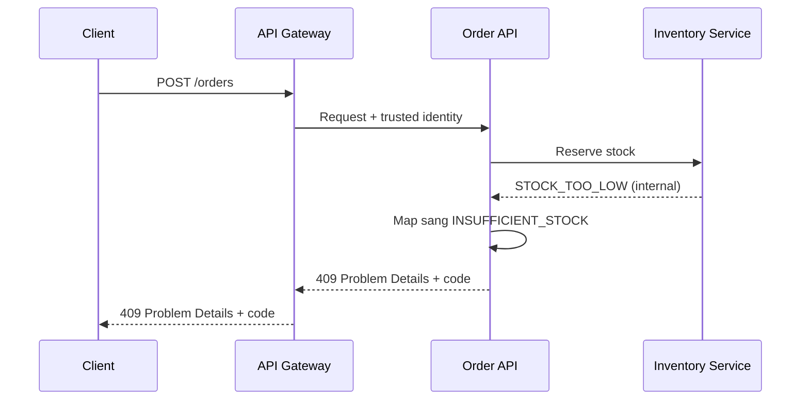

# Mã lỗi nghiệp vụ ổn định và trường mở rộng

## 1. Tại sao API cần mã lỗi nghiệp vụ ổn định?

Khi một REST API từ chối tạo đơn hàng vì không đủ hàng tồn, phản hồi `409 Conflict` nói cho client biết yêu cầu **xung đột với trạng thái hiện tại của resource**. Tuy nhiên, `409` chưa đủ để client xác định nên gợi ý người dùng giảm số lượng, chọn sản phẩm khác hay tải lại đơn hàng. Một mã ứng dụng như `INSUFFICIENT_STOCK` bổ sung ý nghĩa đó.

Tương tự, nhiều nguyên nhân khác nhau có thể cùng dẫn tới `422 Unprocessable Content`: địa chỉ giao hàng không hợp lệ, số lượng âm hoặc định dạng mã khuyến mại không phù hợp. Client có thể cần xử lý khác nhau, trong khi HTTP status vẫn giữ ngữ nghĩa chung.

Một thiết kế lỗi tốt sử dụng **hai tầng bổ trợ**:

- **HTTP status**: phản ánh kết quả xử lý yêu cầu theo chuẩn giao thức, giúp browser, HTTP client, gateway, cache, giám sát và cơ chế retry hiểu đúng tình huống.
- **Mã lỗi nghiệp vụ ổn định**: là định danh có hợp đồng cho từng **loại vấn đề có ý nghĩa với consumer**, cho phép client hiển thị thông báo, hướng người dùng xử lý hoặc phân nhánh logic mà không phải đọc câu chữ `detail`.

Thường còn có **trường mở rộng** để cung cấp thông tin có cấu trúc: những trường không hợp lệ, trạng thái nghiệp vụ hợp lệ để chuyển tiếp, giới hạn số lượng hay correlation ID. Các trường này phải được định nghĩa và kiểm soát, không phải nơi đổ toàn bộ exception, đối tượng domain hay chi tiết cơ sở dữ liệu.

Bài thuộc chương **Lỗi API** trong module **INTEGRATION_API_REST**. Nội dung kết nối trực tiếp việc thiết kế resource/URI, HTTP method và status với hợp đồng dữ liệu, idempotency, xác thực, phân quyền, OpenAPI, xử lý lỗi và kiểm thử trên Java/Spring hoặc nền tảng tương đương.

### Kết quả học tập

Sau bài này, bạn có thể:

1. Phân biệt **HTTP status**, **mã lỗi nghiệp vụ**, **Problem Details type URI**, **thông điệp hiển thị** và **trường mở rộng**.
2. Xây dựng quy tắc đặt tên, tài liệu hóa và quản lý vòng đời mã lỗi sao cho client có thể phụ thuộc an toàn.
3. Thiết kế response lỗi theo **RFC 9457 Problem Details** với extension phù hợp và không rò rỉ dữ liệu.
4. Nhận diện thay đổi tương thích và breaking change khi thêm, đổi hoặc loại bỏ mã lỗi/trường mở rộng.
5. Triển khai mapping lỗi với Spring MVC `ProblemDetail`, mô tả OpenAPI và kiểm thử hợp đồng.
6. Kết hợp mã lỗi với trạng thái HTTP, chính sách retry, localization, quan sát hệ thống và bảo mật.

## 2. Một ví dụ xuyên suốt: tạo đơn hàng không đủ tồn kho

Giả sử client gửi:

```http
POST /orders HTTP/1.1
Host: api.example.test
Content-Type: application/json
Accept: application/problem+json
Idempotency-Key: checkout-123

{
  "customerId": "c-42",
  "items": [{"sku": "SKU-01", "quantity": 8}]
}
```

Tồn kho thực tế chỉ còn 3 sản phẩm. Nếu hợp đồng xem đây là xung đột với trạng thái kho hiện hành, response có thể là:

```http
HTTP/1.1 409 Conflict
Content-Type: application/problem+json
Cache-Control: no-store

{
  "type": "https://api.example.test/problems/insufficient-stock",
  "title": "Insufficient stock",
  "status": 409,
  "detail": "Không đủ số lượng sản phẩm để tạo đơn hàng.",
  "instance": "/problems/occurrences/req-7d92",
  "code": "INSUFFICIENT_STOCK",
  "traceId": "req-7d92",
  "items": [
    {
      "sku": "SKU-01",
      "requestedQuantity": 8,
      "availableQuantity": 3
    }
  ]
}
```

Trong ví dụ này:

| Thành phần | Vai trò |
|---|---|
| `409` ở HTTP response | Phản ánh xung đột trạng thái hiện tại khiến thao tác tạo đơn không thể hoàn thành |
| `type` | URI ổn định định danh **loại vấn đề** và có thể dẫn đến tài liệu giải thích |
| `title` | Tiêu đề ngắn cho loại vấn đề, thuận tiện cho con người |
| `status` trong body | Mã HTTP tương ứng được lặp lại trong Problem Details, có tính thông tin |
| `detail` | Mô tả cho lần lỗi cụ thể; có thể thay đổi văn bản hoặc ngôn ngữ |
| `instance` | URI nhận diện lần phát sinh vấn đề; ví dụ là một định danh có thể truy vết |
| `code` | **Extension do ứng dụng định nghĩa**, ổn định để client phân nhánh theo hợp đồng |
| `traceId` | Extension giúp đối chiếu telemetry; không tiết lộ chi tiết hạ tầng |
| `items` | Extension cung cấp dữ liệu có cấu trúc để client hiển thị hoặc đề xuất xử lý |

**Điểm an toàn quan trọng:** `availableQuantity` chỉ nên được trả khi người dùng có quyền biết thông tin tồn kho chính xác. Với API công khai, có thể chỉ trả `maxAllowedQuantity` nếu chính sách cho phép, hoặc không trả số lượng tồn thực tế.

Response có thể dùng `422` nếu quy tắc nghiệp vụ của API xác định một yêu cầu với số lượng đó là nội dung không xử lý được. Không nên chọn tùy tiện giữa `409` và `422` theo từng request: cần **một quy tắc có căn cứ, công bố trong OpenAPI và áp dụng nhất quán**.

### Phản mẫu: status 200 chứa lỗi

```http
HTTP/1.1 200 OK
Content-Type: application/json

{
  "success": false,
  "message": "Không đủ hàng tồn",
  "errorCode": "INSUFFICIENT_STOCK"
}
```

Client vẫn nhìn thấy code, nhưng lớp HTTP tuyên bố thành công. Retry, metric `5xx`, logging, cache và code generator có thể diễn giải không như mong muốn. Mã nghiệp vụ **bổ sung cho HTTP status**, không phải lý do để biến mọi kết quả thành `200`.

## 3. Phân biệt những định danh và thông điệp trong lỗi

| Khái niệm | Dành cho ai? | Độ ổn định mong đợi | Client nên sử dụng thế nào? |
|---|---|---|---|
| **HTTP status** (`409`) | Hạ tầng HTTP và client | Ổn định theo ngữ nghĩa API | Xử lý nhóm lỗi, auth, cache, retry, precondition |
| **`type` URI** | Client và tài liệu về loại vấn đề | Nên ổn định về định danh/ngữ nghĩa | Nhận diện loại vấn đề, tra tài liệu; có thể dùng làm khóa phân nhánh |
| **`code` extension** (`INSUFFICIENT_STOCK`) | Client ứng dụng và SDK | **Ổn định theo hợp đồng đã công bố** | Quyết định luồng UI/nghiệp vụ có kiểm soát |
| **`title`** | Con người | Có thể được biên tập hoặc bản địa hóa | Hiển thị khi phù hợp, không parse |
| **`detail`** | Con người, hỗ trợ vận hành | Có thể thay đổi theo ngữ cảnh/ngôn ngữ | Hiển thị có xử lý an toàn, không so sánh chuỗi |
| **`instance`** | Hỗ trợ/quan sát | Mỗi lần lỗi có thể khác nhau | Truy dấu một lần phát sinh |
| **`traceId`** | Hỗ trợ kỹ thuật/telemetry | Khác theo request hoặc trace | Gửi bộ phận hỗ trợ, đối chiếu log |
| **`errors`**, `items` | Client cụ thể | Cấu trúc nên được version hóa khi trở thành hợp đồng | Đọc dữ liệu có kiểu và xử lý field thiếu |

Có hai cách nhận diện loại vấn đề phổ biến:

1. **Dùng `type` URI làm định danh máy có thẩm quyền** và để các client so sánh URI này. Điều đó phù hợp tinh thần Problem Details.
2. **Dùng thêm `code` ngắn, ổn định** để ứng dụng và các SDK dễ sử dụng, trong khi `type` vẫn là URI xác định loại vấn đề/tài liệu.

Nếu chọn cách hai, phải **quy định quan hệ ổn định giữa `type` và `code`**; không tạo hai trường có ý nghĩa mâu thuẫn. Đặc biệt, `code` là **extension riêng của API**, không phải member chuẩn bắt buộc của RFC 9457.

### Vì sao không dùng message làm mã lỗi?

Một client như sau rất dễ hỏng:

```javascript
if (response.detail === "Không đủ hàng tồn") {
  showQuantitySelector();
}
```

Chỉ cần đội nội dung đổi thành “Số lượng vượt mức có thể đáp ứng”, thêm dấu câu hoặc hỗ trợ tiếng Anh, nhánh logic không còn chạy. Client nên đọc `code === "INSUFFICIENT_STOCK"` và chỉ dùng `detail` để hiển thị.

## 4. Problem Details theo RFC 9457 là nền tảng mở rộng

RFC 9457 định nghĩa cách biểu diễn thông tin lỗi có cấu trúc cho HTTP API. Media type JSON thông dụng là `application/problem+json`. Đối tượng Problem Details có các thành viên chuẩn:

- **`type`**: URI tham chiếu loại vấn đề. Nếu vắng mặt, mặc định tương đương `about:blank`.
- **`title`**: mô tả ngắn về loại vấn đề, được mong đợi ổn định trừ trường hợp localization.
- **`status`**: mã HTTP do nguồn tạo Problem Details dùng cho trường hợp này; có tính gợi ý/thông tin trong phần body.
- **`detail`**: giải thích vấn đề trong lần xuất hiện cụ thể, không nhất thiết ổn định.
- **`instance`**: URI nhận diện một lần xuất hiện vấn đề cụ thể.

Không phải tất cả trường trên đều **bắt buộc xuất hiện** theo RFC. Ứng dụng có thể đặt **quy tắc chặt hơn** (ví dụ luôn có `type`, `title`, `status`, `code`) nếu công bố rõ. Khi response còn nguyên HTTP, **mã HTTP thực tế mới là status cấp giao thức**; body không thể thay thế nó.

Ví dụ vấn đề xác thực đơn giản:

```http
HTTP/1.1 401 Unauthorized
WWW-Authenticate: Bearer realm="orders"
Content-Type: application/problem+json

{
  "type": "about:blank",
  "title": "Unauthorized",
  "status": 401,
  "detail": "Cần thông tin xác thực hợp lệ."
}
```

Ở đây `about:blank` phù hợp vì loại vấn đề không cần mô tả chuyên biệt ngoài `401`. Khi client cần xử lý một lỗi nghiệp vụ cụ thể, ứng dụng có thể cấp `type` URI riêng và `code` mở rộng.

### Quy tắc extension

RFC 9457 cho phép thêm những **extension members** ngoài các trường chuẩn. Tên và cấu trúc extension là phần **hợp đồng do API định nghĩa**, không nên giả định bất kỳ client chuẩn HTTP nào đều hiểu chúng. Một thành viên mở rộng hữu ích phải trả lời được:

1. Nó phục vụ hành động hợp lệ nào của client?
2. Kiểu dữ liệu là gì? Có thể vắng mặt hoặc `null` không?
3. Khi nào được trả? Khi nào phải ẩn do quyền riêng tư?
4. Client có thể tin và hiển thị giá trị đến mức nào?
5. Khi thay đổi cấu trúc/ý nghĩa, ảnh hưởng tương thích ra sao?

## 5. Thiết kế danh mục mã lỗi nghiệp vụ

Thay vì để mỗi controller tự nghĩ mã, nên có một **error catalog** với chủ sở hữu rõ ràng. Catalog có thể được quản lý cùng hợp đồng OpenAPI và kiểm thử.

### Quy ước đặt tên

Nên chọn một quy ước dễ đọc, ví dụ ký tự in hoa với dấu gạch dưới:

```text
INVALID_REQUEST
VALIDATION_FAILED
ORDER_NOT_FOUND
ORDER_STATE_CONFLICT
INSUFFICIENT_STOCK
PAYMENT_ALREADY_PROCESSED
PAYMENT_DECLINED
DISCOUNT_CODE_EXPIRED
RATE_LIMITED
DEPENDENCY_UNAVAILABLE
INTERNAL_ERROR
```

Đó chỉ là **ví dụ**, không phải bộ mã chuẩn áp dụng cho mọi API. Khi chọn namespace:

- Dùng mã **ổn định, ngắn và mô tả nguyên nhân mà consumer có thể hành động**, như `ORDER_STATE_CONFLICT`.
- Phân tách theo miền nếu nhiều nhóm phụ trách, ví dụ tiền tố `ORDER_`, `PAYMENT_`, `ACCOUNT_`; tránh trùng nghĩa giữa services.
- Không nhúng tên lớp exception, tên bảng, tên database, stack trace hoặc URL nội bộ vào mã công khai.
- Không nhúng ngày, release, message bản địa hóa hay ID người dùng vào `code`.
- Tránh tạo một mã mới cho mỗi giá trị trường. `VALIDATION_FAILED` có thể dùng danh sách `errors` để nêu rõ đường dẫn trường và quy tắc lỗi.
- Không dùng `UNKNOWN_ERROR` cho mọi tình huống đã được biết và client có cách xử lý riêng.

Một mã quá chung như `BAD_REQUEST` ít thêm giá trị so với HTTP 400; một mã quá cụ thể như `ORDER_123_SKU_09_LEFT_3` lại có độ biến thiên vô hạn. Mã lỗi nên nhận diện **loại vấn đề**, dữ liệu từng lần lỗi nằm ở extension đã kiểm soát.

### Ví dụ catalog có thể duy trì

| `code` | HTTP status dự kiến | `type` | Ý nghĩa | Hành động client gợi ý |
|---|---:|---|---|---|
| `VALIDATION_FAILED` | 422 hoặc 400, chọn một quy ước | `/problems/validation-failed` | Nội dung không vượt qua các quy tắc validation đã định nghĩa | Hiển thị lỗi từng trường |
| `ORDER_NOT_FOUND` | 404 | `/problems/order-not-found` | Không tìm thấy đơn được phép truy xuất | Hiển thị trạng thái không tồn tại/không khả dụng |
| `INSUFFICIENT_STOCK` | 409 | `/problems/insufficient-stock` | Tồn kho hiện tại không đáp ứng số lượng | Cho chọn lại số lượng hoặc sản phẩm |
| `ORDER_STATE_CONFLICT` | 409 | `/problems/order-state-conflict` | Chuyển trạng thái không hợp lệ | Tải lại trạng thái, không retry mù |
| `DISCOUNT_CODE_EXPIRED` | 422 | `/problems/discount-code-expired` | Mã ưu đãi không còn hợp lệ theo hợp đồng | Gỡ mã/nhập mã khác |
| `RATE_LIMITED` | 429 | `/problems/rate-limited` | Quá số yêu cầu cho phép | Tôn trọng `Retry-After` và backoff |
| `DEPENDENCY_UNAVAILABLE` | 503 | `/problems/dependency-unavailable` | Hệ thống tạm không sẵn sàng do dependency | Retry có giới hạn khi an toàn |
| `INTERNAL_ERROR` | 500 | `/problems/internal-error` | Lỗi server không dự kiến | Thông báo chung, cung cấp trace ID |

Các `type` trong bảng được ghi dưới dạng đường dẫn cho ngắn; trong response JSON nên dùng URI đã công bố đầy đủ như `https://api.example.test/problems/insufficient-stock`. Nếu API chọn một mapping cố định cho `VALIDATION_FAILED`, cần tránh viết "422 hoặc 400" trong catalog sản xuất: **chốt một status cho từng tình huống đã xác định**.

### Một mã lỗi có thể ánh xạ nhiều HTTP status không?

Có thể có thiết kế mà một loại vấn đề dẫn đến status khác nhau theo phương thức/ngữ cảnh, nhưng điều này khiến client khó suy luận và tài liệu khó kiểm chứng. Đối với **lỗi nghiệp vụ có ngữ nghĩa ổn định**, nên ưu tiên ánh xạ nhất quán; khi cần khác biệt thực sự, cân nhắc **hai loại vấn đề** khác nhau.

Ví dụ `ORDER_NOT_FOUND` phù hợp `404`. Không nên cùng lúc dùng `ORDER_NOT_FOUND` với `200` ở endpoint này và `500` ở endpoint khác chỉ vì hai nhóm backend dùng convention riêng. Với response đọc trạng thái một job có `"status":"FAILED"`, `GET` vẫn có thể trả **200** vì thao tác đọc thành công; đó là **trạng thái domain của resource**, không phải Problem Details.

## 6. Phân biệt mã lỗi, nguyên nhân và hướng xử lý

Một mã ổn định nên trả lời "loại lỗi nào đã xảy ra", không cần bao gồm mọi hướng xử lý. Có thể tách:

- **`code`**: danh tính vấn đề, ví dụ `INSUFFICIENT_STOCK`.
- **`detail`**: mô tả dễ hiểu, có thể localize.
- **`errors`/`items`**: dữ liệu cụ thể giúp client xử lý.
- **`Retry-After`**: header HTTP nếu áp dụng cho tình huống có thể thử lại sau.
- **`retryable`** *(tùy chọn)*: gợi ý ứng dụng về khả năng thử lại theo chính sách; không bảo đảm retry an toàn.
- **Tài liệu `type`**: nguyên nhân, điều kiện xuất hiện, hướng xử lý và ví dụ.

Tránh encode gợi ý có thể thay đổi trong code:

```text
SAI: INVENTORY_LOW_RETRY_IN_3_SECONDS
ĐÚNG: INSUFFICIENT_STOCK
      + detail phù hợp
      + extension có kiểm soát nếu cần
```

Không nên để client **tự động retry lệnh tạo thanh toán** chỉ vì body có `"retryable": true`. Phải xét HTTP method, idempotency key, trạng thái giao dịch đã xử lý, deadline và `Retry-After`.

## 7. Trường mở rộng nào đáng đưa vào response?

| Extension | Kiểu đề xuất | Tác dụng | Lưu ý |
|---|---|---|---|
| `code` | string | Định danh loại lỗi cho client | Bất biến sau công bố, không nhét ID vào |
| `traceId` | string | Liên hệ support, nối trace/log | Không là secret/token |
| `errors` | array object | Lỗi của các trường/đường dẫn trong payload | Giới hạn số phần tử; lọc giá trị nhạy cảm |
| `resourceId` | string | Nêu resource cần xử lý tiếp | Chỉ khi client có quyền biết ID |
| `currentState` | string | Nêu trạng thái hợp lệ mà client được phép thấy | Không tiết lộ workflow nội bộ |
| `allowedTransitions` | array string | Cho phép UI gợi ý hành động khả dụng | Không thay thế authorization phía server |
| `maxAllowedQuantity` | integer | Giúp chỉnh số lượng phù hợp | Chỉ nếu chính sách cho phép công khai |
| `limits` | object | Mô tả hạn mức liên quan tới request | Phân biệt quota và dữ liệu nhạy cảm |
| `retryable` | boolean | Gợi ý có thể cân nhắc thử lại | Phải phối hợp idempotency và HTTP status |
| `documentationUrl` | string URI | Dẫn tới hướng xử lý | Có thể không cần khi `type` đã là tài liệu |

Một API không cần trả tất cả extension trên. Mỗi trường bổ sung làm tăng **kích thước payload, bề mặt bảo mật và gánh nặng tương thích**. Chỉ thêm khi có consumer/hành động rõ ràng.

### Phân biệt trường bắt buộc và tùy chọn

Mẫu schema ứng dụng có thể chọn:

- Bắt buộc: `type`, `title`, `status`, `code`.
- Tùy chọn: `detail`, `instance`, `traceId`, `errors`, `limits`.
- Riêng từng `code`: yêu cầu một số extension có kiểu/điều kiện nhất quán, ví dụ `VALIDATION_FAILED` có thể luôn trả `errors` là array, kể cả rỗng trong vài trường hợp.

Đây là **quy tắc của ứng dụng**, không phải yêu cầu bắt buộc của RFC 9457. Client nên có fallback khi extension tùy chọn vắng mặt và phải **bỏ qua member không biết** để giữ tương thích về sau.

## 8. Thiết kế danh sách lỗi validation nhất quán

Một request tạo đơn không hợp lệ có thể sai ở nhiều vị trí. Nếu chỉ trả `"detail":"Dữ liệu không hợp lệ"`, client phải gửi lại nhiều lần để biết từng vấn đề.

Mẫu response:

```http
HTTP/1.1 422 Unprocessable Content
Content-Type: application/problem+json
Cache-Control: no-store

{
  "type": "https://api.example.test/problems/validation-failed",
  "title": "Validation failed",
  "status": 422,
  "detail": "Hãy kiểm tra các trường được chỉ ra.",
  "code": "VALIDATION_FAILED",
  "errors": [
    {
      "path": "/items/0/quantity",
      "code": "MIN_VALUE",
      "message": "Số lượng phải lớn hơn 0.",
      "parameters": {"minimum": 1}
    },
    {
      "path": "/shippingAddress/postalCode",
      "code": "INVALID_FORMAT",
      "message": "Mã bưu chính không đúng định dạng."
    }
  ]
}
```

Ở đây `errors[].code` là **mã validation rule** thuộc phạm vi phần tử, khác `code` cấp lỗi tổng. Cần tài liệu hóa rõ hai không gian mã để consumer không nhầm. Ví dụ, một lỗi tổng `VALIDATION_FAILED` có thể chứa hai lỗi `MIN_VALUE` và `INVALID_FORMAT`.

### Quyết định thiết kế cụ thể

- **`path`**: có thể dùng JSON Pointer theo RFC 6901; `/items/0/quantity` chỉ trường trong payload JSON. Nếu framework trả `items[0].quantity` thì đó là quy ước khác, cần thống nhất.
- **`code`**: cho phép client chọn hiển thị/logic theo loại quy tắc, không parse `message`.
- **`message`**: dành cho người dùng, có thể được bản địa hóa; không bảo đảm ổn định.
- **`parameters`**: chỉ chứa giá trị an toàn cần thiết cho UI (ví dụ `minimum`, `maximum`), không chứa giá trị bí mật nhập vào.
- **Thứ tự lỗi**: không nên để client phụ thuộc vào thứ tự trừ khi hợp đồng quy định.
- **Số lỗi trả về**: nên giới hạn kích thước và thời gian validate; nếu cắt danh sách thì nêu rõ bằng extension (ví dụ `truncated: true`).
- **Trường không hợp lệ sâu hoặc field đặc biệt**: JSON Pointer có escape `~0` và `~1`; cần dùng đúng nếu áp dụng.

Một số API lựa chọn `400` cho tất cả validation request, một số phân biệt `400` (sai cú pháp) và `422` (nội dung hợp lệ cú pháp nhưng không xử lý được). **Chọn một convention và kiểm thử nhất quán**, tránh thay đổi theo controller.

## 9. Khi nào extension làm lộ dữ liệu nhạy cảm?

Nếu một khách hàng hỏi chi tiết đơn của người khác và API trả:

```json
{
  "code": "ORDER_ACCESS_DENIED",
  "detail": "Đơn của customerId=c-987 đang ở trạng thái DELIVERED",
  "resourceOwnerEmail": "other-user@example.test"
}
```

thì dù HTTP status là `403`, body vẫn làm lộ dữ liệu. Mã lỗi và trường mở rộng **không miễn trừ kiểm soát phân quyền**.

Nguyên tắc:

1. **Authorize trước khi xây dựng extension** chứa thông tin tài nguyên. Với người không có quyền biết resource tồn tại, API có thể trả `404` hoặc một lỗi trung tính theo chính sách.
2. **Không trả input nhạy cảm** như mật khẩu, OTP, access token, secret key hoặc dữ liệu tài chính đầy đủ trong `errors[].rejectedValue`.
3. **Không lộ cấu trúc triển khai** như tên SQL table, hostname nội bộ, stack trace, DSN, đường dẫn file hoặc tên class exception vào `detail` hay extension.
4. **Giới hạn cardinality và độ dài** extension, nhất là các mảng errors; bảo vệ tránh response quá lớn.
5. **Dùng traceId an toàn** cho hỗ trợ vận hành; traceId không nên cho phép truy cập log trực tiếp nếu không qua cơ chế xác thực riêng.
6. **Chọn cache policy thích hợp**, đặc biệt với thông tin tài khoản/đơn hàng; response lỗi có thể cần `Cache-Control: no-store`.
7. **Đánh giá rủi ro timing/enumeration**: mã lỗi quá chi tiết có thể cho phép kẻ tấn công phân biệt tài khoản/email đã tồn tại hay chưa.

### Lỗi đăng nhập và lỗi tra cứu có thể cần thông điệp trung tính

Ví dụ, nếu không được phép tiết lộ một email có đăng ký tài khoản, không nên có cặp mã công khai `USER_NOT_FOUND` và `PASSWORD_INCORRECT` giúp phân biệt hai trường hợp. Có thể công bố một loại `INVALID_CREDENTIALS` cho cả hai, trong khi log an toàn ghi nguyên nhân phục vụ điều tra.

Điều này **không có nghĩa mọi lỗi bảo mật phải dùng cùng mã**. Với client hợp lệ, `401`, `403` và `429` vẫn nên được chọn theo nghĩa HTTP và chính sách được công bố.

## 10. Mã lỗi ổn định nghĩa là ổn định những gì?

**Ổn định** không đồng nghĩa “không bao giờ sửa chữ trong tài liệu”. Nó có nghĩa rằng khi consumer đã dựa vào mã/định danh được công bố, nhà cung cấp giữ nguyên **ý nghĩa**, **điều kiện xuất hiện** và **cách xử lý cốt lõi**, hoặc quản lý thay đổi theo lộ trình có phiên bản.

Các thành phần cần xét:

| Thành phần | Thay đổi thường tương thích | Thay đổi có nguy cơ breaking |
|---|---|---|
| `code` | Thêm mã mới cho tình huống mới khi client xử lý unknown code | Đổi/đặt lại tên mã cũ, tái sử dụng mã với nghĩa khác |
| `type` | Bổ sung tài liệu tại URI hiện có | Đổi URI/ý nghĩa type mà không chuyển đổi hợp đồng |
| HTTP status | Thêm response cho tình huống mới với tài liệu và consumer được nâng cấp | Đổi `409` thành `200` hoặc `500` khiến xử lý client khác đi |
| `title/detail` | Sửa cách diễn đạt, bản địa hóa, làm rõ chi tiết không cấu trúc | Client sai thiết kế sẽ hỏng nếu đang parse text; cần sửa client |
| Extension tùy chọn | Thêm thành viên mới; client bỏ qua unknown fields | Đổi kiểu `errors` từ array thành object, đổi nghĩa đơn vị đo |
| Extension bắt buộc theo contract | Bổ sung dữ liệu không phá schema hiện hành | Xóa trường client dựa vào, thay đổi ngữ nghĩa hoặc nullable |
| Cấu trúc validation | Thêm loại rule/đường dẫn hợp lệ với fallback | Đổi `path` từ JSON Pointer sang dot notation đột ngột |

Lưu ý: **thêm mã mới** có thể vẫn ảnh hưởng client dùng exhaustive switch mà không có default. Vì vậy thiết kế SDK/client phải có **fallback cho mã không biết** ngay từ đầu. Nhà cung cấp vẫn cần ghi rõ mã mới trong changelog, test tương thích và lộ trình thông báo.

### Những quy tắc nên đặt trong error catalog

- Một mã lỗi đã phát hành **không được gán lại cho ý nghĩa khác**.
- Mã có thể **deprecated** và ngừng phát sinh theo lộ trình; không xóa khỏi catalog lịch sử khi consumer còn phụ thuộc.
- Nếu đổi cách phát hiện lỗi làm thay đổi mã trả về, cần đánh giá ảnh hưởng với client thực tế.
- Khi dịch vụ nội bộ thay đổi exception/mô hình dữ liệu, **mapping API công khai vẫn giữ nguyên** nếu ý nghĩa lỗi không thay đổi.
- Nếu đổi lớn về status/schema, dùng cơ chế versioning/cutover của API đã được thiết kế; không dùng `code_v2` tùy tiện cho mọi thay đổi.
- Type URI và tài liệu lỗi phải được quản lý bằng **owner**, lịch sử thay đổi và ví dụ.

## 11. Ví dụ thay đổi tương thích và breaking change

### Ví dụ A — Thay message, giữ identity

Trước:

```json
{"code":"INSUFFICIENT_STOCK","detail":"Không đủ hàng."}
```

Sau:

```json
{"code":"INSUFFICIENT_STOCK","detail":"Số lượng vượt mức có thể đặt."}
```

Nếu client dựa vào `code`, đây thường là thay đổi tương thích về hợp đồng máy. Nếu client parse `detail`, client đó đang phụ thuộc vào văn bản không ổn định và có thể hỏng.

### Ví dụ B — Thêm extension tùy chọn

Trước:

```json
{
  "code": "INSUFFICIENT_STOCK",
  "type": "https://api.example.test/problems/insufficient-stock"
}
```

Sau:

```json
{
  "code": "INSUFFICIENT_STOCK",
  "type": "https://api.example.test/problems/insufficient-stock",
  "items": [{"sku": "SKU-01", "maxAllowedQuantity": 3}]
}
```

Thêm `items` có thể tương thích khi schema cho phép extension và client **bỏ qua trường không biết**. Khi client mới muốn dùng `items`, nó vẫn phải xử lý trường này **vắng mặt** trong response từ server phiên bản cũ.

### Ví dụ C — Đổi kiểu dữ liệu (breaking)

```text
Cũ: "retryAfterSeconds": 30
Mới: "retryAfterSeconds": "30s"
```

Dù tên trường giữ nguyên, đổi từ số sang chuỗi làm hỏng client có schema/validation cũ. Muốn đổi biểu diễn, cần bổ sung field mới với version và lộ trình thay thế, hoặc đổi API version theo chính sách.

### Ví dụ D — Trùng mã khác nghĩa (breaking về ngữ nghĩa)

Ban đầu `ORDER_STATE_CONFLICT` là "không thể hủy vì đã giao". Sau đó backend dùng cùng mã cho "database deadlock". Hai trường hợp cần hành động khác nhau: một cần người dùng xử lý trạng thái, trường hợp kia có thể cần retry. Việc **tái sử dụng mã** làm client xử lý sai dù JSON vẫn hợp lệ.

## 12. Client nên xử lý unknown code như thế nào?

Một client không nên giả định mọi `code` của server đã nằm trong danh sách tại thời điểm biên dịch. Mẫu xử lý an toàn:

```typescript
type Problem = {
  type?: string;
  title?: string;
  status?: number;
  detail?: string;
  code?: string;
  traceId?: string;
  errors?: Array<{ path?: string; code?: string; message?: string }>;
};

function handleApiProblem(httpStatus: number, problem: Problem) {
  switch (problem.code) {
    case "INSUFFICIENT_STOCK":
      return { kind: "EDIT_QUANTITY" as const };
    case "VALIDATION_FAILED":
      return { kind: "SHOW_FIELDS" as const, errors: problem.errors ?? [] };
    case "ORDER_STATE_CONFLICT":
      return { kind: "REFRESH_ORDER" as const };
    default:
      return genericActionForHttpStatus(httpStatus);
  }
}
```

`genericActionForHttpStatus()` là hàm ứng dụng phải tự định nghĩa. Ví dụ, với `401` có thể hướng người dùng xác thực lại, `403` báo không đủ quyền, `429` tôn trọng giới hạn, `5xx` hiển thị tình trạng tạm gián đoạn và hỗ trợ thử lại **khi an toàn**. Không tự phát lại thanh toán chỉ vì nhận mã lạ.

Client phải dùng **HTTP status thực**, không tin mù quáng `problem.status` nếu hai giá trị mâu thuẫn. Khi không parse được Problem Details, vẫn phải xử lý lỗi theo status và cung cấp fallback hữu ích. Nếu `Content-Type` không phải `application/problem+json`, cần áp dụng parser phù hợp/giới hạn nội dung thay vì ép mọi body thành Problem Details.

### Không bắt UI phụ thuộc trực tiếp vào cấu trúc nội bộ

Nên có một lớp adapter/SDK chuyển Problem Details sang hành động/giao diện của client. Ví dụ `INSUFFICIENT_STOCK` có thể dẫn tới UI chọn lại số lượng trong ứng dụng bán lẻ, nhưng cùng mã ở hệ thống quản trị có thể chỉ hiển thị cảnh báo. **Code là danh tính lỗi**, cách hiển thị là quyết định của consumer.

## 13. Localization: thông điệp thay đổi, mã vẫn giữ nguyên

API phục vụ nhiều ngôn ngữ thường muốn hiển thị `detail` và `errors[].message` theo ngôn ngữ người dùng. Có hai mô hình:

- **Server-localized**: client gửi `Accept-Language`; server chọn bản dịch theo locale/policy và trả `detail`.
- **Client-localized**: server trả mã ổn định và tham số có kiểu; client chọn bản dịch từ catalog giao diện.

Cả hai đều hợp lý nếu mục tiêu và quyền sở hữu nội dung được làm rõ. Ví dụ cùng mã:

```json
{
  "code": "DISCOUNT_CODE_EXPIRED",
  "title": "Discount code expired",
  "detail": "Mã ưu đãi đã hết hiệu lực."
}
```

và ở một locale khác:

```json
{
  "code": "DISCOUNT_CODE_EXPIRED",
  "title": "Discount code expired",
  "detail": "The discount code has expired."
}
```

Client không cần biết text cụ thể để chọn hành vi như “đề nghị nhập mã khác”. Nếu server localize response có thể được cache, cần chính sách `Vary: Accept-Language` và privacy/cache thích hợp; không để bản dịch hoặc nội dung riêng của user này bị phát cho user khác.

**Không dùng locale làm một phần của mã lỗi**, ví dụ `DISCOUNT_CODE_EXPIRED_VI`. Locale là chiều trình bày, không phải một loại vấn đề mới.

## 14. Retry và idempotency: mã nghiệp vụ không thay thế giao thức

Giả sử client gửi `POST /payments`, server đã tạo thanh toán nhưng response bị timeout. Client không biết giao dịch đã thực hiện hay chưa. Một mã lỗi như `UPSTREAM_TIMEOUT` (nếu server có trả response) không đủ bảo đảm rằng yêu cầu có thể được gửi lại mà không phát sinh thu tiền hai lần.

### Quy tắc phối hợp

| Tình huống | Status thường gặp | Mã/extension hữu ích | Client nên làm gì? |
|---|---|---|---|
| Validation không hợp lệ | `400/422` | `VALIDATION_FAILED`, `errors` | Sửa dữ liệu |
| Xung đột trạng thái | `409` | `ORDER_STATE_CONFLICT` | Tải lại trạng thái và lựa chọn |
| ETag không khớp | `412` | Có thể dùng `PRECONDITION_FAILED` | GET bản mới, giải quyết conflict |
| Không có quyền | `403/404` | Mã trung tính theo policy | Không retry y nguyên |
| Quá rate limit | `429` | `RATE_LIMITED` | Backoff theo `Retry-After` |
| Dịch vụ tạm quá tải | `503` | `SERVICE_UNAVAILABLE` | Retry/failover có giới hạn khi an toàn |
| Lỗi không dự kiến | `500` | `INTERNAL_ERROR`, `traceId` | Báo lỗi, điều tra; thận trọng với POST |
| Thanh toán đã xử lý cùng idempotency key | Theo hợp đồng request và kết quả ban đầu | Mã trạng thái giao dịch phù hợp, không tạo lần thứ hai | Hiển thị/truy xuất kết quả hiện có |

Nếu API cung cấp extension `retryable`, cần định nghĩa **chính xác “có thể retry” trong điều kiện nào**: có idempotency key không, phải đợi bao lâu, request đã tạo side effect chưa, bao nhiêu lần được phép và tình huống nào không nên tự động retry.

`Retry-After` là header HTTP đã có ngữ nghĩa cho thời gian gợi ý thử lại; không nên bắt client chỉ đọc `retryAfterSeconds` từ body, trừ khi hợp đồng có nhu cầu bổ sung và hai thông tin không mâu thuẫn.

### Idempotency key là hợp đồng riêng

```http
POST /payments HTTP/1.1
Content-Type: application/json
Idempotency-Key: checkout-c42-123

{"orderId":"123","amountMinor":850000,"currency":"VND"}
```

Server cần ghép key với phạm vi principal/tenant/thao tác và nội dung request; quản lý trạng thái in-progress/completed, lưu kết quả bền vững và xử lý retry sau crash. **Một HTTP status hoặc business error code không tự bảo đảm exactly-once** khi còn hệ thống thanh toán ngoài.

## 15. Quan sát hệ thống với mã lỗi ổn định

Một error catalog ổn định cũng là nền tảng thống kê chất lượng API.

Ví dụ nhóm metric:

```text
http_requests_total{route="/orders",method="POST",status="409"} 125
api_business_errors_total{route="/orders",code="INSUFFICIENT_STOCK"} 97
api_business_errors_total{route="/orders",code="ORDER_STATE_CONFLICT"} 28
```

Dữ liệu trên chỉ minh họa: 125 yêu cầu `409` có thể chia thành những nguyên nhân nghiệp vụ cụ thể. Đội vận hành nhìn được tác động business, trong khi HTTP metric vẫn hỗ trợ SLO/alert theo status.

**Không đưa `detail`, `traceId`, email, order ID hoặc SKU động vào metric label**: chúng có cardinality cao, tăng chi phí và có nguy cơ lộ dữ liệu. Chỉ dùng tập mã lỗi có kiểm soát, nhóm resource/route dạng template và dimension được phê duyệt.

Nên tách:

- **HTTP SLI**: tỷ lệ 5xx, latency, timeout, availability, rate limit.
- **Business SLI**: lỗi nghiệp vụ theo code, số yêu cầu bị từ chối do thiếu tồn kho, số giao dịch thất bại vì quy tắc nghiệp vụ.
- **Security signals**: lỗi authorization, dấu hiệu enumeration, quá hạn mức.
- **Telemetry hỗ trợ**: trace ID, request ID, model/service revision (khi cần), không chứa bí mật.

Một lỗi validation do client gửi sai không mặc nhiên là lỗi khả dụng của server; một lỗi 500 không nên bị che thành 200 để đẹp SLO.

## 16. Triển khai trong Java/Spring: mapping trung tâm từ domain sang HTTP

Trong Spring Framework 6/Spring Boot 3, `ProblemDetail` là mô hình hỗ trợ Problem Details. Một thiết kế dễ bảo trì đặt **mã lỗi và status trong catalog**, rồi dùng `@RestControllerAdvice` để chuyển domain exception sang response HTTP.

### 16.1 — Catalog kiểu enum

```java
import java.net.URI;
import org.springframework.http.HttpStatus;

public enum ApiError {
    INSUFFICIENT_STOCK(
        "INSUFFICIENT_STOCK",
        HttpStatus.CONFLICT,
        "Insufficient stock",
        "insufficient-stock"
    ),
    ORDER_STATE_CONFLICT(
        "ORDER_STATE_CONFLICT",
        HttpStatus.CONFLICT,
        "Order state conflict",
        "order-state-conflict"
    ),
    ORDER_NOT_FOUND(
        "ORDER_NOT_FOUND",
        HttpStatus.NOT_FOUND,
        "Order not found",
        "order-not-found"
    );

    private final String code;
    private final HttpStatus httpStatus;
    private final String title;
    private final String slug;

    ApiError(String code, HttpStatus httpStatus, String title, String slug) {
        this.code = code;
        this.httpStatus = httpStatus;
        this.title = title;
        this.slug = slug;
    }

    public String code() { return code; }
    public HttpStatus httpStatus() { return httpStatus; }
    public String title() { return title; }
    public URI type() {
        return URI.create("https://api.example.test/problems/" + slug);
    }
}
```

`api.example.test` là miền ví dụ; production phải thay bằng miền có quyền kiểm soát và tài liệu ổn định. Catalog enum phù hợp hệ thống vừa/nhỏ; hệ thống nhiều team có thể dùng registry/schema định nghĩa tập trung và tạo mã từ hợp đồng khi có quy trình governance.

### 16.2 — Domain exception mang mã, không mang status ngẫu nhiên

```java
public final class BusinessException extends RuntimeException {
    private final ApiError error;

    public BusinessException(ApiError error) {
        super(error.code());
        this.error = error;
    }

    public ApiError error() {
        return error;
    }
}
```

Service nghiệp vụ quyết định **loại lỗi**:

```java
if (availableQuantity < requestedQuantity) {
    throw new BusinessException(ApiError.INSUFFICIENT_STOCK);
}
```

HTTP adapter quyết định representation. Không để mọi service tự trả `ResponseEntity.ok(Map.of("success", false, ...))`; điều đó tạo ra nhiều biến thể lỗi khó kiểm soát.

### 16.3 — Exception handler tạo Problem Details

```java
import java.net.URI;
import org.slf4j.MDC;
import org.springframework.http.MediaType;
import org.springframework.http.ProblemDetail;
import org.springframework.http.ResponseEntity;
import org.springframework.web.bind.annotation.ExceptionHandler;
import org.springframework.web.bind.annotation.RestControllerAdvice;

@RestControllerAdvice
public class ApiProblemHandler {

    @ExceptionHandler(BusinessException.class)
    public ResponseEntity<ProblemDetail> onBusiness(BusinessException ex) {
        ApiError error = ex.error();

        ProblemDetail problem = ProblemDetail.forStatusAndDetail(
                error.httpStatus(),
                "Không thể hoàn thành thao tác theo trạng thái hiện tại."
        );

        problem.setType(error.type());
        problem.setTitle(error.title());
        problem.setProperty("code", error.code());

        String traceId = MDC.get("traceId");
        if (traceId != null && !traceId.isBlank()) {
            problem.setProperty("traceId", traceId);
            problem.setInstance(
                    URI.create("/problems/occurrences/" + traceId)
            );
        }

        return ResponseEntity.status(error.httpStatus())
                .contentType(MediaType.parseMediaType(
                        "application/problem+json"))
                .body(problem);
    }
}
```

Mã trên minh họa **sự phân tách trách nhiệm**, không phải toàn bộ ứng dụng có thể chạy ngay: các lớp nằm ở package thích hợp, component logging/tracing phải được cấu hình, security và validation cần handler/chính sách riêng. Nếu dùng trace ID trong URI, cần bảo đảm giá trị đã được tạo và chuẩn hóa bởi thành phần đáng tin (không lấy nguyên văn một header client tự gửi), đúng cú pháp URI và không tiết lộ bí mật. Không tự khẳng định `instance` truy cập được nếu API chưa cung cấp cơ chế giải quyết URI đó; `instance` chỉ là định danh, không nhất thiết là URL công khai có thể gọi.

Trong Spring, các extension được thêm bằng `problem.setProperty(...)` thường được Jackson serialize cùng các trường chuẩn khi dùng cấu hình hỗ trợ `ProblemDetail`. Nên có **contract test với JSON response thực tế** để bảo đảm dạng wire phù hợp.

### 16.4 — Validation errors với extension có cấu trúc

Nếu API chọn `422` cho semantic validation trong MVC, có thể map `MethodArgumentNotValidException` trong advice:

```java
import java.net.URI;
import java.util.Map;
import org.springframework.http.HttpStatus;
import org.springframework.http.MediaType;
import org.springframework.http.ProblemDetail;
import org.springframework.http.ResponseEntity;
import org.springframework.web.bind.MethodArgumentNotValidException;
import org.springframework.web.bind.annotation.ExceptionHandler;

@ExceptionHandler(MethodArgumentNotValidException.class)
public ResponseEntity<ProblemDetail> onValidation(
        MethodArgumentNotValidException ex) {

    ProblemDetail p = ProblemDetail.forStatusAndDetail(
            HttpStatus.UNPROCESSABLE_ENTITY,
            "Dữ liệu không đáp ứng các ràng buộc đã công bố."
    );

    p.setType(URI.create(
            "https://api.example.test/problems/validation-failed"));
    p.setTitle("Validation failed");
    p.setProperty("code", "VALIDATION_FAILED");

    var errors = ex.getBindingResult().getFieldErrors().stream()
            .map(field -> Map.of(
                    "path", field.getField(),
                    "code", "INVALID_VALUE"
            ))
            .toList();

    p.setProperty("errors", errors);

    return ResponseEntity.status(HttpStatus.UNPROCESSABLE_ENTITY)
            .contentType(MediaType.parseMediaType(
                    "application/problem+json"))
            .body(p);
}
```

Đây là **một method minh họa nằm trong cùng hoặc một lớp `@RestControllerAdvice` thích hợp**, không phải một file Java độc lập. `field.getField()` trả đường dẫn field theo cách của Spring, **không phải JSON Pointer**; nếu API đã cam kết `path` theo RFC 6901 thì phải có hàm chuyển đổi và kiểm thử escaping/chỉ số mảng thay vì sao chép nguyên chuỗi. Đừng xuất `rejectedValue` từ binding errors vì có thể chứa secret/PII.

Nếu validation convention của API dùng `400`, hãy giữ `400` và document nhất quán; ví dụ `422` ở đây chỉ trình bày một thiết kế hợp lệ. Trong sản phẩm thật còn cần xử lý lỗi JSON parse, media type, authentication, authorization, `If-Match` và lỗi hạ tầng theo ngữ nghĩa riêng, không gom mọi exception vào `BusinessException`.

## 17. Tránh những lỗi triển khai Spring thường gặp

| Phản mẫu | Vấn đề | Cách làm tốt hơn |
|---|---|---|
| Bắt mọi `Exception` rồi trả `200` | Che giấu 4xx/5xx, client và metric hiểu sai | Mapping status đúng; fallback 500 an toàn |
| Dùng `ex.getMessage()` làm `code` | Message có thể thay đổi, lộ dữ liệu | Catalog mã ổn định |
| Mỗi controller tự tạo body lỗi khác nhau | Client phải parse nhiều schema | Một problem mapper/advice dùng chung |
| Đưa domain entity vào extension | Vô tình lộ trường, schema thay đổi theo entity | DTO extension có kiểm soát |
| Bắt `SecurityException` rồi trả `400` | Sai ngữ nghĩa auth/forbidden, có thể bỏ qua filter | Tôn trọng Spring Security entry point/handler |
| Đổi mọi validation thành `500` | Client không sửa được request, làm sai SLO | Phân biệt syntax và semantic validation |
| Trả `status: 409` trong JSON nhưng HTTP là 200 | Hợp đồng mâu thuẫn | Đồng bộ actual HTTP status và body |
| Đưa JSON Pointer nhưng lấy trực tiếp tên field Bean Validation | Sai định dạng với nested/array/property escaping | Chuẩn hóa đường dẫn và kiểm thử |
| Dựa vào `traceId` trong header chưa kiểm tra | Có thể injection, sai logging/tracing | Chỉ dùng ID do hệ thống tracing đáng tin xác lập |
| Handler tự bắt tất cả lỗi framework | Có thể thay đổi hành vi 401/403/405/415 | Xác định ranh giới handler, có integration tests |

Đối với các endpoint auth, chú ý một số lỗi `401/403` được sinh trong **security filter chain** trước khi tới controller. `@RestControllerAdvice` không mặc nhiên xử lý mọi lỗi này; cần cấu hình entry point/access denied handler khi muốn thống nhất representation, đồng thời giữ đúng `WWW-Authenticate` và quy tắc HTTP.

## 18. OpenAPI: đưa mã và extension vào hợp đồng công khai

Có thể mô tả **schema chung** cho Problem Details, sau đó quy định extension cho từng loại lỗi. Ví dụ OpenAPI 3.1 dưới đây là **trích đoạn**, không phải tài liệu hoàn chỉnh:

```yaml
openapi: 3.1.0
info:
  title: Orders API
  version: 1.0.0
paths:
  /orders:
    post:
      summary: Tạo đơn hàng
      responses:
        "201":
          description: Đơn hàng được tạo
        "409":
          description: Không thể tạo do xung đột trạng thái
          content:
            application/problem+json:
              schema:
                $ref: "#/components/schemas/ApiProblem"
              examples:
                insufficientStock:
                  value:
                    type: https://api.example.test/problems/insufficient-stock
                    title: Insufficient stock
                    status: 409
                    code: INSUFFICIENT_STOCK
                    detail: Không đủ hàng tồn.

components:
  schemas:
    ApiProblem:
      type: object
      required: [type, title, status, code]
      properties:
        type:
          type: string
          format: uri-reference
        title:
          type: string
        status:
          type: integer
          minimum: 400
          maximum: 599
        detail:
          type: string
        instance:
          type: string
          format: uri-reference
        code:
          type: string
          description: Mã lỗi máy ổn định theo error catalog
        traceId:
          type: string
        errors:
          type: array
          items:
            type: object
            properties:
              path:
                type: string
              code:
                type: string
              message:
                type: string
      additionalProperties: true
```

Chú ý:

- `required: [type,title,status,code]` là **lựa chọn riêng của API**; RFC 9457 không yêu cầu đủ bốn trường trong mọi representation.
- `additionalProperties: true` cho phép extension mới; client phải bỏ qua thuộc tính không biết, nhưng vẫn validate những trường nó thực sự sử dụng.
- Giới hạn `status` từ 400 đến 599 là thiết kế của **error schema** dùng cho 4xx/5xx; Problem Details không bắt buộc chỉ dùng cho các status này về mặt cấu trúc, dù thường dùng để mô tả lỗi.
- Các response khác như `400`, `401`, `403`, `422`, `429`, `500` và schema request/response thành công, security schemes cần bổ sung theo endpoint thực tế.
- Nếu `INSUFFICIENT_STOCK` bắt buộc có `items`, nên mô tả ràng buộc đó bằng schema chuyên biệt hoặc điều kiện schema tương ứng, không chỉ dựa vào ví dụ.
- Mỗi `code` đã công bố cần tài liệu: status, type, điều kiện, extension và chiến lược xử lý của client.

### Catalog là hợp đồng, không chỉ tài liệu

Có thể duy trì một bảng/cấu trúc chuẩn hóa cho error catalog và từ đó tạo tài liệu, enum và contract test. Tuy nhiên, không nhất thiết cần hệ thống code generation phức tạp cho API nhỏ. Quan trọng là tránh **định nghĩa mâu thuẫn** giữa Spring, OpenAPI và SDK.

## 19. Kiểm thử hợp đồng lỗi ổn định

Một test chỉ assert `status().isConflict()` vẫn chưa chứng minh consumer nhận được mã và extension như hợp đồng. Cần kiểm tra **status thực, media type, type/code ổn định, schema và điều kiện bảo mật**.

### Ma trận kiểm thử

| Trường hợp | Status | Các assertion quan trọng |
|---|---|---|
| Tạo đơn khi hết hàng | `409` | `code=INSUFFICIENT_STOCK`, `type` đúng, không tạo đơn |
| Tạo đơn với số lượng âm | `422` theo convention | `code=VALIDATION_FAILED`, `errors` có path/rule đúng, không lộ rejected value |
| Đọc đơn không tồn tại | `404` | `code=ORDER_NOT_FOUND`, không dùng `200 + success:false` |
| Ghi với `If-Match` lỗi thời | `412` | Không ghi đè dữ liệu; error code/type nếu có nhất quán |
| Thiếu token | `401` | `WWW-Authenticate` phù hợp, body không tiết lộ secret |
| Không có quyền đọc đơn người khác | `403` hoặc `404` | Không lộ chủ sở hữu hay trạng thái đơn |
| Quá rate limit | `429` | `Retry-After` nếu được công bố; `code=RATE_LIMITED` |
| Lỗi dependency tạm thời | `503` nếu phù hợp | `code` ổn định, không stack trace, retry contract rõ |
| Lỗi ngoài dự kiến | `500` | Không lộ SQL, hostname, thông tin nội bộ; trace ID có kiểm soát |
| Bổ sung extension tùy chọn mới | Giữ status cũ | Client phiên bản cũ bỏ qua field mới |
| Nhận `code` chưa biết | Theo HTTP | Client fallback không crash và không tự retry side effect |
| Bản địa hóa thông điệp | Giữ status/code/type | `detail` đổi ngôn ngữ nhưng nhánh logic không đổi |

### Ví dụ Spring MockMvc

Giả sử hệ thống test đã cung cấp `mockMvc` và fixture khiến tình huống hết hàng:

```java
mockMvc.perform(post("/orders")
        .contentType(MediaType.APPLICATION_JSON)
        .content("""
            {
              "customerId": "c-42",
              "items": [{"sku": "SKU-01", "quantity": 8}]
            }
            """))
    .andExpect(status().isConflict())
    .andExpect(content().contentTypeCompatibleWith(
        MediaType.parseMediaType("application/problem+json")))
    .andExpect(jsonPath("$.status").value(409))
    .andExpect(jsonPath("$.code").value("INSUFFICIENT_STOCK"))
    .andExpect(jsonPath("$.type").value(
        "https://api.example.test/problems/insufficient-stock"));
```

Test này chỉ minh họa assertion HTTP. Cần bổ sung kiểm tra repository hoặc integration fixture để xác nhận **không tạo đơn hàng** khi request bị từ chối, kiểm thử idempotency khi retry và kiểm tra không có dữ liệu nhạy cảm trong extension.

### Contract tests có giá trị dài hạn

- **Snapshot/golden tests**: phát hiện thay đổi ngoài ý muốn ở cấu trúc/kiểu trường; không khóa `detail` khi có localization.
- **Schema tests**: kiểm tra optional/required, đường dẫn validation và extension đặc thù.
- **Consumer contract tests**: thử SDK cũ với mã mới và field mới, đảm bảo fallback.
- **Security tests**: không lộ tài liệu/đơn hàng thuộc tenant khác qua `detail` hay `items`.
- **Resilience tests**: retry, timeout, xử lý request lặp, lỗi `429/503`.
- **Documentation consistency tests**: những `code` do controller/advice trả có trong catalog/OpenAPI.

Không nên viết test chỉ phản chiếu implementation hiện tại. Test có giá trị khi xác minh **hợp đồng bên ngoài** và những điều kiện làm client thực sự hỏng.

## 20. Tình huống mở rộng: hệ thống nhiều dịch vụ và API Gateway

Khi yêu cầu đi qua gateway, Order Service, Inventory Service và Payment Service, mỗi tầng có exception và error code nội bộ riêng. Không nên để response công khai mang nguyên `JavaClassNotFoundException` hoặc mã riêng của nhà cung cấp phụ thuộc.



### Quy tắc ở ranh giới tích hợp

1. Service nội bộ có thể dùng mã riêng; **API công khai sở hữu mã công khai và mapping**.
2. Không tự động “pass-through” lỗi phụ thuộc nếu làm lộ chi tiết nội bộ, quyền truy cập hoặc phá hợp đồng đã cam kết.
3. Gateway phải **giữ actual HTTP status**, header bắt buộc và schema lỗi hợp lệ; tránh rewrite mọi response lỗi thành 200.
4. Khi gateway tự tạo lỗi (quota, auth, upstream unavailable), cần quyết định error catalog/Problem Details áp dụng tại biên và thống nhất correlation ID.
5. Phân biệt lỗi **nội dung nghiệp vụ** (ví dụ hết tồn kho) với lỗi **hạ tầng upstream** (ví dụ timeout) khi chọn `409` hay `503/504` theo vai trò.
6. Duy trì khả năng truy vết từ public `code/type` tới nguyên nhân nội bộ trong log an toàn mà không buộc consumer biết cấu trúc hệ thống.

## 21. Case study: nâng cấp API đang dùng mã lỗi tùy tiện

Giả sử hệ thống cũ đang trả:

```http
HTTP/1.1 200 OK
Content-Type: application/json

{"ok":false,"message":"Stock not enough","error":1042}
```

Một endpoint khác trả:

```http
HTTP/1.1 400 Bad Request
Content-Type: application/json

{"errorCode":"LOW_STOCK","description":"Not enough stock"}
```

Cùng một tình huống nhưng khác status và schema. Client phải kiểm tra nhiều trường; không có quy tắc ổn định để mở rộng.

### Phương án thiết kế lại

1. **Khảo sát consumer**: thống kê ứng dụng nào đang kiểm tra số `1042`, text hay `400/200`; xác định mức độ rủi ro khi thay contract.
2. **Định nghĩa loại lỗi công khai**: `INSUFFICIENT_STOCK`, HTTP 409 và type URI ổn định, extension chỉ chứa thông tin tồn kho được phép tiết lộ.
3. **Chọn schema chuẩn**: `application/problem+json`; extension `code` cho client, `traceId` cho support, `items` khi hợp lý.
4. **Tạo mapping ở API boundary**: exception/mã nội bộ được chuyển thành một Problem Details nhất quán; không để controller tùy tiện.
5. **Tài liệu hóa**: cập nhật OpenAPI, error catalog và hướng nâng cấp SDK, kèm các ví dụ cho cả request/response.
6. **Kế hoạch chuyển đổi tương thích**: thay 200 thành 409 là thay đổi client có thể nhận thấy; dùng versioning/cutover được phê duyệt hoặc nâng cấp có phối hợp, tránh chuyển âm thầm.
7. **Kiểm thử và quan sát**: contract tests cho client cũ/mới, metric theo HTTP status và business code, theo dõi lỗi xử lý trong quá trình rollout.
8. **Loại bỏ mapping lỗi cũ** khi không còn consumer, giữ lịch sử mã đã deprecated để phục vụ truy vết.

### Kết quả kỳ vọng

Client cũ có kế hoạch chuyển đổi rõ, client mới có thể:

- Dựa vào HTTP `409` để biết request không thành công vì conflict.
- Dựa vào `INSUFFICIENT_STOCK` để hiện bước chỉnh số lượng.
- Dùng `items` nếu có quyền và được cung cấp, nhưng không crash nếu field vắng mặt.
- Báo support bằng `traceId`, không cần đọc exception nội bộ.

## 22. Bài tập thực hành

### Bài A — Thiết kế catalog

Với API thương mại điện tử, hãy tạo catalog cho các tình huống:

1. Tạo đơn khi SKU không còn hàng.
2. Cập nhật đơn đã giao sang trạng thái `PENDING`.
3. Áp mã ưu đãi hết hạn.
4. Gửi JSON sai cú pháp.
5. Người dùng không có quyền đọc đơn.
6. Gửi `POST /payments` với cùng idempotency key nhưng payload khác.
7. API nhận quá nhiều request.
8. Database tạm không sẵn sàng.

Với mỗi tình huống, ghi **HTTP status, type URI, code, title, extension cần thiết, thông tin cấm trả và hành động client**. Chú ý không trùng mã với nghĩa khác nhau và không biến lỗi hạ tầng thành validation error.

### Bài B — Phân biệt tương thích

Xét các thay đổi và phân loại là tương thích, có rủi ro hay breaking; giải thích:

- Thêm `traceId` tùy chọn vào Problem Details.
- Đổi `code` từ `INSUFFICIENT_STOCK` thành `OUT_OF_STOCK`.
- Đổi `detail` từ tiếng Việt sang tiếng Anh dựa theo `Accept-Language`.
- Đổi `errors` từ array thành object map.
- Thêm mã `DISCOUNT_CODE_REVOKED` cho một tình huống nghiệp vụ mới.
- Đổi HTTP status từ `409` thành `200` trong khi giữ `code`.
- Xóa một mã đã deprecated nhưng client cũ chưa được nâng cấp.

**Gợi ý:** thêm field tùy chọn có thể tương thích nếu consumer bỏ qua unknown field; đổi tên mã hoặc kiểu trường thường phá hợp đồng; thay text không nên phá client đúng thiết kế; mã mới cần fallback; đổi 409 thành 200 là thay đổi lớn đối với HTTP behavior.

### Bài C — Viết kiểm thử Spring

Bổ sung `@RestControllerAdvice` để:

1. Map `OrderNotFoundException` → `404` với `code=ORDER_NOT_FOUND`.
2. Map `InsufficientStockException` → `409` với `code=INSUFFICIENT_STOCK` và `type` đúng.
3. Map lỗi validation theo convention `400` hoặc `422` đã chọn, với `errors` dạng array.
4. Tránh lộ `rejectedValue` nếu input có dữ liệu nhạy cảm.
5. Dùng MockMvc assert **actual HTTP status**, `Content-Type`, `status` trong body, `code/type` và trạng thái repository không đổi khi lỗi.

### Bài D — Thiết kế client chịu được thay đổi

Viết client xử lý ít nhất ba `code` đã biết; nếu gặp mã không biết thì fallback theo HTTP status và giữ `traceId` để báo hỗ trợ. Kiểm thử bằng response từ server phiên bản mới có thêm một extension không được client cũ biết, và bằng response thiếu `detail`.

## 23. Checklist trước khi công bố hợp đồng lỗi

- [ ] Mỗi lỗi trả **HTTP status thật**, không đóng gói mọi thất bại trong HTTP 200.
- [ ] Mã nghiệp vụ phản ánh **loại vấn đề có nghĩa với consumer**, không phải message, class exception hoặc ID động.
- [ ] Catalog có owner, type URI, status, code, ý nghĩa, điều kiện phát sinh và hành động client.
- [ ] `type`, `code` và HTTP status không mâu thuẫn; các trường chuẩn Problem Details được dùng đúng ngữ nghĩa.
- [ ] Những trường extension có kiểu, điều kiện xuất hiện, phạm vi quyền và nullability rõ ràng.
- [ ] Validation errors có cấu trúc path/rule thống nhất; không lộ rejected secrets.
- [ ] Client bỏ qua extension lạ và fallback khi gặp `code` không biết.
- [ ] Thông điệp bản địa hóa không làm thay đổi mã hoặc quy tắc phân nhánh.
- [ ] Retry và `Retry-After` phối hợp với idempotency, không retry giao dịch có side effect mù quáng.
- [ ] `traceId` hỗ trợ quan sát nhưng không phải credential và không đưa dữ liệu riêng tư vào metric labels.
- [ ] Gateway, Spring handlers và downstream mapping giữ status/headers và schema nhất quán.
- [ ] OpenAPI liệt kê response, Problem Details, mã lỗi, extension và ví dụ cần thiết.
- [ ] Test xác minh actual HTTP status, body, type/code và **không có side effect** khi lỗi.
- [ ] Thay đổi mã/schema/status có đánh giá compatibility, changelog và kế hoạch chuyển client.
- [ ] Bảo mật kiểm tra thông tin trong `detail`, `errors`, `items` và log, không chỉ kiểm tra status.
- [ ] Những mã đã ngừng phát sinh vẫn được quản lý lịch sử, không tái sử dụng cho nghĩa khác.

## 24. Ghi nhớ cốt lõi

**HTTP status trả lời “yêu cầu HTTP được xử lý như thế nào?”, mã lỗi nghiệp vụ trả lời “đã gặp loại vấn đề gì?”, còn extension cung cấp dữ liệu có cấu trúc giúp client xử lý trường hợp cụ thể.** Ba thành phần bổ trợ, không thay thế nhau.

Để REST API dễ tích hợp và nâng cấp, hãy giữ `code/type` ổn định, để `title/detail` có thể được diễn đạt lại hoặc bản địa hóa, chuẩn hóa `errors` và các extension có quyền hạn rõ ràng, đồng thời duy trì fallback cho mã mới. Triển khai mapping tại ranh giới API bằng Spring ProblemDetail, công bố trong OpenAPI và kiểm thử hợp đồng cả status, dữ liệu và hành vi. Một mã lỗi chỉ thực sự có giá trị khi **consumer có thể phụ thuộc vào ý nghĩa của nó mà không bị bất ngờ bởi những thay đổi nội bộ**.

