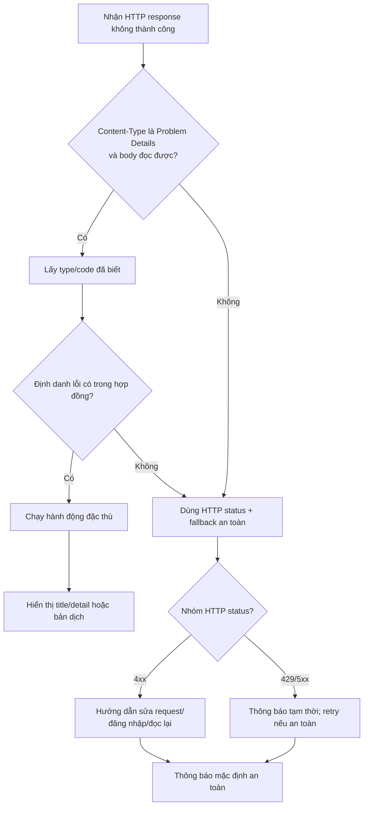

# Phân biệt thông báo cho con người với mã để client xử lý

## 1. Vì sao một thông báo dễ đọc chưa đủ cho REST API?

Trong một ứng dụng web, API có thể từ chối tạo đơn hàng vì sản phẩm không còn đủ số lượng, dữ liệu đầu vào không hợp lệ hoặc khách hàng chưa được xác thực. Người dùng cần một thông báo rõ ràng như **“Sản phẩm này hiện không đủ hàng”** để hiểu vấn đề. Trong khi đó, chương trình gọi API cần một tín hiệu **ổn định và có cấu trúc** để chọn hành động phù hợp: yêu cầu sửa biểu mẫu, tải lại tồn kho, hiển thị nút đăng nhập hay thử lại sau.

Nếu client dựa vào nội dung tiếng Việt để quyết định hành động, một thay đổi câu chữ hoặc ngôn ngữ sẽ khiến logic ngừng hoạt động dù ý nghĩa lỗi không đổi. Đây là nguyên nhân của nhiều lỗi tích hợp REST API: **lấy thông báo dành cho con người làm hợp đồng dành cho máy**.

Bài học thuộc chương **Lỗi API** của học phần `INTEGRATION_API_REST`. Phạm vi học phần là thiết kế REST API từ resource, URI, HTTP method, status code và hợp đồng dữ liệu; thực hành phân trang, cache, idempotency, OpenAPI, xác thực, phân quyền, xử lý lỗi và kiểm thử với Java/Spring hoặc công nghệ tương đương.

Sau bài học, người học có thể:

- Phân biệt **HTTP status**, **loại lỗi máy hiểu được**, **mã lỗi nghiệp vụ**, **thông điệp cho con người** và **dữ liệu chẩn đoán**.
- Thiết kế response lỗi theo **Problem Details for HTTP APIs (RFC 9457)**, sử dụng `type`, `title`, `detail` và các extension có chủ đích.
- Xây dựng bảng mã lỗi ổn định, có khả năng mở rộng phiên bản và bản địa hóa nội dung.
- Viết client phân nhánh theo mã/loại lỗi thay vì so khớp câu chữ.
- Thiết kế kiểm thử contract, xử lý mã chưa biết, bảo mật thông tin lỗi và giám sát.

## 2. Phản mẫu: client quyết định bằng chuỗi thông báo

Giả sử endpoint tạo đơn trả lỗi:

```http
HTTP/1.1 409 Conflict
Content-Type: application/json

{
  "message": "Sản phẩm không đủ hàng"
}
```

Ứng dụng mobile xử lý như sau:

```javascript
if (error.message === "Sản phẩm không đủ hàng") {
  showStockUpdateAction();
} else {
  showGenericError();
}
```

Sau khi nhóm nội dung sửa thành “Rất tiếc, số lượng hàng còn lại không đáp ứng đơn của bạn”, hoặc server trả tiếng Anh cho người dùng khác, điều kiện so sánh không còn đúng. Client có thể chuyển sang nhánh lỗi chung hoặc hướng người dùng thử lại không cần thiết.

Tình huống còn tệ hơn nếu API trả toàn bộ lỗi dưới dạng:

```json
{
  "success": false,
  "message": "Có lỗi xảy ra"
}
```

Lúc này client không phân biệt được lỗi dữ liệu, xung đột trạng thái, giới hạn lưu lượng hay sự cố máy chủ. Nếu HTTP status luôn là 200, middleware theo dõi, retry policy và cache cũng khó diễn giải kết quả đúng.

**Nguyên tắc:** văn bản hiển thị được phép thay đổi để phù hợp ngữ cảnh, giọng điệu, bản địa hóa và trải nghiệm người dùng. Logic chương trình phải dựa trên **các định danh, trạng thái và trường dữ liệu đã được công bố trong hợp đồng**.

## 3. Năm thành phần thường bị nhầm lẫn

| Thành phần | Dành cho ai? | Vai trò | Ví dụ | Có được dùng làm khóa xử lý? |
| --- | --- | --- | --- | --- |
| **HTTP status** | HTTP client, gateway, observability | Nhóm ý nghĩa HTTP chung | `409 Conflict`, `422 Unprocessable Content` | Có, ở mức xử lý tổng quát |
| **Problem type** | Client tích hợp và tài liệu API | Nhận diện một **loại vấn đề** cụ thể | `https://api.example.test/problems/order/out-of-stock` | **Có**, đây là định danh chính của Problem Details |
| **Mã lỗi miền (extension)** | SDK/client, vận hành | Tên ngắn ổn định theo hợp đồng riêng của API | `order.out_of_stock` | Có, khi được quy định ổn định |
| **`title` / `detail` / message** | Người dùng, hỗ trợ, lập trình viên đọc lỗi | Giải thích bằng ngôn ngữ tự nhiên | “Không đủ hàng để hoàn tất đơn” | **Không** dùng để phân nhánh |
| **Trace/request ID** | Hỗ trợ, vận hành, hệ thống log | Tìm đúng lần phát sinh lỗi trong log/trace | `req-82f0` | Không dùng để quyết định nghiệp vụ |

Một `409` có thể ứng với nhiều lỗi cụ thể: hết hàng, đơn ở trạng thái không được phép sửa hoặc mã đơn đã tồn tại. **HTTP status chưa đủ để client chọn đúng giao diện xử lý**, nhưng là cơ sở quan trọng để ứng dụng biết lỗi thuộc nhóm nào. Ngược lại, mã `order.out_of_stock` không thay thế HTTP status; response vẫn cần sử dụng đúng ý nghĩa giao thức.

Ví dụ một hợp đồng hợp lý:

```json
{
  "type": "https://api.example.test/problems/order/out-of-stock",
  "title": "Không đủ hàng",
  "status": 409,
  "detail": "Một sản phẩm trong đơn không còn đủ số lượng để đặt.",
  "instance": "/orders",
  "code": "order.out_of_stock",
  "traceId": "req-82f0"
}
```

Ở đây `code` và `traceId` là **trường mở rộng do API định nghĩa**. `type` là định danh loại lỗi theo RFC 9457. Nếu API dùng cả `type` và `code`, hãy công bố quy tắc chúng ánh xạ với nhau và chọn **một định danh chuẩn** để tránh hai giá trị mâu thuẫn.

## 4. Mô hình Problem Details theo RFC 9457

RFC 9457 quy định một cách biểu diễn thông tin lỗi HTTP có thể tái sử dụng, thường dùng media type `application/problem+json`. Các thành phần chuẩn có ý nghĩa riêng:

| Trường | Ý nghĩa theo Problem Details | Hướng thiết kế |
| --- | --- | --- |
| `type` | URI reference xác định loại vấn đề; mặc định là `about:blank` nếu không cung cấp | Với lỗi nghiệp vụ cần xử lý riêng, dùng URI ổn định, có tài liệu nếu có thể |
| `title` | Mô tả ngắn, dễ đọc của loại lỗi | Có thể bản địa hóa; thường không thay đổi giữa các lần phát sinh ngoại trừ bản địa hóa |
| `status` | Mã HTTP được dùng trong lần phát sinh; đặc biệt hữu ích nếu nội dung được lưu/tách khỏi HTTP | Khi gửi HTTP response, phải nhất quán với status trên dòng phản hồi |
| `detail` | Giải thích cụ thể về lỗi ở lần phát sinh này | Có thể tùy ngữ cảnh, tránh tiết lộ dữ liệu nhạy cảm |
| `instance` | URI reference nhận diện lần xuất hiện hoặc nơi phát sinh lỗi | Có thể là URI request hoặc một URI sự cố riêng theo hợp đồng |
| Extension members | Các trường ứng dụng tự định nghĩa | Ví dụ `code`, `errors`, `traceId`, `retryable` nếu thật sự cần |

Các thành phần trên **không phải đều bắt buộc** trong mọi Problem Details theo RFC. API có thể áp dụng một **hồ sơ hợp đồng riêng** yêu cầu `type`, `title`, `status` và `code` để client dễ triển khai. Khi thiếu `type`, giá trị ngữ nghĩa mặc định là `about:blank`, thường chỉ phản ánh status HTTP chung; do đó nó không đủ cho các lỗi miền cần xử lý riêng.

**Quan trọng:** RFC 9457 hướng client sử dụng `type` làm định danh chính của loại lỗi. `title` và `detail` được viết cho con người. Không suy đoán lỗi từ câu chữ, thứ tự xuất hiện của thông báo hoặc trạng thái được dịch.

### Ví dụ response đầy đủ

```http
HTTP/1.1 409 Conflict
Content-Type: application/problem+json
Content-Language: vi-VN
Cache-Control: no-store

{
  "type": "https://api.example.test/problems/order/out-of-stock",
  "title": "Không đủ hàng",
  "status": 409,
  "detail": "Một sản phẩm trong đơn không còn đủ số lượng để đặt.",
  "instance": "/orders",
  "code": "order.out_of_stock",
  "traceId": "req-82f0"
}
```

Ví dụ `Cache-Control: no-store` được chọn vì response có thể liên quan trạng thái đơn riêng tư và không nên lưu để phát lại. Header và chính sách cache cần thiết kế theo dữ liệu thực tế; không phải mọi Problem Details đều bắt buộc dùng `no-store`.

### Có cần một `message` riêng nữa không?

Nếu đã dùng `title` và `detail`, thường không cần lặp lại một trường `message` mang cùng nội dung. Việc thêm `message` có thể được cân nhắc để tương thích với client cũ, nhưng phải nói rõ trường nào là chuẩn và có kế hoạch bỏ sự trùng lặp. Đừng tạo các trường `message`, `errorMessage`, `description` và `reason` đều chứa văn bản gần giống nhau.

## 5. HTTP status và mã lỗi miền phối hợp ra sao?

HTTP status diễn tả **lớp lỗi của giao thức**. Mã/loại lỗi nghiệp vụ diễn tả **điều gì cụ thể đã xảy ra**.

| HTTP status | Loại/mã lỗi minh họa | Hành động client có thể thực hiện |
| --- | --- | --- |
| `400 Bad Request` | `request.malformed_json` | Kiểm tra cách tạo request; ghi nhận lỗi client nếu cần |
| `401 Unauthorized` | `auth.authentication_required` | Thực hiện quy trình đăng nhập/làm mới xác thực theo hợp đồng |
| `403 Forbidden` | `auth.insufficient_permission` | Thông báo không có quyền; không lặp cùng request vô hạn |
| `404 Not Found` | `resource.not_found` | Hiển thị tài nguyên không tồn tại hoặc không truy cập được |
| `409 Conflict` | `order.out_of_stock` | Tải lại tình trạng sản phẩm, đề nghị chỉnh số lượng |
| `409 Conflict` | `order.state_conflict` | Làm mới đơn rồi cân nhắc thao tác phù hợp |
| `412 Precondition Failed` | `resource.version_mismatch` | GET lại resource/ETag rồi xử lý xung đột |
| `415 Unsupported Media Type` | `request.unsupported_media_type` | Đổi cách serialize và `Content-Type` theo hợp đồng |
| `422 Unprocessable Content` | `validation.failed` | Đánh dấu trường sai và yêu cầu người dùng sửa |
| `429 Too Many Requests` | `rate_limit.exceeded` | Đợi theo `Retry-After` khi có, backoff có giới hạn |
| `503 Service Unavailable` | `service.temporarily_unavailable` | Hiển thị sự cố tạm thời; retry nếu an toàn |

Những mã thuộc cột giữa là **thiết kế minh họa**, không phải danh sách chuẩn do HTTP quy định. Một API có thể chọn naming convention khác, miễn nhất quán, tài liệu rõ và tương thích lâu dài.

Lựa chọn status vẫn phải chính xác:

- Dữ liệu JSON không parse được thường dùng **400**; body đúng cú pháp nhưng không thỏa quy tắc validation có thể dùng **422** theo hợp đồng.
- Media type request không được hỗ trợ dùng **415**, trong khi định dạng response không đáp ứng header `Accept` có thể liên quan **406**.
- Một yêu cầu hợp lệ nhưng xung đột trạng thái tài nguyên thường là **409**; `If-Match` không thỏa là **412**.
- Không dùng `422` để che lỗi database, timeout hoặc bug server. Các sự cố server cần status thuộc nhóm **5xx** thích hợp.
- Khi trả **401** với cơ chế xác thực HTTP yêu cầu challenge, dùng `WWW-Authenticate` theo đặc tả liên quan; mã lỗi miền không thay thế header này.

**Mã dành cho client không có nhiệm vụ sửa ý nghĩa HTTP.** Một HTTP 200 chứa `{"code":"order.out_of_stock"}` vẫn khiến HTTP client, proxy và một số hệ thống quan sát hiểu nhầm request thành công.

## 6. Thiết kế mã lỗi ổn định từ đầu

Một hệ thống có thể chọn **URI của `type` là định danh chuẩn**, còn `code` ngắn là một alias dành cho SDK/mobile. Ví dụ:

```text
Problem type:
  https://api.example.test/problems/order/out-of-stock

Code extension:
  order.out_of_stock

HTTP status:
  409

Documented meaning:
  Đơn hàng không thể hoàn tất do số lượng sẵn có không đáp ứng.

Recommended client action:
  Tải lại thông tin sản phẩm và cho người dùng điều chỉnh đơn.
```

### Quy tắc đặt tên

1. **Diễn tả nghĩa nghiệp vụ**, không lấy tên exception hay phương thức nội bộ. `order.out_of_stock` có nghĩa rõ hơn `DatabaseLockException`.
2. **Không trộn ngôn ngữ hiển thị vào mã.** `order.het_hang` không nguy hiểm về kỹ thuật nhưng khó dùng nhất quán đa ngôn ngữ; một quy tắc đặt tên rõ ràng giúp các nhóm cộng tác.
3. **Không tái sử dụng mã cho nghĩa mới.** Nếu hai tình huống đòi hành động khác nhau, hãy phân biệt loại lỗi; không đổi ngầm ý nghĩa mã cũ.
4. **Tách nhóm lỗi trong namespace.** Ví dụ `auth.*`, `validation.*`, `order.*`, `payment.*`, `rate_limit.*`.
5. **Giữ mã đủ ổn định qua các phiên bản.** Câu chữ, ngôn ngữ, dấu câu và chi tiết hỗ trợ có thể đổi; ý nghĩa mã và nhánh xử lý phải được quản lý theo quy tắc tương thích.
6. **Ghi rõ trạng thái HTTP đi kèm** và hành vi client đề xuất. Mã chỉ có tên mà không có ngữ nghĩa là chưa đủ.

Không nên chia mã thành những trường hợp quá vụn như `order.out_of_stock_warehouse_1` nếu client không cần phân biệt; nhưng cũng không nên gom mọi trường hợp vào `business.error` khiến client vẫn phải đọc `detail` để quyết định.

### Danh mục lỗi như một hợp đồng

| Type URI | Code | Status | Hợp đồng client | Có thể bản địa hóa gì? |
| --- | --- | --- | --- | --- |
| `/problems/order/out-of-stock` | `order.out_of_stock` | 409 | Cập nhật dữ liệu tồn kho/đơn trước khi tiếp tục | `title`, `detail`, nhãn nút |
| `/problems/order/state-conflict` | `order.state_conflict` | 409 | GET lại đơn và kiểm tra thao tác còn được phép | Mô tả trạng thái |
| `/problems/validation-failed` | `validation.failed` | 422 | Duyệt `errors[]` để đánh dấu trường | Thông báo từng trường |
| `/problems/rate-limit` | `rate_limit.exceeded` | 429 | Chờ theo chính sách giới hạn | Thông điệp thời gian chờ |
| `/problems/service-unavailable` | `service.temporarily_unavailable` | 503 | Retry/backoff nếu an toàn; có phương án thông báo | Thông báo cho người dùng |

Các đường `/problems/...` trong bảng là phần đường dẫn tương đối để dễ đọc; trên wire nên dùng URI loại lỗi ổn định như `https://api.example.test/problems/order/out-of-stock`. URI đó có thể dẫn đến tài liệu giải thích ý nghĩa, trường mở rộng và cách xử lý. Không nhúng request ID, ngôn ngữ, tenant ID hoặc timestamp vào **type URI** vì chúng sẽ tạo ra vô số định danh cho cùng một loại lỗi.

## 7. Hai thông báo khác ngôn ngữ, cùng một mã để xử lý

Giả sử cùng một tình huống “không đủ hàng”. Server có thể chọn ngôn ngữ hiển thị dựa trên header `Accept-Language`, thiết lập tài khoản hoặc ngôn ngữ mặc định của ứng dụng.

### Người dùng tiếng Việt

```http
POST /orders HTTP/1.1
Accept-Language: vi-VN
Content-Type: application/json

{"items":[{"sku":"BOOK-01","quantity":5}]}

HTTP/1.1 409 Conflict
Content-Type: application/problem+json
Content-Language: vi-VN

{
  "type": "https://api.example.test/problems/order/out-of-stock",
  "title": "Không đủ hàng",
  "status": 409,
  "detail": "Không thể đặt đủ số lượng sản phẩm đã chọn.",
  "code": "order.out_of_stock"
}
```

### Người dùng tiếng Anh

```http
POST /orders HTTP/1.1
Accept-Language: en-US
Content-Type: application/json

{"items":[{"sku":"BOOK-01","quantity":5}]}

HTTP/1.1 409 Conflict
Content-Type: application/problem+json
Content-Language: en-US

{
  "type": "https://api.example.test/problems/order/out-of-stock",
  "title": "Out of stock",
  "status": 409,
  "detail": "The requested quantity is not currently available.",
  "code": "order.out_of_stock"
}
```

Hai response khác nhau về `title`/`detail`, nhưng cùng status, `type` và `code`. Client có thể gọi cùng một nhánh xử lý mà không phụ thuộc ngôn ngữ.

**Lưu ý:** các ví dụ HTTP trên gộp request và response để mô tả một lượt trao đổi; trong giao thức thực, request và response là hai thông điệp riêng. URL và mã sản phẩm chỉ là dữ liệu minh họa.

### Bản địa hóa không được thay đổi logic

- Trường `type` và `code` **không nên thay đổi theo ngôn ngữ**. Không tạo `order.out_of_stock_vi` và `order.out_of_stock_en`.
- Dùng mã thông điệp nội bộ để tra tài nguyên bản địa hóa, chẳng hạn `problems.order.outOfStock.title`, nhưng **không nhầm khóa i18n với mã lỗi API**.
- Hỗ trợ fallback ngôn ngữ rõ ràng khi không có bản dịch; đặt `Content-Language` tương ứng với ngôn ngữ thực sự trả về.
- Tránh nối chuỗi thô chứa tên sản phẩm hoặc dữ liệu người dùng vào câu thông báo; dùng template và cơ chế escape phù hợp khi hiển thị.
- Với lỗi phản hồi khác nhau theo `Accept-Language`, cân nhắc `Vary: Accept-Language` và chính sách cache phù hợp; response có thông tin riêng tư thường cần `Cache-Control: private` hoặc `no-store` tùy trường hợp.

Một hệ thống cũng có thể để server trả thông báo kỹ thuật an toàn, còn client tự dịch theo `code`. Đây là lựa chọn hợp lý nếu SDK/app sở hữu bảng dịch; phải có fallback cho mã lỗi mới và không được suy luận nghĩa lỗi từ văn bản phía server.

## 8. Lỗi từng trường: mã riêng cho máy, message cho người dùng

Với thao tác tạo đơn:

```http
POST /orders HTTP/1.1
Content-Type: application/json

{
  "customerId": "cus-128",
  "items": [
    {"sku": "BOOK-01", "quantity": 0},
    {"sku": "", "quantity": 2}
  ]
}
```

Theo quy ước API của ví dụ, JSON có thể parse nhưng vi phạm validation nên trả **422 Unprocessable Content**:

```http
HTTP/1.1 422 Unprocessable Content
Content-Type: application/problem+json

{
  "type": "https://api.example.test/problems/validation-failed",
  "title": "Dữ liệu không hợp lệ",
  "status": 422,
  "detail": "Hãy kiểm tra các trường được đánh dấu.",
  "code": "validation.failed",
  "errors": [
    {
      "pointer": "/items/0/quantity",
      "code": "validation.min",
      "message": "Số lượng phải lớn hơn hoặc bằng 1.",
      "parameters": {"min": 1}
    },
    {
      "pointer": "/items/1/sku",
      "code": "validation.required",
      "message": "Mã sản phẩm là bắt buộc."
    }
  ]
}
```

`errors`, `pointer`, `code`, `message` và `parameters` trong mảng trên là **extension do API tự định nghĩa**. RFC 9457 không bắt buộc phải có danh sách lỗi trường với cấu trúc này. Nếu dùng JSON Pointer cho `pointer`, tuân thủ cách escape của JSON Pointer; một đường dẫn Bean Validation như `items[0].quantity` cần được ánh xạ sang `/items/0/quantity` đúng cách.

Ở client:

- Dùng `code = validation.failed` để biết đây là lỗi biểu mẫu.
- Dùng `pointer` để tìm điều khiển nhập liệu cần đánh dấu.
- Dùng `errors[i].code` và `parameters` để hiển thị lỗi thích hợp theo ngôn ngữ client nếu cần.
- Dùng `message` hoặc `detail` làm nội dung đọc được khi không có bảng dịch trong client.

**Không dùng message để tìm tên trường** như so khớp “Số lượng phải lớn hơn ...”. Thông điệp có thể thay đổi mà đường dẫn và mã lỗi vẫn giữ nguyên.

### Nên trả bao nhiêu chi tiết?

Không trả toàn bộ giá trị trường sai nếu đó là dữ liệu riêng tư. Chỉ ra nơi lỗi và nguyên nhân ở mức cần thiết. Ví dụ, lỗi định dạng mật khẩu hoặc token nên hiển thị thông báo an toàn, tránh để response làm kênh đoán điều kiện xác thực. Đối với dữ liệu nghiệp vụ cần che giấu (tồn kho, hạn mức, danh sách người dùng), trường mở rộng cũng phải được xem xét theo quyền của caller.

## 9. Luồng quyết định của client

Với response lỗi, client nên tách **cơ chế giao thức chung** khỏi **hành động dành cho loại lỗi riêng**.



Một đoạn TypeScript minh họa client phân nhánh theo `type`:

```typescript
type ApiProblem = {
  type?: string;
  title?: string;
  status?: number;
  detail?: string;
  code?: string;
  traceId?: string;
  errors?: Array<{
    pointer?: string;
    code?: string;
    message?: string;
  }>;
};

const OUT_OF_STOCK =
  "https://api.example.test/problems/order/out-of-stock";
const VALIDATION_FAILED =
  "https://api.example.test/problems/validation-failed";

async function handleApiError(response: Response): Promise<void> {
  const contentType = response.headers.get("content-type") ?? "";
  let problem: ApiProblem | null = null;

  if (contentType.toLowerCase().includes("application/problem+json")) {
    try {
      problem = (await response.json()) as ApiProblem;
    } catch {
      // Body không đọc được: vẫn có thể xử lý theo HTTP status.
    }
  }

  switch (problem?.type) {
    case OUT_OF_STOCK:
      showStockUpdateAction();
      return;
    case VALIDATION_FAILED:
      showFieldErrors(problem?.errors ?? []);
      return;
    default:
      break;
  }

  // Fallback khi gặp type mới, body không hợp lệ hoặc proxy đổi response.
  if (response.status === 401) {
    promptSignIn();
  } else if (response.status === 429 || response.status >= 500) {
    showTemporaryError();
  } else {
    showSafeGenericError(problem?.detail);
  }
}
```

Đây là **đoạn mã minh họa**; `showStockUpdateAction`, `showFieldErrors` và các hàm giao diện là hàm giả định của ứng dụng. Trong sản phẩm thực, cần xử lý `response.ok`, `Content-Type` có tham số, dữ liệu JSON không tin cậy, kiểm tra schema và chính sách hiển thị văn bản an toàn. Không được tự động đưa `detail` chưa kiểm soát vào HTML bằng cách nội suy không escape.

**Quy tắc fallback:** một API có thể thêm loại lỗi mới trong tương lai. Client cũ không nên crash khi gặp `type`/`code` không nhận ra, khi thiếu trường tùy chọn, hoặc khi gateway trả trang lỗi HTML. HTTP status và thông báo chung giúp client suy giảm có kiểm soát.

## 10. Mã lỗi và chiến lược retry, idempotency

Một mã lỗi có thể giúp chọn hành động, nhưng không có quy tắc “hễ gặp 5xx thì retry mọi request”. Cần kết hợp HTTP method, khả năng lặp an toàn, deadline và ngữ cảnh giao dịch.

| Tình huống | Hướng xử lý client | Lưu ý |
| --- | --- | --- |
| `validation.failed` với 422 | Yêu cầu sửa dữ liệu | Gửi lại y hệt thường không có ích |
| `order.out_of_stock` với 409 | Làm mới tình trạng hàng, cho điều chỉnh | Không tự tăng số lượng hay tạo đơn khác |
| `resource.version_mismatch` với 412 | GET lại resource/ETag, xử lý xung đột | Không retry mãi cùng `If-Match` cũ |
| `auth.authentication_required` với 401 | Theo quy trình xác thực | Không vòng lặp refresh token vô hạn |
| `rate_limit.exceeded` với 429 | Chờ theo `Retry-After` nếu có; backoff có jitter | Tôn trọng quota, tránh retry storm |
| `service.temporarily_unavailable` với 503 | Thông báo tạm thời; thử lại khi an toàn | Có thể có `Retry-After` |
| Timeout sau `POST /orders` | Kiểm tra kết quả theo idempotency key/order ID | Có thể server đã commit dù client không thấy response |

Đặc biệt với thao tác tạo đơn, thanh toán hay cập nhật trạng thái, **mất kết nối sau khi gửi request không cho biết server đã commit hay chưa**. Idempotency key, ràng buộc chống trùng và endpoint tra cứu trạng thái là một phần của hợp đồng riêng. Dù lỗi trả mã chính xác, việc gửi lại `POST` không có cơ chế chống trùng vẫn có thể tạo tác dụng phụ lặp.

Không dùng trường extension `retryable: true` như một “lệnh bắt buộc retry” nếu không xác định method, số lần thử, backoff và khả năng thực hiện lại an toàn. Trường đó chỉ nên là gợi ý được định nghĩa rõ; client vẫn cần chính sách của mình.

## 11. Bảo mật: mã ổn định không đồng nghĩa tiết lộ mọi nguyên nhân

API phải giải thích đủ để client hành động, nhưng **không được dùng phản hồi lỗi để tiết lộ thông tin nội bộ**.

### Những nội dung không nên xuất hiện trong `detail`

- Stack trace, tên class exception, SQL, sơ đồ bảng, tên host nội bộ và đường dẫn filesystem.
- Password, access token, refresh token, API key, secret, thông tin thẻ thanh toán.
- Thông tin cá nhân hoặc dữ liệu của tenant khác.
- Giá trị nhạy cảm mà caller không có quyền biết, kể cả gián tiếp qua sự khác biệt của mã lỗi.

Ví dụ, luồng đăng nhập hoặc khôi phục mật khẩu thường cần tránh tiết lộ tài khoản có tồn tại hay không. Nếu chính sách bảo mật yêu cầu trả chung một loại lỗi cho “email chưa đăng ký” và “mật khẩu không đúng”, hãy dùng loại lỗi tổng quát như `auth.invalid_credentials` và thông điệp chung. Không tạo mã quá cụ thể khiến client có thể dò tài khoản.

Một response cho lỗi server:

```http
HTTP/1.1 500 Internal Server Error
Content-Type: application/problem+json
Cache-Control: no-store

{
  "type": "https://api.example.test/problems/internal-error",
  "title": "Không thể hoàn tất yêu cầu",
  "status": 500,
  "detail": "Vui lòng thử lại sau hoặc liên hệ hỗ trợ.",
  "code": "service.internal_error",
  "traceId": "req-f92c"
}
```

Ở log phía server có thể ghi exception và stack trace theo chính sách truy cập, gắn `traceId` để tra cứu. Response công khai chỉ cần thông tin phù hợp. Không đưa tên exception như `NullPointerException`, chuỗi kết nối DB hoặc chi tiết hạ tầng vào client.

### Quyền truy cập và sự khác biệt giữa lỗi

Một endpoint yêu cầu đăng nhập có thể từ chối **trước khi** validate body. Không có yêu cầu mọi request không được phép phải lộ mã validation của dữ liệu. Phân quyền được kiểm tra tại tầng tài nguyên/đối tượng; client không được dùng mã lỗi để suy đoán ID tài nguyên hoặc danh tính người dùng khác. Cần cân nhắc việc dùng 404 để không công bố sự tồn tại của tài nguyên trong một số chính sách truy cập.

## 12. Ví dụ triển khai Java/Spring: giữ mã ổn định, dịch thông điệp

Với Spring Boot 3 / Spring Framework 6 trở lên, có thể dùng `ProblemDetail` và `@RestControllerAdvice`. Mã lỗi miền nên được định nghĩa độc lập với thông báo hiển thị. Tầng nghiệp vụ ném exception giàu ngữ nghĩa; tầng HTTP ánh xạ exception thành status, type và message.

### 12.1. Mô hình exception nghiệp vụ

```java
// Ví dụ minh họa; lược bỏ một số imports.
final class OutOfStockException extends RuntimeException {
    OutOfStockException() {
        super("OUT_OF_STOCK"); // Không dùng text này làm message công khai.
    }
}
```

Một mã ổn định phải được lưu trong danh mục có chủ sở hữu, không được sinh trực tiếp bằng cách lấy `exception.getMessage()` hoặc `exception.getClass().getSimpleName()`. Tên class có thể đổi khi refactor mà loại lỗi public không được đổi.

### 12.2. `@RestControllerAdvice` trả Problem Details

```java
// Spring MVC; thêm imports cho ResponseEntity, ProblemDetail,
// MessageSource, URI, Locale, HttpHeaders, HttpStatus, MediaType.
@RestControllerAdvice
class ApiProblemAdvice {
    private static final String OUT_OF_STOCK_TYPE =
        "https://api.example.test/problems/order/out-of-stock";
    private static final String OUT_OF_STOCK_CODE =
        "order.out_of_stock";

    private final MessageSource messageSource;

    ApiProblemAdvice(MessageSource messageSource) {
        this.messageSource = messageSource;
    }

    @ExceptionHandler(OutOfStockException.class)
    ResponseEntity<ProblemDetail> handleOutOfStock(
            OutOfStockException ex,
            Locale locale) {
        String title = messageSource.getMessage(
            "problems.order.outOfStock.title",
            null, locale
        );
        String detail = messageSource.getMessage(
            "problems.order.outOfStock.detail",
            null, locale
        );

        ProblemDetail body = ProblemDetail.forStatusAndDetail(
            HttpStatus.CONFLICT, detail
        );
        body.setType(URI.create(OUT_OF_STOCK_TYPE));
        body.setTitle(title);
        body.setProperty("code", OUT_OF_STOCK_CODE);

        return ResponseEntity.status(HttpStatus.CONFLICT)
            .contentType(MediaType.parseMediaType("application/problem+json"))
            .header(HttpHeaders.CONTENT_LANGUAGE, locale.toLanguageTag())
            .header(HttpHeaders.VARY, HttpHeaders.ACCEPT_LANGUAGE)
            .header(HttpHeaders.CACHE_CONTROL, "no-store")
            .body(body);
    }
}
```

Ví dụ dùng resource bundle do ứng dụng cấu hình với khóa:

```properties
# messages_vi.properties — nội dung minh họa, không phải file cần tạo
problems.order.outOfStock.title=Không đủ hàng
problems.order.outOfStock.detail=Không thể đặt đủ số lượng sản phẩm đã chọn.
```

```properties
# messages_en.properties — nội dung minh họa
problems.order.outOfStock.title=Out of stock
problems.order.outOfStock.detail=The requested quantity is not currently available.
```

Nếu cấu hình `MessageSource` sử dụng prefix `messages`, các ví dụ tài nguyên có thể được ứng dụng nạp theo locale. Mỗi ứng dụng phải kiểm tra chiến lược fallback, việc locale được chọn từ đâu và tác động khi thay đổi cấu hình. Tên khóa trong bundle là chi tiết **nội bộ** và có thể đổi khi refactor nếu `type`/`code` public vẫn giữ nguyên.

**Lưu ý triển khai:** `@ExceptionHandler` ví dụ chỉ ánh xạ một loại exception. API hoàn chỉnh còn phải xử lý lỗi parser, Bean Validation, authorization, media type, optimistic locking và lỗi ngoài dự kiến. Không tạo handler bắt `Exception` rồi trả HTTP 200 hoặc 422 cho tất cả trường hợp. Spring MVC có mặc định riêng cho lỗi Bean Validation; nếu hợp đồng muốn 422 thay vì 400 mặc định, cần cấu hình handler và kiểm thử rõ.

### 12.3. Ánh xạ validation error

Khi `@Valid @RequestBody` thất bại, nếu chọn chính sách trả `422`, tầng advice có thể lấy `FieldError` và ánh xạ:

```text
Spring FieldError:
  field = items[0].quantity
  code  = Min

Public API validation error:
  pointer = /items/0/quantity
  code    = validation.min
  message = Số lượng phải lớn hơn hoặc bằng 1.
  parameters.min = 1
```

Đừng xuất thẳng tên constraint hoặc message mặc định của framework làm định danh public khi chưa chuẩn hóa. Trong nhiều trường hợp, message mặc định chứa tên class/field hoặc thay đổi khi nâng dependency. Nếu body có dạng JSON hợp lệ nhưng binding không thành công, việc Spring phân loại `400` hay tầng validation phân loại `422` phụ thuộc kiến trúc cụ thể; hợp đồng phải được viết rõ.

## 13. Mô tả lỗi trong OpenAPI

Ví dụ OpenAPI 3.0.3 cho `POST /orders`, với schema Problem Details chung và extension `code`:

```yaml
openapi: 3.0.3
info:
  title: Orders API
  version: 1.0.0
paths:
  /orders:
    post:
      summary: Tạo đơn hàng
      requestBody:
        required: true
        content:
          application/json:
            schema:
              $ref: '#/components/schemas/CreateOrderRequest'
      responses:
        '201':
          description: Đã tạo đơn hàng
          headers:
            Location:
              schema: { type: string }
              description: URI của đơn mới
        '409':
          description: Trạng thái tài nguyên hoặc tồn kho xung đột
          content:
            application/problem+json:
              schema:
                $ref: '#/components/schemas/ApiProblem'
              examples:
                outOfStock:
                  value:
                    type: https://api.example.test/problems/order/out-of-stock
                    title: Không đủ hàng
                    status: 409
                    code: order.out_of_stock
        '422':
          description: Dữ liệu đầu vào không đáp ứng validation
          content:
            application/problem+json:
              schema:
                $ref: '#/components/schemas/ApiProblem'
        '500':
          description: Lỗi nội bộ không mong đợi
          content:
            application/problem+json:
              schema:
                $ref: '#/components/schemas/ApiProblem'
components:
  schemas:
    CreateOrderRequest:
      type: object
      required: [customerId, items]
      properties:
        customerId: { type: string }
        items:
          type: array
          items:
            type: object
            properties:
              sku: { type: string }
              quantity: { type: integer, minimum: 1 }
    ApiProblem:
      type: object
      description: >
        Hồ sơ lỗi riêng của Orders API dựa trên RFC 9457.
        type và code là định danh ổn định; title/detail dành cho con người.
      required: [type, title, status, code]
      properties:
        type: { type: string, format: uri-reference }
        title: { type: string }
        status: { type: integer }
        detail: { type: string }
        instance: { type: string, format: uri-reference }
        code: { type: string }
        traceId: { type: string }
        errors:
          type: array
          items:
            type: object
            properties:
              pointer: { type: string }
              code: { type: string }
              message: { type: string }
```

Đây là **hợp đồng minh họa riêng của Orders API**: trường `code` và ràng buộc `required` được API tự lựa chọn, không phải RFC 9457 yêu cầu mọi Problem Details phải có chúng. Trong dự án thật cần mô tả toàn bộ response cần thiết (400, 401, 403, 404, 415, 429, 503 theo endpoint), mẫu `errors[]`, mã có thể xuất hiện, headers như `WWW-Authenticate`/`Retry-After` và điều kiện phát sinh.

OpenAPI schema chỉ kiểm tra **hình dạng**. Một response có thể đúng schema nhưng dùng sai `type` cho lỗi, hoặc đổi mã giữa phiên bản mobile/web. Vì vậy cần contract tests kiểm tra cả **ý nghĩa** và **tính ổn định** của định danh.

## 14. Tương thích phiên bản và tiến hóa danh mục lỗi

Giả sử API ban đầu có:

```json
{
  "type": "https://api.example.test/problems/order/out-of-stock",
  "code": "order.out_of_stock",
  "title": "Không đủ hàng"
}
```

Nhóm trải nghiệm muốn đổi `title` thành “Sản phẩm tạm hết hàng”. Đây thường là **thay đổi tương thích**, vì client không được so sánh title. Nhưng nếu đổi `code` thành `inventory.not_enough` hoặc đổi `type` sang URI mới mà không có kế hoạch, client đang xử lý bằng mã cũ có thể mất tính năng. Một thay đổi như vậy là **thay đổi hợp đồng**, phải được quản lý.

### Nguyên tắc tiến hóa

1. **Sửa câu chữ tự do trong giới hạn ngữ nghĩa:** cải thiện `title`/`detail`, thêm bản dịch, sửa chính tả mà không đổi loại lỗi.
2. **Giữ `type`/`code` cũ cho cùng ý nghĩa:** không đổi định danh chỉ vì đổi tên lớp, tái cấu trúc thư mục hay chuyển provider.
3. **Bổ sung lỗi mới theo hướng mở rộng:** client cũ phải có fallback theo HTTP status.
4. **Không tái sử dụng mã đã ngừng:** mã cũ không được mang nghĩa mới trong tương lai.
5. **Khi tách một mã thành nhiều loại:** xác định tác động tới client cũ, thời gian chuyển tiếp, tài liệu và kế hoạch tương thích.
6. **Theo dõi client nào dùng mã nào:** SDK, mobile phiên bản cũ, đối tác, batch; phối hợp deprecation khi cần.
7. **Công bố thay đổi status nếu thay đổi:** HTTP status cũng là một phần hợp đồng, không chỉ body JSON.

Nếu cần chuyển từ response kiểu cũ `{"errorCode": "...", "message": "..."}` sang Problem Details, có thể duy trì tương thích trong một giai đoạn có kiểm soát (theo version/media type hoặc lớp tương thích). Đừng âm thầm thay đổi mọi response mà không xem client đang triển khai ở đâu.

### Danh mục lỗi cần có những cột gì?

| Thuộc tính | Tại sao cần |
| --- | --- |
| Type URI, code và mô tả ngữ nghĩa | Client biết chính xác loại lỗi |
| HTTP status, method/endpoint có thể phát sinh | Công bố ngữ nghĩa HTTP |
| Điều kiện phát sinh và ví dụ request | Tránh hiểu cùng mã theo nhiều cách |
| Hành động client đề xuất | Dễ triển khai UX/SDK |
| Có thể retry hay không và điều kiện retry | Ngăn gửi lại yêu cầu không an toàn |
| Các extension cần thiết và ràng buộc riêng tư | Bảo vệ contract và dữ liệu |
| Người sở hữu, ngày ban hành, trạng thái deprecation | Quản lý vòng đời |

## 15. Kiểm thử contract: kiểm cái gì để client không vỡ?

Một test chỉ assert response chứa chữ “Không đủ hàng” là **test sai mục tiêu** nếu mục đích là hợp đồng máy hiểu được. Các kiểm thử quan trọng:

| Ca kiểm thử | Điều cần xác nhận |
| --- | --- |
| Không đủ hàng | HTTP 409, `type` và `code` chính xác, nội dung có `Content-Type: application/problem+json` |
| Lặp lại cùng lỗi với locale vi-VN / en-US | `type`, `code` và HTTP status **giữ nguyên**; `title`/`detail` có thể khác |
| Body sai cú pháp | HTTP 400, loại lỗi cú pháp; không bị ánh xạ nhầm thành 422 |
| Body đúng cú pháp nhưng không qua validation | HTTP 422 theo chính sách, `errors[i].pointer` và `code` đúng |
| Yêu cầu không có quyền | HTTP 401/403 thích hợp; không lộ dữ liệu |
| Internal exception | HTTP 5xx, loại lỗi chung; không trả stack trace, SQL hoặc secret |
| Type mới/không biết ở client | UI dùng fallback an toàn, không crash |
| Response không phải JSON (proxy/gateway) | Client xử lý được theo HTTP status |
| Lỗi cache/ngôn ngữ | Header ngôn ngữ và chính sách cache phù hợp |
| Lỗi 429/503 | `Retry-After` và retry policy tuân theo hợp đồng; không retry quá mức |

### Ví dụ kiểm thử Spring MVC với MockMvc

```java
// Phác thảo JUnit + MockMvc; giả sử test fixture đã tạo đơn và
// mock service ném OutOfStockException khi gửi request này.
@Test
void outOfStockHasStableCodeAcrossLocales() throws Exception {
    for (String language : List.of("vi-VN", "en-US")) {
        mockMvc.perform(post("/orders")
                .header("Accept-Language", language)
                .contentType(MediaType.APPLICATION_JSON)
                .content("""
                    {"customerId":"cus-128",
                     "items":[{"sku":"BOOK-01","quantity":5}]}
                    """))
            .andExpect(status().isConflict())
            .andExpect(content().contentTypeCompatibleWith(
                MediaType.parseMediaType("application/problem+json")))
            .andExpect(jsonPath("$.type").value(
                "https://api.example.test/problems/order/out-of-stock"))
            .andExpect(jsonPath("$.code").value("order.out_of_stock"))
            .andExpect(jsonPath("$.status").value(409));
    }
}
```

Đoạn mã giả định môi trường test có `MockMvc`, `@Test`, dữ liệu fixture và service stub phù hợp. Thêm test kiểm tra title/detail khác theo hai locale khi cấu hình `MessageSource` đầy đủ, test `Content-Language` và fallback ngôn ngữ. Nếu API có nhiều handler cùng ánh xạ lỗi, kiểm tra không có trường hợp rơi vào lỗi chung ngoài dự kiến.

### Kiểm thử từ góc nhìn client

Thực hiện một test với body phản hồi có:

```json
{
  "type": "https://api.example.test/problems/order/out-of-stock",
  "code": "order.out_of_stock",
  "title": "Câu chữ hoàn toàn mới",
  "detail": "Thông điệp có thể thay đổi.",
  "status": 409
}
```

Client vẫn phải kích hoạt hành động cập nhật tồn kho. Nếu test thất bại khi đổi `title`/`detail`, client đang phụ thuộc vào văn bản. Đây là kiểm thử trực tiếp để ngăn phản mẫu.

## 16. Vận hành và phân tích lỗi mà không làm nổ số lượng metrics

Mã lỗi ổn định có ích cho dashboard, nhưng cách ghi log/metric cần thiết kế cẩn thận:

```json
{
  "timestamp": "2027-01-15T09:15:00Z",
  "level": "INFO",
  "route": "POST /orders",
  "httpStatus": 409,
  "problemType": "https://api.example.test/problems/order/out-of-stock",
  "errorCode": "order.out_of_stock",
  "traceId": "req-82f0"
}
```

- Dùng `route` đã chuẩn hóa (ví dụ `POST /orders/{id}`), không dùng URI chứa ID ngẫu nhiên làm nhãn metrics.
- Dùng `httpStatus` và `errorCode` có tập giá trị hữu hạn; tránh dùng `detail`/`message` làm nhãn vì ngôn ngữ và giá trị động tạo cardinality rất lớn.
- `traceId` phù hợp để tra log/trace, nhưng không phù hợp làm nhãn metric.
- Che dữ liệu cá nhân, token, nội dung request nhạy cảm và các tham số tự do khi ghi log.
- Phân biệt lỗi dự kiến của nghiệp vụ (ví dụ 409 hết hàng) với sự cố hệ thống (5xx); không đánh giá mọi 4xx là server outage.

Một dashboard nên cho biết lỗi nào tăng sau release: `validation.failed` tăng có thể do client gửi schema sai; `order.out_of_stock` tăng có thể do tồn kho và chiến dịch bán hàng; `service.internal_error` tăng gợi ý sự cố cần điều tra. Không kết luận tự động chỉ từ mã; đặt cạnh tỷ lệ request, release events và trace.

## 17. Những sai lầm thường gặp

1. **Dùng `message` làm điều kiện `if`:** client hỏng khi đổi ngôn ngữ hoặc câu chữ.
2. **Trả cùng một mã `UNKNOWN_ERROR` cho mọi trường hợp:** client không có đủ thông tin để hành động.
3. **Chỉ dùng status HTTP để phân biệt mọi lỗi nghiệp vụ:** các lỗi cùng status cần xử lý khác nhau.
4. **Chỉ dùng `code` riêng rồi trả HTTP 200 cho lỗi:** phá ngữ nghĩa giao thức.
5. **Lấy tên exception làm mã public:** refactor nội bộ trở thành breaking change ngoài ý muốn.
6. **Dịch `code` hoặc `type` theo locale:** cùng một lỗi có nhiều định danh không cần thiết.
7. **Trả mọi lỗi validation là 500 hoặc 200:** khiến phía client không biết phải sửa dữ liệu.
8. **Gửi SQL/stack trace trong `detail`:** làm lộ thông tin nhạy cảm và tăng rủi ro tấn công.
9. **Thay đổi nghĩa mã cũ:** client cũ thực hiện sai hành động khi nâng cấp server.
10. **Không có fallback với mã mới:** client phiên bản cũ crash hoặc hiển thị UI trống.
11. **Tạo `errors[]` nhưng chỉ trả thông báo, không có field path/code:** UI khó đánh dấu đúng trường nhập.
12. **Cho rằng `ProblemDetail` tự giải quyết mọi lỗi:** vẫn phải thiết kế mapping, i18n, bảo mật, danh mục lỗi và test.

## 18. Bài thực hành: thiết kế API đặt hàng có hợp đồng lỗi ổn định

Bạn phụ trách `POST /orders`, `PATCH /orders/{id}` và `GET /orders/{id}`. Hệ thống phục vụ cả ứng dụng web tiếng Việt, mobile tiếng Anh và một đối tác không hiển thị giao diện người dùng.

### Yêu cầu

- Đơn không đủ hàng: 409, client làm mới danh sách sản phẩm và đề nghị sửa giỏ.
- Body đúng JSON nhưng `quantity < 1`: 422 theo chính sách, client đánh dấu trường.
- ETag cũ khi PATCH: 412, client đọc lại đơn trước khi sửa.
- Thiếu xác thực hợp lệ: 401, client thực hiện quy trình xác thực.
- Hết hạn mức gọi API: 429, client giới hạn lại request và chờ theo hợp đồng.
- Lỗi DB không dự kiến: 5xx, client nhận thông báo chung và mã tra cứu.

### Nhiệm vụ A — Lập danh mục lỗi

Tạo bảng có ít nhất sáu lỗi. Mỗi dòng gồm `type`, `code`, HTTP status, điều kiện phát sinh, hành động client, message tiếng Việt/tiếng Anh và chính sách bảo mật. Đảm bảo các mã không phụ thuộc câu chữ hay tên class nội bộ.

Một lời giải tham khảo:

| Tình huống | Code đề xuất | Status | Hành động |
| --- | --- | --- | --- |
| Hết hàng | `order.out_of_stock` | 409 | Làm mới tồn kho, chỉnh giỏ |
| Số lượng không hợp lệ | `validation.failed` với field code `validation.min` | 422 | Đánh dấu quantity |
| Phiên bản đơn thay đổi | `resource.version_mismatch` | 412 | GET lại ETag |
| Chưa đăng nhập | `auth.authentication_required` | 401 | Bắt đầu xác thực |
| Vượt hạn mức | `rate_limit.exceeded` | 429 | Chờ/backoff |
| DB không khả dụng | `service.temporarily_unavailable` hoặc loại lỗi 5xx phù hợp | 503 nếu dịch vụ tạm không sẵn sàng | Hiển thị tạm thời, retry an toàn |

### Nhiệm vụ B — Viết hai response cho cùng một loại lỗi

Viết response Problem Details tiếng Việt và tiếng Anh cho lỗi hết hàng. Chứng minh `type`, `code` và status vẫn bằng nhau, còn `title`/`detail` được phép khác. Nêu lựa chọn khi client không gửi `Accept-Language`.

### Nhiệm vụ C — Viết client có fallback

Tạo hàm xử lý `application/problem+json`. Hàm phải phân nhánh theo `type` hoặc `code` được quy định, đọc `errors[]` cho form, xử lý lỗi chưa biết bằng HTTP status và không crash khi gateway trả HTML/response rỗng.

### Nhiệm vụ D — Java/Spring và OpenAPI

Triển khai `@RestControllerAdvice` ánh xạ một exception nghiệp vụ sang Problem Details; dùng `MessageSource` để dịch text. Mô tả `application/problem+json` và ít nhất ba loại lỗi trong OpenAPI. Không sử dụng `exception.getMessage()` trực tiếp làm public `detail` nếu chưa qua chính sách an toàn.

### Nhiệm vụ E — Viết kiểm thử

Tạo các test kiểm tra HTTP status, `type`, `code`, schema lỗi, locale, error code từng field, thiếu quyền và 5xx không lộ stack trace. Thêm một test đổi hoàn toàn câu chữ hiển thị mà client vẫn xử lý đúng nhờ mã lỗi.

### Thang chấm (100 điểm)

| Hạng mục | Điểm |
| --- | ---: |
| Phân biệt status, type, code, title/detail và trace ID | 20 |
| Danh mục lỗi, URI và định danh ổn định | 20 |
| Bản địa hóa và hỗ trợ fallback | 15 |
| Xử lý validation errors, retry và xung đột | 15 |
| Java/Spring, OpenAPI và contract tests | 20 |
| Bảo mật và observability | 10 |

## 19. Câu hỏi tự kiểm tra

1. Vì sao so sánh `error.message == "Không đủ hàng"` là phản mẫu trong client REST API?
2. HTTP status và mã lỗi nghiệp vụ khác nhau về mức độ chi tiết như thế nào?
3. Theo Problem Details, client nên dùng `type`, `title` hay `detail` để phân biệt loại lỗi? Vì sao?
4. `code` trong body Problem Details là thuộc tính bắt buộc của RFC 9457 hay extension do API thiết kế?
5. Có thể đổi thông điệp “Không đủ hàng” thành “Sản phẩm tạm hết hàng” mà không thay `type`/`code` không?
6. Lỗi validation nhiều trường nên trả những thành phần nào để client đánh dấu đúng field?
7. Khi người dùng đổi `Accept-Language` từ tiếng Việt sang tiếng Anh, thành phần nào nên giữ nguyên?
8. Vì sao không nên đưa tên exception, SQL và stack trace vào `detail`?
9. Trường hợp nào `409` phù hợp hơn `422`, và vì sao `412` có ý nghĩa riêng?
10. Client xử lý thế nào nếu nhận một `type` mới chưa biết từ phiên bản server mới?
11. Khi API trả `429` hoặc `503`, vì sao việc retry còn phụ thuộc HTTP method, idempotency và `Retry-After`?
12. Test nào giúp phát hiện client đang phụ thuộc vào câu chữ hiển thị?
13. Vì sao không nên dùng `traceId` hoặc `detail` làm nhãn metric?
14. Nếu đổi tên exception Java trong quá trình refactor, định danh lỗi public có cần đổi không?
15. Những gì cần được ghi trong danh mục lỗi để nhiều nhóm client có thể tích hợp mà không phải đọc mã nguồn server?

**Điểm cần ghi nhớ:** REST API cần hai lớp thông tin lỗi phục vụ hai đối tượng khác nhau: **mã/loại lỗi ổn định cho chương trình xử lý** và **thông báo có thể thay đổi, bản địa hóa cho con người**. Hãy dùng HTTP status đúng nghĩa, định danh Problem Details `type` làm khóa chính, bổ sung mã miền nếu hợp đồng cần, giữ `title`/`detail` an toàn và dễ hiểu, rồi kiểm thử để mọi client vẫn hoạt động khi câu chữ thay đổi.
