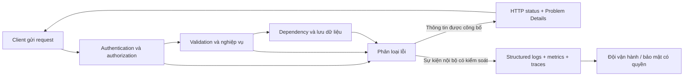
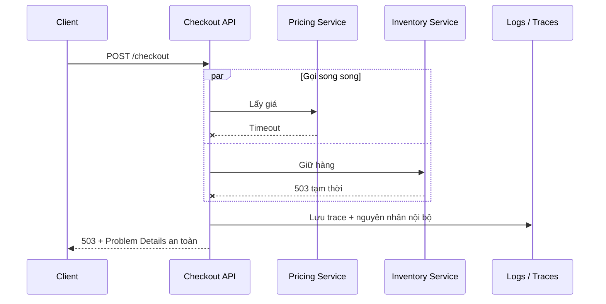

# Lỗi nhiều nguyên nhân và kiểm soát lượng thông tin trả về

Một yêu cầu REST API có thể thất bại vì **nhiều vấn đề cùng lúc**. Ví dụ, khi tạo đơn hàng, địa chỉ giao không hợp lệ, một sản phẩm vượt số lượng cho phép và mã giảm giá không áp dụng được. Ở trường hợp khác, yêu cầu hợp lệ nhưng dịch vụ tồn kho chậm, hệ thống thanh toán không phản hồi và một lần retry đã tạo ra xung đột. Nếu chỉ trả lỗi đầu tiên, client phải sửa rồi gửi đi gửi lại; nếu trả nguyên toàn bộ exception, API có thể làm lộ SQL, token, dữ liệu khách hàng hoặc cấu trúc hạ tầng.

Thử thách của người thiết kế là xác định **thông tin đủ để người gọi sửa yêu cầu hoặc quyết định bước tiếp theo**, trong khi vẫn giữ chi tiết chẩn đoán cần thiết cho vận hành. Bài học thuộc chương **Lỗi API** của module **INTEGRATION_API_REST**: áp dụng thiết kế hợp đồng tài nguyên, phương thức/mã HTTP, Problem Details, OpenAPI, xác thực, phân quyền, xử lý lỗi và kiểm thử với Java/Spring.

**Mục tiêu sau bài học:** phân biệt lỗi kiểm tra dữ liệu có nhiều mục, lỗi từ nhiều dịch vụ và lỗi xử lý từng phần; chọn một HTTP status thể hiện kết quả yêu cầu; xây phản hồi lỗi có mã máy đọc được; giới hạn dữ liệu trả ra theo quyền; lưu thông tin chẩn đoán ở nơi an toàn; và kiểm chứng hợp đồng trong cả tình huống thành công lẫn thất bại.

## 1. “Nhiều nguyên nhân” có thể mang ba ý nghĩa

| Loại tình huống | Ví dụ | Điều client cần biết | Điều server nên giữ để chẩn đoán |
|---|---|---|---|
| **Nhiều lỗi trong một request** | Giỏ hàng có 3 dòng sai số lượng, địa chỉ và mã giảm giá không hợp lệ | Danh sách trường/vấn đề **được phép công bố**, cách sửa, HTTP status chung | Validator nào từ chối, quy tắc nghiệp vụ, input đã xử lý an toàn |
| **Một lỗi với nhiều nguyên nhân nội bộ** | Checkout thất bại vì Inventory timeout và circuit breaker của Pricing đang mở | Mã lỗi ổn định, khả năng thử lại, thời điểm/đường tra cứu nếu có | Dependency, latency, exception chain, trace, trạng thái circuit breaker |
| **Nhiều kết quả trong một thao tác tập hợp** | Import 100 bản ghi: 92 thành công, 8 thất bại | Kết quả/operation theo từng mục, có thể phân trang hoặc tải báo cáo | Trạng thái xử lý từng mục, rollback, retry, idempotency và audit |

Ba tình huống không nên dùng chung một mẫu phản hồi một cách máy móc. **Nhiều lỗi kiểm tra dữ liệu** có thể thuộc một phản hồi `400` hoặc `422` với mảng `errors`. **Một lỗi hệ thống** nên có phản hồi `5xx` an toàn cho client dù có rất nhiều exception bên trong. **Thành công một phần** cần hợp đồng nêu rõ mục nào đã thay đổi và mục nào chưa, tránh gọi toàn bộ request là “failed” hoặc “succeeded” khi điều đó không đúng.

### 1.1. Ví dụ nghiệp vụ xuyên suốt

Giả sử API nhận:

```http
POST /api/v1/orders HTTP/1.1
Host: api.example.com
Authorization: Bearer <access_token>
Idempotency-Key: 6b340fc2-7207-49ae-a83e-40fc21d6115a
Content-Type: application/json

{
  "items": [
    { "sku": "SKU-A", "quantity": 0 },
    { "sku": "SKU-B", "quantity": 9999 }
  ],
  "shippingAddressId": "addr-42",
  "couponCode": "WINTER"
}
```

Trong **ví dụ giả định**, quy định số lượng phải nằm trong khoảng 1–100; dịch vụ kiểm tra địa chỉ cho biết `addr-42` không được sử dụng cho đơn hàng này; mã giảm giá `WINTER` không hợp lệ với giỏ hàng. Một API phù hợp có thể công bố nhiều vấn đề cùng lúc nếu chúng độc lập và người gọi được phép biết thông tin đó.

Ngược lại, nếu `addr-42` thuộc người khác, không được tiết lộ “địa chỉ thuộc tenant B, số nhà...” chỉ vì danh sách lỗi có chức năng giải thích. Khi đó thông điệp nên là “Không thể sử dụng địa chỉ đã chọn” hoặc một kết quả `404`/`403` theo chính sách và thứ tự phân quyền.

## 2. Hai mặt của cùng một lỗi: hợp đồng công khai và chẩn đoán nội bộ

Mỗi sự cố cần được nhìn ở **hai tầng**:



**Hợp đồng công khai** phục vụ client: kết quả có sửa được hay không, cần đăng nhập lại, xin quyền, tải lại trạng thái hay retry sau một khoảng thời gian. **Dữ liệu nội bộ** phục vụ điều tra: exception type, stack trace, dependency, lỗi database, route, deployment version và thông tin tương quan giữa dịch vụ.

Không nên gửi nguyên output của logger, stack trace hoặc nội dung `Throwable.getMessage()` thẳng vào `detail`. Thông điệp exception thường được viết cho lập trình viên và có thể chứa query, dữ liệu đầu vào, tên server, endpoint nội bộ hoặc secret.

## 3. Chọn HTTP status cho kết quả tổng thể

HTTP response thông thường có **một mã trạng thái cho cả request**. Nếu trong cùng request có ba lỗi trường dữ liệu, server không thể đưa ba HTTP status độc lập vào status line. Hợp đồng cần chọn mã thể hiện **kết quả tổng thể** và đặt chi tiết vấn đề được công bố ở body.

| Tình huống | HTTP status gợi ý | Giải thích |
|---|---|---|
| JSON không parse được, kiểu dữ liệu sai hoặc vi phạm cú pháp request | **400 Bad Request** | Request không thể được hiểu đúng theo hợp đồng đầu vào. |
| JSON đúng cấu trúc nhưng có nhiều lỗi ràng buộc dữ liệu | **400** hoặc **422 Unprocessable Content** theo quy ước API | Dùng nhất quán; 422 phù hợp khi nội dung hiểu được nhưng không xử lý được theo hướng dẫn bên trong. |
| Request có token thiếu/hết hạn/không hợp lệ | **401 Unauthorized** + `WWW-Authenticate` | Không thể lấy việc liệt kê lỗi dữ liệu làm cớ bỏ qua xác thực. |
| Actor hợp lệ nhưng bị từ chối quyền hành động | **403 Forbidden** | Không tiết lộ tài nguyên hoặc lỗi dữ liệu thuộc người khác. |
| Không tìm thấy hoặc cần che giấu tài nguyên | **404 Not Found** | Hợp đồng quyết định khi nào trả 404 để hạn chế lộ tồn tại tài nguyên. |
| Trạng thái hiện tại xung đột, như phiên bản tài nguyên hoặc yêu cầu trùng với payload khác | **409 Conflict** hoặc **412 Precondition Failed** nếu `If-Match` không khớp | Client cần cập nhật trạng thái/giải quyết xung đột; không nên báo validation tùy tiện. |
| Vượt quota/rate limit | **429 Too Many Requests** | Có thể sử dụng `Retry-After`. |
| Proxy/gateway nhận phản hồi upstream không hợp lệ | **502 Bad Gateway** | Phản ánh vai trò trung gian của thành phần đang trả phản hồi. |
| Dịch vụ tạm thời không sẵn sàng hoặc quá tải | **503 Service Unavailable** | Có thể kèm `Retry-After` nếu có chính sách thời gian thử lại. |
| Gateway/proxy không kịp nhận phản hồi upstream | **504 Gateway Timeout** | Không tự gắn 504 cho mọi timeout bên trong service; xét đúng vai trò thành phần. |
| Lỗi nội bộ không được dự kiến | **500 Internal Server Error** | Trả thông điệp an toàn, ghi nguyên nhân chi tiết ở kênh nội bộ. |

### 3.1. Thứ tự ưu tiên không phải “chọn lỗi đầu tiên tình cờ xuất hiện”

Nếu cùng request có token không hợp lệ và body cũng sai, tài nguyên bảo vệ nên kiểm tra xác thực trước khi tiết lộ kết quả kiểm tra dữ liệu nhạy cảm. Nếu token hợp lệ nhưng không có quyền với đơn hàng, không trả danh sách sản phẩm hiện có trong đơn của tenant khác.

Một nguyên tắc khả thi:

1. Xác định request có được phép truy cập endpoint và tài nguyên hay không.
2. Nếu cần, kiểm tra cú pháp và giới hạn kích thước trước khi xử lý sâu để tránh tiêu tốn tài nguyên; phản hồi không được tiết lộ dữ liệu vượt quyền.
3. Chỉ tổng hợp những lỗi validation **độc lập và an toàn để công bố**.
4. Nếu gặp lỗi hạ tầng khiến kết quả validation không đầy đủ, không tuyên bố rằng đã kiểm tra mọi quy tắc.
5. Chọn một mã HTTP hợp lý cho **trạng thái request**; lỗi chi tiết phải tuân theo cùng hợp đồng và quyền.

Trong thực tế, parser hoặc proxy có thể từ chối request sai định dạng **trước** khi ứng dụng xác thực. Vì thế thứ tự trên là nguyên tắc thiết kế ngữ nghĩa và hạn chế lộ thông tin, không phải yêu cầu mọi HTTP server phải chạy filter theo chính xác cùng thứ tự. Điều cần đảm bảo là không công bố thông tin bảo vệ nhờ một đường xử lý lỗi.

## 4. Chuẩn phản hồi: Problem Details theo RFC 9457

RFC 9457 định nghĩa **Problem Details for HTTP APIs**, thường biểu diễn bằng media type `application/problem+json`. Các thành viên chuẩn bao gồm:

| Thành viên | Vai trò | Lưu ý |
|---|---|---|
| `type` | Định danh **loại vấn đề**; mặc định là `about:blank` nếu không cung cấp | Nên ổn định, có thể trỏ tới tài liệu giải thích công khai. |
| `title` | Tóm tắt ngắn cho loại vấn đề | Không nên thay đổi theo từng exception nội bộ. |
| `status` | Mã HTTP dạng số nếu có trong body | Phải phù hợp với status line thực tế; bản thân body không thay thế status line. |
| `detail` | Giải thích ngắn cho lần xảy ra lỗi cụ thể | Tránh nội dung nhạy cảm; đây không phải chỗ dán stack trace. |
| `instance` | Định danh lần xảy ra vấn đề | Có thể dùng URI/định danh hỗ trợ; cân nhắc không đưa token hay ID nhạy cảm vào URL. |

API được phép thêm **extension members** để hỗ trợ code, field-level errors, correlation ID hay trạng thái có thể thử lại. RFC 9457 không quy định một tên mảng validation duy nhất; `errors` trong ví dụ dưới đây là **quy ước do API thiết kế**, cần tài liệu hóa rõ ràng.

### 4.1. Một phản hồi cho nhiều lỗi kiểm tra dữ liệu

Giả sử server đã xác thực actor và xác nhận quyền tạo đơn. Những điều kiện đầu vào đều được phép công bố:

```http
HTTP/1.1 422 Unprocessable Content
Content-Type: application/problem+json
Cache-Control: no-store
X-Request-ID: req-8c72

{
  "type": "https://api.example.com/problems/order-validation",
  "title": "Order cannot be processed",
  "status": 422,
  "detail": "Some order fields need to be corrected.",
  "code": "ORDER_VALIDATION_FAILED",
  "requestId": "req-8c72",
  "errors": [
    {
      "pointer": "/items/0/quantity",
      "code": "QUANTITY_OUT_OF_RANGE",
      "message": "Quantity must be between 1 and 100."
    },
    {
      "pointer": "/items/1/quantity",
      "code": "QUANTITY_OUT_OF_RANGE",
      "message": "Quantity must be between 1 and 100."
    },
    {
      "pointer": "/shippingAddressId",
      "code": "SHIPPING_ADDRESS_UNAVAILABLE",
      "message": "The selected shipping address cannot be used."
    },
    {
      "pointer": "/couponCode",
      "code": "COUPON_NOT_APPLICABLE",
      "message": "This coupon cannot be applied to the order."
    }
  ],
  "truncated": false
}
```

Trong body này, `code`, `requestId`, `errors` và `truncated` là **extension tự định nghĩa**, không phải các field mặc định bắt buộc của RFC 9457. `pointer` theo cú pháp JSON Pointer (RFC 6901): `/items/0/quantity` chỉ đúng vị trí cần sửa. Nếu tên thuộc tính chứa ký tự `~` hoặc `/`, JSON Pointer phải escape lần lượt thành `~0` và `~1`; không tự nối tên thuộc tính từ input không tin cậy.

Những thông tin nên giữ ổn định trong hợp đồng:

- **HTTP status và `type`:** phân loại vấn đề tổng thể, giúp client nhận biết lớp lỗi.
- **Mã máy đọc được:** ví dụ `QUANTITY_OUT_OF_RANGE` có thể dùng trong nhiều ngôn ngữ; client không nên parse chữ trong `message`.
- **Đường dẫn trường:** trỏ tới đúng trường client được phép biết, đủ chính xác để hiển thị lỗi ở form.
- **Nội dung con người đọc:** đơn giản, tránh phản chiếu dữ liệu nhạy cảm hoặc nêu cấu hình nội bộ.
- **Thứ tự/giới hạn:** phản hồi có trật tự ổn định và số mục tối đa được công bố để client xử lý dễ dàng.

Đây là một hợp đồng mẫu; nếu API chọn `400` cho validation thay vì `422`, phải áp dụng nhất quán từ controller tới OpenAPI, SDK và test.

### 4.2. Dùng `detail` và `errors` đúng vai trò

`detail` nên mô tả tổng quan một request: “Có một số trường cần sửa”. `errors[]` giải thích từng trường hoặc điều kiện đã được phép công bố. Không làm `detail` trở thành một chuỗi nối tất cả lỗi rồi buộc client phân tích bằng dấu phẩy; việc bản địa hóa thông điệp và mở rộng schema sẽ rất khó.

Đối với lỗi không gắn với một trường cụ thể, có thể bỏ `pointer` hoặc sử dụng một trường phân loại khác như `target: "order"` do hợp đồng quy định. Không tạo “trường giả” vô nghĩa chỉ để mọi lỗi đều có pointer.

## 5. Kiểm soát số lượng, độ sâu và chi tiết lỗi

Trả mọi lỗi phát hiện được nghe có vẻ thân thiện nhưng có thể gây hại:

- Request với hàng nghìn phần tử tạo response khổng lồ và tốn CPU/JSON serialization.
- Một tập lỗi cho phép dò cấu hình giá, danh sách sản phẩm, địa chỉ, tenant hoặc sự tồn tại của tài khoản.
- Dữ liệu đầu vào có thể chứa mật khẩu, token hoặc ghi chú cá nhân; lặp lại nguyên giá trị trong response có thể lộ qua log/trình duyệt.
- Danh sách lỗi không ổn định theo thứ tự xử lý bất đồng bộ khiến frontend khó gắn lỗi vào đúng trường.
- “Gửi lại mọi exception” làm lộ tên class, đường dẫn, host, SQL, khóa và cấu trúc dependency.

### 5.1. Quy tắc giới hạn cụ thể

Một chính sách khả thi là:

| Thuộc tính | Ví dụ chính sách | Lý do |
|---|---|---|
| Giới hạn lỗi | Trả nhiều nhất **20** lỗi trường trong một response | Tránh response quá lớn và chi phí xử lý không kiểm soát. |
| Sắp xếp | Theo vị trí trường hoặc thứ tự cố định của hợp đồng | Kết quả có thể dự đoán, không phụ thuộc timing validator. |
| Loại trùng | Gộp các lỗi trùng mã và đích khi không mất thông tin quan trọng | Giảm nhiễu cho client. |
| Giới hạn payload | Giới hạn kích thước request, số phần tử và độ sâu JSON ngay ở biên | Không cho input cực lớn ép server chạy hàng triệu lần validation. |
| Chi tiết dữ liệu | Trả tên trường công khai và thông điệp tổng quát; **không trả raw rejected value** | Hạn chế phản chiếu secret/PII. |
| Trạng thái bị cắt | Thêm `truncated: true` nếu danh sách vượt mức cho phép | Client biết còn vấn đề khác, có thể sửa và gửi lại. |
| Localized message | Mã ổn định; message theo ngôn ngữ cho phép | Client dùng code để xử lý, không phụ thuộc câu chữ. |

Các con số chỉ là **ví dụ**; API có thể chọn 10, 50 hoặc giới hạn theo byte nhưng phải nhất quán và được kiểm thử tải. Không công bố “còn 47 lỗi nữa” nếu số lượng đó tiết lộ thông tin nhạy cảm. Flag `truncated` đã đủ cho nhiều giao diện.

### 5.2. Khi nào nên báo một lỗi thay vì tổng hợp?

Ưu tiên **fail fast** nếu:

- Chưa xác thực hoặc chưa biết quyền trên tài nguyên.
- Request sai định dạng khiến cấu trúc không thể được kiểm tra an toàn.
- Có lỗi bảo mật như chữ ký token không hợp lệ, sai tenant hoặc dữ liệu vượt phạm vi cho phép.
- Một validator phụ thuộc dịch vụ bị lỗi và kết quả tổng hợp sẽ gây hiểu nhầm rằng dữ liệu đã được kiểm tra đầy đủ.
- Việc tổng hợp cần truy vấn nhiều dữ liệu riêng tư hoặc có thể trở thành cơ chế dò thông tin.

Tổng hợp khi các điều kiện **độc lập, không gây side effect, rẻ về chi phí và được phép công bố**. Ví dụ kiểm tra độ dài, định dạng và số lượng của cùng một DTO có thể tổng hợp; kiểm tra mã khuyến mãi có tồn tại cho một tài khoản khác thường phải thận trọng.

## 6. Không làm lộ thông tin qua lỗi: threat model

| Nguồn rủi ro | Phản hồi nguy hiểm | Phản hồi/kiểm soát nên chọn |
|---|---|---|
| SQL/database | `duplicate key violates orders_tenant_id_key ...` | `409` với mã `ORDER_CONFLICT` hoặc lỗi trường công khai nếu nguyên nhân đã xác minh; SQL nằm trong log được bảo vệ. |
| Xác thực | “JWT signature verified with secret X”, full token | `401` + challenge phù hợp; mô tả ngắn `invalid_token`; không trả token hoặc khóa. |
| Phân quyền | “Order 82 belongs to tenant B” | `403` hoặc `404` theo chính sách; không công bố tenant hay chủ sở hữu khác. |
| Thông tin tài khoản | “Email này tồn tại nhưng chưa kích hoạt” trong luồng nhạy cảm | Thông điệp ít tiết lộ khi cần chống account enumeration; tách luồng xác minh bằng kênh an toàn. |
| Hạ tầng | `Connection refused 10.1.2.15:5432`, địa chỉ DB nội bộ | `503` hoặc `500` phù hợp, mã ổn định và request ID; địa chỉ lưu ở log/trace có quyền. |
| Dữ liệu cá nhân | In toàn bộ địa chỉ, số điện thoại, thẻ thanh toán trong validation error | Chỉ nêu trường và điều kiện; che hoặc bỏ raw input. |
| Debug information | Stack trace, package name, filename, classpath | Response công khai không chứa stack trace; điều tra bằng hệ thống log/trace. |
| Ứng dụng đa tenant | Tìm ID tài nguyên cho biết “đã bị xóa bởi admin tenant B” | Không tiết lộ sự tồn tại hoặc lịch sử ngoài quyền; nhất quán trên GET/search/export. |
| Thời gian phản hồi | Lỗi “không tồn tại” và “không được phép” có khác biệt rõ, cho phép dò trạng thái | Giảm tín hiệu không cần thiết, kiểm thử enumeration theo ngữ cảnh rủi ro; không hứa tuyệt đối constant-time cho mọi route. |

### 6.1. Hai quy tắc bảo mật xuyên suốt

**Thứ nhất, kiểm tra quyền trước khi công bố lỗi theo tài nguyên.** Nếu user A gửi `DELETE /orders/{id-cua-B}`, API không được trả rằng “đơn của B đã thanh toán nên không thể xóa” dù thao tác cuối bị từ chối. Thông tin trạng thái thanh toán đó thuộc quyền truy cập của B.

**Thứ hai, response và log có chính sách dữ liệu khác nhau nhưng cùng cần bảo vệ.** Log nội bộ có thể lưu loại exception, trace ID, service, thời gian và call stack khi thực sự cần; vẫn phải tránh ghi access token, refresh token, mật khẩu, dữ liệu thẻ, request body bí mật và thông tin cá nhân không cần thiết. Logging nội bộ không đồng nghĩa có thể lưu vô hạn hoặc truy cập không giới hạn.

### 6.2. Không dùng “debug=true” do client điều khiển

Một anti-pattern nguy hiểm là cho phép `?debug=true` hoặc `X-Debug: true` làm API công khai trả stack trace, SQL hoặc nội dung request. Nếu cần chức năng chẩn đoán nâng cao, đặt sau xác thực đặc quyền, môi trường được kiểm soát và audit; ưu tiên tra cứu nội bộ bằng `requestId` thay vì tăng độ chi tiết của response cho client.

## 7. Phân biệt lỗi validation, lỗi nghiệp vụ và lỗi từ dependency

Quy tắc hữu ích khi chọn `4xx` hay `5xx`:

- **Validation của client:** request thiếu trường bắt buộc, có kiểu sai hoặc giá trị ngoài giới hạn hợp đồng; mã `400`/`422` phù hợp với chính sách API.
- **Xung đột nghiệp vụ có thể hiểu được:** đơn đã thanh toán không thể hủy, version đã thay đổi; có thể dùng `409` hoặc `412` tùy điều kiện.
- **Lỗi xác thực và phân quyền:** `401`/`403` và có thể `404` để che giấu tài nguyên.
- **Dependency không sẵn sàng:** client có thể hoàn toàn đúng; không trả `422` chỉ vì Inventory hoặc Pricing timeout. Chọn mã `5xx` hợp lý với vai trò API/gateway và trạng thái xử lý.
- **Lỗi triển khai không lường trước:** `500`, với response công khai tối giản và bằng chứng nội bộ đầy đủ.

Ví dụ checkout cần gọi Pricing và Inventory. Nếu Pricing từ chối coupon vì điều kiện công khai của tài khoản, có thể là lỗi nghiệp vụ. Nếu Pricing timeout, **không suy diễn coupon không hợp lệ**. Hệ thống cần phản hồi lỗi tạm thời, retry có kiểm soát hoặc chuyển sang xử lý bất đồng bộ.

### 7.1. Không để nguyên nhân nội bộ làm thay đổi mã lỗi ngẫu nhiên

Cùng một tình huống client (số lượng vượt giới hạn) không nên lúc trả 400, lúc 409 chỉ vì validator nằm ở service khác nhau. Ghi rõ trong hợp đồng:

| Mã lỗi ứng dụng | HTTP status đề xuất | Client cần làm | Thông điệp có thể công bố |
|---|---|---|---|
| `REQUEST_VALIDATION_FAILED` | 400 | Sửa cấu trúc/kiểu/trường đầu vào | “Một số trường không hợp lệ.” |
| `ORDER_VALIDATION_FAILED` | 422 | Sửa giá trị theo quy tắc đã công bố | “Có trường cần điều chỉnh.” |
| `ORDER_STATE_CONFLICT` | 409 | Tải lại trạng thái hoặc chọn hành động khác | “Không thể thực hiện với trạng thái hiện tại.” |
| `STALE_VERSION` | 412 | Lấy ETag mới và quyết định lại thao tác | “Tài nguyên đã thay đổi.” |
| `DEPENDENCY_TEMPORARILY_UNAVAILABLE` | 503 | Retry có backoff nếu an toàn | “Dịch vụ tạm thời không sẵn sàng.” |
| `INTERNAL_ERROR` | 500 | Báo lỗi hoặc thử lại theo chính sách | “Không thể hoàn tất yêu cầu.” |

Tên mã là ví dụ; quan trọng là client chỉ dựa vào **HTTP status, mã ổn định và dữ liệu hợp đồng**, không dùng câu chữ của exception.

## 8. Nhiều dịch vụ thất bại cùng lúc: không công bố exception chain

Một request tổng hợp có thể tạo fan-out:



Client thường **không cần biết** IP của Pricing, tên hàng đợi Inventory hay stack trace của từng dependency. Một phản hồi có thể là:

```http
HTTP/1.1 503 Service Unavailable
Content-Type: application/problem+json
Cache-Control: no-store
Retry-After: 5
X-Request-ID: req-23ad

{
  "type": "https://api.example.com/problems/temporarily-unavailable",
  "title": "Service temporarily unavailable",
  "status": 503,
  "detail": "The operation cannot be completed right now.",
  "code": "DEPENDENCY_TEMPORARILY_UNAVAILABLE",
  "requestId": "req-23ad"
}
```

`Retry-After: 5` chỉ là ví dụ **khi server có chính sách retry sau 5 giây**; không tự đưa ra mốc thời gian vô căn cứ khi chưa biết thời gian phục hồi. Với thao tác `POST`, client chỉ retry nếu hợp đồng hỗ trợ idempotency và đã xác định tình trạng ghi; một timeout sau khi nghiệp vụ đã commit có thể không an toàn để tự gửi lại.

### 8.1. Xử lý hiệu ứng một phần ở backend

Nếu đã giữ hàng thành công rồi Pricing lỗi, hệ thống phải biết cách **thả hàng, hoàn tác nghiệp vụ, lưu operation để tiếp tục** hoặc xử lý theo một workflow có thể đối soát. HTTP status đơn lẻ không tự tạo transaction xuyên dịch vụ.

Tránh mô hình: trả 500, client không biết gì, trong khi server đã ghi đơn hoặc trừ tiền. Khi thao tác có nhiều bước, có thể dùng operation resource:

```http
HTTP/1.1 202 Accepted
Location: /api/v1/operations/op-717
Content-Type: application/json

{
  "operationId": "op-717",
  "status": "PENDING",
  "statusUrl": "/api/v1/operations/op-717"
}
```

Client theo dõi `GET /api/v1/operations/op-717`; kết quả cuối có thể `SUCCEEDED`, `FAILED` hoặc trạng thái nghiệp vụ khác do hợp đồng định nghĩa. `202` **chỉ nghĩa đã tiếp nhận xử lý**, không nghĩa tất cả bước chắc chắn thành công. Operation ID và quyền truy cập phải được giới hạn theo actor/tenant, có retention và chống truy cập trái phép.

## 9. Thao tác batch: nhiều kết quả không có nghĩa một danh sách lỗi validation

Giả sử API cho import 100 khách hàng. Có hai phương án **khác nhau về tính nguyên tử**:

**All-or-nothing:** kiểm tra toàn bộ danh sách trước; chỉ commit khi mọi mục hợp lệ. Nếu 8 mục lỗi, trả `422` hoặc `400` theo contract và mảng lỗi theo index; **không có mục nào được tạo**. Phù hợp khi nghiệp vụ yêu cầu tính toàn vẹn của cả tập.

**Partial success:** xử lý từng mục độc lập; 92 mục thành công, 8 mục thất bại. Có thể trả `200 OK` với cấu trúc summary và per-item results đã công bố, hoặc dùng operation bất đồng bộ với `202` khi xử lý lâu. Không ép mã HTTP chung thành “tất cả thất bại”.

Ví dụ phản hồi của **bulk import đồng bộ có partial success**:

```http
HTTP/1.1 200 OK
Content-Type: application/json
Cache-Control: no-store

{
  "processed": 3,
  "succeeded": 2,
  "failed": 1,
  "results": [
    { "clientItemId": "line-01", "status": "CREATED", "resourceId": "customer-91" },
    {
      "clientItemId": "line-02",
      "status": "REJECTED",
      "code": "INVALID_CONTACT",
      "message": "Contact information is invalid."
    },
    { "clientItemId": "line-03", "status": "CREATED", "resourceId": "customer-92" }
  ]
}
```

Ở đây HTTP `200` mô tả rằng **yêu cầu batch đã được xử lý theo hợp đồng partial-success**, và kết quả từng mục nằm trong body. Không sử dụng `207 Multi-Status` chỉ vì “nhiều lỗi”: `207` xuất phát từ WebDAV (RFC 4918), có ngữ nghĩa và cách biểu diễn riêng; một REST API tổng quát nên chỉ chọn nó khi có hợp đồng/khả năng tương thích cụ thể.

Để batch an toàn, cần:

- Định danh từng mục ổn định, chống lặp và tránh trả sai kết quả khi client retry.
- Giới hạn số phần tử trong một request; phân trang hoặc cung cấp file báo cáo nếu kết quả rất lớn.
- Không cho một mục lỗi làm lộ dữ liệu của tenant khác.
- Ghi rõ transaction boundary: từng mục độc lập hay toàn bộ tập atomic.
- Cơ chế xử lý client không gửi lại các mục đã thành công nếu nghiệp vụ không hỗ trợ idempotency.

## 10. Thiết kế contract errors thống nhất

Hợp đồng nên nêu:

| Trường | Bắt buộc theo hợp đồng ví dụ? | Ghi chú |
|---|---|---|
| `type`, `title`, `status` | Có | Thành viên Problem Details; `status` trong body phải khớp HTTP thực tế. |
| `detail` | Tùy chọn | Ngắn gọn, công bố an toàn, không dùng để client parse. |
| `code` | Có | Mã ứng dụng ổn định, không phản ánh tên exception nội bộ. |
| `requestId` | Có khi hệ thống sinh/đọc được | Định danh tương quan để hỗ trợ điều tra; không dùng token hoặc request body làm ID. |
| `errors[]` | Khi có nhiều vấn đề được phép liệt kê | Dùng schema riêng, mỗi item có `code` và `field`/`pointer` khi phù hợp. |
| `truncated` | Khi dùng giới hạn số lỗi | Cho biết còn vấn đề chưa trả, không nhất thiết tiết lộ tổng số thật. |
| `Retry-After` | Khi có hướng dẫn retry có căn cứ | Là HTTP response header, không phải yêu cầu cho mọi lỗi 503. |

**Không ép tất cả tình huống phải có mảng `errors[]`.** Với lỗi xác thực hoặc 500, thường chỉ cần `type`, `title`, `status`, `code` và `requestId`. Client có thể coi việc thiếu mảng là hợp lệ theo schema.

### 10.1. Quy tắc đặt mã lỗi

Mã ứng dụng nên:

1. Bền vững qua thay đổi ngôn ngữ và framework; ví dụ `ORDER_VALIDATION_FAILED` thay cho tên class `MethodArgumentNotValidException`.
2. Có đủ độ phân biệt để client chọn hành động; không tạo mã chi tiết mô tả bảng SQL hoặc cấu trúc hệ thống.
3. Có chủ sở hữu và quy trình thêm/sửa/deprecate; không tái sử dụng một mã cho ý nghĩa khác.
4. Được tài liệu hóa cùng HTTP status và trường hợp sử dụng trong OpenAPI.
5. Không dùng mã quá chi tiết cho tài nguyên mà người gọi không có quyền, ví dụ `TENANT_B_ORDER_EXPIRED`.

Với mã lỗi trường, ưu tiên mã ổn định như `REQUIRED`, `OUT_OF_RANGE`, `INVALID_FORMAT` khi việc công bố an toàn. `message` là chuỗi hiển thị cho người dùng, có thể được dịch mà không thay đổi logic client.

## 11. Java/Spring Boot: xử lý validation nhiều lỗi an toàn

Ví dụ dựa trên **Spring Boot 3 / Spring MVC / Jakarta Bean Validation**. Đoạn mã minh họa cơ chế: ứng dụng cần dependency Web, Validation và Security tương ứng; cần điều chỉnh schema DTO và business rules cho hệ thống thực.

### 11.1. DTO có ràng buộc đầu vào

```java
import jakarta.validation.Valid;
import jakarta.validation.constraints.NotBlank;
import jakarta.validation.constraints.NotEmpty;
import jakarta.validation.constraints.NotNull;
import jakarta.validation.constraints.Size;
import jakarta.validation.constraints.Max;
import jakarta.validation.constraints.Min;
import java.util.List;

public record CreateOrderRequest(
    @NotEmpty @Size(max = 100) List<@Valid OrderLine> items,
    @NotBlank String shippingAddressId,
    String couponCode
) {
    public record OrderLine(
        @NotBlank String sku,
        @NotNull @Min(1) @Max(100) Integer quantity
    ) {}
}
```

Controller có thể dùng:

```java
import jakarta.validation.Valid;
import org.springframework.http.HttpStatus;
import org.springframework.web.bind.annotation.PostMapping;
import org.springframework.web.bind.annotation.RequestBody;
import org.springframework.web.bind.annotation.ResponseStatus;
import org.springframework.web.bind.annotation.RestController;

@RestController
public class OrderController {
    private final OrderApplicationService service;

    public OrderController(OrderApplicationService service) {
        this.service = service;
    }

    @PostMapping("/api/v1/orders")
    @ResponseStatus(HttpStatus.CREATED)
    public OrderResponse create(@Valid @RequestBody CreateOrderRequest request) {
        return service.create(request);
    }
}
```

`OrderApplicationService` và `OrderResponse` là lớp ứng dụng minh họa. Trong hệ thống thực, service phải kiểm tra quyền tạo đơn, tenant, quy tắc nghiệp vụ, tính nguyên tử và idempotency. Bean Validation chỉ chứng minh các ràng buộc đã khai báo ở DTO, không chứng minh các kiểm soát đó.

### 11.2. Dùng ProblemDetail và giới hạn lỗi

Spring MVC thường phát sinh `MethodArgumentNotValidException` khi ràng buộc `@Valid` của request body không thỏa. Một handler có thể trả mảng lỗi giới hạn và **không phản chiếu rejected value**:

```java
import java.net.URI;
import java.util.Comparator;
import java.util.List;
import org.springframework.http.HttpHeaders;
import org.springframework.http.HttpStatus;
import org.springframework.http.HttpStatusCode;
import org.springframework.http.ProblemDetail;
import org.springframework.http.ResponseEntity;
import org.springframework.web.bind.MethodArgumentNotValidException;
import org.springframework.web.bind.annotation.ControllerAdvice;
import org.springframework.web.servlet.mvc.method.annotation.ResponseEntityExceptionHandler;
import org.springframework.web.context.request.WebRequest;

@ControllerAdvice
public class ApiValidationExceptionHandler extends ResponseEntityExceptionHandler {
    private static final int MAX_PUBLIC_ERRORS = 20;

    public record PublicFieldError(String field, String code, String message) {}

    @Override
    protected ResponseEntity<Object> handleMethodArgumentNotValid(
            MethodArgumentNotValidException ex,
            HttpHeaders headers,
            HttpStatusCode status,
            WebRequest request) {

        List<PublicFieldError> issues = ex.getBindingResult()
            .getFieldErrors().stream()
            .map(error -> new PublicFieldError(
                error.getField(),
                "INVALID_FIELD",
                "The field value is invalid."))
            .distinct()
            .sorted(Comparator.comparing(PublicFieldError::field))
            .limit(MAX_PUBLIC_ERRORS)
            .toList();

        ProblemDetail problem = ProblemDetail.forStatus(HttpStatus.BAD_REQUEST);
        problem.setType(URI.create(
            "https://api.example.com/problems/request-validation"));
        problem.setTitle("Request validation failed");
        problem.setDetail("One or more request fields are invalid.");
        problem.setProperty("code", "REQUEST_VALIDATION_FAILED");
        problem.setProperty("errors", issues);
        problem.setProperty(
            "truncated",
            ex.getBindingResult().getFieldErrorCount() > MAX_PUBLIC_ERRORS);

        // ResponseEntityExceptionHandler trả problem body theo status,
        // không gửi exception hoặc rejected value ra client.
        return handleExceptionInternal(
            ex, problem, headers, HttpStatus.BAD_REQUEST, request);
    }
}
```

Giải thích giới hạn:

- Ví dụ dùng `field` theo cú pháp field path của Spring (như `items[0].quantity`), **không** giả định đó là JSON Pointer. Nếu muốn dùng `pointer`, phải có bộ chuyển đổi và kiểm tra escape đúng cú pháp JSON Pointer.
- Mã `INVALID_FIELD` và message rất tổng quát để tránh vô tình phản chiếu input. Với DTO công khai đã được duyệt, có thể ánh xạ các constraint như `@Min`, `@NotBlank` sang mã cụ thể hơn. Không trả `error.getRejectedValue()` hoặc exception message trực tiếp.
- Mẫu dùng `400` cho Bean Validation và có giới hạn 20 mục; muốn dùng `422` thì phải quy định rõ phân loại và đổi cả handler/test/OpenAPI.
- Phần `truncated` trên dựa vào số lỗi trường gốc; nếu sau khi gộp lỗi trùng mà vẫn muốn biết **chính xác** danh sách bị cắt, cần chuẩn hóa/deduplicate trước khi tính. Đó là một quyết định hợp đồng, không phải đặc tính có sẵn.
- Code chưa bao gồm lỗi kiểm tra liên trường, lỗi nghiệp vụ hoặc exception xảy ra bên ngoài MVC. Chúng cần mapping riêng để tránh ghi đè semantics HTTP.

### 11.3. Ánh xạ lỗi nghiệp vụ và lỗi hệ thống

Không nên dùng `catch (Exception e) { return 400; }` trong controller. Định nghĩa lỗi nghiệp vụ có tên ổn định, tách khỏi lỗi dependency:

```java
import java.net.URI;
import org.springframework.http.HttpStatus;
import org.springframework.http.ProblemDetail;
import org.springframework.http.ResponseEntity;
import org.springframework.web.bind.annotation.ExceptionHandler;
import org.springframework.web.bind.annotation.RestControllerAdvice;

@RestControllerAdvice
public class OrderBusinessErrorHandler {

    @ExceptionHandler(OrderStateConflictException.class)
    ResponseEntity<ProblemDetail> handleConflict(OrderStateConflictException ex) {
        ProblemDetail problem = ProblemDetail.forStatus(HttpStatus.CONFLICT);
        problem.setType(URI.create(
            "https://api.example.com/problems/order-state-conflict"));
        problem.setTitle("Order state conflict");
        problem.setDetail("The order cannot be changed in its current state.");
        problem.setProperty("code", "ORDER_STATE_CONFLICT");
        return ResponseEntity.status(HttpStatus.CONFLICT).body(problem);
    }
}
```

`OrderStateConflictException` là **kiểu exception do ứng dụng tự định nghĩa**. Handler chỉ dùng mã và thông điệp **đã được duyệt**, không copy `ex.getMessage()`. Với các lỗi server bất ngờ, cấu hình error handling chung cần phản hồi `500` tối giản và log exception ở kênh nội bộ được bảo vệ. Không để debug error pages, SQL hay stack trace lọt ra production.

**Chú ý về bảo mật Spring Security:** lỗi xác thực và phân quyền có thể được xử lý trong **security filter chain trước khi tới controller**, vì thế `@RestControllerAdvice` không thay thế `AuthenticationEntryPoint` và `AccessDeniedHandler`. Với Bearer token, đảm bảo `401` kèm `WWW-Authenticate`; `403` có thể kèm thông tin `insufficient_scope` khi phù hợp, nhưng không công bố quyền hay tài nguyên ngoài phạm vi cho phép.

### 11.4. Lỗi parse JSON và lỗi nhiều trường không giống nhau

Ví dụ `"items": "abc"` trong khi DTO đòi danh sách thường gây lỗi đọc message (như `HttpMessageNotReadableException`), không phải `MethodArgumentNotValidException`. Nên trả mã lỗi parse như `MALFORMED_REQUEST` với `400`, không cố suy đoán toàn bộ danh sách field errors khi parser chưa tạo được đối tượng hợp lệ. Handler và cấu hình mặc định cũng cần được kiểm tra để không trả đoạn JSON đầu vào chứa bí mật.

## 12. Trace, logs và correlation ID: đủ điều tra mà không lộ dữ liệu

Khi nhiều dependency cùng thất bại, cần **ghi đầy đủ các nguyên nhân đã chuẩn hóa ở nội bộ**, không nối chúng vào phản hồi công khai.

| Kênh | Nên ghi | Cần tránh |
|---|---|---|
| HTTP response | HTTP status, problem `type`, mã lỗi, request ID, lỗi trường an toàn | SQL, host nội bộ, stack trace, secret, email/địa chỉ của người khác |
| Structured log | Request/correlation ID, route template, service, error category, dependency, elapsed time, kết quả | Raw Authorization, cookie, refresh token, toàn bộ request body chứa PII |
| Trace | Span theo dependency, latency, mã lỗi, retry/circuit breaker, liên kết các bước | Nhúng dữ liệu thanh toán, token hoặc payload nhạy cảm vào attributes |
| Metrics | Tỷ lệ 4xx/5xx theo route, loại lỗi, latency, saturation, retry | Label theo request ID/user ID/secret gây cardinality cao và rò thông tin |
| Audit | Actor/tenant được phép ghi nhận, hành động, đối tượng, quyết định quyền, thay đổi nhạy cảm | Log tất cả dữ liệu tài nguyên hoặc cấp quyền xem audit quá rộng |

Ví dụ **log giả định đã loại dữ liệu nhạy cảm**:

```json
{
  "time": "2026-11-18T09:00:00Z",
  "level": "ERROR",
  "service": "checkout-api",
  "requestId": "req-23ad",
  "traceId": "e6ffb0d9f9454b86b919ee24a753d9d0",
  "route": "POST /api/v1/checkout",
  "httpStatus": 503,
  "errorCode": "DEPENDENCY_TEMPORARILY_UNAVAILABLE",
  "dependencies": [
    {"name": "pricing", "outcome": "TIMEOUT"},
    {"name": "inventory", "outcome": "UNAVAILABLE"}
  ],
  "elapsedMs": 1600
}
```

Log nội bộ này cũng phải được bảo vệ bằng phân quyền, retention, mã hóa và redaction. Không phải dữ liệu nào “nội bộ” cũng được phép ghi: có dữ liệu cá nhân phải được tối thiểu hóa hoặc bỏ hoàn toàn.

### 12.1. Sinh và sử dụng request ID

Hệ thống nên tạo ID tại biên tin cậy hoặc xác minh/chuẩn hóa ID từ upstream được phép. Client có thể gửi `X-Request-ID`, nhưng **không được tin vô điều kiện** vào giá trị tùy ý dài vô hạn hoặc chứa ký tự điều khiển. Sau khi có ID hợp lệ, trả nó cho client, truyền xuống các service, gắn với trace/log và cho đội hỗ trợ tra cứu.

Correlation ID **không phải bí mật xác thực** và không cấp quyền đọc log. Không cung cấp endpoint công khai kiểu `GET /debug/{requestId}` trả raw stack trace chỉ vì người gọi biết request ID.

## 13. OpenAPI: mô tả chi tiết contract nhiều lỗi

Một mô tả OpenAPI 3.1 rút gọn cho endpoint tạo đơn:

```yaml
openapi: 3.1.0
info:
  title: Orders API
  version: 1.0.0
paths:
  /api/v1/orders:
    post:
      summary: Create an order
      security:
        - bearerAuth: []
      responses:
        "201":
          description: Order created
        "400":
          description: Request cannot be parsed or has invalid fields
          content:
            application/problem+json:
              schema:
                $ref: "#/components/schemas/ApiProblem"
        "401":
          description: Authentication required or invalid
          headers:
            WWW-Authenticate:
              description: Authentication challenge
              schema:
                type: string
          content:
            application/problem+json:
              schema:
                $ref: "#/components/schemas/ApiProblem"
        "403":
          description: Not permitted to create an order
          content:
            application/problem+json:
              schema:
                $ref: "#/components/schemas/ApiProblem"
        "409":
          description: Conflict with current order or idempotency state
          content:
            application/problem+json:
              schema:
                $ref: "#/components/schemas/ApiProblem"
        "422":
          description: Valid request structure with business validation errors
          content:
            application/problem+json:
              schema:
                $ref: "#/components/schemas/ApiProblem"
        "429":
          description: Too many requests
          headers:
            Retry-After:
              schema:
                type: string
        "503":
          description: Dependency temporarily unavailable
          content:
            application/problem+json:
              schema:
                $ref: "#/components/schemas/ApiProblem"
components:
  securitySchemes:
    bearerAuth:
      type: http
      scheme: bearer
      bearerFormat: JWT
  schemas:
    ApiProblem:
      type: object
      required: [type, title, status, code]
      properties:
        type:
          type: string
          format: uri-reference
        title:
          type: string
        status:
          type: integer
        detail:
          type: string
        code:
          type: string
          description: Stable application error code
        requestId:
          type: string
          description: Server-controlled correlation identifier
        truncated:
          type: boolean
        errors:
          type: array
          maxItems: 20
          items:
            $ref: "#/components/schemas/PublicValidationIssue"
    PublicValidationIssue:
      type: object
      required: [code, message]
      properties:
        pointer:
          type: string
          description: JSON Pointer to a public request field, when available
        field:
          type: string
          description: Public DTO field path such as items[0].quantity, when used
        code:
          type: string
        message:
          type: string
```

**Điểm cần thống nhất khi áp dụng:** schema ví dụ chấp nhận cả `field` (như handler Bean Validation ở mục 11) và `pointer` (như lỗi nghiệp vụ 422 ở mục 4). Một lỗi cụ thể chỉ cần một kiểu đường dẫn đã được hợp đồng định nghĩa, và nên chuẩn hóa về một kiểu nếu có thể. Cần tài liệu hóa sự khác nhau giữa `400` cho lỗi Bean Validation và `422` cho lỗi nghiệp vụ; không để API triển khai một kiểu còn OpenAPI mô tả kiểu khác.

Có thể cải tiến đặc tả bằng `oneOf` cho từng loại lỗi và response example cụ thể. Nhưng ngay cả một schema chung cũng cần phân biệt được lỗi có `errors[]` với lỗi server chỉ có mã tổng quát. Client generator phải giữ HTTP status và headers, không rút gọn mọi lỗi thành một chuỗi duy nhất.

## 14. Kiểm thử: đúng mã, đúng thông tin, đúng hiệu quả nghiệp vụ

### 14.1. Ma trận kiểm thử cốt lõi

| Mã test | Dữ liệu/tình huống | Kết quả phải xác minh |
|---|---|---|
| VAL-01 | Hai trường DTO cùng sai | Trả 400, có hai lỗi trường công khai, không có raw rejected values. |
| VAL-02 | JSON không parse được | Trả 400 với mã parse; không lộ body, parser stack trace hoặc tên class. |
| VAL-03 | 25 lỗi trường độc lập | Trả tối đa 20 mục, `truncated` phù hợp, thứ tự ổn định. |
| VAL-04 | Một trường vi phạm hai ràng buộc | Gộp/giữ theo policy đã công bố; không trả trùng vô ích. |
| VAL-05 | Nhiều lỗi nghiệp vụ được phép công bố | Trả 422 với codes và pointers đúng schema, không ghi đơn. |
| AUTH-01 | Token thiếu/sai/hết hạn | 401 + `WWW-Authenticate`; không trả lỗi dữ liệu bảo vệ. |
| AUTH-02 | Token hợp lệ nhưng thiếu quyền tạo đơn | 403; không trả gợi ý kiểm tra dữ liệu của tenant khác. |
| TEN-01 | Truy cập tài nguyên tenant khác | 403/404 theo policy; không rò tên tenant, nội dung, trạng thái. |
| CON-01 | Trạng thái tài nguyên xung đột | 409/412 đúng điều kiện; client có mã ổn định để giải quyết. |
| DEP-01 | Pricing timeout trong request hợp lệ | 503/5xx phù hợp, response không chứa URL nội bộ, log có trace. |
| DEP-02 | Hai dependency hỏng cùng lúc | Không gửi exception chain; nội bộ có bằng chứng từng lỗi. |
| SYS-01 | Runtime exception không dự kiến | 500, body tổng quát, không có stack trace/SQL/token. |
| BATCH-01 | All-or-nothing có một item lỗi | Không có item nào commit; errors theo item hợp lệ. |
| BATCH-02 | Partial success | Số thành công/thất bại khớp trạng thái lưu thật; client biết mục nào đã xử lý. |
| RET-01 | Client retry POST sau timeout | Không tạo trùng đơn nếu dùng idempotency key và store kết quả đúng. |
| DOC-01 | Responses ở 400/401/403/409/422/503 | Đúng schema OpenAPI, HTTP status/header, Content-Type. |
| LEAK-01 | Input chứa token, SQL fragment, email, ký tự điều khiển | Response và log được redaction; không phản chiếu dữ liệu nhạy cảm. |

Nên kiểm tra **database, outbox, audit và side effect** sau các test lỗi. Một API có thể trả 422 nhưng đã đặt hàng thành công trước khi chạy validator cuối; khi đó hợp đồng “không tạo đơn” bị vi phạm.

### 14.2. Ví dụ MockMvc cho lỗi nhiều trường

Ví dụ dưới đây giả định có controller và `ApiValidationExceptionHandler` ở mục 11:

```java
import static org.springframework.test.web.servlet.request.MockMvcRequestBuilders.post;
import static org.springframework.test.web.servlet.result.MockMvcResultMatchers.*;
import static org.springframework.security.test.web.servlet.request.SecurityMockMvcRequestPostProcessors.jwt;

import org.junit.jupiter.api.Test;
import org.springframework.beans.factory.annotation.Autowired;
import org.springframework.boot.test.autoconfigure.web.servlet.AutoConfigureMockMvc;
import org.springframework.boot.test.context.SpringBootTest;
import org.springframework.http.MediaType;
import org.springframework.security.core.authority.SimpleGrantedAuthority;
import org.springframework.test.web.servlet.MockMvc;

@SpringBootTest
@AutoConfigureMockMvc
class OrderErrorContractTest {
    @Autowired MockMvc mvc;

    @Test
    void invalidOrderReturnsLimitedSafeFieldErrors() throws Exception {
        String json = """
            {
              "items": [{"sku":"SKU-A","quantity":0}],
              "shippingAddressId":""
            }
            """;

        mvc.perform(post("/api/v1/orders")
                .contentType(MediaType.APPLICATION_JSON)
                .with(jwt().authorities(
                    new SimpleGrantedAuthority("SCOPE_orders:create")))
                .content(json))
            .andExpect(status().isBadRequest())
            .andExpect(content().contentTypeCompatibleWith(
                MediaType.APPLICATION_PROBLEM_JSON))
            .andExpect(jsonPath("$.code")
                .value("REQUEST_VALIDATION_FAILED"))
            .andExpect(jsonPath("$.errors.length()").value(2))
            .andExpect(jsonPath("$.errors[0].field").exists())
            .andExpect(jsonPath("$.trace").doesNotExist());
    }
}
```

**Lưu ý về tiền điều kiện của test:** ví dụ dùng `spring-security-test` để tạo JWT giả lập mang authority `SCOPE_orders:create`. Dự án phải cấu hình security matcher/authority tương ứng, nếu không filter có thể trả 401/403 trước khi Bean Validation chạy. Kiểm thử thêm việc response không chứa rejected value; không nới lỏng bảo mật chỉ để test validation chạy. MockMvc có thể kiểm tra serializer/controller nhưng JWT được mock **không chứng minh** chữ ký, issuer/audience thực được xác minh; cần test tích hợp riêng và kiểm tra trạng thái database.

## 15. Bài tập thực hành: API nhập hàng nhiều điều kiện

### Đề bài

REST API `POST /api/v1/receipts` nhận một phiếu nhập với 50 dòng hàng. Nghiệp vụ yêu cầu:

- Mỗi dòng có `sku`, `quantity` (1–500) và `warehouseId`; một số SKU không được phép nhập vào kho lạnh.
- Người gọi thuộc một tenant và có quyền `receipts:create`; không được nhận bất kỳ thông tin nào của kho tenant khác.
- Nếu **bất kỳ dòng nào sai**, toàn bộ phiếu **không được tạo**.
- Trong giờ cao điểm, Warehouse Service có thể timeout; client có thể retry với `Idempotency-Key`.
- Hợp đồng công bố nhiều nhất 10 lỗi trường/request; lỗi server không lộ exception, SQL hoặc hostname.
- Mỗi response lỗi có mã ổn định và request ID; hệ thống có logging/tracing theo quyền.

Hãy thiết kế:

1. Ma trận HTTP status cho: thiếu token, thiếu quyền, JSON sai cấu trúc, 12 lỗi số lượng, SKU không tương thích kho, kho tenant khác, Warehouse timeout, idempotency-key trùng với payload khác.
2. Một Problem Details response khi có bốn lỗi công khai, gồm `errors[]` và `truncated` theo hợp đồng.
3. Thứ tự kiểm tra authentication, tenant membership, DTO validation, kiểm tra kho và transaction ghi phiếu.
4. Quy trình tổng hợp lỗi tối đa 10 mục, xử lý lỗi trùng, thứ tự ổn định và không phản chiếu input nhạy cảm.
5. Luồng retry an toàn khi request đã commit nhưng client mất kết nối; cách trả lại kết quả theo khóa idempotency.
6. Mô tả OpenAPI và ít nhất 8 test gồm security, validation, transaction, timeout và log sanitization.

### Gợi ý lập luận

| Tình huống | Quyết định hợp lý |
|---|---|
| Không có token | 401 và challenge xác thực; không tiết lộ chi tiết kho. |
| Có token nhưng thiếu `receipts:create` | 403; không cố kiểm tra kho trước khi từ chối quyền. |
| Cú pháp JSON sai | 400 với lỗi tổng quát; không đoán tất cả trường khi chưa parse được. |
| 12 giá trị quantity sai | 400/422 theo quy ước (đề bài chọn thống nhất), tối đa 10 lỗi, `truncated: true`. |
| SKU không được nhập kho lạnh | 422 nếu thuộc quy tắc nghiệp vụ đã công bố và kho thuộc quyền. |
| Warehouse thuộc tenant khác | 403/404 theo chính sách, không nêu tên chủ sở hữu; bảo vệ dữ liệu trước validation. |
| Warehouse Service timeout | 503/5xx phù hợp, không gắn lỗi “warehouseId invalid” khi chưa kiểm chứng được. |
| Cùng idempotency key nhưng payload khác | 409 hoặc mã xung đột theo hợp đồng; không tạo phiếu mới. |

Một thiết kế có giá trị phải đảm bảo **toàn bộ phiếu không được commit** khi bất kỳ validation được yêu cầu nào thất bại. Kết quả trả về phải phản ánh trạng thái nghiệp vụ thật, kể cả khi có timeout hoặc retry, chứ không chỉ là JSON có đủ field.

## 16. Các phản mẫu dễ mắc

1. **Nối mọi exception message vào response:** làm lộ SQL, token, stack trace và cấu trúc nội bộ.
2. **Bắt mọi exception và trả 400:** che lỗi hạ tầng, khiến client sửa dữ liệu vô ích và đánh lừa giám sát.
3. **Trả tất cả lỗi không giới hạn:** bị lợi dụng để tiêu tốn tài nguyên hoặc dò dữ liệu.
4. **Chỉ trả lỗi đầu tiên trong mọi trường hợp:** trải nghiệm nhập liệu kém, client phải thử nhiều lần khi lỗi độc lập có thể tổng hợp an toàn.
5. **Đưa toàn bộ rejected values vào `errors[]`:** vô tình phản chiếu mật khẩu/PII và ký tự nguy hiểm.
6. **Đánh giá data validation trước quyền truy cập tài nguyên:** có thể tiết lộ trạng thái của tenant khác qua thông báo lỗi.
7. **Đưa tên exception Java thành public code:** thay đổi framework làm hỏng client và tiết lộ chi tiết triển khai.
8. **Dùng 422 khi dependency timeout:** gán trách nhiệm cho client dù request hợp lệ.
9. **Trả 200 với mảng errors nhưng bỏ trạng thái từng item:** client không biết có bao nhiêu dữ liệu đã được ghi trong batch.
10. **Trả 202 rồi coi như thành công hoàn tất:** xóa mờ trách nhiệm theo dõi job, retry và đối soát.
11. **Lặp POST sau timeout mà không có idempotency:** có thể tạo đơn/thanh toán hai lần.
12. **Log raw Authorization hoặc request body cho mục đích debug:** rò dữ liệu qua hệ thống quan sát.
13. **Tin request ID do client tùy ý gửi:** có nguy cơ log injection, payload quá dài và sai tương quan.
14. **OpenAPI khác phản hồi thực:** SDK có thể thiếu field, hiểu sai lỗi 400/422 hoặc không xử lý Retry-After.

## 17. Checklist trước khi phát hành

- [ ] Mã HTTP thể hiện đúng kết quả của request: 400/422 cho validation, 401/403 cho xác thực/quyền, 409/412 cho xung đột, 5xx cho lỗi hạ tầng phù hợp.
- [ ] Phản hồi dùng `application/problem+json` với `type`, `title`, `status` và extension có tài liệu hóa; HTTP status và body thống nhất.
- [ ] Mảng lỗi trường có `code` ổn định và `field`/`pointer` đúng contract, không lộ rejected values.
- [ ] Có giới hạn số lỗi và kích thước/độ sâu request, thứ tự ổn định, dấu hiệu cắt danh sách khi cần.
- [ ] Authentication và authorization bảo vệ dữ liệu của tenant/tài nguyên trước khi công bố validation có liên quan.
- [ ] Response công khai không có token, SQL, stack trace, class, IP/host nội bộ hay dữ liệu khách hàng ngoài quyền.
- [ ] Lỗi dependency có phản hồi an toàn và trace/log nội bộ đủ điều tra; không báo sai thành validation.
- [ ] Thao tác có nhiều bước ghi có transaction/workflow, idempotency/retry và đối soát trạng thái thật.
- [ ] Batch API mô tả rõ all-or-nothing hay partial success, kết quả theo mục và quy tắc thử lại.
- [ ] Request ID/trace ID được tạo hoặc chuẩn hóa an toàn, truyền xuyên dịch vụ và không cấp quyền đọc log.
- [ ] OpenAPI và SDK mô tả các lỗi, headers, schema, quy tắc phân trang/operation khi kết quả quá lớn.
- [ ] Có test positive/negative, kiểm tra HTTP status, body, dữ liệu đã commit, không lộ thông tin và sự kiện vận hành.

## 18. Tài liệu tiêu chuẩn để đối chiếu

- **RFC 9110 — HTTP Semantics:** ý nghĩa mã trạng thái 4xx/5xx, điều kiện request và các header liên quan. https://www.rfc-editor.org/rfc/rfc9110.html
- **RFC 9457 — Problem Details for HTTP APIs:** cấu trúc `application/problem+json` và extension members. https://www.rfc-editor.org/rfc/rfc9457.html
- **RFC 6901 — JavaScript Object Notation (JSON) Pointer:** đường dẫn JSON Pointer đến trường lỗi. https://www.rfc-editor.org/rfc/rfc6901.html
- **RFC 6750 — OAuth 2.0 Bearer Token Usage:** Bearer challenge, `invalid_token` và `insufficient_scope`. https://www.rfc-editor.org/rfc/rfc6750.html
- **RFC 4918 — HTTP Extensions for Web Distributed Authoring and Versioning (WebDAV):** nguồn gốc của 207 Multi-Status. https://www.rfc-editor.org/rfc/rfc4918.html
- **OpenAPI Specification 3.1:** mô tả response, error schema và security. https://spec.openapis.org/oas/v3.1.0

**Điểm cần nhớ:** một request có thể có **nhiều lỗi để người dùng sửa**, một lỗi có **nhiều nguyên nhân nội bộ**, hoặc một batch có **nhiều kết quả thành công/thất bại**. HTTP status phản ánh kết quả tổng thể; Problem Details và phần mở rộng truyền **đúng lượng thông tin client được phép cần biết**; logs/traces bảo vệ thông tin chẩn đoán riêng. Đánh giá một API lỗi tốt phải kiểm tra cả sự an toàn của dữ liệu công bố và tính đúng đắn của hiệu ứng nghiệp vụ.
