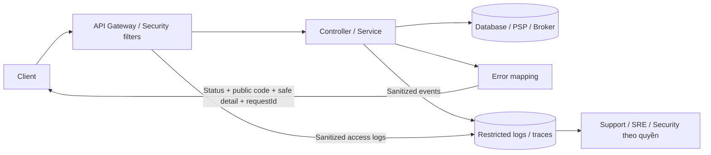
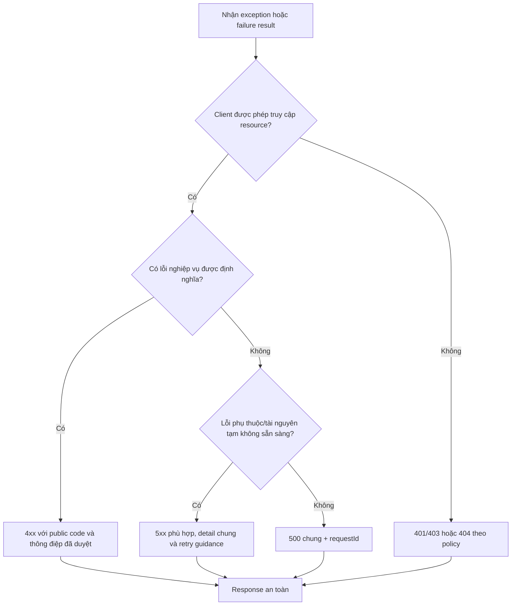

# Che stack trace, câu SQL, token và thông tin nội bộ trong lỗi REST API

## 1. Bài toán: API phải báo lỗi hữu ích nhưng không tiết lộ bí mật

Khi một REST API gặp lỗi, client cần biết **yêu cầu có được xử lý không, sai ở đâu và nên làm gì tiếp theo**. Đội vận hành lại cần thông tin kỹ thuật để điều tra. Hai nhu cầu này không đồng nghĩa với việc trả nguyên exception hoặc log nội bộ ra ngoài.

Ví dụ API quản lý đơn hàng:

```http
GET /api/orders/ord-123 HTTP/1.1
Host: api.example.test
Authorization: Bearer <token-do-client-cung-cap>
```

Giả sử database bị gián đoạn. Một cách xử lý **nguy hiểm** là trả trực tiếp thông báo từ driver:

```http
HTTP/1.1 500 Internal Server Error
Content-Type: text/plain

org.example.persistence.DatabaseException:
  SQL failed: SELECT * FROM internal_orders WHERE customer_id = ?
  at com.example.internal.orders.OrderRepository.load(OrderRepository.java:87)
  database host: db-primary.internal.example
  connection properties: <chi-tiet-noi-bo>
```

Thông tin này không giúp client sửa yêu cầu. Nó tiết lộ tên bảng, tên lớp, đường đi mã nguồn và định danh hạ tầng. Nếu exception chứa giá trị tham số, cookie, khóa dịch vụ hay token, lỗi có thể gây **rò rỉ thông tin xác thực và dữ liệu khách hàng**.

Phản hồi công khai an toàn hơn:

```http
HTTP/1.1 500 Internal Server Error
Content-Type: application/problem+json
Cache-Control: no-store
X-Request-ID: req-7df82

{
  "type": "https://docs.example.test/problems/internal-error",
  "title": "Internal Server Error",
  "status": 500,
  "detail": "Hệ thống chưa thể xử lý yêu cầu. Vui lòng thử lại sau.",
  "code": "INTERNAL_ERROR",
  "requestId": "req-7df82"
}
```

`requestId` là định danh tương quan không chứa bí mật, giúp bộ phận hỗ trợ tìm thông tin **ở kênh vận hành có kiểm soát**. Đây là một ví dụ minh họa; địa chỉ `docs.example.test` phải được thay bằng tài liệu lỗi công khai của sản phẩm hoặc dùng `about:blank`.

Bài thuộc chương **Lỗi API** của module **INTEGRATION_API_REST**, nơi người học thiết kế REST API từ tài nguyên, URI, HTTP methods và status codes đến hợp đồng dữ liệu, xác thực, phân quyền, OpenAPI, idempotency và kiểm thử với Java/Spring hoặc nền tảng tương đương. **SPECIAL_NOTE rỗng** nên phạm vi bài theo đúng chủ đề này.

### Sau bài học, bạn có thể

1. Phân biệt dữ liệu chẩn đoán nội bộ với thông tin lỗi được phép trả về client.
2. Nhận diện đường rò rỉ **stack trace, SQL, token, thông tin hạ tầng và dữ liệu cá nhân** qua response, header, log, trace và gateway.
3. Thiết kế lỗi thống nhất theo HTTP status và **Problem Details** mà không sao chép nguyên văn exception.
4. Thiết lập phản hồi lỗi an toàn trong **Spring Boot/Spring MVC**, kể cả validation và lỗi database.
5. Kiểm tra tự động để chứng minh lỗi công khai không chứa bí mật, đồng thời vẫn giữ khả năng điều tra qua request ID.

## 2. Vì sao thông báo exception không phải hợp đồng API?

Exception là cấu trúc **nội bộ của ngôn ngữ/framework**; nó có thể chứa tên lớp, dòng mã, tham số, lời gọi dịch vụ, kết nối và thông tin debug. Hợp đồng API là cấu trúc **bên ngoài**, phải ổn định, có ngữ nghĩa rõ và nằm trong chính sách công bố thông tin.

Ví dụ hai lỗi hoàn toàn khác nhau có thể cùng được ánh xạ thành một phản hồi 500 an toàn:

- `SQLException` vì database tạm thời không sẵn sàng.
- `NullPointerException` trong code do một lỗi lập trình chưa lường trước.

Client đều không thể tự sửa chúng bằng cách thay body request. Nếu trả nguyên tên exception, client sẽ phụ thuộc vào chi tiết triển khai dễ thay đổi và kẻ tấn công có thêm dữ liệu để lập bản đồ hệ thống.

Ngược lại, một lỗi nghiệp vụ được dự kiến trước như “đơn đã giao, không thể hủy” **nên có mã lỗi ổn định** và HTTP `409 Conflict`, nhưng vẫn không cần lộ điều kiện trong database hoặc stack trace.

### 2.1. Ranh giới công khai và nội bộ



**Quy tắc kiến trúc:** API trả **đủ thông tin để sử dụng và khắc phục lỗi theo hợp đồng**. Log/tracing lưu **đủ thông tin đã được kiểm soát để điều tra**, với quyền truy cập, retention và biện pháp che bí mật riêng. Không có lý do mặc định để công khai stack trace, raw SQL, password, token hay host nội bộ.

## 3. Phân loại dữ liệu cần che

| Nhóm | Ví dụ dễ rò rỉ | Hệ quả | Quy tắc xử lý |
| --- | --- | --- | --- |
| **Stack trace** | Package, class, method, tên file, line number, framework version | Lộ cấu trúc code và thư viện | Không trả stack trace ra body, header hoặc HTML error page công khai |
| **SQL/query** | `SELECT`, `UPDATE`, tên bảng/cột, bind values, constraint nội bộ | Lộ mô hình dữ liệu và dữ liệu thật | Ánh xạ DB exception thành lỗi công khai; hạn chế cả SQL logging |
| **Token và credential** | `Authorization`, JWT, API key, cookie session, `Set-Cookie`, secret, password | Chiếm quyền truy cập nếu còn hiệu lực | Tuyệt đối không đưa vào response/log/trace; dùng allowlist để ghi log |
| **Địa chỉ hạ tầng** | Hostname, IP private, service discovery, port, database URL, bucket | Lộ topology và tài nguyên nội bộ | Dùng thông điệp lỗi công khai, bỏ thông tin đường kết nối |
| **Đường dẫn nội bộ** | Đường dẫn file trên máy chủ, tên module, đường dẫn source, stack context | Hỗ trợ dò tìm thành phần và môi trường | Không phản chiếu nguyên lỗi của OS/framework |
| **Thông tin khách hàng** | Email, số điện thoại, địa chỉ, định danh tài chính, nội dung đơn | Vi phạm bảo mật và riêng tư | Trả trường cần thiết đúng quyền; che trong log và error extensions |
| **Chi tiết nhà cung cấp** | Tên tenant thanh toán, endpoint PSP, internal error payload, secret webhook | Lộ tích hợp và tài nguyên phía thứ ba | Đổi sang public error code, lưu diagnostics có kiểm soát |
| **Thông tin kiểm tra đầu vào** | `rejectedValue` mang mật khẩu/token, raw body upload | Lộ dữ liệu do chính client gửi | Chỉ trả tên trường được phép và quy tắc hợp lệ, không trả giá trị nhạy cảm |

**Token vẫn là bí mật dù chỉ là một phần chuỗi.** Đừng dựa vào giả định rằng che bốn ký tự cuối là đủ an toàn cho mọi loại credential. Chính sách an toàn nhất là không thu thập token từ đầu; nếu có trường hợp đặc biệt cần định danh truy vết, dùng fingerprint một chiều với cách quản lý khóa và quyền phù hợp.

### 3.1. Rò rỉ không chỉ nằm trong JSON

Các bề mặt cần rà soát:

- **Response body:** JSON, XML, HTML error page, text/plain, trang lỗi do servlet container trả về.
- **Response headers:** giá trị debug, `Server`, `X-Powered-By`, `Location` chứa host private, `WWW-Authenticate` có detail quá mức, header tùy biến chèn exception.
- **Logs và distributed tracing:** raw URL/query string, request/response body, `Authorization`, cookies, MDC/baggage, span attributes.
- **Gateway, WAF, CDN và mesh:** trang lỗi riêng, request sample, access log, traffic mirror, dashboard hoặc metric tags chứa dữ liệu nhạy cảm.
- **Công cụ hỗ trợ:** ticket, alert email, screenshot, error report, exception tracker, công cụ phân tích phiên sử dụng.

Một controller có `@ExceptionHandler` an toàn nhưng gateway hoặc security filter trả HTML debug chưa che vẫn tạo lỗ hổng. Cần kiểm tra **đường đi thực tế của request**, không chỉ unit test controller.

### 3.2. Không dựa vào thông điệp “có vẻ vô hại”

Các thông điệp sau đều có thể làm lộ thông tin khi nối vào response:

```text
ex.getMessage()
ex.toString()
Throwable.printStackTrace()
BindingResult.getFieldError().getRejectedValue()
DataAccessException.getMostSpecificCause().getMessage()
HttpClientException.getResponseBodyAsString()
```

Điều kiện nguy hiểm là **dùng dữ liệu chưa được phê duyệt làm nội dung công khai**, không phải riêng tên hàm. Một message có thể vô hại ở phiên bản hôm nay nhưng chứa SQL bind values ở phiên bản driver khác; vì vậy không nên xây hợp đồng API dựa trên nội dung exception.

## 4. Thiết kế hợp đồng lỗi công khai

### 4.1. Dùng HTTP status đúng ngữ nghĩa

Che thông tin **không có nghĩa mọi lỗi đều phải trả 500**. Client vẫn cần mã HTTP chính xác để quyết định sửa request, xác thực lại, giải quyết xung đột hay retry:

| HTTP status | Khi nào dùng | Thông tin công khai nên có |
| --- | --- | --- |
| `400 Bad Request` | Cú pháp hoặc tham số đầu vào không hợp lệ | Tên trường hợp lệ và hướng dẫn sửa, không echo raw body |
| `401 Unauthorized` | Thiếu hoặc sai xác thực | Hướng dẫn xác thực; challenge `WWW-Authenticate` nếu giao thức yêu cầu |
| `403 Forbidden` | Đã xác thực nhưng không được phép | Thông báo thiếu quyền tổng quát, tránh liệt kê tài nguyên nhạy cảm |
| `404 Not Found` | Không tìm thấy hoặc chủ động che resource | Mã `RESOURCE_NOT_FOUND`, không lộ database query |
| `405 Method Not Allowed` | Resource không hỗ trợ HTTP method | Phải có header `Allow` đúng phương thức hiện hỗ trợ |
| `409 Conflict` | Xung đột trạng thái nghiệp vụ | Public code như `ORDER_STATE_CONFLICT`, có thể kèm hành động hợp lệ |
| `412 Precondition Failed` | HTTP conditional request không thỏa | Hướng dẫn tải lại representation/ETag nếu phù hợp |
| `415 Unsupported Media Type` | Định dạng body không hỗ trợ | Các media type công khai được hỗ trợ |
| `422 Unprocessable Content` | Dữ liệu đúng cú pháp nhưng không thỏa quy tắc xử lý theo contract | Trường và mã validation an toàn |
| `429 Too Many Requests` | Vượt giới hạn | `Retry-After` khi có thể cung cấp hướng dẫn |
| `500 Internal Server Error` | Lỗi ngoài dự kiến tại server | Lời nhắn chung và `requestId`, không nêu nội bộ |
| `502 Bad Gateway` | Gateway nhận phản hồi không hợp lệ từ upstream | Lời nhắn chung; không dump upstream payload |
| `503 Service Unavailable` | Dịch vụ đang tạm không sẵn sàng | Có thể thêm `Retry-After`; không công khai tên DB/host |
| `504 Gateway Timeout` | Gateway hết thời gian chờ upstream | Lời nhắn chung; retry chỉ khi thao tác an toàn/idempotent |

**Cảnh báo về retry:** Nhận `500` hoặc `504` **không chứng minh** thao tác POST chưa được xử lý. Nếu request tạo đơn/thu tiền có side effect, client cần retry với **cùng idempotency key**, hoặc tra cứu trạng thái. Việc che chi tiết lỗi không được khiến hợp đồng mơ hồ về kết quả nghiệp vụ.

### 4.2. Problem Details theo RFC 9457

Một định dạng phổ biến là **Problem Details** với media type `application/problem+json`. Các trường chuẩn:

- `type`: URI nhận diện loại vấn đề; có thể dùng URI tài liệu công khai ổn định hoặc `about:blank`.
- `title`: mô tả ngắn gọn, ổn định, hướng người dùng.
- `status`: mã HTTP (thông tin trong body phải nhất quán với status line).
- `detail`: lời giải thích an toàn cho **trường hợp này**, không phải stack trace.
- `instance`: URI nhận diện occurrence cụ thể nếu có ích và an toàn; **không bắt buộc**.

Các trường mở rộng như `code`, `requestId`, `errors`, `retryable` có thể được thêm khi đã được thiết kế và công bố. Không nhúng arbitrary exception properties.

Ví dụ lỗi xung đột nghiệp vụ:

```http
HTTP/1.1 409 Conflict
Content-Type: application/problem+json
Cache-Control: no-store
X-Request-ID: req-2d403

{
  "type": "https://docs.example.test/problems/order-state-conflict",
  "title": "Không thể thực hiện thao tác",
  "status": 409,
  "detail": "Đơn hàng không còn ở trạng thái cho phép hủy.",
  "code": "ORDER_STATE_CONFLICT",
  "requestId": "req-2d403"
}
```

Đây là **thông tin có chủ ý**: với người có quyền xem đơn, biết đơn không cho hủy giúp sửa thao tác. Với người không có quyền, cùng thông tin có thể tiết lộ sự tồn tại của đơn. Do đó **authorization phải chạy trước khi trả detail theo nghiệp vụ**, và policy có thể dùng `404` tổng quát để tránh resource enumeration.

### 4.3. Allowlist cho trường lỗi công khai

Đề xuất danh sách trường cho API công khai:

| Trường | Có thể công khai? | Điều kiện |
| --- | --- | --- |
| `code` | Có | Danh mục mã ổn định, không lấy từ tên exception/SQL constraint |
| `title` | Có | Chuỗi đã được duyệt, có thể i18n |
| `detail` | Có | Chuỗi an toàn hoặc mẫu thông báo dùng tham số **đã kiểm soát** |
| `requestId` | Có | ID opaque, không chứa token hoặc dữ liệu cá nhân |
| `fieldErrors[].field` | Có điều kiện | Chỉ tên field trong schema public; không phản chiếu đường dẫn parser tùy ý |
| `fieldErrors[].message` | Có điều kiện | Mã quy tắc hoặc thông báo ngắn an toàn |
| `instance` | Có điều kiện | Không chứa access token, query string nhạy cảm, email hoặc ID không thuộc quyền |
| `exception`, `stackTrace`, `sql`, `query`, `internalHost` | Không | Dùng cho chẩn đoán nội bộ có kiểm soát |
| `token`, `password`, `secret`, `cookie`, `authorization` | Không | Không lưu trong extension, log hoặc trace |

Phương pháp **allowlist** thường chắc chắn hơn việc serialize toàn bộ exception rồi dùng regex để xóa vài mẫu dữ liệu nhạy cảm. Regex có thể bỏ sót token mã hóa, biến thể key, dữ liệu nhiều dòng hoặc trường mới.

## 5. Quy tắc ánh xạ lỗi: ổn định, đủ dùng và đúng quyền

### 5.1. Phân loại lỗi trước khi xử lý



Không nhất thiết một ngoại lệ Java luôn tương ứng với đúng một HTTP status trong mọi bối cảnh. Ví dụ `DataIntegrityViolationException` có thể là unique key trùng do một **business conflict** đã biết, cũng có thể là bug hoặc dữ liệu nội bộ sai. Không nên tự động đổi **mọi** lỗi integrity thành `409` kèm nguyên văn tên constraint; cần ánh xạ dựa trên operation và **quy tắc nghiệp vụ đã xác định**.

### 5.2. Catalog public error code

Có thể duy trì catalog như:

| Public code | HTTP | Mô tả được phép công khai |
| --- | ---: | --- |
| `INVALID_REQUEST` | 400 | Cú pháp/dữ liệu request không hợp lệ |
| `AUTHENTICATION_REQUIRED` | 401 | Cần xác thực |
| `ACCESS_DENIED` | 403 | Không đủ quyền |
| `RESOURCE_NOT_FOUND` | 404 | Không tìm thấy tài nguyên |
| `ORDER_STATE_CONFLICT` | 409 | Trạng thái hiện tại không cho phép thao tác |
| `VERSION_PRECONDITION_FAILED` | 412 | Phiên bản resource không còn khớp |
| `RATE_LIMITED` | 429 | Vượt giới hạn gọi |
| `INTERNAL_ERROR` | 500 | Lỗi hệ thống chưa xác định |
| `UPSTREAM_UNAVAILABLE` | 503/502 | Dịch vụ phụ thuộc tạm chưa đáp ứng |

`code` phải mô tả **loại lỗi công khai**, không phải tên lớp exception như `Postgres23505UniqueKeyException` hay tên bảng `order_payment_details`. Hợp đồng nên công bố liệu `code` có luôn duy nhất toàn API và chính sách versioning khi thay đổi.

### 5.3. Không trả nguyên response của bên thứ ba

Payment gateway có thể trả thông báo chứa merchant ID, chi tiết tài khoản hoặc mô tả hệ thống nội bộ. Một API public không nên forward nguyên body của PSP khi nhận 4xx/5xx. Thay vào đó:

1. Kiểm tra mã lỗi bên thứ ba có được tài liệu hóa và có thể ánh xạ sang code công khai không.
2. Chỉ trả mã/diễn giải đã được duyệt, ví dụ `PAYMENT_NOT_AUTHORIZED`.
3. Ghi **operation ID đã chuẩn hóa** để nội bộ đối soát, không đưa payment secret vào response.
4. Nếu timeout và trạng thái thanh toán chưa rõ, cung cấp **trạng thái đang xử lý** hoặc endpoint tra cứu; không khẳng định thanh toán thất bại khi chưa có chứng cứ.

## 6. Spring Boot: cấu hình phản hồi lỗi mặc định an toàn

Với **Spring Boot 3.x/Spring MVC 6** và Java 17+, lỗi có thể đi qua các lớp khác nhau: servlet container, Spring MVC, Spring Security, application service, API gateway. Các thiết lập sau giúp giảm thông tin debug từ đường lỗi mặc định của Spring Boot:

```yaml
server:
  error:
    include-exception: false
    include-message: never
    include-stacktrace: never
    include-binding-errors: never
spring:
  mvc:
    problemdetails:
      enabled: true
```

Đây là **cấu hình gợi ý**, cần xác minh trên phiên bản Spring Boot và response thực tế của ứng dụng. `spring.mvc.problemdetails.enabled` giúp framework hỗ trợ Problem Details cho nhiều lỗi MVC; nó **không tự bảo đảm** rằng toàn bộ exception handler, filter, gateway và bên thứ ba không lộ dữ liệu.

**Không đặt `include-stacktrace: on_param` hoặc `include-message: on_param` trên môi trường public.** Nếu dùng tham số debug do client điều khiển, một request từ internet có thể kích hoạt nội dung nhạy cảm. Cũng không coi việc tắt Whitelabel Error Page là đủ; server/container vẫn có thể trả trang lỗi khác.

### 6.1. Điều gì cần kiểm tra ngoài file cấu hình?

- Cấu hình profile production có đang **ghi đè** các giá trị an toàn từ profile chung hoặc biến môi trường không?
- Có `@RestControllerAdvice` nào dùng `ex.getMessage()` để tạo `detail` hoặc dùng `ResponseEntity.status(500).body(ex)` không?
- Có bộ xử lý `ErrorAttributes`, `/error`, servlet filter, controller dành cho lỗi do nhóm tự viết không?
- Có lớp chuyển lỗi GraphQL/gRPC sang HTTP hoặc proxy forward raw upstream body không?
- Các route không tồn tại, media type sai, HTTP method không hỗ trợ và lỗi parse JSON có trả **mã đúng**, thay vì bị catch-all đổi thành 500?
- Khi tắt Spring app, reverse proxy và container trả trang gì? Có lộ đường dẫn, stack trace, banner phần mềm hay error detail không?

Các dòng config chỉ là **lớp bảo vệ cơ bản**. Chính sách công khai phải được áp dụng đồng nhất trên toàn đường đi request.

## 7. Spring MVC: ánh xạ exception sang Problem Details an toàn

Ví dụ dưới đây dùng Java 17+, Spring Boot 3 và Spring MVC 6. Nó minh họa hai lớp lỗi:

- **Lỗi nghiệp vụ đã dự kiến**: `OrderStateConflictException`, ánh xạ `409` và thông điệp cố định an toàn.
- **Lỗi hạ tầng database**: `DataAccessException`, ánh xạ `500`, trả thông điệp chung và chỉ ghi các thuộc tính chẩn đoán đã chọn vào log có kiểm soát.

Code cố ý **không serialize exception** và **không đưa `ex.getMessage()` vào response**.

```java
package example.api;

import java.net.URI;
import java.util.UUID;

import org.slf4j.Logger;
import org.slf4j.LoggerFactory;
import org.springframework.dao.DataAccessException;
import org.springframework.http.CacheControl;
import org.springframework.http.HttpHeaders;
import org.springframework.http.HttpStatus;
import org.springframework.http.HttpStatusCode;
import org.springframework.http.ProblemDetail;
import org.springframework.http.ResponseEntity;
import org.springframework.web.bind.MethodArgumentNotValidException;
import org.springframework.web.bind.annotation.ExceptionHandler;
import org.springframework.web.bind.annotation.RestControllerAdvice;
import org.springframework.web.context.request.WebRequest;
import org.springframework.web.servlet.mvc.method.annotation.ResponseEntityExceptionHandler;

@RestControllerAdvice
public class SafeApiErrorHandler extends ResponseEntityExceptionHandler {

    private static final Logger log =
            LoggerFactory.getLogger(SafeApiErrorHandler.class);

    // Exception nghiệp vụ do ứng dụng định nghĩa; thông điệp trả về
    // lấy từ catalog public, không lấy trực tiếp từ exception.
    @ExceptionHandler(OrderStateConflictException.class)
    public ResponseEntity<ProblemDetail> orderConflict(
            OrderStateConflictException ex) {

        ProblemDetail problem = ProblemDetail.forStatusAndDetail(
                HttpStatus.CONFLICT,
                "Đơn hàng không còn ở trạng thái cho phép thao tác.");
        problem.setTitle("Không thể thực hiện thao tác");
        problem.setType(URI.create(
                "https://docs.example.test/problems/order-state-conflict"));
        problem.setProperty("code", "ORDER_STATE_CONFLICT");

        return ResponseEntity.status(HttpStatus.CONFLICT)
                .cacheControl(CacheControl.noStore())
                .body(problem);
    }

    @ExceptionHandler(DataAccessException.class)
    public ResponseEntity<ProblemDetail> databaseFailure(
            DataAccessException ex) {

        String incidentId = UUID.randomUUID().toString();

        // Log an toàn: không ghi exception message, SQL hoặc bind values.
        log.error("database_failure incidentId={} exceptionType={}",
                incidentId, ex.getClass().getSimpleName());

        ProblemDetail problem = ProblemDetail.forStatusAndDetail(
                HttpStatus.INTERNAL_SERVER_ERROR,
                "Hệ thống chưa thể xử lý yêu cầu. Vui lòng thử lại sau.");
        problem.setTitle("Internal Server Error");
        problem.setType(URI.create(
                "https://docs.example.test/problems/internal-error"));
        problem.setProperty("code", "INTERNAL_ERROR");
        problem.setProperty("requestId", incidentId);

        return ResponseEntity.status(HttpStatus.INTERNAL_SERVER_ERROR)
                .cacheControl(CacheControl.noStore())
                .header("X-Request-ID", incidentId)
                .body(problem);
    }

    @Override
    protected ResponseEntity<Object> handleMethodArgumentNotValid(
            MethodArgumentNotValidException ex,
            HttpHeaders headers,
            HttpStatusCode status,
            WebRequest request) {

        ProblemDetail problem = ProblemDetail.forStatusAndDetail(
                HttpStatus.BAD_REQUEST,
                "Dữ liệu yêu cầu không hợp lệ.");
        problem.setTitle("Invalid Request");
        problem.setProperty("code", "INVALID_REQUEST");

        // Không trả getRejectedValue(), raw binding result hoặc
        // message tự do từ exception/validator.
        return handleExceptionInternal(ex, problem, headers, status, request);
    }
}
```

`OrderStateConflictException` là một exception nghiệp vụ **do ứng dụng tự định nghĩa**; nó phải có trong dự án thật. Đoạn trên tập trung minh họa xử lý lỗi, không bao gồm controller/database hay security configuration.

**Vì sao mở rộng `ResponseEntityExceptionHandler`?** Spring MVC có sẵn logic ánh xạ nhiều exception HTTP/framework. Giữ cơ chế của framework giúp hạn chế việc một catch-all tùy biến đổi nhầm `405` thành `500` hoặc làm mất `Allow`; phần override validation sử dụng `handleExceptionInternal` để tiếp tục qua pipeline phản hồi phù hợp.

### 7.1. Cẩn thận với catch-all `Exception.class`

Một handler kiểu:

```java
@ExceptionHandler(Exception.class)
public ResponseEntity<?> error(Exception ex) {
    return ResponseEntity.status(500).body(ex.getMessage());
}
```

có **hai lỗi**:

1. Trả nguyên message ra ngoài.
2. Gom nhiều lỗi HTTP hợp lệ của framework vào `500`, chẳng hạn lỗi route, method hoặc media type, nếu handler này nhận chúng.

Nếu hệ thống cần một fallback chung, hãy bảo đảm nó chỉ xử lý **lỗi chưa được nhận diện**, có body ổn định và đã được kiểm thử với mọi status quan trọng. Với lỗi framework, ưu tiên điểm mở rộng chuẩn của Spring MVC. Với lỗi phát sinh **trước DispatcherServlet** (ví dụ Spring Security filter, reverse proxy), cần bộ xử lý riêng ở đúng tầng.

Đoạn code `databaseFailure` minh họa chọn trả `500` chung cho lỗi database chưa phân loại. Nếu nghiệp vụ nhận diện được unique constraint cụ thể và biết chắc request xung đột, có thể ánh xạ sang `409` bằng **public code**. Không chuyển nguyên tên constraint/SQL sang `detail`.

### 7.2. Hạn chế nội dung chẩn đoán ngay trong Java

Không nên:

```java
// Sai: client nhận thông tin triển khai và dữ liệu exception.
return ResponseEntity.internalServerError()
        .body(Map.of("error", ex.toString(), "stack", ex.getStackTrace()));
```

Nên:

```java
// Ý tưởng: chọn từ catalog đã được phê duyệt.
ProblemDetail p = ProblemDetail.forStatusAndDetail(
        HttpStatus.INTERNAL_SERVER_ERROR,
        "Yêu cầu chưa thể hoàn tất. Vui lòng thử lại sau.");
p.setProperty("code", "INTERNAL_ERROR");
return ResponseEntity.status(500).body(p);
```

Log nội bộ cũng không nên mặc định `log.error("failed", ex)` ở tất cả request vì **exception message và nested causes có thể chứa SQL parameter, token hoặc payload từ bên thứ ba**. Nếu cần stack trace để điều tra, chỉ ghi vào sink có chính sách bảo vệ thích hợp sau khi đánh giá dữ liệu được phép thu thập; dùng sampling, phân quyền, retention và bộ lọc rõ ràng.

## 8. Validation: chỉ trả điều kiện sửa lỗi, không echo dữ liệu nhạy cảm

Khi một request sai validation, client cần biết **trường nào sai và quy tắc nào không đạt**, nhưng thường không cần server trả lại giá trị đã gửi.

Ví dụ request:

```http
POST /api/users HTTP/1.1
Content-Type: application/json

{
  "email": "person@example.test",
  "password": "<gia-tri-bi-mat>",
  "age": -1
}
```

**Phản hồi nguy hiểm** là chứa:

```json
{
  "field": "password",
  "rejectedValue": "<gia-tri-bi-mat>",
  "exception": "Invalid password: <gia-tri-bi-mat>"
}
```

**Phản hồi phù hợp hơn**:

```http
HTTP/1.1 400 Bad Request
Content-Type: application/problem+json

{
  "type": "https://docs.example.test/problems/invalid-request",
  "title": "Invalid Request",
  "status": 400,
  "detail": "Một số trường dữ liệu không hợp lệ.",
  "code": "INVALID_REQUEST",
  "errors": [
    {"field": "age", "code": "MIN_VALUE"},
    {"field": "password", "code": "PASSWORD_POLICY"}
  ]
}
```

Mã `PASSWORD_POLICY` có thể đi kèm hướng dẫn công khai về độ dài hoặc độ mạnh nếu chính sách cho phép; không cần trả giá trị mật khẩu hoặc toàn bộ rule engine. Tên trường `errors[].field` phải được kiểm tra theo **schema công khai**, đặc biệt khi dùng nested property path do thư viện validation sinh ra.

### 8.1. Các trường có thể nhạy cảm dù không tên là password

`token`, `authorizationCode`, `refreshToken`, `clientSecret`, `otp`, `cardNumber`, `cvv`, `sessionCookie` là ví dụ rõ ràng; tuy nhiên `comment`, `document`, `metadata`, `searchQuery`, `phone`, `address`, `filename` cũng có thể chứa dữ liệu nhạy cảm do người dùng hoặc hệ thống khác đưa vào.

Vì vậy:

- Tránh echo **toàn bộ request body** trong response lỗi.
- Tránh ghi raw body/query string vào access log và APM theo mặc định.
- Với field lỗi, công bố **mã quy tắc cố định** và tên field public.
- Với nội dung cần hỗ trợ khách hàng sửa lỗi, sử dụng thông điệp tĩnh hoặc mẫu có tham số đã được duyệt (ví dụ giới hạn `min=1`, `max=100`), không chèn giá trị tự do.

## 9. SQL và lỗi database: ánh xạ mà không lộ schema

Một exception database có thể chứa:

- Tên database/schema/table/column hoặc unique constraint.
- SQL statement, tên stored procedure, vị trí lỗi cú pháp.
- Tham số bind (địa chỉ email, ID khách hàng, token hoặc nội dung nghiệp vụ).
- Host, tên user database, JDBC URL, query plan và thông tin driver.

Ví dụ client đăng ký tài khoản có email trùng. Nếu hợp đồng cho biết email đã tồn tại, có thể trả:

```http
HTTP/1.1 409 Conflict
Content-Type: application/problem+json

{
  "type": "https://docs.example.test/problems/account-conflict",
  "title": "Cannot create account",
  "status": 409,
  "detail": "Thông tin đăng ký xung đột với một tài khoản hiện có.",
  "code": "ACCOUNT_CONFLICT"
}
```

Nhưng một API **khôi phục tài khoản hoặc đăng nhập** đôi khi cần chống **account enumeration**, nên thông điệp có thể cố ý không xác nhận email có tồn tại. Chính sách bảo mật cho từng flow quyết định thông điệp công khai, không phải SQL constraint.

### 9.1. Không giả định mọi lỗi SQL đều do client

| Tình huống DB | Xử lý API nên cân nhắc | Điều không nên trả |
| --- | --- | --- |
| Unique conflict được mapping rõ theo nghiệp vụ | `409` với code công khai ổn định | Tên unique index, giá trị email/SQL |
| Optimistic lock thất bại | `409`, hoặc `412` khi precondition HTTP `If-Match` không đạt | Tên entity/JPA class, câu UPDATE |
| DB hết kết nối, pool exhausted | `500`/`503` theo thiết kế và khả năng khôi phục | JDBC URL, hostname, credential |
| Syntax SQL do bug | `500` chung | Câu SQL, vị trí lỗi, stack trace |
| Migration thiếu bảng/cột | `500` chung, cảnh báo vận hành | Schema, migration ID nội bộ |
| Query timeout | Mã 5xx phù hợp, hướng dẫn retry có điều kiện | Query plan hoặc bind values |

SQL có thể cần được ghi để **tối ưu hiệu năng**; khi đó phải rà soát chế độ logging ở ORM, JDBC proxy, slow query logs và database service. Nếu ghi query template, vẫn cần bảo vệ SQL literal và tham số. Không để bật chế độ debug/trace chứa bind values trên môi trường public mà chưa kiểm soát.

### 9.2. Tách nguyên nhân thực với mã trả client

```text
Internal cause:
    DataIntegrityViolationException
      -> unique constraint "ux_orders_idempotency_scope"

Application policy:
    same idempotency key + same payload -> return previous result
    same idempotency key + different payload -> 409 IDEMPOTENCY_CONFLICT

Public response:
    409 + code="IDEMPOTENCY_CONFLICT" + safe detail
```

Đừng đơn giản bắt mọi unique constraint rồi luôn trả `409`: một cuộc đụng khóa có thể là do **retry hợp lệ**, và khi đó API cần **trả kết quả đã xử lý**. Điều này liên kết trực tiếp với thiết kế idempotency của REST API.

## 10. Token, cookie và thông tin xác thực trong lỗi

Thông tin xác thực có thể xuất hiện khi client gửi request, gateway kiểm token, server gọi upstream hoặc thư viện HTTP ghi lỗi. Cần bảo vệ cả **đầu vào, quá trình xử lý và luồng log**.

### 10.1. Một số nguyên tắc

- Không đưa giá trị `Authorization`, `Proxy-Authorization`, `Cookie`, `Set-Cookie`, `X-API-Key`, access/refresh token, client secret hoặc password vào `detail`, `instance`, `type`, custom header hay tracing baggage.
- Không truyền credential trong query string/URL vì URL dễ xuất hiện ở access logs, browser history, referer và báo cáo giám sát.
- Khi lỗi xác thực, trả mã 401/403 với thông điệp đã duyệt; không nói “JWT signature expected secret XYZ”.
- `WWW-Authenticate` có thể được yêu cầu bởi cơ chế xác thực đang dùng, nhưng giá trị challenge phải tuân thủ **đặc tả giao thức và chính sách tiết lộ an toàn**. Không đặt token hoặc nguyên nhân xác thực chứa bí mật trong đó.
- Không dùng token thật trong test fixtures, tài liệu ví dụ, screenshot hoặc ticket; dùng giá trị giả lập không thể dùng để đăng nhập.

### 10.2. Ví dụ phản hồi 401

```http
HTTP/1.1 401 Unauthorized
WWW-Authenticate: Bearer realm="orders-api"
Content-Type: application/problem+json
Cache-Control: no-store

{
  "type": "about:blank",
  "title": "Unauthorized",
  "status": 401,
  "detail": "Cần thông tin xác thực hợp lệ.",
  "code": "AUTHENTICATION_REQUIRED"
}
```

`WWW-Authenticate` ở đây minh họa challenge Bearer; ứng dụng thật phải cấu hình đúng OAuth 2.0/Bearer token profile đang dùng. Có thể có mã lỗi protocol công khai như `invalid_token` theo tiêu chuẩn, nhưng không trả **giá trị token, signing key, claims nhạy cảm hay stack trace**.

**Lưu ý:** Khi một hệ thống trả lỗi “token hết hạn”, client đôi khi có thể refresh. Nhưng không nên trả thêm token nguyên bản hoặc giải mã toàn bộ JWT trong body lỗi để giúp debug. Nếu refresh không hợp lệ, vẫn dùng flow xác thực chuẩn.

## 11. Spring Security, API Gateway và lỗi bên ngoài controller

Trong Spring Security, lỗi xác thực thường được xử lý bởi `AuthenticationEntryPoint`, lỗi phân quyền bởi `AccessDeniedHandler`. Các lỗi này có thể phát sinh **trước khi request vào controller**, vì vậy `@RestControllerAdvice` không phải cơ chế duy nhất.

Ví dụ cấu hình **ý tưởng** cho API bearer-token:

```java
@Bean
SecurityFilterChain securityFilterChain(HttpSecurity http) throws Exception {
    http
        .authorizeHttpRequests(auth -> auth
            .requestMatchers("/api/public/**").permitAll()
            .anyRequest().authenticated())
        .exceptionHandling(errors -> errors
            .authenticationEntryPoint(safeAuthenticationEntryPoint)
            .accessDeniedHandler(safeAccessDeniedHandler));
    return http.build();
}
```

`safeAuthenticationEntryPoint` và `safeAccessDeniedHandler` là các bean cần được triển khai bằng response JSON an toàn **và** challenge phù hợp với cơ chế xác thực; đoạn trên là skeleton, không phải một cấu hình bảo mật hoàn chỉnh. Với hệ thống dùng OAuth2 Resource Server, cần kết hợp cơ chế bearer mặc định và chính sách custom một cách có kiểm chứng để không đánh mất header bắt buộc.

### 11.1. Viết response ở filter đúng cách

Handler phải:

1. Chọn status phù hợp (`401` hoặc `403`), set `Content-Type: application/problem+json`.
2. Gửi body từ **mẫu đã duyệt**, không từ `AuthenticationException.getMessage()` hay `AccessDeniedException.getMessage()`.
3. Bảo toàn `WWW-Authenticate` trong tình huống cần challenge.
4. Không phản chiếu token, username, nguyên nhân xác thực hoặc URL query nhạy cảm.
5. Sử dụng request ID được tạo và truyền qua các tầng an toàn.

Không nên bắt `AccessDeniedException` rồi biến thành `500`; như vậy vừa sai hợp đồng vừa gây nhiễu monitoring.

### 11.2. Gateway, WAF, CDN, reverse proxy

Khi gateway timeout hoặc upstream bị ngắt, proxy có thể tự sinh trang HTML/JSON lỗi. Cần áp dụng cùng chính sách:

| Tầng | Loại lỗi | Điều phải kiểm tra |
| --- | --- | --- |
| Gateway | 502/503/504 | Không có upstream URL, private hostname, proxy stack trace |
| WAF | Blocked request, rate limit | Không tiết lộ quy tắc phòng thủ và cấu hình nội bộ; status đúng |
| Reverse proxy | Route không tồn tại, unsupported method | Không lộ banner server, file path, default HTML page |
| CDN | Cache lỗi | TTL/cache key phù hợp; không cache lỗi chứa thông tin người dùng khác |
| Service mesh | Retry/circuit breaker | Không forward raw upstream exception, tránh retry non-idempotent |

`Server`, `Via`, `X-Powered-By` hoặc thông tin version có thể bị rò theo policy ở một số tầng. Cần kiểm tra header thực nhận, nhưng **ẩn banner không thay thế cập nhật bản vá hay phân quyền**. Đặc biệt chú ý khi CDN hoặc gateway cache `500`/`403` theo khóa không gồm identity: có thể làm lộ phản hồi người khác hoặc gây lỗi diện rộng. Phản hồi lỗi chứa ngữ cảnh cá nhân nên có cache policy đúng, ví dụ `Cache-Control: no-store`.

## 12. Logging và tracing an toàn: đủ điều tra mà không thu thập bí mật

Ẩn thông tin khỏi response là **một nửa bài toán**. Nếu controller không lộ token nhưng access log, APM agent hoặc exception tracker vẫn ghi nguyên token, bí mật có thể bị sao chép sang hệ thống lưu trữ phụ và người không cần quyền có thể đọc được.

### 12.1. Ghi những trường nào?

Một bản ghi lỗi có cấu trúc có thể như:

```json
{
  "timestamp": "2026-11-18T10:20:30Z",
  "level": "ERROR",
  "event": "api_request_failed",
  "requestId": "req-7df82",
  "traceId": "trace-15f0",
  "routeTemplate": "/api/orders/{orderId}",
  "httpMethod": "GET",
  "httpStatus": 500,
  "publicErrorCode": "INTERNAL_ERROR",
  "internalFailureCategory": "DATABASE_UNAVAILABLE",
  "durationMs": 842
}
```

Ví dụ dùng **route template** thay cho raw URL `/api/orders/<id>` hoặc query string, giúp giảm dữ liệu cá nhân và tránh tạo nhãn metric có cardinality quá lớn. Mã `internalFailureCategory` chỉ nằm trong hệ thống giám sát nội bộ có quyền kiểm soát; public response có thể chỉ gửi `INTERNAL_ERROR`.

Thông tin chẩn đoán thường đủ để điều tra bước đầu:

- Thời điểm, môi trường, service, phiên bản triển khai và vùng vận hành.
- `requestId` hoặc `traceId` **opaque** được chuẩn hóa.
- Method, **route template**, HTTP status, public error code.
- Nhóm nguyên nhân đã phân loại, độ trễ, dependency category và trạng thái retry.
- Không lưu `Authorization`, cookies, body, query string hoặc exception message một cách mặc định.

**Request ID do client gửi không mặc nhiên đáng tin.** Nếu cho phép `X-Request-ID`, phải kiểm tra độ dài, charset và cách dùng để ngăn log injection/cardinality abuse; có thể thay bằng ID mới do gateway sinh. Không dùng một chuỗi chứa token hoặc email làm `requestId`.

### 12.2. Allowlist tốt hơn blacklist

Thay vì:

```text
log(request.headers, request.body, exception)
then remove "password" and "token" with regex
```

nên triển khai:

```text
safeEvent = {
    requestId: generatedOrValidatedRequestId,
    routeTemplate: matchedPublicRouteTemplate,
    method: request.method,
    status: response.status,
    errorCode: approvedErrorCode,
    durationMs: elapsedTime
}
log(safeEvent)
```

Việc **không thu thập dữ liệu nhạy cảm ngay từ đầu** giảm rủi ro nhiều hơn cố khôi phục sau khi bí mật đã đi vào log pipeline. Nếu phải ghi thêm dữ liệu để xử lý incident, sử dụng allowlist cho từng field, thời hạn ngắn, phê duyệt và kiểm toán truy cập.

### 12.3. Phân loại nơi lưu chẩn đoán

| Nơi lưu | Dữ liệu phù hợp | Kiểm soát cần có |
| --- | --- | --- |
| API response | Public code, safe detail, opaque requestId | Không có bí mật, cache policy phù hợp |
| Access log | Route template, status, latency, requestId | Không ghi raw Authorization/Cookie/query/body |
| Application log | Event category, service state, dependency type | Structured logging, role-based access, retention |
| Distributed trace | Span name, duration, sanitized attributes | Không chèn token/PII vào span/baggage |
| Incident forensic store | Bằng chứng thật sự cần cho điều tra được phê duyệt | Phân quyền chặt, ghi audit, mã hóa, TTL và xử lý dữ liệu cá nhân |

Các trường như `db.statement`, `http.request.header.authorization`, `url.full`, `http.request.body`, `exception.message` có thể được **instrumentation** hoặc thư viện tự động thu thập. Kiểm tra cấu hình exporter và agent; không chỉ rà soát `logger.info()` trong code ứng dụng.

### 12.4. Các tín hiệu vận hành nên quan sát

- Tỷ lệ 4xx/5xx theo **route template và method**, không gắn raw ID vào label.
- Thời gian phục hồi và tần suất 502/503/504 theo dependency category.
- Số lượng `INTERNAL_ERROR` tăng sau deploy, request ID tương quan với logs.
- Lỗi validation theo **field code công khai**, tránh ghi rejected value.
- Số request 401/403/429 và xu hướng bất thường, nhưng không log credential.
- Kết quả kiểm tra tự động về **secret exposure** trong response, logs và traces.

Đối với việc điều tra một yêu cầu hỏng, luồng nên là: người dùng cung cấp `requestId` → đội hỗ trợ tra event sanitized → nếu cần escalation thì người có quyền truy cập chẩn đoán sâu hơn. Không yêu cầu người dùng gửi access token hoặc mật khẩu cho hỗ trợ.

## 13. Kiểm thử bảo mật hợp đồng lỗi

Kiểm thử đúng đắn không chỉ assert `status == 500`; phải chứng minh response **không chứa bí mật** và không làm mất các thông tin giao thức bắt buộc.

### 13.1. Ma trận kiểm thử

| Kịch bản tạo lỗi | Status hoặc yêu cầu giao thức | Kiểm tra không rò rỉ |
| --- | --- | --- |
| Database unavailable | 500/503 theo contract | Không JDBC URL, host private, SQL, tên table |
| SQL syntax bug | 500 | Không statement, tên class, stack trace |
| Unique conflict được nhận diện | 409 theo nghiệp vụ | Không unique constraint hoặc bind value |
| Request JSON hỏng | 400 | Không raw body, parser stack trace |
| Validation password/token | 400/422 theo contract | Không `rejectedValue`, raw password hay token |
| Không có token | 401, challenge phù hợp | Không thông tin nội bộ auth server |
| Token sai hoặc hết hạn | 401 theo policy | Không echo token, signing key, JWT claims nhạy cảm |
| Có danh tính nhưng thiếu quyền | 403 hoặc 404 theo policy | Không tiết lộ tồn tại resource ngoài quyền |
| HTTP method sai | 405 với `Allow` | Không đổi thành 500 bởi catch-all |
| Media type sai | 415 | Không dump raw request hoặc exception |
| Gateway upstream timeout | 504 | Không hostname/path/upstream body |
| Rate limit | 429, `Retry-After` khi áp dụng | Không tiết lộ cấu hình phòng thủ nội bộ |
| Lỗi xảy ra trong filter hoặc gateway | Status đúng theo tầng | Không HTML debug, raw exception, token |

Kiểm thử cả **response body, headers và response được gateway/CDN thay thế**. Nếu dữ liệu đi qua hệ thống logging/trace trong test environment, kiểm tra cả các sink đã được phép thu thập.

### 13.2. Test Spring MVC bằng chuỗi bí mật giả lập

Một kỹ thuật hữu ích là tạo lỗi có chứa **sentinel** giả như `SYNTHETIC_TEST_SECRET_42` trong exception message. Test phải khẳng định sentinel không xuất hiện ở response, dù hệ thống xử lý exception thế nào.

Ví dụ test tối giản cho bộ `SafeApiErrorHandler` ở mục 7:

```java
package example.api;

import static org.assertj.core.api.Assertions.assertThat;
import static org.springframework.test.web.servlet.request.MockMvcRequestBuilders.get;
import static org.springframework.test.web.servlet.result.MockMvcResultMatchers.status;

import org.junit.jupiter.api.Test;
import org.springframework.beans.factory.annotation.Autowired;
import org.springframework.boot.test.autoconfigure.web.servlet.WebMvcTest;
import org.springframework.context.annotation.Import;
import org.springframework.dao.DataIntegrityViolationException;
import org.springframework.http.MediaType;
import org.springframework.test.web.servlet.MockMvc;
import org.springframework.test.web.servlet.MvcResult;
import org.springframework.web.bind.annotation.GetMapping;
import org.springframework.web.bind.annotation.RestController;

@WebMvcTest(controllers = SafeErrorContractTest.FailureController.class)
@Import(SafeApiErrorHandler.class)
class SafeErrorContractTest {

    @Autowired
    MockMvc mockMvc;

    @RestController
    static class FailureController {
        @GetMapping("/test/unsafe")
        String fail() {
            throw new DataIntegrityViolationException(
                    "SELECT * FROM internal_orders; SYNTHETIC_TEST_SECRET_42");
        }
    }

    @Test
    void databaseExceptionMustNotLeakToPublicResponse() throws Exception {
        MvcResult result = mockMvc.perform(get("/test/unsafe"))
                .andExpect(status().isInternalServerError())
                .andReturn();

        String body = result.getResponse().getContentAsString();
        assertThat(MediaType.parseMediaType(
                result.getResponse().getContentType())
                .isCompatibleWith(MediaType.APPLICATION_PROBLEM_JSON))
                .isTrue();
        assertThat(body)
                .contains("INTERNAL_ERROR")
                .doesNotContain("SYNTHETIC_TEST_SECRET_42")
                .doesNotContain("SELECT *")
                .doesNotContain("internal_orders")
                .doesNotContain("DataIntegrityViolationException");
    }
}
```

Đây là ví dụ test trong ứng dụng có Spring Boot Test, Java 17 và class `SafeApiErrorHandler`; cần bổ sung các dependency/cấu hình phù hợp khi đưa vào dự án. **Không sử dụng secret thật** dù chỉ trong test. Có thể mở rộng assertion để đọc toàn bộ headers và kiểm tra không chứa sentinel. Test này chứng minh một **controller path**, chưa chứng minh hành vi của security filter, gateway hay logging exporter.

### 13.3. Test lỗi Spring Security và đường đi end-to-end

Thêm kiểm thử đi qua security chain và môi trường tích hợp:

1. Gửi request chưa có bearer token và token giả lập không hợp lệ; khẳng định response `401` không chứa token và có challenge đúng.
2. Gửi request đã xác thực nhưng thiếu quyền; kiểm tra `403`/`404` theo policy và không làm lộ chi tiết tài nguyên.
3. Gửi `PUT` vào resource chỉ có GET/POST; kiểm tra `405` và `Allow`.
4. Gửi JSON sai cú pháp, input invalid chứa sentinel; kiểm tra response và log không echo.
5. Gây lỗi upstream/gateway trong môi trường thử nghiệm; kiểm tra trang lỗi công khai không chứa private host hoặc upstream payload.
6. Đọc trace/span và mẫu log được xuất trong test, khẳng định không có token/cookie/raw request body.

Một test chỉ chạy `MockMvc` thường **không** đi qua CDN, ingress, WAF hoặc production API gateway. Vì vậy cần ít nhất một lớp test end-to-end đối với lỗi do những thành phần này tạo ra.

### 13.4. Contract tests để chống lỗi tái xuất hiện

Với mỗi public error code, kiểm tra:

```text
status line matches body.status
Content-Type is expected
problem.type and code belong to public catalog
detail is approved and contains no exception-derived text
response body/headers contain no synthetic secrets
401 retains required WWW-Authenticate
405 retains required Allow
retry-related headers follow the documented policy
the same input class maps to the same public error code
```

Ngoài ra nên thử thay đổi ngôn ngữ/locale, version API và mode debug để bảo đảm một đường xử lý ít dùng không tự bật stack trace. Nếu QA dùng snapshot test, tránh snapshot chứa token hoặc dữ liệu cá nhân thật.

## 14. Quy trình vận hành khi nghi ngờ rò rỉ thông tin qua lỗi

Giả sử phát hiện một endpoint đã trả nguyên `Authorization` hoặc thông báo database ra response. Đây có thể là sự cố bảo mật, không chỉ là lỗi định dạng JSON.

Quy trình xử lý thực dụng:

1. **Xác định phạm vi:** endpoint nào, phiên bản triển khai nào, loại bí mật/dữ liệu nào, khoảng thời gian nào; kiểm tra còn ở gateway, log, CDN hoặc alert không.
2. **Ngăn phát sinh thêm:** sửa/khóa đường rò rỉ, cấu hình safe error handler, tắt debug công khai; cân nhắc giảm khả năng truy cập endpoint có lỗi theo phương án được phê duyệt.
3. **Bảo vệ credential đã lộ:** thu hồi/rotate token, API key hoặc secret nếu có khả năng bị lộ; đánh giá thời hạn hiệu lực, phạm vi quyền và dấu vết sử dụng.
4. **Kiểm tra hệ thống phụ:** logs, traces, error monitoring, ticket, proxy cache, bản sao báo cáo; áp dụng quy trình xử lý/xóa/redact theo chính sách retention và pháp lý.
5. **Đánh giá tác động:** dữ liệu nào thực sự có thể bị bên ngoài xem; nhờ bộ phận an toàn thông tin và chủ dữ liệu xác định trách nhiệm thông báo khi có nghĩa vụ.
6. **Khắc phục và phòng ngừa:** thêm regression tests bằng sentinel, kiểm tra config production, review coding guideline và quyền log, xác minh hiệu lực sau deploy.
7. **Ghi nhận:** incident ID, nguyên nhân gốc, thời điểm phát hiện/xử lý, owner và hạn hoàn tất action items.

Đừng chỉ xóa một dòng log trong UI rồi coi bí mật đã an toàn: dữ liệu có thể đã được nhân bản sang nhiều sink. Mặt khác, cần giữ bằng chứng cần thiết cho điều tra theo chính sách có thẩm quyền; xử lý lưu trữ và xóa dữ liệu không nên làm mất khả năng truy vết hoặc vi phạm nghĩa vụ lưu giữ.

## 15. Bài thực hành: thiết kế lỗi an toàn cho API đơn hàng

### 15.1. Đề bài

Một hệ thống Spring Boot có các route:

- `POST /api/orders`: tạo đơn hàng; client gửi `Idempotency-Key`.
- `GET /api/orders/{id}`: đọc đơn thuộc phạm vi quyền của người gọi.
- `PATCH /api/orders/{id}`: cập nhật một số trường khi đơn ở trạng thái hợp lệ, dùng `If-Match`.

Ứng dụng hiện có code:

```java
@ExceptionHandler(Exception.class)
ResponseEntity<Object> failure(Exception ex) {
    return ResponseEntity.status(500).body(
        java.util.Map.of(
            "message", ex.getMessage(),
            "cause", ex.toString()));
}
```

Trong thực tế có thể xảy ra các lỗi: JSON hỏng, không có token, user không được xem đơn, tạo đơn trùng idempotency key nhưng payload khác, `If-Match` cũ, database timeout, và gateway không kết nối được upstream.

**Yêu cầu:**

1. Chỉ ra ít nhất **năm rủi ro** trong handler hiện tại, bao gồm rò rỉ dữ liệu và sai HTTP status.
2. Lập bảng ánh xạ từng tình huống sang HTTP status và public code, phân biệt lỗi do controller, security filter và gateway.
3. Thiết kế Problem Details cho `500` sao cho không có stack trace, SQL, token hoặc host private mà vẫn có `requestId`.
4. Đề xuất quy tắc log cho incident: field nào thu thập, field nào bị cấm?
5. Nêu cách xử lý POST timeout khi không biết đơn hàng đã được tạo hay chưa.
6. Viết ít nhất ba test dùng **secret giả** để chứng minh response an toàn. Một test phải đi qua gateway hoặc security filter.

### 15.2. Hướng giải tham khảo

| Tình huống | Status đề xuất | Public code và lưu ý |
| --- | --- | --- |
| JSON không parse được | 400 | `INVALID_REQUEST`, không echo body |
| Thiếu token hợp lệ | 401 | `AUTHENTICATION_REQUIRED`, giữ challenge đúng |
| Không có quyền xem order | 403 hoặc 404 theo policy | `ACCESS_DENIED` hoặc `RESOURCE_NOT_FOUND`, không tiết lộ đơn của người khác |
| Idempotency key giống nhau nhưng payload khác | 409 | `IDEMPOTENCY_CONFLICT`, không in request gốc |
| PATCH với If-Match không khớp | 412 | `VERSION_PRECONDITION_FAILED`, không in entity state nhạy cảm |
| Lỗi kết nối database | 500/503 theo contract | `INTERNAL_ERROR` hoặc `SERVICE_UNAVAILABLE`, không host/SQL |
| Upstream không kết nối được qua gateway | 502/503/504 tùy lỗi thực | Lời nhắn chung và requestId |

**Năm rủi ro cơ bản:** (1) SQL/stack trace trong `message`; (2) credential hoặc dữ liệu khách hàng trong nested cause; (3) rò framework class và hạ tầng trong `toString`; (4) mọi lỗi 4xx bị trả 500; (5) client khó biết nên sửa input, xác thực lại hay retry; (6) response thiếu error code và correlation ID; (7) có thể lộ cả dữ liệu ở gateway dù controller đã được sửa.

**POST timeout:** Nếu client không nhận phản hồi, server có thể đã commit tạo đơn. Client retry với **cùng `Idempotency-Key`** và payload, hoặc truy vấn kết quả qua ID/operation URL khi có. Server lưu key + fingerprint + kết quả trong phạm vi bền vững để ngăn tạo hai đơn. Không khuyên retry POST với key mới chỉ vì thấy 500/504.

**Test tối thiểu:** (a) Database exception chứa `SYNTHETIC_TEST_SECRET_42` nhưng không lộ ở body/header; (b) validation password/token có rejected value giả nhưng không xuất hiện trong response; (c) token giả sai qua Spring Security hoặc gateway bị từ chối đúng mã, không echo giá trị. Khi có telemetry test sink, kiểm tra cả log/traces.

## 16. Checklist cuối bài

- [ ] Mọi lỗi API có HTTP status phù hợp với tình huống thật, không gom tất cả thành 500.
- [ ] `ProblemDetail` chỉ có field public đã duyệt; không serialize trực tiếp Throwable, SQL exception hoặc upstream response.
- [ ] `detail` và `title` không dùng nguyên văn `ex.getMessage()`, `ex.toString()` hoặc stack trace.
- [ ] Không xuất hiện token, password, cookie, secret, DB URL, tên bảng/constraint, private host hoặc nội dung cá nhân ngoài quyền trong body/header.
- [ ] Validation chỉ trả field name và mã lỗi được công bố; không trả `rejectedValue` nhạy cảm.
- [ ] Mapping giữ header giao thức cần thiết, đặc biệt `WWW-Authenticate` cho 401 và `Allow` cho 405.
- [ ] Spring Boot production không cho client bật stack trace/message qua tham số debug; test cấu hình cuối cùng sau khi áp dụng profile.
- [ ] Security entry point, access denied handler, `/error`, gateway, WAF và CDN dùng chính sách lỗi an toàn.
- [ ] Log/trace dùng allowlist, route template và request ID được kiểm soát; hạn chế secret ngay từ bước thu thập.
- [ ] Có quyền truy cập, retention, kiểm toán và quy trình đối soát/xóa dữ liệu đối với các sink chẩn đoán.
- [ ] Tests dùng sentinel giả, kiểm tra response body/headers và các đường lỗi từ controller đến gateway.
- [ ] Với POST có side effect, client và server có contract idempotency để phục hồi sau timeout không gây xử lý trùng.

## 17. Kết luận

Lỗi REST API cần **đủ rõ cho client** nhưng **không biến thành kênh xuất thông tin nội bộ**. Stack trace, câu SQL, token, cookie, credential, hostname private, đường dẫn code và dữ liệu nhạy cảm không nên xuất hiện trong phản hồi công khai. Thay vào đó, dùng **HTTP status đúng**, Problem Details với **public code ổn định**, thông điệp an toàn và một `requestId` để liên kết quá trình điều tra.

Để đạt điều này trên Java/Spring, phải kiểm soát **toàn bộ đường đi của lỗi**: controller, validation, exception handler, Spring Security, gateway và proxy; đồng thời giới hạn nội dung thu thập ở logs/traces. Bảo đảm cuối cùng đến từ **allowlist thông tin, quyền truy cập, cấu hình production và kiểm thử bằng dữ liệu bí mật giả lập**, chứ không chỉ từ việc ẩn một trang stack trace.


