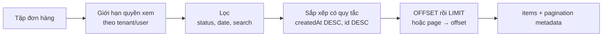
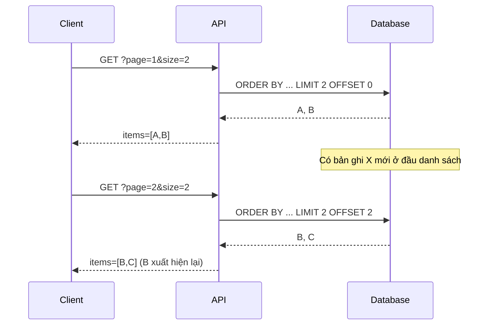

# Phân trang offset, page number và đánh đổi hiệu năng

> **Chương:** Truy vấn tập hợp  
> **Module:** `INTEGRATION_API_REST` — học cách thiết kế REST API dựa trên resource, URI, HTTP methods, status codes và hợp đồng dữ liệu rõ ràng; thực hành phân trang, cache, idempotency, OpenAPI, xác thực, phân quyền, xử lý lỗi và kiểm thử với Java/Spring hoặc công nghệ tương đương.

Khi một API trả danh sách đơn hàng, việc lấy toàn bộ một triệu bản ghi trong một response vừa tốn tài nguyên vừa gây trải nghiệm kém. **Phân trang (pagination)** chia kết quả truy vấn tập hợp thành các phần nhỏ để client duyệt dần. Hai dạng dễ dùng nhất là **offset/limit** và **page number/page size**. Chúng có giao diện khác nhau nhưng phần lớn đều dựa trên cùng một thao tác: **bỏ qua một số bản ghi đầu tiên trong tập đã sắp xếp, sau đó lấy một số bản ghi giới hạn**.

Phân trang không đơn thuần là thêm `LIMIT` vào SQL. API phải quy định thứ tự ổn định, cách chuyển đổi chỉ số trang, giới hạn kích thước, bộ lọc, số liệu tổng, hành vi khi danh sách thay đổi và chi phí của việc bỏ qua những hàng rất sâu. Bài học này phân tích những đánh đổi đó theo một hợp đồng REST cụ thể.

## Mục tiêu học tập

Sau bài này, bạn có thể:

1. Mô tả và thiết kế hai hợp đồng `offset/limit` và `page/size`, kể cả quy ước trang đánh số từ 0 hay 1.
2. Tính `OFFSET`, số trang, trang cuối và số phần tử còn lại; giải thích các trường hợp rỗng hoặc vượt giới hạn.
3. Thiết kế thứ tự tổng xác định bằng `ORDER BY` và khóa phụ duy nhất.
4. Nhận diện trùng lặp và bỏ sót khi tập dữ liệu bị chèn/xóa/sửa giữa các request phân trang.
5. Giải thích vì sao truy vấn offset sâu và `COUNT(*)` có thể làm tăng latency/chi phí, kể cả khi đã có index.
6. Triển khai phân trang trong Spring Data JPA với `PageRequest`, `Page` và `Slice`, đảm bảo filter/authorization nhất quán.
7. Xác định lúc nên chuyển sang keyset/cursor pagination, đồng thời viết contract và test cho dữ liệu biến động.

## 1. Tài nguyên tập hợp và ý nghĩa của một trang

Giả sử backend quản lý đơn hàng theo từng tenant và hỗ trợ truy vấn:

```http
GET /api/orders?status=PAID&sort=-createdAt&page=3&size=20 HTTP/1.1
Accept: application/json
Authorization: Bearer <access-token>
```

Client muốn xem **trang 3**, mỗi trang **20 đơn**, chỉ các đơn có trạng thái `PAID`, mới nhất trước. Một response minh họa:

```http
HTTP/1.1 200 OK
Content-Type: application/json
Cache-Control: private, no-store

{
  "items": [
    {
      "id": 801,
      "createdAt": "2026-11-18T09:20:15Z",
      "status": "PAID",
      "totalMinor": 259000
    }
  ],
  "page": 3,
  "size": 20,
  "totalElements": 127,
  "totalPages": 7,
  "hasNext": true,
  "hasPrevious": true,
  "sort": "-createdAt,-id"
}
```

Ví dụ rút gọn `items` chỉ hiển thị **một** phần tử cho dễ đọc, **không mô tả số lượng thực tế của trang 3**. Với 127 bản ghi cố định và `size=20`, trang 3 bình thường có 20 phần tử.

Cần phân biệt:

- **Collection resource:** `/api/orders` là tập đơn hàng có thể lọc, sắp xếp và phân trang.
- **Item resource:** `/api/orders/801` là một đơn hàng cụ thể; định danh item không phải vị trí trong danh sách.
- **Page:** một đoạn của **tập kết quả sau khi áp filter, authorization và sort**.
- **Snapshot:** ảnh chụp nhất quán của tập dữ liệu tại một thời điểm. Phân trang offset thông thường **không tự tạo snapshot xuyên nhiều request**.

Ở mỗi request, thứ tự xử lý logic là:



Thứ tự thực thi vật lý của database có thể được tối ưu lại; sơ đồ chỉ nói **ngữ nghĩa**. Đặc biệt, điều kiện phân quyền phải áp cho cả truy vấn lấy dữ liệu và truy vấn đếm, không chỉ loại bỏ bản ghi sau khi đã phân trang.

## 2. Offset/limit: chọn vị trí bắt đầu bằng số hàng

Hợp đồng đơn giản:

```http
GET /api/orders?status=PAID&offset=40&limit=20 HTTP/1.1
Accept: application/json
```

- `offset=40`: bỏ qua **40 hàng đầu tiên** trong tập kết quả đã sắp xếp.
- `limit=20`: trả tối đa **20 hàng tiếp theo**.
- Vị trí đầu tiên có index logic `0`; vì vậy `offset=0` bắt đầu từ bản ghi đầu của tập kết quả.

Ví dụ với PostgreSQL và nhiều hệ quản trị hỗ trợ cú pháp tương tự:

```sql
SELECT id, created_at, status, total_minor
FROM orders
WHERE tenant_id = :tenant_id
  AND status = :status
ORDER BY created_at DESC, id DESC
LIMIT :limit OFFSET :offset;
```

Đặt giá trị `limit`/`offset` bằng **tham số đã kiểm tra**, không nối trực tiếp input vào SQL. `ORDER BY` phải có quy ước cố định/allowlist thay vì chấp nhận một chuỗi SQL tùy ý từ client.

### Một ví dụ tính tay

Giả sử sau lọc có 12 đơn với thứ tự:

```text
Thứ tự:  A B C D E F G H I J K L
Vị trí:  0 1 2 3 4 5 6 7 8 9 10 11

offset=0, limit=5  → A B C D E
offset=5, limit=5  → F G H I J
offset=10,limit=5  → K L
offset=15,limit=5  → []  (hết dữ liệu tại thời điểm truy vấn)
```

**Ưu điểm:** dễ dùng cho nút “xem thêm”, các client muốn chọn số hàng đã bỏ qua, hoặc API nội bộ có tập dữ liệu vừa phải. **Hạn chế:** offset lớn khiến database có thể phải đi qua/bỏ nhiều entry trước khi lấy một trang; thay đổi dữ liệu ở phía trước khiến offset chỉ đến những bản ghi khác ở request kế tiếp.

Không nên mô tả `offset` như “ID của bản ghi đầu tiên” hoặc “cursor bền vững”: nó chỉ là **vị trí trong kết quả tại thời điểm truy vấn**.

## 3. Page number/page size: chọn trang thay vì vị trí

Một API phục vụ giao diện số trang thường dùng:

```http
GET /api/orders?status=PAID&page=3&size=20 HTTP/1.1
Accept: application/json
```

Nếu **API quy ước page đánh số từ 1**, công thức là:

\[
\text{offset}=(\text{page}-1)\times\text{size}
\]

Do đó `page=3` và `size=20` tương đương `offset=40` và `limit=20`.

Nếu **API quy ước page đánh số từ 0**:

\[
\text{offset}=\text{page}\times\text{size}
\]

Khi đó `page=2&size=20` mới tương đương offset 40. Hai quy ước đều hợp lệ nếu công khai rõ và dùng nhất quán. Spring Data `PageRequest.of(page, size)` sử dụng **chỉ số trang 0-based**, trong khi nhiều API bên ngoài chọn **1-based** cho người dùng dễ hiểu.

| Công việc | API 1-based | API 0-based |
| --- | --- | --- |
| Trang đầu | `page=1` | `page=0` |
| Trang thứ ba | `page=3` | `page=2` |
| Offset trang thứ ba khi size=20 | 40 | 40 |
| Truyền trực tiếp vào Spring `PageRequest.of` | Chuyển `page - 1` | Giữ nguyên `page` |
| Truyền số trang không hợp lệ | `page=0` hoặc âm | `page` âm |

**Đừng thay đổi quy ước giữa các endpoint** như `/orders` dùng 1-based còn `/products` dùng 0-based mà không có chủ ý. Đây là lỗi contract dễ gây **off-by-one**, nhất là khi client tự dựng liên kết Next/Previous.

### Tổng số trang

Với `totalElements=N` và `size=S>0`:

\[
\text{totalPages}=\left\lceil\frac{N}{S}\right\rceil
\]

Cho **127** đơn, `size=20`:

- Trang 1: phần tử 1–20.
- Trang 3: phần tử 41–60.
- Trang 6: phần tử 101–120.
- Trang 7: phần tử 121–127, có **7** đơn.
- Tổng số trang: \(\lceil127/20\rceil=7\).

Với **0** phần tử, thường chọn `totalPages=0` và `items=[]`, dù client vẫn có thể request `page=1` theo quy ước 1-based. Không nên đặt số trang cuối là 1 khi không hề có trang chứa dữ liệu, trừ khi hợp đồng cố ý xác định cách khác.

## 4. Offset và page number thực chất khác nhau ở đâu?

Cả hai thường dùng cùng câu lệnh `LIMIT/OFFSET` sau khi chuyển đổi tham số. Vì vậy **đổi tên từ offset sang page không giúp truy vấn nhanh hơn**.

| Tiêu chí | Offset/limit | Page/size |
| --- | --- | --- |
| Cách client chỉ định | Số hàng bỏ qua + lượng cần lấy. | Số trang + kích thước mỗi trang. |
| Dễ triển khai nút “xem thêm” | Có, khi offset tăng bằng số hàng đã đọc hoặc theo quy tắc của API. | Có, khi page tăng 1. |
| Dễ hiển thị “Trang 3/7” | Phải quy đổi và biết total. | Tự nhiên, nhưng vẫn cần total. |
| Nhảy trực tiếp tới trang bất kỳ | Theo offset tính trước. | Theo page; server tự quy đổi. |
| Ảnh hưởng khi thêm/xóa bản ghi trước vị trí hiện tại | Có. | Có, vì cơ chế lấy dữ liệu tương đương. |
| Chi phí deep pagination | Có thể cao. | Có thể cao như offset tương ứng. |
| Khả năng có count/total | Không bắt buộc. | Thường được mong đợi nhưng không bắt buộc. |
| Mức dễ dùng của API | Thấp hơn cho phân trang số. | Cao hơn cho UI danh sách có số trang. |

Có thể cung cấp cả hai kiểu ở các endpoint khác nhau nếu mục tiêu khác nhau; nếu cùng một endpoint chấp nhận đồng thời `page` và `offset`, phải quy định độ ưu tiên hoặc từ chối vì nhập nhằng. Cách đơn giản là **chọn một hợp đồng chính**.

## 5. Điều kiện tiên quyết: thứ tự phải xác định

Nếu truy vấn có `LIMIT/OFFSET` **không có `ORDER BY`**, database không có nghĩa vụ trả hàng theo thứ tự ổn định. Một lần chạy có thể lấy tập bản ghi khác sau khi plan, index hoặc thống kê thay đổi.

Ngay cả `ORDER BY created_at DESC` vẫn chưa đủ nếu nhiều bản ghi có cùng timestamp. Giả sử ba đơn đều được tạo lúc `10:00:00`; database có thể hoán đổi thứ tự của chúng giữa các request, khiến chúng bị trùng hoặc bỏ qua ở ranh giới trang.

Cách tốt hơn:

```sql
SELECT id, created_at, status
FROM orders
WHERE tenant_id = :tenant_id
ORDER BY created_at DESC, id DESC
LIMIT :size OFFSET :offset;
```

Ở đây `id` là **khóa phân biệt duy nhất**, tạo thứ tự đầy đủ trong nhóm có cùng `created_at`.

### Thứ tự cần thỏa yêu cầu gì?

- **Xác định được (deterministic):** một tập dữ liệu không đổi, cùng filter và sort sẽ trả cùng thứ tự.
- **Có tie-breaker duy nhất:** ví dụ `createdAt DESC, id DESC`, trừ khi khóa chính khác bảo đảm duy nhất.
- **Rõ xử lý NULL:** nếu field sort cho phép `NULL`, quy định `NULLS FIRST/LAST` hoặc biểu thức tương đương theo hệ quản trị.
- **Rõ collation:** sort theo tên có thể khác với locale/collation. Phải công bố ngữ nghĩa nếu ảnh hưởng trải nghiệm.
- **Có allowlist field:** `sort=-createdAt` là biểu diễn hợp đồng, được ánh xạ vào cột cho phép, không đưa thẳng vào SQL.
- **Tương thích index khi cần:** sắp xếp trên biểu thức không có index có thể yêu cầu sort lớn trước khi lấy trang.

Lưu ý quan trọng: thứ tự ổn định **chỉ tránh bất định khi các hàng không đổi**. Nó **không ngăn bản ghi mới được chèn, xóa hoặc thay đổi trường sort** giữa hai request; vấn đề đó cần xử lý riêng.

## 6. Trùng và bỏ sót khi dữ liệu thay đổi giữa các trang

Đây là giới hạn lớn của offset-based pagination trong danh sách “sống” như đơn hàng, feed bài đăng hoặc log.

### Trường hợp chèn thêm bản ghi ở đầu

Danh sách ban đầu mới nhất trước:

```text
A B C D E F
```

Client lấy trang 1 với `size=2`, nhận **A B**. Trước khi client lấy trang 2, có bản ghi mới **X** được chèn lên đầu:

```text
X A B C D E F
```

Trang 2 dùng `OFFSET 2 LIMIT 2` trả **B C**. **B bị lặp** vì vị trí của nó dịch từ 1 sang 2.

### Trường hợp xóa bản ghi ở đầu

Client đã đọc **A B**. Trước trang 2, **A** bị xóa:

```text
B C D E F
```

Trang 2 với `OFFSET 2 LIMIT 2` trả **D E**. **C bị bỏ sót** vì dữ liệu đã dịch lên phía trước.



**Quan trọng:** đây không phải lỗi ngẫu nhiên của Spring Data hay database; đó là hệ quả trực tiếp của việc chọn **vị trí thay vì định danh/ranh giới thứ tự** trong tập dữ liệu biến động.

### Có thể làm gì?

1. **Chấp nhận tính “live”** đối với danh sách thông thường, đồng thời ghi nhận những thay đổi có thể gây trùng/bỏ sót. UI có thể deduplicate bằng ID, nhưng việc này **không bảo đảm** không bỏ sót.
2. **Dùng keyset/cursor pagination** cho luồng cuộn liên tục, tập dữ liệu lớn và cập nhật thường xuyên. Nó duyệt tiếp từ khóa sort cuối cùng thay vì số vị trí.
3. **Sử dụng snapshot nhất quán** nếu nghiệp vụ cần duyệt chính xác tập bản ghi tại một thời điểm: token snapshot, materialized result hoặc export job. Điều này tăng chi phí lưu trạng thái, thời gian giữ dữ liệu và thiết kế vòng đời snapshot.
4. **Định nghĩa phạm vi truy vấn bất biến**, ví dụ `createdBefore=<cutoff>` khi tất cả bản ghi cần duyệt đã có thời điểm tạo tin cậy và không sửa field sort; vẫn cần cân nhắc xóa/sửa dữ liệu.

Một transaction isolation/snapshot chỉ bao phủ **một request** không tự cung cấp snapshot chung cho nhiều request HTTP độc lập. Không nên mở transaction database kéo dài qua thời gian người dùng lật trang chỉ để giữ snapshot; nó có thể giữ tài nguyên và làm tăng gánh nặng lưu phiên bản.

## 7. Deep pagination: vì sao offset lớn có thể chậm?

Câu lệnh minh họa:

```sql
SELECT id, created_at, status, total_minor
FROM orders
WHERE tenant_id = :tenant_id
ORDER BY created_at DESC, id DESC
LIMIT 20 OFFSET 99980;
```

Đây là trang **5000** trong API 1-based (`(5000 - 1) × 20 = 99980`). Để trả 20 hàng, nhiều execution plan phải lần qua hoặc sắp xếp lượng lớn hàng đáp ứng filter trước khi bỏ 99.980 hàng đầu.

**Ngay cả khi có index đúng**, database thường vẫn cần đi qua nhiều index entry bị bỏ qua; index giúp tránh một số kiểu sort/full scan nhưng không làm việc “nhảy đến hàng thứ 99.981” thành truy cập theo khóa O(1). Chi phí cụ thể phụ thuộc DB engine, statistics, plan, index-only scan, join, visibility check, dữ liệu trên đĩa và cache; **không khẳng định mọi truy vấn OFFSET có độ phức tạp hay thời gian tuyến tính giống nhau**.

### Cần đo những gì?

| Chỉ số | Mục đích |
| --- | --- |
| p50/p95/p99 latency theo độ sâu trang | Nhận diện trang sâu chậm hơn trang đầu và biến động latency. |
| Rows scanned / rows returned | Bao nhiêu bản ghi bị kiểm tra hoặc bỏ qua so với 20 bản ghi trả về. |
| Index usage / sort method | Plan có dùng index phục vụ filter + order không? Có sort lớn hoặc spill đĩa không? |
| Disk I/O, CPU, buffer hits | Phân biệt nghẽn đọc đĩa với sắp xếp, CPU hoặc contention. |
| Count-query latency | Thời gian truy vấn đếm tách khỏi thời gian lấy items. |
| Tải đồng thời | 100 request đến trang 5000 có thể gây ảnh hưởng rộng hơn một request đơn lẻ. |

Dùng `EXPLAIN`/`EXPLAIN ANALYZE` hoặc công cụ phân tích execution plan của DB với dữ liệu đại diện trong môi trường kiểm soát. `EXPLAIN ANALYZE` thực thi truy vấn trên nhiều hệ quản trị; với truy vấn có side effect phải đặc biệt cẩn trọng. Ở đây bài toán là `SELECT`.

### Thiết kế index minh họa

Cho filter `tenant_id` và `status`, sort `created_at DESC, id DESC`:

```sql
CREATE INDEX idx_orders_tenant_status_created_id
ON orders (tenant_id, status, created_at DESC, id DESC);
```

Index này **có thể** giúp DB lọc theo tenant/status rồi đọc theo thứ tự mong muốn, tùy DB và truy vấn. Nếu chỉ filter `tenant_id` mà không filter `status`, thứ tự index trên có thể không còn tối ưu cho query đó; cần đo từng access pattern thay vì tạo một index cho mọi trường hợp.

Index cũng có chi phí: tăng dung lượng, làm write chậm hơn, cần thống kê/bảo trì. Việc thêm index không giải quyết bản chất dịch vị trí khi dữ liệu bị chèn/xóa.

## 8. Truy vấn COUNT(*) và metadata tổng số

Nhiều giao diện muốn hiển thị “Trang 3 trên 7” hoặc “127 kết quả”. Để làm vậy, API thường cần thêm truy vấn:

```sql
SELECT COUNT(*)
FROM orders
WHERE tenant_id = :tenant_id
  AND status = :status;
```

**Điều kiện của count phải tương ứng với điều kiện lấy items**: cùng tenant authorization, cùng filter, cùng ngữ nghĩa loại bản ghi mềm/xóa, và cùng quyết định về bản ghi có thể hiển thị. Nếu query items dùng join nhiều-nhiều còn count đếm các hàng join, `COUNT(*)` có thể **đếm trùng resource**. Cần xem có phải `COUNT(DISTINCT orders.id)` hoặc một cách truy vấn khác phù hợp.

### Vì sao count có thể đắt?

- Một số database/plan phải đọc nhiều index/row version để có kết quả chính xác với filter hiện tại.
- Join, filter phức tạp, quyền truy cập theo tenant và search full-text khiến count không rẻ.
- Query lấy 20 hàng có thể dùng index và dừng sớm; query count vẫn phải xét **tất cả bản ghi khớp**.
- Truy vấn items và count chạy thành **hai statement** có thể nhìn thấy tập dữ liệu khác nhau trong môi trường cập nhật liên tục, tùy mức isolation. Vì vậy `items` và `totalElements` không nhất thiết đại diện một snapshot chung.

### Khi nào không cần total?

Đối với nút “Load more”, client thường chỉ cần biết có trang kế tiếp. Có thể chọn **Slice**: lấy `size + 1` hàng để xác định `hasNext` rồi chỉ trả tối đa `size` hàng. Khi đó response không cần `totalElements`/`totalPages`.

```json
{
  "items": [
    {"id": 801, "status": "PAID"}
  ],
  "page": 3,
  "size": 20,
  "hasNext": true
}
```

Đây là ví dụ minh họa rút gọn, không phản ánh số lượng phần tử ở một trang thực tế.

Các lựa chọn thiết kế khác:

| Cách cung cấp total | Ưu điểm | Hạn chế |
| --- | --- | --- |
| Chính xác mỗi request | UI có thể hiển thị số trang/đếm đầy đủ. | Count có thể đắt và không đồng nhất với items nếu thay đổi giữa hai query. |
| Chỉ trả `hasNext` | Giảm nhu cầu count, hợp với infinite scroll. | Không thể nhảy chính xác đến “trang cuối” chỉ bằng metadata đó. |
| Ước lượng tổng | Ít chi phí hơn trong một số workload lớn. | Phải ghi là `estimatedTotal`, không giả danh con số chính xác. |
| Cache total có thời hạn | Giảm số lần count lặp. | Số có thể cũ; phải quy định `asOf`/TTL và quy tắc invalidation. |
| Trả total theo yêu cầu, ví dụ `includeTotal=true` | Client tự chọn đổi latency lấy metadata. | Tăng nhánh logic, cache key và hợp đồng cần kiểm thử. |

Đừng đoán `hasNext` chỉ bằng việc “trang hiện tại có đủ 20 hàng”; có thể vừa đúng 20 hàng cuối. Cách chắc chắn hơn là lấy dư **một** hàng, hoặc dùng `total` đáng tin cậy nếu đã có.

## 9. Thiết kế contract HTTP cho danh sách

Một API có thể chọn:

```http
GET /api/orders?status=PAID&page=1&size=20&sort=-createdAt HTTP/1.1
Accept: application/json
```

Gợi ý hợp đồng:

| Thành phần | Chính sách minh họa | Lý do |
| --- | --- | --- |
| `page` | Mặc định 1; số nguyên dương; **1-based**. | Dễ hiểu cho UI có số trang. |
| `size` | Mặc định 20, min 1, max 100. | Tránh request quá lớn/tiêu tốn bộ nhớ. |
| `sort` | Chỉ cho phép các field công bố, ví dụ `-createdAt`, `totalMinor`; thêm `id` làm tie-breaker. | An toàn, thứ tự xác định, kiểm soát query plan. |
| Filter | `status`, `createdFrom`, `createdTo` và quyền tenant. | Giữ tập kết quả có ý nghĩa; authorization phải áp trước limit. |
| Unknown parameter | Có thể từ chối hoặc bỏ qua theo contract đã thống nhất. | Tránh client tưởng một filter được áp dụng nhưng thực tế bị bỏ qua. |
| Trang vượt cuối | `200 OK` với `items: []` và metadata phản ánh hiện trạng. | Page query hợp lệ nhưng không còn phần tử; hợp đồng nhất quán. |
| Tham số sai/không hợp lệ | `400 Bad Request` với Problem Details và mã lỗi. | Giải thích client sửa `page`/`size`. |
| Offset/trang quá sâu | Có thể giới hạn bằng `400` kèm `PAGINATION_TOO_DEEP` theo contract. | Bảo vệ backend trước scan bỏ hàng quá lớn. |
| Response | `items` + `page`/`size`/`hasNext`; `total` có thể tùy chọn. | Phù hợp cách client điều hướng. |

`416 Range Not Satisfiable` không phải mã mặc định cho `?page=999`: nó thuộc ngữ nghĩa HTTP Range header; một trang query rỗng là trường hợp khác. Cũng không nên trả `404` chỉ vì **trang vượt số trang** nếu collection resource vẫn tồn tại; hãy chọn contract cụ thể và tài liệu hóa.

### Links và điều hướng

Ngoài metadata trong body, server có thể cung cấp `Link` header:

```http
HTTP/1.1 200 OK
Content-Type: application/json
Link: </api/orders?status=PAID&page=4&size=20&sort=-createdAt>; rel="next"
Link: </api/orders?status=PAID&page=2&size=20&sort=-createdAt>; rel="prev"
```

Ví dụ là phản hồi cho trang 3 khi cả trang trước và sau đều tồn tại. Khi dựng link, server phải **giữ nguyên filter/sort hợp lệ** và URL-encode tham số đúng cách. Client nên theo link đã cung cấp nếu contract định nghĩa navigation links, không tự xây URL làm mất filter.

Các response danh sách theo tenant có thể chứa dữ liệu nhạy cảm: cân nhắc `Cache-Control: private` hoặc `no-store` theo chính sách. Cache key phải tính các query parameters và phạm vi phân quyền; đừng cache chung kết quả người A để trả cho người B. Nếu dùng ETag cho collection, validator phải phản ánh representation **của đúng trang/filter/sort và quyền truy cập**, và dữ liệu mới có thể làm ETag thay đổi thường xuyên.

## 10. Java/Spring Data JPA: từ page 1-based tới PageRequest

Trong Spring Data, `PageRequest.of(index, size, sort)` nhận **index 0-based**. Ví dụ API công khai 1-based sẽ chuyển từ `page=1` sang `PageRequest.of(0, ...)`.

Đây là ví dụ Spring Boot 3 / Spring Data JPA, chủ đích đơn giản hóa DTO và authentication; ứng dụng thật cần áp đủ quyền truy cập từ security context, schema dữ liệu, giới hạn DB và log.

### Entity và repository minh họa

```java
import jakarta.persistence.*;
import java.time.Instant;

@Entity
@Table(name = "orders")
class OrderEntity {
    @Id
    private Long id;

    @Column(name = "tenant_id", nullable = false)
    private Long tenantId;

    @Enumerated(EnumType.STRING)
    private OrderStatus status;

    @Column(name = "created_at", nullable = false)
    private Instant createdAt;

    @Column(name = "total_minor", nullable = false)
    private Long totalMinor;

    public Long getId() { return id; }
    public Long getTenantId() { return tenantId; }
    public OrderStatus getStatus() { return status; }
    public Instant getCreatedAt() { return createdAt; }
    public Long getTotalMinor() { return totalMinor; }
}

enum OrderStatus { NEW, PAID, CANCELLED }

interface OrderRepository extends JpaRepository<OrderEntity, Long> {
    Page<OrderEntity> findByTenantIdAndStatus(
        Long tenantId,
        OrderStatus status,
        Pageable pageable
    );
}
```

Mỗi query phải có **tenant scope đúng từ authentication context**. Không tin `tenantId` trong query string do client tự gửi khi client không có quyền xem tenant đó.

### DTO và response

```java
import java.time.Instant;
import java.util.List;

record OrderSummary(
    long id,
    Instant createdAt,
    OrderStatus status,
    long totalMinor
) {}

record OrderPageResponse(
    List<OrderSummary> items,
    int page,            // 1-based API convention
    int size,
    long totalElements,
    int totalPages,
    boolean hasNext,
    boolean hasPrevious,
    String sort
) {}
```

### Service và Controller

```java
import org.springframework.data.domain.*;
import org.springframework.http.ResponseEntity;
import org.springframework.stereotype.Service;
import org.springframework.validation.annotation.Validated;
import org.springframework.web.bind.annotation.*;
import jakarta.validation.constraints.Max;
import jakarta.validation.constraints.Min;

@Service
class OrderQueryService {
    private static final long MAX_OFFSET = 100_000L; // API policy minh họa
    private final OrderRepository repository;

    OrderQueryService(OrderRepository repository) {
        this.repository = repository;
    }

    OrderPageResponse findPaidOrders(long tenantId, int page, int size) {
        // page đã được kiểm tra >= 1 ở HTTP boundary.
        long offset = (long) (page - 1) * size;
        if (offset > MAX_OFFSET) {
            throw new PaginationTooDeepException();
        }

        // Tie-breaker ID bảo đảm thứ tự xác định khi trùng createdAt.
        Sort order = Sort.by(
            Sort.Order.desc("createdAt"),
            Sort.Order.desc("id")
        );
        Pageable pageable = PageRequest.of(page - 1, size, order);
        Page<OrderEntity> result = repository.findByTenantIdAndStatus(
            tenantId, OrderStatus.PAID, pageable
        );

        return new OrderPageResponse(
            result.getContent().stream()
                .map(o -> new OrderSummary(
                    o.getId(), o.getCreatedAt(),
                    o.getStatus(), o.getTotalMinor()))
                .toList(),
            page,
            size,
            result.getTotalElements(),
            result.getTotalPages(),
            result.hasNext(),
            result.hasPrevious(),
            "-createdAt,-id"
        );
    }
}

class PaginationTooDeepException extends RuntimeException {}

@RestController
@RequestMapping("/api/orders")
@Validated
class OrderQueryController {
    private final OrderQueryService service;

    OrderQueryController(OrderQueryService service) {
        this.service = service;
    }

    @GetMapping
    ResponseEntity<OrderPageResponse> list(
            @RequestParam(defaultValue = "1") @Min(1) int page,
            @RequestParam(defaultValue = "20")
              @Min(1) @Max(100) int size,
            java.security.Principal principal) {
        // Minh họa: resolver phải xác minh principal rồi trả tenant hợp lệ.
        long tenantId = resolveAuthorizedTenant(principal);
        return ResponseEntity.ok(service.findPaidOrders(tenantId, page, size));
    }

    private long resolveAuthorizedTenant(java.security.Principal principal) {
        // Placeholder tích hợp authz: tuyệt đối không lấy tenant từ input tùy ý.
        throw new UnsupportedOperationException(
            "Connect to the application's tenant identity resolver"
        );
    }
}
```

Ví dụ cố ý để `resolveAuthorizedTenant` là **điểm tích hợp chưa hoàn thiện** thay vì bịa cơ chế phân quyền. Muốn chạy ứng dụng cần thay placeholder bằng dịch vụ lấy tenant từ token/session đã xác minh, thêm imports cần thiết, bean/configuration và mapper lỗi. `PaginationTooDeepException` nên được ánh xạ thành `400 Bad Request` hoặc mã contract phù hợp với Problem Details.

**Điểm chính:** chỉ số trang từ client là 1-based, Spring Data là 0-based. `Page<OrderEntity>` biểu diễn trang chứa items và metadata total; dưới JPA, nó **có thể kích hoạt truy vấn count** và cần được kiểm tra với SQL thực tế.

Nếu cho client tự chọn sort, đừng truyền tên property tùy ý vào `Sort.by(userInput)`. Xây bảng **allowlist** các trường, ánh xạ alias công khai sang property thực, rồi luôn bổ sung khóa duy nhất. Sorting động có thể ảnh hưởng SQL và performance ngay cả khi không gây injection trực tiếp.

## 11. Page và Slice trong Spring Data: có cần total không?

`Page<T>` cung cấp `getTotalElements()`, `getTotalPages()` và các hàm `hasNext()`, `hasPrevious()`. Với Spring Data JPA, query lấy page có thể cần **count query** để xác định totals. Với query phức tạp có join và projection, count query có thể yêu cầu cấu hình cụ thể hoặc thiết kế lại.

`Slice<T>` chủ yếu cung cấp **nội dung, vị trí và hasNext**; nó không cần bảo đảm total count. Một repository có thể khai báo method riêng:

```java
import org.springframework.data.domain.*;

interface OrderSliceRepository extends JpaRepository<OrderEntity, Long> {
    @Query("""
        select o from OrderEntity o
        where o.tenantId = :tenantId and o.status = :status
        """)
    Slice<OrderEntity> readSlice(
        @Param("tenantId") Long tenantId,
        @Param("status") OrderStatus status,
        Pageable pageable
    );
}
```

Các imports `org.springframework.data.jpa.repository.Query` và `org.springframework.data.repository.query.Param` cần có trong file Java thực tế. `Slice` thường lấy tối đa thêm một hàng để biết có trang sau, nhưng **cần kiểm tra hành vi thực tế của phiên bản Spring Data và truy vấn cụ thể**.

| Khả năng | Page | Slice |
| --- | --- | --- |
| Trả items của trang hiện tại | Có | Có |
| Biết có trang kế tiếp | Có | Có |
| Biết tổng bản ghi / tổng trang | Có | Không có contract total |
| Phù hợp UI chọn trang số 1,2,3…N | Thường phù hợp hơn | Kém phù hợp nếu UI cần biết N |
| Tránh count query | Không bảo đảm; thường vẫn cần count | Thường thuận lợi hơn |
| Giải quyết deep offset | Không | Không; `Slice` vẫn có thể dùng `Pageable` offset |

**Quan trọng:** chuyển từ `Page` sang `Slice` **có thể giảm chi phí COUNT**, nhưng **không khắc phục OFFSET sâu** và **không loại trừ trùng/bỏ sót khi dữ liệu biến động**. Mỗi vấn đề có nguyên nhân riêng.

## 12. Khi offset không còn phù hợp: keyset/cursor pagination

Nếu khách hàng cần cuộn qua feed hàng triệu bản ghi có sự kiện mới liên tục, **keyset pagination** thường phù hợp hơn. Thay vì hỏi “bỏ qua 99.980 hàng”, client hỏi “lấy 20 hàng đứng sau item cuối cùng tôi đã nhận theo thứ tự này”.

Giả sử sort:

```sql
ORDER BY created_at DESC, id DESC
```

Client đã nhận item cuối cùng có:

```json
{"createdAt":"2026-11-18T10:00:00Z","id":900}
```

Trang kế tiếp có thể truy vấn:

```sql
SELECT id, created_at, status
FROM orders
WHERE tenant_id = :tenant_id
  AND status = :status
  AND (created_at, id) < (:last_created_at, :last_id)
ORDER BY created_at DESC, id DESC
LIMIT :size;
```

Cú pháp so sánh tuple dùng được ở một số DB như PostgreSQL; với DB khác có thể biểu diễn rõ:

```sql
AND (
     created_at < :last_created_at
     OR (created_at = :last_created_at AND id < :last_id)
)
```

Điều kiện `<` khớp với thứ tự **giảm dần** của cả hai trường. Nếu sort theo nhiều trường có chiều tăng/giảm khác nhau, toán tử và điều kiện seek phải được thiết kế tương ứng.

### Offset và keyset theo nhu cầu

| Tiêu chí | Offset/page | Keyset/cursor |
| --- | --- | --- |
| Nhảy trực tiếp đến trang 5000 | Dễ biểu diễn, nhưng truy vấn có thể rất đắt. | Không thuận tiện; thường duyệt tuần tự. |
| Tải sâu | Có thể phải bỏ qua nhiều hàng. | Thường dùng index để tìm tiếp sau khóa, tránh skip số lượng lớn. |
| Chèn mới ở đầu giữa hai lần đọc | Có thể trùng/bỏ sót do vị trí dịch. | Với khóa sort ổn định và điều kiện seek đúng, thường tránh hiện tượng dịch vị trí. |
| Xóa bản ghi đã đọc | Có thể làm offset thay đổi. | Thường tiếp tục theo khóa cuối, không phụ thuộc vị trí hàng bị xóa. |
| Field sort của bản ghi thay đổi | Có nguy cơ trùng/bỏ sót. | Vẫn có nguy cơ nếu khóa sort **không bất biến**; cần thiết kế thêm. |
| Total pages và số trang bất kỳ | Tự nhiên hơn. | Không tự có; cần count riêng nếu cần. |
| Thiết kế client | Đơn giản `page/size`. | Phải giữ cursor/next token và điều kiện filter/sort. |

Cursor nên là **token opaque** chứa (hoặc tham chiếu tới) khóa seek, sort/filter, phạm vi người dùng/tenant, version và thời hạn nếu cần. Nếu token cho client tự sửa được, phải bảo vệ tính toàn vẹn và authorization; nhiều hệ thống ký token hoặc dùng server-side state. Không đưa thông tin nhạy cảm thô vào token có thể bị đọc.

Keyset **không tự động là snapshot**. Nếu record thay đổi khóa sắp xếp hoặc bị xóa trong lúc duyệt, cần hiểu yêu cầu nghiệp vụ và xác định liệu có chấp nhận dữ liệu mới/đã sửa hay phải dùng snapshot/export job.

## 13. Đánh đổi: API cho dashboard, infinite scroll và export

| Use case | Gợi ý mặc định | Lý do |
| --- | --- | --- |
| Bảng quản trị vài nghìn bản ghi có filter, người dùng chọn trang 1–20. | `page/size`, sort xác định, `Page` khi thật sự cần total. | Dễ tích hợp UI số trang và nhảy trang. |
| Nút “Tải thêm” trong danh sách vừa, không cần biết trang cuối. | `offset/limit` hoặc `Slice`. | Contract đơn giản, có `hasNext`, giảm count nếu không cần. |
| News feed, hoạt động gần thời gian thực, nhiều triệu bản ghi. | Keyset/cursor với khóa sort ổn định. | Tránh chi phí skip sâu, giảm trùng/bỏ sót do insert đầu. |
| Xuất tất cả đơn hàng cho đối soát. | **Export job/snapshot** hoặc xử lý batch có checkpoint. | Cần completeness nhất quán, retry/resume và không quá tải API tương tác. |
| Danh sách tìm kiếm phức tạp nhiều filter và total lớn. | Phân trang phù hợp khả năng search engine, đánh giá count estimate và giới hạn deep page. | Count/sort có thể rất đắt; không phải lúc nào relational offset cũng tốt. |
| Danh sách theo tenant cần kiểm soát quyền. | Bất kỳ phương án nào, nhưng filter authorization là điều kiện bắt buộc. | Không để pagination làm lộ số lượng/tài nguyên tenant khác. |

Lựa chọn không chỉ dựa trên số lượng bản ghi. **Tần suất chèn/xóa, nhu cầu nhảy trang, yêu cầu nhất quán và kiểu truy vấn** có thể quan trọng hơn tổng dữ liệu.

### Đánh đổi giữa chức năng và chi phí

- **Page number + exact total:** hữu ích cho UI quản lý nhưng count query có thể tốn tiền/latency.
- **Slice + hasNext:** nhẹ hơn khi không cần trang cuối, nhưng chưa giải quyết offset sâu.
- **Keyset/cursor:** tốt cho duyệt tuần tự, nhưng phức tạp hơn cho sort động và yêu cầu “nhảy đến trang N”.
- **Snapshot/export:** đạt độ đầy đủ nhất quán cho báo cáo quan trọng nhưng tốn storage, lifecycle và thời gian chuẩn bị.

Không có một kiểu phân trang tốt nhất cho tất cả endpoint. Hãy chọn dựa trên **mục tiêu truy vấn và SLO**: ví dụ p95 dưới 300 ms cho 95% yêu cầu danh sách tương tác ở dữ liệu/tải đại diện, còn export có thể được xử lý bất đồng bộ.

## 14. Bảo mật, cache, validation và lỗi hợp đồng

### 14.1 Validation tham số

Các ví dụ API thường cần từ chối:

- `page=0` hoặc `page=-3` trong API 1-based.
- `size=0`, `size=-10`, `size=100000` vượt chính sách.
- `offset=-1` hoặc `offset` không phải số nguyên.
- Phép tính `page×size` vượt phạm vi số được hỗ trợ hoặc vượt ngưỡng deep pagination của dịch vụ.
- `sort` là field không nằm trong allowlist hoặc tổ hợp sort không được hỗ trợ.
- Bộ lọc ngày không hợp lệ, ví dụ `createdFrom` sau `createdTo`, theo contract.

Ví dụ Problem Details:

```http
HTTP/1.1 400 Bad Request
Content-Type: application/problem+json

{
  "type": "https://api.example.test/problems/invalid-pagination",
  "title": "Invalid pagination parameters",
  "status": 400,
  "detail": "Page size must be between 1 and 100.",
  "code": "INVALID_PAGE_SIZE",
  "errors": [
    {"field": "size", "code": "OUT_OF_RANGE"}
  ]
}
```

Một `page` hợp lệ nhưng nằm sau trang cuối thường trả `200 OK` với mảng rỗng như đã quy định; phân biệt điều đó với **tham số sai** và **trang bị từ chối vì vượt ngưỡng sâu**.

### 14.2 Tenant isolation và không tiết lộ metadata

Một truy vấn như sau là sai về phạm vi bảo mật nếu client có thể tự chọn `tenantId`:

```sql
SELECT * FROM orders
WHERE tenant_id = :tenant_id_from_untrusted_query
ORDER BY created_at DESC, id DESC
LIMIT :size OFFSET :offset;
```

Phải lấy tenant scope từ **thông tin xác thực/ủy quyền đã xác minh**, hoặc kiểm tra quyền truy vấn tenant cụ thể trước khi thực hiện. `totalElements` cũng có thể làm lộ số bản ghi của người khác nếu count không áp cùng điều kiện. Tên file export, Link header và metadata cũng là dữ liệu cần kiểm soát.

### 14.3 Cache và GET

`GET` phân trang là thao tác đọc; có thể sử dụng HTTP caching nếu dữ liệu và mô hình quyền cho phép. Nhưng một trang `page=1` với sort mới nhất có thể đổi sau mỗi đơn hàng được thêm, nên TTL và invalidation cần phù hợp. ETag cho toàn trang không nhất thiết là ETag cho từng order.

Với danh sách đơn hàng cá nhân, `Cache-Control: private, no-store` là lựa chọn bảo thủ; với catalog công khai ít thay đổi, có thể chọn `public`/TTL/ETag có điều kiện. Cache key phải phân biệt filter, sort, page/offset, size, vùng quyền truy cập và representation.

### 14.4 Thứ tự mặc định rõ ràng

Nếu API không công bố sort, client có thể tưởng kết quả “theo thứ tự tạo” trong khi database trả thứ tự khác. **Bắt buộc có default sort được định nghĩa** trong contract, ví dụ mới nhất trước theo `createdAt DESC,id DESC`. Nếu cho sort theo giá, bổ sung tie-breaker `id` và index/plan phù hợp với kiểu lọc đó.

## 15. Kiểm thử API phân trang và kiểm tra performance

Không chỉ unit test công thức offset. Cần kiểm tra **hợp đồng HTTP, kết quả SQL, tương tác đồng thời và tải thực**.

| Test | Chuẩn bị | Kỳ vọng |
| --- | --- | --- |
| T01 — trang đầu | 127 đơn, `page=1,size=20`. | 20 items đúng sort; metadata 1-based, offset thực 0. |
| T02 — trang thứ ba | 127 đơn, `page=3,size=20`. | Items vị trí 41–60 sau filter/sort; không trùng trong tập tĩnh. |
| T03 — trang cuối | 127 đơn, `page=7,size=20`. | 7 items, `hasNext=false`, `totalPages=7`. |
| T04 — vượt trang cuối | 127 đơn, `page=8,size=20`. | `200` và `items=[]` theo contract; metadata nhất quán. |
| T05 — collection rỗng | Không có đơn hợp lệ. | `items=[]`, `totalElements=0`, `totalPages=0`. |
| T06 — số trang không hợp lệ | `page=0` hoặc âm ở API 1-based. | `400` và `code` ổn định. |
| T07 — size sai | `size=0` hoặc `size=101` với max 100. | `400`, không truy vấn toàn bộ dữ liệu. |
| T08 — trùng timestamp | Nhiều đơn có `createdAt` giống nhau. | Thứ tự cuối cùng xác định theo `id`; không lệ thuộc plan. |
| T09 — filter + pagination | `status=PAID`, nhiều đơn trạng thái khác. | `items` và `totalElements` chỉ gồm đơn hợp lệ. |
| T10 — tenant isolation | Hai tenant có ID/order giống kiểu dữ liệu. | Tenant A không thấy items hoặc total của B. |
| T11 — insert giữa hai request | Đọc trang 1, insert bản ghi mới ở đầu, đọc trang 2. | Tài liệu hóa khả năng lặp/đổi vị trí; nếu yêu cầu không trùng phải dùng cơ chế khác. |
| T12 — delete giữa hai request | Đọc trang 1, xóa bản ghi đầu, đọc trang 2. | Tài liệu hóa nguy cơ bỏ sót; không tuyên bố consistency vượt khả năng. |
| T13 — page deep | `page=5000,size=20` hoặc ngưỡng thực tế. | Đúng chính sách giới hạn; không để query phá SLO của hệ thống. |
| T14 — query count | Bộ lọc có join/soft delete. | Đếm đúng số **resource**, không đếm hàng join bị trùng. |
| T15 — Slice | Tập kết quả có đúng 20 rồi 21 bản ghi. | `hasNext` đúng ở cả biên; không cần total. |
| T16 — sort không hợp lệ | `sort=privateField` hoặc tên field không hỗ trợ. | `400`; không đưa vào SQL tùy ý. |
| T17 — cache | Hai URL filter/page khác nhau, hai principal khác nhau. | Không trả nhầm cache giữa các query/user. |
| T18 — response link | Có next/prev với filter đang áp dụng. | Link giữ đúng trạng thái query và encode URL hợp lệ. |

### Kiểm chứng hiệu năng

Chạy trên dữ liệu gần với production về số bản ghi và phân bố tenant/filter:

1. Chuẩn bị dữ liệu lớn, bao gồm tenant nhỏ và tenant lớn, nhiều timestamp trùng nhau, đủ hàng để có trang sâu.
2. Đo cùng kích thước trang ở `page=1`, `page=20`, `page=500` và `page=5000` nếu trong phạm vi được phép.
3. Bật log/trace SQL để phân biệt thời gian query items, count, serialize và network.
4. So `EXPLAIN/EXPLAIN ANALYZE`, index scan, sort, row count, CPU, I/O và latency khi có nhiều truy vấn đồng thời.
5. Thử `Page` và `Slice` cho endpoint không cần total; quan sát giảm count và xem deep offset có còn chậm không.
6. Thử keyset với cùng filter/sort nếu cần duyệt sâu; so latency và tính đúng khi chèn/xóa.
7. Ghi điều kiện test và giới hạn kết luận (cache nóng/lạnh, DB phiên bản nào, số tenant, size, concurrent clients).

Không đưa ra kết luận chỉ từ vài query trên bảng 100 hàng. SQL plan có thể thay đổi khi tập dữ liệu lớn lên hoặc khi pattern filter khác đi.

## 16. Bài thực hành: chọn API phân trang cho danh sách sản phẩm

Bạn đang thiết kế `GET /api/products` cho ứng dụng thương mại điện tử. Người dùng có thể lọc theo `category`, khoảng giá, sort theo giá/tên/thời điểm cập nhật, xem bảng quản trị với số trang, hoặc cuộn vô hạn trong app mobile. Catalog có **2 triệu sản phẩm**, khoảng **10.000 sản phẩm mới/cập nhật mỗi ngày**, và nhiều sản phẩm cùng giá.

### Phần A — Thiết kế hợp đồng offset và page number

1. Chọn convention `page` 0-based hay 1-based, mặc định `size`, kích thước tối đa và sort mặc định.
2. Với `totalElements=263` và `size=25`, tính `totalPages`, `offset` của trang thứ 5 trong API 1-based và số phần tử ở trang cuối.
3. Định nghĩa response cho collection rỗng, trang hợp lệ vượt cuối, `size=0` và sort field chưa hỗ trợ.
4. Định nghĩa Link header next/prev giữ đủ filter, sort, page/size.
5. Thảo luận liệu API có cần `totalElements` chính xác mỗi request hay có thể chỉ có `hasNext`.

### Phần B — Phân tích hiệu năng

Giả sử client request trang **8000**, `size=25`, filter category và sort theo giá tăng dần. Hãy:

1. Tính offset.
2. Đề xuất `ORDER BY price ASC,id ASC` để xử lý nhiều sản phẩm cùng giá.
3. Viết SQL `LIMIT/OFFSET` theo filter và sort, đề xuất index phù hợp với access pattern.
4. Giải thích những chi phí có thể xuất hiện dù index tồn tại.
5. Đề xuất cách dùng `EXPLAIN` và số liệu p95 để xác nhận nhận định, không dự đoán tốc độ chỉ bằng lý thuyết.

### Phần C — Đổi sang keyset cho mobile

Thiết kế endpoint sử dụng `cursor` thay cho `page`. Cursor chứa giá và ID của sản phẩm cuối; tìm trang kế tiếp theo `(price,id) > (:last_price,:last_id)` với sort tăng dần. Thêm chính sách cho trường hợp giá sản phẩm đổi trong lúc duyệt và cho cursor thuộc filter/category khác.

**Gợi ý đáp án:**

- Với 263 bản ghi, size 25: \(\lceil 263/25\rceil = 11\) trang; offset trang 5 là \((5-1)\times 25=100\); trang 11 còn **13** bản ghi.
- Trang 8000, size 25, API 1-based: offset \((8000-1)\times25=199975\).
- `ORDER BY price ASC,id ASC` bảo đảm tie-breaker, nhưng giá thay đổi vẫn có thể dịch bản ghi qua vị trí/cursor.
- Với filter `category_id`, index minh họa `(category_id, price ASC, id ASC)` có thể hỗ trợ thứ tự; cần đo thực tế và kiểm tra các filter phụ.
- Đối với mobile feed, keyset/cursor thường tốt hơn offset sâu; phải giữ điều kiện filter/sort nhất quán với token, xử lý thay đổi khóa sort và xác minh quyền của client.
- Nếu report cần duyệt **đầy đủ chính xác tập sản phẩm tại một thời điểm**, xem xét snapshot/export thay vì chỉ đổi từ offset sang cursor.

## 17. Những sai lầm thường gặp

| Sai lầm | Hệ quả | Cách khắc phục |
| --- | --- | --- |
| Không `ORDER BY` nhưng dùng `LIMIT/OFFSET`. | Thứ tự có thể đổi giữa các request. | Định nghĩa sort mặc định và tie-breaker duy nhất. |
| `ORDER BY created_at` mà không có khóa phụ. | Nhiều timestamp bằng nhau có thể đổi thứ tự. | Thêm `id`/unique key cùng chiều sort phù hợp. |
| Nhầm page 1-based với `PageRequest` 0-based. | Lệch trang đầu và mọi trang tiếp theo. | Chuyển `page - 1` rõ ràng ở API boundary. |
| Nghĩ page number nhanh hơn offset. | Deep page vẫn phải skip nhiều hàng. | Hiểu page là dạng biểu diễn của offset. |
| Cho `size` rất lớn hoặc không giới hạn. | Tăng DB load, memory, serialization và network. | Mặc định và giới hạn max; validation chuẩn. |
| Dùng `Slice` rồi tuyên bố deep pagination đã được giải quyết. | Chỉ giảm count, offset vẫn sâu. | Chuyển keyset/cursor khi cần. |
| Đếm bằng join mà không tránh trùng ID. | `totalElements` sai, số trang hiển thị sai. | Kiểm tra cardinality, count distinct hoặc query phù hợp. |
| Count không áp tenant filter. | Lộ số lượng tài nguyên của tenant khác. | Áp cùng authorization/filter vào items và count. |
| Coi pagination luôn nhất quán khi có insert/delete. | Lặp/bỏ sót bản ghi. | Công bố tính live, dùng keyset/snapshot theo yêu cầu. |
| Cho sort field tùy ý. | Query chậm khó dự đoán, có thể lộ field không mong muốn. | Allowlist + map alias + index/test. |
| Mặc định `404` hoặc `416` cho mọi trang vượt cuối. | Phá hợp đồng và nhầm ngữ nghĩa HTTP. | `200` với mảng rỗng hoặc chính sách rõ, phân biệt input sai. |
| Cache page 1 riêng tư như dữ liệu công khai. | Rò rỉ dữ liệu và sai freshness. | Scope cache theo auth/query, đặt Cache-Control phù hợp. |

## 18. Checklist áp dụng cho endpoint danh sách

- [ ] Tên query parameters và quy ước `page`/`offset` được thống nhất; biết trang bắt đầu từ 0 hay 1.
- [ ] Mặc định, min/max `size` và chính sách giới hạn deep pagination được công bố.
- [ ] Filter và authorization áp dụng trước limit, nhất quán giữa items và count.
- [ ] Sort có thứ tự xác định, tie-breaker duy nhất, xử lý NULL/collation khi cần.
- [ ] Các trang đầu/cuối/rỗng/vượt cuối có response theo contract và test.
- [ ] API định nghĩa có cần `totalElements`/`totalPages` hay chỉ cần `hasNext`.
- [ ] Đã đo latency count và page sâu trên dữ liệu/tải đại diện, kiểm tra index/plan.
- [ ] Client hiểu khả năng trùng/bỏ sót khi collection thay đổi giữa requests.
- [ ] Đã cân nhắc keyset/cursor hoặc snapshot khi yêu cầu duyệt sâu và nhất quán.
- [ ] Link next/prev giữ nguyên filter, sort, size, và giới hạn quyền truy cập.
- [ ] Problem Details và OpenAPI mô tả tham số sai/không hỗ trợ và giới hạn.
- [ ] Đã kiểm tra cache/ETag cho dữ liệu theo tenant và trạng thái cập nhật thường xuyên.
- [ ] Có integration tests cho sorting, security, concurrent changes và performance bottleneck.

**Điểm cốt lõi:** `offset/limit` và `page/size` chủ yếu khác nhau về **cách client diễn đạt vị trí**, không khác nhau về bản chất bỏ qua hàng. Khi collection nhỏ và tương đối ổn định, chúng đơn giản và hiệu quả. Khi tập dữ liệu lớn hoặc thay đổi liên tục, chi phí của offset sâu và hiện tượng dịch vị trí khiến keyset/cursor, snapshot hoặc export job đáng cân nhắc. Một API phân trang tốt phải nói rõ **thứ tự, tính nhất quán, chi phí và hợp đồng xử lý của client**.
